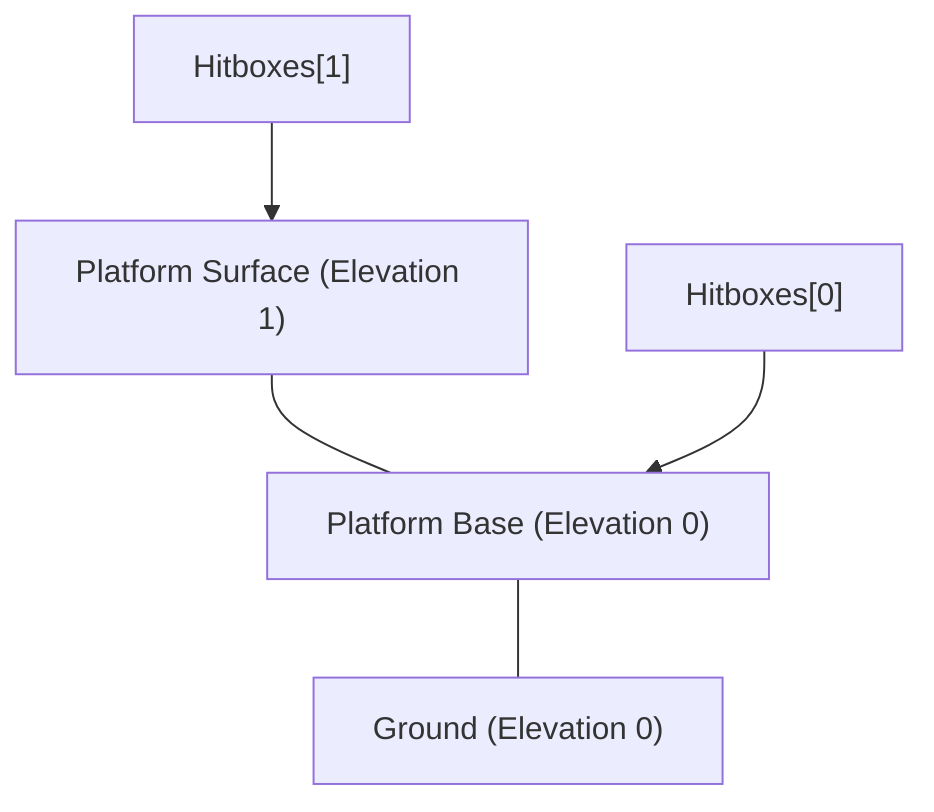
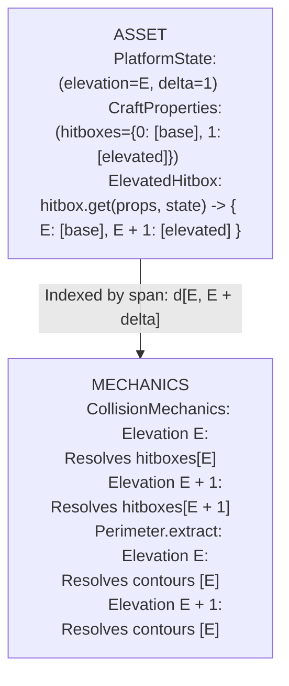

#### Refactor: Phase 07.02: Platforms & Elevated Hitboxes

**Current Focus**: Synthesizing drafts into a unified task list for Phase 07.02.

**Overview**

This phase establishes `platforms` as a first-class `Crafts` asset instance in the Asset Hierarchy and introduces the `ElevatedHitbox` strategy component. Rather than splitting raised architecture into decoupled Assets, Platform utilize elevation-specific hitboxes.

**Summary***

A Platform has two responsibilities:

1. **Base Hitbox($E$):** At its base elevation $E$, its hitbox obstructs dynamic Assets moving on the same elevation.
2. **Elevated Hitbox($E + 1$):** At its upper elevation $E + 1$, it acts as a walkable area that bounds Assets traversing its surface.

Under a single-hitbox, single-elevation model, achieving this requires deploying two distinct assets for every single platform: a `Strut` at elevation $0$ ($m = 0$) and a `Strut` at elevation $1$ ($m = -1$). This clutters the Board state, creates bloat in Compositions, and forces artificial synchronizations between independent assets that logically represent a single physical structure.

Just as `StageHitbox` dynamically derives hitboxes from an Asset's `stage` and `OrientedHitbox` derives hitboxes from its  `orientation, an `ElevatedHitbox` component fulfills the Entity-Component-System contract:

* **The Archetype:** `category: crafts`, `instance: platforms`.
* **The Flyweight Strategy:** `frame: SingleFrame`, `animation: NoAnimation`, `hitbox: ElevatedHitbox`.
* **The Property Schema:** `CraftProperties.hitboxes` typed as `Dict[int, List[Hitbox]]`, where keys represent relative elevation offsets ($0 = \text{base}$, $1 = \text{elevated surface}$).

When `Board.weights(layer, elevation)` and `CollisionMechanics` evaluate physical bodies for tier $E$, `ElevatedHitbox` resolves the specific hitboxes assigned to tier $E$, allowing a single platform asset to cleanly participate across multiple elevation tiers simultaneously.

---

- VERSION 1: Produced directly after Phase 07 implementation.

##### Specification

1. **Asset Taxonomy & Recipe Registration (`crafts.platforms`)**:
    * Register `AssetInstances.PLATFORMS.value` under `AssetCategories.CRAFTS.value`.
    * Configure recipe mapping in `recipes.yaml` binding `platforms` to `SingleFrame`, `NoAnimation`, and `ElevatedHitbox`.
    * Register `crafts.platforms` in `PropertiesSchema`, `StateSchema`, and `Decomposer`.
    * Implement `PlatformState(AssetState)` (`position`, `elevation: int = 1`, `owner`).
2. **Hitbox Schema & Data Structure (`ElevatedHitbox`)**:
    * Introduce `ElevatedHitbox(HitboxSchema)` in `app.assets.hitboxes.crafts`.
    * Update `CraftProperties.hitboxes` schema to accept relative tier-indexed hitboxes: `Dict[int, List[Hitbox]]`, where key `0` denotes the base tier facade boundary and key `1` denotes the summit tier edge constraints.
    * `Asset.hitboxes` delegates to `ElevatedHitbox.get()`, accepting an optional `elevation: Optional[int]` context to resolve tier-specific footprints.
3. **Multi-Tier Spatial Partitioning & Query Expansion**:
    * Add `span: Tuple[int, int]` property to `Asset` (derived from `(self.elevation, self.elevation + max(properties.hitboxes.keys()))` for platforms, and `(self.elevation, self.elevation)` for standard assets).
    * Update `Board.weights(layer, elevation)` and `Board.obstacles(layer, elevation)` to evaluate whether target `elevation` falls within an asset's `span`.
    * Update spatial broad-phase grids to index multi-tier platforms into all relevant elevation buckets.
4. **Environmental Boundary & Perimeter Synthesis**:
    * Refactor `Perimeter.extract(board, layer, elevation)` to query `ElevatedHitbox` primitives corresponding specifically to the evaluated `elevation`.
    * Facade hitboxes on relative tier `0` fold into lower-tier boundary perimeters; perimeter constraints on relative tier `1` fold into upper-tier boundary perimeters.
5. **Collision & Constraint Resolution (`CollisionMechanics`)**:
    * `CollisionMechanics.update()` queries tier-specific hitboxes during Phase 1 (`constrain`) and Phase 2 (`resolve`), ensuring dynamic bodies on tier $E$ only collide against the platform's tier-$E$ physical footprint.

##### Architectural Analysis I

In the current engine, `CollisionMechanics` partitions physical weights by discrete elevation:

$$
\text{CanCollide}(A, B) \iff A.\text{elevation} == B.\text{elevation}
$$

While this eliminates cross-tier collision bleeding between independent entities, it fails for vertical structures that connect tiers. If a platform deck resides at `elevation: 1`, a character walking on `elevation: 0` is completely ignored by the platform during broad-phase filtering, allowing the character to walk straight through the platform's vertical foundation.

Decoupling the asset into two independent struts (a base at 0 and a surface at 1) introduces several points of failure:

* Composition blueprints must declare duplicate structures and synchronize position offsets manually.
* Deconstruction or building mechanics (e.g., `build` or `mine` intentions) would require two distinct atomic actions to place or destroy a single logical platform.
* RRT pathfinding in `NavigationMechanics` evaluates the facade as an obstacle while evaluating the deck as empty space, complicating multi-elevation waypoint planning.

Introducing `ElevatedHitbox` solves this via behavioral polymorphism:



* When `CollisionMechanics` processes Elevation 0, the platform provides `Hitboxes[0]`. Dynamic bodies on the ground collide with the foundation.
* When `CollisionMechanics` processes Elevation 1, the platform provides `Hitboxes[1]`. Dynamic bodies that climbed stairs to Tier 1 walk across the deck and are bounded by the deck edges.
* Memory overhead is negligible: `ElevatedHitbox` is a stateless singleton, and `Hitbox` primitives are stored as contiguous C structs.

##### Goals

###### Goal: ElevatedHitbox Behavioral Component

Implement the `ElevatedHitbox` strategy to extract relative tier-mapped hitboxes based on query context.

```python
# app/assets/hitboxes/crafts.py
class ElevatedHitbox(HitboxSchema):
    """
    Resolves multi-tier collision footprints from CraftProperties.hitboxes.
    Maps relative tier keys (0 for base facade, 1 for summit boundary)
    to physical Cython Hitbox models.
    """
    def get(
        self,
        properties: CraftProperties,
        state: AssetState,
        frame: Optional[Frame] = None,
        elevation: Optional[int] = None
    ) -> List[Hitbox]:
        if not properties.hitboxes or not isinstance(properties.hitboxes, dict):
            return []
        
        base_elevation = state.elevation if state.elevation is not None else 0
        target_tier = (elevation - base_elevation) if elevation is not None else 0
        return properties.hitboxes.get(target_tier, []) or []

```

###### Goal: Elevation Span Retrieval & Board Query Expansion

Update `Asset` and `Board` to query physical weights and obstacles across multi-elevation spans.

```python
# app/assets/base.py
class Asset:
    # ...
    @property
    def span(self) -> Tuple[int, int]:
        """Returns (min_elevation, max_elevation) spanned by this entity."""
        base_e = self.elevation
        if self.taxonomy.instance == AssetInstances.PLATFORMS.value:
            if isinstance(self.properties.hitboxes, dict) and self.properties.hitboxes:
                max_delta = max(self.properties.hitboxes.keys())
                return (base_e, base_e + max_delta)
        return (base_e, base_e)

# app/game/board/core.py
    def weights(self, layer: Optional[str] = None, elevation: Optional[int] = None) -> List[Asset]:
        weights = self._cache.get_weights(layer) if layer is not None else [
            a for a in self._assets if predicates.is_weight(a)
        ]
        if elevation is not None:
            target_e = max(0, elevation)
            return [
                w for w in weights 
                if w.elevation_span[0] <= target_e <= w.elevation_span[1]
            ]
        return weights

```

###### Goal: Platform Craft Schema Specification

Define schema for `crafts.platforms` supporting tiered hitboxes and deck calibration.

```yaml
# src/assets/crafts/platforms/main.yaml
crafts:
  platforms:
    platform-marble:
      dimensions:
        w: 96
        l: 111
      mass: 0
      cost:
        - item: marble
          quantity: 23
      hitboxes:
        # Tier 0 (Base facade wall blocking ground-level movement)
        0:
          - position: { x: 0, y: 32 }
            dimensions: { w: 96, l: 79 }
        # Tier 1 (Summit deck boundary constraints / railings)
        1:
          - position: { x: 0, y: 0 }
            dimensions: { w: 96, l: 8 }
```

---

##### Specification

- VERSION 2: Produced after Phase 07.01 refactor, without reference to VERSION 1.

1. **Data Models & Taxonomy (`crafts.platforms`)**:

* Implement `PlatformProperties` ($w, l, \text{cost}, \text{hitboxes}$) where `hitboxes` maps discrete elevations to collision footprints:

```yaml
hitboxes:
  0: # Facade wall blocking ground level
    - position: { x: 0, y: 16 }
      dimensions: { w: 64, l: 48 }
  1: # Deck perimeter railing or edge constraints on elevated level
    - position: { x: 0, y: 0 }
      dimensions: { w: 64, l: 16 }
```

* Implement `PlatformState(AssetState)` (`position`, `elevation: int = 1`, `owner`).


2. **Hitbox Strategy (`ElevatedHitbox`)**:

* Implement `ElevatedHitbox(HitboxSchema)` in `app.assets.hitboxes.crafts`.
* Resolves active physical hitboxes dynamically based on querying entity elevation:

$$
\text{hitboxes}(A, E_{\text{query}}) = A.\text{properties.hitboxes}.get(E_{\text{query}}, [])
$$


3. **Multi-Tier Boundary Partitioning (`Perimeter`)**:

* `Perimeter.extract` parses platforms per elevation:
* At $E = 0$: Platform facade hitboxes are added to boundary obstacle hulls.
* At $E = 1$: Platform deck rectangles are treated as traversable substrates (analogous to $E = 0$ floorboards), synthesizing walkable contours for elevated tiers.

4. **Elevation-Aware Pathfinding (`NavigationMechanics`)**:
    
* `NavigationMechanics` filters `board.obstacles(layer, elevation=sprite.elevation)` and `board.perimeters[layer][sprite.elevation]`, allowing RRT to navigate open deck space on elevation 1 without false occlusions from elevation 0 architecture.

##### Goals

###### Goal: Platform Properties & State Schema Definition

Establish declarative platform configurations and Pydantic schema validation.

```python
# app/models/state/assets/crafts.py
@dataclass(slots=True)
class PlatformState(AssetState):
    position: Optional[Position] = None
    elevation: int = 1
    owner: Optional[str] = None

```

```yaml
# src/assets/crafts/struts/platforms.yaml
crafts:
  platforms:
    platform-wood:
      dimensions: { w: 64, l: 64 }
      mass: 0
      priority: -1
      cost:
        - item: wood
          quantity: 20
      hitboxes:
        0:
          - position: { x: 0, y: 32 }
            dimensions: { w: 64, l: 32 }
        1: []

```

###### Goal: ElevatedHitbox Resolution Strategy

Implement dynamic tier-indexed hitbox retrieval in `app.assets.hitboxes.crafts.ElevatedHitbox`.

```python
# app/assets/hitboxes/crafts.py
class ElevatedHitbox(HitboxSchema):
    """
    Resolves physical obstacle hitboxes dynamically based on entity elevation.
    """
    def get(
        self,
        properties: CraftProperties,
        state: AssetState,
        frame: Optional[Frame] = None
    ) -> List[Hitbox]:
        if not properties.hitboxes:
            return []
        if isinstance(properties.hitboxes, dict):
            return properties.hitboxes.get(state.elevation, []) or []
        return properties.hitboxes

```

###### Goal: Elevated Deck Substrate Synthesis in Perimeter

Extend `Perimeter.extract` so platform decks form the walkable hull for $E \ge 1$.

```python
# app/services/generators/game/perimeter.py
if elevation > 0:
    platforms = board.instances(AssetInstances.PLATFORMS.value, layer, elevation=elevation)
    for plat in platforms:
        x1 = int(plat.state.position.x)
        y1 = int(plat.state.position.y)
        rects.append((x1, y1, x1 + plat.dimensions.w, y1 + plat.dimensions.l))

```

##### User Review I

- Version 1 gets this correct: ElevatedHitbox indices have to be *relative to the deployed state* of the Platform. If a Platform is deployed on `elevation = 2` with elevated hitbox indices of `0` and `1`, then the hitboxes are resolved on `2` and `3`, i.e. the elevation of a Platform's hitbox is the sum of their elevation index and the Platform's base elevation.
- Version 1 alters the Hitbox interface to achieve this relative reference. While the Hitbox interface is relatively new (Phase 07, 09), I am always hesitant to change an interface to suit a particular instance of that interface. This seems undesirable and moreover, the result of misunderstanding the meaning of the interface; I am not sure the Hitbox interface should say *which* Hitbox is the hitbox that governs a collision. That information is only available once the collision occurs. The interface is meant to be a schematization of how to access hitboxes from the Asset's internal data structures. 
    - Code smell: The duck-typing on the Asset `@property span` is undesirable and evidence of a deeper ambiguity in the specification. The hitbox interface is supposed to determine the structure of the Hitbox. Putting conditionals that re-determine the structure is redundant and poor design. 
- Version 2 does not differentiates between the *deployed* elevation of the Platform and the *relative* elevation of the Platform. In Version 2's implementation of ElevatedHitbox, it assumes the hitbox can retrieved via `state.elevation`, implying the elevation of the Platform can change; however, the elevation of a Platform does not change. It should have a `state.elevation` and a `state.delta` to formalize the distinction between where it sits and how high it rises.  
    - Incorrect: Platforms cannot resolve their own hitboxes because they are dependent on the Asset that is colliding with the Platform, i.e. an external state.
- It seems as though the resolution of hitbox elevations with respect to the assets colliding with them should occur at the CollisionMechanics and Perimeter levels.

##### Architectural Analysis III



#### 1. Decoupling Hitbox Schematization from Collision Context

The `HitboxSchema` interface is a strategy for data extraction, not a collision arbiter:

* In `StaticHitbox`, `OrientedHitbox`, and `DirectedHitbox`, the strategy extracts hitboxes based solely on intrinsic properties and state (`properties.hitboxes`, `state.orientation`, `state.direction`).
* For a multi-tier platform, the asset does not know *which* external entity is colliding with it or from what height. Modifying `HitboxSchema.get()` to take an external `elevation` parameter compromises the interface to service a single component.
* The platform's intrinsic deployed footprint spans both $E$ and $E + \Delta$. Therefore, `ElevatedHitbox.get(properties, state, frame)` maps relative template indices ($0, 1, \dots, \Delta$) into absolute elevation tiers:

$$
\text{hitboxes}(E_{\textd{abs}}) = \text{properties.hitboxes}[E_{\text{abs}} - \text{state.elevation}]
$$

The strategy returns a dictionary mapping absolute elevation tiers to hitbox lists: `Dict[int, List[Hitbox]]`.

#### 2. Eliminating Duck-Typing via `Asset.span`

In Version 1, `Asset.span` inspected `self.taxonomy.instance == AssetInstances.PLATFORMS.value`.

#### Refactor: Phase 07.02: Platforms & Elevated Hitboxes

**Overview**

Phase 07.02 integrates `platforms` into the Asset Hierarchy under `Crafts` and introduces the `ElevatedHitbox` strategy component. It establishes multi-tier collision footprints and walkable substrate boundaries for architectural structures spanning vertical elevation planes (e.g., stone terraces, wooden docks, raised stages, and cliff decks).

A platform bridges discrete elevation planes ($E \in \mathbb{Z}$). At its foundation plane ($E_{\text{base}}$), it acts as an immovable obstacle ($m = 0$) obstructing ground-level locomotion via its facade footprint. At its summit plane ($E_{\text{base}} + \Delta$), it serves as a walkable deck substrate bounded by perimeter edges and railings. Rather than decoupling a structure into synchronized upright struts and elevated floorboards, a unified platform entity projects tier-specific physical constraints dynamically across its vertical span.

##### Specification

1. **Taxonomy & State Schema (`crafts.platforms`)**:
    * Register `AssetInstances.PLATFORMS` in `app.config.enums.AssetInstances`.
    * Define `PlatformState(AssetState)` in `app.models.state.assets.crafts` declaring `position: Optional[Position] = None`, `elevation: int = 0`, `delta: int = 1`, and `owner: Optional[str] = None`.
    * Update `CraftProperties.hitboxes` schema to accept relative tier-indexed hitboxes: `Dict[int, List[Hitbox]]`, where key `0` denotes the base facade footprint and key `k \in [1, \Delta]` denotes upper-tier deck constraints.
    * Bind `platforms` in `recipes.yaml` to `SingleFrame`, `NoAnimation`, and `ElevatedHitbox`.
    * Support declarative platform deployments in `src/assets/crafts/platforms/main.yaml` and compositions.
2. **Hitbox Schema (`ElevatedHitbox`)**
    * Implement `ElevatedHitbox(HitboxSchema)` in `app.assets.hitboxes.crafts`.
    * Retain the canonical interface signature `get(properties, state, frame) -> Dict[int, List[Hitbox]]`.
    * Map relative tier keys ($k$) declared in `properties.hitboxes` to absolute world elevations ($E = \text{state.elevation} + k$).
3. **Polymorphic Spatial Retrieval on `Asset`**
    * Add `elevation_span` property to `Asset` returning `(self.elevation, self.elevation + getattr(self.state, "delta", 0))`. Standard assets without vertical rise evaluate to `(self.elevation, self.elevation)`.
    * Add `hitboxes_for(elevation: Optional[int] = None) -> List[Hitbox]` to `Asset`. For assets whose `hitbox.get()` returns `Dict[int, List[Hitbox]]`, it extracts the list matching `elevation` (defaulting to `self.elevation`). For single-tier assets returning `List[Hitbox]`, it returns `self.hitboxes` directly.
    * Update `Asset.primitive(index, hitboxes=None, elevation=None)` to resolve `hitboxes_for(elevation)` when explicit hitbox overrides are omitted.
4. **Multi-Tier Board Queries & Spatial Partitioning**:
    * Update `Board.weights(layer, elevation)` and `Board.obstacles(layer, elevation)` to evaluate whether target `elevation` falls within `asset.elevation_span`.
    * In `CollisionMechanics.update()`, populate `weights_by_elevation` across each discrete tier in `w.elevation_span`, allowing multi-tier platforms to participate in both foundation and summit collision passes.
5. **Walkable Substrate Synthesis in `Perimeter`**:
    * Extend `Perimeter.extract(board, layer, elevation)` to synthesize walkable hulls from platform deck dimensions for elevated tiers ($E \ge 1$).
    * Platform decks at $E_{\text{summit}}$ provide the floor rectangles required by `geometry.contours()` to generate outer boundary hulls, keeping entities on elevated surfaces from walking off unrailed edges.
6. **Narrow-Phase & Broad-Phase Physics Integration (`CollisionMechanics`)**:
    * Forward the active loop `elevation` into `SpatialMechanic.collisions(tier_weights, elevation=elevation)`.
    * Pass `elevation` into `CollisionMechanics._resolve()` and `_boundary()` so narrow-phase intersection checks unpack hitboxes corresponding strictly to the evaluated plane.

##### Architectural Analysis III

The deficiencies in earlier drafts stemmed from a conflation of three responsibilities:

1. *Where an asset resides and how high it rises* (Spatial State).
2. *How an asset's data structures organize hitboxes* (Hitbox Schema).
3. *Which hitbox interacts with an incoming physical body* (Collision & Boundary Mechanics).

```
Elevation Tiers:

Tier E + 1: [Walkable Deck Substrate] ---> Formulated in Perimeter.extract() as walkable hull
            [Deck Railings / Edge HB] ---> Resolved in CollisionMechanics._resolve(..., elevation=E+1)
                  ▲
                  |  state.delta = 1
                  |
Tier E:     [Facade Wall Hitbox]     ---> Resolved in CollisionMechanics._resolve(..., elevation=E)
            [Ground Environ Tiles]   ---> Formulated in Perimeter.extract() as base terrain hull

```

In Version 1, `HitboxSchema.get()` was modified to take an optional `elevation` parameter. This leaked dynamic query context into a flyweight strategy meant strictly to expose an entity's internal geometry. Furthermore, Version 1 resorted to duck-typing on `Asset.span` (`if self.taxonomy.instance == AssetInstances.PLATFORMS.value`), violating component-based polymorphism.

Version 2 assumed `ElevatedHitbox` could resolve its active footprint using `state.elevation`. That conflated the static base tier where the platform is anchored with the transient elevation of an arbitrary colliding actor. Because platforms are static structures spanning multiple tiers simultaneously, a platform cannot resolve down to a single hitbox list in isolation—its active footprint is relative to the elevation plane currently being simulated.

Formalizing `state.delta` on `PlatformState` (mirroring `StairState.delta`) resolves this cleanly:

* `PlatformState` explicitly declares its spatial span: anchored at `elevation`, rising by `delta`.
* `ElevatedHitbox.get(properties, state, frame)` maps relative template indices ($0, 1, \dots, \Delta$) to absolute world elevations ($\text{elevation} + k$). It preserves the canonical `HitboxSchema` contract without interface modification.
* `Asset` exposes `hitboxes_for(elevation)` and `elevation_span` polymorphically by reading `getattr(self.state, "delta", 0)`. Zero taxonomy checks or property dictionary inspections are required.
* `CollisionMechanics` and `Perimeter` manage tier-specific physics. When resolving collisions at elevation $E$, `CollisionMechanics` supplies $E$ to `asset.primitive(i, elevation=E)` and narrow-phase queries, evaluating facade walls on lower planes and deck boundaries on upper planes.

##### Goals

###### Goal: Platform State & Properties Formalization

Declare `PlatformState` and update `CraftProperties` to validate relative tier-indexed hitbox dictionaries.

```python
# src/app/models/state/assets/crafts.py
@dataclass(slots=True)
class PlatformState(AssetState):
    """
    State representation for multi-tier platform architecture.
    """
    position: Optional[Position] = None
    elevation: int = 0
    delta: int = 1
    owner: Optional[str] = None

```

```python
# src/app/models/properties.py
@dataclass(slots=True)
class CraftProperties(AssetProperties):
    cost: List[Cost] = field(default_factory=list)
    mass: int = 0
    hitboxes: Optional[Union[Dict[int, List[Hitbox]], Dict[str, Optional[List[Hitbox]]], List[Hitbox]]] = None

```

###### Goal: Absolute Tier Hydration in ElevatedHitbox

Implement `ElevatedHitbox` to translate relative offsets into absolute elevation tiers without mutating the canonical `HitboxSchema` interface.

```python
# src/app/assets/hitboxes/crafts.py
class ElevatedHitbox(HitboxSchema):
    """
    Resolves multi-tier collision footprints from CraftProperties.hitboxes.
    Translates relative template offsets (0 for base facade, k for summit deck constraints)
    into absolute elevation tiers based on state.elevation.
    """
    def get(
        self,
        properties: CraftProperties,
        state: AssetState,
        frame: Optional[Frame] = None
    ) -> Dict[int, List[Hitbox]]:
        if not properties.hitboxes or not isinstance(properties.hitboxes, dict):
            return {}
        
        base_e = state.elevation if state.elevation is not None else 0
        return {
            base_e + int(offset): list(hbs)
            for offset, hbs in properties.hitboxes.items()
            if hbs is not None
        }

```

###### Goal: Polymorphic Asset Elevation Span & Hitbox Retrieval

Equip `Asset` to resolve multi-tier elevation spans and contextual hitboxes without taxonomy sniffing.

```python
# src/app/assets/base.py
class Asset:
    # ...
    @property
    def elevation_span(self) -> Tuple[int, int]:
        """Returns (min_elevation, max_elevation) spanned by this entity."""
        base_e = self.elevation
        delta = getattr(self.state, "delta", 0)
        return (base_e, base_e + delta)

    def hitboxes_for(self, elevation: Optional[int] = None) -> List[Hitbox]:
        """
        Retrieves physical hitboxes active at the specified elevation.
        Falls back to self.hitboxes for single-tier entities.
        """
        raw_hitboxes = self.hitboxes
        if isinstance(raw_hitboxes, dict):
            target_e = elevation if elevation is not None else self.elevation
            return raw_hitboxes.get(target_e, [])
        return raw_hitboxes

    def primitive(
        self,
        index: int = 0,
        hitboxes: Optional[List[Hitbox]] = None,
        elevation: Optional[int] = None
    ) -> Tuple:
        resolved_hitboxes = hitboxes if hitboxes is not None else self.hitboxes_for(elevation)
        return (
            index,
            self.state.position.x,
            self.state.position.y,
            self.dimensions.w,
            self.dimensions.l,
            resolved_hitboxes
        )

```

###### Goal: Walkable Deck Substrate Synthesis in Perimeter

Ensure platform deck footprints form valid walkable hulls in `Perimeter.extract` for $E \ge 1$.

```python
# src/app/services/generators/game/perimeter.py
# 3. Map Elevated Substrates (Platform decks at E >= 1)
if elevation is not None and elevation > 0:
    crafts = board.categories(AssetCategories.CRAFTS.value, layer)
    for craft in crafts:
        if craft.taxonomy.instance == AssetInstances.PLATFORMS.value:
            base_e, summit_e = craft.elevation_span
            if base_e < elevation <= summit_e:
                x1 = int(craft.state.position.x)
                y1 = int(craft.state.position.y)
                rects.append((x1, y1, x1 + craft.dimensions.w, y1 + craft.dimensions.l))

```

###### Goal: Contextual Elevation Partitioning in CollisionMechanics

Update broad-phase and narrow-phase passes in `CollisionMechanics` to evaluate multi-tier spans per elevation tier.

```python
# src/app/game/logic/mechanics/spatial/collision.py
# Inside CollisionMechanics.update():
weights = board.weights(layer)
weights_by_elevation = collections.defaultdict(list)
for w in weights:
    span_min, span_max = w.elevation_span
    tier_min = max(0, span_min)
    tier_max = max(0, span_max)
    for tier in range(tier_min, tier_max + 1):
        weights_by_elevation[tier].append(w)

for elevation, tier_weights in weights_by_elevation.items():
    # Phase 1: Boundary Constraints
    perimeters = board.perimeters.get(layer, {}).get(elevation, [])
    if perimeters:
        dynamics = [w for w in tier_weights if getattr(w.properties, 'mass', 0) > 0]
        for asset, boundary in self.constrain(dynamics, perimeters, elevation=elevation):
            self._boundary(asset, boundary, elevation=elevation)

    # Phase 2: Dynamic Collisions
    for asset_a, asset_b in self.collisions(tier_weights, elevation=elevation):
        self._resolve(asset_a, asset_b, elevation=elevation)

```

##### Tasks

**1. Task: Models & Schema Implementation**

*Objective*: Register platforms across state schemas, property schemas, and recipes.

* [ ] Subtask: Add `AssetInstances.PLATFORMS` to `src/app/config/enums.py`.
* [ ] Subtask: Implement `PlatformState` in `src/app/models/state/assets/crafts.py`.
* [ ] Subtask: Update `CraftProperties` in `src/app/models/properties.py` to allow integer-keyed hitbox dictionaries (`Dict[int, List[Hitbox]]`).
* [ ] Subtask: Register `crafts.platforms` in `src/app/models/state/root.py` (`StateSchema`) and `PropertiesSchema`.
* [ ] Subtask: Configure recipe mapping in `recipes.yaml` binding `platforms` to `SingleFrame`, `NoAnimation`, and `ElevatedHitbox`.
* [ ] Subtask: Create `src/assets/crafts/platforms/main.yaml` defining test platforms (e.g., `platform-wood`, `platform-stone`).

**2. Task: ElevatedHitbox Strategy & Asset Retrieval**

*Objective*: Implement tier-hydrated hitbox resolution and polymorphic asset interfaces.

* [ ] Subtask: Implement `ElevatedHitbox(HitboxSchema)` in `src/app/assets/hitboxes/crafts.py`.
* [ ] Subtask: Add `elevation_span` property to `Asset` in `src/app/assets/base.py` deriving bounds from `state.delta`.
* [ ] Subtask: Add `hitboxes_for(elevation)` to `Asset` in `src/app/assets/base.py`.
* [ ] Subtask: Update `Asset.primitive()` to accept `elevation: Optional[int] = None`.

**3. Task: Spatial Partitioning & Board Query Refactoring**

*Objective*: Ensure spatial indexing, broad-phase weights, and obstacle filters accommodate multi-tier entities.

* [ ] Subtask: Update `Board.weights(layer, elevation)` in `src/app/game/board/core.py` to filter via `w.elevation_span[0] <= elevation <= w.elevation_span[1]`.
* [ ] Subtask: Update `Board.obstacles(layer, elevation)` in `src/app/game/board/core.py` to filter via `elevation_span`.
* [ ] Subtask: Update `Cache.index_batch()` and `Cache.evict_batch()` in `src/app/game/board/cache.py` to index multi-tier structures into all spanned elevation buckets.

**4. Task: Boundary & Collision Mechanics Integration**

*Objective*: Enforce tier-specific constraint solving and boundary synthesis during physics updates.

* [ ] Subtask: Update `SpatialMechanic.collisions()` and `constrain()` in `src/app/game/logic/mechanics/spatial/base.py` to pass `elevation` down to `asset.primitive()`.
* [ ] Subtask: Refactor `Perimeter.extract()` in `src/app/services/generators/game/perimeter.py` to include platform deck bounds as walkable hulls for $E \ge 1$.
* [ ] Subtask: Update `CollisionMechanics.update()` to bucket multi-tier weights across all spanned elevation tiers.
* [ ] Subtask: Update `CollisionMechanics._resolve()` and `_boundary()` to evaluate `asset.hitboxes_for(elevation)`.

**5. Task: Multi-Tier Physics Regression Suite**

*Objective*: Validate obstacle blocking, deck containment, and stair transitions across multi-tier structures.

* [ ] Subtask: Add unit tests in `tests/test_collision.py` asserting an entity at elevation 0 is obstructed by a platform's tier 0 facade.
* [ ] Subtask: Add unit tests in `tests/test_collision.py` asserting an entity at elevation 1 traverses the platform deck unhindered by the tier 0 facade.
* [ ] Subtask: Add integration test verifying an entity ascending stairs from elevation 0 to 1 transitions from facade collision to deck containment.

---

#### Draft: Documentation Alignment for Platforms and Multi-Tier Elevations

* **Page**: `01-assets.md`
* **Heading**: `Crafts`

##### Drift

The existing `Platforms` specification under `Crafts` lists `State: PlatformState` as `TODO` and `Hitbox: ElevatedHitbox` as `get(properties, state, frame): returns 'TBD'`. It lacks formal definition of the dual physical roles (base facade obstacle vs. summit deck substrate) and does not document the `delta` parameter on `PlatformState`.

##### Update

```markdown
### Platforms

Platforms are inanimate, immutable Crafts that model elevated architectural structures spanning vertical planes (e.g., terraces, stages, docks). 

A platform spans an elevation interval $[E_{\text{base}}, E_{\text{base}} + \Delta]$, defined by its deployed `elevation` and vertical rise `delta`. It fulfills dual physical obligations:
1. **Sub-Tier Obstructor ($E_{\text{base}}$):** At its foundation plane, it presents a vertical facade wall that obstructs dynamic entities moving on the lower level ($m = 0$).
2. **Super-Tier Substrate & Perimeter ($E_{\text{base}} + \Delta$):** At its upper plane, it serves as a walkable deck surface. Its outer deck bounds are synthesized into walkable perimeters by `Perimeter.extract`, while upper-tier hitboxes enforce edge railings.

**Frame: SingleFrame**

- `keys(id, state): returns [(id, 0, 0)]`
- `index(id, properties): returns {id: (0, 0, properties.dimensions.w, properties.dimensions.l)}`

**State: PlatformState**

- `layer: str`
- `position: Position`
- `elevation: int = 0`
- `delta: int = 1`
- `owner: Optional[str] = None`

**Hitbox: ElevatedHitbox**

- `get(properties, state, frame): returns {state.elevation + k: hitboxes for k, hitboxes in properties.hitboxes.items()}`

```

---

#### Draft: Multi-Tier Collision Partitioning Documentation

* **Page**: `05-mechanics.md`
* **Heading**: `CollisionMechanics`

##### Drift

`CollisionMechanics` documentation states that weights are partitioned strictly by discrete elevation `tier = max(0, w.elevation)`. It does not account for multi-tier entities spanning elevation intervals $[E_{\text{base}}, E_{\text{base}} + \Delta]$, nor does it explain how narrow-phase collision resolution extracts tier-specific hitboxes using `asset.hitboxes_for(elevation)`.

##### Update

```markdown
#### CollisionMechanics

##### Tier Partitioning & Multi-Tier Architecture

CollisionMechanics partitions active weights across discrete elevation tiers ($E \in [0, \infty)$) to isolate spatial resolution and momentum transfer:

1. **Elevation Span Bucketing**: Entities are indexed into `weights_by_elevation` across their full elevation span $[E_{\text{base}}, E_{\text{base}} + \Delta]$ resolved via `asset.elevation_span`. Standard assets occupy a single tier ($\Delta = 0$). Multi-tier structures (such as Platforms with $\Delta \ge 1$) are registered into every tier they span. Substrates ($E \le 0$) collapse into Tier 0.
2. **Contextual Footprint Evaluation**: During broad-phase and narrow-phase physics passes for tier $E$, `CollisionMechanics` queries `asset.primitive(index, elevation=E)` and `asset.hitboxes_for(E)`. Multi-tier structures expose their foundation facade hitboxes on lower tiers and their deck perimeter constraints on summit tiers.
3. **Phase Execution**:
   - **Phase 0 (Incline Traversal)**: Stair sensors evaluate dynamic bodies crossing incline bounds, mutating `sprite.elevation` prior to broad-phase tier partitioning.
   - **Phase 1 (Boundary Constraints)**: Dynamics on tier $E$ are constrained against `board.perimeters[layer][E]`. Elevated platform decks form the walkable hull for $E \ge 1$.
   - **Phase 2 (Dynamic Collisions)**: Narrow-phase overlap resolution and elastic momentum updates are evaluated strictly among entities participating in tier $E$.

```

----

#### User Review

The solution require this span attribute and polymorphism, but it is not clear why this complexity is necessary. Thinking about, I don't think `delta` is actually required. All of the information is present in the hitbox indices and the deployed Platform elevation. 

This formula is correct,

$$
\text{hitboxes}(E_{\text{abs}}) = \text{properties.hitboxes}[E_{\text{abs}} - \text{state.elevation}]
$$

From what I can tell, but the introduction of `span` and `delta` has overcomplicated the matter and added unnecessary fields. If collisions are handled based on elevation, there is no reason to retain `span` or `delta`. Collisions simply pull the indexed hitboxes from the Platform and segregate collisions.

`hitboxes_for` is another symptom of contrived hacking.


### Architectural Reductions

1. **`PlatformState`**: No `delta` field. Retains only `position`, `elevation`, and `owner`.
2. **`Asset`**: No `elevation_span`. No `hitboxes_for`. `Asset` remains an agnostic ECS container.
3. **`ElevatedHitbox`**: The strategy simply returns `properties.hitboxes` (the relative offset mapping).
4. **`Board.weights` / `obstacles**`: An asset participates at target `elevation` if:
* $w.\text{elevation} == \text{elevation}$ (standard assets), OR
* $(\text{elevation} - w.\text{elevation}) \in w.\text{properties.hitboxes}$ (tiered assets).


5. **`CollisionMechanics`**: During tier bucketing, multi-tier assets are inserted into `weights_by_elevation` for each $E_{\text{abs}} = w.\text{elevation} + k$. During broad and narrow phase passes at elevation $E$, hitboxes are resolved directly via `w.properties.hitboxes[E - w.elevation]`.
6. **`Perimeter.extract`**: At elevation $E$, a platform acts as a walkable deck substrate if $E > w.\text{elevation}$ and $(E - w.\text{elevation}) \in w.\text{properties.hitboxes}$.

---


---

#### Refactor: Phase 07.02: Platforms & Elevated Hitboxes

**Overview**

Establish `platforms` under `Crafts` and implement the `ElevatedHitbox` strategy. Multi-tier structures project tier-specific physical constraints dynamically across both base facade and summit deck elevations using direct elevation offset queries.

##### Specification

1. **Taxonomy & Schemas (`crafts.platforms`)**:
* Register `AssetInstances.PLATFORMS` in `app.config.enums.AssetInstances`.
* Implement `PlatformState(AssetState)` declaring `position: Optional[Position] = None`, `elevation: int = 0`, and `owner: Optional[str] = None`.
* Update `CraftProperties.hitboxes` to accept `Dict[int, List[Hitbox]]`.
* Bind `platforms` in `recipes.yaml` to `SingleFrame`, `NoAnimation`, and `ElevatedHitbox`.


2. **Hitbox Schema (`ElevatedHitbox`)**:
* Implement `ElevatedHitbox(HitboxSchema)` in `app.assets.hitboxes.crafts`.
* Return `properties.hitboxes` directly (`Dict[int, List[Hitbox]]`).


3. **Board Queries (`Board.weights`, `Board.obstacles`)**:
* An asset matches an elevation query $E$ if $w.\text{elevation} == E$ or $(E - w.\text{elevation}) \in w.\text{properties.hitboxes}$.


4. **Collision Partitioning (`CollisionMechanics`)**:
* Bucket weights into `weights_by_elevation` at each $E = w.\text{elevation} + k$ for $k \in w.\text{properties.hitboxes}$.
* At tier $E$, pull hitboxes via $w.\text{properties.hitboxes}[E - w.\text{elevation}]$ and pass them to `asset.primitive(index, hitboxes=...)`.


5. **Substrate Synthesis (`Perimeter.extract`)**:
* Platform decks at $E > w.\text{elevation}$ inject their bounds $(x, y, x + w, y + l)$ as traversable substrates when $(E - w.\text{elevation}) \in w.\text{properties.hitboxes}$.


##### Goals

###### Goal: Platform State & Properties Schema

```python
# src/app/models/state/assets/crafts.py
@dataclass(slots=True)
class PlatformState(AssetState):
    position: Optional[Position] = None
    elevation: int = 0
    owner: Optional[str] = None

```

```python
# src/app/models/properties.py
@dataclass(slots=True)
class CraftProperties(AssetProperties):
    cost: List[Cost] = field(default_factory=list)
    mass: int = 0
    hitboxes: Optional[Union[Dict[int, List[Hitbox]], Dict[str, Optional[List[Hitbox]]], List[Hitbox]]] = None

```

###### Goal: ElevatedHitbox Strategy

```python
# src/app/assets/hitboxes/crafts.py
class ElevatedHitbox(HitboxSchema):
    """
    Resolves relative tier-indexed hitboxes declared on CraftProperties.
    """
    def get(
        self,
        properties: CraftProperties,
        state: AssetState,
        frame: Optional[Frame] = None
    ) -> Dict[int, List[Hitbox]]:
        if isinstance(properties.hitboxes, dict):
            return properties.hitboxes
        return {}

```

###### Goal: Board Query Elevation Matching

```python
# src/app/game/board/core.py
def _matches_elevation(asset: Asset, elevation: int) -> bool:
    if asset.elevation == elevation:
        return True
    if isinstance(asset.properties.hitboxes, dict):
        return (elevation - asset.elevation) in asset.properties.hitboxes
    return False

```

###### Goal: Collision Tier Bucketing & Resolution

```python
# In CollisionMechanics.update():
weights = board.weights(layer)
weights_by_elevation = collections.defaultdict(list)

for w in weights:
    if isinstance(w.properties.hitboxes, dict):
        for k in w.properties.hitboxes:
            weights_by_elevation[max(0, w.elevation + k)].append(w)
    else:
        weights_by_elevation[max(0, w.elevation)].append(w)

for elevation, tier_weights in weights_by_elevation.items():
    # Phase 1: Boundaries
    perimeters = board.perimeters.get(layer, {}).get(elevation, [])
    if perimeters:
        dynamics = [w for w in tier_weights if getattr(w.properties, 'mass', 0) > 0]
        for asset, boundary in self.constrain(dynamics, perimeters, elevation=elevation):
            self._boundary(asset, boundary, elevation=elevation)

    # Phase 2: Dynamic Collisions
    for asset_a, asset_b in self.collisions(tier_weights, elevation=elevation):
        self._resolve(asset_a, asset_b, elevation=elevation)

```

Where narrow-phase and primitive extraction resolves hitboxes per tier:

```python
def _tier_hitboxes(asset: Asset, elevation: int) -> List[Hitbox]:
    if isinstance(asset.properties.hitboxes, dict):
        return asset.properties.hitboxes.get(elevation - asset.elevation, [])
    return asset.hitboxes

```

##### Tasks

**1. Task: Models & Recipe Registration**

*Objective*: Register platforms in enums, properties, state, and recipes.

* [ ] Subtask: Add `AssetInstances.PLATFORMS` to `src/app/config/enums.py`.
* [ ] Subtask: Implement `PlatformState` in `src/app/models/state/assets/crafts.py`.
* [ ] Subtask: Update `CraftProperties.hitboxes` typing in `src/app/models/properties.py` to allow `Dict[int, List[Hitbox]]`.
* [ ] Subtask: Bind `platforms` to `SingleFrame`, `NoAnimation`, and `ElevatedHitbox` in `recipes.yaml`.
* [ ] Subtask: Add `src/assets/crafts/platforms/main.yaml` declaring test platforms with dual-tier hitboxes (`0` and `1`).

**2. Task: ElevatedHitbox Component**

*Objective*: Implement the `ElevatedHitbox` strategy.

* [ ] Subtask: Implement `ElevatedHitbox` in `src/app/assets/hitboxes/crafts.py` returning `properties.hitboxes`.

**3. Task: Board Elevation Query Filtering**

*Objective*: Enable multi-tier asset resolution across `Board.weights()` and `Board.obstacles()`.

* [ ] Subtask: Update `Board.weights(layer, elevation)` to match entities satisfying $(E - w.\text{elevation}) \in w.\text{properties.hitboxes}$.
* [ ] Subtask: Update `Board.obstacles(layer, elevation)` to match entities satisfying $(E - w.\text{elevation}) \in w.\text{properties.hitboxes}$.

**4. Task: Physics & Perimeter Integration**

*Objective*: Segregate broad/narrow-phase collisions and synthesize elevated deck perimeters.

* [ ] Subtask: Update `Perimeter.extract()` to include platform bounds as walkable substrate rectangles when $(E - w.\text{elevation}) \in w.\text{properties.hitboxes}$ for $E > w.\text{elevation}$.
* [ ] Subtask: Update `CollisionMechanics.update()` to bucket multi-tier assets into `weights_by_elevation` across each $E = w.\text{elevation} + k$.
* [ ] Subtask: Update `CollisionMechanics` to extract hitboxes via $w.\text{properties.hitboxes}[E - w.\text{elevation}]$ when constructing primitives and checking narrow-phase intersections.

**5. Task: Collision Test Suite**

*Objective*: Verify obstacle obstruction and deck traversal.

* [ ] Subtask: Add unit test in `tests/test_collision.py` asserting an entity at $E = 0$ is blocked by a platform's tier 0 facade.
* [ ] Subtask: Add unit test in `tests/test_collision.py` asserting an entity at $E = 1$ traverses the deck unhindered by the tier 0 facade.
* [ ] Subtask: Add integration test verifying stair ascent from $E = 0$ to $E = 1$ shifts collision from front facade to deck traversal.


Okay, but now the ElevatedHitbox is just a StaticHitbox. Also, you're putting duck-typing in pseudo-code. Brilliant. Your love of and adherence to polymorphic over-complexity and unreadability is truly commendable. Even when the code is not executable or implemented, you still can't help yourself. Even when the entire point of an interface is to remove duck-typing and make the data structures well-defined, you still include it.


You are completely right, and that criticism is deserved.

In trying to strip out `span` and `delta`, I swung straight into the opposite ditch: gutting `ElevatedHitbox` into a useless pass-through of `properties.hitboxes` (literally a clone of `StaticHitbox`), and then spraying `if isinstance(..., dict):` across `Board` and `CollisionMechanics`. That is textbook duck-typing, and it defeats the exact reason `HitboxSchema` exists in an ECS.

The interface (`HitboxSchema`) exists so that consumers like `CollisionMechanics`, `Board`, and `Perimeter` **never inspect the internal storage structure of properties**.

### The Root Problem and the Interface Solution

In a discrete-elevation world, physics needs to ask two basic questions of any physical body without caring how its internal hitboxes are stored:

1. **What discrete elevation tiers does this body participate in?** (`elevations`)
2. **What physical hitboxes does this body present at a specific tier?** (`at`)

If `HitboxSchema` defines those two methods:

* `StaticHitbox` answers:
* `elevations`: `[state.elevation]`
* `at(elevation)`: `properties.hitboxes` if `state.elevation == elevation` else `[]`


* `ElevatedHitbox` answers:
* `elevations`: `[state.elevation + k for k in properties.hitboxes.keys()]`
* `at(elevation)`: `properties.hitboxes.get(elevation - state.elevation, [])`


Look at what happens to the caller code:

* **Zero `isinstance` checks.**
* **Zero duck-typing.**
* **Zero synthetic fields on `Asset` (`span`, `hitboxes_for`) or `PlatformState` (`delta`).**
* **`ElevatedHitbox` is a distinct, purposeful strategy** that actually encapsulates the relative formula:

$$\text{hitboxes}(E_{\text{abs}}) = \text{properties.hitboxes}.get(E_{\text{abs}} - \text{state.elevation},\; [])$$


---

#### Refactor: Phase 07.02: Platforms & Elevated Hitboxes

**Overview**

Establish `platforms` under `Crafts` and implement the `ElevatedHitbox` strategy. Multi-tier structures project tier-specific physical constraints dynamically across both base facade and summit deck elevations using direct elevation offset queries.

##### Specification

1. **Taxonomy & Schemas (`crafts.platforms`)**:
* Register `AssetInstances.PLATFORMS` in `app.config.enums.AssetInstances`.
* Implement `PlatformState(AssetState)` declaring `position: Optional[Position] = None`, `elevation: int = 0`, and `owner: Optional[str] = None`.
* Update `CraftProperties.hitboxes` schema to accept relative tier-indexed hitboxes: `Optional[Union[Dict[int, List[Hitbox]], List[Hitbox]]]`.
* Bind `platforms` in `recipes.yaml` to `SingleFrame`, `NoAnimation`, and `ElevatedHitbox`.


2. **Hitbox Interface Expansion (`HitboxSchema`)**:
* Expand `HitboxSchema` in `src/app/assets/base.py` to specify:
* `elevations(properties, state) -> List[int]`: Returns the absolute elevation tiers the entity participates in.
* `at(properties, state, elevation) -> List[Hitbox]`: Returns physical hitboxes active at the specified elevation.
* `get(properties, state, frame) -> List[Hitbox]`: Retained for backward compatibility (returns hitboxes at `state.elevation`).


* Implement `StaticHitbox.elevations()` (`[state.elevation]`) and `StaticHitbox.at()` (returns `properties.hitboxes` if `state.elevation == elevation` else `[]`).
* Implement `ElevatedHitbox` in `src/app/assets/hitboxes/crafts.py`:
* `elevations`: `[state.elevation + k for k in properties.hitboxes.keys()]`.
* `at`: `properties.hitboxes.get(elevation - state.elevation, [])`.


3. **Board Query Filtering (`Board.weights`, `Board.obstacles`)**:
* Filter assets by evaluating whether `elevation` is present in `asset.hitbox.elevations(asset.properties, asset.state)`.


4. **Collision Partitioning (`CollisionMechanics`)**:
* Bucket weights into `weights_by_elevation` using `w.hitbox.elevations(w.properties, w.state)`.
* Query tier-specific hitboxes via `asset.hitbox.at(asset.properties, asset.state, elevation)` during broad-phase primitive generation and narrow-phase resolution.


5. **Substrate Synthesis (`Perimeter.extract`)**:
* Platforms spanning higher tiers inject their deck bounds `(x, y, x + w, y + l)` into walkable substrate contours when `elevation > asset.state.elevation` and `elevation in asset.hitbox.elevations(asset.properties, asset.state)`.


##### Goals

###### Goal: HitboxSchema Interface & Strategy Implementations

```python
# src/app/assets/base.py
class HitboxSchema(Singleton):
    """
    Foundational interface for Assets that participate in collisions and interactions.
    """
    @abstractmethod
    def get(
        self,
        properties: AssetProperties,
        state: AssetState,
        frame: Optional[Frame] = None
    ) -> List[Hitbox]:
        pass

    def elevations(
        self,
        properties: AssetProperties,
        state: AssetState
    ) -> List[int]:
        """Returns all discrete elevation tiers this asset occupies."""
        e = state.elevation if state.elevation is not None else 0
        return [e]

    def at(
        self,
        properties: AssetProperties,
        state: AssetState,
        elevation: int
    ) -> List[Hitbox]:
        """Returns the hitboxes active at the specified discrete elevation."""
        target_e = state.elevation if state.elevation is not None else 0
        if elevation == target_e:
            return self.get(properties, state)
        return []

```

```python
# src/app/assets/hitboxes/core.py
class StaticHitbox(HitboxSchema):
    def get(
        self,
        properties: AssetProperties,
        state: AssetState,
        frame: Optional[Frame] = None
    ) -> List[Hitbox]:
        if properties.hitboxes is None:
            if properties.dimensions:
                return [Hitbox(Position(0, 0), properties.dimensions)]
            return []
        return properties.hitboxes

```

```python
# src/app/assets/hitboxes/crafts.py
class ElevatedHitbox(HitboxSchema):
    """
    Resolves relative tier-indexed hitboxes from CraftProperties.
    """
    def get(
        self,
        properties: CraftProperties,
        state: AssetState,
        frame: Optional[Frame] = None
    ) -> List[Hitbox]:
        # Returns ground-level facade by default
        return self.at(properties, state, state.elevation if state.elevation is not None else 0)

    def elevations(
        self,
        properties: CraftProperties,
        state: AssetState
    ) -> List[int]:
        base_e = state.elevation if state.elevation is not None else 0
        if not properties.hitboxes:
            return [base_e]
        return [base_e + k for k in properties.hitboxes.keys()]

    def at(
        self,
        properties: CraftProperties,
        state: AssetState,
        elevation: int
    ) -> List[Hitbox]:
        if not properties.hitboxes:
            return []
        base_e = state.elevation if state.elevation is not None else 0
        return properties.hitboxes.get(elevation - base_e, [])

```

###### Goal: Platform State & Properties Schema

```python
# src/app/models/state/assets/crafts.py
@dataclass(slots=True)
class PlatformState(AssetState):
    position: Optional[Position] = None
    elevation: int = 0
    owner: Optional[str] = None

```

```python
# src/app/models/properties.py
@dataclass(slots=True)
class CraftProperties(AssetProperties):
    cost: List[Cost] = field(default_factory=list)
    mass: int = 0
    hitboxes: Optional[Union[Dict[int, List[Hitbox]], Dict[str, Optional[List[Hitbox]]], List[Hitbox]]] = None

```

###### Goal: Clean Board & Mechanics Consumption (Zero Duck-Typing)

```python
# In src/app/game/board/core.py:
def weights(self, layer: Optional[str] = None, elevation: Optional[int] = None) -> List[Asset]:
    weights = self._cache.get_weights(layer) if layer is not None else [
        a for a in self._assets if predicates.is_weight(a)
    ]
    if elevation is not None:
        target_e = max(0, elevation)
        return [w for w in weights if target_e in w.hitbox.elevations(w.properties, w.state)]
    return weights

```

```python
# In src/app/game/logic/mechanics/spatial/collision.py:
weights = board.weights(layer)
weights_by_elevation = collections.defaultdict(list)

for w in weights:
    for tier in w.hitbox.elevations(w.properties, w.state):
        weights_by_elevation[max(0, tier)].append(w)

for elevation, tier_weights in weights_by_elevation.items():
    # Pass tier hitboxes explicitly to primitive extraction
    primitive_data = [
        w.primitive(i, hitboxes=w.hitbox.at(w.properties, w.state, elevation))
        for i, w in enumerate(tier_weights)
    ]
    # Phase 1: Boundary Constraints
    perimeters = board.perimeters.get(layer, {}).get(elevation, [])
    if perimeters:
        dynamics = [w for w in tier_weights if getattr(w.properties, 'mass', 0) > 0]
        for asset, boundary in self.constrain(dynamics, perimeters):
            self._boundary(asset, boundary)

    # Phase 2: Dynamic Collisions
    for asset_a, asset_b in self.collisions(tier_weights):
        self._resolve(asset_a, asset_b)

```

##### Tasks

**1. Task: Models & Recipe Registration**

*Objective*: Register platforms in enums, properties, state, and recipes.

* [ ] Subtask: Add `AssetInstances.PLATFORMS` to `src/app/config/enums.py`.
* [ ] Subtask: Implement `PlatformState` in `src/app/models/state/assets/crafts.py`.
* [ ] Subtask: Update `CraftProperties.hitboxes` typing in `src/app/models/properties.py` to allow `Dict[int, List[Hitbox]]`.
* [ ] Subtask: Bind `platforms` to `SingleFrame`, `NoAnimation`, and `ElevatedHitbox` in `recipes.yaml`.
* [ ] Subtask: Create `src/assets/crafts/platforms/main.yaml` declaring test platforms with dual-tier hitboxes (`0` and `1`).

**2. Task: HitboxSchema Interface & ElevatedHitbox Strategy**

*Objective*: Establish the `elevations()` and `at()` methods across `HitboxSchema` and implement `ElevatedHitbox`.

* [ ] Subtask: Add `elevations()` and `at()` to `HitboxSchema` in `src/app/assets/base.py`.
* [ ] Subtask: Implement `StaticHitbox.elevations()` and `StaticHitbox.at()` in `src/app/assets/hitboxes/core.py`.
* [ ] Subtask: Implement `ElevatedHitbox` in `src/app/assets/hitboxes/crafts.py` executing `elevation - state.elevation` resolution.

**3. Task: Board Elevation Query Filtering**

*Objective*: Filter multi-tier assets without duck-typing in `Board.weights()` and `Board.obstacles()`.

* [ ] Subtask: Update `Board.weights(layer, elevation)` in `src/app/game/board/core.py` to filter via `elevation in w.hitbox.elevations(w.properties, w.state)`.
* [ ] Subtask: Update `Board.obstacles(layer, elevation)` in `src/app/game/board/core.py` to filter via `w.hitbox.elevations()`.

**4. Task: Physics & Perimeter Integration**

*Objective*: Partition collision passes and synthesize walkable deck perimeters.

* [ ] Subtask: Update `CollisionMechanics.update()` to bucket multi-tier weights into `weights_by_elevation` using `w.hitbox.elevations(w.properties, w.state)`.
* [ ] Subtask: Pass `w.hitbox.at(w.properties, w.state, elevation)` into `primitive` calls during tier-segregated physics checks.
* [ ] Subtask: Update `Perimeter.extract()` in `src/app/services/generators/game/perimeter.py` to inject platform deck bounds as walkable substrate hulls when `elevation > w.state.elevation` and `elevation in w.hitbox.elevations(w.properties, w.state)`.

**5. Task: Multi-Tier Collision Regression Suite**

*Objective*: Verify obstacle obstruction and deck traversal.

* [ ] Subtask: Add unit test in `tests/test_collision.py` asserting an entity at $E = 0$ is blocked by a platform's tier 0 facade.
* [ ] Subtask: Add unit test in `tests/test_collision.py` asserting an entity at $E = 1$ traverses the deck unhindered by the tier 0 facade.
* [ ] Subtask: Add integration test verifying stair ascent from $E = 0$ to $E = 1$ shifts collision from front facade to deck traversal.


if you're going to kiss an ugly girl, close your eyes and get on with it. i am not turning the codebase into spaghetti to support backwards compatibility for *an application in development*. Why? Why `get(properties, state, frame) -> List[Hitbox]: Retained for backward compatibility (returns hitboxes at state.elevation).`? If you're going to change the interface, don't half-ass it. 


#### Refactor: Phase 07.02: Platforms & Elevated Hitboxes

**Overview**

Phase 07.02 integrates `platforms` into the Asset Hierarchy under `Crafts` and introduces the `ElevatedHitbox` strategy. It breaks and formalizes the foundational `HitboxSchema` interface to eliminate dead arguments (`frame`) and provide native multi-tier spatial querying. Multi-tier structures dynamically project distinct physical constraints across both their base facade and summit deck elevations without runtime duck-typing or synthetic state fields.

##### Specification

1. **Taxonomy & Schemas (`crafts.platforms`)**:
* Register `AssetInstances.PLATFORMS` in `app.config.enums.AssetInstances`.
* Implement `PlatformState(AssetState)` declaring `position: Optional[Position] = None`, `elevation: int = 0`, and `owner: Optional[str] = None`.
* Update `CraftProperties.hitboxes` schema to accept `Optional[Union[Dict[int, List[Hitbox]], Dict[str, Optional[List[Hitbox]]], List[Hitbox]]]`.
* Bind `platforms` in `recipes.yaml` to `SingleFrame`, `NoAnimation`, and `ElevatedHitbox`.
* Define platform presets in `src/assets/crafts/platforms/main.yaml`.


2. **HitboxSchema Interface Clean Break**:
* Redefine `HitboxSchema` in `src/app/assets/base.py`:
* Drop the unused `frame` parameter across the entire interface.
* `elevations(properties, state) -> List[int]`: Returns the discrete elevation tiers the entity participates in.
* `get(properties, state, elevation: int) -> List[Hitbox]`: Returns physical hitboxes active at the requested discrete elevation.


* Refactor all existing hitbox strategies in `src/app/assets/hitboxes/core.py` (`StaticHitbox`, `DynamicHitbox`, `OrientedHitbox`, `DirectedHitbox`, `NoHitbox`) to implement this signature directly.
* Update `Asset.hitboxes` to delegate directly to `self.hitbox.get(self.properties, self.state, self.elevation)`.


3. **ElevatedHitbox Implementation**:
* Implement `ElevatedHitbox` in `src/app/assets/hitboxes/crafts.py`:
* `elevations(properties, state)`: Evaluates `[base_e + k for k in properties.hitboxes.keys()]`.
* `get(properties, state, elevation)`: Resolves `properties.hitboxes.get(elevation - base_e, [])`.


4. **Board Query Filtering (`Board.weights`, `Board.obstacles`)**:
* `Board.weights(layer, elevation)` and `Board.obstacles(layer, elevation)` evaluate whether `elevation in w.hitbox.elevations(w.properties, w.state)`.


5. **Collision Tier Partitioning (`CollisionMechanics`)**:
* `CollisionMechanics.update()` buckets assets into `weights_by_elevation` across each tier returned by `w.hitbox.elevations(w.properties, w.state)`.
* For tier $E$, primitives and narrow-phase checks evaluate hitboxes retrieved from `w.hitbox.get(w.properties, w.state, E)`.


6. **Elevated Deck Substrate Synthesis (`Perimeter.extract`)**:
* For $E \ge 1$, platforms spanning tier $E$ inject their deck bounds $(x, y, x + w, y + l)$ as traversable substrates if $E > \text{platform.state.elevation}$.


##### Architectural Analysis IV

`HitboxSchema.get(properties, state, frame)` carried vestigial baggage: `frame` was never accessed by any hitbox strategy in the engine. Retaining dead parameters or preserving legacy signatures in active development only serves to obfuscate the architecture.

By breaking the interface cleanly, the spatial and physical responsibilities fall into place:

```
HitboxSchema Interface:
  ├── elevations(properties, state) -> List[int]
  └── get(properties, state, elevation) -> List[Hitbox]

Single-Tier Assets (StaticHitbox, DirectedHitbox, etc.):
  ├── elevations -> [state.elevation]
  └── get(E)     -> hitboxes if E == state.elevation else []

Multi-Tier Assets (ElevatedHitbox):
  ├── elevations -> [state.elevation + k for k in hitboxes.keys()]
  └── get(E)     -> hitboxes.get(E - state.elevation, [])

```

This eliminates every trace of duck-typing (`isinstance(..., dict)`), removes synthetic state fields (`delta`), and keeps `Asset` a clean, unpolluted ECS entity. Callers query the strategy contract directly without knowing or caring whether an asset is a single-tier crate or a multi-tier platform.

##### Goals

###### Goal: Clean HitboxSchema Interface & Core Strategies

Redefine `HitboxSchema` and migrate existing implementations to the updated signature.

```python
# src/app/assets/base.py
class HitboxSchema(Singleton):
    """
    Foundational interface for Assets that participate in collisions and interactions.
    """
    @abstractmethod
    def elevations(
        self,
        properties: AssetProperties,
        state: AssetState
    ) -> List[int]:
        """Returns all discrete elevation tiers this asset participates in."""
        pass

    @abstractmethod
    def get(
        self,
        properties: AssetProperties,
        state: AssetState,
        elevation: int
    ) -> List[Hitbox]:
        """Resolves active physical hitboxes at the specified elevation plane."""
        pass


class Asset:
    # ...
    @property
    def hitboxes(self) -> List[Hitbox]:
        """Default physical footprint resolved at the asset's deployed elevation."""
        return self.hitbox.get(self.properties, self.state, self.elevation)

    def primitive(self, index: int = 0, hitboxes: Optional[List[Hitbox]] = None) -> Tuple:
        return (
            index,
            self.state.position.x,
            self.state.position.y,
            self.dimensions.w,
            self.dimensions.l,
            hitboxes if hitboxes is not None else self.hitboxes
        )

```

```python
# src/app/assets/hitboxes/core.py
class StaticHitbox(HitboxSchema):
    def elevations(self, properties: AssetProperties, state: AssetState) -> List[int]:
        return [state.elevation if state.elevation is not None else 0]

    def get(self, properties: AssetProperties, state: AssetState, elevation: int) -> List[Hitbox]:
        target_e = state.elevation if state.elevation is not None else 0
        if elevation != target_e:
            return []
        if properties.hitboxes is None:
            if properties.dimensions:
                return [Hitbox(Position(0, 0), properties.dimensions)]
            return []
        return properties.hitboxes


class DynamicHitbox(HitboxSchema):
    def elevations(self, properties: AssetProperties, state: AssetState) -> List[int]:
        return [state.elevation if state.elevation is not None else 0]

    def get(self, properties: AssetProperties, state: AssetState, elevation: int) -> List[Hitbox]:
        target_e = state.elevation if state.elevation is not None else 0
        if elevation != target_e:
            return []
        if state.hitboxes is None:
            if properties.hitboxes is None:
                if properties.dimensions:
                    return [Hitbox(Position(0, 0), properties.dimensions)]
                return []
            return properties.hitboxes
        return state.hitboxes


class OrientedHitbox(HitboxSchema):
    def elevations(self, properties: AssetProperties, state: AssetState) -> List[int]:
        return [state.elevation if state.elevation is not None else 0]

    def get(self, properties: AssetProperties, state: AssetState, elevation: int) -> List[Hitbox]:
        target_e = state.elevation if state.elevation is not None else 0
        if elevation != target_e:
            return []
        return properties.hitboxes.get(state.orientation, []) or []


class DirectedHitbox(HitboxSchema):
    def elevations(self, properties: AssetProperties, state: AssetState) -> List[int]:
        return [state.elevation if state.elevation is not None else 0]

    def get(self, properties: AssetProperties, state: AssetState, elevation: int) -> List[Hitbox]:
        target_e = state.elevation if state.elevation is not None else 0
        if elevation != target_e:
            return []
        return properties.hitboxes.get(state.direction, []) or []


class NoHitbox(HitboxSchema):
    def elevations(self, properties: AssetProperties, state: AssetState) -> List[int]:
        return []

    def get(self, properties: AssetProperties, state: AssetState, elevation: int) -> List[Hitbox]:
        return []

```

###### Goal: ElevatedHitbox Strategy Implementation

Implement relative tier-offset resolution in `app.assets.hitboxes.crafts.ElevatedHitbox`.

```python
# src/app/assets/hitboxes/crafts.py
class ElevatedHitbox(HitboxSchema):
    """
    Resolves relative tier-indexed hitboxes from CraftProperties.
    """
    def elevations(self, properties: CraftProperties, state: AssetState) -> List[int]:
        base_e = state.elevation if state.elevation is not None else 0
        if not properties.hitboxes:
            return [base_e]
        return [base_e + k for k in properties.hitboxes.keys()]

    def get(self, properties: CraftProperties, state: AssetState, elevation: int) -> List[Hitbox]:
        if not properties.hitboxes:
            return []
        base_e = state.elevation if state.elevation is not None else 0
        return properties.hitboxes.get(elevation - base_e, []) or []

```

###### Goal: Platform Models & Schemas

```python
# src/app/models/state/assets/crafts.py
@dataclass(slots=True)
class PlatformState(AssetState):
    position: Optional[Position] = None
    elevation: int = 0
    owner: Optional[str] = None

```

```python
# src/app/models/properties.py
@dataclass(slots=True)
class CraftProperties(AssetProperties):
    cost: List[Cost] = field(default_factory=list)
    mass: int = 0
    hitboxes: Optional[Union[Dict[int, List[Hitbox]], Dict[str, Optional[List[Hitbox]]], List[Hitbox]]] = None

```

###### Goal: Collision Partitioning & Board Query Execution

Update `Board` queries and `CollisionMechanics` to query `w.hitbox.elevations()` and `w.hitbox.get()`.

```python
# src/app/game/board/core.py
def weights(self, layer: Optional[str] = None, elevation: Optional[int] = None) -> List[Asset]:
    weights = self._cache.get_weights(layer) if layer is not None else [
        a for a in self._assets if predicates.is_weight(a)
    ]
    if elevation is not None:
        target_e = max(0, elevation)
        return [w for w in weights if target_e in w.hitbox.elevations(w.properties, w.state)]
    return weights

def obstacles(self, layer: Optional[str] = None, elevation: Optional[int] = None) -> List[Asset]:
    obstacles = self._cache.get_obstacles(layer) if layer is not None else []
    if elevation is not None:
        target_e = max(0, elevation)
        return [o for o in obstacles if target_e in o.hitbox.elevations(o.properties, o.state)]
    return obstacles

```

```python
# src/app/game/logic/mechanics/spatial/collision.py
# Inside CollisionMechanics.update():
weights = board.weights(layer)
weights_by_elevation = collections.defaultdict(list)

for w in weights:
    for tier in w.hitbox.elevations(w.properties, w.state):
        weights_by_elevation[max(0, tier)].append(w)

for elevation, tier_weights in weights_by_elevation.items():
    # Pass exact tier hitboxes into primitive generation
    tier_primitives = [
        w.primitive(i, hitboxes=w.hitbox.get(w.properties, w.state, elevation))
        for i, w in enumerate(tier_weights)
    ]

    # Phase 1: Boundary Constraints
    perimeters = board.perimeters.get(layer, {}).get(elevation, [])
    if perimeters:
        dynamics = [
            (w, tier_primitives[i]) 
            for i, w in enumerate(tier_weights) 
            if getattr(w.properties, 'mass', 0) > 0
        ]
        for (asset, prim), boundary in self.constrain_primitives(dynamics, perimeters):
            self._boundary_primitive(asset, prim, boundary)

    # Phase 2: Dynamic Collisions
    for (asset_a, prim_a), (asset_b, prim_b) in self.collisions_primitives(tier_weights, tier_primitives):
        self._resolve_primitives(asset_a, prim_a, asset_b, prim_b)

```

###### Goal: Walkable Deck Substrate Synthesis in Perimeter

```python
# src/app/services/generators/game/perimeter.py
# In Perimeter.extract(board, layer, elevation):
if elevation is not None and elevation > 0:
    crafts = board.categories(AssetCategories.CRAFTS.value, layer)
    for craft in crafts:
        if craft.taxonomy.instance == AssetInstances.PLATFORMS.value:
            base_e = craft.state.elevation if craft.state.elevation is not None else 0
            if elevation > base_e and elevation in craft.hitbox.elevations(craft.properties, craft.state):
                x1 = int(craft.state.position.x)
                y1 = int(craft.state.position.y)
                rects.append((x1, y1, x1 + craft.dimensions.w, y1 + craft.dimensions.l))

```

##### Tasks

**1. Task: Hitbox Interface Breaking Refactor**

*Objective*: Redefine `HitboxSchema` without `frame` and migrate all core strategies to `elevations()` and `get(properties, state, elevation)`.

* [ ] Subtask: Update `HitboxSchema` abstract methods in `src/app/assets/base.py`.
* [ ] Subtask: Refactor `StaticHitbox`, `DynamicHitbox`, `OrientedHitbox`, `DirectedHitbox`, and `NoHitbox` in `src/app/assets/hitboxes/core.py`.
* [ ] Subtask: Update `Asset.hitboxes` in `src/app/assets/base.py` to call `self.hitbox.get(self.properties, self.state, self.elevation)`.

**2. Task: Platform Taxonomy, Schemas & Recipes**

*Objective*: Register platforms in configuration enums, schemas, and recipes.

* [ ] Subtask: Add `AssetInstances.PLATFORMS` to `src/app/config/enums.py`.
* [ ] Subtask: Implement `PlatformState` in `src/app/models/state/assets/crafts.py`.
* [ ] Subtask: Update `CraftProperties.hitboxes` schema in `src/app/models/properties.py` to allow integer-keyed hitbox dictionaries.
* [ ] Subtask: Bind `platforms` to `SingleFrame`, `NoAnimation`, and `ElevatedHitbox` in `recipes.yaml`.
* [ ] Subtask: Create `src/assets/crafts/platforms/main.yaml` defining test platform presets (`platform-wood`, `platform-stone`) with dual-tier hitboxes (`0` and `1`).

**3. Task: ElevatedHitbox Strategy Implementation**

*Objective*: Implement the `ElevatedHitbox` component.

* [ ] Subtask: Implement `ElevatedHitbox` in `src/app/assets/hitboxes/crafts.py` executing `elevation - state.elevation` relative resolution.

**4. Task: Board Query Filtering & Cache Sync**

*Objective*: Query multi-tier entities without duck-typing in `Board`.

* [ ] Subtask: Update `Board.weights(layer, elevation)` in `src/app/game/board/core.py` to filter via `elevation in w.hitbox.elevations(w.properties, w.state)`.
* [ ] Subtask: Update `Board.obstacles(layer, elevation)` in `src/app/game/board/core.py` to filter via `elevation in o.hitbox.elevations(o.properties, o.state)`.

**5. Task: Collision Mechanics & Perimeter Integration**

*Objective*: Enforce tier-segregated collision processing and generate walkable elevated deck contours.

* [ ] Subtask: Update `Perimeter.extract()` in `src/app/services/generators/game/perimeter.py` to synthesize walkable substrate bounds from platform decks for $E > \text{platform.state.elevation}$.
* [ ] Subtask: Update `CollisionMechanics.update()` to bucket multi-tier assets into `weights_by_elevation` via `w.hitbox.elevations(w.properties, w.state)`.
* [ ] Subtask: Pass tier-resolved hitboxes (`w.hitbox.get(w.properties, w.state, elevation)`) into broad-phase and narrow-phase checks in `CollisionMechanics`.

**6. Task: Multi-Tier Collision Regression Suite**

*Objective*: Verify obstacle obstruction and deck traversal across elevation planes.

* [ ] Subtask: Add unit test in `tests/test_collision.py` asserting an entity at elevation 0 is obstructed by a platform's tier 0 facade.
* [ ] Subtask: Add unit test in `tests/test_collision.py` asserting an entity at elevation 1 traverses the platform deck unhindered by the tier 0 facade.
* [ ] Subtask: Add integration test verifying stair ascent from elevation 0 to 1 transitions an entity from front facade obstruction to deck traversal.

##### User Review

Reject. Frame is required for AttackBoxes.


#### Refactor: Phase 07.02: Platforms & Elevated Hitboxes

**Overview**

Phase 07.02 integrates `platforms` into the Asset Hierarchy under `Crafts` and introduces the `ElevatedHitbox` strategy. It breaks and cleans the foundational `HitboxSchema` interface, retaining `frame` for animation/attackbox-dependent resolution while introducing explicit elevation parameterization. Multi-tier structures project distinct physical constraints across both foundation facade and summit deck planes without backwards-compatibility debt, runtime duck-typing, or synthetic state fields.

##### Specification

1. **HitboxSchema Clean Interface Break**:
* Redefine `HitboxSchema` in `src/app/assets/base.py`:
* `elevations(properties, state) -> List[int]`: Returns the discrete elevation tiers the entity participates in.
* `get(properties, state, elevation: int, frame: Optional[Frame] = None) -> List[Hitbox]`: Returns physical hitboxes active at the specified discrete elevation, accepting `frame` for frame/attackbox-dependent footprints.


* Refactor all existing implementations in `src/app/assets/hitboxes/core.py` (`StaticHitbox`, `DynamicHitbox`, `OrientedHitbox`, `DirectedHitbox`, `NoHitbox`) to implement this signature directly.
* Update `Asset.hitboxes` to delegate to `self.hitbox.get(self.properties, self.state, self.elevation, self.frame)`.


2. **ElevatedHitbox Strategy (`crafts.platforms`)**:
* Implement `ElevatedHitbox(HitboxSchema)` in `src/app/assets/hitboxes/crafts.py`:
* `elevations(properties, state)`: Evaluates `[base_e + k for k in properties.hitboxes.keys()]`.
* `get(properties, state, elevation, frame)`: Resolves `properties.hitboxes.get(elevation - base_e, [])`.


3. **Taxonomy, State & Property Models**:
* Register `AssetInstances.PLATFORMS` in `app.config.enums.AssetInstances`.
* Implement `PlatformState(AssetState)` in `app.models.state.assets.crafts` (`position: Optional[Position] = None`, `elevation: int = 0`, `owner: Optional[str] = None`).
* Update `CraftProperties.hitboxes` in `app.models.properties` to accept `Optional[Union[Dict[int, List[Hitbox]], Dict[str, Optional[List[Hitbox]]], List[Hitbox]]]`.
* Bind `platforms` in `recipes.yaml` to `SingleFrame`, `NoAnimation`, and `ElevatedHitbox`.
* Add platform definitions to `src/assets/crafts/platforms/main.yaml`.


4. **Board Query Filtering (`Board.weights`, `Board.obstacles`)**:
* Filter assets by evaluating whether target `elevation` is present in `w.hitbox.elevations(w.properties, w.state)`.


5. **Collision Partitioning (`CollisionMechanics`)**:
* Bucket weights into `weights_by_elevation` across each discrete tier returned by `w.hitbox.elevations(w.properties, w.state)`.
* Pass the active `elevation` through `SpatialMechanic.collisions()` and `constrain()` down to `asset.primitive(i, hitboxes=asset.hitbox.get(asset.properties, asset.state, elevation, asset.frame))`.
* Narrow-phase overlap resolution and boundary checks evaluate hitboxes retrieved at the active `elevation`.


6. **Deck Substrate Synthesis (`Perimeter.extract`)**:
* For $E \ge 1$, platforms spanning tier $E$ inject their deck bounds `(x, y, x + w, y + l)` into walkable substrate contours when $E > \text{platform.state.elevation}$.


##### Architectural Analysis V

The `HitboxSchema` interface exists to schematize how an entity's internal geometry is accessed by external mechanics. Attempting to preserve a legacy `get(properties, state, frame)` signature alongside an elevation-aware overload introduces two diverging paths of execution into a codebase under active development.

Retaining `frame` is mandatory because attackbox calculations in `CombatMechanics` and frame-specific collision geometries in `Sheet` entities require the active animation frame key. Elevation and frame are orthogonal query dimensions:

* `elevation: int` answers *at which vertical layer* the collision is occurring.
* `frame: Optional[Frame]` answers *which animation frame* governs the hitbox footprint.

```
HitboxSchema Interface Contract:
  ├── elevations(properties, state) -> List[int]
  └── get(properties, state, elevation, frame=None) -> List[Hitbox]

Single-Tier Body (StaticHitbox, DirectedHitbox, OrientedHitbox):
  ├── elevations: [state.elevation]
  └── get:        hitboxes if elevation == state.elevation else []

Multi-Tier Architecture (ElevatedHitbox):
  ├── elevations: [state.elevation + k for k in properties.hitboxes.keys()]
  └── get:        properties.hitboxes.get(elevation - state.elevation, [])
```

This enforces strict separation of concerns:

* **`PlatformState`** tracks only spatial deployment (`position`, `elevation`, `owner`).
* **`Asset`** remains an agnostic ECS container without synthetic helper fields.
* **`Board` and `CollisionMechanics**` make zero `isinstance` checks; they interact purely with `HitboxSchema.elevations()` and `HitboxSchema.get()`.

##### Goals

###### Goal: Clean HitboxSchema Interface & Core Strategies

```python
# src/app/assets/base.py
class HitboxSchema(Singleton):
    """
    Foundational interface for Assets that participate in collisions and interactions.
    """
    @abstractmethod
    def elevations(
        self,
        properties: AssetProperties,
        state: AssetState
    ) -> List[int]:
        """Returns all discrete elevation tiers this asset participates in."""
        pass

    @abstractmethod
    def get(
        self,
        properties: AssetProperties,
        state: AssetState,
        elevation: int,
        frame: Optional[Frame] = None
    ) -> List[Hitbox]:
        """Resolves active physical hitboxes at the specified elevation plane."""
        pass


class Asset:
    # ...
    @property
    def hitboxes(self) -> List[Hitbox]:
        """Default physical footprint resolved at the asset's deployed elevation."""
        return self.hitbox.get(self.properties, self.state, self.elevation, self.frame)

    def primitive(self, index: int = 0, hitboxes: Optional[List[Hitbox]] = None) -> Tuple:
        return (
            index,
            self.state.position.x,
            self.state.position.y,
            self.dimensions.w,
            self.dimensions.l,
            hitboxes if hitboxes is not None else self.hitboxes
        )

```

```python
# src/app/assets/hitboxes/core.py
class StaticHitbox(HitboxSchema):
    def elevations(self, properties: AssetProperties, state: AssetState) -> List[int]:
        return [state.elevation if state.elevation is not None else 0]

    def get(
        self,
        properties: AssetProperties,
        state: AssetState,
        elevation: int,
        frame: Optional[Frame] = None
    ) -> List[Hitbox]:
        target_e = state.elevation if state.elevation is not None else 0
        if elevation != target_e:
            return []
        if properties.hitboxes is None:
            if properties.dimensions:
                return [Hitbox(Position(0, 0), properties.dimensions)]
            return []
        return properties.hitboxes


class DynamicHitbox(HitboxSchema):
    def elevations(self, properties: AssetProperties, state: AssetState) -> List[int]:
        return [state.elevation if state.elevation is not None else 0]

    def get(
        self,
        properties: AssetProperties,
        state: AssetState,
        elevation: int,
        frame: Optional[Frame] = None
    ) -> List[Hitbox]:
        target_e = state.elevation if state.elevation is not None else 0
        if elevation != target_e:
            return []
        if state.hitboxes is None:
            if properties.hitboxes is None:
                if properties.dimensions:
                    return [Hitbox(Position(0, 0), properties.dimensions)]
                return []
            return properties.hitboxes
        return state.hitboxes


class OrientedHitbox(HitboxSchema):
    def elevations(self, properties: AssetProperties, state: AssetState) -> List[int]:
        return [state.elevation if state.elevation is not None else 0]

    def get(
        self,
        properties: AssetProperties,
        state: AssetState,
        elevation: int,
        frame: Optional[Frame] = None
    ) -> List[Hitbox]:
        target_e = state.elevation if state.elevation is not None else 0
        if elevation != target_e:
            return []
        return properties.hitboxes.get(state.orientation, []) or []


class DirectedHitbox(HitboxSchema):
    def elevations(self, properties: AssetProperties, state: AssetState) -> List[int]:
        return [state.elevation if state.elevation is not None else 0]

    def get(
        self,
        properties: AssetProperties,
        state: AssetState,
        elevation: int,
        frame: Optional[Frame] = None
    ) -> List[Hitbox]:
        target_e = state.elevation if state.elevation is not None else 0
        if elevation != target_e:
            return []
        return properties.hitboxes.get(state.direction, []) or []


class NoHitbox(HitboxSchema):
    def elevations(self, properties: AssetProperties, state: AssetState) -> List[int]:
        return []

    def get(
        self,
        properties: AssetProperties,
        state: AssetState,
        elevation: int,
        frame: Optional[Frame] = None
    ) -> List[Hitbox]:
        return []

```

###### Goal: ElevatedHitbox Strategy

```python
# src/app/assets/hitboxes/crafts.py
class ElevatedHitbox(HitboxSchema):
    """
    Resolves relative tier-indexed hitboxes from CraftProperties.
    """
    def elevations(
        self,
        properties: CraftProperties,
        state: AssetState
    ) -> List[int]:
        base_e = state.elevation if state.elevation is not None else 0
        if not properties.hitboxes:
            return [base_e]
        return [base_e + k for k in properties.hitboxes.keys()]

    def get(
        self,
        properties: CraftProperties,
        state: AssetState,
        elevation: int,
        frame: Optional[Frame] = None
    ) -> List[Hitbox]:
        if not properties.hitboxes:
            return []
        base_e = state.elevation if state.elevation is not None else 0
        return properties.hitboxes.get(elevation - base_e, []) or []

```

###### Goal: Platform Models & Schemas

```python
# src/app/models/state/assets/crafts.py
@dataclass(slots=True)
class PlatformState(AssetState):
    position: Optional[Position] = None
    elevation: int = 0
    owner: Optional[str] = None

```

```python
# src/app/models/properties.py
@dataclass(slots=True)
class CraftProperties(AssetProperties):
    cost: List[Cost] = field(default_factory=list)
    mass: int = 0
    hitboxes: Optional[Union[Dict[int, List[Hitbox]], Dict[str, Optional[List[Hitbox]]], List[Hitbox]]] = None

```

###### Goal: Board Queries & Mechanics Execution

```python
# src/app/game/board/core.py
def weights(self, layer: Optional[str] = None, elevation: Optional[int] = None) -> List[Asset]:
    weights = self._cache.get_weights(layer) if layer is not None else [
        a for a in self._assets if predicates.is_weight(a)
    ]
    if elevation is not None:
        target_e = max(0, elevation)
        return [w for w in weights if target_e in w.hitbox.elevations(w.properties, w.state)]
    return weights

def obstacles(self, layer: Optional[str] = None, elevation: Optional[int] = None) -> List[Asset]:
    obstacles = self._cache.get_obstacles(layer) if layer is not None else []
    if elevation is not None:
        target_e = max(0, elevation)
        return [o for o in obstacles if target_e in o.hitbox.elevations(o.properties, o.state)]
    return obstacles

```

```python
# src/app/game/logic/mechanics/spatial/base.py
def collisions(self, assets: List[Asset], elevation: Optional[int] = None) -> List[Tuple]:
    self.grid.clear()
    if not assets:
        return []
    asset_map = dict(enumerate(assets))
    primitive_data = [
        asset.primitive(
            i, 
            hitboxes=asset.hitbox.get(asset.properties, asset.state, elevation, asset.frame)
        ) if elevation is not None else asset.primitive(i)
        for i, asset in enumerate(assets)
    ]
    colliding_indices = physics.collisions(primitive_data, self.grid)
    return [(asset_map[id_a], asset_map[id_b]) for id_a, id_b in colliding_indices]

def constrain(
    self, 
    assets: List[Asset], 
    boundaries: List[Boundary], 
    elevation: Optional[int] = None
) -> List[Tuple[Asset, Boundary]]:
    self.grid.clear()
    if not assets or not boundaries:
        return []
    asset_map = dict(enumerate(assets))
    bound_map = dict(enumerate(boundaries))
    primitive_assets = [
        asset.primitive(
            i, 
            hitboxes=asset.hitbox.get(asset.properties, asset.state, elevation, asset.frame)
        ) if elevation is not None else asset.primitive(i)
        for i, asset in enumerate(assets)
    ]
    primitive_bounds = [
        (i, b.position.x, b.position.y, b.dimensions.w, b.dimensions.l)
        for i, b in enumerate(boundaries)
    ]
    colliding_indices = physics.boundaries(primitive_assets, primitive_bounds, self.grid)
    return [(asset_map[id_a], bound_map[id_b]) for id_a, id_b in colliding_indices]

```

```python
# src/app/game/logic/mechanics/spatial/collision.py
# Inside CollisionMechanics.update():
weights = board.weights(layer)
weights_by_elevation = collections.defaultdict(list)

for w in weights:
    for tier in w.hitbox.elevations(w.properties, w.state):
        weights_by_elevation[max(0, tier)].append(w)

for elevation, tier_weights in weights_by_elevation.items():
    # Phase 1: Boundary Constraints
    perimeters = board.perimeters.get(layer, {}).get(elevation, [])
    if perimeters:
        dynamics = [w for w in tier_weights if getattr(w.properties, 'mass', 0) > 0]
        for asset, boundary in self.constrain(dynamics, perimeters, elevation=elevation):
            self._boundary(asset, boundary, elevation=elevation)

    # Phase 2: Dynamic Collisions
    for asset_a, asset_b in self.collisions(tier_weights, elevation=elevation):
        self._resolve(asset_a, asset_b, elevation=elevation)

```

##### Tasks

**1. Task: HitboxSchema Clean Interface Break**

*Objective*: Redefine `HitboxSchema` with `elevations()` and `get(properties, state, elevation, frame)` and update all existing strategies.

* [ ] Subtask: Update `HitboxSchema` abstract methods in `src/app/assets/base.py`.
* [ ] Subtask: Refactor `StaticHitbox`, `DynamicHitbox`, `OrientedHitbox`, `DirectedHitbox`, and `NoHitbox` in `src/app/assets/hitboxes/core.py`.
* [ ] Subtask: Update `Asset.hitboxes` in `src/app/assets/base.py` to forward `self.elevation` and `self.frame`.

**2. Task: Platform Taxonomy, Schemas & Recipes**

*Objective*: Register platforms in configuration enums, schemas, and recipes.

* [ ] Subtask: Add `AssetInstances.PLATFORMS` to `src/app/config/enums.py`.
* [ ] Subtask: Implement `PlatformState` in `src/app/models/state/assets/crafts.py`.
* [ ] Subtask: Update `CraftProperties.hitboxes` in `src/app/models/properties.py` to accept `Dict[int, List[Hitbox]]`.
* [ ] Subtask: Bind `platforms` to `SingleFrame`, `NoAnimation`, and `ElevatedHitbox` in `recipes.yaml`.
* [ ] Subtask: Create `src/assets/crafts/platforms/main.yaml` defining platform presets with dual-tier hitboxes (`0` and `1`).

**3. Task: ElevatedHitbox Strategy Implementation**

*Objective*: Implement the `ElevatedHitbox` component.

* [ ] Subtask: Implement `ElevatedHitbox` in `src/app/assets/hitboxes/crafts.py` executing `elevation - state.elevation` relative resolution while honoring the updated interface signature.

**4. Task: Board Query Filtering & Cache Sync**

*Objective*: Filter multi-tier assets polymorphically in `Board`.

* [ ] Subtask: Update `Board.weights(layer, elevation)` in `src/app/game/board/core.py` to filter via `elevation in w.hitbox.elevations(w.properties, w.state)`.
* [ ] Subtask: Update `Board.obstacles(layer, elevation)` in `src/app/game/board/core.py` to filter via `elevation in o.hitbox.elevations(o.properties, o.state)`.

**5. Task: Collision Mechanics & Perimeter Integration**

*Objective*: Partition collision passes and generate walkable elevated deck contours.

* [ ] Subtask: Update `SpatialMechanic.collisions()` and `constrain()` in `src/app/game/logic/mechanics/spatial/base.py` to accept `elevation: Optional[int] = None` and forward it to `asset.hitbox.get()`.
* [ ] Subtask: Update `CollisionMechanics.update()` to bucket multi-tier weights into `weights_by_elevation` via `w.hitbox.elevations(w.properties, w.state)`.
* [ ] Subtask: Update `CollisionMechanics._boundary()` and `_resolve()` to query hitboxes at the active loop `elevation`.
* [ ] Subtask: Update `Perimeter.extract()` in `src/app/services/generators/game/perimeter.py` to synthesize walkable substrate bounds from platform decks when $E > \text{platform.state.elevation}$ and $E \in \text{platform.hitbox.elevations()}$.

**6. Task: Multi-Tier Collision Regression Suite**

*Objective*: Verify obstacle obstruction, deck traversal, and attackbox integrity across elevation planes.

* [ ] Subtask: Add unit test in `tests/test_collision.py` asserting an entity at $E = 0$ is obstructed by a platform's tier 0 facade.
* [ ] Subtask: Add unit test in `tests/test_collision.py` asserting an entity at $E = 1$ traverses the platform deck unhindered by the tier 0 facade.
* [ ] Subtask: Add integration test verifying stair ascent from $E = 0$ to $E = 1$ transitions an entity from facade obstruction to deck containment.