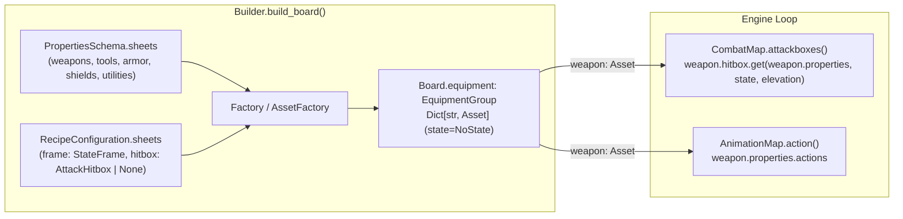
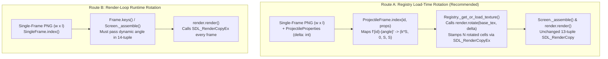

# Hardware & VRAM Coupling in the State Database and Models

The rendering abstraction boundary (`Screen` $\to$ `libs.graphics.render`) is breached by both the domain state models and the `Board` database:

* **VRAM Pointers Stored in Domain State**: `PaneState` (`src/app/models/state/assets/widgets.py`, line 81) stores `canvas: Any = None`, which at runtime holds a Cython `TexturePtr` wrapping a raw `SDL_Texture*` GPU allocation (`src/app/game/screen.py`, line 269).

* **Duplicate VRAM Teardown Across Layers**: Because `PaneState` holds a hardware pointer, `src/app/game/board/core.py` imports `libs.graphics.render as render` (line 59) and manually destroys GPU textures inside `Board.clear()` (lines 363–369):

```python
for menu in self.menus + self.overlays:
    if menu.widgets:
        for widget in menu.widgets.values():
            if isinstance(widget.state, PaneState) and widget.state.canvas is not None:
                render.destroy(widget.state.canvas)
                widget.state.canvas = None

```


This duplicates `Screen.release(menu)` (`src/app/game/screen.py`, lines 289–296). Consequently, the database layer (`Board`) has a hard compile-time and runtime dependency on the SDL2 Cython rendering module.

* **SDL Font Measurement Inside Data Bindings**: `src/app/game/menus/bindings/text.py` imports `libs.graphics.render as render` (line 40) to call `render.measure(test_line, font)` inside `paginate()` (lines 67, 81). As noted in the file's own comment (lines 34–39), this couples declarative data binding to an active SDL2 TTF context. Furthermore, both `LibraryBinding.bind` (line 136) and `TextBinding.bind` (line 167) ignore the `font=widget.state.font` keyword argument passed by `Provider._bind_pane` (`src/app/services/generators/menus/provider.py`, line 155) and hardcode `self.registry.font("dialogue")`.

* **Remediation**: Store widget canvas `TexturePtr` instances in a renderer-owned dictionary (`Screen._widget_canvases: Dict[str, TexturePtr]`) keyed by `widget.name`, and pass a callable text-measurement interface (or execute pagination inside `Screen.stamp`) so `Board`, `PaneState`, and `Binding` have zero dependencies on `libs.graphics.render`.


---


# Erosion of ECS Polymorphism via `isinstance` and ID Branching

Although `Asset` (`src/app/assets/base.py`, line 139) is designed as a uniform component container, core systems bypass its strategy interfaces:

* **`Screen` Inspects Concrete State Types**: `Screen._assemble` (`src/app/game/screen.py`, line 157) checks `if not isinstance(asset.state, SheetState):` to suppress missing frame warnings for sparse equipment sheets. `Screen._widgets`, `Screen.stamp`, `Screen.bake`, and `Screen.release` (lines 213, 224, 250, 286, 294) repeatedly check `isinstance(widget.state, PaneState)`.

* **`Widget` Subclasses `Asset` to Override `dimensions`**: `src/app/game/menus/core.py` (lines 37–49) defines `class Widget(Asset)` solely to attach `binding` and branch on `if isinstance(self.state, PaneState): return self.state.span`.

* **Hardcoded Entity IDs and `getattr` Guards in Sheet Components**:
  * `SpriteFrame.keys` (`src/app/assets/frames/sheets.py`, line 103) checks `if id != RequiredAssets.PLAYER.value and state.psyche.expression:`.
  * `SpriteAnimation.animate` (`src/app/assets/animations/sheets.py`, line 32) is type-annotated for `state: SpriteState`, yet uses `if getattr(state, 'psyche', None) is None: return state` because `Player` is hydrated with `SheetState` (which lacks `psyche`) while sharing `SpriteAnimation` and `SpriteFrame`.
  * Meanwhile, `SheetState` (`src/app/models/state/assets/sheets.py`, lines 128–136) bundles `intention`, `character`, `inventory`, `meters`, and `goal` onto the base class for all `Sheets`, forcing `Pixies` (`docs/01-assets.md`, *Sheet: Pixies*) to inherit full character/inventory structures if they use `SheetState`.

* **Remediation**: Separate `SheetState` (strictly `position`, `velocity`, `animation`), `CharacterState(SheetState)` (adding `character`, `slots`, `inventory`, `meters`, `intention`, `goal` for `Player`), and `SpriteState(CharacterState)` (adding `psyche`, `memory`, `trajectory`). Give `Player` and `Sprite` distinct `Frame` and `Animation` recipes (or let `PlayerFrame` be `SpriteFrame` without expression overlays and `SpriteFrame` subclass `PlayerFrame`), eliminating `getattr` and `id != "player"` checks.


---


# Temporal Coupling and Encapsulation Leaks in `Board`

* **Nullable Late-Bound Dependencies Violating Type Annotations**: In `src/app/game/board/core.py` (lines 69–77), `plot: PlotState`, `device: Device`, and `cradle: Cradle` are annotated as non-optional, while `self.materializer` is unannotated. In `Board.__init__` (lines 90–95), all five are initialized to `None` and mutated later via setter methods (`set_device`, `set_cradle`, `set_plot`, `set_migrator`). Any mechanic or handler invoked before all setters run encounters `AttributeError` on `None`.
* **11 Private Cache Structures Exposed on `Board**`: Lines 111–155 of `src/app/game/board/core.py` expose `_cached_categories`, `_cached_instances`, `_cached_layers`, `_cached_renderables`, `_cached_weights`, `_cached_tilemap`, `_cached_fluidmap`, `_cached_characters`, `_all_categories`, `_all_instances`, and `_shorelines` directly from `self._cache`. External callers inspecting these properties bypass `Board`'s query API and couple directly to `Cache` implementation details.


---


# Unculled Heap Allocations, Registry Lookups, and Full-Layer Sorting in `Screen._assemble`

In `src/app/game/screen.py` (`_assemble`, lines 126–205), the rendering pipeline executes operations in the following order every frame (60 Hz):

1. `self.board.renderables(player.state.layer)` (`src/app/game/engine.py`, line 127) returns the cached list of **all** non-tile assets on the active layer (`src/app/game/board/core.py`, line 276).
2. `assets.sort(key=self._sort)` (line 138) sorts the **entire layer's asset list** in-place ($O(N_{\text{layer}} \log N_{\text{layer}})$), mutating the list stored inside `Board._cache.cached_renderables[layer]`.
3. For **every** asset on the layer (lines 140–154), the loop calls `asset.frame.keys(asset.id, asset.state)`, `asset.frame.channels(...)`, and `self.registry.image(frame_key)` **before** checking whether the asset is inside the camera viewport (lines 171–174).

**Impact**:

In `StateFrame.keys` and `SpriteFrame.keys` (`src/app/assets/frames/sheets.py`, lines 46–51, 88–107), every call to `keys()` executes `settings.SEPARATOR.join([...])` and allocates a new list of tuples on the Python heap. If a layer contains $2,000$ assets and only $40$ are within the camera viewport (`pov`, `bounds`), the engine performs $2,000$ sort key evaluations, $2,000+$ dynamic string concatenations, list allocations, and `Registry.image()` dictionary lookups per frame ($120,000+$ allocations per second) only to discard $98\%$ of them at line 171.

**Remediation**:

Perform broad-phase camera AABB culling **first** using `asset.state.position` and `asset.dimensions` (with a constant margin $M$ for expression offsets), collect only the visible subset $V$ ($\vert{}V\vert{} \ll N_{\text{layer}}$), sort $V$ into a local list without mutating `Board._cache`, and invoke `asset.frame.keys()`, `asset.frame.channels()`, and `self.registry.image()` exclusively on $a \in V$:

$$\text{Complexity}_{\text{frame}}: \quad O(N_{\text{layer}} \log N_{\text{layer}}) + N_{\text{layer}} \cdot C_{\text{alloc}} \;\longrightarrow\; O(N_{\text{layer}}) + O(\vert{}V\vert{} \log \vert{}V\vert{}) + \vert{}V\vert{} \cdot C_{\text{alloc}}$$


---


# $O(N)$ Linear Scans for Unique Entity Lookups and Layer Dimensions in `Board`

* **`Board.asset(name, layer)` (`src/app/game/board/core.py`, lines 222–224)**:
```python
def asset(self, name: str, layer: Optional[str] = None) -> Optional[Asset]:
    search_list = self.renderables(layer) if layer else self._assets
    return next((a for a in search_list if a.name == name), None)
```

Although `asset.name` is globally unique across a deployed `Board` (`docs/01-assets.md`, *Hierarchy: Taxonomy*), `board.asset(name)` performs an $O(N)$ linear scan. Worse, when `layer` is specified, it searches `self.renderables(layer)`, which excludes `AssetCategories.TILES`—meaning `board.asset(tile_name, layer="main")` always returns `None`. Indexing `assets_by_name: Dict[str, Asset]` inside `Cache` reduces `board.asset(name)` to $O(1)$.

* **`Board.size(layer)` (`src/app/game/board/core.py`, lines 296–323)**:
Iterates over every asset on the layer in $O(N)$ on each invocation to compute `max_w` and `max_l`, rather than caching layer dimensions in `Cache` during `index_batch` / `evict_batch`.


---


# Unclamped Fixed-Timestep Accumulator ("Spiral of Death") in `Engine.start`

In `src/app/game/engine.py` (lines 173–182):

```python
current_time = self.time()
frame_time = current_time - last_time
last_time = current_time
accumulator += frame_time

while accumulator >= delta:
    self._play(delta)
    self._drain()
    accumulator -= delta

```

`frame_time` has no upper bound. If the OS window manager blocks the process (e.g., dragging the window title bar, workspace switching, or a breakpoint) for $5\text{ seconds}$, `accumulator` spikes to $5.0\text{ s}$ and executes $300$ consecutive `_play(delta)` ticks without rendering or sleeping. Clamping `frame_time = min(current_time - last_time, settings.MAX_FRAME_TIME)` (typically $0.25\text{ s}$) prevents accumulator runaway.


----


# Swallowed OS Window Events & Sub-Tick Polling in `libs.core.input` and `Device`

1. **Ignored `SDL_QUIT` Events**: In `src/libs/core/input.pyx` (lines 20–26), `pump()` drains the SDL event queue with an empty body:

```cython
while SDL_PollEvent(&event):
    pass
```

Because `SDL_PollEvent` removes all OS window events from SDL's internal queue and discards them, `SDL_QUIT` (window close button, `Alt+F4`, or SIGINT window termination) is permanently discarded.

2. **Polling Inside the Sub-Step Accumulator Loop**: `Engine._play` (`src/app/game/engine.py`, line 109) calls `self.board.device.poll()` inside `while accumulator >= delta:`. In `Keyboard.poll` (`src/app/game/devices.py`, lines 64–106), edge-triggered intentions and menu triggers are resolved by comparing `current_dict.get(v) and not self._last_state.get(v)` and immediately overwriting `self._last_state = current_dict`. If `accumulator` executes two sub-steps in a single render frame, the edge transition is consumed on sub-step 1 and erased on sub-step 2; conversely, if a fast frame renders with `accumulator` less than `delta`, `sdl.pump()` is not called on that frame at all.


---


# `dataclasses.asdict` Serialization on Cython Extension Types in `Board.serialize`

In `src/app/game/board/core.py` (line 408), `Board.serialize` converts runtime states to dictionaries via `asdict(asset.state)`. However, `SheetState`, `ObjectState`, `CraftState`, etc., store Cython `cdef class` extension types (`libs.core.models.Position`, `Velocity`, `Dimensions`, `Multiple`) in their fields (`src/app/models/state/assets/sheets.py`, lines 130–131). Python's `dataclasses.asdict()` only unpacks standard Python `@dataclass` objects, lists, tuples, and dicts; for Cython `cdef class` instances, `asdict()` falls back to `copy.deepcopy(obj)`, leaving raw Cython extension instances in the output dict (or raising `TypeError` if `__reduce__`/`__deepcopy__` is not implemented on every `cdef class` in `libs.core.models`).


---


# Cross-Domain Enum Default Bug in `SelectTarget` and Off-Target Channel Rendering in `Screen.export_map`

* **Invalid Default Enum Type on `SelectTarget**`: In `src/app/models/config/menus.py` (line 87):
```python
@dataclass(slots=True, frozen=True)
class SelectTarget:
    selection: Enumerated[Selections] = Statuses.IDLE.value

```


`selection` is validated against `Enumerated[Selections]`, but its default value is `Statuses.IDLE.value` (`"idle"`), which is a `Statuses` enum value rather than a `Selections` enum value. Additionally, `from app.models.adapters import Enumerated` is imported twice in `src/app/models/config/menus.py` (lines 34 and 39).
* **Channel Operations Drawn to Default Viewport Instead of `full_target` in `Screen.export_map**`: In `src/app/game/screen.py` (lines 398–411), `render.render(..., target=full_target)` renders the map onto the temporary offscreen texture `full_target`, but the subsequent line `render.channel(active_channels, pov.x, pov.y)` (line 411) omits `target=full_target`, causing auxiliary tint channels to render onto the screen backbuffer rather than the exported map texture.


---


* **Per-Call List and Tuple Allocations in `predicates.in_pool` and `predicates.in_stream`**:
    * `in_pool()` allocates a single-element list `[(pool.x, pool.y, pool.x + pool.w, pool.y + pool.l)]` on every call just to invoke `geometry.inside()` for a 4-integer comparison.
    * `in_stream()` rebuilds `aabbs: List[Tuple[int, int, int, int]]` from `fluid.state.source` and `fluid.state.branches` on every `Board.fluid()` lookup (`60 Hz` per moving entity), even though `Actuator.propagate()` already compiles the active stream and pool geometry onto `fluid.state.hitboxes`.


---


### Architectural Grooming & Response to User Review I

#### 1. Inducting Equipment as Stateless `Asset`s on `Board.equipment`

In the current codebase, `Builder.build_board()` populates `EquipmentGroup` with raw `Dict[str, SheetProperties]` dictionaries (`self.context.properties.sheets.weapons`, etc.), while `Migrator` only instantiates `Asset` objects for stateful entities declared in `/src/data/state/<board-key>/**/*.yaml`. Because Equipment has `NoState` and is never deployed as an independent world entity, registering `hitbox: AttackHitbox` under `recipes.sheets.weapons` in the previous specification was a dead configuration path, and `CombatMap.attackboxes()` violated the ECS injection boundary by instantiating `AttackHitbox()` inline.

Storing stateless Equipment **`Asset`** instances in `Board.equipment` (`EquipmentGroup`) resolves this architectural split cleanly:



##### Component-by-Component Implications

1. **`EquipmentGroup` (`src/app/models/groups.py`) & `Builder.build_board()` (`src/app/services/orchestration/builder.py`)**:
* Each field on `EquipmentGroup` (`armor`, `weapons`, `tools`, `utilities`, `shields`) transitions from `Dict[str, SheetProperties]` to `Dict[str, Asset]`.
* During `Builder.build_board()`, each equipment entry `(eq_id, eq_props)` is hydrated into an `Asset` using its corresponding `Recipe` from `self.context.configurations.recipes.sheets.<instance>`:
* `taxonomy = Taxonomy(id=eq_id, name=eq_id, category=AssetCategories.SHEETS.value, instance=inst_name)`
* `properties = eq_props` (`SheetProperties`)
* `state = NoState()`
* `frame = AssetFactory.frame(recipe.frame)` (`StateFrame`)
* `hitbox = AssetFactory.hitbox(recipe.hitbox)` (`AttackHitbox` for `weapons` and `tools`; `None` for `armor`, `shields`, and `utilities`)
* `animation = None`


* Registering `hitbox: AttackHitbox` in `src/data/config/recipes/main.yaml` for `sheets.weapons` and `sheets.tools` is now the actual mechanism that injects `AttackHitbox` onto each weapon and tool `Asset`.


2. **`CombatMap.attackboxes()` (`src/app/game/logic/modules/maps/combat.py`)**:
* `CombatMap` no longer imports or instantiates `AttackHitbox`. Instead, it retrieves the weapon `Asset` from `equipment.weapons.get(weapon_key)` (via `state.slots.equipment.weapon`) and delegates directly to the `Asset` interface:
```python
weapon_key = state.slots.equipment.weapon if state.slots and state.slots.equipment else None
weapon = equipment.weapons.get(weapon_key) if weapon_key else None
if not weapon or not weapon.hitbox:
    return []
resolved_elevation = (
    elevation if elevation is not None
    else (state.elevation if state.elevation is not None else 0)
)
return weapon.hitbox.get(weapon.properties, state, resolved_elevation)

```


3. **`AnimationMap` & Menu `Binder` Call Sites**:
* Any module reading equipment properties from `board.equipment` (such as `AnimationMap.action(state, equipment)` checking `weapon.properties.actions` instead of `weapon_props.actions`) must dereference `.properties` on the retrieved `Asset`.


4. **Implications for `SpriteFrame` (`src/app/assets/frames/sheets.py`)**:
* `Registry._index()` already iterates over `self.properties.sheets.<instance>` and `self.recipes.sheets.<instance>`, instantiating `AssetFactory.frame(recipe.frame)` (`StateFrame`) to populate `Registry._frames` with valid `<eq_id>-<action>-<direction>-<frame>` crop tuples. Hydrating Equipment as `Asset`s on `Board.equipment` does not alter `Registry._index()`.
* At render time, `Screen._assemble()` calls `asset.frame.keys(asset.id, asset.state)`. Because `Frame.keys(id, state)` only accepts `(id: str, state: AssetState)` and does not receive `board.equipment`, `SpriteFrame.keys()` only has access to the string identifiers in `state.slots.equipment` (`eq.armor`, `eq.utility`, `eq.tool`, `eq.weapon`, `eq.shield`).
* However, because every Equipment `Asset` uses `StateFrame` and `SpriteFrame` subclasses `StateFrame`, `SpriteFrame.keys()` can delegate key generation to `super().keys(eq_key, state)` (`StateFrame.keys(eq_key, state)`) rather than manually formatting strings with `settings.SEPARATOR.join(...)`.
* **Why `Screen._assemble()` Currently Suppresses `SheetState` Registry Misses**: Because `SpriteFrame.keys()` only sees the string `eq_key` on `state.slots.equipment` and cannot inspect `weapon.properties.actions`, it emits keys like `"sword-walk-down-0"` when a sword-wielding sprite is walking (`sword` only indexes `lpc-slash` rows in `Registry._frames`). `Screen._assemble()` catches the resulting `None` from `self.registry.image(frame_key)` and suppresses the warning via `if not isinstance(asset.state, SheetState): logger.warning(...)`.
* Keeping `state.slots.equipment` as string keys (`Enumerated[WeaponPalette]`, etc.) preserves clean YAML state serialization (`Board.serialize()`) and keeps `Frame.keys(id, state)` signature-compatible across all Asset categories.


---

#### 2. Analysis of the Projectile Rotation Strategy (Phase 03.04 Preparation)

To support arbitrary angular subdivisions $\Delta \theta \in (0, 360]$ (e.g., $\Delta \theta = 90^\circ$ for 4-direction arrows, $\Delta \theta = 45^\circ$ for 8-direction cannonballs, $\Delta \theta = 15^\circ$ for radial bursts) from a single canonical frame (authored facing `left` / $\theta_0 = 180^\circ$ or $\theta_0 = 0^\circ$), there are two distinct architectural places where texture rotation can occur: **Load-Time Atlas Synthesis in `Registry**` vs. **Per-Frame Rotation in `Screen` / `render.pyx**`.



##### Comparative Trade-Off Analysis

| Architectural Dimension | Route A: Registry Load-Time Rotation (`render.rotate`) | Route B: Render-Loop Runtime Rotation (`render.render`) |
| --- | --- | --- |
| **`Frame.index()` & `Frame.keys()` Contract** | **Preserved**: `ProjectileFrame.index(id, properties)` generates `f"{id}-{angle}"` crop keys across $N = \lfloor 360 / \Delta\theta \rfloor$ cells. `ProjectileFrame.keys(id, state)` returns `[(f"{id}-{state.angle}", 0, 0)]`. | **Broken / Widened**: `Frame.keys(id, state)` must either widen its return signature to 4-tuples `(key, ox, oy, angle)` across *all* `Frame` classes, or `Screen._assemble()` must inspect `getattr(asset.state, 'angle', 0.0)`. |
| **`Screen._assemble()` & `render.render()**` | **Zero changes**: `Screen._assemble()` still emits the standard 13-element integer primitive `(tex, sx, sy, sw, sl, dx, dy, dw, dl, r, g, b, a)`, and `render.render()` executes standard `SDL_RenderCopy`. | **Invasive changes**: Every primitive tuple in `Screen._assemble()` expands to 14 elements; `render.render()` must unpack `angle` and invoke `SDL_RenderCopyEx` on every frame. Conflicts with horizontal texture slicing (`submerge_channel`). |
| **VRAM & Runtime Cost** | Allocates one synthesized strip texture of size $(N \cdot S) \times S$ in VRAM per projectile ID during `Registry` load/prewarm (identical to how `Registry._stack()` uses `render.compose()`). Zero per-frame rotation overhead. | Single $(w \times l)$ texture in VRAM, but incurs per-instance `SDL_RenderCopyEx` overhead on every tick (especially costly under `headless=True` software rendering where `SDL_RenderCopyEx` performs CPU surface rotation every frame). |
| **Alignment with Ontology Philosophy** | Matches `Registry._stack()` + `render.compose()`: static visual variations defined by `Properties` belong to **Frame space** (`Frame.index`), not ad-hoc renderer flags. | Violates `Frame` encapsulation by pushing orientation state out of `Frame.keys()` and into `Screen._assemble()`. |

##### Detailed Requirements to Adopt Route A (Registry Load-Time Rotation)

1. **Canvas Bounding & Non-Clipping Geometry**:
* If a projectile image has dimensions $(w, l)$ and is rotated by $\Delta\theta$ around its center $(w/2, l/2)$, its axis-aligned bounding box expands to:

$$w'(\Delta\theta) = \lceil w |\cos\Delta\theta| + l |\sin\Delta\theta| \rceil, \qquad l'(\Delta\theta) = \lceil w |\sin\Delta\theta| + l |\cos\Delta\theta| \rceil$$


* If the source PNG is authored on a square canvas $w = l = S$ (such as $32 \times 32$ or $64 \times 64$ with transparent margin around the projectile shaft so the sprite lies within diameter $S$), rotating around $(S/2, S/2)$ never clips at any angle $\Delta\theta$, and every cell in the generated horizontal atlas has uniform dimensions $(S, S)$ at crop offset $(k \cdot S, 0, S, S)$ for $k \in \{0, 1, \dots, \lfloor 360/\Delta\theta \rfloor - 1\}$.


2. **Cython SDL2 Addition in `src/libs/graphics/render.pyx` & `registry.pyx**`:
* Declare `SDL_Point`, `SDL_RendererFlip` (`SDL_FLIP_NONE = 0`), and `SDL_RenderCopyEx` in `render.pyx`:
```cython
cdef extern from "SDL2/SDL.h":
    ctypedef struct SDL_Point:
        int x
        int y
    ctypedef enum SDL_RendererFlip:
        SDL_FLIP_NONE = 0x00000000
        SDL_FLIP_HORIZONTAL = 0x00000001
        SDL_FLIP_VERTICAL = 0x00000002

    int SDL_RenderCopyEx(
        SDL_Renderer* renderer,
        SDL_Texture* texture,
        const SDL_Rect* srcrect,
        const SDL_Rect* dstrect,
        const double angle,
        const SDL_Point* center,
        const SDL_RendererFlip flip
    )

```


* Add a `rotate(TexturePtr base_ptr, int delta) -> TexturePtr` helper in `render.pyx` (analogous to `compose()`):
* Computes $N = 360 // \text{delta}$.
* Allocates `target = canvas(base_ptr.w * N, base_ptr.l, opaque=False)`.
* Sets render target to `target.ptr` and loops $k \in [0, N)$, calling `SDL_RenderCopyEx(_renderer, base_ptr.ptr, &c_src, &c_dst, k * delta, NULL, SDL_FLIP_NONE)` where `c_dst = {k * w, 0, w, l}`.


* In `Registry._get_or_load_texture()`, if an asset has a rotation `delta` configured in its properties, invoke `render.rotate(raw_tex, delta)` before caching in `self._textures[asset_key]`.


3. **Hitbox Rotation (`RotatedHitbox` or Pre-Computed Angle Map)**:
* Because Cython's `geometry.intersects` operates strictly on AABBs (`Hitbox(Position(x, y), Dimensions(w, l))`), a single base hitbox $H_0 = (x_0, y_0, w_0, l_0)$ defined in the canonical orientation ($\Delta\theta = 0^\circ$) with center offset $(h_{cx}, h_{cy}) = (x_0 + w_0/2 - W/2,\; y_0 + l_0/2 - L/2)$ relative to the frame center $(W/2, L/2)$ is rotated by $\Delta\theta = k \cdot \text{delta}$ into AABB $H(\Delta\theta)$:

$$\begin{pmatrix} h'_{cx} \\ h'_{cy} \end{pmatrix} = \begin{pmatrix} \cos\Delta\theta & -\sin\Delta\theta \\ \sin\Delta\theta & \cos\Delta\theta \end{pmatrix} \begin{pmatrix} h_{cx} \\ h_{cy} \end{pmatrix}$$


$$w'(\Delta\theta) = \max\Big(1,\; \text{round}\big(w_0 |\cos\Delta\theta| + l_0 |\sin\Delta\theta|\big)\Big), \qquad l'(\Delta\theta) = \max\Big(1,\; \text{round}\big(w_0 |\sin\Delta\theta| + l_0 |\cos\Delta\theta|\big)\Big)$$


$$x'(\Delta\theta) = \text{round}\left(\frac{W}{2} + h'_{cx} - \frac{w'(\Delta\theta)}{2}\right), \qquad y'(\Delta\theta) = \text{round}\left(\frac{L}{2} + h'_{cy} - \frac{l'(\Delta\theta)}{2}\right)$$


* At cardinal angles ($\Delta\theta \in \{0^\circ, 90^\circ, 180^\circ, 270^\circ\}$), this transformation is exact with zero AABB bloat. At oblique angles ($\Delta\theta = 45^\circ$), authoring the projectile's hitbox around the projectile head (where $w_0 \approx l_0$) keeps the rotated AABB tight across all directions.


4. **Decoupling Phase 06.03 from Phase 03.04**:
* In `CombatMechanics.update()`, the unfinished ranged stub (`if attacker.state.animation.frame == 0 and not attacker.state.mutators.triggers.executed: ... spawn_projectile(id="TODO", velocity="TODO")`) is what caused Task 3.2 in the previous plan to propose adding `executed: bool = False` to `MutatorTriggers`.
* As noted in your review, mutating `MutatorTriggers` to support a `"TODO"` stub makes no sense. In **Phase 06.03**, `CombatMechanics.update()` should simply skip `Actions.SHOOT` and `Actions.CAST` (removing the broken `"TODO"` block), while the full Projectile Rotation implementation is codified in **Phase 03.04: Projectiles**.


---

### Updated Task Board Backlog

#### Refactor: Phase 06.03 - Combat

**Overview**

Induct `Equipment` into the `Board` as stateless `Asset` instances injected via `Recipe` configurations (`StateFrame` and `AttackHitbox`), unify `SheetProperties.attackboxes` into `SheetProperties.hitboxes`, resolve the structural separation between a Sprite's physical hurtbox (`StaticHitbox`) and its equipped weapon reach (`AttackHitbox`), enforce discrete elevation partitioning in `CombatMechanics`, remove the broken ranged `"TODO"` stub from `CombatMechanics.update()`, and migrate `test_combat.py` to the live `world-testbed` fixture framework.

##### Specification

In the Asset Hierarchy, `Sprites` (and `Players`) are stateful `Sheet` Assets deployed onto the `Board`, whereas `Equipment` (`weapons`, `tools`, `armor`, `shields`, `utilities`) are stateless `Sheet` Assets (`state = NoState()`) hydrated into `Board.equipment` (`EquipmentGroup`) during `Builder.build_board()` and projected onto a wielding Sprite's state.

1. **Stateless Equipment `Asset` Hydration (`EquipmentGroup` & `Recipes`)**:
* `EquipmentGroup` stores `Dict[str, Asset]` for `armor`, `weapons`, `tools`, `utilities`, and `shields`.
* During `Builder.build_board()`, each equipment entry in `PropertiesSchema.sheets` is instantiated as an `Asset` using its `Recipe` in `src/data/config/recipes/main.yaml`:
* `sheets.weapons` and `sheets.tools` inject `frame: StateFrame` and `hitbox: AttackHitbox`.
* `sheets.armor`, `sheets.shields`, and `sheets.utilities` inject `frame: StateFrame` and `hitbox: null`.


2. **Dual Footprint Separation (`StaticHitbox` vs. `AttackHitbox`)**:
* **Body Footprint (`Hitbox`)**: Owned by the deployed `Sprite` or `Player` (`Asset`). Resolved via `StaticHitbox` from `sprite.properties.hitboxes` (`List[Hitbox]`). Governs physical obstacle collision (`CollisionMechanics`), RRT pathfinding anchors (`NavigationMechanics`), environmental interactions (`InteractionMechanics`), fluid immersion (`MotionMechanics`), and incoming damage reception (`CombatMechanics`).
* **Action Footprint (`Attackbox`)**: Owned by stateless `Equipment` `Asset`s (`weapons` and `tools`). Resolved via `weapon.hitbox.get(weapon.properties, sprite.state, elevation)` (`AttackHitbox`) from `weapon.properties.hitboxes` (`Dict[str, List[Hitbox]]`) projected against the wielding entity's `SheetState` (`state.animation` and `state.elevation`).


3. **Property Schema Unification (`SheetProperties`)**:
* Consolidate `attackboxes` into a single polymorphic `hitboxes` field on `SheetProperties`:


$$\text{SheetProperties.hitboxes} : \text{Optional}\Big[\text{Union}\big[\text{Dict}[\text{str}, \text{List}[\text{Hitbox}]],\; \text{List}[\text{Hitbox}]\big]\Big]$$

* Deployed character sheets (`sprites`, `players`, `pixies`) configure `hitboxes` as `List[Hitbox]` (interpreted by `StaticHitbox`).
* Stateless equipment sheets (`weapons`, `tools`) configure `hitboxes` as `Dict[str, List[Hitbox]]` keyed by `<action>-<direction>-<frame>` (interpreted by `AttackHitbox`).

4. **Stateless Projection Contract (`CombatMap`)**:
* `CombatMap.attackboxes(state, equipment, elevation)` resolves the active weapon key from `state.slots.equipment.weapon`, retrieves the stateless weapon `Asset` from `equipment.weapons`, and delegates geometric resolution to `weapon.hitbox.get(weapon.properties, state, resolved_elevation)`.


##### Architectural Analysis II

1. **Resolving the Recipe Injection Inconsistency via Stateless Equipment `Asset`s**:
Previously, `Builder.build_board()` passed raw `SheetProperties` dictionaries into `EquipmentGroup`, rendering `recipes.sheets.weapons` unused outside of `Registry._index()` and forcing `CombatMap` to instantiate `AttackHitbox()` directly. By constructing stateless `Asset` instances (`state=NoState()`) for `EquipmentGroup` in `Builder.build_board()`, `AttackHitbox` is injected once via `AssetFactory.hitbox(recipe.hitbox)` and accessed polymorphically via `weapon.hitbox.get(weapon.properties, state, elevation)`.
2. **Impact on `AnimationMap` and `SpriteFrame**`:
* In `AnimationMap.action(state, equipment)`, looking up a weapon or tool in `equipment.weapons` or `equipment.tools` now returns an `Asset`; action resolution accesses `weapon.properties.actions` instead of `weapon_props.actions`.
* In `SpriteFrame.keys(id, state)`, because `Frame.keys()` receives only `(id: str, state: SpriteState)` and `state.slots.equipment` stores equipment string keys, `SpriteFrame.keys()` delegates equipment key formatting to `super().keys(eq_key, state)` (`StateFrame.keys`).


3. **Fixing `state.slots.equipment` Lookup in `CombatMap**`:
`CombatMap.attackboxes()` currently queries `state.inventory.equipment.weapon` (which raises `AttributeError` because `equipment` was moved to `state.slots.equipment` in Phase 06.04) and uses `Optional[int]` without importing `Optional`. Updating `CombatMap` to read `state.slots.equipment.weapon` and call `weapon.hitbox.get(...)` fixes both defects.
4. **Elevation Partitioning & Removal of Broken Ranged Stub in `CombatMechanics**`:
* `CombatMechanics.update()` currently hashes all attackers and targets on a `layer` into `self.grid` regardless of `elevation`, allowing an attacker at $E = 0$ to strike a target at $E = 1$. Enforcing `attacker.elevation == target.elevation` isolates melee combat to coplanar entities.
* Ranged projectile spawning (`Actions.SHOOT`, `Actions.CAST`) is currently an unimplemented `"TODO"` stub that crashes on `attacker.state.mutators.triggers.executed`. Rather than polluting `MutatorTriggers` with an `executed` flag for a stub, ranged projectile spawning is deferred to **Phase 03.04: Projectiles**, and `CombatMechanics.update()` cleanly skips `Actions.SHOOT` and `Actions.CAST` during melee attacker collection.


##### User Review I

**Inconsistencies In The Current Spec**

There appears to be an inconsistency in the plan or a misunderstanding of the injection system, as the CombatMap is instantiating a AttackHitbox, but the Task list has it also being registered as a component injected via Recipes. Equipment is not instantiated in the game, so registering it in a Recipe in the current implementation achieves nothing.

However, rather than storing Equipment Properties on the Board, it might be better to store Equipment *Assets* on the Board that can be referenced. That way, CombatMap has access to the hitbox and properties through the Asset interface.

Adoption of this strategy, however, may have implications with respect to SpriteFrame, insofar that currently SpriteFrame manages the injection of EquipmentFrames.

**Projectile Implementation**

Application is at the point where Projectiles need to be codified. There are two routes, as I see:

* Atlasing Route: Different directions of the Projectile are atlased in an Asset file.
* Rotation Route: A Projectile Asset contains a single Frame in a single Direction (say: `left`). When it is indexed by the Registry, it's coordinates are rotated by a fixed amount.

Atlasing fixes the number of Directions a Projectile can be fired. However, rotation allows for an arbitary division of degrees, e.g. arrows can fire in four directions (degree delta = 90) and cannonballs can fire in eight directions (degree delta = 45). However, rotation may require substantial changes in the rendering interface, so there are trade offs.

Do an analysis of what would be required to adopt the rotation strategy.

##### Goals

###### Goal: Unify `SheetProperties.hitboxes` and YAML Definitions

Replace `attackboxes` with `hitboxes` on `SheetProperties` in `src/app/models/properties/assets.py` so both character sheets (`List[Hitbox]`) and equipment sheets (`Dict[str, List[Hitbox]]`) share a single property field:

```python
# src/app/models/properties/assets.py
@dataclass(slots=True)
class SheetProperties(AssetProperties):
    stack: List[str] = field(default_factory=list)
    mass: int = 1
    actions: Union[
        str,
        Dict[Enumerated[Actions], Action]
    ] = field(default_factory=dict)
    hitboxes: Optional[Union[
        Dict[str, List[Hitbox]],
        List[Hitbox]
    ]] = field(default_factory=list)

```

Update `src/assets/sheets/equipment/weapons/main.yaml` and `src/assets/sheets/equipment/tools/main.yaml` to replace `attackboxes` with `hitboxes`.

###### Goal: Hydrate Stateless Equipment `Asset`s into `EquipmentGroup`

Update `EquipmentGroup` (`src/app/models/groups.py`) to hold `Dict[str, Asset]` and update `Builder.build_board()` (`src/app/services/orchestration/builder.py`) to construct stateless `Asset` objects (`state=NoState()`) for `armor`, `weapons`, `tools`, `utilities`, and `shields` using `recipes.sheets`:

```python
# src/app/models/groups.py
@dataclass(slots=True)
class EquipmentGroup:
    armor: Dict[str, Asset] = field(default_factory=dict)
    weapons: Dict[str, Asset] = field(default_factory=dict)
    tools: Dict[str, Asset] = field(default_factory=dict)
    utilities: Dict[str, Asset] = field(default_factory=dict)
    shields: Dict[str, Asset] = field(default_factory=dict)

```

###### Goal: Delegate `CombatMap.attackboxes` to the Weapon `Asset` Interface

Update `CombatMap.attackboxes` to resolve the equipped weapon from `state.slots.equipment.weapon` and invoke `weapon.hitbox.get(weapon.properties, state, resolved_elevation)` through the `Asset` interface:

```python
# src/app/game/logic/modules/maps/combat.py
from typing import List, Optional
from app.models.groups import EquipmentGroup
from app.models.state import SheetState
from libs.core.models import Hitbox

class CombatMap:
    @staticmethod
    def attackboxes(
        state: SheetState,
        equipment: EquipmentGroup,
        elevation: Optional[int] = None
    ) -> List[Hitbox]:
        weapon_key = state.slots.equipment.weapon
        weapon = equipment.weapons.get(weapon_key) if weapon_key else None
        if not weapon or not weapon.hitbox:
            return []
        resolved_elevation = (
            elevation if elevation is not None
            else (state.elevation if state.elevation is not None else 0)
        )
        return weapon.hitbox.get(weapon.properties, state, resolved_elevation)

```

###### Goal: Enforce Elevation Isolation and Clean Up `CombatMechanics.update()`

Remove the unfinished ranged `"TODO"` block from `CombatMechanics.update()` (deferring ranged projectile spawning to Phase 03.04) and enforce discrete elevation isolation (`attacker.elevation == target.elevation`) during melee collision resolution:

```python
# src/app/game/logic/mechanics/spatial/combat.py
for attacker in attackers:
    if attacker.state.animation.action in (
        Actions.SHOOT.value,
        Actions.CAST.value,
    ):
        continue

    attackboxes = CombatMap.attackboxes(attacker.state, board.equipment, attacker.elevation)
    if attackboxes:
        melee_attackers.append((attacker, attackboxes))

```

###### Goal: Induct `test_combat.py` into the Live Fixture Framework

Remove all `_create_*` helper functions, `MagicMock` instances, and monkeypatched `mock_board` lambdas from `tests/unit/app/game/logic/mechanics/spatial/test_combat.py`. Execute all combat tests against `mock_mechanic(Mechanics.COMBAT.value)`, `mock_board`, `mock_bus`, and `mock_payload`.

##### Tasks

**1. Task: Unify `SheetProperties.hitboxes` and Equipment YAML Assets**

*Objective*: Consolidate `attackboxes` into `hitboxes` on `SheetProperties` and update all Equipment YAML definitions.

* [] Subtask: Update `SheetProperties` in `src/app/models/properties/assets.py` so `hitboxes` accepts `Optional[Union[Dict[str, List[Hitbox]], List[Hitbox]]]` and remove the legacy `attackboxes` field.
* [] Subtask: Replace `attackboxes` with `hitboxes` (and remove duplicate `hitboxes: null` keys) in `src/assets/sheets/equipment/weapons/main.yaml` and `src/assets/sheets/equipment/tools/main.yaml`.

**2. Task: Hydrate Stateless Equipment `Asset`s in `EquipmentGroup` and `Builder**`

*Objective*: Store stateless `Asset` instances in `Board.equipment` (`EquipmentGroup`) injected via `recipes/main.yaml` and update all `board.equipment` consumers.

* [] Subtask: Register `hitbox: AttackHitbox` for `sheets.weapons` and `sheets.tools` in `src/data/config/recipes/main.yaml`.
* [] Subtask: Update `EquipmentGroup` in `src/app/models/groups.py` to type `armor`, `weapons`, `tools`, `utilities`, and `shields` as `Dict[str, Asset]`.
* [] Subtask: Update `Builder.build_board()` in `src/app/services/orchestration/builder.py` to instantiate stateless `Asset` objects (`state=NoState()`) for each equipment dictionary using `AssetFactory` and `self.context.configurations.recipes.sheets`.
* [] Subtask: Update `AnimationMap` (and any Menu `Binder` / controller call sites) that access `board.equipment` to read `.properties` from the retrieved Equipment `Asset`, and simplify `SpriteFrame.keys()` in `src/app/assets/frames/sheets.py` to delegate equipment key formatting to `super().keys(eq_key, state)`.

**3. Task: Wire `CombatMap` and Harden `CombatMechanics**`

*Objective*: Route `CombatMap.attackboxes()` through `weapon.hitbox.get()`, enforce elevation isolation in `CombatMechanics.update()`, and remove the broken ranged stub.

* [] Subtask: Fix `CombatMap.attackboxes()` in `src/app/game/logic/modules/maps/combat.py` to import `Optional`, read `state.slots.equipment.weapon`, and delegate hitbox lookup to `weapon.hitbox.get(weapon.properties, state, resolved_elevation)`.
* [] Subtask: Remove the unimplemented ranged `"TODO"` block in `CombatMechanics.update()` (`src/app/game/logic/mechanics/spatial/combat.py`), skip `Actions.SHOOT` and `Actions.CAST` in melee resolution, remove the defensive `getattr(target.state, 'mutators', None)` check, and enforce `attacker.elevation == target.elevation` on colliding pairs.
* [] Subtask: Add unit tests for `AttackHitbox.elevations()` and `AttackHitbox.get()` and update `tests/unit/app/game/logic/modules/maps/test_combat_maps.py` to test against stateless Equipment `Asset`s.

**4. Task: Refactor `test_combat.py` to Use `world-testbed` Fixtures**

*Objective*: Replace all ad-hoc asset builders and `MagicMock` overrides in `tests/unit/app/game/logic/mechanics/spatial/test_combat.py` with live `mock_board` and `mock_mechanic` fixtures.

* [] Subtask: Remove `_create_player_attacker`, `_create_sprite_target`, `_create_reactable_target`, and `_create_equipment` from `tests/unit/app/game/logic/mechanics/spatial/test_combat.py`.
* [] Subtask: Refactor `test_combat_mechanics_melee_resolution`, `test_combat_mechanics_lethal_blow`, `test_combat_mechanics_reactable_trigger`, `test_combat_mechanics_inactive_attackbox_filtered`, and `test_combat_mechanics_unarmed_bypasses_melee` to query `mock_board.player()`, `mock_board.instances(AssetInstances.SPRITES.value, "0")`, and `mock_board.instances(AssetInstances.REACTABLES.value, "0")`.
* [] Subtask: Add `test_combat_mechanics_elevation_isolation` to verify that an attacker at `elevation = 0` cannot damage an overlapping target at `elevation = 1`.

---

### Proposed Backlog Entry: Phase 03.04 - Projectiles

To codify the Rotation Route analyzed above into the backlog for **Phase 03.04**, here is the structured Phase specification following the Backlog Template (`with(not grooming)`):

#### Refactor: Phase 03.04 - Projectiles

**Overview**

Codify `Projectiles` (`cursors.projectiles`) using the Registry Load-Time Rotation strategy (`ProjectileFrame`, `RotatedHitbox`, and `render.rotate`), allowing a single canonical projectile texture frame to be quantized into arbitrary angular increments ($\Delta\theta \in (0, 360]$) in VRAM without modifying the 60 Hz `Screen._assemble()` / `render.render()` pipeline. Wire ranged combat spawning in `CombatMechanics` and trajectory/impact resolution in `ProjectileMechanics`.

##### Specification

1. **Angular Partitioning (`CursorProperties`)**:
* Extend `CursorProperties` (`src/app/models/properties/assets.py`) with `delta: int = 90` (degrees per discrete rotational step, where $360 \bmod \text{delta} == 0$) and `speed: int = 200`.
* The discrete set of valid projectile angles is $\Theta = \{ k \cdot \text{delta} \mid 0 \le k < 360 // \text{delta} \}$.


2. **Load-Time Texture Strip Synthesis (`ProjectileFrame` & `Registry`)**:
* Authored projectile `.png` files contain a single canonical frame of square dimensions $(S, S)$ oriented at $\theta = 0^\circ$ (or canonical `left`).
* `ProjectileFrame.index(id, properties)` maps each discrete angle key `f"{id}-{angle}"` ($\text{angle} = k \cdot \text{delta}$) to crop coordinate $(k \cdot S, 0, S, S)$.
* `Registry._get_or_load_texture()` detects `delta` on projectile properties and invokes `render.rotate(raw_tex, delta)`, which allocates a target `TexturePtr` of dimensions $(N \cdot S, S)$ where $N = 360 // \text{delta}$ and stamps the base texture $N$ times via `SDL_RenderCopyEx`.
* `ProjectileFrame.keys(id, state)` projects `state.angle` directly to `[(f"{id}-{state.angle}", 0, 0)]`.


3. **Rotated AABB Hitbox Projection (`RotatedHitbox`)**:
* `RotatedHitbox.get(properties, state, elevation)` rotates each base `Hitbox` in `properties.hitboxes` by $\Delta\theta = \text{state.angle}$ around the frame center $(S/2, S/2)$:


$$\begin{pmatrix} h'_{cx} \\ h'_{cy} \end{pmatrix} = \begin{pmatrix} \cos\Delta\theta & -\sin\Delta\theta \\ \sin\Delta\theta & \cos\Delta\theta \end{pmatrix} \begin{pmatrix} h_{cx} \\ h_{cy} \end{pmatrix}$$

$$w'(\Delta\theta) = \max\Big(1,\; \text{round}\big(w_0 |\cos\Delta\theta| + l_0 |\sin\Delta\theta|\big)\Big), \qquad l'(\Delta\theta) = \max\Big(1,\; \text{round}\big(w_0 |\sin\Delta\theta| + l_0 |\cos\Delta\theta|\big)\Big)$$

##### Goals

###### Goal: Implement `render.rotate` in Cython SDL2 Bindings

Expose `SDL_RenderCopyEx` in `src/libs/graphics/render.pyx` and implement `rotate(TexturePtr base_ptr, int delta) -> TexturePtr` to pre-bake rotated projectile frames into a single horizontal `TexturePtr` strip during Registry texture loading.

###### Goal: Implement `ProjectileFrame` and `RotatedHitbox`

Create `ProjectileFrame` (`src/app/assets/frames/cursors.py`) and `RotatedHitbox` (`src/app/assets/hitboxes/cursors.py`) and register them under `recipes.cursors.projectiles` in `src/data/config/recipes/main.yaml`.

###### Goal: Wire Ranged Spawning in `Cradle` and Impact Resolution in `ProjectileMechanics`

Update `Cradle.spawn_projectile()` to quantize launch angles to `properties.delta`, compute initial `Velocity(vx, vy)`, and instantiate the projectile `Asset` at the attacker's `elevation`. Update `ProjectileMechanics` to integrate trajectories, enforce elevation-isolated impact detection, apply damage, and garbage-collect expired projectiles.

##### Tasks

**1. Task: Add Cython `render.rotate` and Registry Load-Time Rotation**

*Objective*: Synthesize rotated texture strips in VRAM during `Registry` texture loading.

* [] Subtask: Declare `SDL_Point`, `SDL_RendererFlip`, and `SDL_RenderCopyEx` in `src/libs/graphics/render.pyx` and implement `rotate(TexturePtr base_ptr, int delta) -> TexturePtr`.
* [] Subtask: Update `CursorProperties` in `src/app/models/properties/assets.py` to include `delta: Optional[int] = None` and `speed: int = 200`, and update `MotorState` (`src/app/models/state/assets/cursors.py`) to include `angle: int = 0`.
* [] Subtask: Update `Registry._get_or_load_texture()` in `src/libs/graphics/registry.pyx` to invoke `render.rotate()` when loading a projectile texture with a configured `delta`.

**2. Task: Implement `ProjectileFrame` and `RotatedHitbox**`

*Objective*: Index rotated projectile frame crops and transform base AABB hitboxes by `state.angle`.

* [] Subtask: Implement `ProjectileFrame` in `src/app/assets/frames/cursors.py` to index `f"{id}-{k * delta}"` crops and resolve `[(f"{id}-{state.angle}", 0, 0)]` in `keys()`.
* [] Subtask: Implement `RotatedHitbox` in `src/app/assets/hitboxes/cursors.py` to project base `properties.hitboxes` around the frame center by `state.angle` at the projectile's `elevation`.
* [] Subtask: Register `ProjectileFrame` and `RotatedHitbox` under `cursors.projectiles` in `src/data/config/recipes/main.yaml`.

**3. Task: Implement `Cradle.spawn_projectile`, `CombatMechanics` Ranged Trigger, and `ProjectileMechanics**`

*Objective*: Complete the end-to-end lifecycle of ranged projectiles from release frame to target impact or boundary removal.

* [] Subtask: Update `Cradle.spawn_projectile()` to quantize direction/target vectors onto the nearest multiple of `properties.delta` and populate `MotorState`.
* [] Subtask: Wire ranged projectile spawning in `CombatMechanics.update()` on the release frame of `Actions.SHOOT`.
* [] Subtask: Update `ProjectileMechanics.update()` to evaluate elevation-partitioned intersections against targets and obstacles and queue impacted or out-of-bounds projectiles for removal.

---

### Bug Reports

##### Bug 001: `CombatMap.attackboxes` Raises `NameError` on Import and `AttributeError` on Equipment Slot Lookup

**STATUS**: OPEN
**SEVERITY**: HIGH

**Description**

In `src/app/game/logic/modules/maps/combat.py`, two defects prevent `CombatMap.attackboxes()` from executing:

1. Line 12 imports `from typing import List` without `Optional` (and without `from __future__ import annotations`), causing `elevation: Optional[int] = None` on line 25 to raise `NameError: name 'Optional' is not defined` at import time.
2. Line 27 accesses `state.inventory.equipment.weapon`. Following Phase 06.04 (`Inventory`), active equipment is stored on `state.slots.equipment` (`Slots`), whereas `state.inventory` (`Inventory`) only holds unequipped storage containers (`bag`, `belt`, `sheathe`, `pouch`, `pack`, `sack`). Calling `CombatMap.attackboxes()` raises `AttributeError: 'Inventory' object has no attribute 'equipment'`.

**Steps to Replicate**

1. Import `CombatMap` from `app.game.logic.modules.maps.combat` (raises `NameError` unless `Optional` is imported).
2. Pass a hydrated `SpriteState` or `SheetState` and `board.equipment` to `CombatMap.attackboxes(state, board.equipment)`.
3. Observe `AttributeError: 'Inventory' object has no attribute 'equipment'` on line 27.

**Proposed Remeditation**

Import `Optional` from `typing`, resolve `weapon_key` via `state.slots.equipment.weapon`, and delegate hitbox retrieval to the weapon `Asset` (`weapon.hitbox.get(weapon.properties, state, resolved_elevation)`).

##### Bug 002: `SheetProperties` Declares `attackboxes` Instead of `hitboxes`, Silently Dropping Sprite Hitboxes

**STATUS**: OPEN
**SEVERITY**: HIGH

**Description**

In `src/app/models/properties/assets.py` (lines 117–128), `SheetProperties` still defines `attackboxes` and omits `hitboxes`. However, `src/assets/sheets/sprites/main.yaml` configures physical hurtboxes under the `hitboxes:` key for `player`, `jasilynn`, and `archaxes`. When `Loader.load_properties()` validates `SheetProperties` via Pydantic `TypeAdapter`, the `hitboxes` key in `sprites/main.yaml` is silently ignored, leaving `sprite.properties` without a `hitboxes` attribute when `StaticHitbox.get()` queries it.

**Steps to Replicate**

1. Load properties via `Loader.load_properties()`.
2. Inspect `properties.sheets.sprites["player"]`.
3. Observe that `hasattr(properties.sheets.sprites["player"], "hitboxes")` is `False` and the configured hitbox in `src/assets/sheets/sprites/main.yaml` was discarded.

**Proposed Remeditation**

Rename `attackboxes` to `hitboxes: Optional[Union[Dict[str, List[Hitbox]], List[Hitbox]]] = field(default_factory=list)` on `SheetProperties` in `src/app/models/properties/assets.py`, and replace `attackboxes` with `hitboxes` in `src/assets/sheets/equipment/weapons/main.yaml` and `src/assets/sheets/equipment/tools/main.yaml`.

##### Bug 003: Unfinished Ranged Combat Stub in `CombatMechanics.update` Crashes on `Actions.SHOOT` and `Actions.CAST`

**STATUS**: OPEN
**SEVERITY**: HIGH

**Description**

In `src/app/game/logic/mechanics/spatial/combat.py` (lines 76–88), when an entity in `Intentions.ATTACK` has `state.animation.action` equal to `Actions.SHOOT.value` or `Actions.CAST.value`, execution enters an unfinished ranged combat block that accesses `attacker.state.mutators.triggers.executed`. Because `MutatorTriggers` (`src/app/models/state/core.py`) does not define `executed`, an `AttributeError` is raised at `frame == 0` (and at `frame != 0`).

**Steps to Replicate**

1. Set a deployed Sprite or Player state to `intention = Intentions.ATTACK.value` with `animation.action = Actions.CAST.value` (unarmed) or `Actions.SHOOT.value` (`longbow`).
2. Execute `CombatMechanics().update(board, delta, bus, payload)`.
3. Observe `AttributeError: 'MutatorTriggers' object has no attribute 'executed'`.

**Proposed Remeditation**

Remove the unfinished ranged combat `"TODO"` block from `CombatMechanics.update()` and skip `Actions.SHOOT.value` and `Actions.CAST.value` during melee attacker resolution until **Phase 03.04: Projectiles** is implemented.

---

### Documentation Updates

*(Note: The `@TODO(06-03)` markers in `docs/04-intentions.md` under `Goal: Category` (`resource`) and `Workflow Component: Cognition` (`doors`) concern Goal semantics for **Phase 06.02: Goals**, which has not yet been started on the Task Board.)*

##### Draft: Sheet Hitboxes, Stateless Equipment Assets, and Substrate Sort Keys

* **Page**: `docs/01-assets.md`
* **Heading**: `##### Assets: Overview -> ###### Concept: Appearance` & `##### Assets: Categories -> ###### Category: Sheets`

###### Drift

1. Under `###### Concept: Appearance -> **Substrates**`, `@TODO(07-03)` notes that the paragraph claiming negative substrates are collapsed into `elevation = 0` during `CollisionMechanics` is obsolete: `substrate` ($\le 0$) and `elevation` ($\ge 0$) are now independent attributes on `Asset` forming the first two components of `sort_key(A) = (elevation, substrate, ground, priority)`.
2. Under `###### Category: Sheets -> **Hitbox: Attackboxes**` (`@TODO(06-03)`), `**Properties: SheetProperties**`, and `###### Sheet: Equipment`, the documentation still lists `attackboxes` as a separate field on `SheetProperties`, uses the legacy `get(properties, state, frame)` signature on `StaticHitbox`, and states that Equipment only has Properties (whereas Equipment is now hydrated into `Board.equipment` as stateless `Asset`s with injected `SheetProperties`, `StateFrame`, and `AttackHitbox`).

###### Update

```markdown
**Substrates**

Certain Assets have a dedicated Substrate (`asset.substrate` $\in \mathbb{Z}_{\le 0}$) to preserve intra-elevation rendering order within a macro-elevation tier $E \in \mathbb{Z}_{\ge 0}$. These values are hydrated onto the Asset directly via [MaterialIndex](./appendices/01-schemas.md#configuration-materials) during [hydration](./12-architecture.md#phase-2-hydration) and occupy the secondary slot of the render sort key `(elevation, substrate, ground, priority)`. Physical collision and boundary resolution operate strictly on `asset.elevation` via `HitboxSchema.elevations()`, independent of `asset.substrate`.

--8<-- "static/md/asset-substrates.md"

```

```markdown
**Hitbox: StaticHitbox & AttackHitbox**

Sheet Assets utilize a unified polymorphic `hitboxes` property on `SheetProperties` interpreted by the `HitboxSchema` injected via their [Recipe](./appendices/01-schemas.md#configuration-recipes):

- **Deployed Character Sheets (`sprites`, `players`, `pixies`)**: Configure `hitboxes` as `List[Hitbox]` representing the entity's physical body footprint. Injected with `StaticHitbox`:
  * `elevations(properties, state): returns [max(0, state.elevation or 0)]`
  * `get(properties, state, elevation): returns properties.hitboxes if elevation == max(0, state.elevation or 0) else []`
- **Stateless Equipment Sheets (`weapons`, `tools`)**: Configure `hitboxes` as `Dict[str, List[Hitbox]]` mapped to canonical `<action>-<direction>-<frame>` keys (where `settings.SEPARATOR = "-"`). Injected with `AttackHitbox`:
  * `elevations(properties, state): returns [max(0, state.elevation or 0)]`
  * `get(properties, state, elevation): returns properties.hitboxes.get(f"{state.animation.action}-{state.animation.direction}-{state.animation.frame}", []) if elevation == max(0, state.elevation or 0) else []`

**Properties: SheetProperties(AssetProperties)**

- `dimensions: Dimensions`
- `stack: List[str]`
- `hitboxes: Optional[Union[Dict[str, List[Hitbox]], List[Hitbox]]]`
- `actions: Union[str, Dict[Enumerated[Actions], Action]]`
- `mass: int = 1`

###### Sheet: Equipment

- Equipment: Weapons, Utilities, Tools, Armor, Shields

Equipment is a group of stateless Asset Instances within the Category of Sheets (`EquipmentGroup`) hydrated onto `Board.equipment` during `Builder.build_board()`. Because Equipment rendering and action hitboxes depend on the wielding Sprite's `SheetState`, Equipment Assets are instantiated with `state = NoState()`, `animation = None`, `frame = StateFrame()`, and (for `weapons` and `tools`) `hitbox = AttackHitbox()`.

```

##### Draft: Equipment Slot Paths and Stateless Equipment Assets on `Board`

* **Page**: `docs/02-sprites.md`
* **Heading**: `##### Specification: Sprites -> ###### Equipment: Frame` & `###### Equipment: Animation`

###### Drift

In `docs/02-sprites.md`, `###### Equipment: Frame` refers to `sprite.state.inventory.equipment` in prose (while the YAML snippet below it uses `slots.equipment`), and `###### Equipment: Animation` states that `Board.equipment` stores raw `Equipment Properties` rather than stateless Equipment `Asset`s.

###### Update

```markdown
###### Equipment: Frame

Equipment is hydrated onto `Board.equipment` (`EquipmentGroup`) as stateless Sheet `Asset`s (`state = NoState()`). Because Equipment does not possess its own deployment state in `/src/data/state/<board-key>/**`, it is not deployed onto Board layers by the Migrator. Instead, Equipment Frame keys are projected dynamically by `SpriteFrame.keys()` when a Sprite or Player has Equipment slotted in `state.slots.equipment`:

``` yaml
# /src/data/state/<board-key>/sheets.sprites.state.slots: 
equipment:
    armor: leather
    tool: shovel
    utility: lantern
    shield: buckler
    weapon: dagger

```

###### Equipment: Animation

When Equipment is configured in the Sheet Property index file, the Equipment `Asset`'s `properties.actions` dictionary determines which Actions in a Sprite's state are enterable from animated Intentions (`attack`, `mine`) via `AnimationMap.action(sprite.state, board.equipment)` and which `<action>-<direction>-<frame>` hitboxes are projected during combat via `CombatMap.attackboxes(sprite.state, board.equipment, sprite.elevation)`.

!!! note "Equipment Assets" Stateless Equipment `Asset` instances (bundling `SheetProperties`, `StateFrame`, and `AttackHitbox`) are stored in `Board.equipment`, *not* on the Sprite Asset.

```

##### Draft: Elevation-Partitioned Collision Pipeline in `CollisionMechanics`

- **Page**: `docs/05-mechanics.md`
- **Heading**: `###### Spatial Mechanic: CollisionMechanics`

###### Drift

Marked with `!!! @TODO Out of date.` (`phase = None`). The section does not document the 3-phase elevation-partitioned pipeline introduced in Phases 07.02–07.03 (Phase 0 stair incline transitions, Phase 1 ground-tier $E = 0$ perimeter constraint solving allowing un-walled ledge drops at $E > 0$, and Phase 2 per-elevation solid-body collision and momentum resolution with airborne `falling` exclusion). Additionally, the `SpatialMechanics` base summary above it omits the `elevation` parameter on `collisions(assets, elevation=None)`.

###### Update

```markdown
###### Spatial Mechanic: CollisionMechanics

`CollisionMechanics` resolves topological elevation transitions, environmental perimeter constraints, and solid-body elastic collisions across three deterministic phases per active layer. Airborne entities (`state.mutators.triggers.falling == True`) are excluded from all three phases so freefall kinematics execute unobstructed across elevation planes.

1. **Phase 0 — Incline Traversal (`_traverse_stairs`)**:
   * Strictly prior to elevation tier partitioning, dynamic entities intersecting `crafts.stairs` evaluate directional velocity against the stair's `state.blueprint` (`left`, `right`, `down`) and mutate `asset.state.elevation += ±stairs.state.delta`.
   * Executing Phase 0 first guarantees that elevation transitions take effect within the current frame's broad-phase spatial hash.

2. **Phase 1 — Environmental Perimeter Constraints ($E = 0$)**:
   * Queries `self.constrain(weights_at_e0, boundaries, elevation=0)` via `physics.boundaries` and resolves overlaps via `physics.constrain`.
   * Perimeter hulls are enforced strictly at base terrain (`elevation == 0`), allowing dynamic entities at elevated tiers ($E > 0$) to walk off un-walled platform ledges into gravitational freefall.

3. **Phase 2 — Elevation-Partitioned Solid Collisions & Momentum Transfer**:
   * Non-falling weights (`board.weights(layer, elevation=tier)`) are partitioned by discrete elevation tier $E \in \mathbb{Z}_{\ge 0}$, ensuring entities only collide with obstacles and bodies whose `HitboxSchema.elevations()` includes tier $E$.
   * Overlapping pairs returned by `self.collisions(tier_weights, elevation=tier)` are resolved via `physics.collide`:
     * **Spatial Separation**: Overlapping bodies shift apart along the minimum penetration axis proportional to their inverse mass ratios ($p_i = \frac{1/m_i}{1/m_1 + 1/m_2}$). Static bodies ($m = 0$) absorb $0\%$ of the shift ($1/m \to 0$), forcing dynamic bodies ($m > 0$) to absorb $100\%$ of the displacement.
     * **1D Elastic Momentum Transfer**: Post-separation velocities update via conservation of momentum:

$$
v_{1f} = \frac{v_1(m_1 - m_2) + 2m_2v_2}{m_1 + m_2}, \qquad v_{2f} = \frac{v_2(m_2 - m_1) + 2m_1v_1}{m_1 + m_2}
$$

     * **Player Kinematic Exemption**: The Player retains positive dynamic mass ($m > 0$) during spatial separation—halting against static walls ($m = 0$) and pushing movable Crates ($m > 0$)—but passes `is_kinematic = True` to `physics.collide` to bypass elastic velocity bounce.

``


### Architectural Analysis & Grooming: Phase 07.06 - Crafting

Reviewing the current codebase against the Phase 07.06 specification reveals strong alignment in the underlying mathematical/relational services (`MaterialIndex`, `Materializer`, `Decomposer`, `CompositionCompiler`) alongside several structural gaps and architectural ambiguities in the Menu, Context, Widget, and Placement layers that must be resolved before implementation.

---

#### 1. Structural Gaps & Ambiguities in the Specification

1. **Menu Identity & Controller Binding (`pack` vs. `craft` Menu)**
* **Ambiguity**: The Phase 07.06 overview refers to a *"new Craft Menu"*, while the specification explicitly lays out `Menu: Pack`. In the codebase, `src/data/config/menus/inventory/pack/main.yaml` already defines `pack` with `controller: inventory`, containing the `RESOURCES` column (`inventory.pack` and `inventory.sack`) and an incomplete `CRAFT FORMULAE` column (currently only containing the `CRAFT FORMULAE` subheader). Meanwhile, `src/app/game/menus/controllers/craft.py` defines an empty `CraftController(MenuController)`.
* **Resolution**: Unify around the `pack` menu (`menus.pack`) rather than spawning a redundant menu, or decide whether `pack` transitions to `controller: craft` (which extends/composes `InventoryController` so both resource inspection and crafting operate seamlessly within the Pack screen).


2. **Icon-to-Key Mismatch in `widgets/main.yaml` vs. Phase 07.06 Spec**
* **Discrepancy**: The Phase 07.06 spec lists `icon-filters: building, road, tower, carpentry, railing`. However, `src/assets/widgets/main.yaml` defines `icons.crafts.frames` as:
```yaml
- road
- house      # <-- Spec says 'building', asset defines 'house' (and armature example uses 'armature/building/home')
- tower
- carpentry
- railing
- decor
- stairs
- bridge

```


* **Resolution**: `house` vs. `building` must be standardized across `widgets/main.yaml` (`icons.crafts`), `semantics.py`, and armature directory/key conventions (`armature/<icon-filter>/<strut>`). Furthermore, note that `decor`, `stairs`, and `bridge` already exist as frames in `icons.crafts` to represent the three Primitive Craft categories!


3. **Unpacking the `(Blueprint, Material)` Ledger & Material Selection**
* **Ambiguity**: The specification notes two contrasting mechanisms:
* For **Primitives**, unpacking across `(Blueprints, Materials)` yields discrete entries (e.g., `steps-up-limestone`, `steps-left-limestone`, ...).
* For **Armatures** (e.g., `armature/building/home`), the root strut leaves `material` unbound (`bind(root.material)`), stating: *"the parameter of Material is a degree of freedom determined by User selection."*


* **Architectural Impact**: If Armatures are also pre-unpacked into the Cost Ledger across the root strut's `MaterialSpace` genus (e.g., `armature/building/home` with `id: home` whose `material.genus` is `geologics` $\to$ 4 variants: `limestone`, `feldspar`, `granite`, `marble`), then **Primitives and Armatures share a single uniform Cost Ledger schema** (`CraftEntry`), avoiding modal sub-dialogs for material selection inside the Pack menu.
* **Chromatic Host Resolution**: Decor struts like `banner` (`genus: chromatics, host: cotton`) and `table` (`genus: chromatics, host: wood`) declare a `host` in `CraftProperties`. When unpacking `chromatics` entries for the Cost Ledger, the `Materializer` requires both `material` (e.g., `blue`) and `host` (`cotton` or `wood`) to compute the dual cost (structural host + dye).


4. **Ledger Representation in `CollectionGizmo` (`Slot` Icons & Quantity/Tooltip Feedback)**
* `CollectionState` (`app/models/state/assets/widgets.py`) expects `collection_function() -> List[str]` returning **Icon frame keys** for `ApertureBinding`, and `sync()` sets occupied slots to `Statuses.IDLE` and vacant slots to `Statuses.DISABLED`.
* **Two Constraints**:
1. Each `CraftEntry` in the Cost Ledger maps to a filter icon key from `icons.crafts` (e.g., `stairs`, `bridge`, `decor`, `house`, `road`, `tower`, `carpentry`, `railing`), NOT a unique per-variant icon, because `icons.crafts` only has 8 category frames. Therefore, the Craft Formulae grid requires either:
* A dedicated **Cost / Preview Pane** below or beside the grid that updates on traversal/focus change (`menu.focus`) to display the selected craft's concrete name (`steps-up-limestone`), blueprint/material, and required resource cost (`3x limestone`), AND/OR
* Distinct `CollectionState` status synchronization so unaffordable crafts remain traversable (`IDLE` or a inspectable state) or visually distinct (`DISABLED` vs `IDLE`) while allowing the player to inspect why a craft is disabled. (Note: `MenuMechanics._resolve_neighbor` currently blocks traversal onto `Statuses.DISABLED` widgets! If unaffordable crafts are set to `DISABLED`, the player cannot hover/focus them to see their recipe cost unless `MenuMechanics` allows focusing `DISABLED` slots in the Craft grid or uses a separate affordability indicator).


5. **Filter Dock Traversal & Dynamic Binding (`dock(filters)`)**
* The spec notes: *"`dock(filters)` needs to be able to bind to an Enum, i.e. the static list of Frames in the `crafts` Icon, and a dynamically generated list of Crafts."*
* Currently, `Layout` builds a static cardinal `menu.graph` from buttons at menu creation time, and `GizmoParameters` (`app/models/config/menus.py`) only supports `CollectionTarget` (rendering a single Icon sheet specified by `gizmo.id`).
* Because all 8 filter keys (`road`, `house`, `tower`, `carpentry`, `railing`, `decor`, `stairs`, `bridge`) belong to a single Icon sheet (`id: crafts`), a standard **1x8 (or 2x4) Collection Gizmo** bound to `context.filters` (returning the list of active filter frame keys) automatically renders the filter icons, supports edge-triggered pagination if needed, and integrates into `menu.graph` without inventing a new Widget type.


6. **Placement Geometry & Adjacency (`level` and `adjacent` without overlap)**
* Step 6 of the MVP workflow requires: *"A Craft is instantiated level with the Player (where level is defined as their ground baseline's being equal) and directly adjacent (where adjacent is defined as touching with no pixel overlap)."*
* **Edge Cases to Formalize**:
* **Ground Baseline Alignment**: Let player ground baseline be $y_{g,P} = P.\text{position}.y + P.\text{dimensions}.l$. For a spawned craft $C$ with multiplied span $(W_C, L_C)$ and anchor $a_C$, its ground baseline is $y_{g,C} = C.\text{position}.y + L_C + a_C$. Setting $y_{g,C} = y_{g,P}$ yields:

$$C.\text{position}.y = (P.\text{position}.y + P.\text{dimensions}.l) - (L_C + a_C)$$


* **Horizontal / Directional Adjacency**: Depending on `player.state.animation.direction` (`left`, `right`, `up`, `down`), $C.\text{position}.x$ (and $y$ for `up`/`down`) must offset by the full multiplied span $(W_C, L_C)$—not just unit `dimensions`—and account for `PerimeterMultiplier` / `ExpansionMultiplier` spans (`span.w`, `span.l`) so multi-tile armatures (like `armature/building/home`) do not spawn overlapping the player's hitbox.
* **Collision & Boundary Validation**: Before deducting inventory resources and calling `board.cradle`, placement must verify that $\mathcal{H}(C)$ at the target `(x, y, elevation)` does not intersect existing obstacles (`board.obstacles`), weights (`board.weights`), or layer perimeters (`board.perimeters`).


7. **Armature Macro Bindings (`root.material` & `PropertyState` Extension)**
* In `src/data/config/compositions/armatures/**/*.yaml`, `root.strut` omits `material` so it can be supplied at deployment time (just like `position` and `layer`), while child struts declare `material: bind(root.material)`.
* Checking `CompositionCompiler._evaluate_expression` and `Decomposer._hydrate_state`:
* `CompositionCompiler` leaves `bind(root.material)` as a raw string when `root.strut` has no `material` (`target_node` lookup returns `None` $\to$ `unresolved = True` $\to$ preserved as string).
* `Decomposer.unpack(deployed_state: PropertyState)` currently populates `root_context` with `id`, `name`, `layer`, `owner`, `position`, and `elevation`—**it does NOT copy `deployed_state.material` or `deployed_state.blueprint` into `root_context`!**
* Therefore, `Decomposer.unpack` must be updated to include `"material": deployed_state.material` and `"blueprint": deployed_state.blueprint` in `root_context` so `_resolve_bind` resolves `bind(root.material)` at deployment time.


---

#### 2. Backlog Task Update (`Phase 07.06`)

```markdown
#### Refactor: Phase 07.06 - Crafting

**Overview**

Building upon the Material aspect of Assets, design and introduce a Crafting system managed through the Pack Menu (`menus.pack`) and `CraftController`.

##### Specification

**(Blueprints, Materials)**

- materials: 
    * organics: cotton, thatches, wood
    * ceramics: clay
    * geologics: limestone, feldspar, granite, marble
    * metallics: copper, iron, gold
    * chromatics: neutral, blue, red, yellow, green
- blueprints: 
    * buildings: floors, walls, flats, roofs, paths, halls
    * corridors: solids, stripes, designs
    * columns: crowns, shafts, bases 
    * decor: decor
    * directions: up, left, down, right
    * enclosures: north, east, south, west
    * inclines: up, left, right
    * orientations: horizontal, vertical

**Definition: Primitives**

Primitive Crafts can be constructed by the User without a Composition container:
- Stairs (`crafts.stairs`)
- Bridges (`crafts.bridges`)
- Decor Struts (`crafts.struts` where `blueprints == decor`)

**Definition: Armatures**

Armatures (`/src/data/config/compositions/armatures/**/*.yaml`) are parameterized Compositions integrating a Root Strut and its dependent components over a Material degree of freedom (`material: bind(root.material)`). Each Armature is keyed as `armature/<icon-filter>/<strut>`, where `<icon-filter>` maps to a frame in `icons.crafts` (`house`, `road`, `tower`, `carpentry`, `railing`).

##### Architectural Analysis I

1. **Unified Cost Ledger (`LedgerService` / `CraftEntry`)**: Rather than splitting UI flows between Primitives and Armatures, both are unpacked at boot into a flat, queryable Cost Ledger indexed by `(filter_icon, asset_id, blueprint, material, host)`. Each `CraftEntry` precomputes its unit `List[Cost]` via `Materializer` and its multiplied footprint `Dimensions` via `MaterialIndex`.
2. **Decomposer Late-Binding Extension**: `Decomposer.unpack()` currently omits `material` and `blueprint` from `root_context`. Exposing `deployed_state.material` in `root_context` enables `bind(root.material)` on Armature branch and component struts to resolve cleanly during deployment.
3. **Pack Menu & Traversal**: Extending `menus/inventory/pack/main.yaml` with a filter strip Gizmo (`icons.crafts`), a filtered formulae grid Gizmo, and a reactive cost/detail readout pane preserves the existing declarative `Binder` and `Fabricator` pipeline. To let players inspect recipes they cannot yet afford, `MenuMechanics` (or `CollectionState`) must distinguish between *vacant* slots (non-traversable) and *unaffordable* slots (traversable with visual disabled/dimmed state, or inspected via focus).
4. **Spatial Placement Solver**: Spawning a Craft from `CraftController.select()` requires a deterministic placement check that aligns ground baselines ($y_{\text{craft}} + \text{span}.l + \text{anchor} = y_{\text{player}} + \text{dim}_{\text{player}}.l$), offsets horizontally/vertically clear of the player's hitbox along `player.state.animation.direction`, and validates against `board.obstacles()`, `board.weights()`, and `board.perimeters` before consuming `inventory.pack` resources.

##### Goals

###### Goal: Unified Craft Ledger & Cost Indexing

Construct a `CraftLedger` (or extend `Materializer`) during bootstrap that enumerates all Primitive Crafts (`stairs`, `bridges`, `decor` struts) across their `(BlueprintPartition, MaterialSpace)` cross-products and all configured Armatures (`armature/<filter>/<strut>`) across their root strut's `MaterialSpace` (resolving `host` materials for `chromatics`), storing precomputed `List[Cost]` and `Dimensions` spans.

###### Goal: Armature Late-Binding & Configuration

Support parameterized `material` injection in `Decomposer.unpack()` and establish initial Armature YAML definitions under `/src/data/config/compositions/armatures/` keyed to `icons.crafts` filter frames.

###### Goal: Pack Menu Craft UI & `CraftController`

Wire `menus.pack` (`PackContext` / `InventoryContext`) to `CraftController`, adding the `crafts` filter dock, filtered formulae grid, live ingredient cost display, inventory sufficiency validation, and adjacent level placement via `board.cradle`.

##### Tasks

**1. Task: Semantics & Armature Composition Support**

*Objective*: Align icon filter semantics and enable runtime `material` binding on Armature root struts.

- [ ] Subtask: Reconcile `icons.crafts` frames (`road`, `house`, `tower`, `carpentry`, `railing`, `decor`, `stairs`, `bridge`) in `app/static/semantics.py` and `src/assets/widgets/main.yaml` so filter keys match armature directory prefixes.
- [ ] Subtask: Update `Decomposer.unpack()` in `src/app/services/generators/game/decomposer.py` to inject `deployed_state.material` and `deployed_state.blueprint` into `root_context` for `bind(root.material)` resolution.
- [ ] Subtask: Author baseline Armature configurations in `/src/data/config/compositions/armatures/` (e.g., `armature/house/home`).

**2. Task: Craft Cost Ledger Compilation**

*Objective*: Index all constructable Primitives and Armatures with their precomputed `Materializer` resource costs and spans.

- [ ] Subtask: Define `CraftEntry` model (`key`, `filter`, `category`, `instance`, `id`, `blueprint`, `material`, `host`, `costs: List[Cost]`, `span: Dimensions`, `is_armature: bool`).
- [ ] Subtask: Implement ledger compilation in `Materializer` (or `CraftLedger`) during `Orchestrator` bootstrap, unpacking Primitives across `(blueprints, materials)` and Armatures across root `materials` (including `chromatics` host pairing).
- [ ] Subtask: Attach the compiled ledger to `Board` (or `Materializer`) for $O(1)$ lookup by filter category and craft key.

**3. Task: Pack Menu Layout & Bindings**

*Objective*: Complete the `CRAFT FORMULAE` column in `src/data/config/menus/inventory/pack/main.yaml` with filter traversal, formula slots, and recipe cost readout.

- [ ] Subtask: Extend `InventoryContext` (or introduce `PackContext(InventoryContext)`) with `ledger`, `active_filter`, `filtered_crafts`, and `selected_cost` fields.
- [ ] Subtask: Update `src/data/config/menus/inventory/pack/main.yaml` to include the `crafts` filter strip Gizmo (`dock`), the filtered craft slots Gizmo (`grid`), and a bound `TextBinding` / `IconBinding` cost readout pane.
- [ ] Subtask: Ensure `CollectionState` and `MenuMechanics` allow focusing unaffordable craft slots to inspect costs while preventing `select()` execution when inventory resources are insufficient.

**4. Task: `CraftController` Workflow & Spatial Placement**

*Objective*: Implement craft filtering, affordability checks, resource deduction, and adjacent level instantiation.

- [ ] Subtask: Implement `CraftController.open()` and `update()` to filter the Cost Ledger by `active_filter`, evaluate `inventory.pack` quantities against `CraftEntry.costs`, and update slot statuses and cost readouts.
- [ ] Subtask: Implement placement coordinate calculation in `CraftController` (or a placement helper) ensuring ground-baseline equality ($y_{g,\text{craft}} = y_{g,\text{player}}$) and zero-overlap directional adjacency along `player.state.animation.direction`, validated against `board.obstacles()`, `board.weights()`, and `board.perimeters`.
- [ ] Subtask: Implement `CraftController.select()` to switch filters when a filter button is activated, or—when an affordable craft is selected—deduct required materials from `inventory.pack`, instantiate the Primitive or Armature via `board.cradle` with `owner = player.name`, and emit `TerminalEvent()`.

```

---

#### 3. Documentation Updates

##### Draft: MaterialIndex Substrate Lookup & Pack Menu Context

* **Page**: `docs/03-compositions.md` & `docs/06-widgets.md`
* **Heading**: `Service: Materializer` / `Menu: Data`

###### Drift

1. In `docs/03-compositions.md`, `Decomposer` hydration documents late-binding for `bind(root.*)` and `bind(parent.*)` attributes (`layer`, `owner`), but omits `material` injection required by parameterized Armature compositions (`bind(root.material)`).
2. In `docs/06-widgets.md`, `Menu: Data` item 3 (`Equipment, Pouch & Pack`) describes `pack` as displaying two 2x4 grid Gizmos alongside the Craft Formulae pane using `InventoryContext`, without specifying the filter strip or ledger context fields required for crafting.

###### Update

```markdown
- **Compositions (`docs/03-compositions.md` — `Decomposer: Hydration`)**:
  * **Root Context Attributes**: At deployment, `root_context` exposes `id`, `name`, `layer`, `owner`, `position`, `elevation`, `material`, and `blueprint` from the deployed `PropertyState`, allowing parameterized Armatures to resolve `bind(root.material)` across root and branch Struts.

- **Widgets (`docs/06-widgets.md` — `Menu: Data`)**:
  * **`pack`**: Displays two 2x4 grid Gizmos for `inventory.pack` (`materials`) and `inventory.sack` (`crops`) alongside the Craft Formulae column, which comprises a `crafts` filter strip Gizmo, a filtered formula grid Gizmo, and a recipe cost readout bound to `PackContext`.

```

---

#### 4. Bug Reports

##### Bug 07-06-A: `Decomposer.unpack` Omits `material` and `blueprint` from `root_context`

**STATUS**: OPEN
**SEVERITY**: HIGH

**Description**

In `src/app/services/generators/game/decomposer.py`, `Decomposer.unpack(deployed_state: PropertyState)` constructs `root_context` with only `id`, `name`, `layer`, `owner`, `position`, and `elevation`. When an Armature composition omits `material` on `root.strut` and declares `material: bind(root.material)` on component or branch struts, `CompositionCompiler` defers the macro string to deployment time, where `Decomposer._resolve_bind` fails to resolve `bind(root.material)` because `material` is absent from `root_context`.

**Steps to Replicate**

1. Define an Armature composition with `root.strut` omitting `material` and a component strut declaring `material: bind(root.material)`.
2. Call `decomposer.unpack(PropertyState(id="armature/house/home", material="granite", ...))`.
3. Inspect the hydrated child strut's `state.material`; it remains the literal string `"bind(root.material)"` instead of `"granite"`.

**Proposed Remediation**

Include `"material": deployed_state.material` and `"blueprint": deployed_state.blueprint` in `root_context` inside `Decomposer.unpack()`, and ensure `root.strut` inherits `deployed_state.material` when its own `material` field is `None`.

---

##### Bug 07-06-B: `MenuMechanics` Prevents Focusing `DISABLED` Slots in Craft Formulae

**STATUS**: OPEN
**SEVERITY**: MEDIUM

**Description**

In `src/app/game/logic/mechanics/core/menu.py`, `MenuMechanics._resolve_neighbor` enforces `neighbor.state.status != Statuses.DISABLED.value` before moving `menu.focus`. While appropriate for vacant inventory slots in `equipment` and `pouch`, applying `Statuses.DISABLED` to unaffordable recipes in the Craft Formulae grid prevents the player from traversing onto those slots to inspect their required material costs.

**Proposed Remediation**

Either introduce a dedicated `Statuses` / visual state distinction for unaffordable-but-inspectable recipes, or allow `MenuMechanics` / `CraftController` to traverse onto occupied Craft Formulae slots regardless of affordability while gating execution inside `CraftController.select()`.