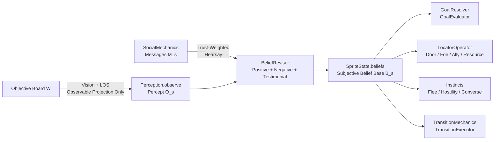
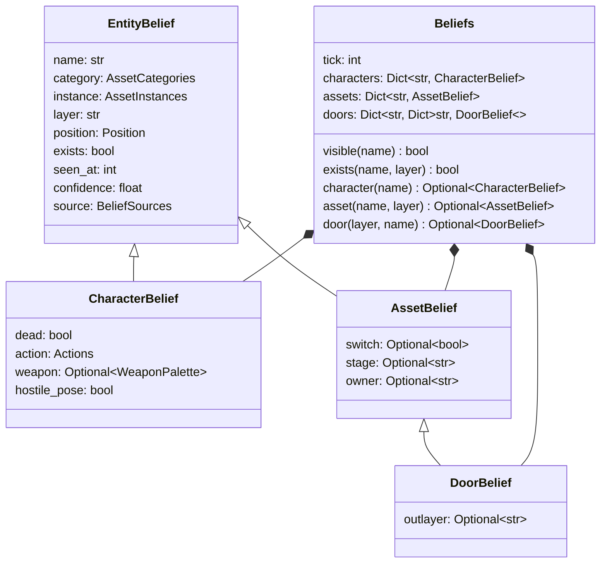

## 1. Theoretical & Architectural Analysis

### 1.1 Evaluating the Two Formulations Against BDI Theory

Your intuition hits directly on the core divide in both the philosophy of action (Michael Bratman) and formal multi-agent logics (Rao & Georgeff; Cohen & Levesque). The two statements you proposed actually capture **two complementary halves** of how Beliefs and Intentions relate in BDI theory — and distinguishing them clarifies exactly how Ontology should architect this layer.

#### Statement A: *"Intentions are a data structure that organizes an interface of beliefs."*

**Alignment: Very strong with Bratman's Planning Theory (1987) and operational BDI architectures (PRS, AgentSpeak/Jason, ABL).**

In Bratman's functionalist account, Intentions are not passive tags; they are **plan structures** that perform three organizational jobs over an agent's cognitive state:

1. **Relevance Framing (The "Interface"):** A Sprite holds many beliefs simultaneously (where doors lead, who is a friend, what items cost, where enemies were last seen). An active Intention node (`hunt`, `find`, `barter`, `speak`) selects *which slice of the Belief Base is actively queried* to govern the next transition or Action. In Ontology, the Intention Transition Matrix literally functions as an index mapping each Intention node to the subset of Belief predicates relevant to that plan step.
2. **Inertia & Commitment:** Intentions stabilize deliberation — an agent does not re-evaluate every Desire on every tick, only the termination/reconsideration predicates bound to its active Intention (`complete`, `lost`, `frightened`, category mismatch).
3. **Means–End Structuring:** An Intention links a Desire to an Action sequence mediated by belief preconditions (`find -> interact` once believed within `action.radius`).

*One nuance from BDI theory:* Intentions **index and query** Beliefs, but they do not **own** them. Beliefs persist independently of any single Intention (believing Door `d1` leads to Layer `1` or believing `archaxes` is dead survives transitions across `hunt`, `escape`, `idle`, and `wander`).

#### Statement B: *"Beliefs are the formal structure of Intentions."*

**Alignment: Strong in formal modal BDI logic (Rao & Georgeff's $BDI_{CTL^*}$; Cohen & Levesque 1990) — with one philosophical distinction.**

In Kripke-semantics BDI logic, an agent's mental state is defined over possible worlds via three accessibility relations: Belief ($\mathcal{B}$), Desire ($\mathcal{D}$), and Intention ($\mathcal{I}$). Under the standard **Realism / Consistency Axioms**:

$$\mathcal{I} \subseteq \mathcal{D} \subseteq \mathcal{B} \qquad \text{and} \qquad \text{Intend}_a(\phi) \implies \text{Bel}_a(\neg \phi) \land \text{Bel}_a(\diamond \phi)$$

An agent can only rationally intend futures that lie *inside the space of worlds it believes are possible* and not yet realized. In that formal sense, **Beliefs constitute the epistemic domain of discourse** over which Intentions are defined and evaluated: every transition predicate $\phi_\tau$ is formally a function of agent $a$'s belief state $B_a$, never of the objective world $W$.

*The philosophical caveat (Direction of Fit):* Beliefs alone cannot *generate* or *constitute* Intentions because they have opposite **directions of fit** (Anscombe / Searle):

| Attitude | Direction of Fit | Role in Ontology (Post-Phase 06.02) |
| --- | --- | --- |
| **Beliefs ($B_a$)** | Mind $\to$ World (aims to represent what *is*) | **Missing unified layer** — currently split between `memory` and omniscient `Board` globals (`sprites`, `assets`) |
| **Desires ($D_a$)** | World $\to$ Mind (what the agent *wants*) | `Instincts` + `psyche.motivation` + `memory.goals` (and active committed `sprite.goal` + `memory.stack`) |
| **Intentions ($I_a$)** | World $\to$ Mind, *committed* (how the agent *plans to act*) | `sprite.intention` + Intention Loops $\langle I, \pi, \beta \rangle$ in `intentions/main.yaml` |

**Synthesis for Ontology:**
> **Beliefs** form the subjective epistemic domain over which ISL predicates are evaluated; **Desires/Goals** are the teleological targets chosen over that domain; **Intentions** are the committed plan states that organize which Belief predicates trigger transitions and Actions.

---

### 1.2 Analyzing the Technical Problem: Relativizing the ISL Environment

At the **end state of Phase 06.02**, Ontology has clean modular boundaries (`Perception`, `GoalResolver`, `Recall`, `Instincts`, `TransitionMechanics`) and a strict `SpriteState(CharacterState)` hierarchy. Yet the ISL evaluation signature still couples the Sprite's mind directly to **objective World state ($W$)**:

$$\text{Phase 06.02 Evaluation:} \quad \text{locals} = \{\,\texttt{sprite}: s, \;\; \texttt{sprites}: W_{\text{characters}}, \;\; \texttt{assets}: W_{\text{layer}}\,\}$$

This leaves four structural leaks that cannot be patched solely by writing careful YAML rules:

1. **Omniscient Character State (`sprites`):** Even with `Perception.track` freezing `goal.position` when unseen, `target.complete` (`not sprites.get(...) or ...dead`) and `mock -> threaten` (`sprites.get(...).intention`) still read live global character states across walls, distances, and Layers. A Sprite instantly learns an enemy died across the map.
2. **Omniscient Layer Asset State (`assets`):** `object.complete`, `resource.complete`, and `door.lost` query `board.states(sprite.layer)`. If another NPC harvests a Resource or destroys a Door outside the Sprite's `vision.radius`, the Sprite telepathically drops the Goal without ever walking there to discover its absence.
3. **No Representation of False, Stale, or Testimonial Beliefs:** Because live `Board` dicts are the source of truth, a Sprite cannot believe something *false* (an outdated Resource location, a mistaken price, a rumor about where the Player fled, or an enemy that slipped away into stealth). Yet Ontology's entire `Narratives` / `Rumors` / `Emergence` design depends on asymmetric information propagating between agents!
4. **Private Mind-Reading Risk:** As `Motivations`, `Commerce`, and `Plots` expand (e.g., `conquest` checking a rival's property or `barter` checking inventory), passing raw `SpriteState` instances in `sprites` exposes *every NPC's private internal state* (`inventory`, `memory`, `psyche.motivation`) to every other NPC.

#### The Relativized Architecture: Mind vs. Body Boundary

The solution is to enforce epistemic relativization **by construction** — removing objective `Board` collections (`sprites`, `assets`) from ISL locals entirely:

$$\text{Phase 06.05 Evaluation:} \quad \text{locals} = \{\,\texttt{sprite}: s, \;\; \texttt{beliefs}: B_s\,\}$$

This draws a hard boundary between the **Body** (sensorimotor systems interacting with objective `Board` $W$) and the **Mind** (deliberative systems operating exclusively over subjective `Beliefs` $B_s$):

* **Objective World ($W$) $\xrightarrow{\text{Observe}}$ Percept ($O_s(t)$):** `Perception` reads `Board` within the Sprite's Layer, `vision.radius`, directional cone / line-of-sight (`geometry.los`, `geometry.cone`), extracting *only externally observable projections* (`position`, `layer`, `dead`, `action`, visible `equipment`, `switch`, `stage` — never private `inventory` or `psyche`).
* **Belief Revision ($B_s(t) = \text{Revise}(B_s(t-1), O_s(t), M_s(t))$):**
  * **Positive Revision (Direct Sighting):** Updates or inserts sparse `EntityBelief` records in place, stamping `seen_at = current_tick` and `source = DIRECT` (`confidence = 1.0`).
  * **Negative Revision (Observed Absence):** When the Sprite's sensory field covers the *believed coordinates* of a static entity (`object`, `resource`, `door`, `property`) and that entity is absent from $O_s(t)$, `Perception` revises `belief.exists = False` (or evicts it). For mobile entities (`character`), absence merely means `seen_at < current_tick` (not visible here — triggering `lost` + `confusion`, *not* falsely believing they died!).
  * **Testimonial Revision (Rumor / Speech):** `SocialMechanics` merges shared beliefs during `speak` with `source = RUMOR`, weighted by `relationships` trust and freshness (`seen_at`), where direct observation always dominates hearsay.
* **Zero-Reset Visibility & Zero-Allocation Discipline:** Storing monotonic `seen_at: int` on each `EntityBelief` and comparing `belief.seen_at == beliefs.tick` gives $O(1)$ visibility checks (`beliefs.visible(name)`) without an $O(|B_s|)$ per-tick reset loop, and mutating `@dataclass(slots=True)` belief records in place avoids inner-loop GC churn.

---

## 2. Backlog Proposal

#### Refactor: Phase 06.05 - Beliefs

**Overview**

Relativize all Sprite cognitive evaluation (`TransitionMechanics`, `GoalResolver`, `LocatorOperator`, and `Instincts`) from objective `Board` state to a subjective, per-Sprite **Belief Base** (`Beliefs`) on `SpriteState`. Replace the omniscient `sprites` and `assets` ISL locals with `beliefs`, upgrade `Perception` into an observational **Belief Revision** stage supporting positive sightings, line-of-sight occlusion, and negative absence detection, restrict inter-Sprite perception strictly to externally observable state projections (eliminating private mind-reading), and wire `SocialMechanics` to exchange testimonial beliefs (`rumors`, entity sightings, and Door routes) modulated by trust and freshness.

##### Specification

###### 1. Formal Epistemic Update Cycle

At each simulation tick $t$, an autonomous Sprite $s$ updates its subjective Belief Base $B_s(t)$ from objective `Board` state $W(t)$ and incoming social messages $M_s(t)$ prior to any deliberative evaluation:

$$O_s(t) = \text{Observe}\big(W(t), \; s(t)\big)$$

$$B_s(t) = \text{Revise}\big(B_s(t-1), \; O_s(t), \; M_s(t)\big)$$

$$\text{GoalOutcome}(t) = \text{GoalEvaluator}\big(s.\text{goal.category}, \; \{\texttt{sprite}: s, \; \texttt{beliefs}: B_s(t)\}\big)$$

$$\text{NextIntention}(t) = \text{TransitionExecutor}\big(s.\text{intention}, \; \{\texttt{sprite}: s, \; \texttt{beliefs}: B_s(t)\}\big)$$



* **Body / Mind Separation:** `Perception`, `NavigationMechanics`, `MotionMechanics`, and `SpatialMechanics` interact with objective `Board` state $W$. `GoalResolver`, `Recall`, `Instincts`, `LocatorOperator`, and `TransitionMechanics` operate exclusively over `(sprite.state, sprite.state.beliefs)` with zero direct reads of `board.characters()` or `board.states()`.

###### 2. Belief Data Hierarchy

`Beliefs` sits on `SpriteState` (never on `SheetState` or `CharacterState`) and stores sparse, slot-allocated records representing what the Sprite takes to be true about deployed entities:



* **Observable Projection Invariant:** `CharacterBelief` captures strictly externally observable traits (`position`, `layer`, `dead`, visible `action`, equipped `weapon`, whether visibly attacking/threatening) — never private internal attributes (`inventory`, `meters.health`, `psyche.motivation`, `memory`).
* **Zero-Reset Freshness:** Direct observation stamps `belief.seen_at = beliefs.tick`. Live visibility reduces to an $O(1)$ timestamp test with zero per-tick clearing loop:
  $$\text{visible}(b) \iff \big(b.\text{exists}\big) \land \big(b.\text{seen\_at} = B_s.\text{tick}\big)$$
* **Separation from Conative `Memory`:** `sprite.state.memory` retains conative and relational stores (`goals`, `stack`, `relationships`, `prices`, `rumors`), while spatial/world-model tables (`memory.sprites`, `memory.doors`, `memory.property`) migrate cleanly into `sprite.state.beliefs`.

###### 3. Epistemic Revision Rules

`BeliefReviser` resolves conflicts using provenance priority (`DIRECT > TESTIMONIAL > INITIAL`), recency (`seen_at`), and trust:

1. **Positive Revision (Direct Observation):** Any entity within `vision.radius` on `sprite.layer` whose anchor passes `geometry.los` (unobstructed by solid elevation obstacles) updates its existing `EntityBelief` in place with `seen_at = tick`, `exists = True`, `confidence = 1.0`, `source = BeliefSources.DIRECT`.
2. **Negative Revision (Observed Absence):** For any belief $b \in B_s$ on `sprite.layer` with $b.\text{exists} = \top$, $b.\text{seen\_at} < B_s.\text{tick}$, and whose believed `b.position` lies within `vision.radius` with clear `geometry.los`:
   * If $b$ is a **static Asset** (`AssetBelief` / `DoorBelief`): set `b.exists = False` (and `b.seen_at = tick`), allowing `object.complete`, `resource.complete`, or `door.lost` to resolve upon discovering the empty site rather than telepathically from afar.
   * If $b$ is a **mobile Character** (`CharacterBelief`): leave `b.exists = True` (the Character moved, not necessarily vanished); `visible(b)` is `False`, triggering `lost` + `confusion` + `store` upon arriving at the empty last-known location.
3. **Testimonial Revision (Social Communication):** During `speak` in `SocialMechanics`, a speaker may share selected beliefs (e.g., high-salience `CharacterBelief` sightings or `DoorBelief` routes) with a listener. Incoming testimony is accepted only if the listener trusts the speaker (`FRIEND`/`FAMILY`, not `FOE`), holds no fresher direct observation (`incoming.seen_at > current.seen_at` or `current.source != DIRECT`), and discounts `confidence` by a decay factor $\gamma \in (0, 1)$.
4. **Bounded Retention (Forgetting):** Beliefs exceeding `BELIEF_TTL` ticks since `seen_at` that are not referenced by `sprite.goal`, `memory.goals`, `memory.stack`, `memory.relationships`, or self-owned `property` are pruned periodically to bound memory per Sprite.

###### 4. Relativized ISL Contract

Both `TransitionExecutor` (`intentions/main.yaml`) and `GoalEvaluator` (`goals/main.yaml`) compile against a single unified local signature:

* `sprite`: Evaluating Sprite's `SpriteState`
* `beliefs`: Evaluating Sprite's `Beliefs` (`sprite.beliefs`)
* `constants`: Application semantic enumerations (including `BeliefSources`)
* `functions`: Pure predicates operating over `(sprite, beliefs)` — replacing `any_memories_visible(sprite, sprites, categories)` with `any_memories_visible(sprite, beliefs, categories)`

Representative relativized rules:

```yaml
# goals/main.yaml (relativized)
goals:
  target:
    complete:
      reflexes: []
      responses: [ forget ]
      conditions:
        - not beliefs.character(sprite.goal.name) or beliefs.character(sprite.goal.name).dead
  door:
    lost:
      reflexes: []
      responses: [ forget, unwind ]
      conditions:
        - not beliefs.exists(sprite.goal.name, sprite.layer) or sprite.trajectory.stalled
  object:
    complete:
      reflexes: []
      responses: [ forget ]
      conditions:
        - sprite.layer == sprite.goal.layer
        - not beliefs.exists(sprite.goal.name, sprite.layer) or sprite.mutators.triggers.interacted
  resource:
    complete:
      reflexes: []
      responses: [ forget ]
      conditions:
        - sprite.layer == sprite.goal.layer
        - not beliefs.exists(sprite.goal.name, sprite.layer)
```

##### Architectural Analysis I

1. **Building on Phase 06.02's End State Without Rework:**
   * Phase 06.02's decomposition of `CognitionMechanics` into `Perception`, `GoalResolver`, `Recall`, `Instincts`, and `LocatorOperator` already isolates the exact seams needed for relativization.
   * Replacing `target` with `assets` in Phase 06.02 Task 4 removes ad-hoc lookup fallbacks immediately; Phase 06.05 then cleanly swaps `(sprites, assets)` for `beliefs` in one atomic cut across `GoalResolver`, `TransitionMechanics`, `Environ`, `settings.LAMBDA_SIGNATURE`, and the two automata YAML matrices.
2. **Eliminating `triggers.vision` Drift:**
   * In Phase 06.02, `mutators.triggers.vision` tracks visibility for the single active Goal only, requiring careful synchronization whenever `sprite.state.goal` changes in Stage 2 or Stage 3.
   * With tick-stamped `Beliefs`, `beliefs.visible(name)` is intrinsically exact for *every* known entity simultaneously; `triggers.vision` becomes a simple derived mirror of `beliefs.visible(goal.name)` (or can be retired from ISL conditions altogether in favor of `beliefs.visible(sprite.goal.name)`).
3. **Bootstrap & Initial Beliefs from State YAML:**
   * Scenarios where a Sprite begins the simulation knowing about an entity on another Layer (e.g., Empress Jasilynn starting on `throne-layer-3` with a `subject` Goal for `player` on Layer `'0'`) remain fully supported: initial State files seed `sprite.beliefs` (with `source = INITIAL`, `seen_at = 0`), preserving intentional agency from tick 1 without granting omniscience about subsequent world changes!
4. **Performance Guardrails:**
   * Running `geometry.los` against every obstacle for every entity in `vision.radius` for every Sprite can become expensive in dense scenes. `Perception.observe` must filter by **same Layer** and **squared Euclidean radius** first, exclude static Tiles and passive Effects, and only execute `geometry.los` on the small candidate set inside `vision.radius` (caching per-Layer static obstacle tuples once per tick outside the Sprite loop).
   * Updating `EntityBelief` fields in place preserves Ontology's zero-allocation inner-loop principle.

##### Goals

###### Goal: Subjective `Beliefs` Model & AGM-Inspired Belief Revision

Introduce `Beliefs`, `EntityBelief`, `CharacterBelief`, `AssetBelief`, and `DoorBelief` on `SpriteState` (migrating spatial/world-model maps out of `Memory`), backed by a `BeliefReviser` module under `app.game.logic.modules.cognition` handling direct positive observation, observed-absence negative revision, trust-weighted testimonial revision, and TTL pruning.

###### Goal: Epistemically Relativized ISL Execution & Cognitive Modules

Remove objective `sprites` and `assets` collections from `TransitionExecutor`, `GoalEvaluator`, `settings.LAMBDA_SIGNATURE`, and `Environ.functions`, passing only `(sprite, beliefs)` into all Intention and Goal rules. Migrate `LocatorOperator` (`DoorLocator` and future entity locators) and `Instincts` (`Flee`, `Hostility`, `Converse`) to query `sprite.state.beliefs` exclusively so `Perception` is the sole boundary reading `Board` state into cognition.

###### Goal: Observable State Projection & Social Information Propagation

Enforce strict projection of externally observable traits in `Perception.observe` (with `geometry.los` occlusion) and extend `SocialMechanics` so conversing Sprites exchange high-salience beliefs (character sightings, deaths, door routes) with provenance and trust discounting — unlocking emergent rumors, false beliefs, stealth, and scouting.

##### Tasks

**1. Task: Belief Semantics, State Models & Hydration Schema**

*Objective*: Define strict Pydantic-validated Belief models on `SpriteState`, enumerate epistemic provenance semantics, and migrate spatial/world-model tables cleanly from `Memory` into `Beliefs`.

* [ ] Subtask: Add `BeliefSources` (`initial`, `direct`, `rumor`) to `app.static.semantics` and expose it in `Environ.constants`.
* [ ] Subtask: Define `@dataclass(slots=True)` models `EntityBelief`, `CharacterBelief(EntityBelief)`, `AssetBelief(EntityBelief)`, `DoorBelief(AssetBelief)`, and `Beliefs` (with typed query helpers `visible`, `exists`, `character`, `asset`, `door`) in `src/app/models/state/assets/beliefs.py` (or `sheets.py`), and attach `beliefs: Beliefs = field(default_factory=Beliefs)` strictly on `SpriteState`.
* [ ] Subtask: Migrate `memory.sprites`, `memory.doors`, and `memory.property` references into `sprite.beliefs` (`characters`, `doors`, `assets` with `owner`), retaining conative/relational fields (`goals`, `stack`, `relationships`, `prices`, `rumors`) on `Memory`, and update `/src/data/state/**/*.yaml` schemas and `Board.serialize` accordingly.
* [ ] Subtask: Add `BELIEF_TTL` and `RUMOR_CONFIDENCE_DECAY` configuration constants to `app.static.settings`.

**2. Task: Perception Observation Projection & `BeliefReviser`**

*Objective*: Upgrade `Perception` into the sole sensorimotor bridge from `Board` to `Beliefs`, implementing observable-only projection, LOS occlusion, negative absence revision, and bounded retention.

* [ ] Subtask: Create `src/app/game/logic/modules/cognition/beliefs.py` implementing `BeliefReviser` with `observe_positive(beliefs, percept)`, `observe_absence(beliefs, sprite, visible_names, obstacles)`, `assimilate_testimony(beliefs, incoming, relationship)`, and `prune(beliefs, memory, ttl)` — mutating existing slot records in place with zero inner-loop heap churn.
* [ ] Subtask: Update `Perception` in `src/app/game/logic/modules/cognition/perception.py` to advance `beliefs.tick`, cache per-Layer static obstacle primitives once per tick, filter same-Layer `Characters`, `Doors`, `Objects`, `Resources`, and `Crafts` by `vision.radius` + `geometry.los` (optional `geometry.cone`), project strictly observable attributes into `EntityBelief` updates, and execute negative absence revision for expected static assets missing within visible LOS.
* [ ] Subtask: Re-anchor `Perception.fear` and `Perception.track` onto `sprite.state.beliefs`: evaluate `triggers.frightened` solely from currently visible hostile `CharacterBelief` entries within `fear.radius` (plus self health ratio), wake dormant `memory.goals` when `beliefs` receives a fresh direct or trusted testimonial update, and derive `triggers.vision` from `beliefs.visible(goal.name)`.
* [ ] Subtask: Update `InteractionMechanics` Door traversal to record bidirectional `DoorBelief` entries directly into `sprite.state.beliefs.doors` (recording `outlayer` on both origin and reciprocal `OUT` projections).

**3. Task: Relativize ISL Signature, `GoalResolver`, `TransitionMechanics`, `LocatorOperator` & `Instincts`**

*Objective*: Remove all objective `Board` collections (`sprites`, `assets`) from ISL execution and deliberative cognitive modules so Sprite decisions depend exclusively on `(sprite, beliefs)`.

* [ ] Subtask: Update `settings.LAMBDA_SIGNATURE` to replace `sprites=None, assets=None` with `beliefs=None` (verifying `PlotMechanics` and `SeasonMechanics` locals remain unaffected), and refactor `Environ.functions.any_memories_visible(sprite, beliefs, categories)` to query `beliefs.visible(goal.name)` and `not beliefs.character(goal.name).dead` without inspecting `Board` character dicts.
* [ ] Subtask: Update `GoalResolver.evaluate(state, beliefs)` and `GoalResolver.resolve(sprite, board)` to pass `locals={'sprite': sprite.state, 'beliefs': sprite.state.beliefs}`, and update `TransitionMechanics.update()` to pass `locals={'sprite': sprite.state, 'beliefs': sprite.state.beliefs}` (removing the `board.characters()` query from `TransitionMechanics`).
* [ ] Subtask: Update `/src/data/configurations/automata/goals/main.yaml` and `/src/data/configurations/automata/intentions/main.yaml` to query `beliefs` (`beliefs.character(...)`, `beliefs.asset(...)`, `beliefs.exists(...)`, `beliefs.visible(...)`) instead of `sprites` and `assets`, eliminating all remaining cross-layer and off-vision telepathy.
* [ ] Subtask: Refactor `DoorLocator` (`cognition/locators.py`) and all concrete `Instincts` (`FleeInstinct`, `HostilityInstinct`, `ConverseInstinct`) to read `sprite.state.beliefs` exclusively rather than scanning `board.characters()` or `board.instances(AssetInstances.DOORS)` directly.

**4. Task: Testimonial Belief Exchange in `SocialMechanics`**

*Objective*: Enable Sprites in `speak` to propagate subjective beliefs (entity sightings, deaths, and Door routes) with trust filtering and provenance precedence.

* [ ] Subtask: Extend `SocialMechanics` Sprite-to-Sprite dialogue exchange to select salient recent beliefs from the speaker's `Beliefs` (e.g., observed `FOE` locations/deaths, mapped `DoorBelief` routes, or requested `memory.goals` subjects) and feed them through `BeliefReviser.assimilate_testimony(...)` on the listener.
* [ ] Subtask: Ensure direct sightings (`BeliefSources.DIRECT`) always supersede hearsay (`BeliefSources.RUMOR`), distrusted speakers (`Relationships.FOE`) are rejected, and receiving a trusted sighting of a dormant remembered Goal wakes it (`dormant = False`) with the rumored coordinates and Layer.

**5. Task: Verification & Epistemic Isolation Tests**

*Objective*: Verify zero epistemic leakage, false-belief persistence and revision upon arrival, testimonial belief propagation, and AST/Lambda backend parity.

* [!: Dependent on User Acceptance Tests] Subtask: Add unit tests verifying `BeliefReviser` positive revision, negative absence revision for missing static Assets (`object`/`resource`/`door`) vs. non-lethal absence for mobile Characters (`target`/`subject`), `seen_at == tick` zero-reset visibility, and `BELIEF_TTL` pruning without evicting active/stored Goals.
* [!: Dependent on User Acceptance Tests] Subtask: Add epistemic isolation tests confirming a Sprite with a distant `target`, `resource`, or `object` Goal retains its false belief when the target dies or is removed outside `vision.radius` / behind an LOS wall, and resolves `complete`/`lost` only once the Sprite enters visible LOS of the location (or receives a trusted rumor).
* [!: Dependent on User Acceptance Tests] Subtask: Add `Compiler` vs. `Lambda` parity tests for the relativized `locals={'sprite': ..., 'beliefs': ...}` contract across `goals/main.yaml` and `intentions/main.yaml`, plus `SocialMechanics` rumor-propagation tests (trust acceptance vs. `FOE` rejection, direct-observation dominance over stale rumors).