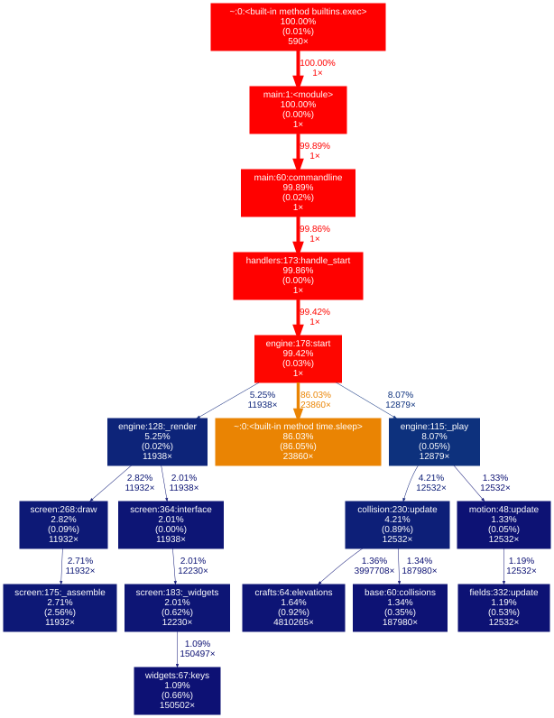
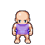
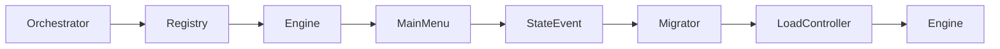

# Context 

* This prompt is generated by dynamically scraping the **User's** environment.
* The **User** employs **Tools** to provide **Views** into the environment. A **View** is context. 
* Refer to the **Task** for the current directive. All context is provided in support of accomplishing the **Task**.

# Tool: Manager

The **Manager Tool** provides **Views** into project planning, architectural designs and other high-level **Documentation**.

## Manager: Views

### View: Task Board

- **Current Phase**: 07-06
- **Current Phase Action**: REFACTOR

#### Ontology: Task Board

This is the Task Board for the project. Below is a backlog of completed and pending Tasks. Tasks are divided into Phases. Phases are not necessarily sequential.

!!! "Task Progress Key"
  `[ ]`: Open
  `[~]`: In Progress
  `[?]`: Needs Further Analysis
  `[x]`: Closed/Implemented
  `[!]`: DO NOT COMPLETE

!!! "Phase Actions"
  * **Implement**: Complex, multi-task development of new functionality.
  * **Refactor**: Complex, multi-task iteration of existing functionality.
  * **Patch**: Tasks for fixing logical bugs or errors in the codebase.
  * **Design**: Short, encapsulated tasks for creating data structures.

**Table of Contents**

* **Actions:**
  * **Implement:**
    * [x]: [Phase 01: Renderer](./phases/implement/implement-01.md)
    * [x]: [Phase 02: Game](./phases/implement/implement-02.md)
    * [x]: [Phase 03: Physics](./phases/implement/implement-03.md)
    * [x]: [Phase 04: Widgets](./phases/implement/implement-04.md)
    * [~]: [Phase 05: Editor](./phases/implement/implement-05.md)
    * [x]: [Phase 06: Intentions](./phases/implement/implement-06.md)
    * [x]: [Phase 07: Compositions](./phases/implement/implement-07.md)
    * [x]: [Phase 08: Pathfinding](./phases/implement/implement-08.md)
    * [x]: [Phase 09: Hydrodynamics](./phases/implement/implement-09.md)
    * [x]: [Phase 10: Seasons](./phases/implement/implement-10.md)
    * [ ]: [Phase 11: Geology](./phases/implement/implement-11.md)
    * [ ]: [Phase 12: Chemistry](./phases/implement/implement-12.md)
    * [ ]: [Phase 13: Acoustics](./phases/implement/implement-13.md)
    * [ ]: [Phase 14: Narratives](./phases/implement/implement-14.md)
    * [ ]: [Phase n: Commerce](./phases/implement/implement-n.md)
    * [ ]: [Phase n+1: Towns](./phases/implement/implement-n+1.md)
  * **Refactor:**
    * *Phase 01:*
      * [x]: [Phase 01.01: Orchestration](./phases/refactor/refactor-01-01.md)
    * *Phase 02:*
      * [x]: [Phase 02.01: Frames](./phases/refactor/refactor-02-01.md)
      * [x]: [Phase 02.02: Registry](./phases/refactor/refactor-02-02.md)
      * [x]: [Phase 02.03: Equipment](./phases/refactor/refactor-02-03.md)
      * [x]: [Phase 02.04: Engine](./phases/refactor/refactor-02-04.md)
      * [x]: [Phase 02.05: Finetuning](./phases/refactor/refactor-02-05.md)
      * [x]: [Phase 02.06: Effects](./phases/refactor/refactor-02-06.md)
      * [x]: [Phase 02.07: Registry Data Structures](./phases/refactor/refactor-02-07.md)
      * [ ]: [Phase 02.08: World Chunks](./phases/refactor/refactor-02-08.md)
    * *Phase 03:*
      * [x]: [Phase 03.01: Mechanics](./phases/refactor/refactor-03-01.md)
      * [x]: [Phase 03.02: Consolidation](./phases/refactor/refactor-03-02.md)
      * [x]: [Phase 03.03: Motion](./phases/refactor/refactor-03-03.md)
      * [ ]: [Phase 03.04: Projectiles](./phases/refactor/refactor-03-04.md)
    * *Phase 04:*
      * [x]: [Phase 04.01: Typography](./phases/refactor/refactor-04-01.md)
      * [x]: [Phase 04.02: Simplification](./phases/refactor/refactor-04-02.md)
      * [x]: [Phase 04.03: EventHandlers](./phases/refactor/refactor-04-03.md)
      * [x]: [Phase 04.04: MenuContext](./phases/refactor/refactor-04-04.md)
      * [x]: [Phase 04.05: Gizmos](./phases/refactor/refactor-04-05.md)
      * [x]: [Phase 04.06: Pane Generation](./phases/refactor/refactor-04-06.md)
    * *Phase 06:*
      * [x]: [Phase 06.01: Expressions](./phases/refactor/refactor-06-01.md)
      * [ ]: [Phase 06.02: Goals](./phases/refactor/refactor-06-02.md)
      * [ ]: [Phase 06.03: Combat](./phases/refactor/refactor-06-03.md)
      * [x]: [Phase 06.04: Inventory](./phases/refactor/refactor-06-04.md)
    * *Phase 07:*
      * [x]: [Phase 07.01: Elevation Sorting](./phases/refactor/refactor-07-01.md)
      * [x]: [Phase 07.02: Platforms & Elevated Hitboxes](./phases/refactor/refactor-07-02.md)
      * [x]: [Phase 07.03: Gravity](./phases/refactor/refactor-07-03.md)
      * [x]: [Phase 07.04: Materialization](./phases/refactor/refactor-07-04.md)
      * [ ]: [Phase 07.05: Composite Compositions](./phases/refactor/refactor-07-05.md)
      * [ ]: [Phase 07.06: Primitive Crafting](./phases/refactor/refactor-07-06.md)
    * *Phase 08:*
      * [x]: [Phase 08.01: Obstable Geometry](./phases/refactor/refactor-08-01.md)
      * [x]: [Phase 08.02: NavigationMechanics](./phases/refactor/refactor-08-02.md)
      * [x]: [Phase 08.03: Trajectory Optimization](./phases/refactor/refactor-08-03.md)
      * [ ]: [Phase 08.04: Mutators](./phases/refactor/refactor-08-04.md)
    * *Phase 09:*
      * [x]: [Phase 09.01: Fluid Flows](./phases/refactor/refactor-09-01.md)
      * [x]: [Phase 09.02: Shorelines & Geography](./phases/refactor/refactor-09-02.md)
      * [x]: [Phase 09.03: Consolidation](./phases/refactor/refactor-09-03.md)
      * [x]: [Phase 09.04: Optimization](./phases/refactor/refactor-09-04.md)
      * [x]: [Phase 09.05: Bridges & Bifurcation](./phases/refactor/refactor-09-05.md)
      * [x]: [Phase 09.06: Cythonization](./phases/refactor/refactor-09-06.md)
      * [x]: [Phase 09.07: Frame Caching](./phases/refactor/refactor-09-07.md)
      * [ ]: [Phase 09.08: Transverse Fluid Submersion](./phases/refactor/refactor-09-08.md)
    * *Phase 10:*
      * [x]: [Phase 10.01: Stage Hitboxes](./phases/refactor/refactor-10-01.md)
      * [x]: [Phase 10.02: Shoreline Seasonal Indexing](./phases/refactor/refactor-10-02.md)
      * [ ]: [Phase 10.03: Flowers, Pixies & Reproduction](./phases/refactor/refactor-10-03.md)
      * [ ]: [Phase 10.04: Cythonization](./phases/refactor/refactor-10-04.md)
  * **Design:**
    * *Automaton*
      * [x]: [Intention Automata 000: Dialogue](./phases/design/design-automata-dialogue.md)
      * [x]: [Intention Automata 001: Interaction](./phases/design/design-automata-interaction.md)
      * [x]: [Intention Automata 002: Wander](./phases/design/design-automata-wander.md)
    * *Compositions:*
      * [x]: [Composition 000: Castle Dawn](./phases/design/design-comp-castle-dawn.md)
      * [ ]: [Composition 001: Temple of Trials](./phases/design/design-comp-temple-of-trials.md)
      * [~]: [Composition 002: Regalia Galleria](./phases/design/design-comp-regalia-galleria.md)
    * *Menus*
      * [x]: [Menu 000: View](./phases/design/design-menu-view.md)
      * [x]: [Menu 001: Dialogue](./phases/design/design-menu-dialogue.md)
      * [x]: [Menu 002: Inventory](./phases/design/design-menu-inventory.md)

#### Refactor: Phase 07.06 - Crafting

**Overview**

Building upon the Material aspect of Assets, design and introduce a Crafting system managed through a new Craft Menu.

##### Specification

**(Blueprints, Materials)**

* materials: 
    * organics: cottons, thatches, wood
    * ceramics: clay
    * geologics: limestone, feldspar, granite, marble
    * metallics: copper, iron, gold
    * chromatics: neutral, blue, red, yellow, green
* blueprints: 
    * buildings: floors, walls, flats, roofs, paths, halls
    * corridors: solids, stripes, designs
    * columns: crowns, shafts, bases 
    * decor: decor
    * enclosures: north, east, south, west
    * inclines: up, left, right
    * orientations: horizontal, vertical

**Definition: Primitives**

Primitive Crafts can be constructed by the User without a Composition container.

* Stairs
* Bridges
* Decor Struts

**Definition: Armatures**

To hide the complexity of the Strut (Blueprint, Material) space from the User, a subdirectory of Compositions (`/src/data/config/compositions/armatures/**/*.yaml`)will be maintained, known as *Armatures*. In a sense, Armatures integrate a Strut over its Blueprint partition. 

```yaml
compositions:
  armature/building/home:
    root:
      strut:
        id: home
        name: roof
        blueprint: roofs
      components:
        objects:
          doors:
            - id: panel
              name: door
              anchor: anchor(exterior)
              material: neutral
              outlayer: house-layer
              position:
                x: (bind(parent.dimensions.w) - bind(self.dimensions.w)) // 2
                y: bind(exterior.position.y) + bind(exterior.dimensions.l) - bind(self.dimensions.l)
              out:
                x: bind(interior.position.x) + (bind(interior.dimensions.w) - bind(self.dimensions.w)) // 2
                y: bind(interior.position.y) + bind(floor.position.y) + bind(floor.dimensions.l) - bind(self.dimensions.l)
        crafts:
          struts:
            - id: home
              name: exterior
              material: bind(root.material)
              blueprint: walls
              position:
                x: 0
                y: bind(parent.dimensions.l)
    branches:
      - strut:
          id: home
          name: interior
          material: bind(root.material)
          blueprint: halls
          layer: house-layer
          position:
            x: 10
            y: 10
        components:
          crafts:
            struts:
              - id: home
                name: floor
                layer: house-layer
                material: bind(root.material)
                blueprint: floors
                position:
                  x: 0
                  y: bind(parent.dimensions.l)
```

These are "*User Facing Crafts*". Users do not directly instantiate Struts. They instantiate Armatures of Struts (e.g. parameterized Compositions). In the example above, the branch Struts depend on the `material` of the root Struts, which is dependent on the parameter passed into the Composition. In this way, the parameter of Material is a degree of freedom determined by User selection.

Each Armature will be keyed according to the following schema:

* `armature/<icon-filter>/<strut>`
    * `<icon-filter>`: The Icon to which the Armature activates when filtering. (See **Feature: Craft Filters**)
    * `<strut>`: The Primitive Strut which the Armature integrates over its Blueprint Partition.

* `icon-filters`: `building`, `road`, `tower`, `carpentry`, `railing`

**Initialization**: 

* The MaterialIndex Relation and Materializer Service are used to construct a Cost Ledger for all indexed Primitive Crafts and configured Armatures.
    * Each separate instance of a Primitive Craft will need to be unpacked across the dimension of (Blueprints, Materials). For example, a `steps` Stair unpacks into `steps-up-limestone`, `steps-left-limestone`, `steps-right-limestone`, `steps-up-feldspar`, `steps-left-feldspar`, `steps-right-feldspar`, ... 

**Menu: Pack**

* `dock(header)`: `pane(content="Pack")`
* `stack`:
    * `dock(subheader)`: `pane(content="Resources")`
    * `dock(materials)`: `gizmo(context.inventory.pack)`
    * `dock(crops)`: `gizmo(context.inventory.sack)`
* `stack`:
    * `dock(subheader)`: `pane(content="Crafts")`
    * `dock(filters)`: `gizmo(context.filters)` 
    * `dock(crafts)`: `gizmo(context.crafts)`

`dock(filters)` needs to be able to bind to an Enum, i.e. the static list of Frames in the `crafts` Icon, *and* a dynamically generated list of Crafts. These fields can be stored in the Menu context.

**Minimum Viable Product: Craft Workflow**

1. Player opens Craft Menu.
2. Menu populates the Craft Formulae Pane with Slots hydrated from *all* entries in the Cost Ledger and initializes each one with the `disabled` Status. 
3. Controller takes Player Inventory and compares it to the Cost Ledger. Any entry in the Cost Ledger that is satisfied by the Player Inventory is set to `enabled` Status.
4. Player selects a constructable Craft.
5. Craft Menu closes.
6. A Craft is instantiated *level* with the Player (where *level* is defined as their ground baseline's being equal) and directly *adjacent* (where *adjacent* is defined as touching with no pixel overlap).
 
**Feature: Craft Filters**

The `crafts` Icon Widget can be utilized to represent user-facing Crafts (Primitives & Armatures). The Craft Menu should have a traversible dock of `crafts` Icons. When one of the `crafts` is selected, the Cost Ledger hides any entries that do not match the filter.

### View: Documentation 

#### Ontology Docs: Index

*Ontology* is a personal project I have been working on in some form for over a decade, begun shortly after the actual Liberated Pixel Cup concluded. It has been scrapped and remade many times as I learned the mechanics of game development and software engineering. This is my latest attempt to build a highly opinionated, yet entirely configurable and extensible game engine. The general philosophy of the project is: simulation and emergence, at all costs. The goal of the engine is to construct a process that ingests a starting world state and then evolves according to its own internal logic, without scripting. All gameplay is achieved by configuring the initial conditions of the world state and letting it "rip", so to speak.

!!! note "LPC" All assets are taken from the [Liberated Pixel Cup](https://lpc.opengameart.org/)

##### Index: Sections

* [Overview](./00-overview.md)
* [Assets](./01-assets.md)
* [Sprites](./02-sprites.md)
* [Compositions](./03-compositions.md)
* [Intentions](./04-intentions.md)
* [Mechanics](./05-mechanics.md)
* [Widgets](./06-widgets.md)
* [Acoustics](./07-acoustics.md)
* [Narratives](./08-narratives.md)
* [Ecology](./09-ecology.md)
* [Chemistry](./10-chemistry.md)
* [Emergence](./11-emergence.md)
* [Architecture](./12-architecture.md)
* [Appendices](./appendices/index.md)
    * [Appendix O: References](./appendices/00-references.md)
    * [Appendix I: Schemas](./appendices/01-schemas.md)
    * [Appendix II: Diagrams](./appendices/02-diagrams.md)
* [Specifications](./specs/index.md)
    * [Spec: Dialogue Loop](./specs/00-dialogue.md)
    * [Spec: Interaction Loop](./specs/01-interaction.md)
    * [Spec: Wander Loop](./specs/02-wander.md)

##### Index: Quality Control

###### Quality Control: Tests

[](https://github.com/chinchalinchin/ontology/actions/workflows/tests.yml)

###### Quality Control: Application Profile

 /// caption Runtime call graph and execution profile generated from `pstats` via `gprof2dot`. ///

#### Ontology Docs: Overview

!!! note "Capitalization" Terminology is capitalized to distinguish it from its colloquial connotations.

!!! note "Angular Brackets" Angular brackets denote parameters.

!!! note "Orientation" (0,0) corresponds to the upper-left corner, with down being the positive y-direction.

!!! note "Width, Length" Width is a horizontal displacement, length is a vertical displacement.

!!! note "Logical Quantification `|` is used as a logical quantifier, e.g. `y | y + x = 3` would mean the set of `y` that lie along the line `3 - x`.

!!! note "Model vs Fields" In all following pages, *Model* generally means a nested data structure, whereas *Field* refers to a primitive quantity.

##### Cores

###### Core: Assets

Assets are the foundation of the Engine. They are, fundamentally, a class for binding image atlases on the fileystem to entities stored on the [Board](#component-board) and shown on the [Screen](#component-screen).

All Assets have an *ID* and *properties*. Most, but not all, Assets have *State*.

Assets are divided into non-overlapping (Category, Instance) nodes, known as the [Asset Hierarchy](./01-assets.md#asset-hierarchy). Different Categories of Assets expand the base Properties and States in various ways. In brief, the Asset categories are,

* [Crafts](./01-assets.md#category-crafts)
* [Cursors](./01-assets.md#category-cursors)
* [Effects](./01-assets.md#category-effects)
* [Geography](./01-assets.md#category-geography)
* [Objects](./01-assets.md#category-objects)
* [Sheets](./01-assets.md#category-sheets)
* [Acoustics](./07-acoustics.md)
* [Resources](./01-assets.md#category-resources)
* [Tiles](./01-assets.md#category-tiles)
* [Widgets](./06-widgets.md)

Assets are placed in the `/src/assets/<category>/` directory and then registered in a Asset Category index `/src/assets/<category>/**/*.yaml` file. The YAML index schema for each Asset configures its *Properties*, i.e. the static attributes that are constant and do not change as a result of gameplay.

The `/src/assets` directory is known as the *asset directory*.

See [Asset Schema](./appendices/01-schemas.md#schema-properties) for more information on the Asset Property index.

###### Core: State

* Location: `/src/data/state/`

An [Asset](./01-assets.md) is deployed onto a [Board](#component-board), where it acquires its State, i.e. the dynamic attributes which change as a result of [Mechanics](./05-mechanics.md). The Application ingests and stores this information in the State directory.

An [Asset Category](./01-assets.md#asset-hierarchy) has a single schema for Properties that each Instance utilizes, but each individual [Asset Instance](./01-assets.md#asset-hierarchy) has a unique State, particular to its deployment. For example, a [Chest](./01-assets.md#object-chests) is configured once by its Properties (its width, length, etc.), but each instance of a [Chest](./01-assets.md#object-chests) on the [Board](#component-board) is given a unique state (its Position, Content, etc.).

###### Core: Configuration

* Location: `/src/data/config`

Mechanics, Relations and other components of the [Engine](#component-engine) utilize Configuration stored in the Configuration directory:

* [Actions](./01-assets.md#category-sheets)
* [Compositions](./03-compositions.md)
* [Intentions](./04-intentions.md)
* [Library](./08-narratives.md)
* [Mappings](./02-sprites.md#devices)
* [Materials](./01-assets.md#concept-materiality)
* [Mechanics](./05-mechanics.md)
* [Menus](./06-widgets.md#configuration-menus)
* [Plots](./08-narratives.md)
* [Recipes](./01-assets.md#overview-concepts)

##### Application

The Application consists of an interconnected and interdependent system of Configurations, Services, Libraries and Components. These system serve to interpret and operate on Asset Properties and Asset State.

See [Architecture documentation](./12-architecture.md) for more information.

###### Configurations

###### Configuration: Loader

* Address: `app.static.loader`

The Loader is responsible for reading in Configurations, Properties and State files from their respective directories, and then validating them into Models via Pydantic TypeAdaptors.

###### Configuration: Semantics

* Address: `app.static.semantics`

All semantic terms utilized by the [Application](#application) are enumerated within this package.

###### Services

###### Service: Factory

* Address: `app.services.generators.game.factory`

The Factory builds [Assets](./01-assets.md) and other Components based on [Recipes](./appendices/01-schemas.md#configuration-recipes).

###### Service: Orchestrator

* Address: `app.services.orchestration.orchestrator`

The Orchestrator is the dependency injection system. It is responsible for converting validated Models into application Components.

###### Libraries

###### Library: Registry

* Address: `libs.graphics.registry`

The Registry loads in all of the Asset files while the application bootstraps. Each Asset Frame is indexed and stored in memory.

###### Components

###### Component: Board

* Address: `app.game.board`

The Board acts as the Game's in-memory "database". It holds all in-game Assets and Configurations during the game loop, providing queryable interfaces to the Engine and Mechanics.

The state files for each Board are maintained in `/src/data/state/<board-key>/**`.

**Interface: Queries**

The Board exposes interfaces for querying the game state:

* Hierarchy Queries
    1.  `board.instances(key, layer)`: Returns a List of Assets on the given layer, filtered by Instance `key`.
    2.  `board.categories(key, layer)`: Returns a List of Assets on the given layer, filtered by Category `key`.
* Physics Queries
    1.  `board.bridges(layer)`: Returns a list of Bridge Assets on a layer.
    2.  `board.weights(layer)`: Returns a list of Assets with non-negative mass ($m \ge 0$) on the given layer (includes static and dynamic bodies; excludes sensors).
    3.  `board.obstacles(layer)`: Returns a list of Assets that qualify as Obstacles.
* Environment Queries
    1.  `board.tile(layer, position, instance)`: Retrieves background or foreground [Tiles](./01-assets.md#category-tiles) via $O(1)$ spatial hash lookup.
    2.  `board.shorelines(layer=None)`: Retrieves active procedural shoreline assets for a specific layer or across all layers.
    3.  `board.moisture(layer, x, y)`: Queries scalar soil moisture potential $\Phi(x, y)$ from the layer's compiled `MoistureField`.

**Interface: Predicates**

THe Board exposes predicates for asserting conditions of the Board state.

* Environment Predicates
    1.  `board.fluid(layer, position, exclude=None)`: Evaluates whether a coordinate intersects any active [Fluid](./01-assets.md#effect-fluids) stream or annular pool across the layer, with an optional entity exclusion filter.

**Service: Cradle**

The Cradle instantiates Assets during the course of the [Engine](#component-engine) loop through the interface of [Mechanics](./05-mechanics.md).

**Service: Migrator**

The Migrator asynchronously loads the Board State.

###### Component: Engine

* Package: `app.game.engine`

The Engine handles the core loop and Frame rate calculations.

**Field: Bus**

The Bus processes asynchronous [Events](./06-widgets.md#events).

**Service: Provider**

The Provider instantiates [Menus](./06-widgets.md#configuration-menus).

**Service: Binder**

The Binder for binding [Widget](./06-widgets.md) States to [Asset](./01-assets.md) States.

**Service: Library**

The Provider contains a Library for injecting Widget states with plot-dependent content.

###### Component: Screen

* Package: `app.game.screen`

The Screen acts as a high-level container for a Cythonized SDL rendering interface.

##### Concepts

###### Concept: Hitboxes

Many Assets have Hitboxes. Hitboxes definitions are static and read before the execution of the [Engine](#component-engine) Hitboxes have positions and dimensions.

To ensures Hitboxes remain statically configured, Hitbox positions are always given relative to the Asset, i.e. treating the upper-left corner of the Asset frame as the origin. Hitbox dimensions are always absolute. The following snippet shows the hitbox schema for an LPC Sprite Frame, with the image below showing how the hitbox translates into the physical image with a blue rectangle,

``` yaml
position:
    x: 21
    y: 23
dimensions:
    w: 22
    l: 21
```

 /// caption LPC Sprite Hitbox in (Walk, Down, 0) State ///

While hitboxes are statically confitured, this does not necessarily mean hitboxes are statically accessed. See [Asset Component Architecture](./01-assets.md#asset-architecture) for more information.

###### Concept: Layers

All deployed Assets have a Layer. Layers represent a "view" where the Asset is located. When the Screen renders an entire frame, it is rendering a Layer.

Layers on a board can be traversed through Doors. The coordinate plane of each Layer is independent of every other. For example, a Sprite may enter a Door on Layer 1 at `(x_1, y_1)` and get released on Layer 3 at `(x_2, y_2)`. For this reason, each Layer may have different dimensions.

Sprite interactions are constrained by their Layers. Because Layers are superimposed coordinates, all interaction calculations are separated by Layer, to avoid inter-Layer collisions and interactions.

###### Concept: Sprites

[Sprites](./02-sprites.md) are [Intentional](./04-intentions.md) [Assets](./01-assets.md). More formally, Sprite Intentions are driven through a coupled system of finite automata, logic and spatial algorithms. The data structure that drives this process is called the [Intention Transition Matrix](./04-intentions.md#transition-matrix). The processing and handling this mechanism occupies a large part of the application's internal logic.

#### Ontology Docs: Assets

This document serves to specify the Asset architecture and provide key definition for [Application](./00-overview.md#application) terminology.

!!! note "Definition" An Asset is an image file.

!!! note "Liberated Pixel Cup" [LPC](https://lpc.opengameart.org/) Assets are bundled with the [Application](./00-overview.md#application) by default.

##### Assets: Overview

The Asset directory (and all subdirectories) contains Asset Image Files (`*.png`) and Asset Property indices (`*.yaml`). The [initialization and hydration phases](./12-architecture.md#specification-initialization) of the [Application](./00-overview.md#application) read in all of these files recursively.

The Property indices are used to index each Asset file into the [Registry](./00-overview.md#library-registry). Each image file that appears in the Asset directories must be configured in a YAML file to get indexed and injected into the [Application](./00-overview.md#application) . The Property configuration in the `*.yaml` files must conform to the [Asset Property schema](./appendices/01-schemas.md#model-properties) of the respective Asset Category it is configuring.

!!! important "Schema Merge" All `*.yaml` files in the Asset directories are merged into a single schema, so every key must be unique. If two image files have the same name, one of them will be overwritten during [Registry indexing](./00-overview.md#library-registry).

###### Overview: Concepts

###### Concept: Identity

**IDs & Names**

IDs are used to map Asset Files to images loaded into the [Registry](./00-overview.md#library-registry), to ensure each Asset is only loaded into the memory once, no matter how many times it is rendered in a single frame. In other words, IDs uniquely identify a physical Asset File, but not rendered entities.

Names are used to uniquely identify an instance of the Asset file. A single Asset ID may have multiple Names. A Name corresponds to a particular deployment of an Asset onto the [Board](./00-overview.md#component-board).

In short, a Name identifies an Asset's deployment. A ID is what binds a deployed Asset to its image file.

###### Concept: Mutability

**Properties & State**

*Properties* are static and never changed by [Mechanics](./05-mechanics.md). Properties determine the immutable characteristics of Assets, e.g. their dimensions and hitboxes. They are loaded side-by-side with the Asset files in the `/src/assets/**` directory. All Assets have, at bare minumum, a Dimension property, specifying their respective width and length, and a Priority property, that specifies the [statically configured sort key](./12-architecture.md#rendering-sort) for their relative rendering order. Dimension is a Cartesian coordinate (tuple), whereas Priority is an integer.

*State* is dynamic and can be changed by [Mechanics](./05-mechanics.md). State determines the mutable characteristics of an Asset, e.g. the current Position of an Asset, the current Animation, etc. All Assets have: *Position* State, given as a Cartesian coordinate (tuple); a Layer, given as a categorical variable'; an Elevation, representing their Z-axis, given as an integer; an Anchor, used to augment the perspective-based render sorting, given as an integer.

!!! @TODO(08-04) Mutators are polymorphic. Because of this, they have attributes that are not utilized by every Asset that is instantiated. They are one of the core ambiguities in the entire Asset model. They are mainly utilized by Sprites to signal their States have internally reached certain conditions, e.g. `vision` is triggered when the Sprite is in sight of its Goal.

    They also contain general Asset fields, like `submerged`, that is triggered when an Asset is immersed in a Fluid stream. 

    Mutators likely need to be another component, like Frame or Animation, that is injected into the Asset. Then different implementations of Mutators need to be registered to each Asset. 

In addition, all Assets have a `mutators` attribute that is used to augment the core behavior of the Asset during [Screen rendering](./00-overview.md#component-screen) and [Mechanics evaluation](./05-mechanics.md).

**Model: Mutators**

* `parameters`:
    * `action: bool`: The radius of the Asset's action.
    * `vision: bool`: The radius of Asset's vision.
* `triggers`: Boolean flags.
    * `animated: bool`: Flag for receiving animation updates.
    * `dead: bool`: Flag for receiving Mechanic updates.
    * `submerged: bool`: Flag for receiving Frame channels.

**Base Model: AssetProperties**

* `dimensions: Dimensions`: Asset Frame dimensions.
* `priority: int`: Static ordinal render sort key.

All Asset Properties inherit fields from this model.

**Base Model: AssetState**

* `layer: str`: Board Layer key.
* `elevation: int`: The Z-axis of the Asset.
* `anchor: int`: Offset for ground perspective render sort-key.
* `mutators: Mutators`: General behavioral flags for rendering and logic.

All Asset States inherit fields from this model.

###### Concept: Animacy

**Frames & Animations**

* **Frame (`index` and `keys`)**: A Frame binds an Asset's raw image file to a discrete *Frame space*. `Frame.index(id, properties)` uses Asset Properties to partition the image file into named crop regions in the [Registry](./00-overview.md#library-registry). `Frame.keys(id, state)` is the inverse projection at runtime: it maps the Asset's current Asset State directly to the active crop key(s) in that Frame space.
* **Animation (`animate`)**: An Animation exists **if and only if** a non-instantaneous, time-stepped transition across Frame space must be mediated by Asset Properties:
    * In [Effects](#category-effects), temporal progression is governed by `frequency` (`delay`, `amount`, `cooldown`, `persist`).
    * In [Sheets](#category-sheets), temporal progression is governed by `actions` (`count`, `delay`).

Frame Space is a representation of the different dispositions assumed by Asset Categories; Frames in a Sprite Sheet represent Actions, Frames in a Resource represent Lifespan Stages, Frames in an Effect represent Periodicity, etc. These are differences are manifested in the atlasing strategy used by Asset Frame. This space is described by the particular configuration of an Asset's Properties, and furthermore, to exist on the [Board](./00-overview.md#component-board), an Asset must have a strategy for associating its State with a particular Frame described by its Properties.

An *Animation* represents a strategy for navigating the Frame space over time. Animations project the internal State changes in an Asset onto a particular trajectory through its Frame space. When an Asset implements an Animation, this is accompanied by its State possessing an `animation` State field. The purpose of this field is to mutate over time and thus describe the trajectory of the Asset through its Frame space.

$$
\text{Frame.index}: \text{Properties} \to \text{Atlas}
$$

$$
\text{Frame.keys}: \text{State} \to \text{Keys}
$$

$$
\text{Animation.animate}: \text{State} \times \text{Properties} \to \text{State}
$$

If an Asset's visual representation changes instantaneously as a direct function of its domain State without temporal mediation by Properties (e.g., `switch` on [Gates](#object-gates) and [Plates](#object-plates), `stage` on [Resources](#category-resources), `status` on [Buttons](./06-widgets.md#buttons), or `reading / unit` on [Meters](./06-widgets.md#meters)), the Asset **does not** implement an Animation or carry an `animation` State. Its Frame implementation projects the domain State directly.

**Model: AnimationState**

* `action`: Action key of Animation.
* `direction`: Direction key of Animation.
* `frame`: Frame index of Animation.
* `tick`: Engine tick accumulator. Used to control the speed of the Animation.

###### Concept: Physicality

Many Asset Categories have a Mass Property. Only Assets with Mass can participate in collisions and other kinematic events. In other words, An Asset's Mass determines its behavior within the physics of the game,

* $m > 0$: **Dynamic Body**. Participates in momentum calculations.
* $m = 0$: **Static Body**. Treated as having infinite mass ($m \to \infty$) in physical models. Its Velocity is unaffected by collisions, but its immobility forces dynamic Assets to resolve overlap.
* $m = -1$: **Sensor**. The Engine detects the spatial collisions for logical conditions, but ignores it entirely during collision resolution.

See [SpatialMechanics](./05-mechanics.md#mechanics-spatial) for more information.

###### Concept: Appearance

**Rendering**

World rendering evaluates spatial geometry using discrete macro-elevations, intra-elevation substrate planes, ground perspective, and coplanar priority, known respectively as Elevation, Substrates, Perspective and Priority,

$$
\text{sort_key}(A) = \Big(A.\text{elevation},\; A.\text{substrate},\; \text{ground}(A),\; A.\text{properties.priority}\Big)
$$

1.  **Primary Key (`A.elevation` $\in \mathbb{Z}_{\ge 0}$)**: Discrete topological story or platform tier (`0`, `1`, `2`, ...).
2.  **Secondary Key (`A.substrate` $\in \mathbb{Z}_{\le 0}$)**: Intra-elevation rendering plane within macro-elevation $E$.
3.  **Tertiary Key (`ground(A)` $\in \mathbb{Z}$)**: Continuous geometric perspective: $\text{ground(A)} = \text{int}(A.\text{state.position.y} + A.\text{dimensions.l} + A.\text{state.anchor})$.
4.  **Quaternary Key (`A.properties.priority` $\in \mathbb{Z}$)**: Coplanar tie-breaker declared on immutable `AssetProperties`.

See [Rendering documentation](./12-architecture.md#rendering-sort) for more information.

**Substrates**

Certain Assets have a dedicated Substrate to preserve the fidelity of their rendering order. These values are hydrated onto the Asset directly via [MaterialIndex](./appendices/01-schemas.md#configuration-materials) during [hydration](./12-architecture.md#phase-2-hydration).

--8\<-- "static/md/asset-substrates.md"

Because `substrate` is an independent secondary component of the rendering sort key `(elevation, substrate, ground, priority)`, Assets rendered on negative intra-elevation substrates (such as [Bridges](#craft-bridges) on `substrate = -1` or [Shorelines](#category-geography) on `substrate = -2`) retain their true topological `elevation` ($E \ge 0$) for spatial queries and collision partitioning.

###### Concept: Materiality

Many Assets have their Frame space defined over a Material partition. Material affects the color palette of an Asset and has other consequences in the [Economy](./11-emergence.md#economy).

The *Material Space* is further subdivded into non-overlapping Genera,

--8\<-- "static/md/material-genera.md"

Each Genera refers to a range of Material Value. An Asset with the modality of Material declares a Genera in its Properties and then binds to a Material Value in its State. In other words, if an Asset indexes its Frame space over Material through its Properties, then its Asset State must specify which Material it should instantiate when deployed.

Chromatics, being a discrete shade of color, requires a Host Material, to accept its payload.

See [Material documentation](./03-compositions.md#material) for more information.

**Model: Material**

* `genus: MaterialGenera`: Partition of Material Space.
* `host: Optional[Union[Ceramics, Organics]]`: Host Material for Chromatic Genera.

###### Overview: Hierarchy

While Assets are instantiated by injecting a common root class with component behaviors (see [next section](#asset-architecture)), the Assets which result from the Entity-Component-System (ECS) injection still conform to a strict hierarchy of Categories and Instances. The Property and State [schemas](./appendices/01-schemas.md) encode Asset Categories and Instances into their top-level keys.

!!! note "Abstraction" The Asset Hierarchy can be thought of as a data abstraction governing the schemas, which in turn drive the ECS instantiation.

!!! note "Metaphysics" An analogy may be drawn from the Asset Hierarchy to Edward Zalta's Metaphysics: Properties *encode* an Asset, State *exemplifies* an Asset.

``` mermaid
--8<-- "static/mmd/asset-hierarchy.mmd"
```

###### Hierarchy: Category

Asset *Categories* form the top layer of the hierarchy. Each Asset Category is defined by its static Properties; an Asset's Category determines what type of Properties it will parse from the Property files and inject into its deployment.

Each Category is differentiated by its purpose and place in the semantics of the Engine.

* Tiles: Environmental. These Assets form the background of the [Board](./00-overview.md#component-board). Their collective State is used to manage the background processes that occur each [Engine Loop](./00-overview.md#component-engine).
* Object: Functional. These Assets perform functions and alter their States when acted upon by an outside force. In other words, Objects receive *input* and produce *output*.
* Effects: Periodic. These Assets undergo continuous changes in their State according to fundamental Frequencies.
* Geography: Procedural. These Assets are generated via physical principles embodied by the [World Mechanics](./05-mechanics.md#mechanics-world).
* Resources: Biological. These Assets undergo Lifecycles and have reactive States that change as the result of the environment.
* Crafts: Structural. These Assets provide the foundation and topology of the [Board](./00-overview.md#component-board).
* Sheets: Intentional. These Assets perform Actions and engage Intentionally with the [Board](./00-overview.md#component-board).
* Widgets: Logical. These Assets display metadata about the world to the User.

--8\<-- "static/md/asset-categories.md"

###### Hierarchy: Instance

Each Category has Instances. Asset *Instances* form the bottom of the Asset Hierarchy. Each Asset Instance is defined by its dynamic nature; an Asset's Instance determines what type of State it will parse from the State files and inject into its deployment.

Each Instance is differentiated by its State, HitboxSchema, Frame and Animation.

--8\<-- "static/md/asset-instances.md"

###### Hierarchy: Taxonomy

An Asset's order in the Asset Hierarchy is encoded into its Taxonomy. These attributes exist on every Asset instantiated within the game. A Taxonomy is neither a State, a Configuration or a Property. Taxonomy represents the full, unambiguous identity of a deployed Asset,

* `id: str`: Uniquely identifies the Asset file. It must match a file found in the `src/assets/**` directory.
* `name: str`: Uniquely identifies the physical deployment of the Asset. Every Asset Instance deployed onto a Board has a unique `name`.
* `category: str`: Determines what Property model is employed by the Asset. The Category must be configured by a `src/assets/<category>/**/*.yaml` property index file.
* `instance: str`: Determines what State model is employed by the Asset. An Asset's state is hydrated from the `data/state/<board>/**/*.yaml` directory.

`(category, instance)` collectively map to the components `(frame, animation, hitbox, properties, state)` injected into an Asset class during the [application initialization](./12-architecture.md#specification-initialization). More specifically, Category maps to properties ($\text{category} \to \text{properties}$), and Instance maps the remaining components ($\text{instance} \to (\text{frame}, \text{animation}, text{hitbox}, \text{state})$).

The State and Property model of an Asset can be calculated (and *is* calculated in this way, during [Application Initialization](./12-architecture.md#specification-initialization) via Pydantic) from its (Category, Instance)-node, but (Animation, Frame, Hitbox) are independent of the node in the Asset Hierarchy. These components must be specified through a [Recipe](./appendices/01-schemas.md#configuration-recipes).

###### Overview: Architecture

Every rendered entity in the [Application](./00-overview.md#application) is an instance of the unified Asset class. The distinction between a [Tile](#category-tiles), an [Object](#category-objects), or a [Sheet](#category-sheets) is determined entirely by the data models and components injected into them. Behaviors are decoupled from Assets and managed entirely by *Mechanic* classes that iterate over the [Board's](./00-overview.md#component-board) Assets. See [Mechanics documentation](./05-mechanics.md) for more information.

The formula for an Asset, i.e. the list of components which go into a particular Asset Instance, is specified in its [Recipe Configuration File](./appendices/01-schemas.md#configuration-recipes). The components of each Assets are enumerated below,

1.  **Model: Properties** A model defining immutable data.
2.  **Model: State** A model defining mutable data.
3.  **Behavior: Animation** Stateless strategy injected into the Asset.
    * `animate(state, properties)`: Interface for applying Animation logic to the Asset State.
4.  **Behavior: Frame:** A static schema calculation used by the Registry to determine the correct Asset Frame keys.
    * `index(id: str, properties: AssetProperties) -> Dict[str, Tuple[int, int, int, int]]`: Interface for indexing Asset Frames in Registry.
    * `keys(id: str, state: AssetState) -> List[Tuple[str, int, int]]`: Interface for retrieving Asset Frame keys from the Registry.
    * `eras(id: str, calendar: CalendarState) -> List[Tuple[str, int, int]]`: Interface for Assets whose Frame key depends on an external State, i.e. an [Environ Tile](#tile-environ) depending on the [Board Season](./09-ecology.md#principle-seasonality).
    * `channels(id: str, state: AssetState, properties: AssetProperties) -> List[Tuple]`: Interface for rendering Frame channels.
5.  **Behavior: Hitbox:** Stateless strategy for resolving Asset Hitboxes from the Asset's internal data structure.
    * `elevations(properties: AssetProperties, state: AssetState) -> List[int]`: Interface for the elevation in which the Asset Hitboxes participate.
    * `get(properties: AssetProperties, state: AssetState, elevation: int) -> List[Hitbox]`: Interface for active Hitboxes at the requested elevation.

!!! note "Stacks and Offsets" An Asset can be a single logical entity composed of multiple superimposed rendered textures, i.e. [Sheets](#category-sheets), therefore a Frame component returns a `List[(str, int, int)]` rather than a single `str`. The tuple `(int, int)` controls how much the frame is offset from its origin (mainly used in [Expressions](#expressions) to pin a [Cursor Expressions](#cursors) to the relative Position of a Sprite).

##### Assets: Categories

###### Category: Tiles

* Property File: `/src/assets/tiles/**/*.yaml`

Tiles are static Assets that form environmental foundation of the game.

**Behavior: Rendering**

When a Tile is drawn, it is rendered as a `multiple` of the unit Tile, usings the Dimensions configured in the Asset directory to expand the multiplied area.

**Behavior: Friction**

Tiles have coefficients of friction. These coefficient are used by [MotionMechanics](./05-mechanics.md#mechanics-spatial) to determine the rate of velocity decay for Frictive Assets traversing their area.

**Properties: TileProperties(AssetProperties)**

* `friction: float`

**Animation: None**

N/A

**Hitbox: StaticHitbox**

* `get(properties, state, frame): returns properties.hitboxes`

**State: MultiplerState(AssetState)**

* `multiple: Multiple`

###### Tile: Environ

A Environ Tile represents the environment. They participate in climatic events and macro-level state changes in the [Ecology](./09-ecology.md).

**Behavior: Rendering**

Tiles have the lowest terrain Substrate; They are always rendered underneath the other Assets in the Hierarchy, regardless any calculations involving `elevation`, `substrate`, `ground`, or `priority`.

Moreover, they are not included in the core rendering loop; Instead, they are prerendered once and drawn from cache. See [Rendering documentation](./12-architecture.md#specification-graphics) for more information.

**Behavior: Seasonality**

Environ Tiles undergo Frame changes based on the accumulation of time on the [Board](./00-overview.md#component-board). In other words, Environ Tiles have the unique property of having their Frame depend on an external State, rather than internal State. All rendering of Environ Tiles occurs through the `Frame.eras()` interface to account for this external dependency.

For this reason, Environ Tiles leverage a SeasonalFrame and event-driven reconstruction triggered as the [Board](./00-overview.md#component-board) undergoes Seasons. See [Ecology documentation](./09-ecology.md) for more information.

**Semantics: Seasons**

* `spring`, `summer`, `autumn`, `winter`

**Atlas: (Row: Season, Column: Period)**

* columns: `^(?:onset|peak|decline)-[0-3]$`
* rows: `^(?:spring|summer|autumn|winter)`

###### Tile: Canopy

Canopy Tiles are hardcoded to always render on on top of all of other Assets, regardless of their `elevation` or `priority`.

!!! important "Widget Exception" The *single* exception to this rule is Widgets. Canopy Tiles are an [World](./05-mechanics.md#mechanics-world) Asset, and thus their render order is superseded by Widgets.

**Frame: SingleFrame**

* `keys(id, state): returns [ (id, 0, 0) ]`
* `index(id, properties): returns { id: (0, 0, properties.dimension.w, properties.dimensions.l) }`

###### Tile: Grid

A Grid is a special Tile reserved for use in the [Editor Menu](./06-widgets.md#menu-data). It is used as an overlay in the Editor, to create a spatial grid that can be traversed through focus.

!!! @TODO(05) Reatlasing of Grid Tiles needs to occur.

There must be precisely *two* Grid tiles:

* `focus`: A Grid Tile to represent active selections.
* `cell`: A Grid Tile to represent idle selections.

**Frame: SingleFrame**

* `keys(id, state): returns [ (id, 0, 0) ]`
* `index(id, properties): returns { id: (0, 0, properties.dimension.w, properties.dimensions.l) }`

###### Category: Objects

* Property File: `/src/assets/objects/**/*.yaml`

Objects are Assets that encapsulate interaction and reaction. Objects participate in [CollisionMechanics](./05-mechanics.md#spatial-mechanic-collisionmechanics) and may undergo instantaneous changes of their state due to environmental factors. However, Objects do not implement an Animation; All changes of an Object's Frame are handled through the mutation of State attributes.

**Field: Count**

Objects have different States. `count` enumerates the number of possible States into which an Object may enter.

* *Unary Objects (`count = 1`)*: Crates, Doors, Signs
* *Binary Objects (`count = 2`)*: Chests, Gates, Plates

**Atlas: (row: Count, column: Materials)**

* columns: `^(?:ceramics|chromatics|geologics|metallics|organics)`
* row: `^[0-9]`

**Properties: ObjectProperties(AssetProperties)**

* `hitboxes: List[Hitbox]`
* `count: int = 1`
* `mass: int`
* `materials: Materials`

**State: ObjectState(AssetState)**

* `position: Position`
* `material: Union[Ceramics, Chromatics, Geologics, Metallics, Organics]`

All Objects extend this base Model..

**Frame: ObjectFrame**

* `index(id, properties): returns { "{id}-{i}": (i * properties.dimension.w, 0, properties.dimensions.w, properties.dimension.l )} for i in enumerate(properties.materials)`
* `keys(id, state): returns "{id}-{state.material}"`

**Animation: None**

N/A

###### Object: Chests

*Chests* are Objects with a binary state whose Frame can be changed by the Player or Sprite entering the `interact` [Intention](./04-intentions.md) while in the immediate proximity of the Chest. When `switch == true`, the Chest is *on* (open). When `switch == false`, the Chest is *off* (closed).

A Chest is *reusable* through the `interact` [Intention](./04-intentions.md), meaning [Inventory Loot](./02-sprites.md#inventory) can be taken out of and also placed into a Chest. The `content` state field manages the current contents of the Chest through a list of Inventory Loot keys.

When interacting with a Chest, the [Player](./02-sprites.md#player) is shown the [Chest Menu](./06-widgets.md#menu-data), allowing them to exchange the contents of their Inventory Loot with the contents of the Chest. A Sprite may also enter into an `interact` Intention with a Chest through its [Intention Transition Matrix](./04-intentions.md#transition-matrix). This interaction is managed through a dedicated Sprite [Mechanic](05-mechanics.md)

**State: ContainerState**

* `switch: bool`
* `content: List[str]`

**Hitbox: StaticHitbox**

* `get(properties, state, elevation, frame): returns properties.hitboxes`

**Frame: BinaryFrame**

* `index(id, properties): returns { "{id}-{i}-{j}": (j * properties.dimension.w, i * properties.dimensions.l, properties.dimensions.w, properties.dimension.l )} for i,j in product(properties.count, properties.material)`
* `keys(id, state): returns "{id}-{state.material}-{Switches.ON.value}" if state.switch else {id}-{state.material}-{Switches.OFF.value}"`

###### Object: Crates

Crates are Objects who state can be altered by collisions. When acted upon by an external force, momentum is transferred to the Crate and it acquires velocity. See [CollisionMechanics](./05-mechanics.md#spatial-mechanic-collisionmechanics) for more information on game physics.

**State: MotiveState**

* `velocity: Velocity`

**Hitbox: StaticHitbox**

* `get(properties, state, elevation, frame): returns properties.hitboxes`

###### Object: Doors

Doors are Objects that alter a Sprite's `layer`. When a Sprite interacts (`state.intention = 'interact'`) with the hitbox of a Door, the `sprite.state.layer` is changed to the `door.state.outlayer` and `sprite.state.position` is changed to the `door.state.out` Position.

**Behavior: Projection**

During hydration, each Door automatically projects a reciprocal shadow footprint onto its `state.outlayer` at `state.out`, rendered on a dedicated Substrate (`substrate = -1`) with a Frame Channel used to filter its appearance.

**State: DoorState**

* `outlayer: str`
* `out: Position`
* `projection: LayerProjection`

**Hitbox: LayeredHitbox**

* `elevations(properties, state): returns [] if state.projection == LayerProjection.OUT.value else [max(0, state.elevation or 0)]`
* `get(properties, state, elevation, frame): returns properties.hitboxes[state.layer] if LayerProjection.IN.value else properties.hitboxes[state.outlayer]`

###### Object: Gates

Gates are Objects with a binary state linked to Plates. When a Gate is on (open), it does not have hitboxes and dynamic Assets can pass freely through its area. When a Gate is off (closed), its hitboxes prevent dynamic Assets from passing through its area.

Gates do not switch their states of their own accord. A Plate automatically updates the `state.switched` of its linked Gate, so when the Plate is on, the Gate is on, and when the Plate is off, the Gate is off.

**Semantics: Switches**

* `on`: The Gate is open.
* `off`: The Gate is closed.

**State: SwitchState**

* `link: str`
* `switch: bool`

**Hitbox: SwitchHitbox**

* `get(properties, state, elevation, frame): returns [] if state.switch else properties.hitboxes`

**Frame: BinaryFrame**

* `index(id, properties): returns { "{id}-{i}-{j}": (j * properties.dimension.w, i * properties.dimensions.l, properties.dimensions.w, properties.dimension.l )} for i,j in product(properties.count, properties.material)`
* `keys(id, state): returns "{id}-{state.material}-{Switches.ON.value}" if state.switch else {id}-{state.material}-{Switches.OFF.value}"`

###### Object: Obstacles

!!! @TODO(11) Obstacles need moved to Geography and inducted into procedural generation. This entire section is subject to radical change post Phase 11.

Obstacles are immutable, inanimate Objects. They are meant to encapsulate natural obstructions such as rocks, outcroppings and other barriers.

**Frame: SingleFrame**

* `keys(id, state): returns [ (id, 0, 0) ]`
* `index(id, properties): returns { id: (0, 0, properties.dimensions.w, properties.dimensions.l) }`

**Hitbox: StaticHitbox**

* `get(properties, state, elevation, frame): returns properties.hitboxes`

###### Object: Plates

Plates are Objects with a binary state. Furthermore, that state can be instantaneously altered by collision, e.g. when a Sprite enters its hitbox. When a collision occurs, a Plate will flip its `switch`. When activated, a Plate in turn notifies the state of its `link`-keyed Gate to change.

!!! note "Plate Sensors" Plates must have their `mass` property configured to be `-1`, to exclude them from the collision resolution while keeping the collision detection active, i.e. Plates do not move due to collisions, but register when other Assets are intersecting them. Plates are considered *Sensors*. See [CollisionMechanics](./05-mechanics.md#mechanics-spatial) for more information.

**State: SwitchState**

* `switch: bool`

**Hitbox: StaticHitbox**

* `get(properties, state, elevation, frame): returns properties.hitboxes`

**Frame: BinaryFrame**

* `index(id, properties): returns { "{id}-{i}-{j}": (j * properties.dimension.w, i * properties.dimensions.l, properties.dimensions.w, properties.dimension.l )} for i,j in product(properties.count, properties.material)`
* `keys(id, state): returns "{id}-{state.material}-{Switches.ON.value}" if state.switch else {id}-{state.material}-{Switches.OFF.value}"`

###### Object: Rafts

!!! @TODO(09-08) Rafts need inducted into the Materiality framework **and** they need to orient themselves (rotate) to the direction of Fluid flow.

Rafts are kinematics Objects that allow other Assets to traverse [Fluid](#effect-fluids) streams without entering the `submerged` state or being swept away individually. Rafts do not obstruct [Fluid flow](#effect-fluids), meaning they still acquire velocity in the [Fluid stream](#effect-fluids).

* When deployed in a Fluid corridor, a Raft drifts along the Fluid's `source` vector at a speed proportional to `flow`.
* Characters boarding a Raft have their `mutators.triggers.submerged` mutator suppressed.
* While aboard, locomotion is evaluated relative to the Raft's area: $\vec{v}_{\text{world}} = \vec{v}_{\text{locomotion}} + \vec{v}_{\text{raft}}$

**State: MotiveState**

* `velocity: Velocity`

**Hitbox: StaticHitbox**

* `get(properties, state, elevation, frame): returns properties.hitboxes`

###### Object: Signs

Signs are linguistic Objects whose `content` is transmitted into a [Text Menu](./06-widgets.md#menu-data) when a Player enters into the `interact` [Intention](./04-intentions.md) with them.

Signs utilize `persona` and `lexicon` keys to grab the appropriate content from the [Library](./08-narratives.md#library)

**State: DialogueState**

* `persona: str`
* `lexicon: str`

!!! @TODO(10-05) Add linkage between Sign lexicon key and Resource SeasonMechanics.

**Hitbox: StaticHitbox**

* `get(properties, state, elevation, frame): returns properties.hitboxes`

###### Category: Crafts

* Property File: `/src/assets/crafts/**/*.yaml`

Crafts are Assets instantiated through [Mechanics](./05-mechanics.md) or utilized in [Compositions](./03-compositions.md). They encapsulate structures and topologies on the [Board](./00-overview.md#component-board). Crafts are used to establish boundaries, impose perimeters and stamp decals onto the [Screen](./00-overview.md#screen).

Many Crafts are inherently bound to the process of [Composition](./03-compositions.md). Several specifications (Struts, Decor) are covered in more detail in the [Composition documentation](./03-compositions.md#asset-specifications)

Craft Asset files are organized into a (Blueprint, Material) atlas, where each row denotes a different structural schematic (Blueprint) and columns denote an aesthetic quantity (Material) used to bind the [crafting, economic and resource Mechanics](./05-mechanics.md#world) into a unified system.

**Behavior: Property**\*

Crafts introduce the notion of *ownership*. Each Craft possesses an `owner`. An `owner` is a key that references the `name` of a [Sprite](./02-sprites.md).

**Model: Blueprint**

Just as the Material space is partitioned into Genera, the *Blueprint Space* is furthered subdivded into non-overlapping partitions of Schema.

--8\<-- "static/md/blueprint-schema.md"

**Atlas: (row: Blueprints, column: Materials)**

* columns: `^(?:ceramics|chromatics|geologics|metallics|organics)`
* rows: `^[?:buildings|corridors|columns|decor|directions|enclosures|orientations|inclines]`

**Properties: CraftProperties(AssetProperties)**

* `mass: int = 0`
* `material: Optional[Material] = None`
* `blueprints: Optional[BlueprintSchemas] = None`
* `hitboxes: Optional[Dict[str, List[Hitbox]]] = None`

**State: CraftState(AssetState)**

* `position: Position`
* `material: Union[Ceramics, Chromatics, Geologics, Metallics, Organics]`
* `blueprint: Union[Buildings, Corridors, Columns, Directions, Enclosures, Inclines, Orientations]`
* `multiple: Multiple`

All Crafts inherit fields from this State model.

**Frame: MaterialFrame**

* `keys(id, state): returns [ (f"{id}-{state.blueprint}-{state.material}", 0, 0) ]`
* `index(id, properties): returns { f"{id}-{i}-{j}: (i * properties.dimensions.w, j * properties.dimensions.l, properties.dimension.w, properties.dimensions.l) } for i, j in product(partition(properties.blueprints), partition(properties.materials))`

**Hitbox: MaterialHitbox**

* `get(properties, state, elevation, frame): returns properties.hitboxes[state.blueprint]`

###### Craft: Bridges

Bridges are Crafts that elevate dynamic Assets over [Fluid](#effect-fluids) streams and [Shoreline](#category-geography) margins without passing through the `submerged` mutator.

**Behavior: Field Suppression**

To achieve the functionality of suppressing [Fluids fields](#effect-fluids), broadly speaking, the following occurs,

* Bridges are registered as Sensors ($m = -1$). Therefore, they do not participate in momentum transfer or collisions.
* Bridges are excluded from the [Boards Physics Queries](./00-overview.md#component-board), allowing [Mechanics](./05-mechanics.md) to pathfind across river crossings.
* In [MotionMechanics](./05-mechanics.md#motionmechanics), intersecting a Bridge marks the Asset as being on a surface:
    * [Fluid](#effect-fluids) immersion and current velocity drift are suppressed ($\vec{v}_{\text{drift}} = \vec{0}$).
    * [Shoreline](#category-geography) step-down nudges, ledge constraints, and splash particle emissions are bypassed.
    * `mutators.triggers.submerged` is cleared to `False`.

**Behavior: Rendering**

Bridges belong to a dedicated [Substrate](#concept-appearance), `substrate = -1`. This guarantees that Bridge areas render above [Environ Tiles](#tile-environ), [Fluids](#effect-fluids), and [Shorelines](#category-geography), while allowing dynamic Assets crossing their area to render above the Bridge via their baseline footprint ($y + l$) and [the Painter's Algorithm](./12-architecture.md#rendering-sort).

###### Craft: Stairs

Stairs are Crafts that transition the elevation of dynamic Assets.

**Behavior: Elevation**

The direction of the elevation transition calculation is dependent on the direction of the transitioning Asset's velocity,

* `stairs.state.blueprint == Directions.RIGHT and asset.state.velocity.vx < 0: asset.state.elevation += stairs.state.delta`
* `stairs.state.blueprint == Directions.RIGHT  and asset.state.velocity.vx > 0: asset.state.elevation -= stairs.state.delta`
* `stairs.state.blueprint == Directions.LEFT and asset.state.velocity.vx < 0: asset.state.elevation -= stairs.state.delta`
* `stairs.state.blueprint == Directions.LEFT and asset.state.velocity.vx > 0: asset.state.elevation += stairs.state.delta`
* `stairs.state.blueprint == Directions.DOWN and asset.state.velocity.vy < 0: asset.state.elevation += stairs.state.delta`
* `stairs.state.blueprint == DIRECTION.DOWN and asset.state.velocity.vy > 0: asset.state.elevation -= stairs.state.delta`

**State: StairState**

* `delta: int = 1`

###### Category: Cursors

!!! @TODO(06-02) Entire system needs re-evaluated following Phase 07-04's simplifcation of the Hierarchy through Material.

* Property File: `/src/assets/cursors/**/*.yaml`

Cursors are Assets that bind to other Asset States.

###### Cursor: Expressions

Expressions are "Phantom States" used as visual decorators. Unlike most Assets, Expressions are not instantiated as physical entities on the [Board](./00-overview.md#component-board). Instead, their spatial offsets and frame keys are calculated dynamically by the [Cradle](./00-overview.md#component-board) and embedded directly into a [Sprite's State](./02-sprites.md) as pure data. When the [Sprite](./02-sprites.md#psyche) is rendered, the SpriteFrame reads this embedded data and superimposes the Expression onto its Frame.

**Required: Expressions**

Due to the nature of Expressions as representations of a Sprite's internal state, there exists a hard dependency between Expression image files and their properties and the possible Expression frame enumerations. Each file name must exist and the following frames must be indexed by the Expression property index,

* bubbles: `agreement`, `anger`, `confusion`, `disagreement`, `loquacity`, `surprise`, `tired`
* buffs: TODO

**Animation: None**

N/A

**Frame: IndexFrame**

* `keys(id, state): returns [ (id, 0, 0) ]` *(Note: Bypassed during active rendering; `SpriteFrame` handles the dynamic offset injection).*
* `index(id, properties): returns { "{id}-{properties.frames[i]}": (i * properties.dimension.w, 0, properties.dimension.w, properties.dimensions.l) }`

**"Phantom" State: AttachmentState(AssetState)**

* `icon: str`
* `offset: Position`
* `ttl: int`: Number of game ticks for which the Expression is present.

**Hitbox: None**

N/A

###### Cursor: Projectiles

Projectiles are spawned via the `shoot` Action (entered through the `attack` [Intention](./04-intentions.md) when the `longbow` [Equipment](./02-sprites.md#equipment) is slotted, for instance) with a certain direction and velocity and then follow a fixed trajectory based on the spawn conditions. Projectiles will either impact a hitbox or trigger garbage-collection and be removed from the [Board](./00-overview.md#component-board).

**Animation: None**

N/A

**Frame: SingleFrame**

* `keys(id, state): returns [ (id, 0, 0) ]`
* `index(id, properties): returns { id: (0, 0, properties.dimension.w, properties.dimensions.l) }`

**State: MotorState(AssetState)**

* `initial: Position`
* `velocity: Velocity`

###### Category: Effects

* Property File: `/src/assets/effects/**/*.yaml`

Effects are periodic Assets used to encapsulate environmental factors, hazards, pickups, and interactive mechanisms.

Most Effects iterate over a single row of frames using IterableFrame and advance via FrequencyAnimation. The only thing that differentiates each instance of an Effect is its State model (excepting [Fluid](#effect-fluids) which plays an instrumental role in [Ecology](./09-ecology.md)).

**Behavior: Periodicity**

Rather than implementing separate Animation classes to handle Effect animations (which would lead to a combinatorial explosion with the composition of Animation and State implementations necessary to span the space of possible Effects instances, e.g. HarzardContinuousAnimation, HazardPeriodicAnimation, HazardTemporaryAnimation would have the same functional purpose of being a Hazard but different logic handling their Animation), Effects have Frequencies that determines how their Animation is handled.

In other words, the State Model determines the function of the Effect, but the Frequency determines the Animation update strategy.

``` mermaid
--8<-- "static/mmd/models-effect.mmd"
```

**Model: Frequency**

* `type: str` (`continuous`, `periodic`, `temporary`)
* `delay: int` (tick pacing between frames)
* `amount: int` (tick interval for periodic resets)
* `persist: bool` (whether temporary effects persist on their final frame)
* `cooldown: int`: (ticks before becoming active after animation)

**Atlas: (column: count)**

* columns: `^(?:[0-9])`

**Animation: FrequencyAnimation**

* `if properties.frequency.type == 'temporary': if animation.state.frame < properties.count: animation.state.frame += 1`
* `if properties.frequency.type== 'continuous': if animation.state.frame >= properties.count: animation.state.frame = 0`
* `if properties.frequency.type== 'periodic': if animation.state.frame > properties.frequency.amount: animation.state.frame = 0`

**Frame: IterableFrame**

* `keys(id, state): returns [ ("{id}-{state.animation.frame}", 0, 0) ]`
* `index(id, properties): returns { "{id}-{i}": (i * w, 0, w, l) for i in range(properties.count) }`

**Properties: EffectProperties(AssetProperties)**

* `dimensions: Dimensions`
* `count: int`
* `mass: int`
* `hitboxes: List[Hitbox]`
* `frequency: Frequency`

**State: EffectState(AssetState)**

* `animation: AnimationState`

All Effect States inherit fields from this State model.

###### Effect: Passive

Passive Effects are inanimate, immutable Assets that do not participate in collision resolution or interactions. They serve to encapsulate static Assets that nonetheless undergo animations: torches, water ripples, falling leaves.

**Required: Passive**

Due to dependencies on other Assets and Mechanics, the following Passive Effects are required to exist at runtime,

* `splash`: Animation for "submerged" Assets moving through [Fluid](#effect-fluids) fields.

**Hitbox: None**

N/A

###### Effect: Hazards

Hazard Effects deal damage to intersecting Assets (e.g., lava, floor spikes, poison gas clouds).

**Semantics: Reactions**

* `bounce`:
* `hinder`:

**Model: Damage**

* `amount: int`
* `duration: int`
* `reaction: Reactions`

**State: HazardState**

* `damage: Damage`

**Hitbox: StaticHibox**

* `get(properties, state, elevation, frame): returns properties.hitboxes`

###### Effect: Collectables

Collectables are Effects that transfer loot keys into a Sprite's or Player's inventory upon collision (e.g., dropped coins, potions).

**Model: Lot**

* `inventory: Inventories`
* `item: str`
* `quantity: int`

**State: CollectableState**

* `lot: Lot`

**Hitbox: StaticHibox**

* `get(properties, state, elevation, frame): returns properties.hitboxes`

###### Effect: Reactables

Reactables Effects react to the [Intentional](./04-intentions.md) states of [Sprites](./02-sprites.md).

**State: ReactableState**

* `intention: str`

**Hitbox: StaticHibox**

* `get(properties, state, elevation, frame): returns properties.hitboxes`

###### Effect: Fluids

Fluids are directional Effects that project along a `source` Direction until obstructed by an obstruction (which includes, but is not limited to [Obstacles](#obstacles)). Once obstructed, Fluids form Pools around the obstruction and bifuricate into secondary streams.

Fluids play a vital role in Seasons and Ecology. They are covered in more detail in the [Ecology documentation](./09-ecology.md#instance-fluids).

**State: FluidState**

* `source: Directions`
* `flow: int`
* `length: int`
* `pool: Optional[Pool]`
* `branches: List[Branch]`
* `hitboxes: List[Hitbox]`
* `dirty: bool = True`

**Hitbox: DynamicHitbox**

* `get(properties, state, elevation, frame): returns state.hitboxes`

###### Category: Geography

* Property File: `/src/assets/geography/**/*.yaml`

Geography Assets encapsulate structural and topographical landforms. Geography is not deployed onto the Board in an analogous fashion to other Asset Categories. Instead, Geography is procedurally generated using applications services (e.g. Actuator, Cartographer). See [Ecology documentation](./09-ecology.md#instance-fluids) for more information.

**Behavior: Rendering**

Shorelines belong to a dedicated Substrate, `substrate = -3`, to guarantee the correct ordering.

**Atlas: (row: Direction, column: Season)**

* columns: `^(?:[spring|summer|autumn|winter])`
* rows: `^(?:[up|left|down|right])`

**Properties: GeographyProperties(AssetProperties)**

* `mass: int`
* `thickness: int`
* `hitboxes: List[Hitbox]`
* `tile: str` (Primary key)
* `fluid: str` (Secondary key)

**Hitbox: DynamicHitbox**

* `get(properties, state, elevation, frame): returns state.hitboxes`

###### Category: Resources

* Property File: `/src/assets/resources/**/*.yaml`

Resources are biological Assets deployed onto the Board that progress through discrete life stages, dependent on [Seasonal and Temporal](./05-mechanics.md#world) factors.

**Behavior: Ecological**

Resources form the core of [SeasonMechanics](./05-mechanics.md#seasonmechanics) and possess many unique interactions across Asset classes. They are covered in more detail in the [Ecology documentation](./09-ecology.md#category-resources)

**Semantics: Loot**

A Resource contains a `loot` key. When Resources are mined through the `mine` [Intention](./04-intentions.md), they are converted into [Collectables](#effect-collectables). The `loot` key from the Resource is passed to the Collectable via the [Cradle](./00-overview.md#component-board) when it is instantiated as a byproduct of `mine`.

**Properties: ResourceProperties(AssetProperties)**

* `hitboxes: List[Hitbox]`
* `mass: int = 0`
* `loot: str`: Inventory loot key dropped upon harvest or mining.
* `lifespan: Lifespans`: Biological or geological progression category (`annual`, `perennial`, `centennial`).

**Frame: StageFrame**

* `keys(id, state): returns [ (f"{id}-{state.stage}", 0, 0) ]`
* `index(id, properties): returns { f"{id}-{stage}": (i * properties.dimensions.w, 0, properties.dimensions.w, properties.dimensions.l) for i, stage in enumerate(properties.lifespan) }`

**Hitbox: StageHitbox**

* `get(properties, state, frame): returns properties[state.stage].hitboxes`

**Animation: None**

Resources do not cycle through animations. Their appearance updates when [SeasonMechanics](./05-mechanics.md#seasonmechanics) transitions their Stage.

###### Category: Sheets

* Property File: `/src/assets/sheets/**/*.yaml`

*Sheets* are intentional Assets whose Frames are organized into Actions and Directions. Sheets form the core Asset of the [Engine Loop](./00-overview.md#component-engine); they are used to encapsulate character entities, such as the Player and Non-Playable Sprites. Most of the application is scaffolding for the complex interactions and calculations that occur when Sheet Assets interact with each other and their environment.

**Semantics: Directions**

* Directions: `up`, `left`, `down`, `right`

Direction is part of the Animation State.

**Semantics: Actions**

* Action: `cast`, `thrust`, `walk`, `slash`, `shoot`, `die`

Action is part of the Animation State. An Action implicitly contains a Direction, i.e. an Action cannot be specified without an accompanying Direction(s).

**Field: Count**

* Count: `0, 1, 2 , ... , n(Action)`

Where `n(Action)` is the number of Frames per Action.

**Atlas: (row: (Action, Direction), column: Count)**

A Sheet Asset is partitioned along the axes of *Direction*, *Action* and *Count*. Each cell is identified by a tuple (Direction, Action), and then divided horizontally into contiguous horizontal Frames of amount (Count).

!!! important "Sheet Altas Strictness" For Sheets, it is assumed coordinates of an image in the Asset file are *completely determined* by Action, Direction and Frame. It is assumed Actions form contiguous rows partitioned by Direction, and Frames are organized in horizontal cells of equal length. This specification is enforced on the application level.

!!! note "LPC Specification" While an arbitrary Action Set can be defined in `/src/data/config/actions/main.yaml`, the documentation will often assume the LPC (Liberated Pixel Cup) specification when discussing Action, Direction and Frame, without loss of generality. The values for these fields in the LPC Spec are enumerated below,

    The Frames per Action for the LPC Spec are given below,

    * `cast`: Count = 7
    * `thrust`: Count = 8
    * `walk`: Count = 9
    * `slash`: Count = 6
    * `shoot`: Count = 13
    * `die`: Count = 6

    Two important points regarding the LPC and worth drawing attention to are given below,

    1. `die` is only associated with a single row in the LPC specification, i.e. it is a "Directionless" State. By default, the Engine labels it with an `up` direction.
    2. The `thrust` Action plays double-duty for `spear` and `shovel`. The `spear` is a Weapon, whereas the `shovel` is a Tool. With LPC Assets, the Animations of these pieces of Equipment are governed by the `thrust` Action State. In other words, different types of Equipment do not necessarily map to different Action States. The Engine accounts for this by treating the Equipment Group of Assets as "stateless" and inherently bound to the State of a Sprite Sheet Asset. See [Equipment documentation](./02-sprites.md#equipment) for more information.

!!! note "Sheet Rows" The row indexing starts at 0.

**Model: Action**

This snippet from the [Schemas](./appendices/01-schemas.md#configuration-actions) shows the general structure of an Action,

``` yaml
<action-key>:
    count: <count>
    delay: <delay>
    directions:
        <direction-key>:
            row: <row>
```

* `<action-key>: str` - Ranges over `cast, thrust, walk, slash, shoot, die` (LPC)
* `<direction-key> : str` - Ranges over `up, left, down, right` (LPC)
* `count: int` - is the number of frames in the Action row grouping.
* `delay`: (*Optional*) Number of Engine ticks to accumulate before a frame update. Used to control the speed of the animation. Defaults to 1.

**Configuration: ActionSets**

Many Sheet Assets reuse the same Action specification. Common Action specifications are configured and indexed in the Action Configuration file. These configurations are referred to as *ActionSets*. Each Sheet may specify an ActionSet in its Property index file to use in the construction of its Frame space. See [Action Configuration Schema](./appendices/01-schemas.md#configuration-actions) for more details.

**Model: Stack**

A Stack is a list of Sheet Asset IDs to superimpose over one another to form the resultant Sheet displayed on the [Screen](./00-overview.md#component-screen). A Sheet Stack is drawn in the order it is specified, i.e. the first entry has the lowest Z coordinate, with each subsequent entry being stacked on top.

For example, the `src/assets/sheets/<sheet-category>/features/hair-blonde-bangs.png` might be stacked on top of `src/assets/sheets/<sheet-category>/skins/male-dark-human.png` to create a new Sheet asset used in the game. This Sprite stack is assembled in the [Registry](./00-overview.md#library-registry) using the `stack` property during the [application bootstrap](./12-architecture.md#specification-initialization). The assembled `stack` is saved as a Sheet Asset, using the `<sheet-id>` as the Asset key. In other words, once assembled, Stacks are effectively new "virtualized" Assets.

!!! note "Sheet Stacks" It is assumed all Sheets in a Stack conform to the same (Action, Direction) row mapping.

**Properties: SheetProperties**

* `dimensions: Dimensions`
* `stack: List[str]`
* `attackboxes: Dict[str, List[Hitbox]]`
* `hitboxes: List[Hitbox]`
* `actions: Actions`
* `mass: int`

**Hitbox: StaticHitbox**

* `get(properties, state, frame): returns properties.hitboxes`

###### Sheet: Pixies

!!! @TODO(10-03) The whole concept of Pixies needs re-evaluated from the ground up before implementation. It is still uncertain how Pixie intentionality will differ from Sprite intentionality.

Pixies are Sheets that have simple game mechanics, i.e. they are excluded from the complex calculations of the [Intention Mechanic](./04-intentions.md). *Pixies* encapsulate simple Characters, such as animals or bugs.

**Animation: StateAnimation**

* `state.animation.frame += 1`
* `if state.animation.frame >= properties.actions[state.animation.action].count: state.animation.frame = 0`

**Frame: StateFrame**

* `keys(id, state): returns [ ("{id}-{state.animation.action}-{state,animation.direction}-{state.animation.frame}", 0, 0) ]`
* `index(id, properties): returns { "{id}-{properties.actions.*}-{properties.actions.*.directions.*}-{properties.actions.*.count}": (0, 0, properties.dimension.w, properties.dimensions.l) }`

**State: TBD**

TBD

###### Sheet: Sprites

Sprites are Sheets over multiple rows of frames, where each row may have a variable number of frames. Sprite have a diverse palette of Animation Actions. They are meant to encapsulate the core game entities, e.g. the player, NPCs, and enemies.

Sprite States are covered in more detail in the [Sprites documentation](./02-sprites.md).

###### Sheet: Equipment

* Equipment: Weapons, Utilities, Tools, Armor, Shields

Equipment is a group of Asset Instances within the Category of Sheets (known as the Equipment Instance Group). They are closely tied to Sprites Animations. Equipment Assets are rendered on top of a Sprite when those pieces of Equipment are active in the Sprite's Inventory. Because of this relationship between the Assets, i.e. Equipment rendering being dependent on Sprite state, Equipment does not possess its own State, Frame or Animation implementation. Equipment only has Properties.

Equipment is covered in more detail in the [Sprites documentation](./02-sprites.md#equipment).

**Hitbox: AttackHitbox**

An Attackbox is a component of Equipment mapped to a Sprite's canonical `<action>-<direction>-<frame>` Frame key. It resolves the Hitbox governing Combat dynamically during [CombatMechanics](./05-mechanics.md#spatial-mechanic-collisionmechanics).

* `elevations(properties, state): returns [max(0, state.elevation if state.elevation is not None else 0)]`
* `get(properties, state, elevation)`: TODO

###### Category: Widgets

Widgets are used to constructs Menus. They are not a part of the core [Engine](./00-overview.md#component-engine) loop and have special [Mechanics](./05-mechanics.md) that govern their lifecycle.

Widgets are covered in the [Widget documentation](./06-widgets.md).

###### Category: Fonts

!!! @TODO(13) Consider removing Fonts from the Asset hierarchy and treating them like a *Medium*, to be introduced in Phase 13.

Fonts are stateless Assets initialized at [runtime](./12-architecture.md#specification-initialization). Rather than being deployed onto the Board, Fonts are loaded into the [Registry](./00-overview.md#library-registry) and utilized by the [Screen](./00-overview.md#screen) to rasterize text canvases for Widgets and dialogue modals.

See [Fonts documentation](./12-architecture.md#rendering-typography) for more information.

#### Ontology Docs: Sprites

Everything that is rendered in Ontology is an Asset. Therefore, Sprites are Assets. Sprites, however, unique in their deployment, are the most important Asset to the game and thus have many unique attributes and methods; the gameplay loop can be understood mainly as a medium for the Sprite states to interact and react to one another, the Player included.

##### Specification: Sprites

###### Category: Sheets

* Property File: `/src/assets/sheets/**/*.yaml`

See [Sheets](./01-assets.md#category-sheets) for a complete description of the Asset Category.

###### Sheet: Sprite

**State: SpriteState**

* `position: Position`
* `velocity: Velocity`
* `layer: str`
* `intention: Intentions`
* `character: Character`
    * `strength: int`
    * `defense: int`
    * `speed: int` (Maximum magnitude of Velocity vector)
    * `impulse: int` (Amount of acceleration applied to Velocity per game-tick)
* `animation: AnimationState`
    * `action: str`
    * `direction: str`
    * `frame: int`
* `slots: Slots`
    * `equipment: Equipment`
        * `armor: ArmorPalette`
        * `weapon: WeaponPalette`
        * `tool: ToolPalette`
        * `utility: UtilityPalette`
        * `shield: ShieldPalette`
    * `grip: Grip`
        * `left: Optional[ItemPalette]`
        * `right: Optional[ItemPalette]`
* `inventory: Inventory`
    * `bag: List[UtilityPalette]`
    * `belt: List[ToolPalette]`
    * `sheathe: List[WeaponPalette]`
    * `pouch: Dict[ItemPalette, int]`
    * `pack: Dict[MaterialPalette, int]`
    * `sack: Dict[CropPalette, int]`
* `meters: Meters`
    * `health: Meter`
        * `current: int`
        * `maximum: int`
    * `magic: Meter`
        * `current: int`
        * `maximum: int`
* `mutators: Mutators`
    * `triggers: MutatorTriggers`
    * `parameters: MutatorParameters`
* `memory: Memory`
    * `doors: Dict[str, str]`
    * `goals: Dict[str, Goal]`
    * `relationships: Dict[str, str]`
    * `prices: Dict[str, float]`
    * `property: Dict[str, Position]`
    * `sprites: Dict[str, Position]`
    * `rumors: List[str]`
* `psyche: Psyche`
    * `dialogue: str`
    * `expression: AttachmentState`
    * `motivation: Motivations`
    * `persona: str` (*Key for [Library](./08-narratives.md#service-library) dialogue retrieval*)
* `goal: Goal`
    * `name: str`
    * `layer: str`
    * `category: Goals`
    * `position: Position`
* `trajectory: Trajectory`
    * `target: Position`
    * `vertices: List[Position]`
    * `stalled: bool`
    * `cooldown: int`

**Animation: SpriteAnimation**

* `state.animation.frame += 1`
* `if state.animation.frame >= properties.actions[state.animation.action].count: state.animation.frame = 0`
* `state.psyche.expression.ttl -= 1`

**Frame: SpriteFrame**

* `keys(id, state): returns [ ("{id}-{state.animation.action}-{state.animation.direction}-{animation.frame}", 0, 0) ] + [ (<equipment-frames>, 0, 0) ] + [ (<expression-frames>, offset.x, offset.y) ]`
* `index(self, id, properties): returns { "{id}-{properties.actions.*}-{properties.actions.*.directions.*}-{properties.actions.*.count}": (0, 0, properties.dimension.w, properties.dimensions.l) }`

**Hitbox: StaticHitbox**

* `get(properties, state, frame): returns properties.hitboxes`

###### Field: Intention

Intentions are an internal State field that governs a Sprite's core logic.

See [Intentions documentation](./04-intentions.md) for more information.

###### Model: Goal

Goals are the current focus of the Sprite's path-finding and Direction resolution.

See [Goals documentation](./04-intentions.md) for more information.

###### Model: Trajectory

Sprite Pathfinding is managed via its Trajectory. When a direct line of sight to a Goal is blocked, [NavigationMechanics](./05-mechanics.md#mechanics-intentional) executes an [Rapidly-exploring Random Tree pathfinding routine](./12-architecture.md#math) and populates the trajectory buffer:

* `target`: The immediate physical coordinate $(x, y)$ that [MotionMechanics](./05-mechanics.md#core-mechanic-motionmechanics) steers toward on the current tick. If line of sight to the Goal is clear, then the Sprite steers directly towards its Goal. If the line of sight is blocked, then the Sprite iterates over the `vertices` in its Trajectory.
* `vertices`: The FIFO queue of intermediate RRT coordinates, adjusted for sensory anchor displacement.
* `stalled`: Boolean flag set when RRT fails to resolve a valid route, signaling deliberative systems of an impassable obstruction.
* `cooldown`: Tick accumulator enforcing a backoff interval before retrying path generation against impassable geometries.

Sprite Trajectories are managed by the [NavigationMechanics](./05-mechanics.md#intentional-mechanic-navigationmechanics).

###### Model: Meters

Every Meter has a `current` value and a `maximum` value.

**Field: Health**

Represents the Sprite's current and potential "*life*".

**Field: Magic**

Represents the Sprite's current and potential capacity for "*magic*"

###### Model: Character

**Field: Strength**

TODO

**Field: Defense**

TODO

**Field: Speed**

Speed determines the maximum magnitude of a Sprite's Velocity vector.

**Field: Impulse**

Impulse determines the rate of change of a Sprite's Velocity vector.

###### Model: Mutators

Mutators are attributes that alter Sprite behavior. They are functions of the Sprite's state, i.e. they are calculated from state attributes, not *primitive* state attributes themselves.

**Behavior: Conditionality**

Mutators are *condition-driven*. They may also be *parameterized*; In other words, all Mutators are *conditional* but not all Mutators are parameterized. Parameters modulate the conditions underlying the Mutator calculation.

* Parameterized Mutators: `fear`, `vision`, `action`, `hand`, `squeeze`, `community`
* Conditional Mutators: `animated`, `dead`

**Fields: Triggers**

* `trigger.animated`: Triggered if a Sprite is currently able to animate, i.e. alter its AnimationState. When this Mutator trigger is false, the Sprite does not receive animation updates from the Engine Loop.
* `triggers.dead`: Triggered if a Sprite dies. This can only occur if the Sprite's `meters.health.current == 0`
* `triggers.frightened`: Triggered for the logical disjunction of the following conditions:
    * If the Sprite's health dips below `fear.limit`
    * If the Sprite is surrounded by more than `fear.enemy` enemies with the pixel distance of `fear.radius`.
* `triggers.submerged`: Triggered when the entity's footprint intersects an active Fluid stream or pool without being aboard a Raft or Bridge. When active, `Screen.draw` renders a semi-transparent water tint over the lower half of the Sprite, and `Cradle` dispatches a temporary `splash` effect.
* `triggers.falling`: Triggered when a Sprite at elevation $E > 0$ steps off its supporting substrate into freefall.
* `triggers.vision`: Triggered if a Sprite is within visible distance of its Goal.

**Fields: Parameters**

* `parameters.fear`:
    * `radius`: Radius of separation within which the Sprite triggers the `triggers.fear` mutator. Measured in pixels.
    * `limit`: Percentage of health below which Sprite triggers the `triggers.fear` mutator.
    * `enemy`: Number of enemies within the `parameters.fear.radius` that must be present to trigger the `triggers.fear` mutator.
* `parameters.vision`:
    * `radius`: Radius of separation for visual identification. Measured in pixels.
* `parameters.action:`
    * `radius`: Radius of separation for interactions. Measured in pixels.
* `parameters.squeeze`:
    * `radius`: Buffer radius used for avoiding obstacles during path-finding.
* `parameters.community`:
    * `radius`: Radius used for [Town Formation Mechanics](./11-emergence.md#towns).
* `parameters.descension`: Vertical freefall accumulator tracking pixel displacement.
* `parameters.hand`: Active hand (`left` or `right`) parameterizing the `use` Intention, used to resolve the corresponding item in `slots.grip`.

###### Model: Animation

Animations are tuples of (Action, Direction, Frame). Action and Direction were previously defined in the [Assets documentation](./01-assets.md#category-sheets).

###### Model: Psyche

The *Psyche* is an internal State data structure that governs a Sprite's ancillary Animation and Intention logic. All Sprite Assets besides the Player are given a Psyche State when deployed onto the Board. Psyche coordinates encode alterations and modulations of the Sprite State. The complete Psyche state for a Sprite is given by the tuple,

$$
(\text{Dialogue}, \text{Persona}, \text{Expression}, \text{Motivation})
$$

**Field: Dialogue**

The Dialogue dimension of a Sprite's Psyche can be thought of as the short-term memory or a buffer for dialogue the Sprite is about to transmit. This field holds the lexicon key that will be exchanged at the [Library](./08-narratives.md#library) for content and rendered in a [Dialogue Menu](./06-widgets.md#menu-data) if the Player enters into the `speak` Intention with the Sprite.

In addition, Sprites may enter into `speak` Intentions with other Sprites, but these events are not routed to [Menus](./06-widgets.md#configuration-menus). Instead, Sprite-to-Sprite Dialogue is used by the [RumorMechanics](./05-mechanics.md).

**Field: Persona**

A Sprite Persona is a data structure used to index Dialogue to a Sprite through the [Library](./08-narratives.md#library). It can be thought of as the "*personality*" of the Sprite.

**Field: Expression**

Expressions alter the Sprite's appearance by appending a [Cursor Expression](./01-assets.md#cursor-expressions) to the upper right corner of the Sprite's boundaries. Expressions can be visualized as speech bubbles containing symbols that express the Sprite's internal State.

Expressions possess a strict Time-To-Live (TTL) dictating their visual duration. This decay is managed by the Sprite [Animation](#model-animation), decoupled from the Sprite's internal State or [Mechanics](./05-mechanics.md).

This separation of concerns ensures that a Sprite can visually retain a psychological state (e.g., lingering `confusion` from a lost target, or `loquacity` after being interrupted) even as it physically transitions between distinct Actions, such as snapping from `speak` to `idle` or `escape`.

Furthermore, the visual expiration of an Expression does not inherently nullify underlying drivers like `psyche.dialogue`. If a speech bubble fades before a `subject` [Goal](#model-goal) is satisfied, the Sprite's intentional logic remains intact, i.e. the Sprite will continue pursuing its Goal, even as its loses sight of the Player.

**Semantics: ExpressionPalette**

* `agreement`, `anger`, `confusion`, `curiosity`, `disagreement`, `loquacity`, `surprise`, `tired`

**Field: Motivation**

Motivations are long-term state variables that are used to modulate the [Intention Transition matrix](./04-intentions.md).

**Semantics: Motivations**

* `conquest`, `profit`, `survival`, `love`, `revenge`, `rebellion`, `safety`

###### Model: Memory

*Memory* stores episodic and relational data while the Sprite's active [Goal](#model-goal) focuses elsewhere:

* `memory.goals: Dict[str, Goal]`: Episodic store of true strategic [Goals](#model-goal). Keyed by the Asset `name`. Strategic memory stores no intermediate [Trajectory](#model-trajectory) waypoints.
* `memory.sprites: Dict[str, Position]`: Map of last-known Sprite locations keyed by Asset `name`.
* `memory.doors: Dict[str, str]`: Map of [Doors](./01-assets.md#object-doors) the Sprite has used, keyed by `name`.
* `memory.prices: Dict[str, Dict[str, float]]`: Subjective Sprite valuations for [Inventory](#model-inventory).
* `memory.property: Dict[str, Position]`: Locations of Sprite-owned structures, keyed by `name`.
* `memory.relationships: Dict[str, Relationships]`: Sprite social relationships, keyed by `name`.
* `memory.rumors: List[str]`: Lexicon dialogue keys received via conversation.

**Semantics: Relationships**

* `friend`, `family`, `foe`, `stranger`

**Field: Prices**

Sprites keep a dictionary keyed by Inventory Slot and Key for the Inventory's associated value, known as Prices. This distionary represents the Sprite's "*belief*" regarding the fair value of its Inventory when engaging in the `barter` [Intention](./04-intentions.md). This dictionary only has new keys appended when the Sprite acquires a new item in its Inventory, e.g. the Sprite doesn't have "initial" Prices.

**Behavior: Price Discovery**

When two Sprites enter the `speak` Intention within a certain radius of each other, the `SpeechMechanic` does the following:

1.  It averages the intersection of Prices. For example, if one Sprite has a price of 1 for Loot A and another has a price of 5 for Loot A, then the new price of Loot A for both Sprites will be (1 + 5)/2 = 3. It performs this calculation for every such Loot Key the Sprites have in common.
2.  For each Sprite A and Sprite B, the prices of A subtracted (in the set-theoretic sense) from the prices of B is added to A and visa versa. In other words, if a Sprite converses with another Sprite that has Price information it does not possess, the `SpeechMechanic` will populate the Sprite's Prices.

**Field: Property**

A Sprite can acquire property through the `build` [Intention](./04-intentions.md). When a Sprite creates a [Strut](./03-compositions.md#craft-struts), the location of that Strut is stored in `memory.property`, keyed to the name of the Strut Asset.

**Field: Rumors**

TODO

###### Model: Slots

Slots represent the active (ready-at-hand) Inventory currently wielded or worn by a Sprite or Playerl

$$
(\text{Equipment}, \text{Grip})
$$

**Fields: Equipment**

Active pieces of [Equipment](#instance-equipment) injected into Sprite Frame. \* `armor`: (*Gear*) Passive defense. \* `shield`: (*Gear*) Active blocking (`intention = block`). \* `weapon`: Active combat (`intention = attack`), equipped from `inventory.sheathe`. \* `tool`: Active harvesting (`intention = mine`), equipped from `inventory.belt`. \* `utility`: Persistent environmental and character effects, equipped from `inventory.bag`.

**Fields: Grip**

Active usable items drawn from the [Pouch](#field-inventory)

* `left`: Usable item (`intention = use`, `mutators.parameters.hand = left`).
* `right`: Usable item (`intention = use`, `mutators.parameters.hand = right`).

###### Model: Inventory

The Inventory represents items and content the Sprite has "*on its person*", but is not currently slotted. In other words, Inventory is *storage*.

The Inventory is partitioned into containers for Inventory that only has a single instance, known as *Gear*, and containers for Inventory that can be accumulated, e.g. Crops, Materials, etc.

The diagram below shows the mapping between Slots and Inventory fields.

``` mermaid
--8<-- "static/mmd/sprite-inventory.mmd"
```

$$
\Big((\text{Bag}, \text{Belt}, \text{Sheathe}, \text{Pouch}, \text{Pack}, \text{Sack}\Big))
$$

**Field: Bag**

Container for Utilities , slottable into `slots.equipment.utility`.

**Field: Belt**

Container for Tools, slottable into `slots.equipment.tool`.

**Field: Pouch**

Container for Items, slottable into `slots.grip.left` and `slots.grip.right`.

**Field: Pack**

Container for Materials.

**Field: Sack**

Container for Crops.

**Field: Sheathe**

Container for Weapons, slottable into `slots.equipment.weapon`.

###### Sheet: Equipment

Equipment is a grouping of several [Sheet Instances](./01-assets.md#category-sheets) that share the common feature of having no [State](./00-overview.md#core-state). Instead, their rendering is dependent on a Sprite State. Equipment is not an Asset Category in and of itself, but a label applied to particular Instances of Sheets in the Hierarchy.

\*Equipment: Armor, Tools, Utilities, Weapons, Shields

!!! important "Equipment Sheet Specification" It assumed Equipment Sheets conform to the same (Action, Direction) grouping utilized by the [Sprite Sheet](./01-assets.md#category-sheets) equipping it. In other words, the frames coordinates and dimensions in an Equipment Sheet must correspond exactly to frames in a Sprite Sheet. This does not mean Equipment frames may not be present in every frame, but rather what is present must conform to the schema. For example, the `longbow` only occupies the `(shoot, *)` rows of a Sheet, while all other rows of the `longbow` Asset file are blank.

###### Equipment: Frame

Equipment is a stateless Sheet Asset. It is not deployed onto the Board in a fashion like other Assets. Instead, only Properties and Frames are supplied for Equipment, i.e. Equipment has a Frame Recipe. This allows the Registry to index and load all Equipment Sheets. However, since Equipment does not possess a State, it is not instantiated by the [Application](./00-overview.md#application) when the State directory is traversed during the [bootstrapping](./12-architecture.md#specification-initialization). Instead, Equipment Frame keys are generated by SpriteFrames when Sprites have Equipment slotted into their `sprite.state.inventory.equipment`, e.g.

``` yaml
# /src/data/state/<board-key>/sheets.sprites.state.slots: 
equipment:
    armor: plate
    tool: shovel
    utility: lantern
    shield: buckler
    weapon: dagger
```

When this Sprite's Frame `keys()` interface is called, it will return a list of Frame keys that include Equipment Frame keys. The Screen will then retrieve each of these keys from the Registry and render them in the order they were received, thus stacking the Equipment on top of the Sprite that is equipping it.

**Frame: StateFrame**

!!! important "Equipment Frame Indexing" Equipment must utilize the StateFrame to get indexed by the Registry.

* `keys(id, state): returns [ ("{id}-{state.animation.action}-{state,animation.direction}-{state.animation.frame}", 0, 0) ]`
* `index(id, properties): returns { "{id}-{properties.actions.*}-{properties.actions.*.directions.*}-{properties.actions.*.count}": (0, 0, properties.dimension.w, properties.dimensions.l) }`

###### Equipment: Animation

When Equipment is configured in the Sheet Property index file, the Equipment `actions` property determines which Actions in a Sprite's state will result in extra Frame Keys being appended to the `keys()` return result.

Equipment is divided in four kinds: Armor, Tools, Utilities and Weapons. Each Kind modifies the gameplay in different ways. Just as active Equipment affects the Frame Keys returned by a Sheet Asset, it also affects State transitions. When a piece of Equipment is active, it directly determines which Animation Action state are enterable from the `attack` Intention (or the `build` Intention, etc.). The translation between [Intention](./04-intentions.md) and Equipment into Animation is achieved through an [AnimationMap](./04-intentions.md#animationmap)

``` python
sprite.state.animation.action = AnimationMap.action(
    sprite.state,
    board.equipment
)
```

!!! note "Equipment" Equipment Properties are stored in the [Board](./00-overview.md#component-board) database, *not* the Sprite Asset.

###### Sheet: Player

A Player is a special type of Sprite Sheet. It may be thought of as a "*pseudo*"-Asset. It has no Properties that differentiate it in the Hierarchy; Instead, it utilizes Sprite Sheet properties. However, it is differentiated by having a unique [State](./00-overview.md#core-state) and isolated [Intention](./04-intentions.md) management Mechanics.

The Player Sprite Sheet is configured through the `player` Sprite Sheet.

!!! important "Player Required" The `player` Sprite *must* be defined in `/src/assets/sheets/main.yml#sprites`.

**State: PlayerState**

* `position: Position`
* `velocity: Velocity`
* `layer: str`
* `meters: Meters`
* `character: Character`
* `animation: AnimationState`
    * `action: Actions`
    * `direction: Direftions`
    * `frame: int`
* `goal: Goal`
* `intention: Intentions`
* `slots: Slots`
* `inventory: Inventory`

!!! note "PlayerState vs. SpriteState" The PlayerState is a *truncated* SpriteState, i.e. it lacks the complex data structures for managing its `intention`.

###### Field: Player Goals & Intentions

Players utilize the same information channel (e.g. Goals and Intentions) as Sprites for communicating state changes.

* **Goals (Level-Triggered & Polymorphic):** Players use a "pseudo" Goal to project their input into their intended direction of motion. Multiple directional inputs can overlap simultaneously (e.g., `UP` and `RIGHT`) and are accumulated as a list to allow for diagonal vector movement. This determines the direction of the Player's Velocity in their [kinematic sliding](./05-mechanics.md#core), i.e. $\text{player.velocity} \parallel \text{player.state.goal.position} - \text{player.state.position}$.
* **Intentions (Edge-Triggered & Singular):** Unlike Goals, Intentions represent discrete state transitions. The hardware polling layer enforces a strict singularity rule: overlapping Intention inputs are collapsed into a single scalar value based on configuration order. This acts as a blocking mechanism, preventing impossible state superpositions (e.g., trying to `build` and `attack` simultaneously).

##### Devices

The [Board](./00-overview.md#component-board) contains a Device, which polls for user input. The Device uses a Mapping to translate the polling data into a structured `DevicePayload`, resolving hardware inputs based on their discrete or continuous nature. The [Mapping Configuration](./appendices/01-schemas.md#configuration-mapping) file provides a translation key between input state and game state.

**Keyboard**

The input state of the Keyboard is polled through SDL. Keyboard mappings correspond to SDL scancodes. See [SDL documentation](https://wiki.libsdl.org/SDL2/SDL_Scancode) for more information.

###### Device: Contexts

The Device class implements a stateful context flag (`world`, `menu`). Each Device mapping includes a nested mapping for each separate context, which strictly segregates the resulting `DevicePayload`:

* `world`: Resolves a World Payload containing a singular Intention, a singular Grip trigger (`left` or `right`, which defaults `intention` to `use` and sets `mutators.parameters.hand`), a singular Menu trigger (`pause`, `equipment`, `pouch`, `pack`, `trade`), and a polymorphic list of Goals.
* `menu`: Resolves a Menu Payload containing a singular Traversal direction and a singular Interaction.

When the [Board](./00-overview.md#component-board) Menus are populated, [MenuMechanics](./05-mechanics.md#core-mechanic-menumechanics) toggles the device context to `menu`, ensuring the [SDL polling](./12-architecture.md#specification-cython-libraries) only evaluates and returns Menu commands.

#### Ontology Docs: Compositions

A Composition is collection of multiple Assets organized into a formula to allow their "*virtualization*" and reuse. A Composition Configuration defines a Composition `id` that can be referenced like any other Asset in the [State file](./00-overview.md#state).

Composition Configuration can be found in `/src/data/config/compositions/**/*.yml`, otherwise known as the *Composition directories*.

##### Category: Crafts

Compositions are used to formalize the spatial relationships of Assets for reuse. For this reason, [Crafts](./01-assets.md#category-crafts) are an essential component of Compositions.

**Palette: Material**

Material alters the color and hue of Assets that possess [Materiality](./01-assets.md#concept-materiality).

--8\<-- "static/md/material-palette.md"

**Semantics: Genera**

The Partitions of Material space are organized into Genera. Each Genus contains an ordered partition of Material values. Assets specify a Genus in their Properties and bind to a Material value in that Genus in their State.

* Cermaics: `clay`
* Organics: `cotton`, `wood`, `thatches`
* Geologics: `limestone`, `feldspar`, `granite`, `marble`
* Metallics: `copper`, `iron`, `gold`
* Chromatics: `neutral`, `red`, `blue`, `yellow`, `green`

**Semantics: Schema**

Blueprints describe specific structural implementations of a Craft. Blueprints are partioned in Schema. Each Schema contains an ordered partition of Blueprint values. A Blueprint Schema must have implementations for every Material in a Craft atlas. Assets specify a Schema in their Properties and then bind to a Blueprint value in their State.

* Buildings:
    * `halls`: Interior support surfaces.
    * `walls`: Exterior support surfaces.
    * `roofs`: Exterior, non-walkable elevated surfaces (building enclosures).
    * `flats`: Exterior, walkable elevated surfaces.
    * `paths`: Exterior ground surfaces.
    * `floors`: Interior ground surfaces.
* Corridors:
    * `solids`, `stripes`, `designs`: Ground overlay surfaces.
* Columns:
    * `crowns`: Upper cap for multiplication.
    * `shafts`: Multiplicand for multiplication.
    * `bases`: Lower cap for multiplication.
* Decor:
    * `decor`: Singleton partition for static decals (paintings, fixtures, etc.)
* Directions:
    * `up`, `left`, `down`, `right`: Directed obstructions and carpentry.
* Enclosures:
    * `north`, `south`: End cap for vertical multiplication, edges for horizontal multiplication.
    * `east`, `west`: End cap for horizontal multiplication, edge for vertical multiplication.
* Inclines:
    * `up`: starts along south edge, rises to north edge.
    * `left`: starts in southeast corner, rises to northwest corner.
    * `right`: starts in southwest corner, rises to northeast corner
* Orientations:
    * `horizontal`, `vertical`: Axis-locked linear spans.

**Behavior: Multiplication**

Each Blueprint Schema has a unique Multiplication Strategy associated with it in the [Materials Configuration](./appendices/01-schemas.md#configuration-materials) that determines how its `multiple` will be expanded during [Board](./00-overview.md#component-board) hydration. Multiplication is executed by a dedicated Multiplier implementation dispatched by the [Decomposer](#service-decomposer).

* `simple` (SimpleMultiplier): 2D grid tiling across $(x_0 + i_x \cdot w,\; y_0 + i_y \cdot l)$ for $i_x \in [0, n_x),\; i_y \in [0, n_y)$\[cite: 1\].
* `oriented` (`OrientedMultiplier`): 1D axis-locked tiling across $(x_0 + i_x \cdot w,\; y_0)$ when `blueprint == 'horizontal'` ($n_x \times 1$) or $(x_0,\; y_0 + i_y \cdot l)$ when `blueprint == 'vertical'` ($1 \times n_y$)\[cite: 1\].
* `expansion` (ExpansionMultiplier): Vertical column interpolation placing `crowns` at $(x_0 + i_x \cdot w,\; y_0)$, $n_y$ contiguous `shafts` at $(x_0 + i_x \cdot w,\; y_0 + (k + 1) \cdot l)$, and `bases` at $(x_0 + i_x \cdot w,\; y_0 + (n_y + 1) \cdot l)$, locking each segment's perspective `anchor` to the column's `base` ground line ($\text{base.y} + l$)\[cite: 1\].
* `perimeter` (PerimeterMultiplier): Hollow 2D boundary of $2(n_x + n_y + 4)$ segments spanning $(n_x + 2)w \times (n_y + 2)l$ with superimposed `L`-corners, an open interior, and `north` baseline `anchor` adjustment\[cite: 1\].

###### Craft: Struts

*Struts* are structural Assets that encapsulate architecture. Struts may be placed on the Board through the State files manually, but they are generally instantiated during the [Engine Loop](./00-overview.md#component-engine) through the `build` [Intention](./04-intentions.md).

**Behavior: Composability**

Struts are the "*bedrock*" upon which Compositions of Assets can be built. A Strut's main purpose is to provide a coordinate system for the relative positioning of Assets in a Composition.

###### Craft: Platforms

!!! @TODO(07-03) To be subsumed and rendered obsolete by the introduction of Gravity. Slated for removal. Should be using elevated surfaces instead. "Platforming" should fall naturally out of the physics.

Platforms are inanimate, immutable Assets that model elevated surfaces. In order to be traversed, the Asset traversing must be on the same elevation as the Platform.

Platforms have two kinds of hitboxes: baseline hitboxes and elevated hitboxes, where the former determines the Platform's collision physics on its ground level (`platform.state.elevation`) and the latter determines the Platform's collision physics on the elevated level (`platform.state.elevation + properties.hitboxes[target.state.elevation]`)

**Frame: SingleFrame**

* `keys(id, state): returns [(id, 0, 0)]`
* `index(id, properties): returns {id: (0, 0, properties.dimensions.w, properties.dimensions.l)}`

**State: PlatformState**

* `position: Position`
* `elevation: int = 0`
* `owner: Optional[str] = None`

**Hitbox: ElevatedHitbox**

* `elevations(properties, state): returns [state.elevation + k for k in properties.hitboxes.keys()]`
* `get(properties, state, elevation, frame): returns properties.hitboxes.get(elevation - state.elevation, [])`

##### Definitions

###### Definition: Composition

From the perspective of the [State files](./00-overview.md#core-state), Compositions are another type of Asset that can be deployed onto the [Board](./00-overview.md#component-board). However, they are a "*virtual*" Asset composed of other Assets, i.e. they do not have Properties of their own nor are they localized to a single image on the fileystem.

Compositions are collections of multiple Assets. When a Composition is deployed onto the [Board](./00-overview.md#component-board), its individual Assets are added to the appropriate `(Category, Instance)`-nodes in the [Asset Hierarchy](./01-assets.md#asset-hierarchy) by the [Decomposer Service](#service-decomposer).

A Composition is a way to reuse common Asset configurations in the State without having to specify their individual components each time they are deployed. Functionally, Compositions serve no purpose from the [Board](./00-overview.md#component-board)'s perspective. They only serve to simplify the amount of State file boilerplate that is required to fully declare a complex, high-level entity on the [Board](./00-overview.md#component-board).

Compositions are organized around [Struts](#craft-struts). They serve as abstract containers (or wrappers) for Struts. Compositions, in a sense, are the *realization* of a Strut. While Struts can be deployed individually onto the Board, their true purpose is to provide a "root" for other Assets in a Composition.

###### Defintion: Roots & Branches

Every Composition has atleast one [Strut](#craft-struts), known as the Root Strut. If it has more than one Strut, the other Struts are known as Branch Struts.

A Composition contains other Assets in predefined configurations, known as the Composition Components. Each Strut in a Composition has its own Components.

For example, a `brick-house` Composition might contain a `home` Strut as its Root Strut and a `panel` Door as a Component Asset. The Composition specifies the relative position of the `panel` with respect to the origin of the Root Strut, i.e. all Component Assets in a Composition have their Positions unpacked relative to their parent Strut's Position.

In other words, Root and Branch Struts provide a *frame of reference* for their Components.

###### Definition: PseudoState

To achieve this, Compositions have a *Pseudo State* and a *Deployed State*. A Pseudo State is a formula for constructing the State of its Component Assets from the Deployed State of the Composition's [Root Strut](#definition-roots--branches). The Pseudo State of a Composition is configured in the Composition directory, whereas the Deployed State is set in the State directory, alongside the other Asset States.

The State files specify Compositions to deploy. The [Application](./00-overview.md#application) converts these Compositions into Assets in the [Asset Hierarchy](./01-assets.md#asset-hierarchy). When Compositions are unpacked by the [Orchestrator](./00-overview.md#orchestrator) during the [bootstrapping](./12-architecture.md#specification-initialization), each Asset in a Composition is appended to the [Board](./00-overview.md#component-board) state dynamically. In other words, the Assets in Compositions, once unpacked, are treated separately by the [Engine](./00-overview.md#component-engine), as if they had been specified in the State directory individually.

**Model: CompositionPseudoState**

* `root`
    * `strut: PropertyState`
    * `components: StateSchema`
* `branches`
    * `strut: PropertyState`
    * `components: StateSchema`

###### Definition: Macros

Compositions abstract the static and contextual relationships of Assets into formulaic Macros. A Macro binds an Asset's attributes to its own properties (`self`), its enclosing Struts (`parent`, `root`), or any named Asset `<name>` within the Composition, and supports algebraic arithmetic (`+`, `-`, `*`, `/`, `//`, `%`, parentheses). Using this procedure, a Composition can be authored as a purely formal container of relational formulas without hardcoded coordinates.

**Concept: Macro Scopes**

* `self`: The current Component or Strut being evaluated.
* `parent`: The immediate enclosing Strut (`root.strut` for Root Components and Branch Struts; `branch.strut` for Branch Components)\[cite: 4\].
* `root`: The Composition's Root Strut (`root.strut`)\[cite: 4\].
* `<name>`: Any Strut or Component in the Composition (across `root` or `branches`) that declares `name: <name>`\[cite: 4\].

Each Scope exposes its PseudoState attributes (`position.x`, `position.y`, `material`, `blueprint`, `layer`, `owner`), its static Properties (`dimensions.w`, `dimensions.l`, `mass`, `priority`), and its multiplied `span` (`span.w`, `span.l`).

**Interface: Composition Macros**

* `anchor(<target>)`: Calculates and returns the integer `anchor` offset required to align `self`'s rendering baseline (`ground_y`) with `<target>`'s rendering baseline\[cite: 4\]: $$\text{anchor}(\text{self}, A) = \big(A.\text{position}.y + A.\text{span}.l\big) - \big(\text{self}.\text{position}.y + \text{self}.\text{span}.l\big)$$
* `bind(<target>.<field>)`: Resolves `<field>` (e.g., `dimensions.l`, `span.l`, `position.y`, `material`, `layer`) on `<target>`. Multiple `bind(...)` and `anchor(...)` calls may be combined in algebraic expressions.

The following snippet illustrates how Macros may be utilized in a Composition to dynamically resolve State,

``` yaml
x: (bind(parent.dimensions.w) - bind(self.dimensions.w)) // 2
y: bind(exterior.position.y) + bind(exterior.dimensions.l) - bind(self.dimensions.l)
```

##### Example

Consider the following Composition configuration,

``` yaml
compositions:
  brick-house:
    root:
      strut:
        id: home
        name: roof
        material: granite
        blueprint: roofs
      components:
        objects:
          doors:
            - id: panel
              name: door
              anchor: anchor(exterior)
              material: neutral
              outlayer: house-layer
              position:
                x: (bind(parent.dimensions.w) - bind(self.dimensions.w)) // 2
                y: bind(exterior.position.y) + bind(exterior.dimensions.l) - bind(self.dimensions.l)
              out:
                x: bind(interior.position.x) + (bind(interior.dimensions.w) - bind(self.dimensions.w)) // 2
                y: bind(interior.position.y) + bind(floor.position.y) + bind(floor.dimensions.l) - bind(self.dimensions.l)
        crafts:
          struts:
            - id: home
              name: exterior
              material: feldspar
              blueprint: walls
              position:
                x: 0
                y: bind(parent.dimensions.l)
    branches:
      - strut:
          id: hallway
          name: interior
          material: blue
          blueprint: solids
          layer: house-layer
          position:
            x: 10
            y: 10
        components:
          crafts:
            struts:
              - id: carpet
                name: floor
                layer: house-layer
                material: blue
                blueprint: designs
                position:
                  x: 0
                  y: bind(parent.dimensions.l)
```

!!! note "PseudoState" `components` is an [Asset State Schema](./00-overview.md#state) schema, identical to a State file.

!!! note "Anchor Macro" The Door in this Configuration utilizes the `anchor` macro to ensure it renders in front of `exterior`. The `anchor` macro applies the formula `anchor(self, target) = (target.y + target.span.l) - (self.y + self.span.l)` at compile time so the Door's perspective baseline matches the bottom edge of `exterior`.

    See [Rendering](./12-architecture.md#rendering-sort) for more information on rendering order.

!!! note "Door Projection" [Doors](./01-assets.md#object-doors) automatically project a reciprocal shadow footprint onto their `outlayer` at `out` (`Substrates.OVERLAYS = -1`, `ChannelTypes.TINT`). When `door` (`panel`) is deployed on the Root Layer, the [Decomposer](#service-decomposer) automatically instantiates its reciprocal return shadow Door on `house-layer` without requiring a second Door declaration in `branches`.

This is a formula for a `brick-house` spanning two [Layers](./00-overview.md#concept-layers) (`root.layer` and `house-layer`), linked bidirectionally by `door` and its projected shadow footprint ($\text{house-layer} \leftrightarrow \text{root.layer}$). In this way, the interior of Compositions can be traversed across independent Layers.

!!! note "Pseudo State Overrides" Except for Position (see immediately below), the Pseudo State overrides the inherited State of the Root Strut. In this example, the `state.layer` of `floor` is is `house-layer-<increment>`, regardless of the `layer` passed to the Root Strut when deployed.

The Root Strut (`brick-house.root.strut`) does not specify a Position or Layer, whereas the Branch Strut (`brick-house.branches[0].strut`) does; this is the defining feature of Composition Pseudo State. The Composition configuration leaves the Root Strut Position and Layer empty so that they can be injected from the State file during deployment. Component Assets and Branch Struts define Pseudo States relative to their hierarchical contexts.

Consider deploying the above Composition onto a Board with the following YAML in the state directory:

``` yaml
compositions:
    - id: brick-house
      name: player-home
      layer: '0'
      owner: player
      position:
        x: 100
        y: 100
```

When deployed at `(100, 100)` on layer `'0'`:

* Same-layer Root Components (`door`, `exterior`) have the Root Position `(100, 100)` added to their compiled Pseudo Positions.
* Because `interior` transitions to a different layer (`house-layer-1` $\neq$ `'0'`), its coordinate origin resets to `(0, 0)`, placing `interior` at `(10, 10)` on `house-layer-1`.
* `floor` shares `house-layer-1` with its parent `interior`, so its Position is translated relative to `interior` (`(10, 10) + (0, 96) = (10, 106)`).

Other than Position, any state attribute (`layer`, `owner`, `elevation`) *not* specified in a Component Asset's Pseudo State automatically inherits from its parent Strut's hydrated state.

##### Process: Decomposition

Compositions are processed in two stages: **Compile-Time Macro Evaluation** during configuration loading, and **Deployment-Time Hydration & Multiplication** during Board migration or runtime spawning.

###### Macros: CompositionCompiler

* Address: `app.static.macros.compositions`

The CompositionCompiler runs during [bootstrapping](./12-architecture.md#specification-initialization) after all configuration YAML files are merged and the Property Schema is loaded, but *prior* to model validation to ensure all fields resolve to their required types.

###### CompositionCompiler: Evaluation

1.  **Composition-Wide Scope Indexing**:
    * **Action**: Traverse `root.strut`, `root.components`, and every `branch.strut` and `branch.components`, wrapping each raw dictionary in a `ScopeNode` bound to its static Properties (`dimensions`) and strategy-aware multiplied `span`.
    * **Role**: Registers every named entity in a composition-wide lookup table so forward references (e.g., `door` referencing `exterior` declared later in the file) and cross-branch references (e.g., `door.out` referencing `interior` and `floor` in `branches`) resolve regardless of YAML ordering.
2.  **`bind(...)` Evaluation**:
    * **Action**: Recursively evaluate all string fields containing `bind(...)` across every node, binding `self`, `parent`, and `root` to the active node's lexical hierarchy.
    * **Dependency Resolution**: If an expression references a field on another node that itself contains an unevaluated macro (e.g., `bind(exterior.position.y)`), the compiler resolves and memoizes the target field on demand (with cycle detection).
    * **Algebraic AST Evaluation**: Expressions combining multiple `bind(...)` tokens and arithmetic operators (`+`, `-`, `*`, `/`, `//`, `%`) are substituted and evaluated via Python's `ast` module into concrete integers.
    * **Deferred Runtime Bindings**: If a `bind(...)` expression targets an extrinsic attribute that is `None` prior to deployment (such as `bind(root.layer)` or `bind(root.owner)`), the raw string is preserved for late-binding by the [Decomposer](#service-decomposer).
3.  **Baseline `anchor(...)` Evaluation**:
    * **Action**: Once all local `position` coordinates and `span` dimensions are concrete, evaluate `anchor(<target>)` macros into integer offsets.
4.  **Schema Validation**:
    * **Action**: Pass the compiled dictionary tree to model validation for application runtime.

###### Service: Decomposer

* Address: `app.services.generators.game.decomposer`

The Decomposer translates validated Composition models into flat lists of concrete [Asset](./01-assets.md) instances when deployed onto the [Board](./00-overview.md#component-board).

###### Decomposer: Hydration

1.  **Root Context Initialization & Link Pre-Indexing**
    * **Action**: Increment the monotonic deployment counter (`_increment`), initialize `root_context` from the deployed `PropertyState` (`id`, `name`, `layer`, `owner`, `position`, `elevation`), and pre-index all named components into `_link_map`.
    * **Role**: Ensures all [SwitchState](./01-assets.md#category-objects) references (e.g., between `plates` and `gates`) and internal layer names (`<layer>-<increment>`) are consistently namespaced across the entire Composition deployment.
2.  **State Superposition**
    * **Layer Namespacing & Parity Check**: Internal layers distinct from `root_context['layer']` are namespaced to `<layer>-<increment>`. Compare the child's resolved `layer` against `parent_context['layer']`.
    * **Coordinate Translation**:
        * If layers match: $\text{Child Absolute Position} = \text{Parent Absolute Position} + \text{Child Pseudo Position}$.
        * If layers differ: $\text{Child Absolute Position} = (0, 0) + \text{Child Pseudo Position}$.
    * **Teleport Out Translation**: If the Asset defines an `out` coordinate:
        * If `outlayer == root_context['layer']`: $\text{Child Absolute Out} = \text{Root Absolute Position} + \text{Child Pseudo Out}$.
        * Otherwise: $\text{Child Absolute Out} = \text{Child Pseudo Out}$.
    * **Attribute Inheritance**: If a child's PseudoState omits `owner`, `layer`, or `elevation`, it inherits the value from `parent_context`.
    * **Deferred Late-Binding Resolution**: Any remaining runtime `bind(root.*)` or `bind(parent.*)` strings are substituted from `root_context` or `parent_context`.
3.  **Unique Nomenclature Generation**
    * **Action**: Apply the deployment increment `<inc>` to guarantee globally unique entity names on the `Board`:
    * **Root/Branch Struts**: `<base_inst>-<strut_name>-<inc>` (e.g., `strut-roof-1`, `strut-interior-1`).
    * **Components**: `<base_inst>-<parent_name>-<comp_name>-<inc>` (e.g., `door-strut-roof-1-door-1`).
    * **Multiplied Units**: Appends `-<blueprint>-<unit_idx>` or `-<unit_idx>` via the active `Multiplier`.
    * **Projected Shadow Doors**: Appends `-out` to the primary Door's hydrated name.
4.  **Strategy Dispatch, Door Projection & Flattening**
    * **Multiplied Crafts (`struts`, `bridges`, `stairs`)**: Routed through the Multiplier implementations to produce the correct distribution of Assets.
    * **Doors (`doors`)**: Routed through Layer Projection instantiating both the primary `IN` Door on `state.layer` (`Substrates.STANDARD = 0`) and its reciprocal `OUT` shadow Door on `state.outlayer` (`Substrates.OVERLAYS = -1`, with its return `out` coordinate offset clear of the primary Door's solid hitbox).
    * **Standard Assets**: Instantiated directly via [Dependency Injection](./00-overview.md#service-orchestrator).

###### Decomposer: Initialization

The Decomposer is a standalone Service instantiated *before* the [Board and Cradle](./00-overview.md#component-board); it is used during state hydration by the [Migrator](./00-overview.md#component-board) **and** at runtime by [Mechanics](./05-mechanics.md) through the [Board's Cradle interface](./00-overview.md#component-board).

1.  **Initialization**: The `Decomposer` is instantiated with Configurations, Properties and the [MaterialIndex](./appendices/01-schemas.md#configuration-materials).
2.  **Hydration**: During State loading, Compositions are passed to the Decomposer, while standalone multiplied Crafts (`struts`, `bridges`, `stairs`) are routed through Multipliers and standalone `doors` through Layer Projections.
3.  **Runtime**: Orchestration injects the Decomposer instance into Cradle. When a Mechanic calls the Cradle, the Cradle constructs a deployment State and passes it to the Decomposer.

###### Service: Materializer

* Address: `app.services.markets.materializer`

The Materializer service computes the crafting Resource Cost for any materialized Asset from its Dimensions, Material, Blueprint, and Multiple using the relational weights compiled in [MaterialIndex](./appendices/01-schemas.md#configuration-materials).

###### Materializer: Cost

The crafting cost $C$ depends on Material valuation weights ($\mu_{\text{mat}}$), Blueprint structural volume factors ($\delta_{\text{blueprint}}$), and the Asset's total multiplied footprint normalized to a standard Tile size ($A_0 = 32 \times 32 = 1,024\text{ px}^2$):

1.  **Unit Count ($U$) by Multiplication Strategy**:
    * `simple`: $U = n_x \cdot n_y$
    * `oriented`: $U = n_x$ (`horizontal`) or $U = n_y$ (`vertical`)
    * `expansion`: $U = n_x \cdot (n_y + 2)$
    * `perimeter`: $U = 2 \cdot (n_x + n_y + 2)$
2.  **Normalized Footprint ($N$)**:
    * $N = \frac{w \cdot l}{1024} \cdot U$
3.  **Material & Chromatic Host Valuation**:
    * For non-chromatic genera (`organics`, `geologics`, `metallics`, `ceramics`): $\text{Cost} = \Big[\;\text{Cost}\big(\text{item} = m,\; \text{quantity} = \max(1, \text{round}(N \cdot \mu_m \cdot \delta_b))\big)\;\Big]$
    * For `chromatics` (with host material $h \in \text{organics} \cup \text{ceramics}$): emits the structural host cost using $\mu_h \cdot \delta_b$, plus an additional dye cost $\max(1, \text{round}(N \cdot \mu_{\text{chromatic}}))$ when $m \neq \text{'neutral'}$.

**Formula: Cost**

$$
--8<-- "static/tex/cost.tex"
$$

#### Ontology Docs: Widgets

Widgets are a type of specialized [Asset](./01-assets.md) leveraged for user interfaces. Similar to the core [Asset Categories](./01-assets.md#asset-hierarchy), they possess Properties, State and have extensible components injected into their Frame and Animation interfaces. However, they play a unique role in the [Engine Loop](./00-overview.md#component-engine) and have dedicated systems for their processing and deployment.

Widgets are not declared in a [State file](./00-overview.md#core-state) and are thus not migrated onto the [Board](./00-overview.md#component-board) during [hydration](./12-architecture.md#phase-2-hydration). Widgets have their [Bindings](#bindings) and [Layout](#layouts) configured into [Menus](#configuration-menus), that are subsequently injected into the [Application](./00-overview.md#application) when [Events](#events) are thrown.

##### Widgets: Overview

###### Overview: Concepts

###### Concept: Recursivity

Panes provide a canvas on which to lay out other Widgets. All Menus must possess atleast one *Root Pane*.

All Panes have children. The child of a Pane may also be a Pane. There are no upper bounds (except computationally) to the number of Panes that may be nested within a Menu; Because [Layouts](#layouts) are defined recursively, an arbitary number of Panes can be nested within one another without issue.

###### Concept: Bindability

Widgets bind to [Asset State](./00-overview.md#core-state) on the [Board](./00-overview.md#component-board) when they are instantiated. A Binding represents a mapping to an address on live [Application](./00-overview.md#application) data structure. Bindings

For example, a [Meter Widget](#instance-meter) may bind to [Player Health](./02-sprites.md#instance-player). Once bound, any update to the Player Health will automatically be reflected in the Meter's Frame keys.

Widgets that are embedded into Menus have their states altered through action-reaction [Selection Bindings](#bindings) which specify how a SelectionEvent propagates through the Menu. This logic is handled by the Controller.

###### Concept: Traversibility

Widgets are *traversible* when they are organized in sequence. In other words, a Menu can be traversed. To accomplish this, a Menu has *`focus`*.

`focus` is a field that points to the currently `active` traversible Widget. When the user issues a command to traverse the Menu, the focus shifts to the next traversible Widget.

For example, suppose a Menu Pane has two traversible Widgets. In this example, Widget A is initially in `active` Status (i.e. it has `focus`), while Widget B is initially in the `idle` Status. When the user issues the command to traverse, these states will shift so A is `idle` and B is `active`.

**Semantics: Traversal**

* `north`, `south`, `east`, `west`

###### Concept: Asychronicity

Menus (and their component Widgets) are driven through asychronous *Events*.

As an illustration, the [Engine Loop](./00-overview.md#component-engine) may emit an Event containing a [Menu](#configuration-menus) key along with Event Data, e.g. Asset State. When an Event is detected by the [Engine](./00-overview.md#component-engine), it causes the [Application](./00-overview.md#application) to pause the [World Loop](./05-mechanics.md#mechanics-world) and switch contexts into the [Menu Loop](./05-mechanics.md#core-mechanic-menumechanics).

Menus (and their component Widgets) communicate state shifts through the Engine's event bus:

* **MenuEvent**: Signals the Engine to pause the [World Loop](./05-mechanics.md#mechanics-world) and push a Menu onto the [Board](./00-overview.md#component-board) via the [Provider](#service-provider).
* **StateEvent**: Signals the Engine to load and migrate [State](./00-overview.md#core-state) from the filesytem into the [Board](./00-overview.md#component-board)
* **UpdateEvent**: Signals the [Screen](./00-overview.md#component-screen) to recalculate and re-render the Assets on Screen.
* **TerminalEvent**: Signals the Engine to close the active Menu and switch context back into the [World Loop](./05-mechanics.md#mechanics-world)

!!! note "Selections" Widget selection does not emit a Event. When [MenuMechanics](./05-mechanics.md#core-mechanic-menumechanics) detects a Selection payload, it invokes the [Controller's](#controllers) `select()` method synchronously. The controller executes domain logic and optionally registers Event Data payloads on the [Engine Bus](./00-overview.md#component-engine).

###### Concept: Contextuality

When the Board is paused by a MenuEvent, [MenuMechanics](./05-mechanics.md#core-mechanic-menumechanics) switches the [Device Context](./02-sprites.md#device-contexts) to `menu` and translates hardware inputs into traversal and selection actions.

[Controllers](#menus-controllers) mutate bound Asset State directly through the Menu's [Context](#menus-context) or emit asynchronous Events onto the [Engine Bus](./00-overview.md#component-engine).

For example, selecting an item inside the [Equipment or Pouch Menu](#menu-data) mutates the Context, which is immediately reflected on the next Frame via [Binding closures](#menus-bindings). Conversely, selecting a [Board transition](./12-architecture.md#phase-2-hydration) in the [Main or Pause Menu](#menu-data) emits a StateEvent onto the [Engine Bus](./00-overview.md#component-engine).

When the Menu enters certain end states, such as the user selecting an Exit Button, the corresponding Widget will emit a TerminalEvent that bubbles up through the Menu and generates a notification to the Bus the MenuEvent has ended. The [Board](./00-overview.md#component-board) is then unpaused, and the [World Loop](./05-mechanics.md#mechanics-world) resumes.

##### Category: Widgets

**Properties: WidgetProperties(AssetProperties)**

* `dimensions: Dimensions`:
* `frames: Optional[List[str]]`: List of frame keys. Used for indexing Widget Frames in a horizontal atlas with arbitary keys.

**Animation: None**

Widgets do not implement Animations. All Widget State changes are instantaneously reflected in the keys returned by the Frame interface.

###### Widget: Panes

Panes are Widgets that provide a frame of reference for other Widgets in a Menu. All child Widgets of Pane have their Positions calculated relative to the Position of their parent Pane.

**Atlas: (row: Alignments, column: Alignments)**

Each Pane is registered in the [Asset Property index](./00-overview.md#core-assets) as a single unified Frame with dimensions $(W,L)$; However, when the Pane is indexed by the [Registry](./00-overview.md#library-registry), the Frame is split according to the following schema:

First, define the Dimensions of a Pane Frame cell as,

$$
w_c = \left\lfloor \frac{W}{3} \right\rfloor
$$

$$
l_c = \left\lfloor \frac{L}{3} \right\rfloor
$$

$$
v(i) = \begin{cases} \text{start} & i = 0 \\ \text{end} & i = n + 1 \\ \text{center} & 1 \le i \le n \end{cases}
$$

Then, the Pane can be split into a 9-Frame Atlas using the following mapping,

$$
\text{str(id-v[y]-v[x])} \to (x \cdot w_c, y \cdot l_c)
$$

Where $(x,y)$ range over,

$$
x \in \max\!\left(0,\; \left\lceil \frac{W - 2w_c}{w_c} \right\rceil\right), y \in \max\!\left(0,\; \left\lceil \frac{L - 2l_c}{l_c} \right\rceil\right)
$$

**Field: Scale**

Panes are scaled to a percentage of the underlying [Screen's](./00-overview.md#component-screen) Dimensions.

* `pw`: Percentage of the [Screen](./00-overview.md#component-screen) width.
* `pl`: Percentage of the [Screen](./00-overview.md#component-screen) length.

Only Panes have a Scale explicitly set in the [Menu Configuration](#configuration-menus). All other Widgets have their [Screen](./00-overview.md#component-screen) Positions calculated relative to the Pane in which they are embedded. These Positions are calculated and injected into the Widget during instantation in the [Provider service](#provider).

**Model: AxisAlignment**

* `horizontal: Alignments`
* `vertical: Alignments`

**Field: Justification**

Panes use *Justification* to determine their own rendering location.

**Field: Alignment**

Panes use *Alignment* to determine the rendering locations of their child Widgets with the Pane's *Layout*.

**Field: Layout**

Panes use a *Layout* to determine the general shape that child Widgets assumed when deployed. A Layout specifies a type of *axis* to use when arranging child Widgets.

**Semantics: Alignments**

* `start`: Widgets are aligned at the *start* of the Pane's Layout axis.
* `center`: Widgets are aligned at the *center* of the Pane's Layout axis.
* `end`: Widgets are aligned at the *end* of the Pane's Layout axis.

**Semantics: Layouts**

* `overlay`: A sagittal (out-of-the-screen) axis of Widgets.
* `stack`: A vertical axis of Widgets.
* `dock`: A horizontal axis of Widgets.

**Field: Canvas**

Panes contain a `canvas` to hold a reference to an [Texture](./12-architecture.md#library-graphics). The `canvas` is created at runtime as a blank buffer for rendering [Fonts](./12-architecture.md#rendering-typography) without altering the underlying Asset loaded into the [Registry](./00-overview.md#library-registry).

**State: PaneState**

* `layout: Layout`
* `alignment: AxisAlignment`
* `justification: AxisAlignment`
* `gap: int`
* `margins: Tuple[int, int, int, int]`:
* `multiple: Multiple`
* `span: Dimensions`
* `content: str`
* `pageindex: int`
* `pagesize: int`
* `font: Fonts`
* `canvas: TexturePtr`

**Frame: PaneFrame**

* `keys(id, state): returns TODO`
* `index(id, properties): returns TODO`

**Pane: Methods**

* `current(): return content[pageindex]`
* `less(): return pageindex > 0`
* `more(): return pageindex < len(content)`
* `scrolldown(): pageindex++`
* `scrollup(): pageindex--`

###### Pane: Collections

**State: CollectionState(PaneState)**

Synthesized root Panes of Collection [Gizmos](#menus-gizmos) use CollectionState to window over a live Collection closure:

* `collection_function: Callable[[], List[str]]`: Live closure returning active item keys.
* `capacity: int`: Total aperture slots in the visible window ($C$).
* `columns: int`: Number of columns per row ($K$).
* `offset: int`: Current window offset ($\omega \ge 0$).

**CollectionState: Methods**

* `get_item(slot_index: int) -> str`: Resolves the item key at $\omega + \text{slot\_index}$, or `""` if vacant.
* `is_occupied(slot_index: int) -> bool`: Asserts $0 \le \omega + \text{slot\_index} < |\text{collection}|$.
* `sync(pane_name: str, widgets: Dict[str, Widget]) -> None`: Sets occupied aperture slot buttons to `Statuses.IDLE` and vacant slots to `Statuses.DISABLED`.
* `scroll(direction: str, slot_index: int) -> bool`: Advances or decrements $\omega$ when traversal crosses the active scroll boundary ($\pm 1$ on `WEST`/`EAST` for 1D strips where $C \le K$; $\pm K$ on `NORTH`/`SOUTH` for 2D grids where $C > K$). & `clamp_slot(slot_index: int) -> Optional[int]`: Clamps focus to the highest occupied slot index in the aperture window after pagination.

###### Widget: Buttons

Buttons are *traversible* Widgets. They have a *Status* that changes as they are traversed.

**Semantics: Statuses**

* `idle`, `active`, `selected`, `disabled`

**Atlas: (row: Status)**

* columns: `^(?:idle|active|selected|disabled)$`

**State: TraversalState**

* `position: Position`
* `status: Status`

**Frame: TraversalFrame**

* `keys(id, state): returns [ ("{id}-{state.status}", 0, 0) ]`
* `index(id, properties): { "{id}-{status}": (i*properties.dimensions.w, 0, properties.dimensions.w, properties.dimensions.l) for i, status in enumerate(Statuses)}`

###### Widget: Meters

Meters are indicators for displaying continuous changes to Asset State.

**Behavior: Gauge**

Meter require a `unit` to calibrate. Once calibrated, all `readings` are expressed relative to the `unit`. When Meters render their Frame, `reading` is the proportion of its `unit` Frame that is filled.

For example, in the case of Health Meters, the ratio of the current value of the Player's Health is [bound](#concept-bindability) to `reading` and the maximum value of the Player's Health [bound](#concept-bindability) to `unit`. The ratio of these fields is used to determine the length of the Meter's current gauge.

**Atlas: (row: Gauge)**

A Meter Asset has two Frames. The first frame is an Empty. The second frame is Filled at 100% (i.e., $\frac{reading}{unit}=1$). Each Frame is `dimensions.w` wide and `dimensions.l` long. The first Frame is indexed over its dimensions, while the second Frame is sliced and indexed over the *Gauge Resolution*.

**State: MeterState**

* `position: Position`
* `reading: int`
* `unit: int`

**Frame: MeterFrame**

* `key(id, state): returns [ "{id}-{state.animation.frame}" ]`
* `index(self, id, properties, recipe): returns { "{id}-{resolution}" : (0, 0, properties.dimensions.w * meter, properties.dimensions.l) }`

###### Widget: Icons

Icons serves the purpose of labelling within the Widget family.

**Atlas: (row: Frames)**

Each Icon Asset is a horizontal row of Frames, indexed sequentially by the order of the Property, `frames`, where each Frame has the same dimensions `(w, l)`.

**Required: Assets**

Due to the nature of Icons as representations of other Assets, Icons have unique constraints. The following Icon sheets *must* exist for the game to function properly,

* `digits`: A sheet of numeric digits 0 - 9, keyed as `zero` - `nine`.
* `weapons`: A sheet of Weapon icons Keys *must* match `src/assets/sheets/**/*.yaml#sheets.weapons`.
* `armor`: A sheet of Armor icons. Keys *must* match `src/assets/sheets/**/*.yaml#sheets.armor`.
* `shields`: A sheet of Shield icons. Keys *must* match `src/assets/sheets/**/*.yaml#sheets.shields`.
* `utilities`: A sheet of Utility icons. Keys *must* match `src/assets/sheets/**/*.yaml#sheets.utilities`.
* `tools`: A sheet of Tool icons. Keys *must* match `src/assets/sheets/**/*.yaml#sheets.tools`.
* `items`: A sheet of usable Item icons. Keys *must* match `src/assets/sheets/**/*.yaml#sheets.sprites.*.inventory.pouch`. More generally, Keys *must* match the Item partitions (TODO).
* `materials`: A sheet of raw Material icons. Key *must* match the [MaterialIndex partitions](./01-assets.md#concept-materiality).
* `crops`: A sheet of harvested Crop icons. Keys *must* match `src/assets/resources/**/*.yaml#resources.crops`.
* `portraits`: A sheet of character Portrait icons keyed by persona identifier. `src/assets/sheets/**/*.yaml#sheets.sprites.*.psyche.persona`.

**State: IconState**

* `icon: str`: Key determining which frame from the Icon sheet is displayed.

**Frame: IconFrame**

* `keys(id, state): return [("{id}-{state.icon}", 0, 0)]`
* `index(id, properties): return [{ "{id}-{frame}": (i*w, 0, w, l) for i, frame in enumerate(properties.frames)} ]`

##### Configuration: Menus

* Location: `/src/data/menus/**/*.yaml`

Menus are [Configurations](./00-overview.md#core-configuration) of Widgets.

**Model: Menu**

* `id: str`: Unique Menu Identifier
* `focus: str`: Widget that is currently being focused on for traversal.
* `graph: Dict[str, Dict[str, str]]`: Traversal adjacent graph.
* `context: MenuContext`: Menu Context data payload.
* `widgets: Dict[str, Widget]`: Dictionary of instantiated Menu Assets.
* `controller: MenuController`: MenuController object.

**Model: MenuNodes**

Menus are structured as trees of declarative MenuNodes.

* `id: str`: Physical Asset identifier.
* `name: str`: Unique runtime entity name within the menu instance.
* `instance: str`: Asset instance type (`panes`, `buttons`, `icons`, `pages`, `meters`, or `gizmos`).
* `bind: Optional[MenuBinding]`: Declarative state binding target and schema.
* `parameters: Optional[Union[PaneParameters, GizmoParameters, ButtonParameters]]`: Structural configuration payload.

###### Menus: Example

The following example demonstrates how to schematize a simple text display Menu which allows the Menu `focus` to scroll up and down the content by selecting one of the scroll Buttons:

``` yaml
menus:
  text:
    controller: scroll
    roots: 
      - instance: panes
        id: neutral
        name: text-menu
        parameters:
          position:
            px: 0.175
            py: 0.60
          layout: dock
          alignment: center
          gap: 15
          font: dialogue
          children: 
            - instance: pages
              id: dark-notification
              name: text-display
              bind:
                schema: library
                target: 
                  plot: context.plot.current
                  persona: context.object.persona
                  lexicon: context.object.lexicon
            - instance: panes
              id: transparent-slot
              name: text-scroll-buttons
              parameters:
                layout: stack
                alignment: center
                gap: 5
                children:
                  - instance: buttons
                    id: arrow-up
                    name: text-scroll-up
                    bind: 
                      schema: select
                      target:
                        selection: scrollup
                        selector: text-display
                  - instance: buttons
                    id: arrow-down
                    name: text-scroll-down
                    bind: 
                      schema: select
                      target:
                        selection: scrolldown
                        selector: text-display
```

###### Menus: Lifecycle

* [Orchestrator](./00-overview.md#service-orchestrator) loads the Menu Configuration and injects it into the [Provider](#service-provider).
* An [Event](#concept-asychronicity) triggers the [Provider](#service-provider) to instantiate a Menu.
* The [Layout Module](#module-layouts) recursively walks the Menu Tree, calculating absolute $(X,Y)$ coordinates for each Menu Node.
* The [Layout Module](#module-layouts) flattens the Menu Tree into a list of Widgets, builds a Traversal graph describing the topology of the Menu's [Widget Traversal](#concept-traversibility), and returns the populated Menu.
* The [Screen](./00-overview.md#component-screen) loops over Menu's flattened list of Widgets and pushes primitive tuples across the [Cython boundary](./12-architecture.md#specification-cython-libraries).

!!! note "Rendering is $O(N)$" The [Screen](./00-overview.md#component-screen) iterates over a flat list of Assets.

!!! note "Controller Logic is $O(1)$" When Events fire, the Menu Controller looks up Widgets in a pre-compiled Traversal graph. The Traversal graph allows the Menu to shift `focus` without querying the Menu Tree for a Widget's exact MenuNode in complex recursion of a Menu Tree.

###### Menus: Controllers

Every Menu has a Controller for handling domain specific logic. When [MenuMechanics](./05-mechanics.md#core-mechanic-menumechanics) executes, it delegates all processing of Asset State to the appropriate Controlle.

###### Menus: Context

Every Menu has a Context. When a Menu is instantiated, it receives a MenuContext object. This payload contains direct references to underlying Asset State data models.

Widgets populate their State by evaluating their [Binding](#menus-binding) paths against their MenuContext. Because the Context holds the State directly, a meter bound to `context.sprite.meters.health` will traverse the Context to retrieve the live `MeterState` without needing to parse the raw Asset. This *Binding* of Asset State to Widget State is referred to as a *State Closure*.

###### Menus: Bindings

Widgets display live Asset State information, such as Player Health, slotted Equipment, etc. Moreover, they do so in a declarative (not imperative) style, to prevent complicated user interface logic from overcrowding the codebase. In other words, [Menu Controllers](#controllers) do not have to worry about managing animation states or updating Widget State references.

However, since Menus are unpacked by the Provider into Widgets, otherwise indistinguishable from standard Assets to the [Engine](./00-overview.md#component-engine) and [Screen](./00-overview.md#component-screen), every Widget bound to Asset State declares and utilizes a *Binding*.

Widget Bindings to Asset State are generated inside of the [Provider](#service-provider) via the [Binder](#service-binder) factory. Each Binding requires a `schema` and a nested `target` dictionary.

* `schema`: Determines the structure of the Binding.
* `target`: A contextual path to the target Asset State in the Menu Context. The Binder resolves these contextual paths into live Asset State references during Menu instantiation, creating State Closures that ensure the bound Widget implicitly mirrors live Asset State data.

**Model: Binding**

``` yaml
# 1. LibraryBinding
bind:
    schema: library
    target: 
        plot: context.<path>.<to>.<plot>
        persona: context.<path>.<to>.<persona>
        lexicon: context.<path>.<to>.<lexicon>

# 2. TextBinding
bind:
    schema: text
    target:
        content: context.<path>.<to>.<content>

# 3. MeterBinding
bind:
    schema: meter
    target: 
        meter: context.<path>.<to>.<meter>

# 4. IconBinding
bind:
    schema: icon
    target: 
        icon: context.<path>.<to>.<icon>

# 5. SelectBinding
bind:
    schema: select
    target:
        selection: scrolldown | scrollup | slot | grip | new | load | save | menu | quit
        selector: <widget-name> | <hand-key> | <board-id> | <menu-id>
        index: <optional-slot-index>

# 6. CollectionBinding
bind:
    schema: collection
    target:
        source: context.<path>.<to>.<collection>
        capacity: <int>
        columns: <int>

# 7. ApertureBinding
bind:
    schema: aperture
    target:
        selector: <gizmo-pane-name>
        index: <slot-index>
```

Each Binding *expects* the nested paths in the `target` dictionary to resolve to valid domain entities in the Menu Context based on the schema. For example, if `schema == meter`, the path mapped to `target.meter` must ultimately resolve to an entity whose data structure exactly matches the Binding schema, i.e. a MeterState.

For example, in the View (HUD) Menu, a Widget is bound to the Player's health meter:

``` yaml
-   instance: meters
    id: health
    name: health-meter
    bind: 
        schema: meter
        target: 
            meter: context.sprite.meters.health
```

By decoupling the layout from the logic, Widgets do not need to know what is controlling them; they only require a declarative Binding to know what data they are displaying.

**Selection Bindings**

Selection Bindings define how Widgets interact with user input and game state. Rather than pointing to external game state, their `target` dictionary maps internal Menu commands:

* `selection`: The specific action or command a Control Widget emits when selected by the user (e.g., `scrollup`).
* `selector`: A direct pointer to the unique `name` of another Widget in the Menu, or a destination key. Used when a Control Widget needs to mutate or read another Widget's state.

In the provided `text` Menu example, the `text-scroll-up` and `text-scroll-down` Buttons are bound to the `selection` actions `scrollup` and `scrolldown`. Because these buttons control the Page widget, their `selector` bindings are set to `text-display`---the unique name of the target Page.

When a Button is selected, the MenuMechanics route the input to the appropriate Controller (in this case, the `ScrollController`). The Controller uses the `selector` binding to perform an $O(1)$ dictionary lookup for the target widget and applies the `selection` action:

``` python
class ScrollController(Controller):

    def select(self, name: str, menu: Menu, board: Board, bus: collections.deque):
        widget = menu.widgets[name]
        
        selection = widget.binding.selection
        target_key = widget.binding.selector
        
        if not target_key or target_key not in menu.widgets:
            return
            
        target_widget = menu.widgets[target_key]
        
        # apply selection logic to target_widget...
```

Bindings are enumerated and summarized below:

* `selection`: Menu Action commands.
    * `SCROLLUP`: Call `scrollup()` on a PaneState.
    * `SCROLLDOWN`: Call `scrolldown()` on a PaneState.
    * `SLOT`: Equip or interact with the item at aperture `index` on the CollectionState Gizmo `selector`.
    * `GRIP`: Latch Grip to `selector` in [Pouch Menu](#menu-data) and toggle Status to `selected`.
    * `NEW` / `LOAD`: Emit a TerminalEvent and StateEvent.
    * `SAVE`: Serialize current [Board](./00-overview.md#component-board) state.
    * `MENU`: Emit a MenuEvent.
    * `QUIT`: Reset the [Board](./00-overview.md#component-board) and return to the [Main Menu](#menu-data).
* `selector`: The name of a target to be used in the SelectionEvent.
    * `selections in [SCROLLUP, SCROLLDOWN, SELECT]`: Selector is the target Widget name.
    * `selections == MENU`: Selector is the target Menu.
    * `selections in [NEW, LOAD]`: TODO

###### Menus: Gizmos

A Gizmo is a macro node declared in the Menu Tree. Before the Layout evaluates spatial geometry, the Provider delegates Gizmo MenuNodes to a specialize *Fabricator Service*, transforming the Gizmo Node into concrete structures of Panes, Buttons, Meters and Icons with a synthesizedState attached to the root pane of the Gizmo.

``` yaml
- id: weapons
  name: inventory-pack-grid
  instance: gizmos
  bind:
    schema: collection
    target:
      source: context.inventory.pack
  parameters:
    capacity: 8
    columns: 4
    gap: 5
    pane: transparent-slot
    button: slot
```

**Semantics: Gizmo Bindings**

The Binding of a Gizmo's synthesized root Pane is determined by the Binding's `schema`.

* `collections`: A Collection Gizmo is a synthetic grid of Buttons that enumerates and displays a list of Icon strings bound to its `target.source`.

**Behavior: Edge-Triggered Pagination**

Collection Gizmos do not use explicit scroll arrow buttons. Instead, aperture slot buttons are directly traversable and paginate automatically when directional input crosses the aperture boundary:

* **1D Strip Gizmos ($C \le K$, used in `Menu: Equipment`)**: (Used in the [Equipment Menu](#menu-data)) `west` and `east` traverse horizontally within the strip and shift `offset` by $\pm 1$ at the left ($c = 0$) and right ($c = K - 1$) boundaries when $|\text{collection}| > C$. `north` and `south` immediately traverse between adjacent equipment rows via [Traversal Graph](#concept-traversibility).
* **2D Grid Gizmos ($C > K$)**: (Used in the [Pouch and Pack Menus](#menu-data)) `north` and `south` shift `offset` by $\pm K$ (one row) at the top ($r = 0$) and bottom ($r = R - 1$) boundaries.

##### Menu: Services

###### Service: Provider

The Provider, similiar to the [Decomposer](./03-compositions.md#service-decomposer), is responsible for unpacking Menu Configurations into flat lists of Assets for the [Engine](./00-overview.md#component-engine). However, unlike the Decomposer, the Provider must also generate a Traversal graph, inject bindings into Widgets and pass the result to a Menu.

To start, ScreenPosition is a *configuration-time* concept, not a *runtime* concept. When the Provider and Layout engine instantiate a Menu, they must calculate the absolute pixel values `(px * screensize.w, py * screensize.l)` and inject a Position into the Widget state. By flattening the Menu tree and translating all percentages to absolute `Positions`, `Screen.draw()` can consume Widgets exactly like world Assets, satisfying the [zero-allocation principle](./12-architecture.md#cython).

###### Service: Binder

The Binder Service instantiates Bindings and generates the callable functions leveraged by Widgets for their State Closures.

###### Service: Fabricator

The Fabricator Service synthesizes Gizmo Widgets and their Pane Bindings.

###### Service: Layout

Consider a `stack` Pane with two children `dock` Panes, each with three Buttons, represented by the matrix, `[[a,b,c], [d, e, f]]`. Consider the problem of the Menu `focus` residing on the `b` Button element when the user presses `south`. In this case, the Menu must shift focus to the `e` element. The `graph` attribute of the Menu holds this relational struture.

As this example illustrates, a Menu must have access to the Traversal graph. This is generated by the Layout of a Menu. A Layout does two things:

1.  **Render List:** Calculates a flat list of [Assets](./01-assets.md) with absolute [Screen](./00-overview.md#component-screen) coordinates.
2.  **Traversal Graph:** A directed graph (adjacency list) mapping each interactive Button to its logical neighbors (`north`, `south`, `east` and `west`).

**Interface: Render List**

To generate the Render List, when a Menu is triggered, the Layout Module executes the following sequence:

1.  **Quantize 9-Slice Spans (Post-Order)**: Recursively walk the Menu Tree bottom-up (`Layout._quantize`). Leaf and child Pane dimensions are resolved first; each parent Pane bounds its requested `(w_req, l_req)` below by the aggregate footprint of its children (`DOCK`, `STACK`, or `OVERLAY` plus `gap` and `margins`) before quantizing `multiple` (`nx`, `ny`) and `span` to 9-slice tile multiples.
2.  **Resolve Root Pane Anchors**: Convert each root Pane's `span` and `justification` to absolute screen coordinates `(x, y)`.
3.  **Align Children (Pre-Order)**: Recursively position child Widgets relative to their parent Pane's anchor along the Pane's `layout` axis (`dock`, `stack`, or `overlay`) using `Layout._resolve_axis`.
4.  **Flatten**: Return the flattened list of instantiated `Widget` objects.

**Interface: Traversal Graph**

To construct the Traversal Graph, the Layout Service evaluates Axis-Aligned Bounding Box (AABB) overlaps across traversable Buttons:

* **Graph Inclusion**: Passive display slots (`status == Statuses.DISABLED`) are excluded from `menu.graph`. All Gizmo aperture slot buttons (`SelectBinding` with `selection == Selections.SLOT`) are always indexed into Traversal Graph regardless of initial vacancy so dynamic collection changes and pagination never leave stale or missing graph edges.
* **Cardinal Raycast**: For each Button, the Layout Service links the nearest overlapping Button along each cardinal axis (`north`, `south`, `east`, `west`).
* **Runtime Traversal**: When directional input is polled, [MenuMechanics](./05-mechanics.md#core-mechanic-menumechanics) first checks whether focus resides on a Gizmo aperture boundary that can scroll. Otherwise, it looks up the neighbor in `menu.graph` and shifts focus only if `neighbor.state.status != Statuses.DISABLED`.

##### Board: Overlays

The [Board](./00-overview.md#component-board) maintains an `overlay` and `menus` field to separate the responsiblities of different Menus.

The HUD is always painted on top of all dynamic Assets; as such, it is stored in `overlays` and treated separately by the rendering loop. The `menus` field on the Board holds a mutable stack of Menus that are instantiated on the fly during the game loop. When a MenuEvent is emitted by game loop, it will cause the game to pause as a precondition for these Menus to be displayed. These differences are summarized below,

* `board.menus: List[Menu]`: A LIFO stack for *Modal* interfaces (Inventory, Dialogue, Trade). When `len(board.menus) > 0`, world mechanics are paused, and `MenuMechanics` intercepts device polling for traversal.
* `board.overlays: List[Menu]`: A flat list for *Non-blocking* interfaces (HUD, Floating Damage Numbers, Action Prompts). These do not pause the board and do not receive input focus. They passively observe `UpdateEvent` emissions from the Event Bus.

###### Menu: Data

1.  Dialogue:
    * **Payload**: `DialogueContext(plot: PlotState, sprite: SpriteState, object: DialogueState)`
    * **Events**: `UpdateEvent` (canvas paging and line progression), `TerminalEvent` (closing dialogue loop)
2.  Editor: TODO
    * **Payload**: `EditorContext` (TBD)
    * **Events**: TODO
3.  **Equipment, Pouch & Pack (Inventory Menus)**: Instantiated from the world loop via `MenuEvent('equipment')`, `MenuEvent('pouch')`, and `MenuEvent('pack')` in `PlayerMechanics`:
    * **Payload**: `InventoryContext(inventory: Inventory, slots: Slots, active_grip: str = "right")`
    * **`equipment`**: Displays passive `Gear` slots (`armor`, `shield`) and three 1x4 strip Gizmos mapping `inventory.sheathe` $\to$ `slots.equipment.weapon`, `inventory.belt` $\to$ `slots.equipment.tool`, and `inventory.bag` $\to$ `slots.equipment.utility`.
    * **`pouch`**: Displays interactive `right` and `left` Grip buttons (`Selections.GRIP`) and a 2x4 grid Gizmo mapping `inventory.pouch` $\to$ `slots.grip.<active_grip>`.
    * **`pack`**: Displays two 2x4 grid Gizmos for `inventory.pack` (`materials`) and `inventory.sack` (`crops`) alongside the Craft Formulae pane.
    * **Events**: `TerminalEvent` (closing menu and unpausing world). Slot icon updates and Gizmo pagination evaluate reactively through `IconBinding` and `ApertureBinding` closures without emitting `UpdateEvent`.
4.  Market: TODO
    * **Payload**: `MarketContext(buyer: Inventory, seller: Inventory)` (TBD)
    * **Events**: TODO
5.  Main: Instantiated at ignition by injecting a `MenuEvent('main')` directly onto the Engine event bus before world simulation begins.
    * **Payload**: `MainContext(registry: Registry)`
    * **Events**: `StateEvent` (triggers `Migrator` hydration for New/Load), `MenuEvent` (opens `options` or `editor` submenus)
    * **Outputs**: `<board-key>` / save slot target for state migration
6.  Options: Generic settings modal invoked from the Main Menu or Pause Menu.
    * **Payload**: `MenuContext` (generic or inherited context)
    * **Events**: `UpdateEvent` (live preview text stamping on display canvas), `TerminalEvent` (returns to previous menu)
7.  Pause: Modal menu triggered from the world loop via `MenuEvent('pause')` in `PlayerMechanics`. Pauses the engine tick by setting `board.paused = True`.
    * **Payload**: `PauseContext(board: Board)`
    * **Events**: `TerminalEvent` (unpauses game simulation), `StateEvent` (triggers state rehydration for loads), `MenuEvent` (opens `options` submenu or resets board to return to `main`)
8.  View: Also known as the Heads-Up Display (HUD). Created during engine bootstrap and stored in `board.overlays` rather than the modal `board.menus` stack. It renders on top of world assets every frame without pausing simulation or intercepting input traversal.
    * **Payload**: `ViewContext(sprite: SpriteState)`
    * **Events**: None (passively evaluates live state bindings each tick)

#### Ontology Docs: Architecture

##### Specifications

###### Specification: Initialization

The [Application](./00-overview.md#application) initialization can be traced through the following phases,



!!! important "Hardware Rendering Context Pre-requisites" When running in live (non-headless) mode, the hardware window context **must** be instantiated strictly *after* the rendering subsystem is intialized but *before* Registry initialization. The Registry caches textures directly into GPU memory via Cython. If the window context does not exist when the Registry attempts to index and load `.png` files, the textures will silently resolve as empty `0x0` null pointers. This results in a "ghost game" where the entire Screen is invisible, but the Board database and Mechanic systems continue to operate normally.

###### Phase 1: Boot

1.  **Bootstrapping**: Loads Configuration files via Pydantic TypeAdaptor, instantiates Service singletons, compiles [Executors](./05-mechanics.md#dependency-executors) and [Relations](./05-mechanics.md#dependency-relations)
2.  **Cython**: Initializes video, image, and typography subsystems.
3.  **Registry**: Recursively parses the Asset directory, mapping file paths and generating crop-map indexes. *VRAM allocation is completely deferred.*
4.  **Components**: Instantiates [Mechanics](./05-mechanics.md) and an empty [Board](./00-overview.md#component-board).
5.  **Ignition**: The [Engine Loop](#specification-engine-loop) begins. A [MenuEvent](./06-widgets.md#events) is injected into the [Engine Bus](./00-overview.md#component-engine) prior to ignition to immediately render the [Main Menu](./06-widgets.md#menu-data).

###### Phase 2: Hydration

When the User selects "*New Game*" or "*Load*" from the [Main Menu](./06-widgets.md#menu-data), an [Event](./06-widgets.md#concept-asychronicity) is thrown to the [Engine Bus](./00-overview.md#component-engine), signaling the onset of the [World Mechanic context](./05-mechanics.md#mechanics-world).

1.  **Generation**: The [LoadController](./06-widgets.md#controllers) calls the Migrator each frame. The Migrator applies calls the [Factory](./00-overview.md#service-factory) to generate batches of Assets from the State file, injecting Frame, Animation, Hitbox, Properties, and State components, then yields execution back to the Engine.
2.  **Prewarming**: Concurrently, the Registry parses a queue of keys, loading Asset files into memory.
3.  **Allocation**: Once hydration is complete, the Migrator triggers the Screen to reallocate canvases for the Painter's Algorithm.
4.  **Execution**: The LoadController emits a [TerminalEvent](./06-widgets.md#events), popping the loading screen, activating the Board, and unpausing the [World Mechanics](./05-mechanics.md#mechanics-world).

###### Specification: Engine Loop

The Engine delegates behavior to [Mechanics](./05-mechanics.md). Rather than the [Engine](./00-overview.md#component-engine) passing arguments to a system, a Mechanic is responsible for querying the [Board](./00-overview.md#component=board) for the exact data it requires, processing the state, and optionally pushing Events to the Engine Bus.

Mechanics are segregated into `core` pipelines and `world` pipelines. The [Engine](./00-overview.md#component-engine) processes these pipelines conditionally:

``` python
def _play(self, delta) -> None:
    """
    Apply Mechanics.
    """
    for mechanic in self.core:
        mechanic.update(self.board, delta, self.bus)

    if not self.board.paused:
        for mechanic in self.world:
            mechanic.update(self.board, delta, self.bus)
```

* **Core Mechanics:** Systems that must execute every tick regardless of the Board State. This includes [MenuMechanics](./05-mechanics.md#core) (to process input and layout traversals), [AnimationMechanics](./05-mechanics.md#core) (to keep Assets animating), and RemoveMechanics (to optimize memory).
* **World Mechanics:** Systems that govern logic, physics, and behavior. This includes [MotionMechanics, CombatMechanics, and PlayerMechanics](./05-mechanics.md).

When an [Event](./06-widgets.md#events) fires and a Menu is pushed to the screen, the Board is paused. The Engine skips the World Mechanics loop entirely. The World freezes, but Core Mechanics continue ticking, allowing the User to navigate the Menu.

###### Specification: Board Caches

###### Cache: Spatial Grid

The Board utilizes several spatial hash grids $(c_x, c_y)$:

1.  **Tile Grid**: Partitions Tiles into buckets nested by Layer and Instance

$$
\text{tilemap}[\text{layer}][\text{instance}][(c_x, c_y)] \to \text{Asset}
$$

2.  **Fluid Grid**: Paritions Fluid streams and their Pools into buckets. Each bucket stores references to overlapping Fluids:

$$
\text{fluidmap}[\text{layer}][(c_x, c_y)] \to \text{List}[\text{Asset}]
$$

###### Specification: Graphics

###### Rendering: Sort

The [Screen](./00-overview.md#component-screen) calculates rendering order using Elevations, Substrates, ground baseline, and a static priority:

$$
\text{sortkey}(A) = \Big(A.\text{elevation}, A.\text{substrate}, \text{ground}(A), A.\text{properties.priority}\Big)
$$

1.  **Primary Key (`A.elevation` $\in \mathbb{Z}_{\ge 0}$)**: Discrete elevation (`0`, `1`, `2`, ...).
2.  **Secondary Key (`A.substrate` $\in \mathbb{Z}_{\le 0}$)**: Rendering plane within a given elevation:
    * `-4`: [Environ Tiles](./01-assets.md#tile-environ)
    * `-3`: [Fluids](./01-assets.md#effect-fluids)
    * `-2`: [Struts](./03-compositions.md#craft-struts), [Geography](./09-ecology.md#category-geography).
    * `-1`: [Bridges](./01-assets.md#craft-bridges), [Stairs](01-assets.md#craft-stairs).
    * `0`: Standard Substrate.
3.  **Tertiary Key ($\text{ground} \in \mathbb{Z}$)**: Geometric perspective offset by Anchor: $\text{ground} = \text{int}(A.\text{state.position.y} + A.\text{dimensions.l} + A.\text{state.anchor})$.
4.  **Quaternary Key ($\text{priority} \in \mathbb{Z}$)**: Coplanar tie-breaker for Assets sharing an identical `(elevation, substrate, ground)` baseline.

###### Rendering: Typography

A Font configuration pairs a `.ttf` file with styling rules. During bootstrap, the Registry ingests each Font declared in `/src/assets/fonts/**/*.yaml`, storing them as styled Cython wrappers.

In [Menu Configurations](./06-widgets.md#configuration-menus), Font are scoped at the [Pane](./06-widgets.md#widget-panes) level: any Fany declared on a parent Pane cascades down to all child Widgets unless explicitly overridden by a nested pane.

See [Library: Graphics](#library-graphics) for more implementation details.

**Properties: FontProperties**

* `size: int`: Font size (defaults to `24`).
* `alignment: str`: Text alignment (`left`, `center`, `right`).
* `bold: bool`
* `italics: bool`
* `underline: bool`
* `strikethrough: bool`
* `margins: float`: Fractional padding applied to the target canvas bounds before wrapping (e.g., `0.05` for 5%).
* `color: Color`:
    * `r: int` (0--255)
    * `g: int` (0--255)
    * `b: int` (0--255)
    * `a: int` (0--255)
* `outline`: (*Optional*)
    * `width: int`: Perimeter thickness in pixels
    * `color: Color`:
        * `r: int` (0--255)
        * `g: int` (0--255)
        * `b: int` (0--255)
        * `a: int` (0--255)

**Required: Fonts**

* `dialogue`: Font used to render text.
* `menu`: Font used for Buttons.
* `title`: Font used for headings.

###### Specification: Cython Libraries

While Python objects are fast enough for general logic, calculating collisions and processing rendering instructions for thousands of entities requires maximum performance. The engine uses Cython to bridge this gap, adhering to a **"Zero Heap Allocation in the Inner Loop"** philosophy to prevent frame stutters caused by the Python Garbage Collector.

!!! important "Zero Heap Allocation Flexibility" Zero Heap Allocation is more of an ideal/driving principle than an enforced constraint.

###### Library: Models

* Address `libs.core.models`

**Model: Position**

* `x: int`
* `y: int`

**Model: Dimensions**

* `w: int`
* `l: int`

**Model: Multiple**

* `nx: int`
* `ny: int`

**Model: Velocity**

* `vx: int`
* `vy: int`

**Model: Hitbox**

* `position: Position`
* `dimension Dimensions`

**Model: Scale**:

* `pw: double`
* `pl: double`

###### Models: Rendering

* **`TexturePtr`**: Wraps a raw `SDL_Texture*` pointer alongside its integer dimensions (`w`, `l`).
* **`TTFFont`**: Wraps a raw `TTF_Font*` pointer alongside its pre-configured styling metadata.

###### Library: Math

* Address: `libs.core.math`

The mathematical foundation of the Engine operates over the two-dimensional Euclidean plane $\mathbb{R}^2$ and its discrete integer lattice $\mathbb{Z}^2$:

* *Coordinate Space*: Each Layer defines an independent Cartesian plane with origin $(0, 0)$ at the upper-left corner, $+x$ directed right, and $+y$ directed down.
* *Bounding Primitives*: A rectangular region (Axis-Aligned Bounding Box, or AABB) is parameterized by its upper-left origin $(x, y)$ and non-negative dimensions $(w, l)$, spanning the half-open interval:

$$
R(x, y, w, l) = [x, x + w) \times [y, y + l)
$$

* *Composite Footprints*: An Asset at world position $(x_a, y_a)$ with relative Hitboxes $\{(x_i, y_i, w_i, l_i)\}$ occupies the union of translated bounding boxes:

$$
\mathcal{H}(A) = \bigcup_{i} \big[x_a + x_i, x_a + x_i + w_i\big) \times \big[y_a + y_i, y_a + y_i + l_i\big)
$$

###### Math: Geometry

* Address: `libs.core.math.geometry`

**Interfaces**

1.  **`intersects`**: Calculates Axis-Aligned Bounding Box intersections.

Two axis-aligned bounding boxes $R_1 = (x_1, y_1, w_1, l_1)$ and $R_2 = (x_2, y_2, w_2, l_2)$ intersect if and only if their projections overlap on both principal axes:

$$
(x_1 < x_2 + w_2)
$$ $$
(x_1 + w_1 > x_2)
$$ $$
(y_1 < y_2 + l_2)
$$ $$
(y_1 + l_1 > y_2)
$$

A point $(p_x, p_y)$ lies inside $R(x, y, w, l)$ when $x \le p_x < x + w$ and $y \le p_y < y + l$.

2.  **`onscreen`**: Evaluates if an Asset intersects with the Screen Camera.

For a Camera of dimensions $(w_s, l_s)$ centered on a focus at $(x_f, y_f)$ with dimensions $(w_f, l_f)$, the camera origin is:

$$
x_c = x_f + \left\lfloor \frac{w_f}{2} \right\rfloor - \left\lfloor \frac{w_s}{2} \right\rfloor
$$ $$y_c = y_f + \left\lfloor \frac{l_f}{2} \right\rfloor - \left\lfloor \frac{l_s}{2} \right\rfloor
$$

An Asset is visible on screen if its bounding box intersects $R(x_c, y_c, w_s, l_s)$.

3.  **`cone`**: Field-of-view check validating whether a target coordinate falls within a parameterized directional vision cone.

    Given a source point $\mathbf{s} = (s_x, s_y)$ and a target point $\mathbf{t} = (t_x, t_y)$ with displacement $\mathbf{d} = \mathbf{t} - \mathbf{s} = (\Delta x, \Delta y)$:

    Given a cardinal unit heading vector $\hat{\mathbf{u}} \in \{(0, -1), (0, 1), (-1, 0), (1, 0)\}$ and angular cosine threshold $\cos\alpha$, $\mathbf{t}$ lies within the field of view of radius $r$ when $\|\mathbf{d}\|^2 \le r^2$ and:

    $$
     (\mathbf{d} = \mathbf{0})
     \lor
     (\frac{\mathbf{d} \cdot \hat{\mathbf{u}}}{\|\mathbf{d}\|} \ge \cos\alpha)
     $$

    4.  **`nearby`**: Euclidean distance check.

    $\mathbf{t}$ lies within radius $r$ of $\mathbf{s}$ if and only if:

    $$
     \|\mathbf{d}\|^2 = \Delta x^2 + \Delta y^2 < r^2
     $$

4.  **`punctures`**: Implementation of the Liang-Barsky line clipping algorithm. Evaluates whether a line segment $(x_1, y_1) \to (x_2, y_2)$ penetrates the interior of an AABB obstacle with non-degenerate penetration depth ($u_1 < u_2 - \epsilon$).

    A directed line segment from $\mathbf{p}_1 = (x_1, y_1)$ to $\mathbf{p}_2 = (x_2, y_2)$ is parameterized over $u \in [0, 1]$ by:

    $$
     \mathbf{p}(u) = \mathbf{p}_1 + u(\mathbf{p}_2 - \mathbf{p}_1) = (x_1 + u\Delta x,\; y_1 + u\Delta y)
     $$

    Intersection with an obstacle rectangle $R = [r_x, r_x + r_w] \times [r_y, r_y + r_l]$ satisfies the system of four linear inequalities \$ p_k `\le `{=tex}q_k\$ for $k \in \{0, 1, 2, 3\}$:

    $$
     p_0 = -\Delta x, \quad q_0 = x_1 - r_x
     $$ $$
     p_1 = +\Delta x, \quad q_1 = (r_x + r_w) - x_1
     $$ $$
     p_2 = -\Delta y,  \quad q_2 = y_1 - r_y
     $$ $$
     p_3 = +\Delta y, \quad q_3 = (r_y + r_l) - y_1
     $$

    Let $u_1$ and $u_2$ denote the clipped entry and exit parameters:

    $$
     u_1 = \max\Big(\{0\} \cup \{\frac{q_k}{p_k} \mid p_k < 0 \}\Big)
     $$ $$
     u_2 = \min\Big(\{1\} \cup \{\frac{q_k}{p_k} \mid p_k > 0 \}\Big)
     $$

    The segment punctures the interior of $R$ if no parallel boundary is violated ($p_k = 0 \implies q_k > \epsilon$) and $u_1 < u_2 - \epsilon$ for tolerance $\epsilon > 0$. Line of sight holds between $\mathbf{p}_1$ and $\mathbf{p}_2$ over an obstacle set $\mathcal{O}$ if the segment punctures no rectangle in $\mathcal{O}$.

5.  **`los`**: Raycasts a line-of-sight segment across a collection of primitive AABB tuples.

    For a corridor of cross-section $(s_w, s_l)$ originating at $(s_x, s_y)$ and propagating along a cardinal direction up to distance $D_{\max}$, the distance to the nearest obstructing rectangle $(o_x, o_y, o_w, o_l) \in \mathcal{O}$ is evaluated over obstacles whose transverse projection overlaps the corridor:

    * *Vertical Propagation* ($o_x < s_x + s_w$ and $o_x + o_w > s_x$):

    $$
     d_{\text{down}} = \min\Big(\{D_{\max}\} \cup \{ o_y - s_y \mid o_y > s_y \}\Big)
     $$ $$
     d_{\text{up}} = \min\Big(\{D_{\max}\} \cup \{s_y - (o_y + o_l) \mid o_y + o_l < s_y\}\Big)
     $$

    * *Horizontal Propagation* ($o_y < s_y + s_l \land o_y + o_l > s_y$):

    $$
     d_{\text{right}} = \min\Big(\{D_{\max}\} \cup \{o_x - s_x \mid o_x > s_x\}\Big)
     $$ $$
     d_{\text{left}} = \min\Big(\{D_{\max}\} \cup \{s_x - (o_x + o_w) \mid o_x + o_w < s_x\}\Big)
     $$

6.  **`contours`**: Executes a two-pass Sweep-Line algorithm over primitive AABBs to generate map boundaries. Uses interval merging and XOR symmetric differences to isolate exposed contour edges, returning boundary segments.

    Given a family of axis-aligned rectangles $\{R_i = [x_{i,\min}, x_{i,\max}] \times [y_{i,\min}, y_{i,\max}]\}$, the exposed boundary contours of their union $\mathcal{U} = \bigcup_i R_i$ are derived via a two-pass orthogonal sweep:

    * *Vertical Sweep*: Sort all vertical edges by $x$-coordinate, pairing $x_{i,\min}$ with event $+1$ and $x_{i,\max}$ with event $-1$. At each event coordinate $x$, let $I_{\text{prev}}$ and $I_{\text{curr}}$ denote the merged 1D $y$-intervals of active rectangles before and after $x$. The asymmetric set differences isolate the exposed vertical contour segments at $x$:

    $$
     E_{\text{left}}(x) = I_{\text{curr}} \setminus I_{\text{prev}}
     $$ $$
     E_{\text{right}}(x) = I_{\text{prev}} \setminus I_{\text{curr}}
     $$

    * *Horizontal Sweep*: Sort all horizontal edges by $y$-coordinate, pairing $y_{i,\min}$ with $+1$ and $y_{i,\max}$ with $-1$. Comparing the merged 1D $x$-intervals $J_{\text{prev}}$ and $J_{\text{curr}}$ isolates the exposed horizontal contour segments at $y$:

7.  **`bounded`** Narrow-phase validation checking whether an Asset's offset hitboxes intersect a raw mathematical boundary constraint.

###### Math: Paths

* Address: `libs.core.math.paths`

Given a start coordinate $\mathbf{s} = (s_x, s_y)$, a target coordinate $\mathbf{t} = (t_x, t_y)$, a step size $\delta > 0$, an iteration limit $N_{\max}$, and a set of obstacle rectangles $\mathcal{O}$ (inflated in configuration space by the navigating Sprite's Hitbox half-dimensions and clearance radius), pathfinding constructs a collision-free trajectory from $\mathbf{s}$ to $\mathbf{t}$ via a Rapidly-exploring Random Tree (RRT).

**Interface**

1.  **`rrt`**

    * *Search Window Partitioning*: Define a padded search domain enclosing $\mathbf{s}$ and $\mathbf{t}$ with margin $\mathbf{m} = (0.2|t_x - s_x| + 2\delta, 0.2|t_y - s_y| + 2\delta)$:

    $$
     [x_{\min}, x_{\max}] = [\min(s_x, t_x) - m_x, \max(s_x, t_x) + m_x]
     $$ $$
     [y_{\min}, y_{\max}] = [\min(s_y, t_y) - m_y,\; \max(s_y, t_y) + m_y]
     $$

    If $x_{\min} < 0$ or $y_{\min} < 0$, the negative offset is added to the corresponding upper bound and the lower bound is clamped to $0$. The active obstacle set is restricted to $\mathcal{O}_{\text{local}} = \{R \in \mathcal{O} \mid R \cap ([x_{\min}, x_{\max}] \times [y_{\min}, y_{\max}]) \neq \emptyset\}$.

    * *Goal-Biased Tree Expansion*: Initialize a tree $\mathcal{T} = (V, E)$ rooted at $\mathbf{v}_0 = \mathbf{s}$. For up to $N_{\max}$ iterations:

    * *Sampling*: Draw $u, u_x, u_y \sim \mathcal{U}(0, 1)$ with goal bias $p_{\text{goal}} = 0.05$:

    $$
     \mathbf{q} = \begin{cases} \mathbf{t} & \text{if } u \le p_{\text{goal}} \\ \big(x_{\min} + u_x(x_{\max} - x_{\min}),\; y_{\min} + u_y(y_{\max} - y_{\min})\big) & \text{otherwise} \end{cases}
     $$

    * *Nearest Neighbor*: Select the tree vertex $\mathbf{v}_{\text{near}} \in V$ minimizing Euclidean distance to $\mathbf{q}$:

    $$
     \mathbf{v}_{\text{near}} = \arg\min_{\mathbf{v} \in V} \|\mathbf{v} - \mathbf{q}\|_2
     $$

    * *Clamped Steering*: Step from $\mathbf{v}_{\text{near}}$ toward $\mathbf{q}$ by distance $d = \min(\delta, \|\mathbf{q} - \mathbf{v}_{\text{near}}\|_2)$ along angle $\theta = \operatorname{atan2}(q_y - v_{\text{near},y},\; q_x - v_{\text{near},x})$:

    $$
     \mathbf{v}_{\text{new}} = \mathbf{v}_{\text{near}} + d\begin{pmatrix} \cos\theta \\ \sin\theta \end{pmatrix}
     $$

    * *Edge Validation & Termination*: If the segment $\overline{\mathbf{v}_{\text{near}}\mathbf{v}_{\text{new}}}$ is unobstructed across $\mathcal{O}_{\text{local}}$, add $\mathbf{v}_{\text{new}}$ to $V$ with parent $\mathbf{v}_{\text{near}}$. If $\mathbf{v}_{\text{new}} = \mathbf{t}$, or if $\|\mathbf{t} - \mathbf{v}_{\text{new}}\|_2 \le \delta$ and $\overline{\mathbf{v}_{\text{new}}\mathbf{t}}$ is unobstructed, append $\mathbf{t}$ to $\mathcal{T}$ and terminate exploration.

    * \*Backtracing & String-Pulling Pruning\*\*: Traverse parent links from $\mathbf{t}$ to $\mathbf{v}_0$ and reverse the sequence to form the unpruned chain $\mathbf{p}_0, \mathbf{p}_1, \dots, \mathbf{p}_k$ ($\mathbf{p}_0 = \mathbf{s}$, $\mathbf{p}_k = \mathbf{t}$). Redundant intermediate vertices are collapsed via greedy line-of-sight string-pulling:

        * From current anchor index $i$ (initialized to $0$), select the largest index $j \in (i, k]$ for which $\overline{\mathbf{p}_i\mathbf{p}_j}$ is unobstructed across $\mathcal{O}_{\text{local}}$ (defaulting to $j = i + 1$ if no further vertex has line of sight).
        * Emit $\mathbf{p}_j$, advance $i \leftarrow j$, and repeat until $i = k$.

###### Math: Space

* Address: `libs.core.math.space`

An Asset with Dimensions $[x, x + w] \times [y, y + l]$ covers the integer cell coordinates:

$$
c_x \in \left[\left\lfloor \frac{x}{C} \right\rfloor,\; \left\lfloor \frac{x + w}{C} \right\rfloor\right]
$$ $$c_y \in \left[\left\lfloor \frac{y}{C} \right\rfloor,\; \left\lfloor \frac{y + l}{C} \right\rfloor\right]
$$

**Interfaces**

1.  **`insert`**: Maps coordinates to their flat hashed array.

    Each covered cell $(c_x, c_y)$ maps to a bucket index $h(c_x, c_y) \in \{0, \dots, M - 1\}$ via multiplicative prime hashing:

    $$
     h(c_x, c_y) = (c_x \cdot p_1 \oplus c_y \cdot p_2) \bmod M
     $$

    where $p_1, p_2$ are large coprime integers. The Asset identifier is inserted into each bucket its bounding box intersects.

2.  **`query`**: Iterating through populated buckets yields unique unordered pairs $(i, j)$ with $i < j$ that share at least one bucket, forming the broad-phase candidate set for narrow-phase evaluation.

3.  **`clear`**: Resets the grid for the current frame by zeroing out the allocated memory block.

###### Math: Physics

* Address: `libs.core.math.physics`

**Interfaces**

1.  **`collisions`**

    * *Broad Phase*: Assets are hashed into the spatial grid by their bounding footprints to produce candidate pairs $(A_1, A_2)$.
    * *Narrow Phase*: Candidate pairs are evaluated for intersection across their offset hitboxes $\mathcal{H}(A_1) \cap \mathcal{H}(A_2) \neq \emptyset$.

2.  **`collide`**

    * *Minimum Translation Vector & Inverse-Mass Separation*: For two intersecting hitboxes $H_1 = [x_1, x_1 + w_1] \times [y_1, y_1 + l_1]$ and $H_2 = [x_2, x_2 + w_2] \times [y_2, y_2 + l_2]$ with centers $\mathbf{c}_1, \mathbf{c}_2$, the axial overlap depths are:

    $$
     \delta_x = \frac{w_1 + w_2}{2} - |c_{1,x} - c_{2,x}|, \qquad \delta_y = \frac{l_1 + l_2}{2} - |c_{1,y} - c_{2,y}|
     $$

    Separation occurs along the axis of minimum penetration $\delta = \min(\delta_x, \delta_y)$ with unit normal $\hat{\mathbf{n}}$. Define each body's inverse mass $\mu_i$ such that static obstacles ($m_i = 0$) have $\mu_i = 0$ ($m_i \to \infty$) and dynamic bodies ($m_i > 0$) have $\mu_i = 1 / m_i$. For $\mu_{\text{total}} = \mu_1 + \mu_2 > 0$, each body is displaced in proportion to its inverse mass share:

    $$
     \Delta \mathbf{r}_1 = -\delta \left(\frac{\mu_1}{\mu_{\text{total}}}\right) \hat{\mathbf{n}}, \qquad \Delta \mathbf{r}_2 = +\delta \left(\frac{\mu_2}{\mu_{\text{total}}}\right) \hat{\mathbf{n}}
     $$

    * *One-Dimensional Elastic Momentum Transfer* Along the collision normal, post-separation velocities $(v_{1f}, v_{2f})$ follow conservation of momentum and kinetic energy:

    $$
     v_{1f} = \frac{v_1(m_1 - m_2) + 2m_2 v_2}{m_1 + m_2}, \qquad v_{2f} = \frac{v_2(m_2 - m_1) + 2m_1 v_1}{m_1 + m_2}
     $$

    Against a static body ($m_2 = 0 \implies m_2 \to \infty$), the dynamic body's normal velocity inverts ($v_{1f} = -v_1$). Kinematic entities participate in inverse-mass spatial separation using their nominal mass $m_1 > 0$, but bypass velocity reassignment.

3.  **`integrate`**: Executes Symplectic Euler Integration ($x_{n+1} = x_n + v_n \Delta t$).

    Because positions $(x_n, y_n) \in \mathbb{Z}^2$ are discrete integers while velocities $(v_x, v_y) \in \mathbb{R}^2$ and timesteps $\Delta t \in \mathbb{R}_{>0}$ are continuous, fractional sub-pixel remainders $(r_x, r_y) \in (-1, 1)$ are accumulated across frames:

    $$
     \begin{aligned}
     \tilde{r}_x &= r_{x,n} + v_x \Delta t, & \Delta x &= \operatorname{trunc}(\tilde{r}_x), & x_{n+1} &= x_n + \Delta x, & r_{x,n+1} &= \tilde{r}_x - \Delta x \\
     \tilde{r}_y &= r_{y,n} + v_y \Delta t, & \Delta y &= \operatorname{trunc}(\tilde{r}_y), & y_{n+1} &= y_n + \Delta y, & r_{y,n+1} &= \tilde{r}_y - \Delta y
     \end{aligned}
     $$

4.  **`friction`**: Decays the magnitude of a Velocity vector over time using an Environ Tile friction coefficient.

    For an entity with velocity $\mathbf{v}_n$ traversing a surface with friction coefficient $\mu_f \ge 0$ over timestep $\Delta t$, speed decays linearly to a lower bound of $0$:

    $$
     s_{n+1} = \max\big(0,\; \|\mathbf{v}_n\| - \mu_f \Delta t\big), \qquad \mathbf{v}_{n+1} = \begin{cases} \dfrac{s_{n+1}}{\|\mathbf{v}_n\|}\mathbf{v}_n & \text{if } \|\mathbf{v}_n\| > 0 \\ \mathbf{0} & \text{otherwise} \end{cases}
     $$

5.  **`kinematics`**: Handles direct velocity assignment. Snaps non-input axes to zero and normalizes the resulting vector.

    Given directional input vector $\mathbf{d}_{\text{input}}$ and speed $s$, non-active axes snap to $0$ and the velocity vector is normalized to magnitude $s$:

    $$
    \mathbf{v} = \begin{cases} s \dfrac{\mathbf{d}_{\text{input}}}{\|\mathbf{d}_{\text{input}}\|} & \text{if } \|\mathbf{d}_{\text{input}}\| > 0 \\ \mathbf{0} & \text{otherwise} \end{cases}
    $$

6.  **`dynamics`**: Calculates acceleration vectors towards a target coordinate.

    Given position $\mathbf{r} = (x, y)$, target $\mathbf{t} = (t_x, t_y)$, impulse $a$, and maximum speed $s$, let $\mathbf{d} = \mathbf{t} - \mathbf{r}$ and $\hat{\mathbf{d}} = \mathbf{d} / \|\mathbf{d}\|$. Velocity accelerates along $\hat{\mathbf{d}}$ and is clamped to $s$:

    If $\|\mathbf{d}\|$ lies within the single-tick arrival threshold, velocity snaps to the remaining displacement to prevent oscillation.

7.  **`boundaries`**: Evaluates broad-phase and narrow-phase candidate collisions between dynamic assets and static environmental boundary hulls.

    Environmental perimeters act as directed barriers with $\mu_{\text{bound}} = 0$. When an Asset's Hitbox penetrates a boundary segment, the Asset is displaced out of the overlap along the boundary normal by penetration depth $\delta$ and its normal velocity component is inverted.

8.  **`constrain`**: Resolves spatial overlap and inverts velocity vectors for assets colliding with infinitely massive boundary hulls.

###### Library: Graphics

* Address: `libs.core.graphics`

This Library is a Cythonized interface for SDL2 bindings.

* **Context Initialization (`init`):** Sets up the SDL environment, including video, images, and typography.
* **Asset & Font Allocation (`_load_image`, `_load_font`):** Loads physical image (`.png`) and font (`.ttf`) Assets from the file system into Application memory, returning Cython wrappers.
* **Typography (`measure`, `write`):** `measure` queries the pixel dimensions of a string without allocating a rendering surface. `write` calculates wrapping bounds and alignment, rendering characters as a blended surface that is stamped onto a target texture.
* **Background Compilation (`canvas` & `construct`):** `canvas` creates a blank texture in memory to match the full size of the Board. Flat lists of Environ Tile tuples are passed into `construct` to cache prerendered textures for the background of the Screen.
* **Buffer Management (`clear` & `present`):** `clear` wipes the current buffer while `present` finalizes and displays the current buffer.
* **World Rendering (`render`):** Copies the cropped background texture and then maps world-coordinates to camera-relative coordinates, stamping the active primitives onto the back buffer.
* **Overlays (`superimpose`):** Bypasses the camera offset logic, rendering textures via absolute screen coordinates directly on top of the Screen.


### View: Task Templates

The **Templates View** defines the structure of Task responses.

#### Template: Backlog

To add new Tasks to the backlog, use the following template,

```jinja2

#### {{ phase_action }}: {{ title }}

**Overview** 

{{ overview }}


##### Specification

{{ specification }}




##### Architectural Analysis {{ grooming.iteration | roman_numerals }}

{{ grooming.analysis }}




{# Reserved Block for User #}
##### User Review {{ user.iteration | roman_numerals }}

{{ user.alignment or user.constraints or user.notes }}

{% endif }

##### Goals


###### Goal: {{ goal.title }}

{{ goal.description | architectural_discussion or pseudo_code }}




##### Tasks

**{{ loop.index }}. Task: {{ task.title }}**

*Objective*: {{ task.objective }}

{% for subtask in task $}
* [] Subtask: {{ subtask.description }}



```

#### Template: Documentation

For documentation divergences detected, use the following template,

```jinja2


##### Draft: {{ title }}

- **Page**: {{ page.file }}
- **Heading**: {{ page.heading }}

###### Drift

{{ page.drift.description | justification }}

###### Update

{{ page.update.description | markdown }}

```

#### Template: Bug Report

For ancillary or tangential bugs detected, use the following template to open new reports,

```jinja2


##### Bug {{ bug.id }}: {{ bug.title }}

**STATUS**: OPEN
**SEVERITY**: {{ bug.severity }}

**Description**

{{ bug.description }}


**Steps to Replicate** 

{{ bug.steps }}


**Proposed Remeditation**

{{ remediation }}


```


# Tool: Source

The **Source Tool** provides **Views** into the **Application Codebase**.

* Remote: [github.com/chinchalinchin](https://github.com/chinchalinchin)

## Source: Views

### View: Filter

The Filter View *queries* the Codebase based on the **Active Tags** and the **Filter Strategy**.

#### Query #1: Application Core Components

* **Filter Strategy**: `AND`
* **Active Tags**: `app.core`, `app.component`, `domain.system`

##### Matched Source Package: app.game

**Matched Module: `src/app/game/engine.py`**

```python
"""
@domain.system
@app.core
@app.component

# Ontology: Source - app.game.engine

Package for core game loop.
"""
# Standard Libraries
import time
import collections
from typing import (
    List, 
    Dict
)
import logging

# Application Libraries
import app.static.settings as settings
from app.game.board import Board
from app.game.logic.mechanics import Mechanic
from app.game.screen import Screen
from app.services.generators.menus.provider import Provider
from app.models.menus import (
    MenuEvent, 
    TerminalEvent, 
    UpdateEvent,
    StateEvent,
    SeasonEvent
)
from app.game.menus.core import EventData
from app.game.menus.handlers import (
    MenuEventHandler,
    StateEventHandler,
    TerminalEventHandler,
    SeasonEventHandler,
    UpdateEventHandler,
    EventHandler
)

# Cython Libraries
from libs.graphics.registry import Registry

logger = logging.getLogger(__name__)

class Engine:
    """
    ## Engine

    Class for running the game loop and performing framerate calculations.
    """
    board: Board
    screens: Dict[str, Screen]
    core: List[Mechanic]
    world: List[Mechanic]
    bus: collections.deque
    provider: Provider
    registry: Registry
    running: bool
    data: EventData
    handlers: Dict[type, EventHandler]

    def __init__(self, 
        board: Board, 
        screens: Dict[str, Screen], 
        core: List[Mechanic],
        world: List[Mechanic],
        provider: Provider,
        registry: Registry = None
    ):
        self.board = board
        self.screens = screens
        self.core = core
        self.world = world
        self.provider = provider
        self.registry = registry
        self.bus = collections.deque()
        self.running = False
        
        # Package Engine dependencies for Event Handler distribution
        self.data = EventData(
            board=self.board,
            screens=self.screens,
            provider=self.provider,
            bus=self.bus
        )

        
        # Route Event classes to their Strategy implementation
        self.handlers = {
            MenuEvent: MenuEventHandler(),
            StateEvent: StateEventHandler(),
            TerminalEvent: TerminalEventHandler(),
            UpdateEvent: UpdateEventHandler(),
            SeasonEvent: SeasonEventHandler()
        }


    @staticmethod
    def time() -> float:
        return time.perf_counter()


    def _drain(self) -> None:
        """
        Drains the event bus and routes events to their handlers.
        """
        while self.bus:
            event = self.bus.popleft()
            handler = self.handlers.get(type(event))
            
            if not handler:
                logger.warning(f"No Event Handler registered for type: {type(event)}")
                continue
            
            handler.handle(event, self.data)


    def _play(self, delta) -> None:
        """
        Apply Mechanics.
        """
        payload = self.board.device.poll()
        for mechanic in self.core:
            mechanic.update(self.board, delta, self.bus, payload)

        if not self.board.paused and self.board.loaded:
            for mechanic in self.world:
                mechanic.update(self.board, delta, self.bus, payload)


    def _render(self) -> None:
        """
        Render Assets.
        """
        player = self.board.player()
        
        # Trap the rendering flow if we are in MainMenu or Loading mode
        if not self.board.loaded or not player:
            screen = next(iter(self.screens.values()))
            screen.clear()
            screen.interface(self.board.menus, self.board.overlays)
            screen.present()
            return
            
        screen = self.screens[player.state.layer]
        screen.clear()
        screen.draw(
            self.board.renderables(player.state.layer), 
            player.state.position,
            player.dimensions
        )
        screen.interface(
            self.board.menus, 
            self.board.overlays
        )
        screen.present()


    def _telemetry(self, 
        frames: int, 
        updates: int, 
        start: float, 
        ticks: int  = settings.TELEMETRY_TICKS
    ) -> bool:
        """
        Returns True if telemetry was logged.
        """
        if frames % ticks == 0:
            elapsed = self.time() - start
            avg_fps = frames / elapsed
            avg_ups = updates / elapsed
            
            logger.info(
                f"Avg FPS: {avg_fps:.1f} |"
                f"Avg UPS: {avg_ups:.1f}"
            )
            return True
        return False


    def start(self, 
        delta: float = 1.0 / settings.TARGET_FPS,
        spin: float = settings.SPIN_RATE
    ) -> None:        
        logger.info("Entering Game Loop...")

        accumulator = 0.0
        last_time = self.time()

        telemetry_frames = 0
        telemetry_updates = 0
        telemetry_start_time = last_time

        self.running = True
        while self.running:
            current_time = self.time()
            frame_time = current_time - last_time
            last_time = current_time
            accumulator += frame_time
            
            # Fixed-timestep Logic Updates
            while accumulator >= delta:
                self._play(delta)
                self._drain()

                accumulator -= delta
                telemetry_updates += 1

            self._render()
            telemetry_frames += 1

            #  Hybrid Pacing (Sleep + Spin)
            work_time = self.time() - current_time
            sleep_time = delta - work_time
            
            if sleep_time > 0:
                if sleep_time > spin:
                    time.sleep(sleep_time - spin)
                
                while (self.time() - current_time) < delta:
                    time.sleep(0)

            if self._telemetry(
                telemetry_frames,
                telemetry_updates, 
                telemetry_start_time
            ):
                telemetry_frames = 0
                telemetry_updates = 0
                telemetry_start_time = self.time()


    def stop(self) -> None:
        """
        Stops the game loop, drains active screens, destroys screen canvas textures,
        clears registry caches, and releases board references.
        """
        logger.info("Stopping Engine and releasing resources...")
        self.running = False
        self.bus.clear()

        if self.registry is not None:
            self.registry.clear()

        for screen in list(self.screens.values()):
            screen.destroy()
            
        self.screens.clear()

        if self.board is not None:
            self.board.clear()

    # --------------------------------------------------------- 
    
    def get_mechanic(self, cls: type) -> Mechanic:
        """Retrieves a mechanic by class from the engine pipeline."""
        return next((m for m in self.core + self.world if isinstance(m, cls)), None)
```

**Matched Module: `src/app/game/screen.py`**

```python
"""
@domain.system
@app.core
@app.component
@workflow.rendering

# Ontology: Source - app.game.screen

Implementation of the Screen, an abstraction over the Cython SDL rendering interface and the Registry.
"""

# Standard Libraries
import logging
from typing import (
    List,
    Tuple,
    Union,
)

# Application Libraries
from app.assets.base import Asset
from app.game.menus.core import Menu
from app.models.state import (
    CalendarState,
    PaneState,
    SheetState,
)
from app.static.semantics import (
    AssetCategories,
    AssetInstances,
    ChannelTypes,
)

# Cython Libraries
import libs.graphics.render as render
from libs.core.models import (
    Dimensions,
    Position,
)
from libs.graphics.registry import (
    Registry,
    TexturePtr,
)

logger = logging.getLogger(__name__)


class Screen:
    """
    Manages the rendering layer and camera calculations.
    """
    screensize: Dimensions
    boardsize: Dimensions
    bg_canvas: TexturePtr
    fg_canvas: TexturePtr
    registry: Registry

    def __init__(
        self,
        screensize: Dimensions,
        boardsize: Dimensions,
        tiles: List[Asset],
        registry: Registry,
        calendar: CalendarState,
    ):
        self.screensize = screensize
        self.boardsize = boardsize
        self.registry = registry

        # Hardware Target Minimum: Texture size must not drop below viewport bounds
        canvas_w = max(boardsize.w, screensize.w)
        canvas_l = max(boardsize.l, screensize.l)

        logger.info(
            f"Initializing Screen (Viewport: {self.screensize.w}x{self.screensize.l} |"
            f"Board: {self.boardsize.w}x{self.boardsize.l})"
        )

        is_opaque = len(tiles) == 0

        self.bg_canvas = render.canvas(canvas_w, canvas_l, opaque=is_opaque)
        self.fg_canvas = render.canvas(canvas_w, canvas_l)

        back_tiles, fore_tiles = self._prerender(tiles, calendar)
        render.construct(self.bg_canvas, back_tiles)
        render.construct(self.fg_canvas, fore_tiles)


    def _prerender(
        self,
        tiles: List[Asset],
        calendar: CalendarState,
    ) -> Tuple[ list, list ]:
        back_tiles, fore_tiles = [], []

        for tile in tiles:
            # Query macro-temporal era projection
            frame_keys = tile.frame.eras(tile.id, calendar)

            for frame_key, ox, oy in frame_keys:
                tex_data = self.registry.image(frame_key)
                
                if not tex_data: continue

                tex, sx, sy, sw, sl = tex_data
                tile_tuple = (
                    tex, sx, sy, sw, sl,
                    tile.state.position.x + ox,
                    tile.state.position.y + oy,
                    tile.dimensions.w, tile.dimensions.l,
                    tile.state.multiple.nx, tile.state.multiple.ny,
                )

                if tile.taxonomy.instance == AssetInstances.ENVIRON.value:
                    back_tiles.append(tile_tuple)
                elif tile.taxonomy.instance == AssetInstances.CANOPY.value:
                    fore_tiles.append(tile_tuple)

        return back_tiles, fore_tiles


    @staticmethod
    def _sort(asset: Asset) -> Tuple[int, int, int, int]:
        dim_l = asset.dimensions.l if asset.dimensions else 0
        ground_y = int(asset.state.position.y + dim_l + asset.state.anchor)
        return (asset.elevation, asset.substrate, ground_y, asset.properties.priority)


    def _assemble(
        self,
        assets: List[Asset],
        pov: Position,
        bounds: Dimensions,
    ) -> Tuple[list, list]:
        """
        Height-sorts assets, culls geometry outside the target bounds,
        and assembles render primitives and auxiliary channel operations.
        """
        active_assets = []
        active_channels = []

        # Height-sort the assets directly prior to querying asset.frame.keys()
        assets.sort(key=self._sort)

        for asset in assets:
            if asset.category == AssetCategories.TILES.value:
                continue

            frame_keys = asset.frame.keys(asset.id, asset.state)
            channels = asset.frame.channels(asset.id, asset.state, asset.properties)
            submerge_channel = next(
                (
                    op for op in channels
                    if op[0] == ChannelTypes.SUBMERGE.value
                ),
                None,
            )

            for frame_key, ox, oy in frame_keys:
                tex_data = self.registry.image(frame_key)

                if not tex_data:
                    if not isinstance(asset.state, SheetState):
                        logger.warning(f"Registry MISS! Frame key not found: '{frame_key}'")
                    continue

                # Flatten mapping to C-level PRIMITIVE INTEGERS for destination logic
                tex, sx, sy, sw, sl = tex_data
                dx, dy = asset.state.position.x + ox, asset.state.position.y + oy
                dw, dl = sw, sl

                # Strict Culling: Only pass geometry if intersecting the target frame
                if (
                    dx + dw >= pov.x and dx <= pov.x + bounds.w and
                    dy + dl >= pov.y and dy <= pov.y + bounds.l
                ):
                    if submerge_channel is None:
                        active_assets.append((
                            tex, sx, sy, sw, sl,
                            dx, dy, dw, dl,
                            255, 255, 255, 255,
                        ))
                    else:
                        split_y, r, g, b, a = submerge_channel[1]
                        # Upper slice: normal rendering
                        active_assets.append((
                            tex, sx, sy, sw, split_y,
                            dx, dy, dw, split_y,
                            255, 255, 255, 255,
                        ))
                        # Lower slice: submerged texture modulation
                        rem_l = sl - split_y
                        active_assets.append((
                            tex, sx, sy + split_y, sw, rem_l,
                            dx, dy + split_y, dw, rem_l,
                            r, g, b, a,
                        ))

                # 2. Auxiliary Channel Tuples
                for c_type, payload in channels:
                    if c_type == ChannelTypes.TINT.value:
                        cx, cy, cw, cl, r, g, b, a = payload
                        active_channels.append((
                            c_type,
                            asset.state.position.x + cx,
                            asset.state.position.y + cy,
                            cw, cl,
                            r, g, b, a,
                        ))

        return active_assets, active_channels


    def _widgets(self, menus: List[Menu]) -> None:
        """Helper to collect and superimpose widget primitives for a set of menus."""
        widgets = []
        for menu in menus:
            if menu.widgets:
                widgets.extend(menu.widgets.values())

        primitives = []
        for widget in widgets:
            if isinstance(widget.state, PaneState) and widget.state.canvas is not None:
                tex = widget.state.canvas
                primitives.append((
                    tex, 0, 0, tex.w, tex.l,
                    widget.state.position.x, widget.state.position.y,
                    widget.dimensions.w, widget.dimensions.l,
                ))
                continue

            frame_keys = widget.frame.keys(widget.id, widget.state)
            for key, ox, oy in frame_keys:
                if key:
                    tex_data = self.registry.image(key)

                    if not tex_data:
                        if not isinstance(widget.state, PaneState):
                            logger.warning(f"Registry MISS: Frame key not found: '{key}'")
                        continue

                    tex, sx, sy, sw, sl = tex_data
                    primitives.append((
                        tex, sx, sy, sw, sl,
                        widget.state.position.x + ox, widget.state.position.y + oy,
                        sw, sl,
                    ))

        if primitives:
            render.superimpose(primitives)


    def camera(
        self,
        focus: Position,
        dim: Dimensions,
    ) -> Position:
        """
        Calculates camera viewport coordinates.
        Centers layers smaller than viewport dimensions via negative offsets.
        """
        if self.boardsize.w < self.screensize.w:
            cam_x = -((self.screensize.w - self.boardsize.w) // 2)
        else:
            cam_x = focus.x + (dim.w // 2) - (self.screensize.w // 2)
            max_x = self.boardsize.w - self.screensize.w
            cam_x = max(0, min(cam_x, max_x))

        if self.boardsize.l < self.screensize.l:
            cam_y = -((self.screensize.l - self.boardsize.l) // 2)
        else:
            cam_y = focus.y + (dim.l // 2) - (self.screensize.l // 2)
            max_y = self.boardsize.l - self.screensize.l
            cam_y = max(0, min(cam_y, max_y))

        return Position(x=cam_x, y=cam_y)


    def clear(self) -> None:
        render.clear()


    def present(self) -> None:
        render.present()


    def destroy(self) -> None:
        """
        Explicitly destroys hardware canvas textures held by this screen.
        """
        if self.bg_canvas:
            render.destroy(self.bg_canvas)
            self.bg_canvas = None
        if self.fg_canvas:
            render.destroy(self.fg_canvas)
            self.fg_canvas = None

    # ------------------------------------------------ CANVAS METHODS

    def draw(
        self,
        assets: List[Asset],
        focus: Position,
        dim: Dimensions,
    ) -> None:
        """
        Calculates viewport positioning, culls non-visible items, and routes data to the renderer.
        """
        pov = self.camera(focus, dim)
        active_assets, active_channels = self._assemble(
            assets,
            pov,
            self.screensize,
        )

        logger.debug(
            f"Render Payload: Camera({pov.x}, {pov.y}) | "
            f" Total Assets: {len(active_assets)}"
        )

        # Pass purely native integers to bypass heavy object allocation
        render.render(
            self.bg_canvas,
            self.fg_canvas,
            active_assets,
            pov.x,
            pov.y,
            self.screensize.w,
            self.screensize.l,
        )

        if active_channels:
            render.channel(active_channels, pov.x, pov.y)


    def stamp(self, widget: Asset, content: Optional[Union[str, List[str]]] = None) -> None:
        """
        Allocates PaneState.canvas on demand, constructs the 9-slice backdrop,
        and rasterizes bound text onto the canvas.
        """
        if not isinstance(widget.state, PaneState):
            return

        w, l = widget.dimensions.w, widget.dimensions.l
        if w <= 0 or l <= 0:
            return

        primitives = []
        # TODO: this is hacky
        if widget.id != "transparent":
            for base_key, ox, oy in widget.frame.keys(widget.id, widget.state):
                tex_data = self.registry.image(base_key)
                if not tex_data:
                    continue
                base_ptr, sx, sy, sw, sl = tex_data
                primitives.append((base_ptr, sx, sy, sw, sl, ox, oy, sw, sl, 1, 1))

        active_content = widget.state.current() if content is None else content

        # Skip GPU texture allocation for transparent layout containers without text
        if not primitives and not active_content and widget.state.content_function is None:
            return

        if widget.state.canvas is None:
            widget.state.canvas = render.canvas(w, l)

        tex = widget.state.canvas

        # 1. Clear target canvas and stamp 9-slice background (if any)
        render.construct(tex, primitives)

        # 2. Rasterize font over the cleared canvas
        if isinstance(active_content, str) and active_content:
            font_key = widget.state.font
            font = self.registry.font(font_key)
            if not font:
                logger.warning(
                    f"Registry MISS: Font '{font_key}' not found for widget '{widget.name}'."
                )
                return
            render.write((tex, 0, 0, tex.w, tex.l, 0, 0, tex.w, tex.l), active_content, font)

    def bake(self, menu: Menu) -> None:
        """Initializes and stamps all Pane canvases for a newly unpacked Menu."""
        if not menu.widgets:
            return
        for widget in menu.widgets.values():
            if isinstance(widget.state, PaneState):
                self.stamp(widget)

    @staticmethod
    def release(menu: Menu) -> None:
        """Explicitly destroys hardware canvas textures held by a Menu's panes."""
        if not menu.widgets:
            return
        for widget in menu.widgets.values():
            if isinstance(widget.state, PaneState) and widget.state.canvas is not None:
                render.destroy(widget.state.canvas)
                widget.state.canvas = None

    def interface(self, menus: List[Menu], overlays: List[Menu]) -> None:
        """
        Renders HUD overlays, dims the background if modal menus exist,
        and renders modal menus on top.
        """
        # 1. Render HUD / Overlays over the raw world
        if overlays:
            self._widgets(overlays)

        # 2. Dim background and render modal menus
        if menus:
            # Alpha: 140-180 provides good contrast for UI panes
            for menu in menus:
                render.dim(r=0, g=0, b=0, a=120)
                self._widgets([menu])


    def reconstruct(self, tiles: List[Asset], calendar: CalendarState) -> None:
        """Bakes updated seasonal tile frames without reallocating GPU texture memory."""
        logger.info(
            f"Screen.reconstruct: Baking seasonal tile canvases for "
            f"season='{calendar.season}', cycle='{calendar.cycle}', period={calendar.period} "
            f"across {len(tiles)} tiles."
        )
        back_tiles, fore_tiles = self._prerender(tiles, calendar)
        render.construct(self.bg_canvas, back_tiles)
        render.construct(self.fg_canvas, fore_tiles)


    def rebake(
        self,
        tiles: List[Asset],
        boardsize: Dimensions,
        calendar: CalendarState,
        screensize: Dimensions = None,
    ) -> None:
        if self.bg_canvas:
            render.destroy(self.bg_canvas)
        if self.fg_canvas:
            render.destroy(self.fg_canvas)

        if screensize:
            self.screensize = screensize

        self.boardsize = boardsize
        canvas_w = max(boardsize.w, self.screensize.w)
        canvas_l = max(boardsize.l, self.screensize.l)

        is_opaque = len(tiles) == 0
        self.bg_canvas = render.canvas(canvas_w, canvas_l, opaque=is_opaque)
        self.fg_canvas = render.canvas(canvas_w, canvas_l)

        back_tiles, fore_tiles = self._prerender(tiles, calendar)
        render.construct(self.bg_canvas, back_tiles)
        render.construct(self.fg_canvas, fore_tiles)

    # ------------------------------------------------ EXPORT METHODS

    def export_background(self, out_path: str) -> None:
        """
        Exports the raw generated background canvas mapping to disk.
        """
        logger.info(f"Dumping pre-constructed map textures (bg_canvas) to file system -> {out_path}")
        render.save(
            out_path,
            self.boardsize.w,
            self.boardsize.l,
            target=self.bg_canvas,
        )


    def export_render(
        self,
        out_path: str,
        assets: List[Asset],
        focus: Position,
        fdim: Dimensions,
    ) -> None:
        """
        Draws a composited snapshot of the frame and extracts the VRAM buffer to disk.
        """
        logger.info(f"Extracting VRAM view buffer representing full composition to file system -> {out_path}")
        self.draw(assets, focus, fdim)
        render.save(
            out_path,
            self.screensize.w,
            self.screensize.l,
        )


    def export_map(self, out_path: str, assets: List[Asset]) -> None:
        """
        Draws a composited snapshot of the entire board and extracts the full VRAM buffer to disk,
        bypassing the viewport camera culling.
        """
        logger.info(f"Extracting full board VRAM view buffer to file system -> {out_path}")
        pov = Position(x=0, y=0)
        active_assets, active_channels = self._assemble(
            assets,
            pov,
            self.boardsize,
        )

        # 1. Allocate a temporary canvas matching the absolute board dimensions
        full_target = render.canvas(
            self.boardsize.w,
            self.boardsize.l,
            opaque=True,
        )

        # 2. Render directly onto the transient target instead of the default viewport
        render.render(
            self.bg_canvas,
            self.fg_canvas,
            active_assets,
            pov.x,
            pov.y,
            self.boardsize.w,
            self.boardsize.l,
            target=full_target,  # Invokes the Cython update
        )

        if active_channels:
            render.channel(active_channels, pov.x, pov.y)

        # 3. Read the pixels strictly from the custom target
        render.save(out_path, self.boardsize.w, self.boardsize.l, target=full_target)

        # 4. Explicitly free the GPU memory to prevent memory leaks
        render.destroy(full_target)
```

##### Matched Source Package: app.game.board

**Matched Module: `src/app/game/board/core.py`**

```python
"""
@domain.system
@app.board
@app.core
@app.component

# Ontology: Source - app.game.board.core

The Board Database.
"""
from __future__ import annotations

# Standard Libraries
import logging
from typing import (
    List,
    Dict,
    Tuple,
    Any,
    Optional,
    TYPE_CHECKING
)
from dataclasses import asdict

# Application Libraries
import app.static.settings as settings
import app.game.logic.predicates as predicates

from app.assets.base import Asset
from app.static.semantics import (
    AssetCategories,
    AssetInstances,
    Frequencies,
    Shortcuts
)
from app.static.loader import Loader
from app.game.logic.modules.fields import MoistureField
from app.game.devices import Device
from app.game.menus.core import Menu
from app.models.state.core import (
    PlotState,
    CalendarState
)
from app.models.state import PaneState
from app.models.config import ConfigurationSchema
from app.models.groups import EquipmentGroup
from app.game.board.modules.cache import Cache

if TYPE_CHECKING:
    from app.services.generators.game import Cradle
    from app.services.orchestration.migrator import Migrator

# Cython Libraries
from libs.core.models import (
    Dimensions,
    Position,
    Boundary
)
import libs.graphics.render as render

logger = logging.getLogger(__name__)


class Board:
    """
    ## Board

    Central database for the game Engine. Holds all Asset state and configuration,
    and provides queryable interfaces for Mechanics to retrieve pertinent game data.
    """
    # ------- Public Fields
    # Flags
    loaded: bool
    paused: bool
    # Game Data
    plot: PlotState
    calendar: CalendarState
    perimeters: Dict[str, List[Boundary]]
    # Configurations
    configurations: ConfigurationSchema
    equipment: EquipmentGroup
    # Game Components
    device: Device
    cradle: Cradle
    migrator: Optional[Migrator]
    menus: List[Menu]
    overlays: List[Menu]
    # ------- Private Fields
    _assets: List[Asset]
    _cache: Cache
    _moisture_fields: Dict[str, MoistureField]

    def __init__(
        self,
        assets: List[Asset],
        configurations: ConfigurationSchema,
        equipment: EquipmentGroup
    ):
        logger.info(f"Initializing Board with {len(assets)} incoming assets.")
        self.loaded = False
        self.paused = False
        self.plot = None
        self.device = None
        self.cradle = None
        self.materializer = None
        self.migrator = None
        self.calendar = CalendarState()
        self.menus = []
        self.overlays = []
        self.configurations = configurations
        self.equipment = equipment
        self.perimeters = {}
        self._assets = list(assets)
        self._moisture_fields: Dict[str, MoistureField] = {}
        self._cache = Cache()
        self._cache.index_batch(self._assets)
        logger.info("Board completely hydrated and initialized.")

    # ---------------------------------------------------------
    # ------------------------------------ BACKWARD COMPATIBILITY
    # Properties for internal components/tests inspecting cache internals directly

    @property
    def _cached_categories(self) -> Dict[str, Dict[str, List[Asset]]]:
        return self._cache.cached_categories

    @property
    def _cached_instances(self) -> Dict[str, Dict[str, List[Asset]]]:
        return self._cache.cached_instances

    @property
    def _cached_layers(self) -> Dict[str, List[Asset]]:
        return self._cache.cached_layers

    @property
    def _cached_renderables(self) -> Dict[str, List[Asset]]:
        return self._cache.cached_renderables

    @property
    def _cached_weights(self) -> Dict[str, List[Asset]]:
        return self._cache.cached_weights

    @property
    def _cached_tilemap(self) -> Dict[str, Dict[str, Dict[Tuple[int, int], Asset]]]:
        return self._cache.cached_tilemap

    @property
    def _cached_fluidmap(self) -> Dict[str, Dict[Tuple[int, int], List[Asset]]]:
        return self._cache.cached_fluidmap

    @property
    def _cached_characters(self) -> Dict[str, Any]:
        return self._cache.cached_characters

    @property
    def _all_categories(self) -> Dict[str, List[Asset]]:
        return self._cache.all_categories

    @property
    def _all_instances(self) -> Dict[str, List[Asset]]:
        return self._cache.all_instances

    @property
    def _shorelines(self) -> Dict[str, List[Asset]]:
        return self._cache.shorelines

    # ---------------------------------------------------------
    # ---------------------------------------------- PREDICATES

    def fluid(
        self,
        layer: str,
        position: Position,
        exclude: Optional[str] = None
    ) -> bool:
        """
        Evaluates whether Cartesian coordinate (pos.x, pos.y) intersects an active
        fluid stream corridor or annular pool on the layer.
        Uses O(1) broad-phase spatial hash lookup followed by narrow-phase AABB validation.
        """
        cx = int(position.x) // settings.TILE_HASH_SIZE
        cy = int(position.y) // settings.TILE_HASH_SIZE
        bucket = self._cache.get_fluid_bucket(layer, cx, cy)
        if not bucket:
            return False

        for fluid in bucket:
            if exclude and fluid.name == exclude:
                continue

            if predicates.in_fluid(position, fluid):
                return True

        return False

    # ------------------------------------------------ SETTERS

    def set_device(self, device: Device) -> None:
        self.device = device


    def set_cradle(self, cradle: Cradle) -> None:
        self.cradle = cradle


    def set_overlays(self, overlays: List[Menu]) -> None:
        self.overlays = overlays


    def set_plot(self, plot: PlotState) -> None:
        self.plot = plot


    def set_migrator(self, migrator: Migrator) -> None:
        self.migrator = migrator

    # ------------------------------------------------ GETTERS

    def player(self, slot: int = 0) -> Optional[Asset]:
        players = self._cache.get_instances(AssetInstances.PLAYERS.value)
        if not players:
            return None
        if slot < len(players):
            return players[slot]
        return players[0]


    def tile(
        self,
        layer: str,
        position: Position,
        instance: str = AssetInstances.ENVIRON.value
    ) -> Optional[Asset]:
        return self._cache.get_tile(layer, position, instance)


    def character(self, name: str) -> Any:
        return self._cache.get_character(name)


    def characters(self) -> Dict[str, Any]:
        return self._cache.get_characters()


    def asset(self, name: str, layer: Optional[str] = None) -> Optional[Asset]:
        search_list = self.renderables(layer) if layer else self._assets
        return next((a for a in search_list if a.name == name), None)


    def assets(self, layer: Optional[str] = None, elevation: Optional[int] = None) -> List[Asset]:
        if layer is not None:
            target_assets = self._cache.get_layer_assets(layer)
        else:
            target_assets = self._assets

        if elevation is not None:
            return [a for a in target_assets if a.elevation == elevation]
        return target_assets


    def weights(self, layer: Optional[str] = None, elevation: Optional[int] = None) -> List[Asset]:
        weights = self._cache.get_weights(layer) if layer is not None else [
            a for a in self._assets if predicates.is_weight(a)
        ]
        if elevation is not None:
            target_e = max(0, elevation)
            return [w for w in weights if target_e in w.hitbox.elevations(w.properties, w.state)]
        return weights
    

    def obstacles(self, layer: Optional[str] = None, elevation: Optional[int] = None) -> List[Asset]:
        obstacles = self._cache.get_obstacles(layer) if layer is not None else []
        if elevation is not None:
            target_e = max(0, elevation)
            return [o for o in obstacles if target_e in o.hitbox.elevations(o.properties, o.state)]
        return obstacles
    

    def bridges(self, layer: Optional[str] = None) -> List[Asset]:
        """Retrieves static sensor bridge assets for a specific layer or across all layers."""
        return self.instances(AssetInstances.BRIDGES.value, layer)


    def layers(self) -> List[str]:
        return self._cache.get_layers()


    def categories(self, category: str, layer: Optional[str] = None, elevation: Optional[int] = None) -> List[Asset]:
        cat_assets = self._cache.get_categories(category, layer)
        if elevation is not None:
            return [a for a in cat_assets if a.elevation == elevation]
        return cat_assets

    
    def instances(self, instance: str, layer: Optional[str] = None, elevation: Optional[int] = None) -> List[Asset]:
        inst_assets = self._cache.get_instances(instance, layer)
        if elevation is not None:
            return [a for a in inst_assets if a.elevation == elevation]
        return inst_assets


    def renderables(self, layer: Optional[str] = None) -> List[Asset]:
        if layer is None:
            return [asset for asset in self._assets if asset.category != AssetCategories.TILES.value]
        return self._cache.get_renderables(layer)


    def shorelines(self, layer: Optional[str] = None) -> List[Asset]:
        """
        Retrieves active procedural shoreline assets for a specific layer or across all layers.
        """
        if layer is not None:
            return self._cache.get_shorelines(layer)
        return self.instances(AssetInstances.SHORELINES.value)

    
    def moisture(self, layer: str, x: int, y: int) -> float:
        """
        Queries scalar moisture potential at coordinates (x, y) on the specified layer.
        """
        field = self._moisture_fields.get(layer)
        if not field:
            return 0.0
        return field.evaluate(x, y)


    def size(self, layer: Optional[str] = None) -> List[Dimensions]:
        layers = [layer] if layer is not None else self.layers()
        layer_sizes = []

        for l in layers:
            layer_assets = self.assets(l)
            max_w = 0
            max_l = 0

            for asset in layer_assets:
                if asset.category == AssetCategories.TILES.value:
                    ext_w = int(asset.state.position.x) + (asset.state.multiple.nx * asset.properties.dimensions.w)
                    ext_l = int(asset.state.position.y) + (asset.state.multiple.ny * asset.properties.dimensions.l)
                elif asset.dimensions:
                    ext_w = int(asset.state.position.x) + asset.dimensions.w
                    ext_l = int(asset.state.position.y) + asset.dimensions.l
                else:
                    continue

                if ext_w > max_w:
                    max_w = ext_w
                if ext_l > max_l:
                    max_l = ext_l

            layer_sizes.append(Dimensions(w=max_w, l=max_l))

        return layer_sizes

    # ------------------------------------------------ MUTATORS

    def set_moisture_field(self, layer: str, field: MoistureField) -> None:
        """
        Stores the compiled MoistureField for the layer and precomputes
        moisture_flux directly on all static ResourceState instances.
        """
        self._moisture_fields[layer] = field
        resources = self.categories(AssetCategories.RESOURCES.value, layer)
        for resource in resources:
            if resource.state.position:
                flux = field.evaluate(
                    resource.state.position.x,
                    resource.state.position.y
                )
                resource.state.moisture_flux = flux
                logger.debug(
                    f"Board: Layer={layer} resource='{resource.name}' at "
                    f"({resource.state.position.x}, {resource.state.position.y}) "
                    f"moisture_flux={flux:.4f}"
                )
        logger.info(
            f"Board: Layer={layer} MoistureField cached across {len(resources)} resources."
        )


    def update_fluid_cache(self, layer: str) -> None:
        """
        Rebuilds the O(1) spatial fluid grid cache for the specified layer.
        """
        self._cache.rebuild_fluid(layer)


    def cache_fluid(self, fluid: Asset) -> None:
        """
        Updates the spatial self._cache grid cache for the specified fluid's layer.
        """
        layer = fluid.state.layer
        if layer:
            self._cache.rebuild_fluid(layer)


    def relayer(self, asset: Asset, new_layer: str) -> None:
        self._cache.relayer(asset, new_layer)


    def add(self, additions: List[Asset]) -> None:
        for asset in additions:
            self._assets.append(asset)
            logger.info(
                f"Appending Asset(id={asset.id}, "
                f"name={asset.name}, "
                f"category={asset.category}, "
                f"instance={asset.instance})"
            )
        self._cache.index_batch(additions)


    def remove(self, removals: List[Asset]) -> None:
        """
        Performs bulk entity de-registration.
        """
        if not removals:
            return

        removal_set = set(removals)
        self._assets = [a for a in self._assets if a not in removal_set]
        self._cache.evict_batch(removals)


    def clear(self) -> None:
        for menu in self.menus + self.overlays:
            if menu.widgets:
                for widget in menu.widgets.values():
                    if isinstance(widget.state, PaneState) and widget.state.canvas is not None:
                        render.destroy(widget.state.canvas)
                        widget.state.canvas = None

        self.loaded = False
        self.paused = False
        self._assets.clear()
        self._cache.clear()
        self.menus.clear()
        self.overlays.clear()
        self.perimeters.clear()
        self._moisture_fields.clear()

    # ------------------------------------------------ EXPORTERS

    def serialize(self, world: str, slot: str) -> None:
        dump: Dict[str, Any] = {}

        for asset in self._assets:
            if asset.category == AssetCategories.WIDGETS.value:
                continue

            if asset.category == AssetCategories.EFFECTS.value:
                if asset.properties.frequency and \
                    asset.properties.frequency.type == Frequencies.TEMPORARY.value and \
                    not asset.properties.frequency.persist:
                    continue

            if asset.category == AssetCategories.SHEETS.value and asset.instance not in (
                AssetInstances.SPRITES.value,
                AssetInstances.PLAYERS.value,
                AssetInstances.PIXIES.value
            ):
                continue

            cat = str(asset.category)
            inst = str(asset.instance)

            if cat not in dump:
                dump[cat] = {}
            if inst not in dump[cat]:
                dump[cat][inst] = []

            dump[cat][inst].append(asdict(asset.state))

        # Serialize abstract world metadata
        if self.calendar:
            dump[Shortcuts.CALENDAR.value] = asdict(self.calendar)
        if self.plot:
            dump[Shortcuts.PLOTS.value] = asdict(self.plot) if hasattr(self.plot, "__dataclass_fields__") else self.plot

        Loader.save_state(world, slot, dump)
```


#### Query #2: Asset Abstract

* **Filter Strategy**: `AND`
* **Active Tags**: `app.asset`, `domain.abstract`

##### Matched Source Package: app.assets

**Matched Module: `src/app/assets/base.py`**

```python
"""
@domain.abstract
@app.asset
@app.component
@app.base

# Ontology: Source - app.assets.base

Base Asset Interfaces.
"""
# Standard Libraries
from abc import abstractmethod
from dataclasses import dataclass
from typing import (
    Dict,
    List, 
    Tuple,
    Optional,
)

# Application Libraries
from app.static.semantics import (
    ChannelTypes,
    Substrates
)
from app.models.abstracts import Singleton
from app.models.properties import (
    AssetProperties
)
from app.models.state import (
    AssetState,
    CalendarState
)

# Cython Libraries
from libs.core.models import (
    Dimensions, 
    Hitbox, 
)

# -------------------------------------------------

@dataclass(slots=True)
class Taxonomy:
    id: str
    name: str
    category: str
    instance: str


class Frame(Singleton):
    """
    Foundational interface for Assets.
    """

    @abstractmethod
    def keys(self, 
        id: str, 
        state: AssetState
    ) -> List[Tuple[str, int, int]]:
        pass

    @abstractmethod
    def index(self, 
        id: str, 
        properties: AssetProperties
    ) -> Dict[str, Tuple[int, int, int, int]]:
        """
        Generates a mapping of all possible frame keys to their crop coordinates (sx, sy, w, l).
        """
        pass

    def channels(self, 
        id: str, 
        state: AssetState, 
        properties: AssetProperties
    ) -> List[Tuple]:
        directives = []
        if state.mutators.triggers.submerged:
            if properties.dimensions:
                half_l = properties.dimensions.l // 2
                # (CHANNEL_SUBMERGE, split_y, r, g, b, a)
                # e.g., deep aquatic modulation: RGBA(40, 110, 180, 170)
                # TODO: this should be codified in a ChannelPayload data structure 
                #       to pass to the screen. Screen should unpack channel payload 
                #       into Cython primitives.  
                directives.append((
                    ChannelTypes.SUBMERGE.value,
                    (half_l, 40, 110, 180, 170)
                ))
        return directives

    def eras(self, 
        id: str, 
        calendar: CalendarState
    ) -> List[Tuple[str, int, int]]:
        """
        Macro-temporal epochal projection for static pre-rendered canvas baking.
        Default implementation falls back to static frame resolution.
        """
        return self.keys(id, None)

    
class Animation(Singleton):
    """
    Foundational interface for Assets with animate states.
    """

    @abstractmethod
    def animate(self, 
        state: AssetState, 
        properties: AssetProperties
    ) -> AssetState:
        """
        Abstract method for incrementing Asset's frame key. 
        """
        pass


class HitboxSchema(Singleton):
    """
    Foundational interface for Assets that participate in collisions and interactions.
    """
    @abstractmethod
    def elevations(
        self,
        properties: AssetProperties,
        state: AssetState
    ) -> List[int]:
        """Returns all discrete elevation tiers this asset participates in."""
        pass

    @abstractmethod
    def get(
        self,
        properties: AssetProperties,
        state: AssetState,
        elevation: int
    ) -> List[Hitbox]:
        """Resolves active physical hitboxes at the specified elevation plane."""
        pass


class Asset:
    """
    Foundational class for all game Assets.
    """
    taxonomy: Taxonomy
    properties: AssetProperties
    state: AssetState
    frame:  Frame
    animation: Animation
    hitbox: HitboxSchema
    substrate: int

    def __init__(self,
        taxonomy: Taxonomy,
        properties: AssetProperties, 
        state: AssetState, 
        frame: Frame=None, 
        animation: Animation=None,
        hitbox: HitboxSchema=None,
        substrate: int = Substrates.STANDARD.value
    ):
        self.taxonomy = taxonomy
        self.properties = properties
        self.state = state
        self.frame = frame
        self.animation = animation
        self.hitbox = hitbox
        self.substrate = substrate

    @property
    def id(self) -> str: 
        return self.taxonomy.id

    @property
    def name(self) -> str:
        return self.taxonomy.name

    @property
    def category(self) -> str:
        return self.taxonomy.category

    @property
    def instance(self) -> str:
        return self.taxonomy.instance
    
    @property
    def dimensions(self) -> Dimensions:
        """Unified spatial retrieval for rendering and camera culling."""
        return self.properties.dimensions

    @property
    def elevation(self) -> int:
        return self.state.elevation if self.state.elevation is not None else 0

    
    @elevation.setter
    def elevation(self, value: Optional[int]) -> None:
        self.state.elevation = value

    @property
    def hitboxes(self) -> List[Hitbox]:
        """Default physical footprint resolved at the asset's deployed elevation."""
        return self.hitbox.get(self.properties, self.state, self.elevation)

    def primitive(self, index: int = 0, hitboxes: List[Hitbox] = None) -> Tuple:
        """
        Extracts spatial attributes into primitive integers for Cython math operations.

        - hitboxes: List of Hitbox overrides.

        Returns: (index, x, y, w, l, hitboxes)
        """
        return (
            index,
            self.state.position.x,
            self.state.position.y,
            self.dimensions.w,
            self.dimensions.l,
            hitboxes if hitboxes is not None else self.hitboxes
        )
```


#### Query #3: Widget Implementations

* **Filter Strategy**: `AND`
* **Active Tags**: `app.asset`, `domain.concrete`, `category.widgets`

##### Matched Source Package: app.assets.frames

**Matched Module: `src/app/assets/frames/widgets.py`**

```python
"""
@domain.concrete
@app.asset
@asset.frame
@category.widgets

# Ontology: Source - app.assets.frames.widgets

Package for Widget Frame implementations.
"""
# Standard Libraries
from typing import (
    List,
    Tuple
)
import logging

# Application Libraries
import app.static.settings as settings
from app.assets.base import Frame
from app.static.semantics import (
    Alignments,
    Statuses,
    Gauges
)
from app.models.state import (
    PaneState,
    TraversalState,
    MeterState,
    IconState
)
from app.models.properties import WidgetProperties

# -------------------------------------------------------------

logger = logging.getLogger(__name__)

# -------------------------------------------------------------

class PaneFrame(Frame):
    """
    ## PaneFrame

    Trisects a Pane texture in-place into a 3x3 9-slice atlas and projects
    (nx + 2) * (ny + 2) tile offsets from PaneState.multiple.
    """
    _PARTITIONS = (
        Alignments.START.value,
        Alignments.CENTER.value,
        Alignments.END.value,
    )

    def index(
        self,
        id: str,
        properties: WidgetProperties
    ) -> dict[str, tuple[int, int, int, int]]:
        wc = properties.dimensions.w // 3
        lc = properties.dimensions.l // 3
        crops = {}
        for r, v in enumerate(self._PARTITIONS):
            for c, h in enumerate(self._PARTITIONS):
                key = settings.SEPARATOR.join([id, v, h])
                crops[key] = (c * wc, r * lc, wc, lc)
        return crops

    def keys(
        self,
        id: str,
        state: PaneState
    ) -> List[Tuple[str, int, int]]:
        nx = state.multiple.nx
        ny = state.multiple.ny
        wc = state.span.w // (nx + 2)
        lc = state.span.l // (ny + 2)

        primitives: List[Tuple[str, int, int]] = []
        for iy in range(ny + 2):
            v = (
                Alignments.START.value if iy == 0
                else Alignments.END.value if iy == ny + 1
                else Alignments.CENTER.value
            )
            for ix in range(nx + 2):
                h = (
                    Alignments.START.value if ix == 0
                    else Alignments.END.value if ix == nx + 1
                    else Alignments.CENTER.value
                )
                key = settings.SEPARATOR.join([id, v, h])
                primitives.append((key, ix * wc, iy * lc))
        return primitives

# -------------------------------------------------------------

class TraversalFrame(Frame):
    """
    ## TraversalFrame
    """

    def keys(self, id: str, state: TraversalState) -> List[Tuple[str, int, int]]:
        """
        """
        return [
            (settings.SEPARATOR.join([
                id,
                state.status
            ]), 0, 0)
        ]

    def index(self, id: str, properties: WidgetProperties) -> dict[str, tuple[int, int, int, int]]:
        """
        """
        w = properties.dimensions.w
        l = properties.dimensions.l

        return {
            settings.SEPARATOR.join([
                id,
                Statuses.IDLE.value
            ]): (0, 0, w, l),
            settings.SEPARATOR.join([
                id,
                Statuses.ACTIVE.value
            ]): (w, 0, w, l),
            settings.SEPARATOR.join([
                id,
                Statuses.SELECTED.value
            ]): (2 * w, 0, w, l),
            settings.SEPARATOR.join([
                id,
                Statuses.DISABLED.value
            ]): (3 * w, 0, w, l)
        }

# -------------------------------------------------------------

class MeterFrame(Frame):
    """
    ## MeterFrame
    """

    def keys(self, id: str, state: MeterState) -> List[Tuple[str, int, int]]:
        """
        """
        unit = state.unit
        pct = (state.reading / unit) if unit > 0 else 0.0
        res = max(0, min(100, int(round(pct * 100))))

        frames = [
            (settings.SEPARATOR.join([
                id,
                str(Gauges.EMPTY.value)
            ]), 0, 0)
        ]
        if res > 0:
            frames.append(
                (settings.SEPARATOR.join([
                    id,
                    str(res)
                ]), 0, 0)
            )
        return frames

    def index(self, id: str, properties: WidgetProperties) -> dict[str, tuple[int, int, int, int]]:
        """
        """
        w = properties.dimensions.w
        l = properties.dimensions.l
        crops = {
            settings.SEPARATOR.join([
                id,
                str(Gauges.EMPTY.value)
            ]): (0, 0, w, l)
        }
        for res in range(1, Gauges.FULL.value + 1):
            frame_index = settings.SEPARATOR.join([
                id,
                str(res)
            ])
            crops[frame_index] = (w, 0, int(w * (res / Gauges.FULL.value)), l)
        return crops

# -------------------------------------------------------------

class IconFrame(Frame):
    """
    ## IconFrame

    Parses horizontal sheets where each frame corresponds to a specific string key.
    """
    
    def keys(self, id: str, state: IconState) -> List[Tuple[str, int, int]]:
        if not state.icon:
            return []
        return [(settings.SEPARATOR.join([
            id, 
            state.icon
        ]), 0, 0)]

    def index(self, id: str, properties: WidgetProperties) -> Dict[str, Tuple[int, int, int, int]]:
        w = properties.dimensions.w
        l = properties.dimensions.l
        frames = properties.frames
        crops = {}
        
        # Failsafe: if no frames are defined, index the whole image
        if not frames:
            return {id: (0, 0, w, l)}
            
        for i, frame_name in enumerate(frames):
            frame_index = settings.SEPARATOR.join([
                id, 
                frame_name
            ])
            crops[frame_index] = (i * w, 0, w, l)
            
        return crops
```


#### Query #4: Widget Models

* **Filter Strategy**: `AND`
* **Active Tags**: `domain.model`, `category.widgets`

##### Matched Source Package: app.models.properties

**Matched Module: `src/app/models/properties/assets.py`**

```python
"""
@domain.model
@category.crafts
@category.cursors
@category.effects
@category.geography
@category.objects
@category.resources
@category.sheets
@category.tiles
@category.widgets
@app.asset
@asset.property

# Ontology: Source - app.models.properties.assets

Asset Property Models.
"""
# Standard Libraries
from typing import (
    Dict, 
    List, 
    Union, 
    Optional
)
from dataclasses import (
    dataclass, 
    field
)

# Application Libraries
from app.static.semantics import (
    Actions,
    Lifespans,
    Blueprints
)
from app.models.adapters import (
    PydanticHitbox as Hitbox,
    Enumerated
)
from app.models.properties.core import (
    AssetProperties,
    Action,
    Material,
    Frequency
)

# --------------------------------------------------------------

@dataclass(slots=True)
class CraftProperties(AssetProperties):
    mass: int = 0
    material: Optional[Material] = None
    blueprints: Optional[Enumerated[Blueprints]] = None
    hitboxes: Optional[Union[
        Dict[int, List[Hitbox]],                                    # type: ignore
        Dict[str, Optional[List[Hitbox]]],                          # type: ignore
        List[Hitbox]]                                               # type: ignore
    ] = None 

# --------------------------------------------------------------

@dataclass(slots=True)
class CursorProperties(AssetProperties):
    frames: List[str] = field(default_factory=list)
    hitboxes: Optional[List[Hitbox]] = None                         # type: ignore

# --------------------------------------------------------------

@dataclass(slots=True)
class EffectProperties(AssetProperties):
    count: int = 1
    frequency: Frequency = field(default_factory=Frequency)
    mass: int = -1
    hitboxes: Optional[List[Hitbox]] = None                         # type: ignore

# --------------------------------------------------------------

@dataclass(slots=True)
class GeographyProperties(AssetProperties):
    tile: str = None
    fluid: Optional[str] = None
    thickness: int = 8
    mass: int = -1
    hitboxes: Optional[List[Hitbox]] = field(default_factory=list)  # type: ignore

# --------------------------------------------------------------

@dataclass(slots=True)
class ObjectProperties(AssetProperties):
    mass: int = 0
    count: int = 1
    material: Optional[Material] = None
    hitboxes: Optional[Union[
        Dict[str, List[Hitbox]],                                    # type: ignore
        List[Hitbox]]                                               # type: ignore
    ] = None 

# --------------------------------------------------------------

@dataclass(slots=True)
class ResourceProperties(AssetProperties):
    loot: str = None
    lifespan: Enumerated[Lifespans] = Lifespans.ANNUAL.value
    mass: int = 0
    hitboxes: Dict[str, Optional[List[Hitbox]]] = None              # type: ignore

# --------------------------------------------------------------

# TODO: attackboxes need inducted into the new HitboxSchema ECS Architecture.

@dataclass(slots=True)
class SheetProperties(AssetProperties):
    stack: List[str] = field(default_factory=list)
    mass: int = 1
    actions: Union[
        str, 
        Dict[Enumerated[Actions], Action]
    ] = field(default_factory=dict)
    attackboxes: Optional[Union[
        List[Hitbox],                                               # type: ignore
        Dict[str, List[Hitbox]]                                     # type: ignore
    ]] = field(default_factory=list)

    
# --------------------------------------------------------------

@dataclass(slots=True)
class TileProperties(AssetProperties):
    friction: float = 0.0

# --------------------------------------------------------------

@dataclass(slots=True)
class WidgetProperties(AssetProperties):
    frames: Optional[List[str]] = field(default_factory=list)
```

##### Matched Source Package: app.models.state.assets

**Matched Module: `src/app/models/state/assets/widgets.py`**

```python
"""
@domain.model
@app.asset
@asset.state
@category.widgets

# Ontology: Source - app.models.state.assets.widgets

Widget State Models.
"""
# Standard Libraries
from typing import (
    Dict,
    List,
    Optional,
    Union,
    Any,
    Callable
)
from dataclasses import (
    dataclass,
    field
)

# Application Libraries
import app.static.settings as settings
from app.static.semantics import (
    Statuses,
    Layouts,
    Fonts,
    Selections,
    Traversal
)
from app.models.adapters import (
    PydanticPosition as Position,
    PydanticDimensions as Dimensions,
    PydanticMultiple as Multiple,
    Enumerated
)
from app.models.core import AxisAlignment
from app.models.state.core import AssetState

# Cython Libraries
from libs.core.models import (
    Position as CorePosition,
    Dimensions as CoreDimensions,
    Multiple as CoreMultiple
)

# ------------------------------------------------------------

@dataclass(slots=True)
class WidgetState(AssetState):
    position: Position = field(default_factory=lambda: CorePosition(0, 0)) # type: ignore

# ------------------------------------------------------------

@dataclass(slots=True)
class IconState(WidgetState):
    icon_function: Callable[[], str] = field(default=lambda: "")

    @property
    def icon(self) -> str:
        return self.icon_function()

# ------------------------------------------------------------

@dataclass(slots=True)
class TraversalState(WidgetState):
    status: Enumerated[Statuses] = Statuses.IDLE.value

# ------------------------------------------------------------

@dataclass(slots=True)
class PaneState(WidgetState):
    layout: Enumerated[Layouts] = Layouts.STACK.value
    alignment: AxisAlignment = field(default_factory=AxisAlignment)
    justification: AxisAlignment = field(default_factory=AxisAlignment)
    gap: int = 0
    margins: int = 0
    multiple: Multiple = field(default_factory=lambda: CoreMultiple(0, 0)) # type: ignore
    span: Dimensions = field(default_factory=lambda: CoreDimensions(0, 0)) # type: ignore
    content_function: Optional[Callable[[], Union[str, List[str]]]] = None
    pageindex: int = 0
    pagesize: int = 1
    font: Enumerated[Fonts] = Fonts.DIALOGUE.value
    canvas: Any = None

    @property
    def content(self) -> Union[str, List[str]]:
        if self.content_function is None:
            return ""
        return self.content_function()

    @property
    def _pagecount(self) -> int:
        content = self.content
        if not content:
            return 0
        if isinstance(content, list):
            return len(content)
        return 1

    def current(self) -> str:
        content = self.content
        if not content:
            return ""
        if isinstance(content, list):
            if 0 <= self.pageindex < len(content):
                return content[self.pageindex]
            return ""
        return content

    def more(self) -> bool:
        return self.pageindex < (self._pagecount - 1)

    def less(self) -> bool:
        return self.pageindex > 0

    def scrollup(self) -> None:
        if self.less():
            self.pageindex -= 1

    def scrolldown(self) -> None:
        if self.more():
            self.pageindex += 1

# ------------------------------------------------------------

@dataclass(slots=True)
class MeterState(WidgetState):
    reading_function: Callable[[], Union[int, float]] = field(default=lambda: 0)
    unit_function: Callable[[], Union[int, float]] = field(default=lambda: 0)
    
    @property
    def reading(self) -> Union[int, float]:
        return self.reading_function()

    @property
    def unit(self) -> Union[int, float]:
        return self.unit_function()

# ------------------------------------------------------------

@dataclass(slots=True)
class CollectionState(PaneState):
    """
    ## CollectionState

    Composite state container for collection-bound macro panes (Gizmos).
    Centralizes windowing offsets, capacity limits, and item retrieval
    for delegated aperture slots.
    """
    collection_function: Callable[[], List[str]] = field(default=lambda: [])
    capacity: int = 4
    columns: int = 4
    offset: int = 0

    @property
    def collection(self) -> List[str]:
        """Evaluates the live collection closure."""
        return self.collection_function()

    @property
    def rows(self) -> int:
        """Total row count across the aperture grid."""
        return (self.capacity + self.columns - 1) // self.columns

    @property
    def is_strip(self) -> bool:
        """True when the aperture is configured as a 1D horizontal row."""
        return self.capacity <= self.columns

    def get_item(self, slot_index: int) -> str:
        """
        Retrieves the item string identifier at the windowed collection index.
        Returns an empty string for vacant slots to suppress texture rendering.
        """
        k = self.offset + slot_index
        items = self.collection
        if 0 <= k < len(items):
            return items[k]
        return ""

    def is_occupied(self, slot_index: int) -> bool:
        """Determines whether a physical aperture index holds an active entity."""
        return 0 <= (self.offset + slot_index) < len(self.collection)

    def sync(self, pane_name: str, widgets: Dict[str, Any]) -> None:
        """
        Synchronizes child aperture slot button statuses with current window occupancy.
        """
        for i in range(self.capacity):
            slot_name = settings.SEPARATOR.join([pane_name, Selections.SLOT.value, str(i)])
            slot_widget = widgets.get(slot_name)
            if slot_widget and isinstance(slot_widget.state, TraversalState):
                status = Statuses.IDLE.value if self.is_occupied(i) else Statuses.DISABLED.value
                slot_widget.state.status = status

    def can_scroll_west(self, slot_index: int) -> bool:
        """1D strip boundary predicate for westward window scrolling."""
        if not self.is_strip:
            return False
        col = slot_index % self.columns
        return col == 0 and self.offset > 0

    def can_scroll_east(self, slot_index: int) -> bool:
        """1D strip boundary predicate for eastward window scrolling."""
        if not self.is_strip:
            return False
        col = slot_index % self.columns
        return col == (self.columns - 1) and (self.offset + self.capacity) < len(self.collection)

    def can_scroll_north(self, slot_index: int) -> bool:
        """2D grid boundary predicate for northward row scrolling."""
        if self.is_strip:
            return False
        row = slot_index // self.columns
        return row == 0 and self.offset > 0

    def can_scroll_south(self, slot_index: int) -> bool:
        """2D grid boundary predicate for southward row scrolling."""
        if self.is_strip:
            return False
        row = slot_index // self.columns
        return row == (self.rows - 1) and (self.offset + self.capacity) < len(self.collection)

    def scroll(self, direction: str, slot_index: int) -> bool:
        """
        Executes edge-triggered window pagination along the Gizmo's active scroll axis.
        Returns True if the aperture offset mutated.
        """
        if direction == Traversal.WEST.value and self.can_scroll_west(slot_index):
            self.offset = max(0, self.offset - 1)
            return True

        if direction == Traversal.EAST.value and self.can_scroll_east(slot_index):
            self.offset += 1
            return True

        if direction == Traversal.NORTH.value and self.can_scroll_north(slot_index):
            self.scrollup()
            return True

        if direction == Traversal.SOUTH.value and self.can_scroll_south(slot_index):
            self.scrolldown()
            return True

        return False

    def clamp_slot(self, slot_index: int) -> Optional[int]:
        """
        Returns slot_index if occupied, or clamps to the highest occupied slot
        index in the current aperture window. Returns None if the window is empty.
        """
        if self.is_occupied(slot_index):
            return slot_index

        visible_count = len(self.collection) - self.offset
        if visible_count <= 0:
            return None

        return min(slot_index, self.capacity - 1, visible_count - 1)

    def scrollup(self) -> None:
        """Decrements offset by column count, clamped to the lower bound (0)."""
        if self.offset > 0:
            self.offset = max(0, self.offset - self.columns)

    def scrolldown(self) -> None:
        """Advances offset by column count if additional elements exist beyond capacity."""
        if self.offset + self.capacity < len(self.collection):
            self.offset += self.columns
```


#### Query #5: Menu Abstracts

* **Filter Strategy**: `AND`
* **Active Tags**: `app.menu`, `domain.abstract`

##### Matched Source Package: app.game.menus.bindings

**Matched Module: `src/app/game/menus/bindings/base.py`**

```python
"""
@domain.abstract
@app.base
@app.menu
@menu.binding

# Ontology: Source - app.game.menus.bindings.base

Abstract interface for binding Widget States to Asset State.
"""
# Standard Libraries
import functools
from abc import (
    ABC, 
    abstractmethod
)
from typing import (
    Any, 
    Tuple, 
    Optional
)

# Application Libraries
from app.models.menus import MenuContext
from app.models.config.menus import BindingTarget

class Binding(ABC):
    """
    Base interface for Menu bindings.
    """
    target: BindingTarget

    def __init__(self, target: BindingTarget, context: MenuContext, **kwargs):
        self.target = target
        self.context = context

    @staticmethod
    def _resolve_path(bind_path: str, context: MenuContext) -> Tuple[Any, Optional[str]]:
        """Resolves a dot-delimited context path into a (parent, attribute) tuple."""
        parts = bind_path.split(".")
        if parts and parts[0] == "context":
            parts = parts[1:]
        if not parts:
            return None, None

        try:
            parent = functools.reduce(
                lambda obj, attr: (
                    obj.get(attr) if isinstance(obj, dict) else getattr(obj, attr)
                ) if obj is not None else None,
                parts[:-1],
                context,
            )
            return parent, parts[-1]
        except AttributeError:
            return None, None

    @staticmethod
    def _deref(ref: Tuple[Any, Optional[str]], default: Any = None) -> Any:
        """Evaluates a pre-resolved (parent, attribute) tuple."""
        parent, attr = ref
        if parent is None or attr is None:
            return default
        if isinstance(parent, dict):
            return parent.get(attr, default)
        return getattr(parent, attr, default)

    @abstractmethod
    def bind(self, **kwargs) -> Any:
        pass
```

##### Matched Source Package: app.game.menus.controllers

**Matched Module: `src/app/game/menus/controllers/base.py`**

```python
"""
@domain.abstract
@app.menu
@app.base
@menu.controller

# Ontology: Source - app.game.menus.controllers.base
"""
from __future__ import annotations

# Standard Libraries
from abc import (
    ABC, 
    abstractmethod
)
import collections
from typing import TYPE_CHECKING

# FIX: Defer the Board import
if TYPE_CHECKING:
    from app.game.board import Board
    
# Application Libraries
from app.game.menus.core import Menu

class MenuController(ABC):
    @abstractmethod
    def open(self, menu: Menu, board: Board, bus: collections.deque) -> None:
        pass

    @abstractmethod
    def select(self, name: str, menu: Menu, board: Board, bus: collections.deque) -> None:
        pass
        
    @abstractmethod
    def update(self, menu: Menu, board: Board, bus: collections.deque) -> None:
        pass

    @abstractmethod
    def close(self, menu: Menu, board: Board, bus: collections.deque) -> None:
        pass
```

##### Matched Source Package: app.game.menus.handlers

**Matched Module: `src/app/game/menus/handlers/base.py`**

```python
"""
@domain.abstract
@app.menu
@menu.handler

# Ontology: Source - app.game.menus.handlers.base

Strategy implementations for Event resolution.
"""
# Standard Libraries
from abc import (
    ABC, 
    abstractmethod
)

# Application Libraries
from app.models.menus import Event
from app.game.menus.core import EventData

class EventHandler(ABC):
    
    @abstractmethod
    def handle(self, event: Event, context: EventData) -> None:
        pass
```


#### Query #6: Menu Models

* **Filter Strategy**: `AND`
* **Active Tags**: `app.menu`, `domain.model`

##### Matched Source Package: app.game.menus

**Matched Module: `src/app/game/menus/core.py`**

```python
"""
@domain.model
@app.core
@app.menu

# Ontology: Source - app.game.menus.core
"""
from __future__ import annotations

# Standard Libraries
from typing import (
    Dict,
    Optional,
    TYPE_CHECKING
)
from dataclasses import dataclass
import collections

# Application Libraries
from app.assets.base import Asset
from app.game.menus.bindings import Binding
from app.models.menus import MenuContext
from app.models.state import PaneState

# Cython Libraries
from libs.core.models import Dimensions

if TYPE_CHECKING:
    from app.game.menus.controllers.base import MenuController
    from app.game.board import Board
    from app.game.screen import Screen
    from app.services.generators.menus.provider import Provider

# ---------------------------------------------------------------------

class Widget(Asset):
    """
    Attach Binding to standard Asset base to allow state closure.
    """
    binding: Optional[Binding]

    def __init__(self, taxonomy, properties, state, frame, animation, binding: Optional[Binding] = None):
        super().__init__(taxonomy, properties, state, frame, animation)
        self.binding = binding

    @property
    def dimensions(self) -> Dimensions:
        if isinstance(self.state, PaneState):
            return self.state.span
        return self.properties.dimensions

# ---------------------------------------------------------------------

@dataclass(slots=True)
class Menu:
    """
    Structured envelope returned by the Provider containing runtime layout relationships.
    """
    id: str
    focus: str
    graph: Dict[str, Dict[str, str]]
    context: MenuContext
    widgets: Dict[str, Widget]
    controller: MenuController

# ---------------------------------------------------------------------

@dataclass(slots=True)
class EventData:
    """
    State container passed to EventHandlers during routing.
    """
    board: Board
    screens: Dict[str, Screen]
    provider: Provider
    bus: collections.deque
```

##### Matched Source Package: app.models.config

**Matched Module: `src/app/models/config/menus.py`**

```python
"""
@domain.model
@app.config
@app.menu

# Ontology: Source - app.models.config.menus

Models for typing the configuration attributes of Menus.
"""
from __future__ import annotations

# Standard Libraries
from typing import (
    List, 
    Optional, 
    Union, 
)
from dataclasses import (
    dataclass, 
    field
)

# Application Libraries
from app.static.semantics import (
    Statuses,
    Layouts,
    Bindings,
    Controllers,
    Selections,
    Fonts,
    Widgets
)
from app.models.adapters import (
    PydanticScale as Scale,
    PydanticDimensions as Dimensions,
    Enumerated
)
from app.models.core import AxisAlignment
from app.models.config import Configuration
from app.models.adapters import Enumerated

# Cython Libraries
from libs.core.models import Scale as CoreScale
# ---------------------------------------------------------

@dataclass(slots=True, frozen=True)
class LibraryTarget:
    plot: str
    persona: str
    lexicon: str


@dataclass(slots=True, frozen=True)
class MeterTarget:
    meter: str


@dataclass(slots=True, frozen=True)
class IconTarget:
    icon: str


@dataclass(slots=True, frozen=True)
class TextTarget:
    content: str


@dataclass(slots=True, frozen=True)
class CollectionTarget:
    source: str
    capacity: int = 8
    columns: int = 4


@dataclass(slots=True, frozen=True)
class ApertureTarget:
    selector: str
    index: int


@dataclass(slots=True, frozen=True)
class SelectTarget:
    selection: Enumerated[Selections] = Statuses.IDLE.value
    selector: Optional[str] = None
    index: Optional[int] = None


# ---------------------------------------------------------

BindingTarget = Union[
    LibraryTarget,
    MeterTarget,
    IconTarget,
    TextTarget,
    CollectionTarget,
    # NOTE: SelectTarget must come before ApertureTarget
    #           or else Pydantic validators will enforce
    #           wrong typing.
    SelectTarget,
    ApertureTarget,
]

# ---------------------------------------------------------

@dataclass(slots=True, frozen=True)
class MenuBinding:
    """
    Associates UI controls or panes with runtime context paths or commands.
    """
    schema: Enumerated[Bindings]
    target: BindingTarget

# ---------------------------------------------------------


@dataclass(slots=True, frozen=True)
class PaneParameters:
    """
    Structural and spatial layout parameters for container panes.
    """
    layout: Enumerated[Layouts] = Layouts.STACK.value
    alignment: AxisAlignment = field(default_factory=AxisAlignment)
    justification: AxisAlignment = field(default_factory=AxisAlignment)
    gap: int = 0
    margins: int = 0
    dimensions: Scale = field(default_factory=lambda: CoreScale(1.0, 1.0)) # type: ignore
    font: Optional[Enumerated[Fonts]] = None
    children: List[MenuNode] = field(default_factory=list)


@dataclass(slots=True, frozen=True)
class GizmoParameters:
    """
    Macro expansion configuration for virtual collection gizmos.
    """
    capacity: int
    columns: int
    pane: str
    button: str
    dimensions: Scale = field(default_factory=lambda: CoreScale(1.0, 1.0)) # type: ignore
    gap: int = 5

    def __post_init__(self):
        if self.capacity <= 0:
            raise ValueError(f"GizmoParameters capacity must be greater than 0, got {self.capacity}")
        if self.columns <= 0:
            raise ValueError(f"GizmoParameters columns must be greater than 0, got {self.columns}")
        if not self.pane:
            raise ValueError("GizmoParameters pane identifier cannot be empty")
        if not self.button:
            raise ValueError("GizmoParameters button identifier cannot be empty")


@dataclass(slots=True, frozen=True)
class ButtonParameters:
    """
    State parameters for traversable interactive button widgets.
    """
    status: Enumerated[Statuses] = Statuses.IDLE.value

# ---------------------------------------------------------

@dataclass(slots=True, frozen=True)
class MenuNode:
    """
    Unified AST node representing panes, widgets, and virtual macro gizmos.
    """
    id: str
    name: str
    instance: Enumerated[Widgets]
    bind: Optional[MenuBinding] = None
    parameters: Optional[Union[PaneParameters, GizmoParameters, ButtonParameters]] = None

# ---------------------------------------------------------

@dataclass(slots=True, frozen=True)
class MenuConfiguration(Configuration):
    """
    Root menu configuration containing high-level controller and node hierarchy.
    """
    controller: Enumerated[Controllers]
    roots: List[MenuNode]
```

##### Matched Source Package: app.models.menus

**Matched Module: `src/app/models/menus/contexts.py`**

```python
"""
@domain.model
@app.menu

# Ontology: Source - app.models.menus.contexts

Menu Context models.
"""
from __future__ import annotations

# Standard Libraries
from dataclasses import dataclass
from typing import (
    Any, 
    Dict, 
    Union, 
    List, 
    TYPE_CHECKING
)

# Application Classes
from app.static.semantics import Hands
from app.models.state.core import PlotState
from app.models.state.assets import (
    SpriteState,
    DialogueState,
    Slots,
    Inventory
)

# Cython Libraries
from libs.graphics.registry import Registry
from libs.core.models import Dimensions

if TYPE_CHECKING:
    from app.game.board import Board


class MenuContext:
    pass


@dataclass(slots=True)
class ViewContext(MenuContext):
    sprite: SpriteState


@dataclass(slots=True)
class MainContext(MenuContext):
    registry: Registry


@dataclass(slots=True)
class TextContext(MenuContext):
    content: Union[str, List[str]]


@dataclass(slots=True)
class LoadContext(MenuContext):
    registry: Registry
    screens: Dict[str, Any]
    screensize: Dimensions


@dataclass(slots=True)
class DialogueContext(MenuContext):
    plot: PlotState 
    sprite: SpriteState = None
    object: DialogueState = None


@dataclass(slots=True)
class InventoryContext(MenuContext):
    inventory: Inventory
    slots: Slots
    active_grip: str = Hands.RIGHT.value


@dataclass(slots=True)
class PauseContext(MenuContext):
    board: Board
```

**Matched Module: `src/app/models/menus/events.py`**

```python
"""
@domain.model
@app.menu

# Ontology: Source - app.models.menus.events
"""
# Standard Libraries
from dataclasses import dataclass
from typing import (
    Any, 
    Union, 
    List
)

from app.models.menus import MenuContext

class Event:
    pass

@dataclass(slots=True)
class MenuEvent(Event):
    id: str
    context: MenuContext

@dataclass(slots=True)
class UpdateEvent(Event):
    widget: Any
    content: Union[str, List[str]]

@dataclass(slots=True)
class StateEvent(Event):
    id: str

class SeasonEvent(Event):
    pass

class TerminalEvent(Event):
    pass
```


#### Query #7: Menu Bindings

* **Filter Strategy**: `AND`
* **Active Tags**: `app.menu`, `domain.concrete`, `menu.binding`

##### Matched Source Package: app.game.menus.bindings

**Matched Module: `src/app/game/menus/bindings/aperture.py`**

```python
"""
@domain.concrete
@app.menu
@menu.binding
@menu.gizmo

# Ontology: Source - app.game.menus.bindings.aperture

Package for binding delegated aperture slot icons to parent Gizmo collection state.
"""
from __future__ import annotations

# Standard Libraries
from typing import (
    Callable, 
    Dict,
    TYPE_CHECKING
)

# Application Libraries
from app.game.menus.bindings.base import Binding
from app.models.config.menus import ApertureTarget
from app.models.menus.contexts import MenuContext
from app.models.state.assets.widgets import CollectionState

if TYPE_CHECKING:
    from app.game.menus.core import Widget

class ApertureBinding(Binding):
    """
    ## ApertureBinding

    Delegates item frame key evaluation to a parent Gizmo pane's CollectionState.
    """
    target: ApertureTarget

    def __init__(self, 
        target: ApertureTarget, 
        context: MenuContext, 
        widgets: Dict[str, Widget] = None,
        **kwargs
    ):
        super().__init__(target, context, **kwargs)
        self.widgets = widgets if widgets is not None else {}

    def get_item(self) -> str:
        """
        Retrieves the current frame key from the parent Gizmo state.
        Returns an empty string if vacant or unresolvable to suppress rendering.
        """
        pane = self.widgets.get(self.target.selector)
        if pane is not None and isinstance(pane.state, CollectionState):
            return pane.state.get_item(self.target.index)
        return ""

    def bind(self, **kwargs) -> Callable[[], str]:
        return self.get_item
```

**Matched Module: `src/app/game/menus/bindings/collection.py`**

```python
"""
@domain.concrete
@app.menu
@menu.binding
@menu.gizmo

# Ontology: Source - app.game.menus.bindings.collection

Package for binding collection data models to Gizmo panes.
"""
# Standard Libraries
from typing import (
    Callable,
    List
)

# Application Libraries
from app.game.menus.bindings.base import Binding
from app.models.config.menus import CollectionTarget
from app.models.menus import MenuContext


class CollectionBinding(Binding):
    """
    ## CollectionBinding

    Resolves a contextual collection path (Dict[str, int] or List[str])
    into a live closure returning active item keys for CollectionState.
    """
    target: CollectionTarget

    def __init__(self, target: CollectionTarget, context: MenuContext, **kwargs):
        super().__init__(target, context, **kwargs)
        self._source_ref = self._resolve_path(target.source, context)

    def get_collection(self) -> List[str]:
        """Resolves the active item keys from a list or quantity-mapped dictionary."""
        val = self._deref(self._source_ref)
        if isinstance(val, dict):
            return [ str(k) for k, qty in val.items() if qty > 0 ]
        if isinstance(val, list):
            return [ str(item) for item in val ]
        return []

    def bind(self, **kwargs) -> Callable[[], List[str]]:
        return self.get_collection
```

**Matched Module: `src/app/game/menus/bindings/icon.py`**

```python
"""
@domain.concrete
@app.menu
@menu.binding

# Ontology: Source - app.game.menus.bindings.icon

Icon Widget Binding implementation.
"""
# Standard Libraries
from typing import (
    Callable,
    Tuple
)

# Application Libraries
from app.models.config.menus import IconTarget
from app.models.menus.contexts import MenuContext
from app.game.menus.bindings.base import Binding

class IconBinding(Binding):
    target: IconTarget

    def __init__(self, target: IconTarget, context: MenuContext, **kwargs):
        super().__init__(target, context, **kwargs)
        self._ref = self._resolve_path(target.icon, context)

    def get_icon(self) -> str:
        return self._deref(self._ref, "")

    def bind(self, **kwargs) -> Callable[[], str]:
        return self.get_icon
```

**Matched Module: `src/app/game/menus/bindings/meter.py`**

```python
"""
@domain.concrete
@app.menu
@menu.binding

# Ontology: Source - app.game.menus.bindings.meter

Package for binding Meter Widget States to live Meter data models.
"""
# Standard Libraries
from typing import (
    Callable,
    Tuple,
    Union
)

# Application Libraries
from app.game.menus.bindings.base import Binding
from app.models.config.menus import MeterTarget
from app.models.menus import MenuContext


class MeterBinding(Binding):
    """
    ## MeterBinding

    Binds a Meter widget's reading and unit closures to a context Meter attribute.
    """
    target: MeterTarget

    def __init__(self, target: MeterTarget, context: MenuContext, **kwargs):
        super().__init__(target, context, **kwargs)
        self._meter_ref = self._resolve_path(target.meter, context)

    def get_reading(self) -> Union[int, float]:
        meter = self._deref(self._meter_ref)
        return meter.current if meter is not None else 0

    def get_unit(self) -> Union[int, float]:
        meter = self._deref(self._meter_ref)
        return meter.maximum if meter is not None else 0

    def bind(
        self,
        **kwargs
    ) -> Tuple[Callable[[], Union[int, float]], Callable[[], Union[int, float]]]:
        return (self.get_reading, self.get_unit)
```

**Matched Module: `src/app/game/menus/bindings/select.py`**

```python
"""
@domain.concrete
@app.menu
@menu.binding

# Ontology: Source - app.game.menus.bindings.select

Select Binding implementation.
"""
# Standard Libraries
from typing import Optional

# Application Libraries
from app.models.config.menus import SelectTarget
from app.game.menus.bindings.base import Binding
from app.static.semantics import Statuses

class SelectBinding(Binding):
    target: SelectTarget

    @property
    def selection(self) -> str:
        # NOTE: need to account for Aperature Selection bindings.
        return getattr(self.target, "selection", Statuses.IDLE.value)

    @property
    def selector(self) -> Optional[str]:
        return self.target.selector

    @property
    def index(self) -> Optional[int]:
        return self.target.index

    def bind(self, **kwargs) -> None:
        return None
```

**Matched Module: `src/app/game/menus/bindings/text.py`**

```python
"""
@domain.concrete
@app.menu
@menu.binding


# Ontology: Source - app.game.menus.bindings.library

Library Widget Binding implementation.
"""
from __future__ import annotations

# Standard Libraries
from typing import (
    Callable, 
    Tuple, 
    Any, 
    List,
    TYPE_CHECKING
)

# Application Libraries
from app.game.menus.bindings.base import Binding
from app.models.config.menus import (
    LibraryTarget,
    TextTarget
)
from app.models.menus.contexts import MenuContext

if TYPE_CHECKING:
    from app.services.generators.menus.library import Library

# Cython Libraries
## NOTE: Uneasy about importing the SDL interface here. 
##       I don't see any other way of measuring the font, though.
##       Research should be done into alternate implementations
##       that don't require over-complicating the application
##       dependency tree.
import libs.graphics.render as render
from libs.graphics.registry import Registry


# ------------------------------------------------------------------------------

def paginate(text: str, font: Any, w: int, l: int) -> List[str]:
    """Shared utility for formatting text into wrapped pages."""
    if not text or not font:
        return [str(text)] if text else [""]

    margin_w = int(w * font.margins)
    margin_l = int(l * font.margins)
    
    wrap_width = w - (2 * margin_w)
    wrap_height = l - (2 * margin_l)
    
    if wrap_width <= 0 or wrap_height <= 0:
        return [text]
        
    words = text.split(' ')
    lines = []
    current_line = ""
    
    for word in words:
        test_line = f"{current_line} {word}".strip() if current_line else word
        tw, th = render.measure(test_line, font)
        
        if tw > wrap_width and current_line:
            lines.append(current_line)
            current_line = word
        else:
            current_line = test_line
            
    if current_line:
        lines.append(current_line)
        
    if not lines:
        return [""]
        
    _, line_height = render.measure(lines[0], font)
    line_height = max(line_height, 10)
        
    max_lines_per_page = max(1, wrap_height // line_height)
    
    pages = []
    for i in range(0, len(lines), max_lines_per_page):
        page_lines = lines[i : i + max_lines_per_page]
        pages.append("\n".join(page_lines))
        
    return pages


class LibraryBinding(Binding):
    """
    """
    
    target: LibraryTarget

    def __init__(self, 
        target: LibraryTarget, 
        context: MenuContext, 
        library: Library = None, 
        registry: Registry = None, 
        **kwargs
    ):
        super().__init__(target, context, **kwargs)
        self.library = library
        self.registry = registry
        self._cached_pages = None
        self._plot_ref = self._resolve_path(target.plot, context)
        self._persona_ref = self._resolve_path(target.persona, context)
        self._lexicon_ref = self._resolve_path(target.lexicon, context)
        
    def bind(self, **kwargs) -> Tuple[Callable, ...]:
        """
        """
        w, l = kwargs.get('w', 0), kwargs.get('l', 0)
        
        def content_function():
            if self._cached_pages is not None:
                return self._cached_pages
            
            plot = self._deref(self._plot_ref)
            persona = self._deref(self._persona_ref)
            lexicon = self._deref(self._lexicon_ref)
                
            raw = self.library.fetch(plot, persona, lexicon) if self.library else ""
            font = self.registry.font("dialogue") if self.registry else None
            
            self._cached_pages = paginate(str(raw), font, w, l)
            return self._cached_pages
            
        return content_function


class TextBinding(Binding):
    target: TextTarget

    def __init__(self, 
        target: TextTarget, 
        context: MenuContext, 
        registry: Registry = None, 
        **kwargs
    ):
        super().__init__(target, context, **kwargs)
        self.registry = registry
        self._cached_pages = None
        self._content_ref = self._resolve_path(target.content, context)

    def bind(self, **kwargs) -> Tuple[Callable, ...]:
        w, l = kwargs.get('w', 0), kwargs.get('l', 0)
        
        def content_function():
            if self._cached_pages is not None:
                return self._cached_pages
                
            raw = self._deref(self._content_ref, self.target.content)
            font = self.registry.font("dialogue") if self.registry else None
            
            self._cached_pages = paginate(str(raw), font, w, l)
            return self._cached_pages
            
        return content_function
```


#### Query #8: Menu Mechanics

* **Filter Strategy**: `AND`
* **Active Tags**: `app.menu`, `app.mechanic`, `domain.concrete`

##### Matched Source Package: app.game.logic.mechanics.core

**Matched Module: `src/app/game/logic/mechanics/core/menu.py`**

```python
"""
@domain.concrete
@domain.user
@app.mechanic
@app.menu
@category.widgets
@workflow.traversal

# Ontology: Source - app.game.logic.mechanics.core.menu

Core Mechanic for Menu traversal and interaction routing.
"""
from __future__ import annotations

# Standard Libraries
import collections
from typing import (
    Optional,
    TYPE_CHECKING
)

# Application Libraries
import app.static.settings as settings
from app.game.logic.mechanics import Mechanic
from app.game.menus.core import (
    Menu,
    Widget
)
from app.game.menus.bindings import SelectBinding
from app.models.menus import TerminalEvent
from app.models.state import (
    CollectionState,
    DevicePayload
)
from app.static.semantics import (
    DeviceContexts,
    Interactions,
    Selections,
    Statuses
)

if TYPE_CHECKING:
    from app.game.board import Board


class MenuMechanics(Mechanic):
    """
    ## MenuMechanics

    Manages the active modal menu stack, delegating directional focus traversal,
    edge-triggered Gizmo pagination, and controller selection commands.
    """

    @staticmethod
    def _scroll_gizmo(direction: str, focused: Widget, menu: Menu) -> bool:
        """
        Intercepts cardinal traversal on a focused Gizmo aperture slot.
        Mutates CollectionState.offset when at the scroll boundary, refreshes
        slot statuses, and clamps focus to the highest occupied slot.
        """
        if not isinstance(focused.binding, SelectBinding):
            return False

        if focused.binding.selection != Selections.SLOT.value:
            return False

        gizmo_name = focused.binding.selector
        slot_index = focused.binding.index
        gizmo_pane = menu.widgets.get(gizmo_name)

        if not gizmo_pane or not isinstance(gizmo_pane.state, CollectionState):
            return False

        if not gizmo_pane.state.scroll(direction, slot_index):
            return False

        gizmo_pane.state.sync(gizmo_name, menu.widgets)

        clamped_idx = gizmo_pane.state.clamp_slot(slot_index)
        if clamped_idx is not None:
            target_name = settings.SEPARATOR.join([gizmo_name, Selections.SLOT.value, str(clamped_idx)])
            menu.focus = target_name
            menu.widgets[target_name].state.status = Statuses.ACTIVE.value

        return True

    @staticmethod
    def _resolve_neighbor(direction: str, focused: Widget, menu: Menu) -> Optional[str]:
        """
        Resolves the next enabled neighbor along direction in menu.graph.
        Enforces target.state.status != Statuses.DISABLED at runtime.
        """
        neighbor_name = menu.graph.get(menu.focus, {}).get(direction)
        if not neighbor_name:
            return None

        neighbor = menu.widgets.get(neighbor_name)
        if not neighbor:
            return None

        if neighbor.state.status != Statuses.DISABLED.value:
            return neighbor_name

        return None

    def _traverse(self, direction: str, menu: Menu) -> None:
        if not menu.focus:
            return

        focused = menu.widgets.get(menu.focus)
        if not focused:
            return

        if self._scroll_gizmo(direction, focused, menu):
            return

        neighbor_name = self._resolve_neighbor(direction, focused, menu)
        if not neighbor_name:
            return

        focused.state.status = Statuses.IDLE.value
        menu.focus = neighbor_name
        menu.widgets[neighbor_name].state.status = Statuses.ACTIVE.value

    def update(
        self,
        board: Board,
        delta: float,
        bus: collections.deque,
        payload: DevicePayload
    ) -> None:
        for overlay in board.overlays:
            if overlay.controller:
                overlay.controller.update(overlay, board, bus)

        if not board.menus:
            board.device.context(DeviceContexts.WORLD.value)
            return

        board.device.context(DeviceContexts.MENU.value)
        menu = board.menus[-1]

        if payload.menu.interaction == Interactions.CANCEL.value:
            bus.append(TerminalEvent())
            return

        if payload.menu.interaction == Interactions.SELECT.value:
            if menu.focus:
                menu.controller.select(menu.focus, menu, board, bus)
            menu.controller.update(menu, board, bus)
            return

        if payload.menu.traversal:
            self._traverse(payload.menu.traversal, menu)

        menu.controller.update(menu, board, bus)
```


#### Query #9: Material Models

* **Filter Strategy**: `AND`
* **Active Tags**: `domain.model`, `modality.material`

##### Matched Source Package: app.models.config

**Matched Module: `src/app/models/config/materials.py`**

```python
"""
@domain.model
@app.config
@modality.material

# Ontology: Source - app.models.config.materials

Material Configuration Models.
"""

# Standard Libraries
from typing import (
    Dict,
    Union,
    Optional
)
from dataclasses import (
    dataclass, 
    field
)

# Application Libraries
from app.static.semantics import (
    AssetInstances,
    Blueprints,
    Materials,
    Organics,
    Chromatics,
    Ceramics,
    Metallics,
    Geologics,
    MultiplicationStrategies,
    Buildings,
    Corridors,
    Columns,
    Decor,
    Enclosures,
    Orientations,
    Inclines,
    Directions,
    Substrates
)
from app.models.adapters import Enumerated
from app.models.config.core import Configuration

# ---------------------------------------------------------

@dataclass(slots=True)
class Cost:
    item: str
    quantity: int

@dataclass(slots=True, frozen=True)
class MaterialSpace:
    host: Optional[Enumerated[Materials]] = None
    partitions: Dict[Union[
        Enumerated[Organics], 
        Enumerated[Chromatics], 
        Enumerated[Ceramics], 
        Enumerated[Metallics],
        Enumerated[Geologics]
    ], float] = field(default_factory=dict)

@dataclass(slots=True, frozen=True)
class BlueprintPartition:
    delta: float = 1.0
    substrate: Enumerated[Substrates] = Substrates.STANDARD.value
    obstacle: bool = False

@dataclass(slots=True, frozen=True)
class BlueprintSpace:
    strategy: MultiplicationStrategies = MultiplicationStrategies.SIMPLE.value
    partitions: Dict[Union[
        Enumerated[Buildings],
        Enumerated[Corridors],
        Enumerated[Columns],
        Enumerated[Enclosures],
        Enumerated[Orientations],
        Enumerated[Directions],
        Enumerated[Decor],
        Enumerated[Inclines]
    ], BlueprintPartition] = field(default_factory=dict)

@dataclass(slots=True, frozen=True)
class MaterialsConfiguration(Configuration):
    genera: Dict[
        Enumerated[Materials], 
        MaterialSpace
    ] = field(default_factory=dict)
    blueprints: Dict[
        Enumerated[Blueprints], 
        BlueprintSpace
    ] = field(default_factory=dict)
    substrates: Dict[
        Enumerated[AssetInstances], 
        Substrates
    ] = field(default_factory=dict)
```

##### Matched Source Package: app.models.state.assets

**Matched Module: `src/app/models/state/assets/crafts.py`**

```python
"""
@domain.model
@app.asset
@asset.state
@category.crafts
@modality.material

# Ontology: Source - app.models.state.crafts

Craft State models.
"""
# Standard Libraries
from typing import ( 
    Optional,
    Union
)
from dataclasses import dataclass

# Application Libraries
from app.static.semantics import (
    # ---- BLUEPRINT SCHEMAS
    Buildings,
    Corridors,
    Columns,
    Enclosures,
    Inclines,
    Decor,
    Directions,
    Orientations,
    # --- MATERIAL GENERA
    Ceramics,
    Geologics,
    Organics,
    Metallics,
    Chromatics
)
from app.models.adapters import (
    PydanticPosition as Position, 
    PydanticMultiple as Multiple,
    Enumerated
)
from app.models.state.core import AssetState

# ------------------------------------------------------------

@dataclass(slots=True)
class CraftState(AssetState):
    position: Optional[Position] = None # type: ignore
    multiple: Optional[Multiple] = None # type: ignore
    material: Optional[Union[
        Enumerated[Ceramics],
        Enumerated[Chromatics],
        Enumerated[Geologics],
        Enumerated[Organics],
        Enumerated[Metallics]
    ]] = None
    blueprint: Optional[Union[
        Enumerated[Buildings],
        Enumerated[Corridors],
        Enumerated[Columns],
        Enumerated[Decor],
        Enumerated[Directions],
        Enumerated[Enclosures],
        Enumerated[Inclines],
        Enumerated[Orientations],
    
    ]] = None


@dataclass(slots=True)
class PropertyState(CraftState):
    owner: Optional[str] = None


@dataclass(slots=True)
class StairState(CraftState):
    """
    State representation for walkable incline transitions.
    """
    delta: int = 1

    @property
    def direction(self) -> Optional[str]:
        return self.blueprint

    @direction.setter
    def direction(self, value: Optional[str]) -> None:
        self.blueprint = value
```

**Matched Module: `src/app/models/state/assets/objects.py`**

```python
"""
@domain.model
@app.asset
@asset.state
@category.objects
@modality.material

# Ontology: Source - app.models.state.objects

Object State Models.
"""
# Standard Libraries
from typing import ( 
    List,
    Optional
)
from dataclasses import (
    dataclass, 
    field
)

# Application Libraries
from app.models.adapters import (
    PydanticPosition as Position, 
    PydanticVelocity as Velocity,
    Enumerated
)
from app.models.state.core import AssetState
from app.static.semantics import LayerProjections

# Cython Libraries
from libs.core.models import (
    Velocity as CoreVelocity
)

# -----------------------------------------------------

@dataclass(slots=True)
class ObjectState(AssetState):
    position: Optional[Position] = None # type: ignore
    material: Optional[str] = None

@dataclass(slots=True)
class MotiveState(ObjectState):
    velocity: Optional[Velocity] = field(default_factory=lambda: CoreVelocity(0.0, 0.0)) # type: ignore

@dataclass(slots=True)
class ContainerState(ObjectState):
    content: Optional[List[str]] = field(default_factory=list)
    switch: Optional[bool] = False

@dataclass(slots=True)
class DoorState(ObjectState):
    out: Optional[Position] = None # type: ignore
    outlayer: Optional[str] = None
    projection: Enumerated[LayerProjections] = LayerProjections.IN.value

@dataclass(slots=True)
class SwitchState(ObjectState):
    link: Optional[str] = None
    switch: Optional[bool] = False

@dataclass(slots=True)
class DialogueState(ObjectState):
    persona: Optional[str] = None
    lexicon: Optional[str] = None
```


#### Query #10: Composition Logic

* **Filter Strategy**: `AND`
* **Active Tags**: `domain.logic`, `workflow.compositions`

##### Matched Source Package: app.game.logic.modules.multipliers

**Matched Module: `src/app/game/logic/modules/multipliers/expansion.py`**

```python
"""
@domain.concrete
@domain.logic
@app.module
@workflow.compositions

# Ontology: Source - app.game.logic.modules.multipliers.expansion

Expansion multiplication strategy implementation.
"""
# Standard Libraries
from typing import (
    List,
    Tuple
)

# Application Libraries
import app.static.settings as settings
from app.assets.base import Asset
from app.game.logic.modules.multipliers import SimpleMultiplier
from app.models.state import CraftState
from app.models.properties import CraftProperties
from app.models.config import Recipe
from app.static.semantics import Columns

# Cython Libraries
from libs.core.models import Position

# ---------------------------------------------------

class ExpansionMultiplier(SimpleMultiplier):
    """
    Interface for Multiplier implementation of MultiplicationStrategies
    """
    
    def multiply(
        self,
        state: CraftState,
        props: CraftProperties,
        recipe: Recipe,
        category: str,
        instance: str,
        base_pos: Position,
        layer: str,
        base_name: str,
        nx: int,
        ny: int
    ) -> List[Asset]:
        """"""
        if state.multiple is None and state.blueprint in self.materials.blueprints(props.blueprints):
            return super().multiply(
                state,
                props,
                recipe,
                category,
                instance,
                base_pos,
                layer,
                base_name,
                1,
                1
            )
        w = props.dimensions.w
        l = props.dimensions.l
        units: List[Asset] = []
        base_anchor = int(state.anchor or 0)
        idx = 0

        for ix in range(nx):
            col_x = base_pos.x + ix * w
            base_y = base_pos.y + (ny + 1) * l
            base_ground = base_y + l
            segments: List[Tuple[str, int]] = [
                (Columns.CROWNS.value, base_pos.y)
            ]
            for k in range(ny):
                segments.append(
                    (Columns.SHAFTS.value, base_pos.y + (k + 1) * l)
                )
            segments.append((Columns.BASES.value, base_y))

            for bp_part, seg_y in segments:
                unit_name = settings.SEPARATOR.join([base_name, bp_part, str(idx)])
                idx += 1
                seg_anchor = int(base_ground + base_anchor - (seg_y + l))
                units.append(
                    self._unit(
                        state,
                        props,
                        recipe,
                        category,
                        instance,
                        unit_name,
                        layer,
                        Position(col_x, seg_y),
                        bp_part,
                        seg_anchor
                    )
                )
        return units
```

**Matched Module: `src/app/game/logic/modules/multipliers/perimeter.py`**

```python
"""
@domain.concrete
@domain.logic
@app.module
@workflow.compositions

# Ontology: Source - app.game.logic.modules.multipliers.perimeter

Perimeter multiplication strategy implementation.
"""
# Standard Libraries
from typing import List

# Application Libraries
import app.static.settings as settings
from app.assets.base import Asset
from app.game.logic.modules.multipliers import SimpleMultiplier
from app.models.state import CraftState
from app.models.properties import CraftProperties
from app.models.config import Recipe
from app.static.semantics import Enclosures

# Cython Libraries
from libs.core.models import Position

# ---------------------------------------------------

class PerimeterMultiplier(SimpleMultiplier):
    """
    Interface for Multiplier implementation of MultiplicationStrategies
    """
    
    def multiply(
        self,
        state: CraftState,
        props: CraftProperties,
        recipe: Recipe,
        category: str,
        instance: str,
        base_pos: Position,
        layer: str,
        base_name: str,
        nx: int,
        ny: int
    ) -> List[Asset]:
        """
        """
        if state.multiple is None and state.blueprint in self.materials.blueprints(props.blueprints):
            return super().multiply(
                state,
                props,
                recipe,
                category,
                instance,
                base_pos,
                layer,
                base_name,
                1,
                1
            )
        w = props.dimensions.w
        l = props.dimensions.l
        units: List[Asset] = []
        idx = 0

        north_hbs = props.hitboxes.get(Enclosures.NORTH.value, []) if props.hitboxes else []
        north_bottom = max((hb.position.y + hb.dimensions.l for hb in north_hbs), default=l)
        north_anchor = int(north_bottom - l)

        # Horizontal caps/shafts across [0, nx + 1]
        for ix in range(nx + 2):
            seg_x = base_pos.x + ix * w
            n_name = settings.SEPARATOR.join([base_name, Enclosures.NORTH.value, str(idx)])
            idx += 1
            units.append(
                self._unit(
                    state,
                    props,
                    recipe,
                    category,
                    instance,
                    n_name,
                    layer,
                    Position(seg_x, base_pos.y),
                    Enclosures.NORTH.value,
                    north_anchor
                )
            )

            s_name = settings.SEPARATOR.join([base_name, Enclosures.SOUTH.value, str(idx)])
            idx += 1
            units.append(
                self._unit(
                    state,
                    props,
                    recipe,
                    category,
                    instance,
                    s_name,
                    layer,
                    Position(seg_x, base_pos.y + (ny + 1) * l),
                    Enclosures.SOUTH.value,
                    0
                )
            )

        # Vertical caps/shafts across [0, ny + 1] (superimposes at corners to seal L-hitboxes)
        for iy in range(ny + 2):
            seg_y = base_pos.y + iy * l
            w_name = settings.SEPARATOR.join([base_name, Enclosures.WEST.value, str(idx)])
            idx += 1
            units.append(
                self._unit(
                    state,
                    props,
                    recipe,
                    category,
                    instance,
                    w_name,
                    layer,
                    Position(base_pos.x, seg_y),
                    Enclosures.WEST.value,
                    0
                )
            )

            e_name = settings.SEPARATOR.join([base_name, Enclosures.EAST.value, str(idx)])
            idx += 1
            units.append(
                self._unit(
                    state,
                    props,
                    recipe,
                    category,
                    instance,
                    e_name,
                    layer,
                    Position(base_pos.x + (nx + 1) * w, seg_y),
                    Enclosures.EAST.value,
                    0
                )
            )

        return units
```

**Matched Module: `src/app/game/logic/modules/multipliers/simple.py`**

```python
"""
@domain.concrete
@domain.logic
@app.module
@workflow.compositions

# Ontology: Source - app.game.logic.modules.multipliers.simple

Simple Multiplier implementations.
"""
# Standard Libraries
from typing import List

# Application Libraries
import app.static.settings as settings
from app.static.semantics import Orientations
from app.assets.base import Asset
from app.models.config import Recipe
from app.models.state import CraftState
from app.models.properties import CraftProperties
from app.game.logic.modules.multipliers import Multiplier

# Cython Libraries
from libs.core.models import Position

# ---------------------------------------------------

class SimpleMultiplier(Multiplier):
    """
    """
    
    def multiply(
        self,
        state: CraftState,
        props: CraftProperties,
        recipe: Recipe,
        category: str,
        instance: str,
        base_pos: Position,
        layer: str,
        base_name: str,
        nx: int,
        ny: int
    ) -> List[Asset]:
        """
        """
        w = props.dimensions.w
        l = props.dimensions.l
        base_anchor = int(state.anchor or 0)
        units: List[Asset] = []
        idx = 0

        for iy in range(ny):
            for ix in range(nx):
                seg_pos = Position(base_pos.x + ix * w, base_pos.y + iy * l)
                unit_name = settings.SEPARATOR.join([base_name, str(idx)])
                idx += 1
                units.append(
                    self._unit(
                        state,
                        props,
                        recipe,
                        category,
                        instance,
                        unit_name,
                        layer,
                        seg_pos,
                        state.blueprint,
                        base_anchor
                    )
                )
        return units


class OrientedMultiplier(SimpleMultiplier):
    """
    """
    
    def multiply(
        self,
        state: CraftState,
        props: CraftProperties,
        recipe: Recipe,
        category: str,
        instance: str,
        base_pos: Position,
        layer: str,
        base_name: str,
        nx: int,
        ny: int
    ) -> List[Asset]:
        """
        """
        if state.blueprint == Orientations.HORIZONTAL.value:
            nx, ny = nx, 1
        else:
            nx, ny = 1, ny

        return super().multiply(
            state=state,
            props=props,
            recipe=recipe,
            category=category,
            instance=instance,
            base_pos=base_pos,
            layer=layer,
            base_name=base_name,
            nx=nx,
            ny=ny
        )
```

##### Matched Source Package: app.game.logic.relations

**Matched Module: `src/app/game/logic/relations/materials.py`**

```python
"""
@domain.logic
@app.module
@modality.material
@workflow.compositions

# Ontology: Source - app.game.logic.relations.materials

Relational index mapping Material Genera, Blueprint schemas, multiplication
strategies, obstacle predicates, and intra-tier Substrates.
"""
from __future__ import annotations

# Standard Libraries
from typing import (
    Dict,
    Tuple,
    Optional,
    FrozenSet,
    Set,
    TYPE_CHECKING
)
import logging

# Application Libraries
from app.assets.base import Singleton
from app.static.semantics import (
    AssetInstances,
    LayerProjections,
    MultiplicationStrategies,
    Substrates
)

if TYPE_CHECKING:
    from app.models.config.materials import MaterialsConfiguration

logger = logging.getLogger(__name__)


class MaterialIndex(Singleton):
    """
    Compiled relational index for Material and Blueprint spaces.
    """
    _material_partitions: Dict[str, Tuple[str, ...]]
    _material_weights: Dict[str, Dict[str, float]]
    _material_to_genus: Dict[str, str]
    _genus_host: Dict[str, Optional[str]]
    _blueprint_partitions: Dict[str, Tuple[str, ...]]
    _blueprint_strategies: Dict[str, Optional[str]]
    _blueprint_deltas: Dict[str, Dict[str, float]]
    _obstacle_blueprints: FrozenSet[str]
    _instance_substrates: Dict[str, int]
    _blueprint_substrates: Dict[str, int]

    def __init__(self):
        if not hasattr(self, "_material_partitions"):
            self._material_partitions = {}
            self._material_weights = {}
            self._material_to_genus = {}
            self._genus_host = {}
            self._blueprint_partitions = {}
            self._blueprint_strategies = {}
            self._blueprint_deltas = {}
            self._obstacle_blueprints = frozenset()
            self._instance_substrates = {}
            self._blueprint_substrates = {}

    @classmethod
    def from_configuration(cls, config: MaterialsConfiguration) -> MaterialIndex:
        """
        Compiles relational lookup tables from MaterialConfiguration.
        """
        index = cls()
        index._material_partitions = {}
        index._material_weights = {}
        index._material_to_genus = {}
        index._genus_host = {}
        index._blueprint_partitions = {}
        index._blueprint_strategies = {}
        index._blueprint_deltas = {}
        index._instance_substrates = dict(config.substrates)
        index._blueprint_substrates = {}

        obstacles: Set[str] = set()

        # 1. Compile Material Genera, Host Genus & Partitions in a single pass
        for genus, mat_part in config.genera.items():
            ordered_keys = tuple(mat_part.partitions.keys())
            index._material_partitions[genus] = ordered_keys
            index._material_weights[genus] = dict(mat_part.partitions)
            index._genus_host[genus] = mat_part.host
            for mat_key in ordered_keys:
                index._material_to_genus[mat_key] = genus

        # 2. Compile Blueprint Schemas, Strategies, Obstacles & Substrates
        for schema, bp_part in config.blueprints.items():
            ordered_bps = tuple(bp_part.partitions.keys())
            index._blueprint_partitions[schema] = ordered_bps
            index._blueprint_strategies[schema] = bp_part.strategy
            index._blueprint_deltas[schema] = {}

            for bp_key, spec in bp_part.partitions.items():
                index._blueprint_deltas[schema][bp_key] = spec.delta
                index._blueprint_substrates[bp_key] = spec.substrate
                if spec.obstacle:
                    obstacles.add(bp_key)

        index._obstacle_blueprints = frozenset(obstacles)
        return index


    def materials(self, genus: str) -> Tuple[str, ...]:
        return self._material_partitions.get(genus, ())


    def host(self, genus: str) -> Optional[str]:
        """Returns the single host genus key for a material genus, or None."""
        return self._genus_host.get(genus)


    def hosts(self, genus: str) -> Tuple[str, ...]:
        """Returns the partition tuple of valid host materials for a genus."""
        host_genus = self._genus_host.get(genus)
        if not host_genus:
            return ()
        return self._material_partitions.get(host_genus, ())


    def blueprints(self, schema: str) -> Tuple[str, ...]:
        return self._blueprint_partitions.get(schema, ())

    def strategy(self, schema: Optional[str]) -> str:
        if not schema:
            return MultiplicationStrategies.SIMPLE.value
        return (
            self._blueprint_strategies.get(schema)
            or MultiplicationStrategies.SIMPLE.value
        )

    def is_obstacle(self, blueprint: Optional[str]) -> bool:
        if not blueprint:
            return False
        return blueprint in self._obstacle_blueprints

    def substrate(
        self,
        instance: str,
        blueprint: Optional[str] = None,
        projection: Optional[str] = None
    ) -> int:
        if (
            instance == AssetInstances.DOORS.value
            and projection == LayerProjections.OUT.value
        ):
            return Substrates.OVERLAYS.value
        if instance == AssetInstances.STRUTS.value and blueprint:
            return self._blueprint_substrates.get(blueprint, Substrates.STANDARD.value)
        return self._instance_substrates.get(instance, Substrates.STANDARD.value)

    def material_weight(
        self,
        material_key: str,
        genus: Optional[str] = None
    ) -> float:
        target_genus = genus or self._material_to_genus.get(material_key)
        if not target_genus:
            return 1.0
        return self._material_weights.get(target_genus, {}).get(material_key, 1.0)

    def blueprint_delta(
        self,
        schema: Optional[str],
        blueprint_key: Optional[str]
    ) -> float:
        if not schema or not blueprint_key:
            return 1.0
        return self._blueprint_deltas.get(schema, {}).get(blueprint_key, 1.0)
```

##### Matched Source Package: app.services.generators.game

**Matched Module: `src/app/services/generators/game/decomposer.py`**

```python
"""
@domain.logic
@app.service
@modality.material
@workflow.compositions

# Ontology: Source - app.services.generators.game.decomposer

Package for decomposing Compositions into their constituent Assets.
"""
# Standard Libraries
import re
import dataclasses
import logging
from typing import (
    Dict,
    List,
    Any,
    Optional,
    Callable
)

# Application Libraries
import app.static.settings as settings
from app.assets.base import Asset
from app.static.semantics import (
    AssetCategories,
    AssetInstances,
    LayerProjections,
    MultipliedAssets,
    MultiplicationStrategies,
    Shortcuts,
    Substrates
)
from app.services.factories.assets import AssetFactory
from app.game.logic.relations import MaterialIndex
from app.game.logic.modules.multipliers import (
    SimpleMultiplier,
    OrientedMultiplier,
    ExpansionMultiplier,
    PerimeterMultiplier,
)
from app.models.config import (
    CompositionConfiguration,
    RecipeConfiguration
)
from app.models.properties import PropertiesSchema
from app.models.state import (
    PropertyState,
    CraftState,
    DoorState,
    AssetState
)

# Cython Libraries
from libs.core.models import Position

logger = logging.getLogger(__name__)


class Decomposer:
    """
    Service for hydrating Composition deployments onto the Board, projecting
    reciprocal Door footprints, and dispatching Craft multiplication strategies.
    """
    compositions: Dict[str, CompositionConfiguration]
    properties: PropertiesSchema
    materials: MaterialIndex
    recipes: RecipeConfiguration
    _increment: int
    _strategies: Dict[str, Callable]

    def __init__(
        self,
        compositions: Dict[str, CompositionConfiguration],
        properties: PropertiesSchema,
        recipes: RecipeConfiguration,
        materials: MaterialIndex
    ):
        self.compositions = compositions
        self.properties = properties
        self.recipes = recipes
        self.materials = materials
        self._increment = 0
        self._strategies = {
            MultiplicationStrategies.SIMPLE.value: SimpleMultiplier(self.materials).multiply,
            MultiplicationStrategies.ORIENTED.value: OrientedMultiplier(self.materials).multiply,
            MultiplicationStrategies.EXPANSION.value: ExpansionMultiplier(self.materials).multiply,
            MultiplicationStrategies.PERIMETER.value: PerimeterMultiplier(self.materials).multiply,
        }

    # ---------------------------------------------------------
    # ------------------------------------- HYDRATION UTILITIES
    # ---------------------------------------------------------

    def _get_length(self, cat_key: str, inst_key: str, asset_id: str) -> int:
        """
        Retrieves static length (l) property for an asset ID.
        """
        cat_props = getattr(self.properties, cat_key)
        inst_props = getattr(cat_props, inst_key)
        props = inst_props.get(asset_id)
        if not props or not props.dimensions:
            return 0
        return props.dimensions.l


    def _resolve_layer(
        self,
        layer: Optional[str],
        root_layer: Optional[str],
        inc: int,
        layer_map: Dict[str, str]
    ) -> Optional[str]:
        """
        Namespaces internal composition layers with the deployment increment while
        preserving references to the deployed root layer.
        """
        if layer is None or str(layer) == str(root_layer):
            return layer

        layer_str = str(layer)
        if layer_str in layer_map.values():
            return layer_str

        if layer_str not in layer_map:
            layer_map[layer_str] = settings.SEPARATOR.join([layer_str, str(inc)])

        return layer_map[layer_str]


    def _resolve_bind(
        self,
        val: Any,
        root_context: Dict[str, Any],
        parent_context: Dict[str, Any]
    ) -> Any:
        """
        Resolves deferred deployment-time bind(parent.*) and bind(root.*) strings.
        """
        if not isinstance(val, str):
            return val

        match_parent = re.match(r"^bind\(parent\.(.*?)\)$", val)
        if match_parent:
            key = match_parent.group(1)
            return parent_context.get(key, val)

        match_root = re.match(r"^bind\((?:root\.)?(.*?)\)$", val)
        if match_root:
            key = match_root.group(1)
            return root_context.get(key, val)

        return val


    def _index_links(
        self,
        comp_config: CompositionConfiguration,
        root_context: Dict[str, Any],
        inc: int
    ) -> Dict[str, str]:
        """
        Pre-indexes hydrated component names across root and branch nodes so
        SwitchState.link references resolve to their namespaced deployment IDs.
        """
        link_map: Dict[str, str] = {}
        nodes = [comp_config.root]
        if comp_config.branches:
            nodes.extend(comp_config.branches)

        for node in nodes:
            if not node or not node.components:
                continue
            b_name = node.strut.name or root_context["name"]
            parent_name = settings.SEPARATOR.join(["strut", b_name, str(inc)])

            for cat_field in dataclasses.fields(node.components):
                cat_key = cat_field.name
                if cat_key in Shortcuts:
                    continue
                cat_data = getattr(node.components, cat_key)
                if not cat_data:
                    continue
                for inst_field in dataclasses.fields(cat_data):
                    inst_key = inst_field.name
                    inst_list = getattr(cat_data, inst_key)
                    if not inst_list:
                        continue
                    base_inst = inst_key[:-1] if inst_key.endswith("s") else inst_key
                    for pseudo_state in inst_list:
                        if pseudo_state.name:
                            link_map[pseudo_state.name] = settings.SEPARATOR.join([
                                base_inst,
                                parent_name,
                                pseudo_state.name,
                                str(inc)
                            ])
        return link_map


    def _hydrate_state(
        self,
        state_obj: AssetState,
        root_context: Dict[str, Any],
        parent_context: Dict[str, Any],
        inc: int,
        inst_key: str,
        is_strut: bool = False
    ) -> AssetState:
        """
        Hydrates a validated component or strut PseudoState with deployment-time
        coordinates, layer namespacing, and inherited context attributes.
        """
        layer_map = root_context["_layer_map"]
        link_map = root_context["_link_map"]
        root_layer = root_context["layer"]

        kwargs = {}
        for f in dataclasses.fields(state_obj):
            val = getattr(state_obj, f.name)
            kwargs[f.name] = self._resolve_bind(val, root_context, parent_context)

        # 1. Layer, Owner & Elevation Inheritance
        if "layer" in kwargs:
            if kwargs["layer"]:
                kwargs["layer"] = self._resolve_layer(kwargs["layer"], root_layer, inc, layer_map)
            else:
                kwargs["layer"] = parent_context["layer"]

        if "owner" in kwargs and not kwargs["owner"]:
            kwargs["owner"] = parent_context["owner"]

        if kwargs.get("elevation") is None:
            kwargs["elevation"] = parent_context["elevation"]

        # 2. Door Outlayer Namespacing
        if "outlayer" in kwargs and kwargs["outlayer"]:
            kwargs["outlayer"] = self._resolve_layer(kwargs["outlayer"], root_layer, inc, layer_map)

        # 3. Coordinate Translation (reset origin when crossing into an internal layer)
        is_cross_layer = str(kwargs.get("layer")) != str(parent_context.get("layer"))
        base_pos = Position(0, 0) if is_cross_layer else parent_context["position"]

        pseudo_pos = kwargs.get("position")
        if pseudo_pos:
            kwargs["position"] = Position(
                x=base_pos.x + pseudo_pos.x,
                y=base_pos.y + pseudo_pos.y
            )
        else:
            kwargs["position"] = Position(base_pos.x, base_pos.y)

        # 4. Teleport Out Coordinate Translation
        pseudo_out = kwargs.get("out")
        if pseudo_out:
            if str(kwargs.get("outlayer")) == str(root_layer):
                kwargs["out"] = Position(
                    x=root_context["position"].x + pseudo_out.x,
                    y=root_context["position"].y + pseudo_out.y
                )
            else:
                kwargs["out"] = Position(pseudo_out.x, pseudo_out.y)

        # 5. SwitchState Link Namespacing
        if "link" in kwargs and kwargs["link"]:
            link_target = str(kwargs["link"])
            if link_target in link_map:
                kwargs["link"] = link_map[link_target]

        # 6. Unique Entity Nomenclature
        base_inst = inst_key[:-1] if inst_key.endswith("s") else inst_key
        if is_strut:
            b_name = kwargs.get("name") or root_context["name"]
            kwargs["name"] = settings.SEPARATOR.join([base_inst, b_name, str(inc)])
        else:
            comp_name = kwargs.get("name") or "comp"
            kwargs["name"] = settings.SEPARATOR.join([base_inst, parent_context["name"], comp_name, str(inc)])

        return type(state_obj)(**kwargs)


    def _asset(
        self,
        cat_key: str,
        instance: str,
        state: AssetState,
        substrate: Optional[int] = None
    ) -> Asset:
        if substrate is None:
            substrate = self.materials.substrate(instance)

        cat_recipes = getattr(self.recipes, cat_key)
        recipe = getattr(cat_recipes, instance)

        prop_instance_key = (
            AssetInstances.SPRITES.value
            if cat_key == AssetCategories.SHEETS.value
            and instance == AssetInstances.PLAYERS.value
            else instance
        )

        cat_props = getattr(self.properties, cat_key)
        inst_props = getattr(cat_props, prop_instance_key)
        props = inst_props.get(state.id)

        return AssetFactory.asset(
            category=cat_key,
            instance=instance,
            properties=props,
            state=state,
            recipe=recipe,
            substrate=substrate
        )

    # ---------------------------------------------------------
    # ------------------------------------- EXPANSION UTILITIES
    # ---------------------------------------------------------

    def _unpack_node(
        self,
        node: Any,
        root_context: Dict[str, Any],
        parent_context: Dict[str, Any],
        inc: int
    ) -> List[Asset]:
        assets: List[Asset] = []

        strut_state = self._hydrate_state(
            node.strut,
            root_context,
            parent_context,
            inc,
            AssetInstances.STRUTS.value,
            is_strut=True
        )
        assets.extend(
            self.multiply(
                strut_state,
                AssetCategories.CRAFTS.value,
                AssetInstances.STRUTS.value
            )
        )

        node_context = {
            "position": strut_state.position,
            "layer": strut_state.layer,
            "owner": strut_state.owner,
            "name": strut_state.name,
            "elevation": strut_state.elevation
        }

        self._unpack_components(node.components, root_context, node_context, inc, assets)
        return assets


    def _unpack_components(
        self,
        components: Any,
        root_context: Dict[str, Any],
        parent_context: Dict[str, Any],
        inc: int,
        assets: List[Asset]
    ) -> None:
        if not components:
            return

        for cat_field in dataclasses.fields(components):
            cat_key = cat_field.name
            if cat_key in Shortcuts:
                continue

            cat_data = getattr(components, cat_key)
            if not cat_data:
                continue

            for inst_field in dataclasses.fields(cat_data):
                inst_key = inst_field.name
                inst_list = getattr(cat_data, inst_key)
                if not inst_list:
                    continue

                for pseudo_state in inst_list:
                    new_state = self._hydrate_state(
                        pseudo_state,
                        root_context,
                        parent_context,
                        inc,
                        inst_key,
                        is_strut=False
                    )

                    if inst_key in MultipliedAssets:
                        assets.extend(self.multiply(new_state, cat_key, inst_key))
                    elif inst_key == AssetInstances.DOORS.value:
                        assets.extend(self.project(new_state))
                    else:
                        assets.append(self._asset(cat_key, inst_key, new_state))

    # ---------------------------------------------------------
    # ------------------------------------------ PUBLIC METHODS
    # ---------------------------------------------------------

    def project(self, state: DoorState) -> List[Asset]:
        """
        Instantiates a primary Door on state.layer (Substrates.STANDARD) and its
        reciprocal shadow footprint on state.outlayer (Substrates.OVERLAYS).
        """
        if state.projection == LayerProjections.OUT.value:
            return [
                self._asset(
                    AssetCategories.OBJECTS.value,
                    AssetInstances.DOORS.value,
                    state,
                    substrate=Substrates.OVERLAYS.value
                )
            ]

        primary_state = dataclasses.replace(
            state,
            projection=LayerProjections.IN.value
        )
        doors = [
            self._asset(
                AssetCategories.OBJECTS.value,
                AssetInstances.DOORS.value,
                primary_state,
                substrate=Substrates.STANDARD.value
            )
        ]

        if not state.outlayer or not state.out:
            return doors

        door_l = self._get_length(
            AssetCategories.OBJECTS.value,
            AssetInstances.DOORS.value,
            state.id
        )
        shadow_name = settings.SEPARATOR.join([
            state.name or state.id,
            LayerProjections.OUT.value
        ])
        shadow_state = dataclasses.replace(
            state,
            name=shadow_name,
            layer=state.outlayer,
            position=Position(state.out.x, state.out.y),
            outlayer=state.layer,
            out=Position(state.position.x, state.position.y + door_l),
            anchor=0,
            projection=LayerProjections.OUT.value
        )
        doors.append(
            self._asset(
                AssetCategories.OBJECTS.value,
                AssetInstances.DOORS.value,
                shadow_state,
                substrate=Substrates.OVERLAYS.value
            )
        )
        return doors


    def unpack(self, deployed_state: PropertyState) -> List[Asset]:
        """
        Flattens a Composition configuration into a 1D list of hydrated Assets.
        """
        assets: List[Asset] = []
        comp_config = self.compositions.get(deployed_state.id)
        if not comp_config:
            return assets

        self._increment += 1
        inc = self._increment

        root_context: Dict[str, Any] = {
            "id": deployed_state.id,
            "name": deployed_state.name or "",
            "layer": deployed_state.layer or "",
            "owner": deployed_state.owner,
            "position": deployed_state.position or Position(0, 0),
            "elevation": deployed_state.elevation if deployed_state.elevation is not None else 0,
            "_layer_map": {},
            "_link_map": {}
        }
        root_context["_link_map"] = self._index_links(comp_config, root_context, inc)

        assets.extend(self._unpack_node(comp_config.root, root_context, root_context, inc))

        if comp_config.branches:
            for branch in comp_config.branches:
                assets.extend(self._unpack_node(branch, root_context, root_context, inc))

        return assets


    def multiply(
        self,
        state: CraftState,
        category: str,
        instance: str
    ) -> List[Asset]:
        """
        Expands a CraftState into unit Assets according to its Blueprint schema's
        MultiplicationStrategy.
        """
        cat_props = getattr(self.properties, category)
        instance_props = getattr(cat_props, instance)
        props = instance_props.get(state.id)

        if props is None:
            logger.error(
                settings.SEPARATOR.join([
                    "Decomposer",
                    "MultiplyMissingProperties",
                    state.id
                ])
            )
            return []

        base_pos = state.position or Position(0, 0)
        layer = state.layer or "0"
        nx = state.multiple.nx if state.multiple and state.multiple.nx is not None else 1
        ny = state.multiple.ny if state.multiple and state.multiple.ny is not None else 1
        base_name = state.name or state.id

        strategy_key = self.materials.strategy(props.blueprints)
        handler = self._strategies.get(
            strategy_key,
            self._strategies[MultiplicationStrategies.SIMPLE.value]
        )

        cat_recipes = getattr(self.recipes, category)
        recipe = getattr(cat_recipes, instance)

        return handler(
            state,
            props,
            recipe,
            category,
            instance,
            base_pos,
            layer,
            base_name,
            nx,
            ny
        )
```

##### Matched Source Package: app.static.macros

**Matched Module: `src/app/static/macros/compositions.py`**

```python
"""
@domain.logic
@workflow.compositions

# Ontology: Source - app.static.macros.compositions

Compile-time macro and algebraic expression resolver for Composition configurations.
"""
# Standard Libraries
import ast
import operator
import re
from typing import (
    Any,
    Callable,
    Dict,
    Optional,
    Set,
    Tuple,
    Union
)
import logging

# Application Libraries
from app.models.properties import (
    AssetProperties,
    PropertiesSchema
)
from app.static.semantics import (
    AssetCategories,
    AssetInstances,
    MultiplicationStrategies,
    Orientations,
    Shortcuts
)

# Cython Libraries
from libs.core.models import (
    Dimensions,
    Position
)

logger = logging.getLogger(__name__)

# ---------------------------------------------------------

MACRO_TOKEN_PATTERN = re.compile(r"\b(bind|anchor)\(([^()]+)\)")
SINGLE_BIND_PATTERN = re.compile(r"^bind\(([^()]+)\)$")

_BINARY_OPS: Dict[type, Callable[[Any, Any], Any]] = {
    ast.Add: operator.add,
    ast.Sub: operator.sub,
    ast.Mult: operator.mul,
    ast.Div: operator.truediv,
    ast.FloorDiv: operator.floordiv,
    ast.Mod: operator.mod,
}

_UNARY_OPS: Dict[type, Callable[[Any], Any]] = {
    ast.UAdd: operator.pos,
    ast.USub: operator.neg,
}

# ---------------------------------------------------------


class ScopeNode:
    """
    Compile-time proxy for a Composition entity exposing its static
    AssetProperties, multiplied span Dimensions, and raw PseudoState dictionary.
    """
    def __init__(
        self,
        raw_state: Dict[str, Any],
        props: Optional[AssetProperties],
        span: Dimensions,
        parent_node: Optional["ScopeNode"] = None,
        root_node: Optional["ScopeNode"] = None
    ):
        self._raw = raw_state
        self.properties = props
        self.dimensions = (
            props.dimensions
            if props and props.dimensions
            else Dimensions(0, 0)
        )
        self.span = span
        self.parent = parent_node
        self.root = root_node

    @property
    def position(self) -> Position:
        raw_pos = self._raw.get("position")
        if not isinstance(raw_pos, dict):
            return Position(0, 0)
        x = raw_pos.get("x", 0)
        y = raw_pos.get("y", 0)
        return Position(
            int(x) if isinstance(x, (int, float)) else 0,
            int(y) if isinstance(y, (int, float)) else 0
        )


class CompositionCompiler:
    """
    Resolves intrinsic bind(...) and anchor(...) formulas (including self
    references and algebraic expressions) across raw Composition dictionaries
    prior to Pydantic StateSchema validation.
    """

    @classmethod
    def compile(
        cls,
        merged_config: Dict[str, Any],
        properties: PropertiesSchema
    ) -> Dict[str, Any]:
        compositions = merged_config.get(Shortcuts.COMPOSITIONS.value)
        if not isinstance(compositions, dict) or properties is None:
            return merged_config

        materials_cfg = merged_config.get("materials", {})
        bp_cfg = (
            materials_cfg.get("blueprints", {})
            if isinstance(materials_cfg, dict)
            else {}
        )

        for comp_id, comp_data in compositions.items():
            if not isinstance(comp_data, dict):
                continue
            cls._compile_composition(comp_id, comp_data, properties, bp_cfg)

        return merged_config

    # ---------------------------------------------------------
    # ---------------------------------------- SCOPE & METRICS
    # ---------------------------------------------------------

    @classmethod
    def _get_props(
        cls,
        properties: PropertiesSchema,
        cat_key: str,
        inst_key: str,
        asset_id: Optional[str]
    ) -> Optional[AssetProperties]:
        if not asset_id:
            return None
        prop_inst = (
            AssetInstances.SPRITES.value
            if cat_key == AssetCategories.SHEETS.value
            and inst_key == AssetInstances.PLAYERS.value
            else inst_key
        )
        cat_props = getattr(properties, cat_key, None)
        inst_props = getattr(cat_props, prop_inst, None) if cat_props else None
        return inst_props.get(asset_id) if isinstance(inst_props, dict) else None

    @classmethod
    def _compute_span(
        cls,
        raw_state: Dict[str, Any],
        props: Optional[AssetProperties],
        bp_cfg: Dict[str, Any]
    ) -> Dimensions:
        if not props or not props.dimensions:
            return Dimensions(0, 0)

        w, l = props.dimensions.w, props.dimensions.l
        mul = raw_state.get("multiple")
        nx = int(mul.get("nx", 1)) if isinstance(mul, dict) and isinstance(mul.get("nx"), int) else 1
        ny = int(mul.get("ny", 1)) if isinstance(mul, dict) and isinstance(mul.get("ny"), int) else 1

        bp_schema = getattr(props, "blueprints", None)
        strategy = (
            bp_cfg.get(bp_schema, {}).get("strategy", MultiplicationStrategies.SIMPLE.value)
            if bp_schema and isinstance(bp_cfg.get(bp_schema), dict)
            else MultiplicationStrategies.SIMPLE.value
        )

        if strategy == MultiplicationStrategies.EXPANSION.value:
            return Dimensions(w * nx, l * (ny + 2))
        if strategy == MultiplicationStrategies.PERIMETER.value:
            return Dimensions(w * (nx + 2), l * (ny + 2))
        if strategy == MultiplicationStrategies.ORIENTED.value:
            if raw_state.get("blueprint") == Orientations.HORIZONTAL.value:
                return Dimensions(w * nx, l)
            return Dimensions(w, l * ny)

        return Dimensions(w * nx, l * ny)

    @classmethod
    def _build_node(
        cls,
        raw_state: Dict[str, Any],
        cat_key: str,
        inst_key: str,
        properties: PropertiesSchema,
        bp_cfg: Dict[str, Any],
        parent_node: Optional[ScopeNode] = None,
        root_node: Optional[ScopeNode] = None
    ) -> ScopeNode:
        props = cls._get_props(properties, cat_key, inst_key, raw_state.get("id"))
        span = cls._compute_span(raw_state, props, bp_cfg)
        return ScopeNode(raw_state, props, span, parent_node=parent_node, root_node=root_node)

    # ---------------------------------------------------------
    # --------------------------------- COMPILATION PIPELINE
    # ---------------------------------------------------------

    @classmethod
    def _compile_composition(
        cls,
        comp_id: str,
        comp_data: Dict[str, Any],
        properties: PropertiesSchema,
        bp_cfg: Dict[str, Any]
    ) -> None:
        root_data = comp_data.get("root")
        if not isinstance(root_data, dict):
            return

        global_scopes: Dict[str, ScopeNode] = {}
        all_nodes: list[ScopeNode] = []

        # 1. Index Root Strut
        root_strut_raw = root_data.get("strut") or {}
        root_node = cls._build_node(
            root_strut_raw,
            AssetCategories.CRAFTS.value,
            AssetInstances.STRUTS.value,
            properties,
            bp_cfg
        )
        root_node.parent = root_node
        root_node.root = root_node
        all_nodes.append(root_node)
        if root_strut_raw.get("name"):
            global_scopes[root_strut_raw["name"]] = root_node

        # 2. Index Root Components
        cls._register_components(
            root_data.get("components"),
            root_node,
            root_node,
            properties,
            bp_cfg,
            global_scopes,
            all_nodes
        )

        # 3. Index Branches and Branch Components
        for branch_data in comp_data.get("branches") or []:
            if not isinstance(branch_data, dict):
                continue
            branch_strut_raw = branch_data.get("strut") or {}
            branch_node = cls._build_node(
                branch_strut_raw,
                AssetCategories.CRAFTS.value,
                AssetInstances.STRUTS.value,
                properties,
                bp_cfg,
                parent_node=root_node,
                root_node=root_node
            )
            all_nodes.append(branch_node)
            if branch_strut_raw.get("name"):
                global_scopes[branch_strut_raw["name"]] = branch_node

            cls._register_components(
                branch_data.get("components"),
                root_node,
                branch_node,
                properties,
                bp_cfg,
                global_scopes,
                all_nodes
            )

        # 4. Evaluate all bind(...) expressions (with demand-driven dependency resolution)
        evaluating: Set[Tuple[int, str]] = set()
        for node in all_nodes:
            cls._evaluate_node_dict(node._raw, node, global_scopes, evaluating, include_anchors=False)

        # 5. Evaluate all anchor(...) expressions now that positions and spans are concrete
        for node in all_nodes:
            cls._evaluate_node_dict(node._raw, node, global_scopes, evaluating, include_anchors=True)

    @classmethod
    def _register_components(
        cls,
        components: Any,
        root_node: ScopeNode,
        parent_node: ScopeNode,
        properties: PropertiesSchema,
        bp_cfg: Dict[str, Any],
        global_scopes: Dict[str, ScopeNode],
        all_nodes: list[ScopeNode]
    ) -> None:
        if not isinstance(components, dict):
            return

        for cat_key, cat_dict in components.items():
            if not isinstance(cat_dict, dict):
                continue
            for inst_key, inst_list in cat_dict.items():
                if not isinstance(inst_list, list):
                    continue
                for comp_raw in inst_list:
                    if not isinstance(comp_raw, dict):
                        continue
                    comp_node = cls._build_node(
                        comp_raw,
                        cat_key,
                        inst_key,
                        properties,
                        bp_cfg,
                        parent_node=parent_node,
                        root_node=root_node
                    )
                    all_nodes.append(comp_node)
                    if comp_raw.get("name"):
                        global_scopes[comp_raw["name"]] = comp_node

    # ---------------------------------------------------------
    # ----------------------------------- EXPRESSION EVALUATION
    # ---------------------------------------------------------

    @classmethod
    def _local_scopes(
        cls,
        self_node: ScopeNode,
        global_scopes: Dict[str, ScopeNode]
    ) -> Dict[str, ScopeNode]:
        scopes = dict(global_scopes)
        scopes["self"] = self_node
        if self_node.parent is not None:
            scopes["parent"] = self_node.parent
        if self_node.root is not None:
            scopes["root"] = self_node.root
        return scopes

    @classmethod
    def _evaluate_node_dict(
        cls,
        data: Dict[str, Any],
        self_node: ScopeNode,
        global_scopes: Dict[str, ScopeNode],
        evaluating: Set[Tuple[int, str]],
        include_anchors: bool,
        prefix: str = ""
    ) -> None:
        for k, v in list(data.items()):
            field_path = f"{prefix}.{k}" if prefix else k
            if isinstance(v, dict):
                cls._evaluate_node_dict(
                    v,
                    self_node,
                    global_scopes,
                    evaluating,
                    include_anchors=include_anchors,
                    prefix=field_path
                )
            elif isinstance(v, str):
                if not include_anchors and "anchor(" in v:
                    continue
                resolved = cls._evaluate_expression(
                    v,
                    self_node,
                    global_scopes,
                    evaluating,
                    field_path=field_path,
                    include_anchors=include_anchors
                )
                if resolved is not None:
                    data[k] = resolved

    @classmethod
    def _resolve_path(
        cls,
        target_node: ScopeNode,
        attr_path: str,
        global_scopes: Dict[str, ScopeNode],
        evaluating: Set[Tuple[int, str]],
        include_anchors: bool
    ) -> Any:
        """
        Resolves a dotted path (e.g. 'dimensions.l', 'position.y', 'material')
        on target_node, evaluating raw macro strings on demand if encountered.
        """
        parts = attr_path.strip().split(".")
        curr: Any = target_node

        for idx, part in enumerate(parts):
            if isinstance(curr, ScopeNode):
                # 1. Check raw state dictionary first for dynamic/overridden fields
                if part in curr._raw:
                    raw_val = curr._raw[part]
                    sub_path = ".".join(parts[: idx + 1])
                    if isinstance(raw_val, str):
                        resolved = cls._evaluate_expression(
                            raw_val,
                            curr,
                            global_scopes,
                            evaluating,
                            field_path=sub_path,
                            include_anchors=include_anchors
                        )
                        if resolved is not None:
                            curr._raw[part] = resolved
                            curr = resolved
                        else:
                            return None
                    else:
                        curr = raw_val
                elif hasattr(curr, part):
                    curr = getattr(curr, part)
                elif curr.properties and hasattr(curr.properties, part):
                    curr = getattr(curr.properties, part)
                else:
                    return None
            elif isinstance(curr, dict):
                raw_val = curr.get(part)
                sub_path = ".".join(parts[: idx + 1])
                if isinstance(raw_val, str):
                    resolved = cls._evaluate_expression(
                        raw_val,
                        target_node,
                        global_scopes,
                        evaluating,
                        field_path=sub_path,
                        include_anchors=include_anchors
                    )
                    if resolved is not None:
                        curr[part] = resolved
                        curr = resolved
                    else:
                        return None
                else:
                    curr = raw_val
            else:
                curr = getattr(curr, part, None)

            if curr is None:
                return None

        return curr

    @classmethod
    def _evaluate_anchor(
        cls,
        target_key: str,
        self_node: ScopeNode,
        scopes: Dict[str, ScopeNode]
    ) -> int:
        target_node = scopes.get(target_key.strip())
        if target_node is None:
            logger.warning(
                f"CompositionCompiler: Unresolved anchor target '{target_key}', defaulting to 0."
            )
            return 0

        # When anchoring to the immediate parent or root strut, the parent's local origin is y = 0
        target_y = (
            0
            if target_node is self_node.parent or target_node is self_node.root
            else target_node.position.y
        )
        target_bottom = target_y + target_node.span.l
        self_bottom = self_node.position.y + self_node.span.l
        return int(target_bottom - self_bottom)

    @classmethod
    def _evaluate_expression(
        cls,
        expr_str: str,
        self_node: ScopeNode,
        global_scopes: Dict[str, ScopeNode],
        evaluating: Set[Tuple[int, str]],
        field_path: str = "",
        include_anchors: bool = False
    ) -> Any:
        stripped = expr_str.strip()
        if "bind(" not in stripped and "anchor(" not in stripped:
            return stripped

        state_key = (id(self_node), field_path)
        if field_path and state_key in evaluating:
            raise ValueError(
                f"Circular Composition macro reference detected at '{field_path}': {expr_str}"
            )

        if field_path:
            evaluating.add(state_key)

        try:
            scopes = cls._local_scopes(self_node, global_scopes)

            # Fast path: single standalone bind(target.path) without outer arithmetic
            single_match = SINGLE_BIND_PATTERN.match(stripped)
            if single_match:
                inner = single_match.group(1).strip()
                # If inner expression contains no arithmetic operators, resolve directly to preserve type
                if not any(op in inner for op in ("+", "-", "*", "/", "%", "(")):
                    target_key, attr_path = inner.split(".", 1) if "." in inner else ("root", inner)
                    target_node = scopes.get(target_key.strip())
                    if target_node is None:
                        return None
                    return cls._resolve_path(
                        target_node,
                        attr_path,
                        global_scopes,
                        evaluating,
                        include_anchors
                    )

            # General path: substitute all bind(...) and anchor(...) tokens and evaluate AST
            unresolved = False

            def _replace_token(match: re.Match) -> str:
                nonlocal unresolved
                macro_type = match.group(1)
                arg = match.group(2).strip()

                if macro_type == "anchor":
                    if not include_anchors:
                        unresolved = True
                        return match.group(0)
                    return str(cls._evaluate_anchor(arg, self_node, scopes))

                target_key, attr_path = arg.split(".", 1) if "." in arg else ("root", arg)
                target_node = scopes.get(target_key.strip())
                if target_node is None:
                    unresolved = True
                    return match.group(0)

                val = cls._resolve_path(
                    target_node,
                    attr_path,
                    global_scopes,
                    evaluating,
                    include_anchors
                )
                if val is None:
                    unresolved = True
                    return match.group(0)
                return str(val)

            substituted = MACRO_TOKEN_PATTERN.sub(_replace_token, stripped)
            if unresolved:
                return None

            return cls._eval_math_ast(substituted)
        finally:
            if field_path:
                evaluating.discard(state_key)

    @classmethod
    def _eval_math_ast(cls, expr: str) -> Union[int, float, Any]:
        """
        Safely evaluates an arithmetic string via Python's AST without eval().
        """
        tree = ast.parse(expr.strip(), mode="eval")
        result = cls._eval_ast_node(tree.body)
        if isinstance(result, (int, float)):
            return int(round(result))
        return result

    @classmethod
    def _eval_ast_node(cls, node: ast.AST) -> Any:
        if isinstance(node, ast.Constant) and isinstance(node.value, (int, float)):
            return node.value
        if isinstance(node, ast.BinOp) and type(node.op) in _BINARY_OPS:
            left = cls._eval_ast_node(node.left)
            right = cls._eval_ast_node(node.right)
            return _BINARY_OPS[type(node.op)](left, right)
        if isinstance(node, ast.UnaryOp) and type(node.op) in _UNARY_OPS:
            operand = cls._eval_ast_node(node.operand)
            return _UNARY_OPS[type(node.op)](operand)
        raise ValueError(f"Unsupported syntax in Composition macro expression: {ast.dump(node)}")
```


#### Query #11: Craft Controller

* **Filter Strategy**: `AND`
* **Active Tags**: `app.menu`, `domain.concrete`, `menu.controller`, `workflow.crafting`

##### Matched Source Package: app.game.menus.controllers

**Matched Module: `src/app/game/menus/controllers/craft.py`**

```python
"""
@domain.logic
@domain.concrete
@app.menu
@menu.controller
@workflow.crafting

# Ontology: Source - app.game.menus.controllers.craft
"""
from __future__ import annotations

# Standard Libraries
import collections
from typing import TYPE_CHECKING

# Application Libraries
from app.game.menus.controllers.base import MenuController
from app.game.menus.core import Menu

if TYPE_CHECKING:
    from app.game.board import Board

class CraftController(MenuController):
    def open(self, menu: Menu, board: Board, bus: collections.deque) -> None:
        pass

    def select(self, name: str, menu: Menu, board: Board, bus: collections.deque) -> None:
        """Fires when the user presses SELECT on a focused widget."""
        pass
        
    def update(self, menu: Menu, board: Board, bus: collections.deque) -> None:
        """Fires every frames."""
        pass

    def close(self, menu: Menu, board: Board, bus: collections.deque) -> None:
        pass
```


### View: Data

The **Data View** displays static data.

#### Configurations: menus/inventory/pack

* Location: `src/data/config/menus/inventory/pack`

**main.yaml**

```yaml
# ---------------------------------------------------------------------
# -------------------------------------------------------- MENU: THEMES
# ---------------------------------------------------------------------
themes:
  colors:
    pane: &pane dark-solid
    pane-alt: &pane-alt dark-texture
  alignments:
    top: &top
      horizontal: center
      vertical: start
    center: &center
      horizontal: center
      vertical: center
    start: &start
      horizontal: start
      vertical: center
  dimensions:
    root: &root
      pw: 0.67
      pl: 0.80
    column: &column
      pw: 0.32
      pl: 0.60
    body: &body
      pw: 0.65
      pl: 0.65
    label: &label
      pw: 0.50
      pl: 0.06
    sublabel: &sublabel
      pw: 0.30
      pl: 0.06
    row: &row
      pw: 0.50
      pl: 0.08
    slot: &slot
      pw: 0.08
      pl: 0.08
    gizmo-strip: &gizmo-strip
      pw: 0.32
      pl: 0.08
    gizmo-grid: &gizmo-grid
      pw: 0.32
      pl: 0.16
  parameters:
    collection-strip: &collection-strip
      capacity: 4
      columns: 4
      gap: 5
      pane: transparent
      button: slot
      dimensions: *gizmo-strip
    collection-grid: &collection-grid
      capacity: 8
      columns: 4
      gap: 5
      pane: transparent
      button: slot
      dimensions: *gizmo-grid
    disabled: &disabled
      status: disabled
    selected: &selected
      status: selected
    display: &display
      dimensions: *label
      layout: overlay
      alignment: *center
    subdisplay: &subdisplay
      dimensions: *sublabel
      layout: overlay
      alignment: *center
# ---------------------------------------------------------------------
# --------------------------------------------------------- MENU: PACK
# ---------------------------------------------------------------------
  pack:
    controller: inventory
    roots:
      - instance: panes
        id: *pane
        name: pack-menu
        parameters:
          dimensions: *root
          justification: *top
          alignment: *center
          layout: stack
          font: menu
          gap: 10
          margins: 5
          children:
            # ------------------------------------------
            # ----------------------------- PACK: HEADER
            # ------------------------------------------
            - instance: panes
              id: transparent
              name: pack-header-pane
              parameters: *display
              bind:
                schema: text
                target:
                  content: PACK
            # ------------------------------------------
            # ------------------------------- PACK: BODY
            # ------------------------------------------
            - instance: panes
              id: transparent
              name: pack-body-row
              parameters:
                dimensions: *body
                layout: dock
                alignment: *center
                gap: 15
                children:
                  # ---------------- COLUMN: RESOURCES
                  - instance: panes
                    id: transparent
                    name: pack-resources-column
                    parameters:
                      dimensions: *column
                      layout: stack
                      alignment: *center
                      gap: 8
                      children:
                        - instance: panes
                          id: transparent
                          name: pack-resources-subheader
                          parameters: *subdisplay
                          bind:
                            schema: text
                            target:
                              content: RESOURCES
                        - instance: gizmos
                          id: materials
                          name: inventory-pack-grid
                          bind:
                            schema: collection
                            target:
                              source: context.inventory.pack
                              capacity: 8
                              columns: 4
                          parameters: *collection-grid
                        - instance: gizmos
                          id: crops
                          name: inventory-sack-grid
                          bind:
                            schema: collection
                            target:
                              source: context.inventory.sack
                              capacity: 8
                              columns: 4
                          parameters: *collection-grid
                  # ----------- COLUMN: CRAFT FORMULAE
                  - instance: panes
                    id: transparent
                    name: pack-formulae-column
                    parameters:
                      dimensions: *column
                      layout: stack
                      alignment: *center
                      gap: 8
                      children:
                        - instance: panes
                          id: transparent
                          name: pack-formulae-subheader
                          parameters: *subdisplay
                          bind:
                            schema: text
                            target:
                              content: CRAFT FORMULAE
```

#### Configurations: materials

* Location: `src/data/config/materials`

**main.yaml**

```yaml
materials:
  # ---------------------------------------------------
  # INSTANCE-LEVEL SUBSTRATES
  # ---------------------------------------------------
  substrates:
    environ: -4
    fluids: -3
    shorelines: -2
    bridges: -1
    stairs: -1
  # ---------------------------------------------------
  # ORDERED MATERIAL GENERA (Columns c in [0, C))
  # ---------------------------------------------------
  genera:
    organics:
      hosts: []
      partitions:
        cotton: 5.0
        thatches: 1.0
        wood: 2.0
    ceramics:
      hosts: []
      partitions:
        clay: 1.5
    geologics:
      hosts: []
      partitions:
        limestone: 3.0
        feldspar: 3.5
        granite: 4.5
        marble: 6.0
    metallics:
      hosts: []
      partitions:
        copper: 5.0
        iron: 7.5
        gold: 15.0
    chromatics:
      hosts:
        - organics
        - ceramics
      partitions:
        neutral: 0.0
        blue: 1.0
        red: 1.0
        yellow: 1.0
        green: 1.0

  # ---------------------------------------------------
  # ORDERED BLUEPRINT SCHEMAS (Rows r in [0, R))
  # ---------------------------------------------------
  blueprints:
    buildings:
      strategy: simple
      partitions:
        floors:  { delta: 1.0, substrate: -2, obstacle: false }
        walls:   { delta: 2.5, substrate:  0, obstacle: true  }
        flats:   { delta: 1.5, substrate: -2, obstacle: false }
        roofs:   { delta: 2.0, substrate:  0, obstacle: false }
        paths:   { delta: 1.0, substrate: -2, obstacle: false }
        halls:   { delta: 2.0, substrate:  0, obstacle: true  }
    corridors:
      strategy: simple
      partitions:
        solids:  { delta: 1.0, substrate: -1, obstacle: false }
        stripes: { delta: 1.2, substrate: -1, obstacle: false }
        designs: { delta: 1.5, substrate: -1, obstacle: false }
    columns:
      strategy: expansion
      partitions:
        crowns:  { delta: 1.5, substrate:  0, obstacle: false }
        shafts:  { delta: 1.0, substrate:  0, obstacle: false }
        bases:   { delta: 1.5, substrate:  0, obstacle: true  }
    decor: 
      strategy: simple
      partitions:
        decor: { delta: 3.0, substrate: 0, obstacle: false }
    enclosures:
      strategy: perimeter
      partitions:
        north:   { delta: 1.0, substrate:  0, obstacle: true  }
        east:    { delta: 1.0, substrate:  0, obstacle: true  }
        south:   { delta: 1.0, substrate:  0, obstacle: true  }
        west:    { delta: 1.0, substrate:  0, obstacle: true  }
    orientations:
      strategy: oriented
      partitions:
        horizontal: { delta: 1.0, substrate: 0, obstacle: true }
        vertical:   { delta: 1.0, substrate: 0, obstacle: true }
    inclines:
      strategy: simple
      partitions:
        up:      { delta: 1.5, substrate: -1, obstacle: true  }
        left:    { delta: 1.5, substrate: -1, obstacle: true  }
        right:   { delta: 1.5, substrate: -1, obstacle: true  }
    directions:
      strategy: simple
      partitions:
        up:      { delta: 1.0, substrate:  0, obstacle: true  }
        left:    { delta: 1.0, substrate:  0, obstacle: true  }
        down:    { delta: 1.0, substrate:  0, obstacle: true  }
        right:   { delta: 1.0, substrate:  0, obstacle: true  }
```

#### Properties: widgets

* Location: `src/assets/widgets`

**main.yaml**

```yaml
# -------------------------------------------------------------
themes:
  dimensions:
    icon: &icon
      w: 32
      l: 32
    slot: &slot
      w: 40
      l: 40
    pane: &pane
      w: 36
      l: 36
    arrow: &arrow
      w: 24
      l: 24
    meter: &meter
      w: 72
      l: 20
# -------------------------------------------------------------
widgets:
  # -----------------------------------------
  # --------------------------------- BUTTONS
  # -----------------------------------------
  buttons:
    slot: 
      dimensions: *slot
    icon:
      dimensions:
        w: 71
        l: 28
    label: 
      dimensions:
        w: 142
        l: 28
    # --------
    arrow-down:
      dimensions: *arrow
    arrow-left:
      dimensions: *arrow
    arrow-right:
      dimensions: *arrow
    arrow-up:
      dimensions: *arrow
  # -----------------------------------------
  # ----------------------------------- ICONS
  # -----------------------------------------
  icons:
    # ------------------- ICONS: STANDARDIZED
    armor:
      dimensions: *icon
      frames: 
        - leather
        - copper
        - iron
        - gold
    # --------------------------------------
    crops:
      dimensions: *icon
      frames:
        - carrot
        - lettuce
        - maize
        - radish
        - watermelon
        - tomato
        - mushroom
        - pepper
        - pineapple
        - berry
        - chard
        - gourd
    # --------------------------------------
    items:
      dimensions: *icon
      frames:
        - bomb
        - container
        - key
        - arrow
        - bolt
        - coin
    # --------------------------------------
    materials:
      dimensions: *icon
      frames:
        - cotton
        - thatches
        - wood
        - red-dye
        - blue-dye
        - yellow-dye
        - green-dye
        - clay
        - marble
        - granite
        - feldspar
        - iron
        - copper
        - gold
    # --------------------------------------
    shields:
      dimensions: *icon
      frames:
        - buckler
        - kite
        - emblem
    # --------------------------------------
    utilities:
      dimensions: *icon
      frames:
        - lantern
        - stave
        - sapphire
        - emerald
        - ruby
    # --------------------------------------
    tools:
      dimensions: *icon
      frames:
        - shovel
        - axe
        - pickaxe
        - hammer 
        - hoe
        - scythe
    # --------------------------------------
    weapons:
      dimensions: *icon
      frames:
        - sword
        - dagger
        - knife
        - spear
        - longbow
        - crossbow
        - cane
    # -------------------- SPECIALIZED ICONS
    crafts:
      dimensions:
        w: 20
        l: 20
      frames:
        - road
        - house
        - tower
        - carpentry
        - railing
        - decor
        - stairs
        - bridge
    digits:
      dimensions:
        w: 12
        l: 14
      frames:
        - zero
        - one
        - two
        - three
        - four
        - five
        - six
        - seven
        - eight
        - nine
    # --------------------------------------
    portraits:
      dimensions: 
        w: 50
        l: 63
      frames:
        - female-persona-1
        - female-persona-2
        - female-persona-3
        - female-persona-4
        - female-persona-5
        - female-persona-6
        - empress-jasilynn
        - female-persona-8
        - female-persona-9
        - female-persona-10
        - female-persona-11
        - female-persona-12
        - female-persona-13
        - male-persona-1
        - male-persona-2
        - male-persona-3
        - male-persona-4
        - male-persona-5
        - male-persona-6
        - male-persona-7
        - male-persona-8
        - male-persona-9
        - male-persona-10
        - male-persona-11
  # -----------------------------------------
  # ---------------------------------- METERS
  # -----------------------------------------
  meters:
    health:
      dimensions: *meter
    magic:
      dimensions: *meter
  # -----------------------------------------
  # ----------------------------------- PANES
  # -----------------------------------------
  panes:
    brown-solid:
      dimensions: *pane
    brown-texture:
      dimensions: *pane
    blue-solid:
      dimensions: *pane
    blue-texture:
      dimensions: *pane
    green-solid:
      dimensions: *pane
    green-texture:
      dimensions: *pane
    dark-solid:
      dimensions: *pane
    dark-texture:
      dimensions: *pane
    light-solid:
      dimensions: *pane
    light-texture:
      dimensions: *pane
    transparent:
      dimensions: *pane
```

#### Properties: crafts

* Location: `src/assets/crafts`

**bridges/main.yaml**

```yaml
crafts:
  bridges:
    # -------------------------------------------------
    arch:
      dimensions:
        w: 80
        l: 103
      material: 
        genus: geologics
      blueprints: orientations
      mass: -1
      hitboxes: null
    # -------------------------------------------------
    suspension:
      dimensions:
        w: 96
        l: 96
      material: 
        genus: organics
      blueprints: orientations
      mass: -1
      hitboxes: null
    # -------------------------------------------------
```

**stairs/main.yaml**

```yaml
crafts:
  stairs:
    steps:
      dimensions:
        w: 64
        l: 96
      mass: -1
      material:
        genus: geologics
      blueprints: inclines
      hitboxes:
        up:
          - position:
              x: 0
              y: 0
            dimensions:
              w: 32
              l: 96
        left:
          - position:
              x: 0
              y: 0
            dimensions:
              w: 64
              l: 32
        right:
          - position:
              x: 0
              y: 0
            dimensions: 
              w: 64
              l: 32
```

**struts/main.yaml**

```yaml
crafts:
  struts:
    # -----------------------------------------
    # ------------------------------- BUILDINGS
    # -----------------------------------------
    home: 
      dimensions:
        w: 96
        l: 96
      mass: 0
      hitboxes: null
      material: 
        genus: geologics
      blueprints: buildings
    # -----------------------------------------
    mansion:
      dimensions:
        w: 96
        l: 96
      mass: 0
      hitboxes: null
      material: 
        genus: geologics
      blueprints: buildings
    # -----------------------------------------
    shack:
      dimensions:
        w: 96
        l: 96
      mass: 0
      hitboxes: null
      material: 
        genus: organics
      blueprints: buildings
    # -----------------------------------------
    store: 
      dimensions:
        w: 96
        l: 96
      mass: 0
      hitboxes: null
      material:
        genus: geologics
      blueprints: buildings
    # -----------------------------------------
    suburb:
      dimensions:
       w: 96
       l: 96
      mass: 0
      hitboxes: null
      material:
        genus: chromatics
        host: wood
      blueprints: buildings
    # -----------------------------------------
    # ------------------------------- CORRIDORS
    # -----------------------------------------
    avenue:
      dimensions: 
        w: 32
        l: 32
      mass: 0
      hitboxes: null
      material:
        genus: geologics
      blueprints: corridors
    # -----------------------------------------
    carpet:
      dimensions:
        w: 96
        l: 96
      mass: 0
      hitboxes: null
      material: 
        genus: chromatics
        host: cotton
      blueprints: corridors
    # -----------------------------------------
    hallway:
      dimensions:
        w: 96
        l: 96
      mass: 0
      hitboxes: null
      material:
        genus: chromatics
        host: wood
      blueprints: corridors
    # -----------------------------------------
    # --------------------------------- COLUMNS
    # -----------------------------------------
    pillar:
      dimensions:
        w: 16
        l: 32
      mass: 0
      hitboxes: null
      material:
        genus: geologics
      blueprints: columns
    # -----------------------------------------
    tower:
      dimensions:
        w: 64
        l: 64
      mass: 0
      hitboxes: null
      material:
        genus: geologics
      blueprints: columns
    # -----------------------------------------
    # -------------------------------- RAILINGS
    # -----------------------------------------
    crenellation:
      dimensions:
        w: 32
        l: 32
      mass: 0
      material:
        genus: geologics
      blueprints: orientations
      hitboxes:
        horizontal:
          - position: 
              x: 0
              y: 0
            dimensions:
              w: 32
              l: 10
        vertical:
          - position:
              x: 0
              y: 0
            dimensions:
              w: 9
              l: 32
    # -----------------------------------------
    # ------------------------------- CARPENTRY
    # -----------------------------------------
    bed:
      dimensions:
        w: 71
        l: 74
      mass: 0
      material:
        genus: chromatics
        host: wood
      blueprints: directions
      hitboxes: null
    # -----------------------------------------
    chair:
      dimensions:
        w: 26
        l: 32
      mass: 0
      material:
        genus: chromatics
        host: wood
      blueprints: directions
      hitboxes: null
    # -----------------------------------------
    sofa:
      dimensions:
        w: 64
        l: 64
      mass: 0
      material:
        genus: chromatics
        host: wood
      blueprints: directions
      hitboxes: null 
    # -----------------------------------------
    throne:
      dimensions:
        w: 32
        l: 75
      mass: 0
      material:
        genus: chromatics
        host: wood
      blueprints: directions
      hitboxes: null
    # -----------------------------------------
    # ----------------------------------- DECOR
    # -----------------------------------------
    banner:
      # description(partition):
      #   - neutral: Unicorn Crest
      #   - blue: Eagle Crest
      #   - red: Lion Crest
      #   - yellow: Plain Canvas
      #   - green: Dragon Crest
      dimensions:
        w: 32
        l: 64
      priority: 1
      mass: -1
      material:
        genus: chromatics
        host: cotton
      blueprints: decor
      hitboxes: null
    # -----------------------------------------
    curtain:
      dimensions:
        w: 32
        l: 94
      priority: 1
      mass: -1
      material:
        genus: chromatics
        host: cotton
      blueprints: decor
      hitboxes: null
    # -----------------------------------------
    dresser:
      dimensions:
        w: 32
        l: 53
      priority: 1
      mass: 0
      material:
        genus: chromatics
        host: wood
      blueprints: decor
      hitboxes: null
    # -----------------------------------------
    fireplace:
      dimensions:
        w: 72
        l: 70
      priority: 1
      mass: 0
      material:
        genus: geologics
      blueprints: decor
      hitboxes: null
    # -----------------------------------------
    palette:
      # description(partition):
      #   - neutral: Empty wooden palette.
      #   - blue: Palette with blue boxes.
      #   - red: Palette with red boxes.
      #   - yellow: Palette with yellow boxes.
      #   - green: Pallete with green cans.
      dimensions:
        w: 63
        l: 58
      priority: 1
      mass: 0
      material:
        genus: chromatics
        host: wood
      blueprints: decor
      hitboxes: null
    # -----------------------------------------
    painting:
      # description(partition):
      #   - neutral: Sailboat on the Ocean
      #   - blue: Winter Tundra during Blizzard
      #   - red: Fire Raging out of Control
      #   - yellow: Bouquet of Flowers
      #   - green: Secluded Forest Meadow
      dimensions:
        w: 31
        l: 39
      priority: 1
      mass: -1
      material:
        genus: chromatics
        host: cotton
      blueprints: decor
      hitboxes: null
    # -----------------------------------------
    portrait:
      # description(partition):
      #   - neutral: King
      #   - blue: Prince
      #   - red: Queen
      #   - yellow: Princess
      #   - green: Knight
      dimensions:
        w: 29
        l: 49
      priority: 1
      mass: -1
      material:
        genus: chromatics
        host: cotton
      blueprints: decor
      hitboxes: null
    # -----------------------------------------
    table:
      dimensions:
        w: 63
        l: 54
      priority: 1
      mass: 0
      material:
        genus: chromatics
        host: wood
      blueprints: decor
      hitboxes: null
    # -----------------------------------------
    taxidermy:
      # description(partition):
      #   - neutral: Elk head.
      #   - blue: Blue head.
      #   - red: Boar head.
      #   - yellow: Pig head.
      #   - green: Fish.
      dimensions:
        w: 31
        l: 31
      priority: 1
      mass: -1
      material:
        genus: chromatics
        host: wood
      blueprints: decor
      hitboxes: null
    # -----------------------------------------
    # ------------------------------ ENCLOSURES
    # -----------------------------------------
    # NOTE: Asset File not yet ready for testing.
    #
    #     palisade:
    #       dimensions: { w: 96, l: 96 }
    #       mass: 0
    #       material:
    #         genus: organics
    #       blueprints: enclosures
    #       hitboxes:
    #         north:
    #           - position: { x: 0, y: 0 }
    #             dimensions: { w: 96, l: 16 }
    #         south:
    #           - position: { x: 0, y: 80 }
    #             dimensions: { w: 96, l: 16 }
    #         west:
    #           - position: { x: 0, y: 0 }
    #             dimensions: { w: 8, l: 96 }
    #         east:
    #           - position: { x: 88, y: 0 }
    #             dimensions: { w: 8, l: 96 }
```

# Tool: Shell

The **Shell Tool** provides **Views** into the local execution environment of the **User**.

## Shell: Views

### View: Directory

```bash
grant@skynet % tree -L 3 --gitignore -I "build|*.so|*.png|__pycache__|__init__.py"
 /home/grant/Projects/ontology/

/home/grant/Projects/ontology/
├── cloud
│   └── main.tf
├── CODEOWNERS
├── Dockerfile
├── docs
│   ├── 00-overview.md
│   ├── 01-assets.md
│   ├── 02-sprites.md
│   ├── 03-compositions.md
│   ├── 04-intentions.md
│   ├── 05-mechanics.md
│   ├── 06-widgets.md
│   ├── 07-acoustics.md
│   ├── 08-narratives.md
│   ├── 09-ecology.md
│   ├── 10-chemistry.md
│   ├── 11-emergence.md
│   ├── 12-architecture.md
│   ├── appendices
│   │   ├── 00-references.md
│   │   ├── 01-schemas.md
│   │   ├── 02-diagrams.md
│   │   └── index.md
│   ├── assets
│   │   ├── processed
│   │   ├── unprocessed
│   │   └── unsorted
│   ├── board
│   │   ├── index.md
│   │   └── phases
│   ├── index.md
│   └── static
│       ├── gpl
│       ├── js
│       ├── md
│       ├── mmd
│       ├── png
│       ├── pstats
│       ├── svg
│       ├── tex
│       ├── xcf
│       └── yaml
├── mkdocs.yml
├── prompts
│   ├── blocks
│   │   ├── context
│   │   ├── controls
│   │   └── images
│   ├── data
│   │   ├── defaults.yaml
│   │   ├── properties.yaml
│   │   ├── queries.yaml
│   │   ├── tasks
│   │   └── typehints.yaml
│   ├── main.md.j2
│   ├── main.py
│   ├── main.yaml
│   ├── README.md
│   ├── tasks
│   │   ├── analyze
│   │   ├── design
│   │   ├── index.md.j2
│   │   ├── iterate
│   │   ├── maintain
│   │   └── report
│   └── tools
│       ├── index.md.j2
│       ├── manager
│       ├── metrics
│       ├── package
│       ├── shell
│       ├── source
│       └── tests
├── pyproject.toml
├── pytest.ini
├── README.md
├── requirements.txt
├── scripts
│   ├── concatenate
│   │   └── main.py
│   ├── dependencies
│   │   └── main.sh
│   ├── frequencies
│   │   ├── human
│   │   ├── main.py
│   │   └── README.md
│   ├── mermaid
│   │   └── main.py
│   ├── synthesize
│   │   ├── compile.py
│   │   ├── files.py
│   │   ├── loader.py
│   │   ├── main.py
│   │   ├── models.py
│   │   ├── README.md
│   │   ├── scores
│   │   ├── score.yaml
│   │   ├── setup.py
│   │   ├── sound.c
│   │   ├── sound.pyx
│   │   ├── sounds.yaml
│   │   └── templates
│   ├── transpose
│   │   └── main.py
│   └── unpack
│       └── main.py
├── setup.cicd.py
├── setup.py
├── src
│   ├── app
│   │   ├── assets
│   │   ├── config
│   │   ├── game
│   │   ├── models
│   │   ├── services
│   │   ├── static
│   │   └── telemetry
│   ├── assets
│   │   ├── crafts
│   │   ├── cursors
│   │   ├── effects
│   │   ├── fonts
│   │   ├── geography
│   │   ├── objects
│   │   ├── resources
│   │   ├── sheets
│   │   ├── tiles
│   │   └── widgets
│   ├── cli
│   │   ├── arguments.py
│   │   ├── handlers.py
│   │   ├── semantics.py
│   │   └── utilities.py
│   ├── data
│   │   ├── config
│   │   ├── dumps
│   │   ├── logs
│   │   ├── save
│   │   ├── state
│   │   └── templates
│   ├── libs
│   │   ├── audio
│   │   ├── core
│   │   └── graphics
│   └── main.py
├── tests
│   ├── exploratory
│   │   ├── algorithms
│   │   ├── README.md
│   │   └── sdl
│   ├── integration
│   │   └── README.md
│   ├── README.md
│   └── unit
│       ├── app
│       ├── cli
│       ├── conftest.py
│       ├── fixtures
│       ├── libs
│       ├── main
│       └── README.md
└── TODOs.md

95 directories, 68 files
```

# Task: Ontology - Grooming

**Priority** 

* Discuss the design and architecture of this application with respect to the current phase of the [Task Board](#view-task-board). 
* Create or modify tasks on the [Task Board](#view-task-board) to achieve the next Phase of the application. Lay out at a high level what must be done. Follow the [Backlog Template](#template-backlog).
* (*Optional*) Suggest updates to the [Documentation](#view-documentation) to solidify the architecture and design of the application. Use the [Documentation Template](#template-documentation) to propose changes.
* (*Optional*) Be on the lookout for bugs. Use the [Bug Report Template](#template-bug-report) to raise any issues you find.

**Guideline: Grooming**

* Do not implement anything; instead step back and examine the big picture.  Focus on the logical flow of the application. Is the specification well-defined? Are there any ambiguities?
* Address and adjust to **User Reviews**. 
* Suggest improvements, if applicable. 
* Discuss what needs modified in the task backlog, if changes are required. 
* Ensure tasking aligns with architecture. Break down all new tasks, step-by-step.

**Behavior: Flexibility**

Treat the Codebase as ground truth, but recognize the Application is in development and this ground truth will evolve over time. Documentation is an ideal that may not yet be implemented in the Codebase (or it may have been modified to accomodate the realities of execution); it serves as a design document. It should be respected and consulted for the general direction of the project, but not always enforced. Because the Application is currently in development, the Documentation may touch on areas that have not yet been implemented or it may assert things of the Codebase that are no longer true. Documentation is in flux while design occurs, so it is open for debate if something is inconsistent or contradictory. Assist in elaborating the nebulous or vague concepts in the Documentation.

**Guideline: Documentation**

* **Generality** Documentation should **not** be *hyper-specific*. Do **not** document each and every function call, or `dict` lookup. Do **not** litter the Documentation with string literals, i.e. `tickmarks`. The point of Documentation is to create a metalogical framework for understanding the Application, not for replicating the Codebase into pseudocode. Do **not** reference specific function calls like `malloc()` or `cosf()`. The Documentation should **not** contain any reference to implementation-specific libraries beyond the Application libraries themselves. 
* **Conciseness** Do **not** employ pointless filler words like "*precisely*", "*exactly*", "*pure*", etc. All unnecessary adjectives and abverbs should be culled from the Documentation.

**Example: Poor Documentation**

Example of **Extremely Poor** Documentation:

    This module implements the Rapidly-exploring Random Tree (RRT) pathfinding algorithm in pure C memory.

    - **Broad-Phase Culling & Memory Management**: Computes an AABB search window around `(sx, sy)` and `(tx, ty)` padded by `20% + 2 * step_size` (with origin fallback clamping), packing only intersecting obstacles into a contiguous `RRTObstacle*` buffer via `malloc()`. Allocates `RRTNode*` and integer index buffers (`path_buf`, `forward_buf`, `pruned_buf`) sized to `max_iter + 2`, freeing all buffers synchronously in a `try...finally` block.
    - **Tree Representation**: Nodes are represented as flat `RRTNode` structs containing coordinate values and an integer `parent_idx`, eliminating object pointer chasing and heap fragmentation.
    - **Inner Loop (`nogil`)**: Releases the Python GIL during tree exploration. Executes 5% goal-biased continuous coordinate sampling, $O(N)$ nearest-neighbor distance minimization, distance-clamped trigonometric steering (`fminf(step_size, hypotf(dx, dy))`) via `atan2f()`, `cosf()`, and `sinf()`, and line-of-sight segment verification via `c_punctures`.
    - **String-Pulling & Path Reconstruction**: Backtraces the `parent_idx` chain from `target_idx` to the root node, reverses the index chain into `forward_buf`, and executes a `nogil` greedy raycast string-pulling pass (`_prune_path`) to collapse redundant intermediate vertices before re-acquiring the GIL to instantiate Python `Position` models. 

Why this **Extremely Poor** Documentation:

* It *inverts* the order of understanding. Since it does not actually reflect the underlying logic of the Rapidly-exploring Random Tree in any way, and is more aptly described as a "taxonomy of jargon", a reader cannot understand this block without first knowing what it is referring to in the Codebase, thus defeating the entire purpose of Documentation. It actively obscures the algorithm through meaningless jargon and forces the reader to consult the Codebase. 
* It is littered with specific references to lines in the Codebase. This is a *Dependency* between the Documentation and the Codebase. Anytime the Codebase changes, this section of the Documentation has to be updated to reflect the underlying change. This is not how Documentation should work; Documentation specifies, the Codebase implements. If Documentation needs updated to accomodate the particulars of an implementation, then something is wrong. The Documentation should be *completely* decoupled from the Codebase; all such *Dependencies* should be eliminated when they are detected.
* It references a static idea from a snapshot of the project, e.g. "*eliminating object pointer chasing and heap fragmentation*". If the code actually eliminates this, then it is pointless and counter-productive reintroducing this clause as an idea into future **Contexts**. This is a *Vestige* of the current **Context**, and all such *Vestiges* should be removed from the Documentation.

**Example: Good Documentation**

Example of **Extremely Good** Documentation:

    Let world space be parameterized by $(X, Y, Z)$, where $(X, Y)$ spans the horizontal ground plane ($E = 0$) and $Z \ge 0$ is the vertical elevation axis perpendicular to the ground plane:

    1. **Assumption (Orthographic Parallelism)**: Camera rays are parallel and intersect the horizontal ground plane $(X, Y)$ at a constant inclination angle $\theta = 60^\circ$.
    2. **Assumption (Right Triangle Formation)**: For a point at discrete elevation $E$ dropping by $\Delta E = 1$ to $E - 1$, the vertical elevation change ($\Delta z$), the horizontal ground change ($\Delta y$), and the camera line-of-sight ray ($L_{\text{LOS}}$) form a right triangle $\triangle$ with right angle at the base of the vertical leg and acute angle $\theta = 60^\circ$ at the ground intercept:

    $$
    \tan(\theta) = \frac{\Delta z}{\Delta y}, \qquad \sin(\theta) = \frac{\Delta z}{L_{\text{LOS}}}, \qquad \cos(\theta) = \frac{\Delta y}{L_{\text{LOS}}}
    $$

    **Unit Elevation Drop ($\Delta y_{\text{elevation}}$):**

    Taking the horizontal ground run of one unit Tile as the adjacent leg ($\Delta y = U = 32\text{ px}$), the vertical leg opposite $\theta = 60^\circ$ (the Screen-space $+y$ displacement of one unit elevation) is:

    $$
    \Delta y_{\text{elevation}} = \lfloor U \cdot \tan(60^\circ) \rfloor = \lfloor 32\sqrt{3} \rfloor = 55\text{ px}
    $$

    Equivalently, taking the line-of-sight hypotenuse across a two-tile Sprite frame ($L_{\text{LOS}} = 2U = 64\text{ px}$) yields the same opposite vertical leg:

    $$
    \Delta y_{\text{elevation}} = \lfloor L_{\text{LOS}} \cdot \sin(60^\circ) \rfloor = \left\lfloor 64 \cdot \frac{\sqrt{3}}{2} \right\rfloor = 55\text{ px}
    $$

    Under this formulation, Gravity is purely a property of the topological elevation planes $E \in \mathbb{Z}_{\ge 0}$: every $\Delta y_{\text{elevation}} = \text{TIER_DROP_DISTANCE} = 55\text{ px}$ of vertical freefall transitions an unsupported entity down one discrete elevation plane ($E \to E - 1$), where substrate support is re-evaluated immediately.

Why this **Extremely Good** Documentation:

* The reader requires no knowledge of the Codebase to understand what is going on.
* The Documentation is no less specific or exact for the lack of highly obstuse and bespoke jargon.
* The Documentation has *no Dependencies* on the Codebase whatsoever. No classes names are referenced, no functions names are enumerated, no specific lines from the Codebase are referenced at all; It is a pure deduction from explicit and well-defined premises contained within the Documentation itself.
* The specification given in the Documentation is decoupled from the Codebase, but the Codebase nevertheless depends on the specifics of the Documentation. The algorithm that needs to be implemented is clear and precise, but the Codebase is free to adapt the implementation to the realities of the Application, without invalidating the Documentation.

**Guideline: Models**

The models are there for a reason. All data must pass through strict Pydantic TydeAdaptor validation before it is loaded into the Engine. Code should **not** excessively check the existence of attributes on classes to prevent RuntimeErrors. It can be assumed the attributes on typed variables exist unconditionally.

**Guidelines: Design**

* Use `.mmd` mermaid markup for any diagrams.
* Use LaTeX for any equations.
