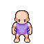

# Ontology Docs: Overview

!!! note "Capitalization"
    Terminology is capitalized to distinguish it from its colloquial connotations.

!!! note "Angular Brackets"
    Angular brackets denote parameters.

!!! note "Orientation"
    (0,0) corresponds to the upper-left corner, with down being the positive y-direction.

!!! note "Width, Length"
    Width is a horizontal displacement, length is a vertical displacement.

!!! note "Logical Quantification
    `|` is used as a logical quantifier, e.g. `y | y + x = 3` would mean the set of `y` that lie along the line `3 - x`.

## Cores

### Core: Assets

Assets are the foundation of the Engine. They are, fundamentally, a class for binding image atlases on the fileystem to entities stored on the [Board](#components-board) and shown on the [Screen](#component-screen).

All Assets have an *ID* and *properties*. Most, but not all, Assets have *State*. 

Assets are divided into non-overlapping (Category, Instance) nodes, known as the [Asset Hierarchy](./01-assets.md#asset-hierarchy). Different Categories of Assets expand the base Properties and States in various ways. In brief, the Asset categories are,

- [Crafts](./01-assets.md#crafts)
- [Cursors](./01-assets.md#cursors)
- [Effects](./01-assets.md#effects)
- [Geography](./01-assets.md#geography)
- [Objects](./01-assets.md#objects)
- [Sheets](./01-assets.md#sheets)
- [Sounds](./07-sounds.md)
- [Resources](./01-assets.md#resources)
- [Tiles](./01-assets.md#tiles)
- [Widgets](./06-widgets.md)

Assets are placed in the `/src/assets/<category>/` directory and then registered in a Asset Category index `/src/assets/<category>/**/*.yaml` file. The YAML index schema for each Asset configures its *Properties*, i.e. the static attributes that are constant and do not change as a result of gameplay. 

The `/src/assets` directory is known as the *asset directory*.

See [Asset Schema](./appendices/01-schemas.md#model-properties) for more information on the Asset Property index.

### Core: State

* Location: `/src/data/state/`

An [Asset](./01-assets.md) is deployed onto a [Board](#board), where it acquires its State, i.e. the dynamic attributes which change as a result of [Mechanics](./05-mechanics.md). The Application ingests and stores this information in the State directory.

An [Asset Category](./01-assets.md#asset-hierarchy) has a single schema for Properties that each Instance utilizes, but each individual [Asset Instance](./01-assets.md#asset-hierarchy) has a unique State, particular to its deployment. For example, a [Chest](./01-assets.md#chests) is configured once by its Properties (its width, length, etc.), but each instance of a [Chest](./01-assets.md#chests) on the [Board](#board) is given a unique state (its Position, Content, etc.).

### Core: Configuration

* Location: `/src/data/config`

Mechanics, Relations and other components of the [Engine](#engine) utilize Configuration stored in the Configuration directory:

- [Actions](./01-assets.md#sheets)
- [Compositions](./03-compositions.md)
- [Intentions](./04-intentions.md)
- [Library](./08-plots.md)
- [Mappings](./02-sprites.md#devices)
- [Materials](./01-assets.md#concept-materiality)
- [Mechanics](./05-mechanics.md)
- [Menus](./06-widgets.md#menus)
- [Plots](./08-plots.md)
- [Recipes](./01-assets.md#asset-concepts)

## Application 

The Application consists of an interconnected and interdependent system of Configurations, Services, Libraries and Components. These system serve to interpret and operate on Asset Properties and Asset State.

See [Architecture documentation](./11-architecture.md) for more information.

### Configurations

#### Configuration: Loader

- Address: `app.config.loader`

The Loader is responsible for reading in Configurations, Properties and State files from their respective directories, and then validating them into Models via Pydantic TypeAdaptors.

#### Configuration: Enums

- Address: `app.config.enums`

All semantic terms utilized by the [Application](#application) are enumerated within this package. 

### Services

#### Service: Factory

- Address: `app.services.generators.game.factory`

The Factory builds [Assets](./01-assets.md) and other Components based on [Recipes](./appendices/01-schemas.md#configuration-recipes). 

#### Service: Orchestrator

- Address: `app.services.orchestration.orchestrator`

The Orchestrator is the dependency injection system. It is responsible for converting validated Models into application Components.

### Libraries

#### Library: Registry

- Address: `libs.graphics.registry`

The Registry loads in all of the Asset files while the application bootstraps. Each Asset Frame is indexed and stored in memory. 

### Components

#### Component: Board

- Address: `app.game.board`

The Board acts as the Game's in-memory "database". It holds all in-game Assets and Configurations during the game loop, providing queryable interfaces to the Engine and Mechanics.

The state files for each Board are maintained in `/src/data/state/<board-key>/**`.

**Interface: Queries**

The Board exposes interfaces for querying the game state:

* Hierarchy Queries
    1. `board.instances(key, layer)`: Returns a List of Assets on the given layer, filtered by Instance `key`.
    2. `board.categories(key, layer)`: Returns a List of Assets on the given layer, filtered by Category `key`.
* Physics Queries
    1. `board.bridges(layer)`: Returns a list of Bridge Assets on a layer.
    2. `board.weights(layer)`: Returns a list of Assets with non-negative mass ($m \ge 0$) on the given layer (includes static and dynamic bodies; excludes sensors).
    3. `board.obstacles(layer)`: Returns a list of Assets that qualify as Obstacles.
* Environment Queries
    1. `board.tile(layer, position, instance)`: Retrieves background or foreground [Tiles](./01-assets.md#tiles) via $O(1)$ spatial hash lookup.
    2. `board.shorelines(layer=None)`: Retrieves active procedural shoreline assets for a specific layer or across all layers.
    1. `board.moisture(layer, x, y)`: Queries scalar soil moisture potential $\Phi(x, y)$ from the layer's compiled `MoistureField`.

**Interface: Predicates**

THe Board exposes predicates for asserting conditions of the Board state.

* Environment Predicates
    1. `board.fluid(layer, position, exclude=None)`: Evaluates whether a coordinate intersects any active [Fluid](./01-assets.md#fluids) stream or annular pool across the layer, with an optional entity exclusion filter.

**Service: Cradle**

The Cradle instantiates Assets during the course of the [Engine](#component-engine) loop through the interface of [Mechanics](./05-mechanics.md).

**Service: Migrator**

The Migrator asynchronously loads the Board State.

#### Component: Engine

- Package: `app.game.engine`

The Engine handles the core loop and Frame rate calculations. 

**Field: Bus**

The Bus processes asynchronous [Events](./06-widgets.md#events).

**Service: Provider**

The Provider instantiates [Menus](./06-widgets.md#menus).

**Service: Binder**

The Binder for binding [Widget](./06-widgets.md) States to [Asset](./01-assets.md) States.

**Service: Library**

The Provider contains a Library for injecting Widget states with plot-dependent content.

#### Component: Screen

- Package: `app.game.screen`

The Screen acts as a high-level container for a Cythonized SDL rendering interface.

## Concepts

### Concept: Hitboxes

Many Assets have Hitboxes. Hitboxes definitions are static and read before the execution of the [Engine](#component-engine) Hitboxes have positions and dimensions. 

To ensures Hitboxes remain statically configured, Hitbox positions are always given relative to the Asset, i.e. treating the upper-left corner of the Asset frame as the origin. Hitbox dimensions are always absolute. The following snippet shows the hitbox schema for an LPC Sprite Frame, with the image below showing how the hitbox translates into the physical image with a blue rectangle,

```yaml
position:
    x: 21
    y: 23
dimensions:
    w: 22
    l: 21
```


/// caption
LPC Sprite Hitbox in (Walk, Down, 0) State
///

While hitboxes are statically confitured, this does not necessarily mean hitboxes are statically accessed. See [Asset Component Architecture](./01-assets.md#asset-architecture) for more information.

### Concept: Layers

All deployed Assets have a Layer. Layers represent a "view" where the Asset is located. When the Screen renders an entire frame, it is rendering a Layer.  

Layers on a board can be traversed through Doors. The coordinate plane of each Layer is independent of every other. For example, a Sprite may enter a Door on Layer 1 at `(x_1, y_1)` and get released on Layer 3 at `(x_2, y_2)`. For this reason, each Layer may have different dimensions.

Sprite interactions are constrained by their Layers. Because Layers are superimposed coordinates, all interaction calculations are separated by Layer, to avoid inter-Layer collisions and interactions.

### Concept: Sprites

[Sprites](./02-sprites.md) are [Intentional](./04-intentions.md) [Assets](./01-assets.md). More formally, Sprite Intentions are driven through a coupled system of finite automata, logic and spatial algorithms. The data structure that drives this process is called the [Intention Transition Matrix](./04-intentions.md#transition-matrix). The processing and handling this mechanism occupies a large part of the application's internal logic.
