# Ontology Docs: Appendix I - Schemas

## Hitboxes Schemas

### Sprites

- [sheet-sprite-walk-down-0](../static/xcf/hitboxes/sheet-sprite-walk-down-0.xcf)

/// caption
LPC Sprite Hitbox in (Walk, Down, 0) State
///

**Attackboxes**

- [sheet-weapon-shortsword-slash-down-3](../static/xcf/hitboxes/sheet-weapon-shortsword-slash-down-3.xcf) | [sheet-weapon-shortsword-slash-down-4](../static/xcf/hitboxes/sheet-weapon-shortsword-slash-down-4.xcf) | [sheet-weapon-shortsword-slash-down-5](../static/xcf/hitboxes/sheet-weapon-shortsword-slash-down-5.xcf)

- 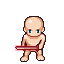
- 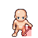
- 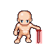

- [sheet-weapon-shortsword-slash-left-3](../static/xcf/hitboxes/sheet-weapon-shortsword-slash-left-3.xcf) | [sheet-weapon-shortsword-slash-left-4](../static/xcf/hitboxes/sheet-weapon-shortsword-slash-left-4.xcf) | [sheet-weapon-shortsword-slash-left-5](../static/xcf/hitboxes/sheet-weapon-shortsword-slash-left-5.xcf)

- 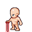
- 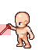
- 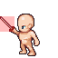

- [sheet-weapon-shortsword-slash-up-3](../static/xcf/hitboxes/sheet-weapon-shortsword-slash-up-3.xcf) | [sheet-weapon-shortsword-slash-down-4](../static/xcf/hitboxes/sheet-weapon-shortsword-slash-up-4.xcf) | [sheet-weapon-shortsword-slash-up-5](../static/xcf/hitboxes/sheet-weapon-shortsword-slash-up-5.xcf)

- 
- 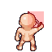
- 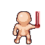

- [sheet-weapon-shortsword-slash-right-3](../static/xcf/hitboxes/sheet-weapon-shortsword-slash-right-3.xcf) | [sheet-weapon-shortsword-slash-right-4](../static/xcf/hitboxes/sheet-weapon-shortsword-slash-right-4.xcf) | [sheet-weapon-shortsword-slash-right-5](../static/xcf/hitboxes/sheet-weapon-shortsword-slash-right-5.xcf)

- 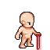
- 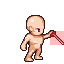
- 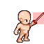

## Compositions Schemas

- [brick-house](../static/xcf/compositions/brick-house.xcf)
- [postern-gate](../static/xcf/compositions/postern-gate.xcf)
- [castle-dawn](../static/xcf/compositions/castle-dawn.xcf)

### Struts

- [craft-strut-frame-brick](../static/xcf/hitboxes/craft-strut-frame-brick.xcf)
- [craft-strut-wall-blue](../static/xcf/hitboxes/craft-strut-wall-blue.xcf)
- [craft-strut-wall-castle](../static/xcf/hitboxes/craft-strut-wall-castle.xcf)

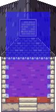
/// caption
Brick Frame Strut Hitbox
///

## Schemas

### Schema: Configuration

* [Spec: ConfigurationSchema](../static/yaml/schema-configuration.yaml)

#### Configuration: Actions

* Location: `/src/data/config/actions/main.yaml`

Action Configurations determine the (Action, Direction) partitions employed by a Sheet Asset.

#### Configuration: Compositions

* Location: `/src/data/config/compositions.yaml`

Composition Configuration defines a collection of Assets that can be deployed as a unit onto the Board.

#### Configuration: Intentions
    
* Location: `/src/data/config/intentions/main.yaml`

#### Configuration: Library

* Location: `/src/data/config/library/main.yaml`

#### Configuration: Mapping

* Location: `/src/data/config/mappings/main.yaml`

#### Configuration: Materials

TODO

#### Configuration: Mechanics

* Location: `/src/data/config/mechanics/main.yaml`

Mechanics Configuration defines what Mechanic classes are instantiated by the game engine. The order in which they are specified in the schema becomes the order of execution in the game engine.

#### Configuration: Menus

* Location: `src/data/config/menus/main.yaml`

TODO

#### Configuration: Recipes

* Location: `/src/data/config/recipes/main.yaml`

Recipe Configuration files determine the specific (Animation, Frame, Hitbox) components injected into a (Category, Instance)-node in the Asset Hierarchy. The Category and Instance key are encoded into the top-level fields of each Recipe.

### Schema: Properties

* [Spec: Property Schema](../static/yaml/schema-property.yaml)

### Schema: State

* [Spec: State Schema](../static/yaml/schema-state.yaml)
