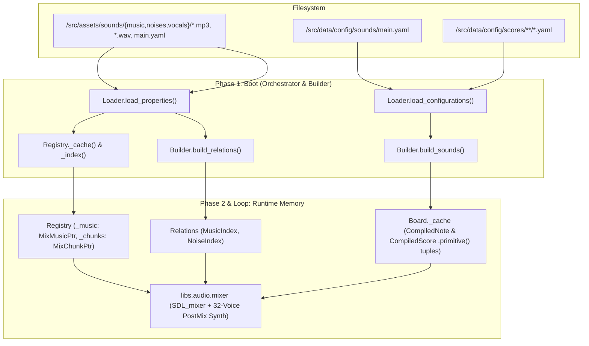

### Big-Picture Architectural Review: Phase 13 (Sound)

**User Review II** identifies a fundamental category error in the previous Phase 13 specification: conflating **Sound Assets** (physical `.mp3` and `.wav` media files on disk that require hardware/RAM lifecycle management in the `Registry`) with **Sound & Score Configurations** (declarative mathematical tables and symbolic timelines in `/src/data/config/` that are compiled into Cython primitives).

Stepping back to examine the logical flow of *Ontology*, the engine is built around three strict pillars:

1. **Assets (`/src/assets/<category>/**` $\to$ `PropertiesSchema` $\to$ `Registry`)**: Physical files on the filesystem bound to runtime pointers (`TexturePtr`, `TTFFont`, and now `MixMusicPtr` and `MixChunkPtr`).
2. **Configurations (`/src/data/config/<domain>/**` $\to$ `ConfigurationSchema` $\to$ `Builder` $\to$ `Board`)**: Declarative rules, topologies, and schemas (`actions`, `compositions`, `intentions`, `materials`, `menus`, `plots`, `recipes`, and now `sounds` and `scores`) that are compiled during bootstrap into $O(1)$ execution structures (`Executors`, `Relations`, and `Board._cache`).
3. **State (`/src/data/state/<board>/**` $\to$ `StateSchema` $\to$ `Migrator` $\to$ `Board`)**: Dynamic entity deployments and macro-world variables (`calendar`, `plots`) mutated by `Mechanics` and rendered/synthesized across the Cython boundary using zero-heap `.primitive()` tuples.



---

#### 1. Disambiguating Configuration (`sounds`, `scores`) vs. Assets (`music`, `noises`, `vocals`)

##### A. Sound & Score Configuration Pipeline (`/src/data/config/sounds/`, `/src/data/config/scores/`)

As seen in the current Data View, `/src/data/config/sounds/main.yaml` (`signatures`, `beats`, `dynamics`, `timbres`, `notes`) and `/src/data/config/scores/chopin/nocturne-op-9-no-2.yaml` (`score`) already reside in `/src/data/config/`. They have no physical media files associated with them and must never enter `PropertiesSchema` or `Registry`.

* **Ingestion (`Loader` & `ConfigurationSchema`)**:
* `Loader.load_configurations()` validates `/src/data/config/sounds/**/*.yaml` into `ConfigurationSchema.sounds: SoundConfiguration` and `/src/data/config/scores/**/*.yaml` into `ConfigurationSchema.scores: Dict[str, ScoreConfiguration]`.


* **Compilation (`Builder.build_sounds()` $\to$ `Board._cache`)**:
* Mirroring how `Asset.primitive()` flattens spatial attributes into a C-ready tuple `(index, x, y, w, l, hitboxes)`, the compiled synthesis models—`CompiledNote` and `CompiledScore`—act as thin immutable containers around pre-packed primitive tuples:

$$\text{CompiledNote.primitive}() \mapsto \big(t_{\text{delay}},\; f_0,\; \Delta t,\; v,\; t_{\text{attack}},\; k_{\text{decay}},\; n_h,\; (w_0, w_1, \dots, w_7)\big)$$


* During `Builder.build_board()` (or a dedicated `Builder.build_sounds()` pipeline stage), a `SynthesizerCompiler` service pre-compiles:
1. Every declarative `ScoreConfiguration` entry into a `CompiledScore` object holding its sorted tuple sequence `events: Tuple[Tuple[...], ...]` and motif pitch sequence `pitches: Tuple[str, ...]`.
2. A flat lookup table of `CompiledNote` primitives indexed by `(pitch_name, beat_name, dynamic_name, timbre_name)` (or pre-indexed frequency/duration/velocity/timbre structs) and stores both directly inside `Board._cache` (`cache.cached_scores`, `cache.cached_notes`).


* At runtime, when `InstrumentController.select()` handles a key press or a `player-piano` score trigger, it queries `board.note(...)` or `board.score(...)` from `Board._cache` in $O(1)$ time and passes `.primitive()` directly across the Cython boundary to `mixer.push_note()` or `mixer.push_score()` with **zero heap allocation and zero dictionary parsing in `Registry**`.


---

##### B. Indexing and Triggering Stateful Sound Assets (`vocals`, `noises`, `music`)

In `/src/assets/sounds/main.yaml`, `PropertiesSchema.sounds` indexes physical `.wav` and `.mp3` files across three instances: `vocals`, `noises`, and `music`. Why was `Frame` inappropriate for indexing them, and what interfaces replace it?

1. **Why `Frame` is Inappropriate**:
* `Frame` is a 2D spatial texture crop calculator (`(sx, sy, sw, sl)`) bound to an entity's visual `.png` atlas. An `Asset` deployed on the Board already occupies its `asset.frame` slot with its visual `Frame` strategy (e.g., `SpriteFrame`, `BinaryFrame`, `SeasonalFrame`).
* Audio assets are 1D temporal streams (`.mp3`) or PCM sample buffers (`.wav`) stored in `/src/assets/sounds/`, independent of the visual `.png` file identified by `asset.id`.


2. **`vocals` — First-Class ECS Component on `Asset` (`Vocal`)**:
* `vocals` are emitted by animate, intentional `Asset` instances (`sheets.sprites`, `sheets.players`, `sheets.pixies`) as a direct function of their internal state (`state.intention`, `state.animation.action`, `state.expression`, `state.mutators.triggers`).
* Therefore, `Vocal` belongs on `Asset` at the exact same architectural level as `Frame`, `Animation`, and `HitboxSchema`:
* **`Asset.vocal: Vocal`**: Injected via `/src/data/config/recipes/main.yaml` (`recipe.vocal`).
* **`Vocal.index(id: str, properties: VocalProperties) -> Dict[str, Tuple[int, int]]`**: Used by `Registry._index()` to map compound vocal keys (e.g., `f"{id}-{action}"` or `f"{id}-{expression}"`) to sample slice offsets `(start_sample, num_samples)` within a `.wav` file (or `(0, -1)` for whole-file `.wav` samples).
* **`Vocal.keys(id: str, state: AssetState, properties: AssetProperties) -> List[str]`**: Queried at runtime by `SoundMechanics` to project a Sprite's active state transitions (e.g., entering `slash`, `die`, `speak`, or spawning an `anger` expression) into `Registry` chunk keys.


3. **`noises` — Dual Indexing via `Noise` ECS Component & `NoiseIndex` Relation**:
* Why is `noises` less obvious than `vocals`? Because in a simulation engine, physical noises arise from **two distinct mechanisms**:
1. **Intrinsic Asset State Mutations (Entity-Bound)**: A `Chest` or `Gate` flipping `state.switch` (`open`/`close`), a `Plate` depressing, a `Door` traversing, an `Effect` pulsing on a specific `animation.frame`, or an `Equipment` item executing `slash`/`shoot`.
2. **Relational / Material Interactions (Environment-Bound)**: A `Sprite` or `Crate` moving across an `Environ Tile` (footsteps/scraping modulated by the Tile's terrain or `friction`), or two `Weight` bodies colliding in `CollisionMechanics` (impact sound determined by `(asset.state.material, other.state.material)`).


* To handle both cleanly without polluting `Frame`:
* **In `Registry**`: Physical `.wav` files under `/src/assets/sounds/noises/` are indexed into `Registry._chunks` as `MixChunkPtr` extension objects (supporting optional `(start_sample, num_samples)` slicing via `Noise.index(id, properties)`).
* **In `Relations` (`NoiseIndex`)**: Compiled during `Builder.build_relations()` from `PropertiesSchema.sounds.noises`. Each `NoiseProperties` entry declares its trigger domain (`category`, `instance`, optional `material`, `state_key` / `action`). `NoiseIndex` exposes $O(1)$ relational lookup `noise_index.resolve(category, instance, material=..., trigger=...) -> Optional[str]`.
* When `InteractionMechanics` toggles a `Chest`/`Gate`/`Plate`, `MotionMechanics` steps across a `Tile`, or `CollisionMechanics` resolves an elastic impulse exceeding a velocity threshold, `SoundMechanics` resolves the `noise_key` through `NoiseIndex` and dispatches a `NoiseEvent(noise_key, layer, position, gain)` to the bus.


4. **`music` — Macro-Environmental Indexing via `MusicIndex` Relation**:
* Unlike `vocals` (bound to a Sprite) or `noises` (bound to an Object/Interaction), `music` (`.mp3` streams) is a macro-state property of the **Board Layer, Season, and Plot**—architecturally parallel to how `Environ Tiles` respond to `CalendarState` and `Library` responds to `PlotState`.
* **In `Registry**`: Physical `.mp3` files under `/src/assets/sounds/music/` are indexed into `Registry._music` as `MixMusicPtr` Cython extension types wrapping `Mix_Music*`, alongside loop points (`loop_start`, `loop_end`) and `gain` from `MusicProperties`.
* **In `Relations` (`MusicIndex`)**: Compiled in `Builder.build_relations()` from `PropertiesSchema.sounds.music`, mapping `(layer, season, plot) -> (music_id, loop_start, loop_end, gain)` with wildcard fallback `(layer, None, None)`.
* When `StateEventHandler` finishes board hydration, `SeasonEventHandler` advances the calendar, or `InteractionMechanics` transitions the Player through a `Door` to a new `layer`, the handler queries `MusicIndex` and instructs `mixer.play_music(music_ptr, loop_start, loop_end, gain, fade_ms)` to crossfade the background stream.


| Audio Domain | Disk Location | Schema Owner | Runtime Storage | Indexing / Resolution Strategy |
| --- | --- | --- | --- | --- |
| **`sounds` (Synth Config)** | `/src/data/config/sounds/` | `ConfigurationSchema.sounds` | `Board._cache` (`cached_notes`) | Compiled by `Builder.build_sounds()` into `CompiledNote.primitive()` tuples |
| **`scores` (Score Config)** | `/src/data/config/scores/` | `ConfigurationSchema.scores` | `Board._cache` (`cached_scores`) | Compiled by `Builder.build_sounds()` into `CompiledScore.primitive()` tuple arrays & Motif Trie |
| **`vocals` (Sound Asset)** | `/src/assets/sounds/vocals/` | `PropertiesSchema.sounds.vocals` | `Registry._chunks` (`MixChunkPtr`) | `Asset.vocal` ECS component (`Vocal.index()` & `Vocal.keys()`) |
| **`noises` (Sound Asset)** | `/src/assets/sounds/noises/` | `PropertiesSchema.sounds.noises` | `Registry._chunks` (`MixChunkPtr`) | `NoiseIndex` relation `(category, instance, material, trigger) -> chunk_key` |
| **`music` (Sound Asset)** | `/src/assets/sounds/music/` | `PropertiesSchema.sounds.music` | `Registry._music` (`MixMusicPtr`) | `MusicIndex` relation `(layer, season, plot) -> music_key` |

---

#### 2. Critical Architectural Improvements for `libs/audio/mixer.pyx`

Inspecting `scripts/synthesize/sound.pyx` alongside `src/data/config/scores/chopin/nocturne-op-9-no-2.yaml` reveals an important architectural bottleneck in the original specification:

1. **Separating the Interactive SPSC Ring Buffer from the Score Sequencer Cursor**:
* The 22-measure `chopin_nocturne_op9_no2` score compiles into **~950 individual `NoteEvent` structs**.
* If `push_score()` dumps all 950 events into a 256-slot SPSC ring buffer (`RING_BUFFER_SIZE = 256`), the ring buffer immediately saturates and drops nearly 700 notes on the first tick. Furthermore, if the audio callback drains the ring buffer sequentially by waiting for `ring[read_idx].start_sample <= current_sample`, any scheduled future score note at the head of the ring buffer will **head-of-line block** immediate interactive notes (`start_sample == 0`) pushed by the player!
* **Solution**: Split synthesis dispatch in `SynthState` into two lock-free paths:
* **Immediate Interactive Ring Buffer (`NoteEvent ring[256]`)**: Exclusively handles real-time single-note triggers (`mixer.push_note(note_primitive)`). Every entry in `ring` has zero start delay and is allocated to a free `Voice` immediately on the next audio callback frame.
* **Score Sequencer Buffer (`NoteEvent score_buf[MAX_SCORE_EVENTS]`, `int score_len`, `int score_idx`, `int score_sample_pos`, `int score_active`)**: Handles compiled multi-note timelines (`mixer.push_score(score_primitives)`). The audio callback advances `score_sample_pos` independently on each sample and spawns voices as `score_buf[score_idx].start_sample <= score_sample_pos`. This allows a 1,000+ note `player-piano` score to play autonomously while the player simultaneously plays live notes on top without buffer overflow or head-of-line blocking.


2. **Zero-Heap Tuple Unpacking Across the Cython Boundary**:
* In `scripts/synthesize/models.py`, `harmonics` was a Python `List[float]`, forcing Cython's `play()` to iterate over a heap-allocated Python list inside every tuple.
* By pre-padding harmonics to a fixed 8-element float tuple `(w0, w1, w2, w3, w4, w5, w6, w7)` accompanied by `num_harmonics: int` inside `CompiledNote.primitive()`, `mixer.push_note()` unpacks a flat 15-element C-compatible tuple `(start_delay, freq, duration, velocity, attack, decay, num_harmonics, w0, w1, w2, w3, w4, w5, w6, w7)` directly onto stack primitives without touching a single nested Python list.


#### Implement: Phase 13: Sound

**Overview** 

Implement the foundational audio and procedural synthesis architecture for the engine, cleanly separating physical **Sound Assets** (`/src/assets/sounds/`: `music`, `noises`, `vocals`) indexed in the `Registry` from declarative **Sound & Score Configurations** (`/src/data/config/sounds/`, `/src/data/config/scores/`) compiled into the `Board` cache. This phase integrates a lock-free Cython audio mixer (`libs/audio/mixer.pyx`), inducts LPC `instruments` (`pipe-organ`, `grand-piano`, `player-piano`, `lute`, `bongos`) into the `objects` Asset Category, introduces the `Vocal` ECS component and `MusicIndex`/`NoiseIndex` relational indices, and implements the `InstrumentEvent` $\to$ `InstrumentMenu` $\to$ `MelodyEvent` $\to$ `SoundMechanics` pipeline driving Sprite psychological resonance.

**Diagrams**


##### Specification

1. **Disambiguated Audio Data Architecture**:
   * **Sound Configurations (`/src/data/config/sounds/main.yaml` $\to$ `ConfigurationSchema.sounds`)**:
     * `signatures`: Time signature definitions (`beats_per_measure`, `beat_unit`).
     * `beats`: Whole-note normalized duration scalars (`double_whole: 2.0` down to `thirty_second: 0.03125` and triplets).
     * `dynamics`: Symbolic dynamic markings (`ppp: 0.15` through `fff: 1.00`) mapped to normalized velocity scalars.
     * `timbres`: Additive synthesis harmonic profiles (`harmonics: List[float]`, `attack: float`, `decay: float`, `beat: str`) for `piano`, `soft_piano`, `grand_piano`, `pipe_organ`, `lute`, `bongos`, `reed`, and `bell`.
     * `notes`: Equal-temperament pitch lookup table (`REST`, `A0`–`C8`) in Hz.
   * **Score Configurations (`/src/data/config/scores/**/*.yaml` $\to$ `ConfigurationSchema.scores`)**:
     * Declarative multi-track and single-track musical compositions (`signature`, `bpm`, `tracks`, `notes`), including `chopin_nocturne_op9_no2` and short recognizable gameplay motifs.
   * **Sound Assets (`/src/assets/sounds/main.yaml` $\to$ `PropertiesSchema.sounds`)**:
     * `music`: Streaming `.mp3` background tracks configured with `loop: Tuple[float, float]`, `gain: float`, and relational selectors (`layers`, `seasons`, `plots`).
     * `noises`: Physical and environmental `.wav` SFX samples configured with `gain: float`, optional sample slice bounds, and relational triggers (`category`, `instance`, `material`, `trigger`).
     * `vocals`: Character and creature `.wav` verbalization samples configured with `gain: float` and state-to-slice mappings (`actions`, `intentions`, `expressions`).
2. **Compilation & Zero-Heap `primitive()` Models (`Builder` & `Board._cache`)**:
   * `Builder.build_sounds()` compiles `ConfigurationSchema.sounds` and `ConfigurationSchema.scores` during Phase 1 Boot into immutable `CompiledNote` and `CompiledScore` models stored in `Board._cache` (`cached_notes`, `cached_scores`, and `motif_trie`).
   * `CompiledNote.primitive()` returns a flat 15-element tuple `(start_delay, freq, duration, velocity, attack, decay, num_harmonics, w0, w1, w2, w3, w4, w5, w6, w7)` for zero-heap unpacking in Cython.
   * `CompiledScore.primitive()` returns a tuple of pre-sorted `CompiledNote.primitive()` tuples ready for direct ingestion by `mixer.push_score()`.
3. **Sound Asset Indexing (`Registry`, `Vocal` ECS Component, `MusicIndex`, `NoiseIndex`)**:
   * **Registry Audio Wrappers (`libs/graphics/registry.pyx` & `libs/audio/mixer.pyx`)**:
     * Discovers `.mp3` and `.wav` files in `/src/assets/sounds/` during `Registry._cache()`.
     * Wraps `.mp3` streams in `MixMusicPtr` (`Mix_FreeMusic` in `__dealloc__`) and `.wav` chunks in `MixChunkPtr` (`Mix_FreeChunk` in `__dealloc__`), prewarmed within the `Registry.prewarm()` frame budget.
   * **`Vocal` Component (`app.assets.base.Vocal`)**:
     * First-class ECS behavioral interface injected into `Asset` (`asset.vocal`) via `Recipe`.
     * `Vocal.index(id, properties)` maps state-qualified vocal keys to sample slices; `Vocal.keys(id, state, properties)` emits active vocal keys when a Sheet's `intention`, `action`, or `expression` mutates.
   * **`NoiseIndex` & `MusicIndex` (`app.game.logic.relations`)**:
     * `NoiseIndex`: Compiled in `Builder.build_relations()`, mapping `(category, instance, material, trigger) -> noise_key` for $O(1)$ SFX lookup on Object switches, footsteps, and collisions.
     * `MusicIndex`: Compiled in `Builder.build_relations()`, mapping `(layer, season, plot) -> music_key` for automatic layer/season/plot background music transitions.
4. **Instrument Object Taxonomy (`objects.instruments`)**:
   * Register `instruments` under `AssetCategories.OBJECTS` (`ObjectPropertyInstances.instruments`, `ObjectStateInstances.instruments`, and `Cache.get_obstacles()`):
   * **Supported LPC Assets**: `pipe-organ`, `grand-piano`, `player-piano`, `lute`, `bongos`.
   * **`InstrumentProperties(ObjectProperties)`**: Extends `ObjectProperties` with `timbre: str`, `layout: Enumerated[InstrumentLayouts]` (`chromatic`, `percussion`, `player`), `octaves: Tuple[int, int] = (2, 6)`, and `default_beat: str = "quarter"`.
   * **`InstrumentState(ObjectState)`**: Extends `ObjectState` with `octave: int = 4`, `dynamic: Enumerated[Dynamics] = "mf"`, `score: Optional[str] = None`, and `switch: bool = False`.
5. **Audio Architecture (`libs/audio/mixer.pyx`)**:
   * Unified SDL2 / `SDL_mixer` backend at 48,000 Hz, `AUDIO_F32SYS`, with headless fallback (`SDL_AUDIODRIVER=dummy`).
   * Dual-path `Mix_SetPostMix` `nogil` additive synthesizer (32 polyphonic voices, 8 harmonics, Stevens' power law $A = v^{1.8}$, dynamic brightness $w'_h = w_h \cdot v^{0.5h}$):
     * **Interactive SPSC Ring Buffer (`NoteEvent[256]`)**: Lock-free immediate single-note dispatch via `push_note()`.
     * **Score Sequencer Cursor (`NoteEvent[MAX_SCORE_EVENTS]`)**: Lock-free timeline playback via `push_score()` preventing ring-buffer saturation on multi-hundred-note scores (`chopin_nocturne_op9_no2`) and avoiding head-of-line blocking.
6. **Interactive Instrument Event & Menu Pipeline**:
   * `PlayerMechanics` / `InteractionMechanics` emits `InstrumentEvent(sprite, instrument, properties)` onto `Engine.bus` when interacting with an `objects.instruments` hitbox.
   * `InstrumentEventHandler` pauses world simulation (`board.paused = True`), constructs `InstrumentContext(sprite, instrument, properties)`, and pushes `InstrumentMenu` via `Provider.menu("instrument", context)`.
   * `Fabricator.expand()` expands the `keyboard` Gizmo schema into a 13-key chromatic octave (5 upper `key-black` buttons + 8 lower `key-white` buttons) or 4 `drum-pad` buttons for `bongos`.
   * `InstrumentController.select()` resolves `board.note(pitch, beat, dynamic, timbre)` from `Board._cache` and pushes `MelodyEvent` onto `Engine.bus`.
   * `MelodyEventHandler` executes during `Engine._drain()` (active even while `board.paused == True`), passing `note.primitive()` to `mixer.push_note()` (or `score.primitive()` to `mixer.push_score()`) and appending the acoustic onset to `board.acoustics`.
7. **Psychological & Ecological Mechanics (`SoundMechanics`)**:
   * Drains `board.acoustics`, computes distance attenuation $I(r) = I_0 / (1 + \alpha r^2)$ and obstacle occlusion across `board.obstacles(layer)` using `geometry.c_punctures`.
   * Evaluates played note sequences against the compiled Melodic Trie in `Board._cache` to trigger Sprite `MutatorTriggers` (`frightened`, `calmed`, `attentive`) and `Expressions`.

##### Architectural Analysis I

The audio subsystem must decouple runtime synthesis from the fixed 60 Hz physics loop while maintaining strict synchronization with Sprite cognition. Calling transcendental functions per sample inside Python would drop frame rates below acceptable thresholds; thus, audio synthesis must remain in C memory via Cython, completely releasing the GIL.

Pre-recorded assets (`.wav`, `.mp3`) and synthesized timbres require distinct memory management:

- `.mp3` files stream directly from disk via `Mix_Music` to prevent loading multi-megabyte uncompressed PCM buffers into RAM.
- `.wav` files are pre-loaded into system RAM during `Registry.prewarm` as `Mix_Chunk*` pointers, indexed by asset key for instantaneous $O(1)$ playback.
- Procedural scores defined in YAML must be compiled during initialization into flat C structs (`NoteEvent`), guaranteeing that runtime score playback incurs zero parsing overhead.

To prevent audio stutter and race conditions, the engine will not use mutex locks across the Python/audio boundary. Instead, the main thread pushes note triggers into an atomic 256-slot ring buffer. The audio callback drains this buffer at sample accuracy without locking.

##### User Review I

Drill down on implementing the `Instrument` Object within the application using the Sound models from `scripts/synthesize`:

1. Player interacts with `Instrument`.
2. `InstrumentEvent` is thrown.
3. `InstrumentMenu` is instantiated.
4. Player traverses Menu and selects Key Widgets (special Button IDs) to play.
5. Sound is generated each time `Engine` handles a select event on one of the Key Widgets.
6. All 88 keys is overkill—scope the keyboard representation appropriately.
7. Account for the LPC Instrument assets: `pipe organ`, `grand piano`, `player piano`, `lute`, `bongos`.

##### Architectural Analysis II

###### 1. Porting `scripts/synthesize` Models into `app.models.properties` and `Registry`

In `scripts/synthesize`, audio synthesis is driven by two declarative schemas (`SoundsRoot` and `ScoreRoot`) and a time-domain compiler (`compile.score()`) that flattens hierarchical tracks and beats into chronological `NoteEventDTO` tuples:

$$e_i = \big(t_{\text{start}},\; f_0,\; \Delta t,\; v,\; t_{\text{attack}},\; k_{\text{decay}},\; [w_0, w_1, \dots, w_{n-1}]\big)$$

###### 2. LPC Instrument Taxonomy & Timbre Specialization

| LPC Asset ID | Layout Type | Default Timbre | Harmonic Profile $[w_0, \dots, w_k]$ | Attack ($s$) | Decay ($k$) | Default Beat | Behavioral Mode |
| --- | --- | --- | --- | --- | --- | --- | --- |
| `grand-piano` | `chromatic` (13 keys) | `grand_piano` | `[1.0, 0.35, 0.10, 0.02]` | `0.005` | `2.2` | `quarter` | Manual polyphonic keyboard |
| `pipe-organ` | `chromatic` (13 keys) | `pipe_organ` | `[1.0, 0.85, 0.60, 0.45, 0.30, 0.20, 0.10, 0.05]` | `0.030` | `0.35` | `half` | Sustained cathedral pipes |
| `player-piano` | `player` (13 keys + score) | `grand_piano` | `[1.0, 0.35, 0.10, 0.02]` | `0.005` | `2.2` | `quarter` | Manual play + compiled `score` playback |
| `lute` | `chromatic` (13 keys) | `lute` | `[1.0, 0.50, 0.25, 0.08, 0.02]` | `0.003` | `3.8` | `quarter` | Plucked acoustic string decay |
| `bongos` | `percussion` (4 pads) | `bongos` | `[1.0, 0.45, 0.75, 0.25, 0.15]` | `0.001` | `7.5` | `sixteenth` | 4 tuned drum pads (`C3`, `G3`, `C4`, `E4`) |

###### 3. Solving the 88-Key Problem: The 13-Key Chromatic Octave & `KeyboardGizmo`

Rendering 88 individual `Button` widgets would saturate screen real estate and require up to 87 sequential `EAST`/`WEST` traversal inputs to cross the keyboard. Instead, `InstrumentMenu` models a **single 13-key chromatic octave (`C` through `C'`)** paired with stateful octave transposition (`InstrumentState.octave` within `properties.octaves = (2, 6)`), expanded declaratively via `Fabricator` using `schema: keyboard`.

##### User Review II

There are several things going on here that need further clarification and disambiguation, as multiple distinct things are being labeled "Assets" in the current specification. 

- Sound Assets: `music`, `noises`, `vocals`
- Configuration: `sound`, `scores`

In the current spec, the synthesize Sound models are being jammed into the Asset Hierarchy for some reason. There is no physical Asset associated with `sound` or `scores` until the engine compiles the configuration during runtime, so Sound clearly belongs to a different kind of application system.

`sound` should be loaded through Configuration. There can be a dedicated step in the dependency pipeline for compiling the sound models and storing them somewhere (not the Registry; logically, the Board Cache would be a prime candidate), as these models should be wrappers around Cython primitive() calls that simply flatten their data struture into tuples for Cython (zero heap). 

`music`, `noises`, `vocals` should be indexed by the Registry, as they will be "stateful" Assets, triggered by Board events and Asset state conditions. However, this raises the question of what interface is doing the indexing, as Frame is not appropriate. It is clear at least:

- `vocals`: This will need to be an interface on the Asset itself, on the level of Hitbox, Frame and Animation.

How and where `music` and `noises` get index is less obvious.

##### Architectural Analysis III

###### 1. Disambiguating Configurations (`sounds`, `scores`) from Assets (`music`, `noises`, `vocals`)

Following Ontology's core axiom—*an Asset is a physical media file on disk, whereas Configuration is a declarative rule system*—the audio architecture splits cleanly along the `Loader` boundary:

1. **Configuration Pipeline (`/src/data/config/sounds/`, `/src/data/config/scores/`)**:
   - `Loader.load_configurations()` parses `/src/data/config/sounds/main.yaml` into `ConfigurationSchema.sounds` (`SoundConfiguration`) and `/src/data/config/scores/**/*.yaml` into `ConfigurationSchema.scores` (`Dict[str, ScoreConfiguration]`).
   - `Builder.build_sounds()` compiles these models during bootstrap via `SynthesizerCompiler` and injects them into `Board._cache` (`cache.cached_notes`, `cache.cached_scores`, `cache.motif_trie`).
   - Both `CompiledNote` and `CompiledScore` expose `.primitive()` methods returning flat, pre-padded C-compatible tuples:

$$\text{CompiledNote.primitive}() = \big(\text{delay},\; f_0,\; \Delta t,\; v,\; t_{\text{attack}},\; k_{\text{decay}},\; n_h,\; w_0, w_1, w_2, w_3, w_4, w_5, w_6, w_7\big)$$

2. **Sound Asset Pipeline (`/src/assets/sounds/{music,noises,vocals}/`)**:
   - `Loader.load_properties()` parses `/src/assets/sounds/main.yaml` into `PropertiesSchema.sounds` (`SoundPropertyInstances`: `music`, `noises`, `vocals`).
   - `Registry._cache()` indexes `.mp3` and `.wav` filepaths; `Registry.prewarm()` loads them into `MixMusicPtr` and `MixChunkPtr` Cython extension classes.

###### 2. Indexing Interfaces for `vocals`, `noises`, and `music`

Because `Frame` is a 2D spatial crop-map strategy (`(sx, sy, sw, sl)`) already occupied by an entity's visual `.png` representation, the three Sound Asset instances are indexed and triggered according to the scope of the state that drives them:

- **Entity-Scope (`vocals` $\to$ `Asset.vocal: Vocal` ECS Component)**:
  - `Vocal` is injected into `Asset` via `Recipe` (`recipe.vocal`) alongside `frame`, `animation`, and `hitbox`.
  - `Vocal.index(id, properties)` maps state keys (e.g., `f"{id}-{action}"`, `f"{id}-{intention}"`, `f"{id}-{expression}"`) to sample offsets `(start_sample, num_samples)` in `Registry._vocals`.
  - `Vocal.keys(id, state, properties)` inspects a Sprite/Pixie's current state transitions and returns active vocal keys to `SoundMechanics`.
- **Interaction & Material Scope (`noises` $\to$ `NoiseIndex` in `Relations`)**:
  - Physical noises are triggered either by intrinsic Object state flips (`Chest`, `Gate`, `Plate` `switch` mutations) or relational multi-body interactions (footsteps on `Tile` terrain, elastic `Weight` collisions in `CollisionMechanics`).
  - `Builder.build_relations()` compiles `PropertiesSchema.sounds.noises` into `NoiseIndex` (`Relations.NOISES`), mapping `(category, instance, material, trigger) -> noise_key` in $O(1)$.
- **Macro-Board Scope (`music` $\to$ `MusicIndex` in `Relations`)**:
  - Background `.mp3` streams depend on macro-world coordinates `(layer, calendar.season, plot.current)` rather than individual entities.
  - `Builder.build_relations()` compiles `PropertiesSchema.sounds.music` into `MusicIndex` (`Relations.MUSIC`), mapping `(layer, season, plot) -> (music_key, loop_start, loop_end, gain)`.

###### 3. Dual-Path Lock-Free Synthesizer (`Ring Buffer` + `Score Sequencer`)

Because full scores such as `chopin_nocturne_op9_no2` compile into ~950 chronological `NoteEvent` structs, pushing an entire score into a 256-slot interactive ring buffer would drop over 70% of the score and cause head-of-line blocking for live notes (`start_sample == 0`). `libs/audio/mixer.pyx` therefore separates real-time synthesis into two lock-free channels inside `SynthState`:

- **`NoteEvent ring[256]` (SPSC Ring Buffer)**: Exclusively services immediate `push_note(note.primitive())` calls from live `InstrumentMenu` key presses.
- **`NoteEvent score_buf[2048]` (Score Sequencer Cursor)**: Exclusively services `push_score(score.primitive())` calls (e.g., from `player-piano`), advancing its own sample counter `score_sample_pos` inside `Mix_SetPostMix` so live notes and autonomous scores mix seamlessly without overflow or blocking.

##### User Review III

**Notes**

Asset Category: Tracks
Asset Instances: Music, Noises
Asset Component: Vocals

```yaml
# example recipe
sheets:
    sprite:
        animation: sprite
        frame: sprite
        hitbox: static
        vocal: <vocal-recipe>
```

**Analysis of Available Assets & Possible Mappings**


##### Goals

###### Goal: Zero-Allocation Cython Audio Mixer (`libs/audio/mixer.pyx`)

Unify `SDL_mixer` channel management (`MixMusicPtr`, `MixChunkPtr`) with a dual-path 32-voice additive synthesizer executing inside a `Mix_SetPostMix` `nogil` callback:

```cython
# src/libs/audio/mixer.pyx
DEF MAX_VOICES = 32
DEF MAX_HARMONICS = 8
DEF RING_BUFFER_SIZE = 256
DEF MAX_SCORE_EVENTS = 2048

cdef struct NoteEvent:
    int start_sample
    int total_samples
    float freq
    float velocity
    float attack
    float decay
    int num_harmonics
    float harmonics[MAX_HARMONICS]

cdef struct SynthState:
    int sample_rate
    int write_idx
    int read_idx
    NoteEvent ring[RING_BUFFER_SIZE]
    int score_active
    int score_len
    int score_idx
    int score_sample_pos
    NoteEvent score_buf[MAX_SCORE_EVENTS]
    Voice voices[MAX_VOICES]

cpdef void push_note(tuple primitive):
    """Unpacks a 15-element CompiledNote.primitive() tuple into the lock-free SPSC ring buffer."""
    cdef int next_w = (_synth.write_idx + 1) & (RING_BUFFER_SIZE - 1)
    if next_w == _synth.read_idx:
        return
    cdef NoteEvent *ev = &_synth.ring[_synth.write_idx]
    ev.start_sample = 0
    ev.freq = <float>primitive[1]
    ev.total_samples = <int>(<float>primitive[2] * _synth.sample_rate)
    ev.velocity = <float>primitive[3]
    ev.attack = <float>primitive[4]
    ev.decay = <float>primitive[5]
    ev.num_harmonics = <int>primitive[6]
    for h in range(MAX_HARMONICS):
        ev.harmonics[h] = <float>primitive[7 + h]
    _synth.write_idx = next_w

cpdef void push_score(tuple score_primitives):
    """Loads a pre-compiled score tuple sequence into the lock-free score sequencer cursor."""
    cdef int n = len(score_primitives)
    if n > MAX_SCORE_EVENTS:
        n = MAX_SCORE_EVENTS
    _synth.score_active = 0
    for i in range(n):
        # Unpack each 15-element note tuple into _synth.score_buf[i]
        ...
    _synth.score_len = n
    _synth.score_idx = 0
    _synth.score_sample_pos = 0
    _synth.score_active = 1

```

###### Goal: Sound & Score Configuration Compilation into `Board._cache`

Define `SoundConfiguration` and `ScoreConfiguration` under `app/models/config/sounds.py`, compile them in `Builder.build_sounds()`, and store `CompiledNote` and `CompiledScore` wrappers in `Board._cache`:

```python
# src/app/models/config/sounds.py
@dataclass(slots=True, frozen=True)
class CompiledNote:
    pitch_name: str
    frequency: float
    duration: float
    velocity: float
     _primitive: Tuple[
        float, float, float, float, float, float, int,
        float, float, float, float, float, float, float, float
    ]

    def primitive(self) -> Tuple:
        """Returns the zero-heap 15-element tuple for libs.audio.mixer.push_note()."""
        return self._primitive

@dataclass(slots=True, frozen=True)
class CompiledScore:
    title: str
    bpm: float
    signature: str
    pitches: Tuple[str, ...]
    _primitives: Tuple[Tuple, ...]

    def primitive(self) -> Tuple[Tuple, ...]:
        """Returns the zero-heap tuple sequence for libs.audio.mixer.push_score()."""
        return self._primitives

```

###### Goal: `Vocal` Component, `NoiseIndex`, & `MusicIndex`

Extend `Asset` and `Recipe` with `vocal: Vocal`, and compile `NoiseIndex` and `MusicIndex` in `Builder.build_relations()`:

```python
# src/app/assets/base.py
class Vocal(Singleton):
    """Foundational interface for Assets that emit stateful vocalizations."""
    @abstractmethod
    def index(
        self,
        id: str,
        properties: AssetProperties
    ) -> Dict[str, Tuple[int, int]]:
        pass

    @abstractmethod
    def keys(
        self,
        id: str,
        state: AssetState,
        properties: AssetProperties
    ) -> List[str]:
        pass

```

###### Goal: `InstrumentEvent`, `InstrumentMenu`, & 13-Key `InstrumentController`

Route interactive key selections through `Board._cache` (`board.note()` and `board.score()`) without runtime allocations:

```python
# src/app/game/menus/controllers/instrument.py
class InstrumentController(MenuController):
    def select(self, name: str, menu: Menu, board: Board, bus: collections.deque) -> None:
        widget = menu.widgets.get(name)
        if not widget or not widget.binding:
            return

        ctx: InstrumentContext = menu.context
        action = widget.binding.selection
        selector = widget.binding.selector

        if action == Selections.PLAY_NOTE.value:
            pitch_name = self._resolve_pitch(selector, ctx.instrument.octave)
            compiled_note = board.note(
                pitch_name=pitch_name,
                beat_name=ctx.properties.default_beat,
                dynamic_name=ctx.instrument.dynamic,
                timbre_name=ctx.properties.timbre,
            )
            bus.append(MelodyEvent(
                source=ctx.sprite.name,
                layer=ctx.instrument.layer,
                position=ctx.instrument.position,
                note=compiled_note,
            ))
        elif action == Selections.PLAY_SCORE.value and ctx.instrument.score:
            compiled_score = board.score(ctx.instrument.score)
            bus.append(MelodyEvent(
                source=ctx.instrument.name,
                layer=ctx.instrument.layer,
                position=ctx.instrument.position,
                score=compiled_score,
            ))
        elif action == Selections.OCTAVE_UP.value:
            ctx.instrument.octave = min(ctx.properties.octaves[1], ctx.instrument.octave + 1)
            bus.append(UpdateEvent(menu=menu.id, target="octave-display"))
        elif action == Selections.OCTAVE_DOWN.value:
            ctx.instrument.octave = max(ctx.properties.octaves[0], ctx.instrument.octave - 1)
            bus.append(UpdateEvent(menu=menu.id, target="octave-display"))
        elif action == Selections.EXIT.value:
            bus.append(TerminalEvent())

```

##### Tasks

**1. Task: Cython Audio Subsystem, `SDL_mixer` Wrappers & Dual-Path Synthesizer**

*Objective*: Build `libs/audio/mixer.pyx` and extend `libs/graphics/registry.pyx` to manage `Mix_Music` / `Mix_Chunk` pointers alongside a non-blocking 32-voice additive synthesizer with separate live ring-buffer and score-sequencer channels.

* [x] Subtask: Configure build pipeline in `setup.py`, `setup.cicd.py`, and `Dockerfile` to link against `SDL2` and `SDL2_mixer`.
* [ ] Subtask: Define `MixMusicPtr` and `MixChunkPtr` Cython extension classes with deterministic `__dealloc__` teardown (`Mix_FreeMusic`, `Mix_FreeChunk`) and register `.mp3` and `.wav` ingestion in `Registry._cache()`, `Registry.prewarm()`, and `Registry.clear()`.
* [ ] Subtask: Implement `libs/audio/mixer.pyx` managing `Mix_OpenAudio` (48,000 Hz, `AUDIO_F32SYS`), streaming `play_music()` with crossfade/loop bounds, and positional `play_chunk()` SFX channels.
* [ ] Subtask: Implement the lock-free 256-slot SPSC ring buffer (`push_note(tuple primitive)`) for immediate interactive notes and the 2,048-slot Score Sequencer cursor (`push_score(tuple score_primitives)`) for autonomous multi-measure scores.
* [ ] Subtask: Port `sound.pyx` voice allocation (`MAX_VOICES = 32`, `MAX_HARMONICS = 8`), Stevens' power law scaling ($v^{1.8}$), dynamic brightness ($v^{0.5h}$), and linear-attack/exponential-decay envelopes into a `Mix_SetPostMix` `nogil` callback.
* [ ] Subtask: Add headless/CI audio driver fallback (`SDL_AUDIODRIVER=dummy`) so unit and integration tests execute without physical audio hardware.

**2. Task: Sound & Score Configuration Models, Compiler & `Board._cache` Integration**

*Objective*: Load `/src/data/config/sounds/main.yaml` and `/src/data/config/scores/**/*.yaml` through `ConfigurationSchema`, compile them into zero-heap `CompiledNote` and `CompiledScore` wrappers in `Builder.build_sounds()`, and store them in `Board._cache`.

* [ ] Subtask: Define `SignatureConfiguration`, `BeatConfiguration`, `NoteFrequencyConfiguration`, `TimbreConfiguration`, `SoundConfiguration`, `ScoreNoteConfiguration` (with `__post_init__` normalizing `note` into `notes`), `TrackConfiguration`, `ScoreConfiguration`, `CompiledNote`, and `CompiledScore` in `app/models/config/sounds.py`.
* [ ] Subtask: Attach `sounds: SoundConfiguration` and `scores: Dict[str, ScoreConfiguration]` to `ConfigurationSchema` and update `Loader.load_configurations()` to ingest `/src/data/config/sounds/` and `/src/data/config/scores/`.
* [ ] Subtask: Populate `/src/data/config/sounds/main.yaml` with the LPC instrument timbres (`grand_piano`, `pipe_organ`, `lute`, `bongos`) alongside `piano`, `soft_piano`, `reed`, and `bell`, and add gameplay motif scores to `/src/data/config/scores/motifs/main.yaml`.
* [ ] Subtask: Implement `SynthesizerCompiler` in `app/services/generators/game/synthesizer.py` to pre-compile `SoundConfiguration` and `ScoreConfiguration` into `CompiledNote` (15-element `.primitive()` tuples), `CompiledScore` (`.primitive()` tuple sequences), and a Melodic Trie.
* [ ] Subtask: Add `Builder.build_sounds()` to `Orchestrator.orchestrate()` and extend `Cache` (`app/game/board/modules/cache.py`) and `Board` (`app/game/board/core.py`) with `board.note()`, `board.score()`, `board.motifs()`, and `board.acoustics`.

**3. Task: Sound Assets (`music`, `noises`, `vocals`), `Vocal` Component & Relational Indices**

*Objective*: Induct physical audio assets (`/src/assets/sounds/main.yaml`) into `PropertiesSchema.sounds`, add the `Vocal` ECS interface to `Asset`, and compile `MusicIndex` and `NoiseIndex` in `Builder.build_relations()`.

* [ ] Subtask: Add `SOUNDS = "sounds"` to `AssetCategories`, `MUSIC = "music"`, `NOISES = "noises"`, `VOCALS = "vocals"`, `INSTRUMENTS = "instruments"` to `AssetInstances`, and `MUSIC = "music"`, `NOISES = "noises"` to `Relations` in `app/static/semantics.py`.
* [ ] Subtask: Define `MusicProperties`, `NoiseProperties`, `VocalProperties`, and `SoundPropertyInstances` in `app/models/properties/sounds.py` and attach `sounds: SoundPropertyInstances` to `PropertiesSchema`.
* [ ] Subtask: Define the abstract `Vocal` class in `app/assets/base.py`, add `vocal: Vocal = None` to `Asset.__init__()`, and register `Vocal` implementations (`SpriteVocal`, `NoVocal`) in `AssetFactory` and `/src/data/config/recipes/main.yaml`.
* [ ] Subtask: Implement `MusicIndex` and `NoiseIndex` in `app/game/logic/relations/sounds.py` and register them inside `Builder.build_relations()`.
* [ ] Subtask: Define `InstrumentProperties(ObjectProperties)` and `InstrumentState(ObjectState)`, register `instruments` in `ObjectPropertyInstances`, `ObjectStateInstances`, `Cache.get_obstacles()`, and configure `pipe-organ`, `grand-piano`, `player-piano`, `lute`, and `bongos` in `/src/assets/objects/main.yaml`.

**4. Task: `InstrumentEvent`, `InstrumentMenu`, `KeyboardGizmo` & `InstrumentController**`

*Objective*: Implement the interactive instrument lifecycle from Player `interact` intention to `InstrumentMenu` traversal and `MelodyEvent` synthesis.

* [ ] Subtask: Define `InstrumentEvent`, `MelodyEvent`, and `NoiseEvent` in `app/game/menus/events.py` and `InstrumentContext(sprite, instrument, properties)` in `app/game/menus/contexts.py`.
* [ ] Subtask: Implement `InstrumentEventHandler`, `MelodyEventHandler`, and `NoiseEventHandler` in `app/game/menus/handlers.py` and register them in `Engine.handlers`.
* [ ] Subtask: Update `InteractionMechanics` / `PlayerMechanics` to emit `InstrumentEvent` onto `Engine.bus` when the Player triggers `interact` while intersecting an `objects.instruments` hitbox.
* [ ] Subtask: Configure `key-white`, `key-black`, and `drum-pad` button assets in `/src/assets/widgets/main.yaml` and extend `Fabricator.expand()` (`app/services/generators/menus/fabricator.py`) with the `keyboard` Gizmo schema (`chromatic`, `percussion`, `player`).
* [ ] Subtask: Define the `instrument` menu in `/src/data/config/menus/main.yaml` and implement `InstrumentController.select()` in `app/game/menus/controllers/instrument.py` querying `board.note()` and `board.score()`.

**5. Task: `SoundMechanics`, Spatial Attenuation & Sprite Psyche Resonance**

*Objective*: Simulate physical sound propagation, trigger `Vocal` and `NoiseIndex` emissions from world state changes, manage layer/season `MusicIndex` streams, and evaluate Sprite behavioral responses to melodies.

* [ ] Subtask: Implement `SoundMechanics` in `app/game/logic/mechanics/world/sound.py` consuming `board.acoustics` and polling `asset.vocal.keys()` and `NoiseIndex` triggers across active layer entities.
* [ ] Subtask: Implement distance attenuation ($I(r) = I_0 / (1 + \alpha r^2)$) and obstacle transmission muffling across `board.obstacles(layer)` using `geometry.c_punctures`.
* [ ] Subtask: Evaluate played note sequences against `board.motifs()` (sliding-window Melodic Trie) and modulate Sprite `MutatorTriggers` (`frightened`, `calmed`, `attentive`) and `Expressions` for `TransitionMechanics`.
* [ ] Subtask: Connect `MusicIndex` resolution to `StateEventHandler`, `SeasonEventHandler`, and Door layer transitions to stream and crossfade background `.mp3` tracks automatically.

```

---

### Backlog Additions from `@TODO` Markup Review (`Template: Backlog`)

Reviewing the `@TODO(phase)` annotations in the documentation where `phase` has already been closed on the Task Board (`Phase 07.04: Materialization [x]` and `Phase 10.01: Stage Hitboxes [x]`):

1. **`@TODO(07-04)`**: In `01-assets.md`, `Substrates` notes that prior to Phase 07.04, negative substrates were stored in `elevation` and collapsed via $\text{elevation} \in [-\infty, 0] \to 0$ during `CollisionMechanics` and Perimeter generation. Because `substrate` is now a dedicated attribute on `Asset` (`asset.substrate`) distinct from `asset.elevation`, legacy `max(0, elevation)` guards in `Board.weights()`, `Board.obstacles()`, and `LayeredHitbox.elevations()` should be audited and simplified.
2. **`@TODO(10-01)`**: In `01-assets.md`, `Attackboxes` notes that `HitboxSchema` has been codified as an ECS component on `Asset`, leaving `SheetProperties.attackboxes` and Equipment attackboxes as the last legacy hitbox path outside `HitboxSchema.get()`.

```markdown
#### Refactor: Phase 10.06: Attackbox HitboxSchema Unification

**Overview** 

Migrate legacy `SheetProperties.attackboxes` and slotted `Equipment` attackboxes into a dedicated `SheetHitbox(HitboxSchema)` component implementation, completing the `HitboxSchema` ECS unification noted in `@TODO(10-01)`.

##### Goals

###### Goal: `SheetHitbox` Component & Frame-Keyed Attackbox Resolution

Unify base body hitboxes and frame-specific `<action>-<direction>-<frame>` attackboxes behind `HitboxSchema` so `CombatMechanics` and `CollisionMechanics` query `asset.hitbox` uniformly without manual dictionary inspection on `SheetProperties`:

```python
# src/app/assets/hitboxes.py
class SheetHitbox(HitboxSchema):
    def elevations(self, properties: SheetProperties, state: SheetState) -> List[int]:
        return [state.elevation or 0]

    def get(
        self,
        properties: SheetProperties,
        state: SheetState,
        elevation: int,
        frame: Optional[Frame] = None
    ) -> List[Hitbox]:
        if (state.elevation or 0) != elevation:
            return []
        return properties.hitboxes

    def attack(
        self,
        properties: SheetProperties,
        state: SheetState,
        equipment: Optional[AssetProperties] = None
    ) -> List[Hitbox]:
        key = f"{state.animation.action}-{state.animation.direction}-{state.animation.frame}"
        source = equipment.attackboxes if (equipment and equipment.attackboxes) else properties.attackboxes
        return source.get(key, []) if source else []

```

##### Tasks

**1. Task: `SheetHitbox` Implementation & `CombatMechanics` Migration**

*Objective*: Encapsulate `<action>-<direction>-<frame>` attackbox resolution inside `SheetHitbox` and remove raw `properties.attackboxes` lookups from `CombatMechanics`.

* [ ] Subtask: Implement `SheetHitbox(HitboxSchema)` in `app/assets/hitboxes.py` supporting both base `get()` collision footprints and `attack()` frame-indexed weapon/sheet hitboxes.
* [ ] Subtask: Register `SheetHitbox` in `AssetFactory.hitbox` and bind `sheets.sprites`, `sheets.players`, and `sheets.pixies` to `SheetHitbox` in `/src/data/config/recipes/main.yaml`.
* [ ] Subtask: Refactor `CombatMechanics` to resolve active attack footprints exclusively through `sprite.hitbox.attack(sprite.properties, sprite.state, active_weapon_props)`.

```

---

### Documentation Updates (`Template: Documentation`)

Per the Documentation Guidelines, the following updates resolve architectural drift across `00-overview.md`, `01-assets.md` (`@TODO(07-04)` and `@TODO(10-01)`), `06-widgets.md` (`@TODO` out-of-date notice), and `07-sounds.md` (`TODO` placeholder).

```markdown
##### Draft: Disambiguating Sound Assets vs. Sound & Score Configurations in Overview

- **Page**: `00-overview.md`
- **Heading**: `##### Cores` / `###### Core: Configuration` & `###### Component: Board`

###### Drift

`00-overview.md` lists `Sounds` exclusively under `Core: Assets` and omits `Sounds` and `Scores` from `Core: Configuration`. Additionally, `Component: Board` does not document the compiled synthesis queries (`board.note()`, `board.score()`, `board.motifs()`) hosted in `Board._cache`.

###### Update

###### Core: Configuration

- Location: `/src/data/config`

Mechanics, Relations, Synthesizers, and other components of the [Engine](#component-engine) utilize Configuration stored in the Configuration directory:

- [Actions](./01-assets.md#category-sheets)
- [Compositions](./03-compositions.md)
- [Intentions](./04-intentions.md)
- [Library](./08-narratives.md)
- [Mappings](./02-sprites.md#devices)
- [Materials](./01-assets.md#concept-materiality)
- [Mechanics](./05-mechanics.md)
- [Menus](./06-widgets.md#configurations-menu)
- [Plots](./08-narratives.md)
- [Recipes](./01-assets.md)
- [Scores](./07-sounds.md#configuration-scores)
- [Sounds](./07-sounds.md#configuration-sounds)

**Interface: Queries (Acoustic & Synthesis)**

- Acoustic Queries
    1. `board.note(pitch_name, beat_name, dynamic_name, timbre_name)`: Retrieves a pre-compiled `CompiledNote` wrapper from `Board._cache` in $O(1)$ time for zero-heap Cython synthesis.
    2. `board.score(score_key)`: Retrieves a pre-compiled `CompiledScore` wrapper from `Board._cache` containing chronological `NoteEvent` primitives.
    3. `board.motifs()`: Retrieves the compiled Melodic Trie mapping note pitch sequences to psychological motif keys.

##### Draft: Inducting the `Vocal` ECS Component, `objects.instruments`, and Resolving `@TODO(07-04)` in Assets

- **Page**: `01-assets.md`
- **Heading**: `###### Concept: Appearance`, `###### Asset: Architecture`, and `##### Category: Objects`

###### Drift

1. `@TODO(07-04)` notes that `Substrates` still describes collapsing negative `elevation` values ($\text{elevation} \in [-\infty, 0] \to 0$) during `CollisionMechanics`, which is obsolete now that `substrate` is a dedicated integer field on `Asset` (`asset.substrate`) separate from `asset.elevation`.
2. `Asset: Architecture` lists 5 components (`Properties`, `State`, `Animation`, `Frame`, `Hitbox`), omitting the 6th component (`Vocal`) required to index and project stateful `.wav` vocalizations on `Asset`.
3. `Category: Objects` omits the `Object: Instruments` instance specification (`pipe-organ`, `grand-piano`, `player-piano`, `lute`, `bongos`).

###### Update

**Substrates**

Certain Assets have a dedicated Substrate (`asset.substrate` $\in \mathbb{Z}_{\le 0}$) to preserve the fidelity of their intra-elevation rendering order within a macro-elevation $E$ (`asset.elevation` $\in \mathbb{Z}_{\ge 0}$). These values are hydrated onto the Asset directly via [MaterialIndex](./appendices/01-schemas.md#configuration-materials) during [hydration](./12-architecture.md#phase-2-hydration). Because `substrate` is orthogonal to `elevation`, Assets on negative substrates (`ENVIRON = -4`, `FLUIDS = -3`, `SURFACES = -2`, `OVERLAYS = -1`) naturally reside at macro-elevation `elevation = 0` and participate in coplanar spatial evaluations without requiring elevation clamping.

###### Asset: Architecture

The formula for an Asset, i.e. the list of components which go into a particular Asset Instance, is specified in its [Recipe](./appendices/01-schemas.md#configuration-recipes) configuration file:

1. **Model: Properties**: A model defining immutable data.
2. **Model: State**: A model defining mutable data.
3. **Behavior: Animation**: Stateless strategies for updating Animation frames (`animate(state, properties)`).
4. **Behavior: Frame**: Stateless texture crop-map and render-key calculators (`index()`, `keys()`, `eras()`, `channels()`).
5. **Behavior: Hitbox**: Stateless collision boundary resolution strategies (`elevations()`, `get()`).
6. **Behavior: Vocal**: Stateless acoustic emission strategies projecting intrinsic state transitions into `Registry` audio chunk keys:
   * `index(id: str, properties: AssetProperties) -> Dict[str, Tuple[int, int]]`: Maps compound vocal keys to PCM sample slice bounds `(start_sample, num_samples)`.
   * `keys(id: str, state: AssetState, properties: AssetProperties) -> List[str]`: Emits active vocal chunk keys based on current `intention`, `action`, or `expression` state.

###### Object: Instruments

*Instruments* (`pipe-organ`, `grand-piano`, `player-piano`, `lute`, `bongos`) are interactive acoustic Objects that bridge world interaction with procedural synthesis in `libs.audio.mixer`. When a Player enters the `interact` [Intention](./04-intentions.md) while intersecting an Instrument's hitbox, an `InstrumentEvent` pauses world simulation and opens the modal [Instrument Menu](./06-widgets.md#menus).

**Properties: InstrumentProperties(ObjectProperties)**

- `timbre: str`: Default synthesis timbre key from `/src/data/config/sounds/main.yaml`.
- `layout: InstrumentLayouts`: Keybed topology (`chromatic`, `percussion`, `player`).
- `octaves: Tuple[int, int]`: Transposition octave bounds (defaults to `(2, 6)`).
- `default_beat: str`: Default note duration key (defaults to `"quarter"`).

**State: InstrumentState(ObjectState)**

- `octave: int = 4`: Currently focused octave window.
- `dynamic: Dynamics = "mf"`: Active velocity scalar key.
- `score: Optional[str] = None`: Compiled score key for autonomous or triggered `player-piano` performance.
- `switch: bool = False`: Autonomous playback toggle.

**Hitbox: StaticHitbox**

- `get(properties, state, elevation, frame): returns properties.hitboxes`

**Frame: ObjectFrame / BinaryFrame**

- `keys(id, state): returns "{id}-{state.material}"`

##### Draft: Modernizing Widgets Documentation (`@TODO` Resolution)

- **Page**: `06-widgets.md`
- **Heading**: `###### Panes`, `###### Gizmos`, and `###### Bindings`

###### Drift

`06-widgets.md` carries a top-level `!!! @TODO Documentation out of date` banner:
1. Under `Panes -> Layout`, the documentation lists `Overlay`, `Column`, `Row`, whereas the codebase (`menus/main.yaml` and `Layouts` section) uses `dock`, `stack`, `overlay`, and `tab`.
2. Under `Gizmos`, only `collection` is documented; the `keyboard` Gizmo schema for `InstrumentMenu` is missing.
3. Under `Bindings -> Selection Bindings`, the `PLAY_NOTE`, `OCTAVE_UP`, `OCTAVE_DOWN`, `PLAY_SCORE`, and `EXIT` selections are omitted.

###### Update

**Layout**

Pane layouts are enumerated below:

- `overlay`: A sagittal axis (out-of-the-screen) stacking child Widgets over the same origin.
- `stack`: A vertical column arrangement of child Widgets along the Y-axis.
- `dock`: A horizontal row arrangement of child Widgets along the X-axis.
- `tab`: Multi-pane container where each child Pane shares the parent `ScreenPosition`.

###### Gizmos

The type of state and topology a Gizmo expands into via `Fabricator.expand()` is determined by `bind.schema`:

- `collection`: A synthetic grid of Buttons and overlaid Icons enumerating a list bound to `target.source`.
- `keyboard`: An interactive musical keybed generated from `context.properties.layout`:
  * `chromatic` / `player`: Expands into an upper `dock` Pane of 5 staggered accidental Buttons (`key-black`: `C#`, `D#`, `F#`, `G#`, `A#`) and a lower `dock` Pane of 8 natural Buttons (`key-white`: `C` through `C+1`), bound to `SelectBinding(selection="play_note", selector="<semitone_offset>")`.
  * `percussion`: Expands into a single `dock` Pane of 4 tuned `drum-pad` Buttons (`C3`, `G3`, `C4`, `E4`).

##### Draft: Complete Specification for `07-sounds.md`

- **Page**: `07-sounds.md`
- **Heading**: `#### Ontology Docs: Sounds`

###### Drift

`07-sounds.md` is currently an empty `TODO` stub.

###### Update

#### Ontology Docs: Sounds

Audio in *Ontology* is divided into two distinct architectural systems: **Sound Assets** (physical `.mp3` and `.wav` media files in `/src/assets/sounds/` managed by the [Registry](./00-overview.md#library-registry)) and **Sound & Score Configurations** (declarative mathematical tables and symbolic scores in `/src/data/config/sounds/` and `/src/data/config/scores/` compiled into [Board Caches](./12-architecture.md#specification-board-caches)).

##### Sound Assets (`/src/assets/sounds/`)

Sound Assets bind physical audio files on disk to stateful in-world triggers. During bootstrap, the `Registry` indexes `.mp3` streams as `MixMusicPtr` objects and `.wav` samples as `MixChunkPtr` objects.

###### Instance: Vocals

- Location: `/src/assets/sounds/vocals/**/*.wav`
- Interface: `Asset.vocal` (`Vocal` ECS Component)

Vocals encapsulate character and creature verbalizations. Unlike `Frame` (which slices 2D `.png` atlases), `Vocal` maps an intentional Sheet's `intention`, `action`, and `expression` transitions to `.wav` sample slices in `Registry`.

###### Instance: Noises

- Location: `/src/assets/sounds/noises/**/*.wav`
- Interface: `NoiseIndex` (`Relations.NOISES`)

Noises encapsulate physical, environmental, and mechanical sound effects (e.g., Chest/Gate switches, footsteps across Tile materials, weapon impacts, and Fluid splashes). During `Builder.build_relations()`, `NoiseProperties` declarations are compiled into `NoiseIndex`, resolving `(category, instance, material, trigger) -> noise_id` in $O(1)$ time.

###### Instance: Music

- Location: `/src/assets/sounds/music/**/*.mp3`
- Interface: `MusicIndex` (`Relations.MUSIC`)

Music Assets are streaming background tracks tied to macro-Board state rather than individual entities. `MusicIndex` maps `(layer, calendar.season, plot.current)` to a target `MixMusicPtr` and loop boundary `(loop_start, loop_end, gain)`.

##### Sound & Score Configurations (`/src/data/config/`)

###### Configuration: Sounds

- Location: `/src/data/config/sounds/main.yaml`

Defines the mathematical foundation for the 32-voice Cython additive synthesizer (`libs.audio.mixer`):

- `signatures`: Time signatures (`beats_per_measure`, `beat_unit`).
- `beats`: Whole-note normalized duration scalars (`double_whole` through `thirty_second` and triplets).
- `dynamics`: Normalized velocity scalars (`ppp: 0.15` to `fff: 1.00`).
- `timbres`: Harmonic partial weights $[w_0, \dots, w_7]$, linear `attack` ($s$), and exponential `decay` ($k$).
- `notes`: Equal-temperament pitch frequencies (`REST`, `A0`–`C8`).

###### Configuration: Scores

- Location: `/src/data/config/scores/**/*.yaml`

Defines multi-track and single-track compositions and short gameplay motifs. During `Builder.build_sounds()`, `SynthesizerCompiler` flattens all scores and note combinations into `CompiledScore` and `CompiledNote` objects stored in `Board._cache`. Each model exposes a `.primitive()` method returning a flat, zero-heap tuple consumed directly by `libs.audio.mixer.push_note()` and `libs.audio.mixer.push_score()`.

```

---

### Bug Reports (`Template: Bug Report`)

```markdown
##### Bug B018: Cache.get_obstacles() Omits `obstacles` and `instruments` Asset Instances

**STATUS**: OPEN
**SEVERITY**: HIGH

**Description**

In `src/app/game/board/modules/cache.py`, `Cache.get_obstacles(self, layer: str)` hardcodes a tuple of 5 `AssetInstances` keys:

```python
for inst_key in (
    AssetInstances.CRATES.value,
    AssetInstances.GATES.value,
    AssetInstances.STRUTS.value,
    AssetInstances.SIGNS.value,
    AssetInstances.CHESTS.value
):
    obstacles.extend(layer_inst.get(inst_key, []))

```

It omits `AssetInstances.OBSTACLES.value` (`objects.obstacles`), `AssetInstances.TREES.value` / `AssetInstances.ORE.value` (`resources`), and the incoming `AssetInstances.INSTRUMENTS.value` (`objects.instruments`). Consequently, `board.obstacles(layer)` fails to return rock outcroppings, trees, ore nodes, or large instruments (`pipe-organ`, `grand-piano`), causing RRT pathfinding (`paths.pyx`), line-of-sight checks (`geometry.los`), and Phase 13 acoustic occlusion (`SoundMechanics` via `geometry.c_punctures`) to route and raycast straight through solid obstacles.

**Steps to Replicate**

1. Instantiate a Board containing an `objects.obstacles` asset (or an `objects.instruments` asset) on layer `"0"`.
2. Call `board.obstacles("0")`.
3. Observe that the returned list excludes all `objects.obstacles` and `objects.instruments` instances despite their non-negative mass and active `StaticHitbox` footprints.

**Proposed Remeditation**

Update `Cache.get_obstacles()` in `src/app/game/board/modules/cache.py` to include `AssetInstances.OBSTACLES.value`, `AssetInstances.INSTRUMENTS.value`, `AssetInstances.TREES.value`, and `AssetInstances.ORE.value` (or filter `self.cached_weights.get(layer, [])` for non-kinematic/blocking entities with active hitboxes).

##### Bug B019: SPSC Ring Buffer Overflow & Head-of-Line Blocking on Multi-Measure Score Playback

**STATUS**: OPEN
**SEVERITY**: HIGH

**Description**

In the Phase 13 `libs/audio/mixer.pyx` specification, a single 256-slot SPSC ring buffer (`RING_BUFFER_SIZE = 256`) is used for both immediate interactive key presses (`push_note`) and compiled score sequences (`push_score`). However, `src/data/config/scores/chopin/nocturne-op-9-no-2.yaml` compiles into ~950 chronological `NoteEvent` structs across its 22 measures. Pushing a compiled score into the 256-slot ring buffer immediately overflows `RING_BUFFER_SIZE`, silently dropping ~700 notes. Furthermore, because the audio callback drains the ring buffer sequentially while `ring[read_idx].start_sample <= current_sample`, any future-scheduled score event at `ring[read_idx]` blocks all subsequent immediate interactive `push_note` events (`start_sample = 0`) until the score note's timestamp is reached.

**Steps to Replicate**

1. Compile `chopin_nocturne_op9_no2` (~950 `NoteEvent` tuples) and pass it to a 256-slot ring buffer via `push_score()`.
2. Observe that events `255..950` are dropped by the `if next_w == _synth.read_idx: return` guard.
3. Push an immediate live note (`start_delay = 0.0`) while a future score note (`start_sample > current_sample`) sits at `read_idx`; observe that the live note is blocked behind the scheduled score event.

**Proposed Remeditation**

Separate `SynthState` in `libs/audio/mixer.pyx` into two lock-free dispatch structures:

1. `NoteEvent ring[256]`: Exclusively for immediate `push_note()` events (`start_sample = 0`).
2. `NoteEvent score_buf[2048]` with independent `score_sample_pos` and `score_idx` cursors: Exclusively for `push_score()` timeline playback.

##### Bug B020: Screen.export_map() Renders Channel Modulations to Default Backbuffer Instead of `full_target`

**STATUS**: OPEN
**SEVERITY**: MEDIUM

**Description**

In `src/app/game/screen.py`, `Screen.export_map()` allocates a transient `full_target` canvas and calls `render.render(..., target=full_target)`. Inside Cython, `render.render()` resets the SDL render target back to `NULL` (the default window backbuffer) upon completion. Immediately afterward, `Screen.export_map()` executes:

```python
if active_channels:
    render.channel(active_channels, pov.x, pov.y)

```

without passing `target=full_target`. Any `ChannelTypes.TINT` operations are therefore drawn onto the window backbuffer rather than `full_target` before `render.save(..., target=full_target)` dumps the texture to disk.

**Steps to Replicate**

1. Deploy an Asset with an active `ChannelTypes.TINT` directive onto a Board layer.
2. Invoke `screen.export_map("out.png", board.renderables(layer))`.
3. Inspect `out.png` and observe that the channel tint is missing from the exported map image.

**Proposed Remeditation**

Extend `render.channel()` in `libs/graphics/render.pyx` to accept an optional `TexturePtr target = None` parameter (binding `SDL_SetRenderTarget(_renderer, target.ptr)` when provided) and pass `target=full_target` from `Screen.export_map()`.

```

```