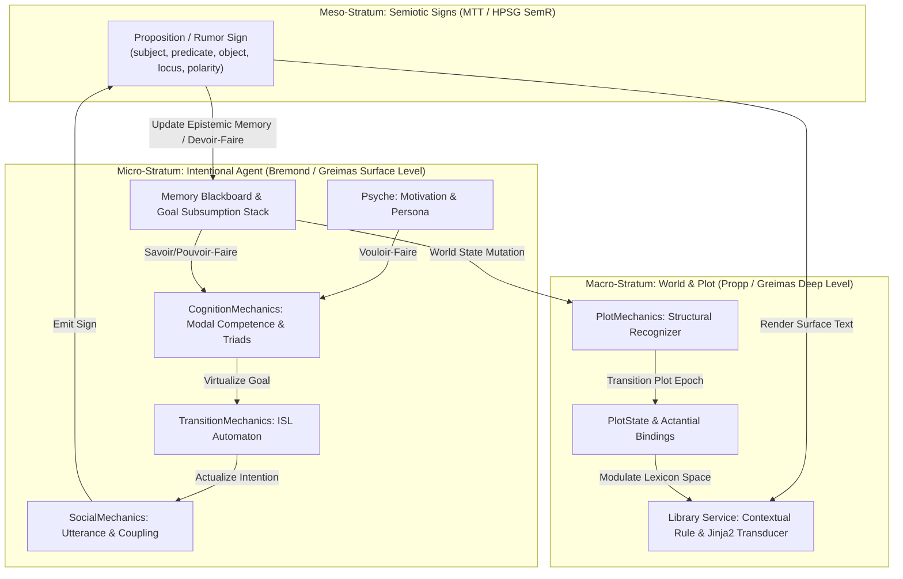

#### Implement: Phase 14 - Narratives

**Overview**

Ontology's foundational design constraint is *simulation and emergence, at all costs*: the engine ingests an initial world state configuration and evolves strictly via internal mechanics without hardcoded conversational trees or scripted cutscenes. Currently, narrative progression is split across two disconnected strata:

1. **Macro-Plot State (`PlotMechanics` & `Library`)**: `board.plot` tracks a global state string (`current`, `previous`) mutated via the Plot Transition Matrix (`src/data/config/plots/main.yaml`), which serves as the outer key in the static 3-tier `Library` lookup $\text{Library}(\text{plot}, \text{persona}, \text{lexicon}) \to \text{content}$.
2. **Micro-Intentional State (`CognitionMechanics`, `TransitionMechanics`, & `SocialMechanics`)**: Individual `Sprites` possess a `Psyche` $(\text{dialogue}, \text{persona}, \text{expression}, \text{motivation})$ and `Memory` $(\text{goals}, \text{rumors}, \text{prices}, \text{relationships}, \text{property}, \text{sprites}, \text{doors})$, executing autonomous loops through the Intention Transition Matrix (`src/data/config/intentions/main.yaml`).

However, the bridge between micro-level Sprite agency and macro-level Narrative structure is currently incomplete: `CognitionMechanics._motivate` is unimplemented (`pass` across all seven `Motivations`), `memory.rumors` stores opaque strings that cannot alter recipient cognition, `Library` lookups lack fallback or template interpolation, and `PlotMechanics` relies on brittle, hardcoded entity names rather than reusable structural roles.

Phase 14 formalizes and implements **Emergent Narratives** by synthesizing structuralist narratology (Propp, Bremond, Greimas), stratified linguistic transduction (Meaning-Text Theory / HPSG feature signs), and contextual blackboard response rules into Ontology's Entity-Component-System (ECS) and Intentional Automata.

##### Specification

To introduce the concept of a **Narrative** without violating Ontology's anti-scripting philosophy, narrative must not be modeled as a pre-authored directed graph of lines, but as a **coupled cybernetic loop** between bottom-up agent teleology (Bremond/Greimas) and top-down structural recognition and contextual expression (Propp/MTT/Response Rules).



###### 1. Formal Synthesis of Narrative Models in Ontology

| Theoretical Framework | Formal Mechanism | Ontology Engine Realization |
| --- | --- | --- |
| **Vladimir Propp** (*Morphology*) | 31 Invariant Functions ($\phi$) & 7 Spheres of Action | **Macro-Level Recognizer (`PlotMechanics`)**: Instead of scripting actions, Proppian functions act as *posterior state predicates* (e.g., $\text{Villainy/Lack } A$, $\text{Struggle/Victory } H/I$, $\text{Liquidation } K$) evaluated by the Plot `Executor` over bound Actantial Roles to advance `board.plot`. |
| **Claude Bremond** (*Logique du récit*) | Elementary Triads ($\text{Virtualize} \to \text{Actualize} \to \text{Achieve/Fail}$) & 3 Operations (*Chaining*, *Embedding*, *Coupling*) | **Micro-Level Deliberative Loop (`CognitionMechanics`)**:<br>

<br>1. *Virtualization*: `_motivate` & `_ideate` instantiate a `Goal`.<br>

<br>2. *Actualization*: `TransitionMechanics` & `NavigationMechanics` execute the Intention.<br>

<br>3. *Achievement/Failure*: `_resolve` evaluates completion or stall.<br>

<br>4. *Embedding (Enchâssement)*: Generalizes Cross-Layer Door Subsumption into a recursive prerequisite stack in `memory.goals`.<br>

<br>5. *Coupling (Entrecroisement)*: `CombatMechanics` and `SocialMechanics` apply inverse state/relationship mutations to interacting pairs. |
| **A. J. Greimas** (*Sémantique structurale*) | Actantial Model (6 Actants on 3 Axes) & 4 Modalities of Competence (*Vouloir*, *Devoir*, *Savoir*, *Pouvoir*) | **Modal Competence Evaluation**:<br>

<br>• *Vouloir-faire* (Desire): `psyche.motivation` ($\text{Subject} \to \text{Object}$).<br>

<br>• *Devoir-faire* (Contract): Social/Plot obligations received via `speak` (`Sender` $\to$ `Receiver`).<br>

<br>• *Savoir-faire* (Knowledge): Epistemic queries against `memory.sprites`, `memory.doors`, `memory.prices`.<br>

<br>• *Pouvoir-faire* (Capacity): Material queries against `inventory.equipment`, `inventory.wallet`, `inventory.pack`. |
| **Mel'čuk (MTT) & HPSG** | Stratified $\text{SemR} \to \text{Surface}$ Transduction & Typed Feature Signs | **Structured Propositions (`Proposition` Model)**: Replaces raw `str` keys in `psyche.dialogue` / `memory.rumors` with a dual-aspect Sign containing a machine-readable semantic payload ($\text{SemR}$: mutating recipient `Memory` on transmission) and a `lexicon` key rendered via `Library` Jinja2 templates. |
| **Valve Response System** | Contextual Blackboard Queries & Specificity Scoring | **Dynamic `Library` Resolution**: Evaluates `(plot, persona, lexicon)` with wildcard/default fallbacks and contextual predicates so dialogue adapts to emergent world state without combinatorial YAML explosion. |

###### 2. Architectural Approaches to Introducing "Narratives"

There are three distinct ways to architecturally introduce Narratives into Ontology, which can be implemented either independently or as a unified stratified architecture:

1. **Approach I: Bottom-Up Teleological Emergence (Bremondian Subsumption & Greimasian Competence)**
* **Mechanism**: Narrative exists purely as the trace of autonomous agents resolving multi-step motivational chains. `CognitionMechanics._motivate` translates each of the 7 `Motivations` (`conquest`, `profit`, `survival`, `love`, `revenge`, `rebellion`, `safety`) into concrete target states (Conjunction $S \land O$). Before transitioning into an execution Intention, `CognitionMechanics` checks **Modal Competence**:

$$\text{Competent}(S, G) \iff \text{Savoir}(S, G) \land \text{Pouvoir}(S, G)$$


If $\neg \text{Pouvoir}(S, G)$ (e.g., `Motivation == CONQUEST` requires `attack`, which requires `inventory.equipment.weapon != None` per `AnimationMap`), `CognitionMechanics` *embeds* (Bremond's *Enchâssement*) a prerequisite `Goal` (e.g., `scavenge` a weapon or `interact` with a known `Chest`, or `barter` with a merchant) onto `memory.goals`, exactly as `_track` currently subsumes cross-layer goals with a `Door` goal.
* **Pros**: 100% faithful to Ontology's zero-scripting axiom; produces complex, multi-step emergent quests spontaneously.
* **Cons**: Without a communicative or macro-recognition layer, emergent actions remain silent behavioral loops; the Player sees Sprites moving and fighting, but cannot read or participate in the underlying causal history.


2. **Approach II: Meso-Level Epistemic & Semiotic Propagation (`Proposition` Signs & `RumorMechanics`)**
* **Mechanism**: Upgrades `psyche.dialogue` and `memory.rumors` from static lexicon strings to structured **Semantic Propositions** ($\text{SemR}$). When an event occurs within a Sprite's `vision.radius` during `CognitionMechanics._scan` or `SpatialMechanics` (e.g., Sprite $A$ kills Sprite $B$, or Sprite $A$ spots a `Chest` or `Resource`, or a `Plot` epoch shifts), the witnessing Sprite synthesizes a `Proposition`:

$$\pi = \langle \text{topic}, \text{subject}, \text{predicate}, \text{object}, \text{layer}, \text{position} \rangle$$


When the witness enters `speak` with another Sprite (`SocialMechanics`), $\pi$ is transmitted into the listener's `memory.rumors` **and** unpacked into the listener's epistemic `Memory` (updating `memory.sprites[subject]`, `memory.relationships`, or virtualizing a new `Goal`). When transmitted to the `Player`, the `Library` interpolates the fields of $\pi$ into a Jinja2 template indexed by `(plot, persona, topic)`.
* **Pros**: Unifies `RumorMechanics`, `SocialMechanics`, and `Library` dialogue; Sprites gossip about actual events that occurred in the simulation rather than reciting canned lines.
* **Cons**: Requires refactoring `Psyche.dialogue` and `Memory.rumors` schemas and updating `Library` to support template rendering.


3. **Approach III: Top-Down Structural Recognition (`PlotMechanics` Actantial Frames)**
* **Mechanism**: Generalizes `PlotState` from a flat state string into an **Actantial Frame** where roles (`cast: Dict[str, str]`, e.g., `sovereign: evil-empress-jasilynn`, `champion: castle-dawn-champion`, `relic: writ-of-dawn`) are bound in configuration or dynamically assigned. `PlotMechanics` evaluates Proppian structural transitions over these role bindings, and upon plot state transitions, can optionally broadcast macro-level `PlotEvent` updates or mutate world relationships/motivations.
* **Pros**: Decouples Plot Transition Matrices from hardcoded entity names, allowing reusable narrative archetypes (e.g., *Siege*, *Usurpation*, *Vendetta*, *Blight*) across different Boards.
* **Cons**: If over-used to force state changes, risks encroaching on bottom-up simulation; therefore, `PlotMechanics` must remain strictly a *recognizer* of world state rather than a *puppeteer* of Sprite Intentions.


**Recommended Synthesis**: Implement a **Stratified Hybrid of Approaches I, II, and III**, keeping `TransitionMechanics` strictly responsible for `Intentions`, `CognitionMechanics` strictly responsible for `Goals` and Bremondian/Greimasian competence subsumption, `SocialMechanics` responsible for `Proposition` transmission and coupling, and `PlotMechanics` + `Library` responsible for macro-state recognition and Jinja2 surface realization.

---

##### Architectural Analysis I

###### Prerequisite Architectural Alterations

Before Phase 14 can be fully realized, several foundational gaps and inconsistencies in Phases 04, 06, and 08 must be addressed:

1. **Goal Taxonomy & Resolution Completeness (`Phase 06.02: Goals`)**:
* **Ambiguity in `Goals` Enumeration**: `src/data/config/intentions/main.yaml` references `constants.Goals.LOOT.value` (in `barter` and `mine`), whereas `docs/04-intentions.md` lists `position`, `object`, `property`, `target`, `subject`, and `@TODO(06-03) resource`. Meanwhile, `CognitionMechanics._resolve` assumes `Goals.OBJECT.value` is exclusively a cross-layer `Door` transition (`if sprite.state.layer != goal.layer`), leaving `Chest`, `Sign`, and `Plate` interactions unresolved!
* **Alteration**: Partition `Goals.OBJECT` or augment `Goal` with a `modality` / target `instance` check so `CognitionMechanics._resolve` and `complete` accurately resolve:
* `DOORS`: `sprite.state.layer != goal.layer`
* `CHESTS`: Chest `state.switch == True` or target item transferred to `sprite.state.inventory`
* `RESOURCES` / `LOOT`: Resource harvested or item quantity in `inventory.pack` / `inventory.pouch` incremented
* `PROPERTY`: `goal.name in sprite.state.memory.property`


2. **Generalizing `memory.goals` into a LIFO Subsumption Stack**:
* Currently, `memory.goals: Dict[str, Goal]` is an unordered dictionary iterated via `for key, candidate in sprite.state.memory.goals.items(): break` in `CognitionMechanics._remember`.
* Furthermore, when `_resolve` abandons a `TARGET` or `SUBJECT` goal because the target was not at its last-known `position`, it pushes the stale goal back into `memory.goals[goal.name] = goal`. As soon as the Sprite takes one `wander` step away from `candidate.position`, `_remember` sees `not self.nearby(candidate.position, sprite.state.position, action_radius)` and immediately pops the stale goal back out, causing an infinite oscillation loop (see **Bug B020**).
* **Alteration**: Add a `dormant: bool = False` flag to `Goal` (set to `True` when abandoned at an empty last-known coordinate, and cleared to `False` in `_scan` when the entity is re-sighted within `vision.radius`), and treat `memory.goals` as an ordered prerequisite stack (using Python 3.7+ `dict` insertion order with `.popitem()` for LIFO prerequisite resolution).


3. **Modal Competence Check in `CognitionMechanics` (`Pouvoir-Faire` & `Savoir-Faire`)**:
* In `TransitionMechanics`, `AnimationMap.action(sprite.state, board.equipment)` maps `attack` $\to$ `equipment.weapon` action and `mine` $\to$ `equipment.tool` action. If a Sprite transitions into `attack` or `mine` without the required equipment slotted, it cannot resolve a valid animation action or attackbox.
* **Alteration**: `CognitionMechanics` must verify competence before committing to an terminal goal. If a Sprite's goal requires a `weapon` (`TARGET`), `tool` (`RESOURCE`), or `materials` (`PROPERTY`), and the Sprite lacks the item in `inventory`, `CognitionMechanics` subsumes the primary goal into `memory.goals` and pushes a prerequisite acquisition goal (`OBJECT` for a known `Chest`, `SUBJECT` for `barter`, or `LOOT` / `RESOURCE`).


4. **Upgrading `Library` with Fallback Resolution and Jinja2 Interpolation**:
* Ontology already uses `Jinja2` for dynamic template rendering in its toolchain. By allowing `Library` entries (`src/data/config/library/main.yaml`) to contain optional Jinja2 expressions (e.g., `"Have you heard? {{ rumor.subject }} was seen near {{ rumor.layer }}!"`) and implementing a fallback cascade:

$$\text{Library.resolve}(\text{plot}, \text{persona}, \text{lexicon}, \text{context}) \to \text{plot}.\text{persona}.\text{lexicon} \;\lor\; \text{default}.\text{persona}.\text{lexicon} \;\lor\; \text{default}.\text{default}.\text{lexicon}$$


dialogue will never crash or return empty on Plot transitions where a minor NPC's dialogue did not change.


---

##### Goals

###### Goal: Structured Semantic Propositions (`Proposition` Model)

To bridge `CognitionMechanics`, `SocialMechanics`, and `Library`, introduce a `Proposition` dataclass in `src/app/models/state/assets/sheets.py` (or `src/app/models/state/core.py`) representing a unit of narrative information ($\text{SemR}$):

```python
@dataclass(slots=True)
class Proposition:
    lexicon: str
    subject: Optional[str] = None
    predicate: Optional[str] = None
    target: Optional[str] = None
    layer: Optional[str] = None
    position: Optional[Position] = None
    valuation: Optional[float] = None

```

* When a Sprite's `psyche.dialogue` is populated (either statically from YAML hydration or dynamically via `_ideate` / `_scan`), it holds a `lexicon` key or `Proposition`.
* When `SocialMechanics` executes a `speak` interaction between `source` and `target`:
1. **Player Target**: Dispatches `MenuEvent(id=Menus.DIALOGUE.value, context=DialogueContext(source=source, proposition=prop))` which resolves the surface string through `Library.render(board.plot.current, source.state.psyche.persona, prop)` and stamps the `dialogue` MenuPane.
2. **Sprite Target (Rumor & Epistemic Propagation)**: Appends `prop` to `target.state.memory.rumors` and integrates its semantic payload into `target.state.memory`:
* If `prop.subject` and `prop.position` and `prop.layer == target.state.layer`: updates `target.state.memory.sprites[prop.subject] = prop.position` and refreshes any matching dormant `Goal` in `target.state.memory.goals` (clearing `dormant = False`).
* If `prop.predicate == Relationships.FOE.value` and `target.state.memory.relationships.get(source.name) in (Relationships.FRIEND.value, Relationships.FAMILY.value)`: propagates relational alignment (Bremondian coupling).


###### Goal: Greimasian Motivation & Bremondian Subsumption in `CognitionMechanics`

Complete `CognitionMechanics._motivate` so that each of the seven `Motivations` virtualizes strategic `Goals` based on the Sprite's internal state and `Memory` blackboard:

```python
def _motivate(self, sprite: Asset, board: Board) -> None:
    if sprite.state.intention != Intentions.IDLE.value or sprite.state.goal:
        return

    motivation = sprite.state.psyche.motivation
    mem = sprite.state.memory

    if motivation == Motivations.REVENGE.value or motivation == Motivations.CONQUEST.value:
        # Seek known foes in memory
        foes = [name for name, rel in mem.relationships.items() if rel == Relationships.FOE.value]
        for foe_name in foes:
            foe_state = board.character(foe_name)
            if foe_state and not foe_state.mutators.triggers.dead:
                pos = mem.sprites.get(foe_name, sprite.state.position)
                sprite.state.goal = Goal(
                    name=foe_name,
                    category=Goals.TARGET.value,
                    layer=foe_state.layer,
                    position=Position(x=pos.x, y=pos.y)
                )
                return

    elif motivation == Motivations.SURVIVAL.value or motivation == Motivations.SAFETY.value:
        # If fear trigger is active or health is low, seek safety / escape
        if sprite.state.mutators.triggers.fear and mem.property:
            prop_name, prop_pos = next(iter(mem.property.items()))
            sprite.state.goal = Goal(
                name=prop_name,
                category=Goals.POSITION.value,
                layer=sprite.state.layer,
                position=Position(x=prop_pos.x, y=prop_pos.y)
            )
            return

    elif motivation == Motivations.LOVE.value:
        # Seek friends or family to converse with
        loved = [
            name for name, rel in mem.relationships.items()
            if rel in (Relationships.FRIEND.value, Relationships.FAMILY.value)
        ]
        for target_name in loved:
            if target_name in mem.sprites and sprite.state.psyche.dialogue:
                pos = mem.sprites[target_name]
                sprite.state.goal = Goal(
                    name=target_name,
                    category=Goals.SUBJECT.value,
                    layer=sprite.state.layer,
                    position=Position(x=pos.x, y=pos.y)
                )
                return

```

###### Goal: Contextual `Library` Service & Actantial `PlotState`

Enhance `PlotState` and `Library` to support role bindings, fallback resolution, and template interpolation:

$$\text{Library.get}(\text{plot}, \text{persona}, \text{lexicon}, \text{ctx}) = \text{Render}_{\text{Jinja2}}\Big(\mathcal{L}[\text{plot}][\text{persona}][\text{lexicon}] \;\lor\; \mathcal{L}[\text{"default"}][\text{persona}][\text{lexicon}],\; \text{ctx}\Big)$$

---

##### Tasks

**1. Task: Prerequisite Goal Lifecycle & Subsumption Refactor (Phase 06.02 Alignment)**

*Objective*: Complete goal resolution semantics in `CognitionMechanics` and fix dormant goal memory oscillation so multi-step narrative goals can execute reliably.

* [] Subtask: Add a `dormant: bool = False` attribute to `Goal` in `src/app/models/state/assets/sheets.py` to distinguish un-sighted last-known positions from active prerequisite goals in `memory.goals`.
* [] Subtask: Update `CognitionMechanics._resolve` and `CognitionMechanics.complete` to safely handle `None` returns from `board.character(goal.name)` and implement completion predicates for `Goals.OBJECT` (distinguishing `Doors` from `Chests`), `Goals.PROPERTY` (`goal.name in sprite.state.memory.property`), and `Goals.RESOURCE` / `Goals.LOOT`.
* [] Subtask: Update `CognitionMechanics._remember` to skip `memory.goals` entries where `candidate.dormant == True`, and update `CognitionMechanics._scan` to set `mem_goal.dormant = False` when `other_name` is sighted within `vision_radius`.
* [] Subtask: Implement LIFO prerequisite subsumption in `CognitionMechanics._track` and `_motivate` so missing modal competencies (`Pouvoir-faire`: missing `weapon`/`tool` in `inventory.equipment`; `Savoir-faire`: unknown target coordinates) push the primary `Goal` to `memory.goals` and instantiate a prerequisite acquisition/exploration `Goal`.

**2. Task: Implement Motivational Goal Generation & Coupling**

*Objective*: Implement `CognitionMechanics._motivate` across all seven `Motivations` and add Bremondian event coupling in `CombatMechanics` and `SocialMechanics`.

* [] Subtask: Implement `CONQUEST`, `REVENGE`, `SURVIVAL`, `SAFETY`, `PROFIT`, `LOVE`, and `REBELLION` goal ideation in `CognitionMechanics._motivate` (`src/app/game/logic/mechanics/intentional/cognition.py`).
* [] Subtask: Implement Bremondian coupling (*Entrecroisement*) in `CombatMechanics`: when `source` damages `target`, automatically update `target.state.memory.relationships[source.name] = Relationships.FOE.value`, record `source.state.position` in `target.state.memory.sprites[source.name]`, and spawn an `ANGER` or `SURPRISE` expression bubble via `board.cradle.spawn_expression`.
* [] Subtask: Add unit tests in `tests/unit/app/game/logic/mechanics/intentional/test_cognition.py` verifying each `Motivation` generates the expected `Goal` category and respects prerequisite subsumption.

**3. Task: Implement Semantic Propositions & `SocialMechanics` Rumor Propagation**

*Objective*: Replace inert string rumors with structured `Proposition` signs that mutate recipient `Memory` blackboards during `speak` intentions.

* [] Subtask: Define the `Proposition` model in `src/app/models/state/assets/sheets.py` and update `Memory.rumors` and `Psyche.dialogue` type annotations and Pydantic adapters to support structured propositions alongside legacy lexicon strings.
* [] Subtask: Update `CognitionMechanics._scan` to synthesize a `Proposition` when a Sprite observes salient world transitions (e.g., a dead character, a hostile combatant, or a newly discovered `Chest`/`Resource`).
* [] Subtask: Implement `SocialMechanics` (`src/app/game/logic/mechanics/spatial/social.py`) to handle `Intentions.SPEAK`: when two Sprites intersect within `action.radius`, exchange `Proposition` rumors, update recipient `memory.sprites` and `memory.relationships`, perform price discovery on `memory.prices`, and spawn `LOQUACITY` / `AGREEMENT` / `DISAGREEMENT` expressions.
* [] Subtask: When `Player` is the target or initiator of `Intentions.SPEAK`, push a `MenuEvent(id=Menus.DIALOGUE.value)` to the `Engine.bus` and clear or advance the speaker's `psyche.dialogue` buffer.

**4. Task: Upgrade `Library` Service & `PlotMechanics` Actantial Recognition**

*Objective*: Enable dynamic template interpolation and fallback cascades in `Library`, and fix `PlotMechanics` history tracking and ISL helper functions.

* [] Subtask: Fix `PlotMechanics.update` (`src/app/game/logic/mechanics/world/plot.py`) so `board.plot.previous.append(current_plot)` executes when `board.plot.previous is not None` rather than `if board.plot.previous:`.
* [] Subtask: Extend `PlotState` (`src/app/models/state/core.py`) with an optional `roles: Dict[str, str]` mapping to bind abstract Actantial roles (e.g., `sovereign`, `champion`, `villain`) to concrete entity names for reusable Plot Transition rules.
* [] Subtask: Implement ` default` plot and persona fallback resolution and Jinja2 string interpolation in the `Library` service so `Proposition` attributes (`subject`, `target`, `layer`, `valuation`) can be injected directly into dialogue strings.
* [] Subtask: Add narrative integration tests verifying a complete emergent loop: World Event $\to$ Witness `Proposition` $\to$ Sprite-to-Sprite Rumor Transmission $\to$ Motivational `Goal` Virtualization $\to$ `PlotMechanics` Transition $\to$ `Library` Surface Realization.