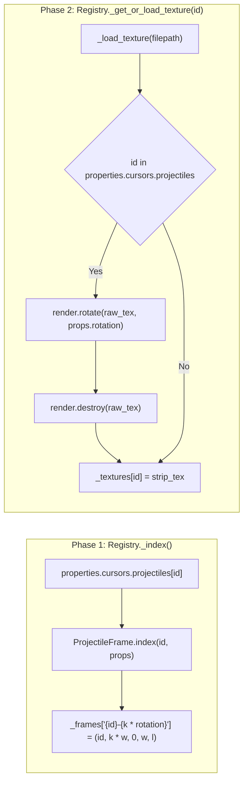
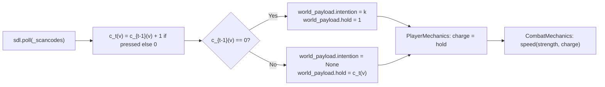

#### Refactor: Phase 03.04 - Projectiles

**Overview**

Codify `Projectiles` (`cursors.projectiles`) using the Registry Load-Time Rotation strategy (`ProjectileFrame`, `RotatedHitbox`, and `render.rotate`), allowing a single canonical projectile texture frame to be quantized into arbitrary angular increments ($\Delta\theta \in (0, 360]$) in VRAM without modifying the 60 Hz `Screen._assemble()` / `render.render()` pipeline. Extend `Device` polling to track button hold duration, parameterize projectile launch speed as a function of `character.strength` and `attack` hold duration, and wire ranged combat spawning in `CombatMechanics` and impact/boundary resolution in `ProjectileMechanics`.

##### Specification

1. **Angular Partitioning (`CursorProperties` & `MotorState`)**:
    * Extend `CursorProperties` (`src/app/models/properties/assets.py`) with `rotation: int = 90` (degrees per discrete rotational step, where $360 \bmod \text{rotation} == 0$). Because `rotation` defines the static frame-space partitioning of the image file, it belongs on `CursorProperties`.
    * The discrete set of valid projectile angles is $\Theta = \{ k \cdot \text{rotation} \mid 0 \le k < 360 // \text{rotation} \}$.
    * Extend `MotorState` (`src/app/models/state/assets/cursors.py`) with `angle: int = 0` ($\text{angle} \in \Theta$), `speed: int = 200`, and `owner: Optional[str] = None`. Because launch speed, angle, and shooter identity vary per deployed projectile instance, they reside on `MotorState`.
2. **Load-Time Texture Strip Synthesis (`ProjectileFrame` & `Registry`)**:
    * Authored projectile `.png` files contain a single canonical frame of dimensions $(W, L)$ oriented at $\theta = 0^\circ$ ($+x$, `Directions.RIGHT`).
    * `ProjectileFrame.index(id, properties)` maps each discrete angle key `f"{id}-{angle}"` ($\text{angle} = k \cdot \text{properties.rotation}$) to crop coordinate $(k \cdot W, 0, W, L)$ for $0 \le k < 360 // \text{properties.rotation}$.
    * `Registry._get_or_load_texture()` checks whether `asset_key in self.properties.cursors.projectiles` and invokes `render.rotate(raw_tex, self.properties.cursors.projectiles[asset_key].rotation)`, which allocates a target `TexturePtr` of dimensions $(N \cdot W, L)$ where $N = 360 // \text{rotation}$ and stamps the base texture $N$ times clockwise via `SDL_RenderCopyEx`.
    * `ProjectileFrame.keys(id, state)` projects `state.angle` directly to `[(f"{id}-{state.angle}", 0, 0)]`.
3. **Rotated AABB Hitbox Projection (`RotatedHitbox`)**:
    * Given frame dimensions $(W, L)$ with center $(c_x, c_y) = (W / 2, L / 2)$, `RotatedHitbox.get(properties, state, elevation)` rotates each base `Hitbox` $(x_0, y_0, w_0, l_0)$ in `properties.hitboxes` (falling back to the full frame bounds $(0, 0, W, L)$ when `properties.hitboxes` is `None`) by $\Delta\theta = \text{state.angle}$ clockwise around $(c_x, c_y)$:

    $$
    h_{cx} = \left(x_0 + \frac{w_0}{2}\right) - c_x, \qquad h_{cy} = \left(y_0 + \frac{l_0}{2}\right) - c_y
    $$

    $$
    \begin{pmatrix} h'_{cx} \\ h'_{cy} \end{pmatrix} = \begin{pmatrix} \cos\Delta\theta & -\sin\Delta\theta \\ \sin\Delta\theta & \cos\Delta\theta \end{pmatrix} \begin{pmatrix} h_{cx} \\ h_{cy} \end{pmatrix}
    $$

    $$
    w'(\Delta\theta) = \max\Big(1,\; \operatorname{round}\big(w_0 |\cos\Delta\theta| + l_0 |\sin\Delta\theta|\big)\Big), \qquad l'(\Delta\theta) = \max\Big(1,\; \operatorname{round}\big(w_0 |\sin\Delta\theta| + l_0 |\cos\Delta\theta|\big)\Big)
    $$

    $$
    x'(\Delta\theta) = \operatorname{round}\left(c_x + h'_{cx} - \frac{w'(\Delta\theta)}{2}\right), \qquad y'(\Delta\theta) = \operatorname{round}\left(c_y + h'_{cy} - \frac{l'(\Delta\theta)}{2}\right)
    $$

4. **Button Hold Counter (`Keyboard` & `WorldPayload`) and Projectile Draw Speed (`MutatorParameters` & `CombatMechanics`)**:
    * `Keyboard` (`src/app/game/devices.py`) accumulates consecutive press ticks per scancode in `self._last_state`:

    $$
    c_t(\text{code}) = \begin{cases} c_{t-1}(\text{code}) + 1 & \text{if } \text{pressed}(\text{code}) = 1 \\ 0 & \text{if } \text{pressed}(\text{code}) = 0 \end{cases}
    $$

    * `WorldPayload` (`src/app/models/state/devices.py`) is extended with `hold: int = 0`, populated with $c_t(v)$ for the active held intention scancode $v$ while preserving rising-edge singularity (`c_t(v) == 1`) on `WorldPayload.intention`.
    * `MutatorParameters` (`src/app/models/state/core.py`) is extended with `charge: int = 0` to store the accumulated `attack` hold duration on `SheetState` / `SpriteState`.
    * On the release frame of `Actions.SHOOT`, projectile scalar speed $s(S, n)$ is computed from `strength` $S = \text{state.character.strength}$, held tick count $n = \text{state.mutators.parameters.charge}$, base velocity coefficient $\alpha = 10$, and draw window $N_{\max} = \max(1, F_{\text{release}} \cdot \text{delay})$:

    $$
    s(S, n) = \operatorname{round}\left(\alpha S \left(1 + \min\left(1.0,\; \frac{n}{N_{\max}}\right)\right)\right)
    $$

##### Architectural Analysis I

1. **Ontology of Properties vs. State (`rotation` vs. `speed` and `angle`)**:
    * In the Asset Hierarchy, `Properties` encode static, immutable characteristics intrinsic to the Asset file and its atlas partitioning, whereas `State` exemplifies dynamic attributes particular to an Asset's deployment on the `Board`.
    * `rotation: int = 90` on `CursorProperties` defines the angular resolution $\Delta\theta$ of the synthesized texture strip in `Registry` and `ProjectileFrame.index()`. Because every projectile has a deterministic angular step (defaulting to $90^\circ$ for cardinal projectiles such as `arrow` and `bolt`, or $45^\circ$ for `cannonball`), `rotation` is a concrete `int = 90` field rather than `Optional[int] = None`.
    * Conversely, `speed: int = 200` and `angle: int = 0` are situational parameters of a specific launch event and belong on `MotorState` alongside `position`, `initial`, `velocity`, and `owner`.

2. **Eliminating Duck-Typing in `Registry` via Asset Hierarchy Lookup**:
    * `Registry` holds the validated `PropertySchema` hierarchy on `self.properties`. Rather than inspecting arbitrary property objects for the presence of an optional `rotation` attribute, `Registry._get_or_load_texture()` checks membership directly against the `(cursors, projectiles)` hierarchy node (`if self.properties.cursors and asset_key in self.properties.cursors.projectiles:`), matching the pattern established in `Registry._load_font()` (`if font_key not in self.properties.fonts:`).
    * When `asset_key in self.properties.cursors.projectiles`, `Registry` retrieves `rotation = self.properties.cursors.projectiles[asset_key].rotation`, synthesizes the rotated horizontal texture strip via `render.rotate(raw_tex, rotation)`, and destroys the intermediate unrotated `raw_tex` via `render.destroy(raw_tex)` so single-frame textures do not linger in VRAM.
    * `Registry._index()` requires no special-case logic: it already iterates the `(category, instance)` fields of `self.properties` and `self.recipes`, delegating `cursors.projectiles` crop generation to `ProjectileFrame.index(item_id, item_props)`.



3. **Screen-Space Angle Convention & Launch Quantization (`Cradle.spawn_projectile`)**:
    * In screen coordinates ($+x$ right, $+y$ down), both `SDL_RenderCopyEx` and the 2D rotation matrix $R(\Delta\theta)$ rotate clockwise:
        * $\theta = 0^\circ \leftrightarrow (+1, 0)$ (`Directions.RIGHT`)
        * $\theta = 90^\circ \leftrightarrow (0, +1)$ (`Directions.DOWN`)
        * $\theta = 180^\circ \leftrightarrow (-1, 0)$ (`Directions.LEFT`)
        * $\theta = 270^\circ \leftrightarrow (0, -1)$ (`Directions.UP`)
    * Given a continuous displacement vector $(\Delta x, \Delta y)$ toward a target coordinate (or a cardinal `Directions` unit vector when no target coordinate is present), the raw launch angle in $[0, 360)$ is:

    $$
    \theta_{\text{raw}} = \left(\operatorname{atan2}(\Delta y, \Delta x) \cdot \frac{180}{\pi}\right) \bmod 360
    $$

    * Quantizing onto the nearest discrete step $R = \text{properties.rotation}$ yields:

    $$
    \text{angle} = \left(\operatorname{round}\left(\frac{\theta_{\text{raw}}}{R}\right) \cdot R\right) \bmod 360, \qquad \vec{v} = \begin{pmatrix} \text{speed} \cdot \cos(\text{angle} \cdot \frac{\pi}{180}) \\ \text{speed} \cdot \sin(\text{angle} \cdot \frac{\pi}{180}) \end{pmatrix}
    $$

    * `Cradle.spawn_projectile()` allocates distinct `Position(position.x, position.y)` instances for `state.position` and `state.initial` so in-place sub-pixel integration in `physics.integrate()` does not mutate `state.initial` or the shooter's position.

4. **Ranged Combat Trigger & Impact Resolution (`CombatMechanics` & `ProjectileMechanics`)**:
    * **Release Frame Edge Trigger**: In `CombatMechanics.update()`, an attacker with `state.animation.action == Actions.SHOOT` spawns a projectile only on the release frame when `state.animation.tick == 1`, preventing duplicate spawns when action `delay > 1`.
    * **Motion Integration Ownership**: `MotionMechanics` integrates velocity for inert projectile assets via `physics.integrate()`. `ProjectileMechanics.update()` evaluates range/boundary expiration and elevation-partitioned intersections (`projectile.elevation == target.elevation`) against obstacles (`board.obstacles(layer, elevation)`) and targets (`SPRITES`, `PLAYERS`, `REACTABLES`), excluding `target.name == projectile.state.owner`.

##### User Review I

* `speed` is not a Property. `mass` is a Property, i.e. intrinsic to the Asset. `speed` is State; it is dependENT on the particular occasion of the Asset, i.e. different Projectiles of the same Instance and Category could have different speeds. Changing proposed tasks to align with this.
* "*detects `rotation` on projectile properties and invokes `render.rotate(raw_tex, delta)`*" sounds a lot like duck-typing. Any solution that requires duck-typing needs to be re-evaluated from the ground up. Models are well defined. Code should not be inferring type based on properties. The Registry literally walks the Asset Hierarchy nodes when indexing, so it makes no sense to infer the type when the type is already available. Just check if the ID is in `properties.cursors.projectiles` or something. I am concerned the Registry is about to be turned into spaghetti. Please re-evaluate the plan.

##### Architectural Analysis II

1. **Button Hold Duration Counter in `Device` (`Keyboard.poll`)**:
    * In `src/app/game/devices.py`, `Keyboard` already initializes `self._last_state = {code: 0 for code in self._scancodes}` when setting the device context and polls raw boolean key states `(0, 1)` via `sdl.poll(self._scancodes)`.
    * By upgrading `current_dict` from a binary flag to a consecutive-tick accumulator:

    ```python
    current_dict = {
        code: (self._last_state.get(code, 0) + 1) if state else 0
        for code, state in zip(self._scancodes, current_state)
    }
    ```

    every pressed scancode tracks its exact hold duration in ticks ($c_t \ge 1$) while unpressed scancodes reset to `0`:
    * **Backward-Compatible Edge Triggering**: Because `self._last_state.get(v)` is `0` (falsy) only when unpressed on the prior tick and $\ge 1$ (truthy) on every held tick, existing rising-edge checks (`current_dict.get(v) and not self._last_state.get(v)`) across `intentions`, `grips`, `menus`, `traversal`, and `interactions` remain invariant.
    * **Hold Counter Propagation**: Extending `WorldPayload` (`src/app/models/state/devices.py`) with `hold: int = 0` allows `Keyboard.poll()` to emit the consecutive tick count of the active intention button in configuration order (preserving the Intention singularity rule):

    ```python
    for k, v in self.mapping.world.intentions.items():
        if v is not None and current_dict.get(v):
            if not self._last_state.get(v):
                world_payload.intention = k
            world_payload.hold = current_dict[v]
            break
    ```



2. **State Attributes for Hold Duration (`MutatorParameters.charge`)**:
    * Inspecting `SheetState` (`src/app/models/state/assets/sheets.py`) and `AssetState` (`src/app/models/state/core.py`), `MutatorParameters` is the canonical container for dynamic parameters modulating an entity's active Intention or physical state (already housing `hand: Optional[Enumerated[Hands]] = None` for `Intentions.USE` and `descension: Optional[float] = 0.0` for gravity freefall).
    * Adding `charge: int = 0` to `MutatorParameters` provides a unified state field across both `Player` (`SheetState`) and `Sprite` (`SpriteState`) without duplicating fields across models:
        * **Player Lifecycle (`PlayerMechanics`)**:
            1. When `player.state.intention != intention` on a new `Intentions.ATTACK` transition, initialize `player.state.mutators.parameters.charge = payload.world.hold`.
            2. On subsequent ticks while `player.state.intention == Intentions.ATTACK` and `payload.world.hold > 0`, update `player.state.mutators.parameters.charge = payload.world.hold`.
            3. If the Player releases the attack key early (`payload.world.hold == 0`) while locked in the blocking `SHOOT` animation (`is_locked == True`), `player.state.mutators.parameters.charge` retains the peak tick count $n$ held during that draw rather than being wiped to `0` before the release frame is reached.
            4. When `player.state.intention` returns to `Intentions.IDLE` (or upon projectile release in `CombatMechanics`), reset `player.state.mutators.parameters.charge = 0`.
        * **Sprite Lifecycle (Deferred to Future Phase)**: Because `MutatorParameters.charge` lives on `AssetState`, `CognitionMechanics` can later populate `sprite.state.mutators.parameters.charge` without any schema or `CombatMechanics` changes.

3. **Projectile Speed Formula ($s(S, n)$)**:
    * Let $S = \text{state.character.strength}$ (default `10`), $n = \text{state.mutators.parameters.charge} \in \mathbb{Z}_{\ge 0}$, and $N_{\max} = \max(1, F_{\text{release}} \cdot \text{delay})$ be the number of ticks from frame `0` to the release frame $F_{\text{release}}$ of `Actions.SHOOT`.
    * Define the normalized draw ratio $\tau(n) \in [0, 1]$ and scalar launch speed $s(S, n)$:

    $$
    \tau(n) = \min\left(1.0,\; \frac{n}{N_{\max}}\right), \qquad s(S, n) = \operatorname{round}\Big(\alpha S \big(1 + \tau(n)\big)\Big)
    $$

    * With base strength coefficient $\alpha = 10\text{ px}/(\text{s}\cdot\text{strength})$ (`settings.PROJECTILE_BASE_SPEED_FACTOR = 10`):
        * **Uncharged / Instant Tap ($n \to 0, S = 10$)**: $\tau(0) = 0 \implies s(10, 0) = 100\text{ px/s}$, guaranteeing a positive minimum launch velocity even for a 1-tick tap or an uncharged NPC Sprite (`charge == 0`).
        * **Half Draw ($\tau = 0.5, S = 10$)**: $s(10, N_{\max}/2) = 150\text{ px/s}$.
        * **Full Draw ($n \ge N_{\max}, S = 10$)**: $\tau(n) = 1.0 \implies s(10, N_{\max}) = 200\text{ px/s}$, matching the nominal `MotorState.speed = 200` baseline and saturating cleanly so prolonged button holds cannot cause unbounded velocity or hitbox tunneling.

##### User Review II

* Examine the Device implementation below. Determine what would be necessary to add a counter to a button to determine how long it has been pressed.
* Examine the Sprite state definitions and create a formula for calculating the speed of a spawned projectile base on `sprite.state.character.strength` and the length of time the Sprite has held down the `attack` intention. Determine what state attributes would need added to accomodate this.
    * For the Player, the length of time will be determined through device polling.
    * For the Sprite, the length of time will be determined through CognitionMechanics. This is actually a really complex problem, so let's defer it until later. MVP is Player Projectile spawning based on length of time button was held and Player strength.

##### Goals

###### Goal: Implement `render.rotate` in Cython SDL2 Bindings

Expose `SDL_Point`, `SDL_RendererFlip`, and `SDL_RenderCopyEx` in `src/libs/graphics/render.pyx` and implement `rotate(TexturePtr base_ptr, int rotation) -> TexturePtr` to pre-bake rotated projectile frames into a single horizontal `TexturePtr` strip during `Registry` texture loading when `asset_key in self.properties.cursors.projectiles`.

###### Goal: Implement `ProjectileFrame` and `RotatedHitbox`

Create `ProjectileFrame` (`src/app/assets/frames/cursors.py`) and `RotatedHitbox` (`src/app/assets/hitboxes/cursors.py`) and register them under `recipes.cursors.projectiles` in `src/data/config/recipes/main.yaml`.

###### Goal: Track Intention Hold Duration in `Device` and `PlayerMechanics`

Update `Keyboard.poll()` (`src/app/game/devices.py`) to accumulate consecutive press ticks per scancode in `self._last_state` and expose the active intention hold count on `WorldPayload.hold` (`src/app/models/state/devices.py`). Extend `MutatorParameters` (`src/app/models/state/core.py`) with `charge: int = 0` and update `PlayerMechanics.update()` to record the held tick count during `Intentions.ATTACK`.

###### Goal: Wire Ranged Spawning in `Cradle`, Speed Calculation in `CombatMechanics`, and Impact Resolution in `ProjectileMechanics`

Update `Cradle.spawn_projectile()` to quantize launch angles to `properties.rotation`, compute initial `Velocity(vx, vy)` from `state.angle` and `state.speed`, and instantiate the projectile `Asset` at the attacker's `elevation`. Update `CombatMechanics` to compute charged projectile speed $s(S, n)$ from `character.strength` and `mutators.parameters.charge` on the release frame of `Actions.SHOOT`, and update `ProjectileMechanics` to enforce elevation-isolated impact detection against obstacles and targets, apply damage, and remove expired projectiles.

##### Tasks

**1. Task: Add Cython `render.rotate` and Registry Load-Time Rotation**

*Objective*: Synthesize rotated texture strips in VRAM during `Registry` texture loading for assets registered under `properties.cursors.projectiles`.

* [] Subtask: Declare `SDL_Point`, `SDL_RendererFlip`, and `SDL_RenderCopyEx` in `src/libs/graphics/render.pyx` and implement `rotate(TexturePtr base_ptr, int rotation) -> TexturePtr`.
* [] Subtask: Update `CursorProperties` in `src/app/models/properties/assets.py` to include `rotation: int = 90` and update `MotorState` (`src/app/models/state/assets/cursors.py`) to include `angle: int = 0`, `speed: int = 200`, and `owner: Optional[str] = None`.
* [] Subtask: Update `Registry._get_or_load_texture()` in `src/libs/graphics/registry.pyx` to check `asset_key in self.properties.cursors.projectiles`, invoke `render.rotate(raw_tex, self.properties.cursors.projectiles[asset_key].rotation)`, and destroy the temporary unrotated texture.

**2. Task: Implement `ProjectileFrame` and `RotatedHitbox`**

*Objective*: Index rotated projectile frame crops and transform base AABB hitboxes by `state.angle`.

* [] Subtask: Fix the `ProjectilFrame` class name typo and implement `ProjectileFrame` in `src/app/assets/frames/cursors.py` to index `f"{id}-{k * properties.rotation}"` crops and resolve `[(f"{id}-{state.angle}", 0, 0)]` in `keys()`.
* [] Subtask: Implement `RotatedHitbox` in `src/app/assets/hitboxes/cursors.py` (and export in `src/app/assets/hitboxes/__init__.py`) to project base `properties.hitboxes` around the frame center by `state.angle` at the projectile's `elevation`.
* [x] Subtask: Register `ProjectileFrame` and `RotatedHitbox` under `cursors.projectiles` in `src/data/config/recipes/main.yaml`.

**3. Task: Implement Button Hold Counter in `Device` and Charge Tracking in `PlayerMechanics`**

*Objective*: Measure how many consecutive ticks an intention button is held and persist the charge count on `MutatorParameters`.

* [] Subtask: Add `hold: int = 0` to `WorldPayload` in `src/app/models/state/devices.py` and `charge: int = 0` to `MutatorParameters` in `src/app/models/state/core.py`.
* [] Subtask: Update `Keyboard.poll()` in `src/app/game/devices.py` to increment per-scancode hold counters in `self._last_state` while pressed, reset to `0` on release, and populate `world_payload.hold` for the active intention key.
* [] Subtask: Update `PlayerMechanics.update()` in `src/app/game/logic/mechanics/intentional/player.py` to accumulate `payload.world.hold` into `player.state.mutators.parameters.charge` during `Intentions.ATTACK` (preserving the held count if released before the animation completes) and reset `charge = 0` when returning to `Intentions.IDLE`.

**4. Task: Implement `Cradle.spawn_projectile`, Charged `CombatMechanics` Ranged Trigger, and `ProjectileMechanics`**

*Objective*: Complete the end-to-end lifecycle of ranged projectiles from charged release to target impact or boundary removal.

* [] Subtask: Update `Cradle.spawn_projectile()` to clone `Position` for `position` and `initial`, quantize direction/target vectors onto the nearest multiple of `properties.rotation`, compute `Velocity(vx, vy)` from `angle` and `speed`, and populate `MotorState` at the shooter's `elevation`.
* [] Subtask: Wire ranged projectile spawning in `CombatMechanics.update()` on the release frame (`tick == 1`) of `Actions.SHOOT`, computing launch `speed` from `attacker.state.character.strength` and `attacker.state.mutators.parameters.charge` and resetting `charge = 0`.
* [] Subtask: Update `ProjectileMechanics.update()` to evaluate elevation-partitioned intersections against targets and obstacles (excluding `projectile.state.owner`), apply combat damage or reactable activation, and queue impacted or out-of-bounds projectiles for removal.

#### Bug Reports 

##### Bug 001: Shared `Position` Reference Between `position` and `initial` in `Cradle.spawn_projectile`

**STATUS**: OPEN
**SEVERITY**: HIGH

**Description**

In `src/app/services/generators/game/cradle.py`, `Cradle.spawn_projectile()` assigns the incoming `position: Position` reference to both `state.position` and `state.initial`:

```python
state = MotorState(
    id          = id, 
    name        = name, 
    layer       = layer, 
    position    = position, 
    initial     = position,
    ...
)
```

Because `physics.integrate()` mutates `asset.state.position.x` and `asset.state.position.y` in place (`p.x += shift`, `p.y += shift`), `state.initial` mutates identically every frame (`||state.position - state.initial|| == 0`), breaking any travel-distance or range check. Furthermore, if a caller passes `attacker.state.position` directly into `spawn_projectile()`, `physics.integrate()` will translate the attacker across the board alongside the projectile.

**Steps to Replicate**

1. Call `cradle.spawn_projectile("arrow", attacker.state.position, "overworld", Velocity(200.0, 0.0))`.
2. Step `physics.integrate([projectile], delta=0.1)`.
3. Observe that `projectile.state.initial.x`, `projectile.state.position.x`, and `attacker.state.position.x` have all incremented by `20`.

**Proposed Remediation**

Instantiate distinct `Position` copies in `Cradle.spawn_projectile()`:

```python
position=Position(x=position.x, y=position.y),
initial=Position(x=position.x, y=position.y),
```

##### Bug 002: Per-Frame `logger.info` I/O Inside `SpriteFrame.keys` When Attacking

**STATUS**: OPEN
**SEVERITY**: LOW

**Description**

In `src/app/assets/frames/sheets.py`, `SpriteFrame.keys()` executes an unconditional `logger.info` call whenever a Sprite is in `Intentions.ATTACK`:

```python
if state.intention is not None and state.intention == Intentions.ATTACK:
    logger.info(f"SpriteFrame generated keys: {frame_keys}")
```

Because `SpriteFrame.keys()` is invoked every frame inside `render.assemble()`, any attacking Sprite triggers string formatting and synchronous logging I/O at 60 Hz.

**Proposed Remediation**

Remove the leftover debug `logger.info` statement from `SpriteFrame.keys()`.

#### Doc Updates 

##### Draft: Mutator Charge Parameter and Device Hold Polling

- **Page**: `docs/02-sprites.md`
- **Heading**: `###### Model: Mutators`

###### Drift

`docs/02-sprites.md` does not document the `parameters.charge` accumulator used to parameterize `attack` hold duration for projectile launch speed.

###### Update

```markdown
* `parameters.charge`: Tick accumulator tracking how long the `attack` Intention has been held prior to projectile release.
```

##### Draft: Ranged Combat Projectile Speed Specification

- **Page**: `docs/05-mechanics.md`
- **Heading**: `###### Spatial Mechanic: CombatMechanics`

###### Drift

`docs/05-mechanics.md` describes melee Attackbox evaluation in `CombatMechanics` but omits ranged projectile spawning and the strength/charge launch speed equation.

###### Update

```markdown
For ranged combat (`shoot`), `CombatMechanics` spawns a Projectile on the release frame of the Action. The initial scalar speed $s(S, n)$ is a function of the attacker's strength $S$ and the held tick duration $n$ relative to the draw window $N_{\max}$:

$$
\tau(n) = \min\left(1.0,\; \frac{n}{N_{\max}}\right), \qquad s(S, n) = \operatorname{round}\Big(\alpha S \big(1 + \tau(n)\big)\Big)
$$
```