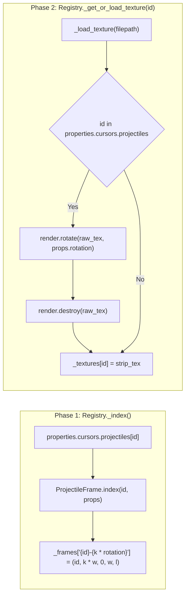
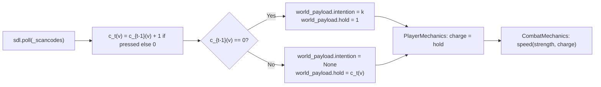
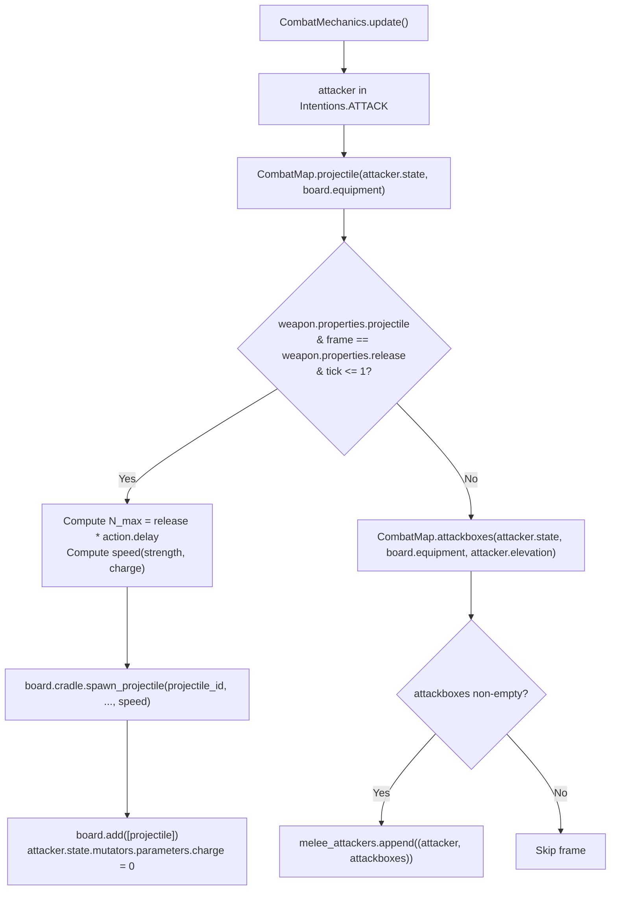
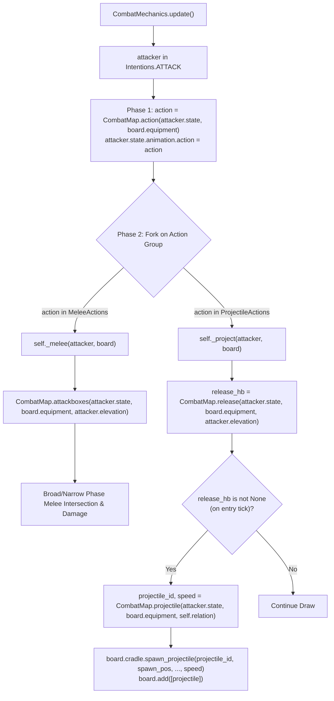
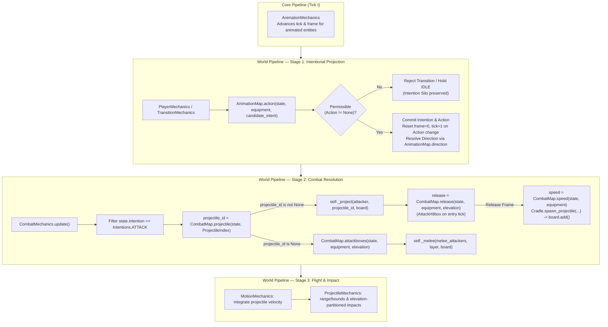

#### Refactor: Phase 03.04 - Projectiles

**Overview**

Codify `Projectiles` (`cursors.projectiles`) using the Registry Load-Time Rotation strategy (`ProjectileFrame`, `RotatedHitbox`, and `render.rotate`), allowing a single canonical projectile texture frame to be quantized into arbitrary angular increments ($\Delta\theta \in (0, 360]$) in VRAM without modifying the 60 Hz `Screen._assemble()` / `render.render()` pipeline. Enforce strict Equipment admissibility in `AnimationMap.action()` across `TransitionMechanics` and `PlayerMechanics`, compile the Weapon-to-Projectile `ProjectileIndex` relation from `CursorProperties` via `from_properties()`, track per-intention button hold duration in `Device` and `PlayerMechanics`, fork `CombatMechanics` cleanly between melee (`_melee`) and ranged (`_project`) via `CombatMap` and `ProjectileIndex`, and resolve projectile flight impacts in `ProjectileMechanics`.

##### Specification

1. **Angular Partitioning & Relational Indexing (`CursorProperties` & `MotorState`)**:
    * Extend `CursorProperties` (`src/app/models/properties/assets.py`) with:
      * `rotation: int = 90`: discrete rotational step in degrees ($360 \bmod \text{rotation} == 0$) governing load-time texture strip partitioning.
      * `weapons: List[Enumerated[WeaponPalette]] = field(default_factory=list)`: relational foreign keys declaring which Weapons emit this Projectile.
    * Align `src/assets/cursors/main.yaml` to declare `rotation` and `weapons` (e.g., `arrow` $\leftarrow$ `[longbow]`, `bolt` $\leftarrow$ `[crossbow]`, `cannonball` $\leftarrow$ `[]`).
    * The discrete set of valid projectile angles is $\Theta = \{ k \cdot \text{rotation} \mid 0 \le k < 360 // \text{rotation} \}$.
    * Extend `MotorState` (`src/app/models/state/assets/cursors.py`) with `angle: int = 0` ($\text{angle} \in \Theta$), `speed: int = 200`, and `owner: Optional[str] = None`.
2. **Load-Time Texture Strip Synthesis (`ProjectileFrame` & `Registry`)**:
    * Authored projectile `.png` files contain a single canonical frame of dimensions $(W, L)$ oriented at $\theta = 0^\circ$ ($+x$, `Directions.RIGHT`).
    * `ProjectileFrame.index(id, properties)` maps each discrete angle key `f"{id}-{angle}"` ($\text{angle} = k \cdot \text{properties.rotation}$) to crop coordinate $(k \cdot W, 0, W, L)$ for $0 \le k < 360 // \text{properties.rotation}$.
    * `Registry._get_or_load_texture()` checks `asset_key in self.properties.cursors.projectiles` and invokes `render.rotate(raw_tex, self.properties.cursors.projectiles[asset_key].rotation)`, allocating a target `TexturePtr` of dimensions $(N \cdot W, L)$ ($N = 360 // \text{rotation}$) and stamping each rotated cell via `SDL_RenderCopyEx` with per-cell clip isolation (`SDL_RenderSetClipRect`), then destroys `raw_tex`.
    * `ProjectileFrame.keys(id, state)` projects `state.angle` directly to `[(f"{id}-{state.angle}", 0, 0)]`.
3. **Rotated AABB Hitbox Projection (`RotatedHitbox`)**:
    * Given frame dimensions $(W, L)$ with center $(c_x, c_y) = (W / 2, L / 2)$, `RotatedHitbox.get(properties, state, elevation)` rotates each base `Hitbox` $(x_0, y_0, w_0, l_0)$ in `properties.hitboxes` (falling back to $(0, 0, W, L)$ when `properties.hitboxes` is `None`) by $\Delta\theta = \text{state.angle}$ clockwise around $(c_x, c_y)$:

    $$
    h_{cx} = \left(x_0 + \frac{w_0}{2}\right) - c_x, \qquad h_{cy} = \left(y_0 + \frac{l_0}{2}\right) - c_y
    $$

    $$
    \begin{pmatrix} h'_{cx} \\ h'_{cy} \end{pmatrix} = \begin{pmatrix} \cos\Delta\theta & -\sin\Delta\theta \\ \sin\Delta\theta & \cos\Delta\theta \end{pmatrix} \begin{pmatrix} h_{cx} \\ h_{cy} \end{pmatrix}
    $$

    $$
    w'(\Delta\theta) = \max\Big(1,\; \operatorname{round}\big(w_0 |\cos\Delta\theta| + l_0 |\sin\Delta\theta|\big)\Big), \qquad l'(\Delta\theta) = \max\Big(1,\; \operatorname{round}\big(w_0 |\sin\Delta\theta| + l_0 |\cos\Delta\theta|\big)\Big)
    $$

    $$
    x'(\Delta\theta) = \operatorname{round}\left(c_x + h'_{cx} - \frac{w'(\Delta\theta)}{2}\right), \qquad y'(\Delta\theta) = \operatorname{round}\left(c_y + h'_{cy} - \frac{l'(\Delta\theta)}{2}\right)
    $$

4. **Button Hold Counter (`Keyboard` & `WorldPayload`) and Charge State (`MutatorParameters`)**:
    * `Keyboard` (`src/app/game/devices.py`) accumulates consecutive press ticks per scancode in `self._last_state`:

    $$
    c_t(\text{code}) = \begin{cases} c_{t-1}(\text{code}) + 1 & \text{if } \text{pressed}(\text{code}) = 1 \\ 0 & \text{if } \text{pressed}(\text{code}) = 0 \end{cases}
    $$

    * `WorldPayload` (`src/app/models/state/devices.py`) is extended with `holds: Dict[str, int] = field(default_factory=dict)`, recording $c_t(v)$ for every currently held intention key while preserving rising-edge singularity (`c_t(v) == 1`) on `WorldPayload.intention`.
    * `MutatorParameters` (`src/app/models/state/core.py`) is extended with `charge: int = 0` to store accumulated `attack` hold duration on `SheetState` / `SpriteState`.
5. **Disjoint Map Architecture (`AnimationMap` & `CombatMap`) and `ProjectileIndex` Relation**:
    * **`AnimationMap`** (`src/app/game/logic/modules/maps/animation.py`) is the sole projection from `(Intention, Slots, EquipmentGroup)` $\to$ `Optional[Actions]` and `(Position, Target)` $\to$ `Directions`:
      * Equipment-gated intentions (`ATTACK`, `MINE`, `BUILD`) return `None` when the required Equipment slot is empty or unconfigured, blocking inadmissible transitions inside `TransitionMechanics` and `PlayerMechanics`.
      * Whenever `state.animation.action` changes in `TransitionMechanics` or `PlayerMechanics`, `frame` resets to `0` and `tick` resets to `1`.
    * **`ProjectileIndex`** (`src/app/game/logic/relations/projectiles.py`) compiles `weapon_id -> projectile_id` via `ProjectileIndex.from_properties(properties.cursors.projectiles)` during `Builder.build_relations()` and is injected into `CombatMechanics` via `relations: [ projectiles ]` in `src/data/config/mechanics/main.yaml`.
    * Ranged weapons in `src/assets/sheets/equipments/weapons/main.yaml` configure their release frame and directional spawn aperture using standard `<action>-<direction>-<frame>` `hitboxes` resolved by `AttackHitbox`.
    * **`CombatMap`** (`src/app/game/logic/modules/maps/combat.py`) exposes strictly combat-domain projections (no `CombatMap.action`):
      * `CombatMap.projectile(state, relation) -> Optional[str]`: resolves the projectile ID bound to `state.slots.equipment.weapon`.
      * `CombatMap.attackboxes(state, equipment, elevation) -> List[Hitbox]`: resolves melee `AttackHitbox` primitives.
      * `CombatMap.release(state, equipment, elevation) -> Optional[Tuple[Position, str]]`: pulls the active `AttackHitbox` on the frame entry tick, returning the world-space spawn center `(x_a + hb.x + hb.w // 2, y_a + hb.y + hb.l // 2)` and launch direction `state.animation.direction`.
      * `CombatMap.speed(state, equipment) -> int`: computes charged launch speed $s(S, n)$ from strength $S$, draw ticks $n$, release frame index $F_{\text{release}} = \text{state.animation.frame}$, and active action `delay`:

      $$
      N_{\max} = \max(1,\; \text{state.animation.frame} \cdot \text{delay}), \qquad \tau(n) = \min\left(1.0,\; \frac{n}{N_{\max}}\right), \qquad s(S, n) = \operatorname{round}\Big(\alpha S \big(1 + \tau(n)\big)\Big)
      $$

    * **`CombatMechanics.update()`** queries `projectile_id = CombatMap.projectile(attacker.state, self.relation)` and forks on combat modality:
      * `projectile_id is not None`: executes `self._project(attacker, projectile_id, board)`.
      * `projectile_id is None`: collects `CombatMap.attackboxes(...)` and executes batched `self._melee(melee_attackers, layer, board)`.
6. **Flight Resolution & Impact (`Cradle` & `ProjectileMechanics`)**:
    * `Cradle.spawn_projectile()` centers the projectile's top-left origin around the release coordinate using `(-props.dimensions.w // 2, -props.dimensions.l // 2)`, allocates distinct `Position` instances for `position` and `initial`, quantizes the launch angle onto `properties.rotation`, derives `Velocity(vx, vy)` (clamping cardinal trig drift to exact axis vectors), and initializes `MotorState` with `elevation` and `owner`.
    * `ProjectileMechanics.update()` evaluates range/layer-bound expiration and elevation-partitioned intersections against `obstacles`, `SPRITES`, `PLAYERS`, and `REACTABLES`, ignoring `target.name == projectile.state.owner`, applying impact damage $\max(1, \operatorname{round}(\text{speed} / \alpha) - \text{defense})$, and removing expired/impacted projectiles immediately via `board.remove()`.

##### Architectural Analysis I

1. **Ontology of Properties vs. State (`rotation` vs. `speed` and `angle`)**:
    * In the Asset Hierarchy, `Properties` encode static, immutable characteristics intrinsic to the Asset file and its atlas partitioning, whereas `State` exemplifies dynamic attributes particular to an Asset's deployment on the `Board`.
    * `rotation: int = 90` on `CursorProperties` defines the angular resolution $\Delta\theta$ of the synthesized texture strip in `Registry` and `ProjectileFrame.index()`. Because every projectile has a deterministic angular step (defaulting to $90^\circ$ for cardinal projectiles such as `arrow` and `bolt`, or $45^\circ$ for `cannonball`), `rotation` is a concrete `int = 90` field rather than `Optional[int] = None`.
    * Conversely, `speed: int = 200` and `angle: int = 0` are situational parameters of a specific launch event and belong on `MotorState` alongside `position`, `initial`, `velocity`, and `owner`.

2. **Eliminating Duck-Typing in `Registry` via Asset Hierarchy Lookup**:
    * `Registry` holds the validated `PropertySchema` hierarchy on `self.properties`. Rather than inspecting arbitrary property objects for the presence of an optional `rotation` attribute, `Registry._get_or_load_texture()` checks membership directly against the `(cursors, projectiles)` hierarchy node (`if self.properties.cursors and asset_key in self.properties.cursors.projectiles:`), matching the pattern established in `Registry._load_font()` (`if font_key not in self.properties.fonts:`).
    * When `asset_key in self.properties.cursors.projectiles`, `Registry` retrieves `rotation = self.properties.cursors.projectiles[asset_key].rotation`, synthesizes the rotated horizontal texture strip via `render.rotate(raw_tex, rotation)`, and destroys the intermediate unrotated `raw_tex` via `render.destroy(raw_tex)` so single-frame textures do not linger in VRAM.
    * `Registry._index()` requires no special-case logic: it already iterates the `(category, instance)` fields of `self.properties` and `self.recipes`, delegating `cursors.projectiles` crop generation to `ProjectileFrame.index(item_id, item_props)`.



3. **Screen-Space Angle Convention & Launch Quantization (`Cradle.spawn_projectile`)**:
    * In screen coordinates ($+x$ right, $+y$ down), both `SDL_RenderCopyEx` and the 2D rotation matrix $R(\Delta\theta)$ rotate clockwise:
        * $\theta = 0^\circ \leftrightarrow (+1, 0)$ (`Directions.RIGHT`)
        * $\theta = 90^\circ \leftrightarrow (0, +1)$ (`Directions.DOWN`)
        * $\theta = 180^\circ \leftrightarrow (-1, 0)$ (`Directions.LEFT`)
        * $\theta = 270^\circ \leftrightarrow (0, -1)$ (`Directions.UP`)
    * Given a continuous displacement vector $(\Delta x, \Delta y)$ toward a target coordinate (or a cardinal `Directions` unit vector when no target coordinate is present), the raw launch angle in $[0, 360)$ is:

    $$
    \theta_{\text{raw}} = \left(\operatorname{atan2}(\Delta y, \Delta x) \cdot \frac{180}{\pi}\right) \bmod 360
    $$

    * Quantizing onto the nearest discrete step $R = \text{properties.rotation}$ yields:

    $$
    \text{angle} = \left(\operatorname{round}\left(\frac{\theta_{\text{raw}}}{R}\right) \cdot R\right) \bmod 360, \qquad \vec{v} = \begin{pmatrix} \text{speed} \cdot \cos(\text{angle} \cdot \frac{\pi}{180}) \\ \text{speed} \cdot \sin(\text{angle} \cdot \frac{\pi}{180}) \end{pmatrix}
    $$

    * `Cradle.spawn_projectile()` allocates distinct `Position(position.x, position.y)` instances for `state.position` and `state.initial` so in-place sub-pixel integration in `physics.integrate()` does not mutate `state.initial` or the shooter's position.

4. **Ranged Combat Trigger & Impact Resolution (`CombatMechanics` & `ProjectileMechanics`)**:
    * **Release Frame Edge Trigger**: In `CombatMechanics.update()`, an attacker with `state.animation.action == Actions.SHOOT` spawns a projectile only on the release frame when `state.animation.tick == 1`, preventing duplicate spawns when action `delay > 1`.
    * **Motion Integration Ownership**: `MotionMechanics` integrates velocity for inert projectile assets via `physics.integrate()`. `ProjectileMechanics.update()` evaluates range/boundary expiration and elevation-partitioned intersections (`projectile.elevation == target.elevation`) against obstacles (`board.obstacles(layer, elevation)`) and targets (`SPRITES`, `PLAYERS`, `REACTABLES`), excluding `target.name == projectile.state.owner`.

##### User Review I

* Examine the Device implementation. Determine what would be necessary to add a counter to a button to determine how long it has been pressed.
* Examine the Sprite state definitions and create a formula for calculating the speed of a spawned projectile base on `sprite.state.character.strength` and the length of time the Sprite has held down the `attack` intention. Determine what state attributes would need added to accomodate this.
    * For the Player, the length of time will be determined through device polling.
    * For the Sprite, the length of time will be determined through CognitionMechanics. This is actually a really complex problem, so let's defer it until later. MVP is Player Projectile spawning based on length of time button was held and Player strength.

##### Architectural Analysis II

1. **Button Hold Duration Counter in `Device` (`Keyboard.poll`)**:
    * In `src/app/game/devices.py`, `Keyboard` already initializes `self._last_state = {code: 0 for code in self._scancodes}` when setting the device context and polls raw boolean key states `(0, 1)` via `sdl.poll(self._scancodes)`.
    * By upgrading `current_dict` from a binary flag to a consecutive-tick accumulator:

    ```python
    current_dict = {
        code: (self._last_state.get(code, 0) + 1) if state else 0
        for code, state in zip(self._scancodes, current_state)
    }
    ```

    every pressed scancode tracks its exact hold duration in ticks ($c_t \ge 1$) while unpressed scancodes reset to `0`:
    * **Backward-Compatible Edge Triggering**: Because `self._last_state.get(v)` is `0` (falsy) only when unpressed on the prior tick and $\ge 1$ (truthy) on every held tick, existing rising-edge checks (`current_dict.get(v) and not self._last_state.get(v)`) across `intentions`, `grips`, `menus`, `traversal`, and `interactions` remain invariant.
    * **Hold Counter Propagation**: Extending `WorldPayload` (`src/app/models/state/devices.py`) with `hold: int = 0` allows `Keyboard.poll()` to emit the consecutive tick count of the active intention button in configuration order (preserving the Intention singularity rule):

    ```python
    for k, v in self.mapping.world.intentions.items():
        if v is not None and current_dict.get(v):
            if not self._last_state.get(v):
                world_payload.intention = k
            world_payload.hold = current_dict[v]
            break
    ```



2. **State Attributes for Hold Duration (`MutatorParameters.charge`)**:
    * Inspecting `SheetState` (`src/app/models/state/assets/sheets.py`) and `AssetState` (`src/app/models/state/core.py`), `MutatorParameters` is the canonical container for dynamic parameters modulating an entity's active Intention or physical state (already housing `hand: Optional[Enumerated[Hands]] = None` for `Intentions.USE` and `descension: Optional[float] = 0.0` for gravity freefall).
    * Adding `charge: int = 0` to `MutatorParameters` provides a unified state field across both `Player` (`SheetState`) and `Sprite` (`SpriteState`) without duplicating fields across models:
        * **Player Lifecycle (`PlayerMechanics`)**:
            1. When `player.state.intention != intention` on a new `Intentions.ATTACK` transition, initialize `player.state.mutators.parameters.charge = payload.world.hold`.
            2. On subsequent ticks while `player.state.intention == Intentions.ATTACK` and `payload.world.hold > 0`, update `player.state.mutators.parameters.charge = payload.world.hold`.
            3. If the Player releases the attack key early (`payload.world.hold == 0`) while locked in the blocking `SHOOT` animation (`is_locked == True`), `player.state.mutators.parameters.charge` retains the peak tick count $n$ held during that draw rather than being wiped to `0` before the release frame is reached.
            4. When `player.state.intention` returns to `Intentions.IDLE` (or upon projectile release in `CombatMechanics`), reset `player.state.mutators.parameters.charge = 0`.
        * **Sprite Lifecycle (Deferred to Future Phase)**: Because `MutatorParameters.charge` lives on `AssetState`, `CognitionMechanics` can later populate `sprite.state.mutators.parameters.charge` without any schema or `CombatMechanics` changes.

3. **Projectile Speed Formula ($s(S, n)$)**:
    * Let $S = \text{state.character.strength}$ (default `10`), $n = \text{state.mutators.parameters.charge} \in \mathbb{Z}_{\ge 0}$, and $N_{\max} = \max(1, F_{\text{release}} \cdot \text{delay})$ be the number of ticks from frame `0` to the release frame $F_{\text{release}}$ of `Actions.SHOOT`.
    * Define the normalized draw ratio $\tau(n) \in [0, 1]$ and scalar launch speed $s(S, n)$:

    $$
    \tau(n) = \min\left(1.0,\; \frac{n}{N_{\max}}\right), \qquad s(S, n) = \operatorname{round}\Big(\alpha S \big(1 + \tau(n)\big)\Big)
    $$

    * With base strength coefficient $\alpha = 10\text{ px}/(\text{s}\cdot\text{strength})$ (`settings.PROJECTILE_BASE_SPEED_FACTOR = 10`):
        * **Uncharged / Instant Tap ($n \to 0, S = 10$)**: $\tau(0) = 0 \implies s(10, 0) = 100\text{ px/s}$, guaranteeing a positive minimum launch velocity even for a 1-tick tap or an uncharged NPC Sprite (`charge == 0`).
        * **Half Draw ($\tau = 0.5, S = 10$)**: $s(10, N_{\max}/2) = 150\text{ px/s}$.
        * **Full Draw ($n \ge N_{\max}, S = 10$)**: $\tau(n) = 1.0 \implies s(10, N_{\max}) = 200\text{ px/s}$, matching the nominal `MotorState.speed = 200` baseline and saturating cleanly so prolonged button holds cannot cause unbounded velocity or hitbox tunneling.

##### User Review II

* The concept of "release frame" in the spec seems ill defined. If I am understanding correctly, the current spec proposes to release the projectile the first tick of the first frame.
* However, this will not work in terms of animation fluidity. The LPC animations require flexibility, as the "release frame" is highly variable. The projectile has to be released on a certain frame, and that frame will be dependent on the type of Equipment, e.g. a crossbow animation might release a bolt at frame 3, but a longbow animation might release an arrow at frame 7.
* For non-projectile Equipment, AttackHitboxes are used in conjunction with the CombatMap and AnimationMap to resolve which attackbox applies on which frame. It would seem a similar solution can be adopted for Projectiles, insofar that the release frame needs to be mapped from the Equipment that spawns the Projectile, not the Projectile itself, i.e. release frame is a property of Equipment, not Projectiles.
* It would seem possible to define the "release frame" on the a certain keyed Hitbox, e.g. `shoot-up-3`. However, this seems to introduce some undesirable polymorphism, as both projectile equipment and non-projectile equipment get injected with the same Hitbox implementation. So, it seems like the AttackHitbox interface would have to "bend" to accomodate the different behaviors. However, perhaps, the Combat logic could abstract the release frame lookup the same way the CombatMap abstracts the `attackboxes`.

##### Architectural Analysis III

1. **Why Action-Based Detection and `AttackHitbox` Overloading Fail for Ranged Equipment**:
    * Inspecting `src/assets/sheets/equipments/weapons/main.yaml` reveals why ranged combat cannot be triggered by checking `if attacker.state.animation.action == Actions.SHOOT:`:
        * `longbow` uses `actions: lpc-shoot` (`Actions.SHOOT`), whereas `crossbow` uses `actions: lpc-thrust` (`Actions.THRUST`)—the exact same action set used by the melee `spear`!
        * Consequently, `AnimationState.action` is not a bijective indicator of ranged vs. melee combat; the equipped weapon itself determines whether an attack is melee or ranged, which projectile asset (`arrow` vs. `bolt`) is emitted, and on which frame index $F_{\text{release}}$ emission occurs.
    * Furthermore, overloading `properties.hitboxes` (e.g. `shoot-up-7`) and `AttackHitbox` to encode projectile release frames introduces structural polymorphism into `HitboxSchema`:
        * All `sheets.weapons` share a single recipe (`hitbox: AttackHitbox`).
        * `AttackHitbox.get()` fulfills the `HitboxSchema` contract by returning spatial `List[Hitbox]` primitives for melee collision resolution in `CombatMechanics`. A ranged weapon does not strike targets via a weapon-attached AABB; it spawns an autonomous `Projectile` asset whose own `RotatedHitbox` traverses the board.
        * Even if `properties.hitboxes` encoded a release frame key, it still could not express *which* projectile ID (`arrow` vs. `bolt` vs. `cannonball`) the weapon spawns. Keeping `hitboxes: null` on ranged weapons allows `AttackHitbox.get()` to return `[]` without modification or polymorphism.

2. **Equipment-Driven Release Frame & Projectile Binding on `SheetProperties`**:
    * Just as `ResourceProperties` declares `loot: str = None` to bind a biological resource to the `Collectable` it spawns, `SheetProperties` (`src/app/models/properties/assets.py`) should declare two optional equipment properties:
        * `projectile: Optional[Enumerated[ProjectilePalette]] = None`: The projectile asset ID in `cursors.projectiles` spawned by this weapon (`arrow` for `longbow`, `bolt` for `crossbow`, `None` for melee weapons).
        * `release: Optional[int] = None`: The 0-based frame index $F_{\text{release}}$ within the weapon's active `Action` on which the projectile is released (e.g. `release: 9` for `longbow` under 13-frame `lpc-shoot`; `release: 5` for `crossbow` under 8-frame `lpc-thrust`).
    * In `src/assets/sheets/equipments/weapons/main.yaml`:

    ```yaml
    sheets:
      weapons:
        # --------------------------------------- ACTION: SHOOT
        longbow:
          dimensions: *lpc
          hitboxes: null
          actions: lpc-shoot
          stack: [ longbow ]
          projectile: arrow
          release: 9
        ...
        # --------------------------------------- ACTION: THRUST
        crossbow:
          dimensions: *lpc
          hitboxes: null
          actions: lpc-thrust
          stack: [ crossbow ]
          projectile: bolt
          release: 5
    ```

3. **Abstracting Release Frame & Speed Resolution via `CombatMap.projectile()`**:
    * Mirroring how `CombatMap.attackboxes(state, equipment, elevation)` resolves active melee hitboxes from the equipped weapon, `CombatMap` (`src/app/game/logic/modules/maps/combat.py`) should expose `CombatMap.projectile(state: SheetState, equipment: EquipmentGroup) -> Optional[Tuple[str, int]]`:
        1. Resolve `weapon = equipment.weapons.get(state.slots.equipment.weapon)`. If `not weapon` or `not weapon.properties.projectile` or `weapon.properties.release is None`, return `None`.
        2. Verify that `state.animation.action in weapon.properties.actions` and `state.animation.frame == weapon.properties.release`.
        3. Enforce single-tick edge emission within that frame (`state.animation.tick <= 1`) so actions with `delay > 1` only emit one projectile upon entering `release`.
        4. Derive the weapon's draw window $N_{\max}$ directly from the weapon's configured `release` frame and action `delay`:

        $$
        N_{\max} = \max\Big(1,\; \text{weapon.properties.release} \cdot \text{weapon.properties.actions}[\text{state.animation.action}].\text{delay}\Big)
        $$

        5. Compute the charged launch speed $s(S, n)$ from $S = \text{state.character.strength}$ and $n = \text{state.mutators.parameters.charge}$, returning `(weapon.properties.projectile, speed)`.



4. **Decoupling `CombatMechanics` from Hardcoded Actions**:
    * In `CombatMechanics.update()`, the hardcoded `if attacker.state.animation.action in (Actions.SHOOT, Actions.CAST): continue` guard is replaced by querying `CombatMap.projectile(attacker.state, board.equipment)` and `CombatMap.attackboxes(attacker.state, board.equipment, attacker.elevation)`.
    * Ranged weapons (`longbow` on `SHOOT`, `crossbow` on `THRUST`) have `hitboxes: null`, so on non-release frames both `CombatMap.projectile()` and `CombatMap.attackboxes()` return empty/`None`, and on the configured `release` frame `CombatMap.projectile()` returns `(projectile_id, speed)` for `board.cradle.spawn_projectile()`.

##### User Review III

Disagree with the direction of analysis and proposed solution. Introducing an Instance specific field onto a category level model (Properties) seems like a poor design decision. Let's back up and consider how CombatMechanics works.

Here is how the CombatMechanics flow should work (very generally):

```python:pseudocode

def _melee(self, attacker, board):
    attackboxes = CombatMap.attackboxes(
        attacker.state,
        board.equipment,
        attacker.elevation
    )
    # existing logic

def _project(self, attacker, board):
    release_frame = CombatMap.release(
        attacker.state,
        board.equipment,
        attacker.elevation
    )
    projectile = CombatMap.projectile(...)
    # do other stuff

def update(self, board, delta, bus, payload):
    # existing filter of intentions 
    # ...

    for attacker in attckers:
        # PHASE 1: Determine if Action is possible.
        action = CombatMap.action(attacker.state, board.equipment)

        # PHASE 2: Fork on type of Action
        if action in MeleeActions:
            self._melee(attacker, board)

        elif action in ProjectileActions:
            self._project(attacker, board)
```

* CombatMap.action: maps the current Equipment and Intent to an Action. Ensures Sprites cannot enter into Actions without the correct Equipment. 
* CombatMap.release: pulls the AttackHitbox. Instead of using it to calculate intersections and attack vectors, it uses the AttackHitbox to determine where and in what direction the Projectile should be spawned.
* CombatMap.projectile: projectile mapping.

**NOTE**: this should not be taken as gospel. I am attempting to clarify the logical flow.

No extraneous properties necessary so far. To account for the relation of Projectile to Weapon, rather than encode this into Properties, which are models of Assets in isolation, the proposed mapping is actually a *Relation* between Asset types. Thus, it calls for an addition to the Relations module. `app.game.logic.relations` is currently utilized for mapping Shorelines to Fluids (ShorelineIndex), and mapping Crafts to Material Behaviors (MaterialIndex). For example,

Probably the relation between Projectiles and Weapons should be codified as *Configuration* and then compiled into a Relation. 

##### Architectural Analysis IV

1. **Preserving Category-Level `SheetProperties` Purity via `AttackHitbox` & `CombatMap.release`**:
    * `SheetProperties` is a Category-level model shared across all `sheets` instances (`sprites`, `pixies`, `armor`, `shields`, `tools`, `utilities`, `weapons`). Polluting `SheetProperties` with weapon-specific or projectile-specific attributes breaks the strict $\text{Category} \to \text{Properties}$ mapping.
    * Every weapon in `sheets.weapons` already receives `AttackHitbox` (`recipes.sheets.weapons`) and declares `hitboxes: Dict[str, List[Hitbox]]` keyed by `<action>-<direction>-<frame>`.
    * Instead of modifying `AttackHitbox` or `SheetProperties`, the distinction between melee strikes and ranged projectile releases is a difference in how `CombatMechanics` and `CombatMap` *interpret* the weapon's active `AttackHitbox` after forking on `action`:
        * For `action in MeleeActions` (`slash`, `thrust`), `CombatMap.attackboxes(attacker.state, board.equipment, attacker.elevation)` retrieves the active `Hitbox` list on the strike frames, and `CombatMechanics._melee(attacker, board)` evaluates narrow-phase intersections against targets.
        * For `action in ProjectileActions` (`shoot`, `cast`), ranged weapons in `src/assets/sheets/equipments/weapons/main.yaml` define a `Hitbox` entry under `hitboxes` only on their release frame for each direction (e.g., `shoot-up-9`, `shoot-left-9`, `shoot-down-9`, `shoot-right-9` for `longbow`).
        * `CombatMap.release(attacker.state, board.equipment, attacker.elevation)` queries `weapon.hitbox.get(weapon.properties, attacker.state, resolved_elevation)` on the entry tick of the current frame. When non-empty, that `Hitbox` identifies the current frame as the weapon's release frame and defines the exact world-space spawn coordinate `(attacker.state.position.x + hb.position.x, attacker.state.position.y + hb.position.y)` where the projectile emerges!
        * Moreover, because `state.animation.frame` on the tick `CombatMap.release` succeeds *is* the release frame index $F_{\text{release}}$, the draw window $N_{\max} = \max(1, \text{state.animation.frame} \cdot \text{delay})$ is known directly from `state.animation.frame` without any extra property fields.
2. **Two-Phase Action Validation & Forking in `CombatMechanics`**:
    * In `CombatMechanics.update()`, each attacking entity (`state.intention == Intentions.ATTACK`) undergoes a two-phase evaluation:
        * **Phase 1 (Action Validation via `CombatMap.action`)**: `action = CombatMap.action(attacker.state, board.equipment)` validates that the attacker has the requisite equipment slotted to perform a combat action and assigns `attacker.state.animation.action = action`, ensuring Sprites cannot execute combat actions without matching equipment.
        * **Phase 2 (Action Group Fork)**:
            * If `action in MeleeActions`: routes to `self._melee(attacker, board)`.
            * If `action in ProjectileActions`: routes to `self._project(attacker, board)`.



3. **Codifying the Weapon-to-Projectile Association as a `Relation` (`app.game.logic.relations`)**:
    * Because Properties model an Asset in isolation, the mapping between a `Weapon` (`sheets.weapons`, e.g., `longbow`, `crossbow`) and the `Projectile` it emits (`cursors.projectiles`, e.g., `arrow`, `bolt`) is a cross-asset **Relation**.
    * Following the exact pattern of `MaterialIndex.from_configuration(self.context.configurations.materials)` in `Builder.build_relations()`:
        1. Declare the weapon-to-projectile mapping in configuration (e.g., `longbow: arrow`, `crossbow: bolt`).
        2. Compile a `Singleton` relational index in `src/app/game/logic/relations/` (e.g., `ProjectileIndex` / `CombatIndex` with `from_configuration()` and `resolve(weapon_id) -> Optional[str]`) and register it in `Builder.build_relations()`.
        3. Inject the relation into `CombatMechanics` via `relations` in `src/data/config/mechanics/main.yaml` (accessed via `self.relation` on `Mechanic`).
        4. `CombatMap.projectile(attacker.state, board.equipment, self.relation)` queries the relation to resolve the projectile Asset ID for `attacker.state.slots.equipment.weapon` and computes the charged launch speed $s(S, n)$.

##### User Review V

###### Concept of "Maps"

Something seems off. The concept of "Maps" (Combat and Animation) seems to be vague. Before moving onto implementation, I want to clarify the entire Sprite Intention -> Action workflow. CombatMap and AnimationMap seems to be at odds, and this seems to indicate the interface that is being used is incorrect ins some capacity.

What is currently defined:

1. TransitionMechanics applies the following mapping after evalatuing the Intention Transition matrix:

```python
sprite.state.animation.action = AnimationMap.action(
    sprite.state, 
    board.equipment
)

# 3. Resolve Direction
target_pos = sprite.state.trajectory.target or (
    sprite.state.goal.position if sprite.state.goal else None
)

if target_pos:
    sprite.state.animation.direction = AnimationMap.direction(
        sprite.state.position, 
        target_pos
    )
```

This maps the Sprite Intention to an (Action, Direction)

2. PlayerMechanics similarly maps Intention payloads from the device to Player (Action, Direction):

```python
player.state.animation.action = AnimationMap.action(
    player.state, 
    board.equipment
)

if player.state.goal and has_movement:
    player.state.animation.direction = AnimationMap.direction(
        player.state.position,
        player.state.goal.position
    )
```

3. CombatMechanics does the following (currently, with the planned extensions also to be taken into account):

```python
attackboxes = CombatMap.attackboxes(
    attacker.state,
    board.equipment,
    attacker.elevation
)
```

In summary: 

* AnimationMap.action: (Intention, Equipment) -> Action
* AnimationMap.direction: (Position, Goal) -> Direction 
* CombatMap.attackboxes: (Slots, Equipment) -> Hitbox

In each case, we have a domain comprised of a Cartesian product of categorical variables (except Position, which is continuous and quantitative) and a function that is mapping those domains to a range. (action, direction) are semantic enumerations. Hitbox is a datastructure of (relative position, dimension).

Moreover, the proposed CombatMap.action overlaps with AnimationMap.action. The core issue is: where and when does the Sprite intention "transform" into an Action and Direction?

If TransitionMechanics does not assign an Action, then the Sprite will not animate when AnimationMechanics executes. However, the Combat Actions are not mapped (in the proposal) until CombatMechanics executes. So, TransitionMechanics will assign the Action of Slash before CombatMechanics has had a chance to determine if that Action is permissibile.

Please analyze this problem and clarify the combat flow. Update the backlog accordingly.

###### Projectile-Weapon Mapping

After examining the proposals, while I am still of the opinion that codifying the mapping as an `app.game.logic.relations` Relation is the correct move, I am now not so certain the relation shouldn't be defined as a property. Geography is an example of an Asset that is implicitly relational, i.e. shorelines cannot be embedded into the Board without awareness of the Tiles and Fluids they border, hence these are Properties of Geography. Hence,

```python
"""
@domain.logic
@app.module
@category.geography
@workflows.generation
@workflow.fluids

# Ontology: Source - app.game.logic.relations.shorelines

Relational index mapping Environ Tiles, Fluid Effects and Seasons to Geography Shorelines.
"""
from __future__ import annotations

# Standard Libraries
from typing import (
    Dict,
    Tuple,
    Optional,
    Any,
    TYPE_CHECKING
)
import logging

# Application Library
from app.models.abstracts import Singleton

if TYPE_CHECKING:
    from app.models.properties import GeographyProperties

# ---------------------------------------------------

logger = logging.getLogger(__name__)

# ---------------------------------------------------

class ShorelineIndex(Singleton):
    """
    Relational secondary index mapping (tile_id, fluid_id, [season]) to shoreline Asset ID.
    Supports multi-level fallback:
    1. (tile_id, fluid_id, season)
    2. (tile_id, fluid_id)
    3. (tile_id, None, season)
    4. (tile_id, None)
    """
    _map: Dict[Tuple[str, Optional[str], Optional[str]], str] = {}
    _fallback_map: Dict[Tuple[str, Optional[str]], str] = {}

    def __init__(self, relations: Optional[Dict[Any, str]] = None):
        self._map = {}
        self._fallback_map = {}
        if relations:
            for key, shoreline_id in relations.items():
                self.register(key, shoreline_id)

    @classmethod
    def from_properties(cls, shorelines: Dict[str, GeographyProperties]) -> ShorelineIndex:
        """
        Factory constructor compiling relational definitions from geography property schemas.
        """
        index = cls()
        for shoreline_id, props in shorelines.items():
            season = getattr(props, "season", None)
            if season:
                index.register((props.tile, props.fluid, season), shoreline_id)
            index.register((props.tile, props.fluid), shoreline_id)
        return index

    def register(self, key: Tuple, shoreline_id: str) -> None:
        """
        Registers a composite relation tuple to target shoreline asset ID.
        """
        if len(key) == 3:
            tile_id, fluid_id, season = key
            self._map[(tile_id, fluid_id, season)] = shoreline_id
        elif len(key) == 2:
            tile_id, fluid_id = key
            self._fallback_map[(tile_id, fluid_id)] = shoreline_id

    def resolve(
        self,
        tile_id: str,
        fluid_id: Optional[str] = None,
        season: Optional[str] = None
    ) -> Optional[str]:
        """
        Resolves the appropriate shoreline asset ID across compound keys with seasonal fallback.
        """
        # 1. Primary seasonal resolution: (tile, fluid, season)
        if season is not None:
            seasonal_key = (tile_id, fluid_id, season)
            if seasonal_key in self._map:
                return self._map[seasonal_key]

            # Seasonal fallback without fluid constraint
            if fluid_id is not None:
                dry_seasonal_key = (tile_id, None, season)
                if dry_seasonal_key in self._map:
                    return self._map[dry_seasonal_key]

        # 2. Base relational fallback: (tile, fluid)
        base_key = (tile_id, fluid_id)
        if base_key in self._fallback_map:
            return self._fallback_map[base_key]

        # 3. Base fallback without fluid constraint: (tile, None)
        if fluid_id is not None:
            dry_base_key = (tile_id, None)
            if dry_base_key in self._fallback_map:
                return self._fallback_map[dry_base_key]

        return None
```

Projectiles and Weapons are inherently relational. A `crossbow` cannot fire a Projectile without knowing what type of Projectile is to be spawned. It does seem like the proper solution is to have the ProjectileIndex expose a factory method `from_properties` in a similar way to the ShorelineIndex. Then it can get compiled from Properties, not configuration. 

The question is what is the "independent" variable and what is the "dependent" variable. In my head, I see Projectiles are "dependent" on the existence of the Weapon, so it seems like Projectiles should contain the relational indexing properties. 

##### Architectural Analysis VI

###### 1. Concept of "Maps" and the Intention $\to$ Action $\to$ Combat Workflow

The tension identified in **User Review V** exposes two separate flaws in the previous design: (a) a conflated responsibility between `AnimationMap` and `CombatMap`, and (b) a temporal/ownership contradiction over where an Intention becomes an Action and where Equipment admissibility is enforced.

**1.1 Mathematical Ontology of `app.game.logic.modules.maps`**

A **Map** is a stateless morphism translating one Engine state-space into another. Each Map must own a **disjoint codomain** so that no two Maps compete over the same state transition:

| Map | Domain | Codomain | Consumers (Mechanics) |
| :--- | :--- | :--- | :--- |
| **`AnimationMap`** | Intentional & Spatial State $\times$ Equipment | Animation Space (`Action`, `Direction`) | `TransitionMechanics`, `PlayerMechanics` |
| **`CombatMap`** | Active Combat/Animation State $\times$ Equipment $\times$ `ProjectileIndex` | Combat Resolution Artifacts (`projectile_id`, `Hitbox`, `(spawn_pos, direction)`, `speed`) | `CombatMechanics` |

Formally:

1. **`AnimationMap`** projects from **Intentional/Spatial Space** into **Animation Space**:
   $$\text{AnimationMap.action}: \text{Intentions} \times \text{Slots} \times \text{EquipmentGroup} \longrightarrow \text{Actions} \cup \{\bot\}$$
   $$\text{AnimationMap.direction}: \text{Position} \times \text{Position} \longrightarrow \text{Directions}$$

2. **`CombatMap`** projects from an **already-validated Combat Animation State** into **Combat Resolution Space**:
   $$\text{CombatMap.projectile}: \text{Slots.Equipment} \times \text{ProjectileIndex} \longrightarrow \text{ProjectileID} \cup \{\bot\}$$
   $$\text{CombatMap.attackboxes}: \text{SheetState} \times \text{EquipmentGroup} \times \mathbb{Z}_{\ge 0} \longrightarrow \mathcal{P}(\text{Hitbox})$$
   $$\text{CombatMap.release}: \text{SheetState} \times \text{EquipmentGroup} \times \mathbb{Z}_{\ge 0} \longrightarrow (\text{Position} \times \text{Directions}) \cup \{\bot\}$$
   $$\text{CombatMap.speed}: \text{SheetState} \times \text{EquipmentGroup} \longrightarrow \mathbb{Z}_{>0}$$

Under this separation, **`CombatMap.action` is eliminated**. `AnimationMap` is the single source of truth for `(Intention, Equipment) -> Action`, and `CombatMechanics` is strictly a *consumer* of `AnimationState`, never a mutator of `state.animation.action` or `state.intention`.

**1.2 Where and When Equipment Permissibility Is Enforced**

In `Engine._play()`, `core` mechanics (`AnimationMechanics`) execute every tick before `world` mechanics (`PlayerMechanics` $\to$ `TransitionMechanics` $\to$ `MotionMechanics` $\to$ `CombatMechanics` $\to$ `ProjectileMechanics`), followed by `Engine._render()`.

Why the previous `CombatMap.action` proposal broke this lifecycle:

1. **Intention Silo Violation**: Only `TransitionMechanics` (Sprites) and `PlayerMechanics` (Player) are permitted to mutate `state.intention`. If `TransitionMechanics` enters `Intentions.ATTACK` without checking Equipment admissibility, `CombatMechanics` cannot legally revert `state.intention` when it discovers no weapon is slotted.
2. **Stale/Illegal Animation Frames**: Currently, `AnimationMap.action()` silently falls back to `Actions.CAST` (for `ATTACK`/`BUILD`) and `Actions.THRUST` (for `MINE`) when the corresponding equipment slot is `None`. This allows an unequipped Sprite or Player to enter an animated combat state and render invalid frames before `CombatMechanics` ever executes.
3. **Action-Change Frame Reset Missing**: In `TransitionMechanics.update()`, mutating `sprite.state.animation.action` without resetting `frame = 0` and `tick = 1` when the action changes risks immediate out-of-bounds frame keys (e.g., transitioning from `walk` frame `7` into 6-frame `slash`) or skipping/prematurely triggering a weapon's release frame.

**Resolution — Strict Admissibility Gate in `AnimationMap.action()`**:
* `AnimationMap.action(state, equipment, intention=None) -> Optional[Actions]` evaluates `target_intent = intention or state.intention`:
  * For equipment-gated Intentions (`ATTACK` $\to$ `slots.equipment.weapon`, `MINE` $\to$ `slots.equipment.tool`, `BUILD` $\to$ `slots.equipment.utility`), look up the slotted asset in `equipment`. If the slot is empty or the asset declares no `actions`, return `None` ($\bot$).
  * For non-equipment-gated Intentions (`StaticIntentions`, `NavigationIntentions`, `USE`, etc.), return `Actions.WALK`.
* **In `TransitionMechanics` (Sprites)**:
  1. Evaluate `next_intent` via the Intention Transition `Executor`.
  2. Before committing `next_intent != current_intent`, validate `AnimationMap.action(sprite.state, board.equipment, intention=next_intent)`. If it returns `None`, **reject the transition** cleanly inside the Intention Silo.
  3. Resolve `action = AnimationMap.action(sprite.state, board.equipment)`. If `None` (e.g., equipment was unequipped mid-state), fall back to `Intentions.IDLE` and `Actions.WALK`.
  4. If `action != prev_action`, reset `sprite.state.animation.frame = 0` and `sprite.state.animation.tick = 1`.
* **In `PlayerMechanics` (Player)**:
  1. When `payload.world.intention` arrives, validate `AnimationMap.action(player.state, board.equipment, intention=intention)`. If `None`, ignore the trigger rather than locking the Player into a phantom blocking animation.
  2. Reset `frame = 0`, `tick = 1` on action change and update `mutators.parameters.charge` during `Intentions.ATTACK`.

**1.3 Resolving the Combat Fork (`crossbow` / `spear` LPC Polymorphism)**

A second subtle issue existed in forking `CombatMechanics` via `MeleeActions` (`slash`, `thrust`) vs. `ProjectileActions` (`shoot`, `cast`):
* Under the LPC specification, `Action` is a **spritesheet row layout**, not a combat modality.
* `spear` (melee) and `crossbow` (ranged) **both** animate on `lpc-thrust` (`Actions.THRUST`). Forking on `action in MeleeActions` would misclassify `crossbow` as a melee weapon and prevent it from ever spawning a `bolt`.

Forking `CombatMechanics` directly on `CombatMap.projectile(attacker.state, self.relation)` resolves this completely:
* `ProjectileIndex.resolve(weapon_id)` partitions weapons by their true combat modality:
  * **Ranged Weapon** (`projectile_id is not None`): `longbow -> arrow` (`SHOOT`), `crossbow -> bolt` (`THRUST`) $\implies$ routes to `self._project(attacker, projectile_id, board)`.
  * **Melee Weapon** (`projectile_id is None`): `longsword -> None` (`SLASH`), `spear -> None` (`THRUST`) $\implies$ routes to `self._melee(melee_attackers, layer, board)`.
* `MeleeActions` and `ProjectileActions` enums are no longer needed at all, removing an artificial coupling between combat dispatch and LPC row names.



###### 2. Projectile–Weapon Relation (`ProjectileIndex.from_properties`)

**2.1 Independent vs. Dependent Variable Analysis**

| Relation | Independent Variable(s) (Domain) | Dependent Asset (Codomain) | Where Foreign Keys Live | Factory Method |
| :--- | :--- | :--- | :--- | :--- |
| **`ShorelineIndex`** | `(tile_id, fluid_id, [season])` | `shoreline_id` (`geography.shorelines`) | `GeographyProperties` (`tile`, `fluid`) | `ShorelineIndex.from_properties(properties.geography.shorelines)` |
| **`ProjectileIndex`** | `weapon_id` (`sheets.weapons`) | `projectile_id` (`cursors.projectiles`) | `CursorProperties` (`weapons`) | `ProjectileIndex.from_properties(properties.cursors.projectiles)` |

Why **Projectiles** are the dependent variable and should hold the relational indexing property:

1. **Ontology of `Cursors`**: As defined in `01-assets.md`, *Cursors are Assets that bind to other Asset States* (`expressions` bind to Sprite Psyche; `projectiles` bind to Weapon combat releases). A Projectile (`arrow`, `bolt`) is ontologically dependent on the Weapon(s) that fire it, whereas a Weapon is a Sheet that can exist without Projectiles.
2. **Preserving `SheetProperties` Purity**: `SheetProperties` serves 7 distinct Instances (`sprites`, `pixies`, `armor`, `shields`, `tools`, `utilities`, `weapons`) plus all melee weapons. Keeping weapon-to-projectile keys off `SheetProperties` avoids polluting non-ranged Sheets. `CursorProperties` serves only `expressions` and `projectiles`.
3. **Many-to-One Cardinality (`weapons: List[Enumerated[WeaponPalette]]`)**:
   * Declaring `weapons: List[Enumerated[WeaponPalette]] = field(default_factory=list)` on `CursorProperties` allows multiple weapons to share one projectile asset (e.g., `shortbow` and `longbow` both mapping to `arrow`) without duplicating `.png` files.
   * Non-weapon-bound projectiles (e.g., `cannonball`) and `cursors.expressions` (`bubbles`) cleanly default to `weapons: []`.
   * Strict `Enumerated[WeaponPalette]` typing validates all declared weapon references at boot via Pydantic `TypeAdapter`.
   * `ProjectileIndex.from_properties(properties.cursors.projectiles)` compiles the $O(1)$ lookup map `weapon_id -> projectile_id`, raising an error if two projectiles claim the same `weapon_id`, eliminating any need for a separate configuration YAML file.

**2.2 Additional Design Refinements Identified During Grooming**

1. **Concurrent Intention Hold Isolation (`WorldPayload.holds`)**:
   * Using a single scalar `WorldPayload.hold: int` with an early `break` in `Keyboard.poll()` causes two edge-case bugs: (a) holding an earlier intention key suppresses rising-edge triggers on later intention keys, and (b) tapping another intention key (e.g. `interact`) while locked in `ATTACK` corrupts the bow's `charge` count.
   * Replacing scalar `hold: int` with `holds: Dict[str, int] = field(default_factory=dict)` (recording consecutive pressed ticks per active intention key while keeping `world_payload.intention` strictly rising-edge and singular) allows `PlayerMechanics` to query `payload.world.holds.get(Intentions.ATTACK, 0)` unambiguously and cleanly supports future held intentions (`block`, `sprint`).
2. **Release Origin Centering & Self-Contained Impact Power**:
   * `CombatMap.release()` should resolve the world-space center of the active `AttackHitbox` $(x_a + x_h + w_h // 2,\; y_a + y_h + l_h // 2)$, and `Cradle.spawn_projectile()` should offset the projectile's top-left corner by $(-W_p // 2, -L_p // 2)$ so rotated square projectile textures (`41x41` arrow, `32x32` bolt, `16x16` cannonball) emerge dead-center from the weapon's release point.
   * Because launch speed already encodes both attacker strength and draw charge ($s(S, n) = \operatorname{round}(\alpha S(1 + \tau(n)))$), `ProjectileMechanics` can compute self-contained impact damage as $\max(1,\; \operatorname{round}(\text{speed} / \alpha) - \text{defense})$—requiring no extra damage field on `MotorState` and remaining valid even if the shooter changes layers or dies mid-flight.

**Overview**

Codify `Projectiles` (`cursors.projectiles`) using the Registry Load-Time Rotation strategy (`ProjectileFrame`, `RotatedHitbox`, and `render.rotate`), allowing a single canonical projectile texture frame to be quantized into arbitrary angular increments ($\Delta\theta \in (0, 360]$) in VRAM without modifying the 60 Hz `Screen._assemble()` / `render.render()` pipeline. Enforce strict Equipment admissibility in `AnimationMap.action()` across `TransitionMechanics` and `PlayerMechanics`, compile the Weapon-to-Projectile `ProjectileIndex` relation from `CursorProperties` via `from_properties()`, track per-intention button hold duration in `Device` and `PlayerMechanics`, fork `CombatMechanics` cleanly between melee (`_melee`) and ranged (`_project`) via `CombatMap` and `ProjectileIndex`, and resolve projectile flight impacts in `ProjectileMechanics`.

##### Specification

1. **Angular Partitioning & Relational Indexing (`CursorProperties` & `MotorState`)**:
    * Extend `CursorProperties` (`src/app/models/properties/assets.py`) with:
      * `rotation: int = 90`: discrete rotational step in degrees ($360 \bmod \text{rotation} == 0$) governing load-time texture strip partitioning.
      * `weapons: List[Enumerated[WeaponPalette]] = field(default_factory=list)`: relational foreign keys declaring which Weapons emit this Projectile.
    * Align `src/assets/cursors/main.yaml` to declare `rotation` and `weapons` (e.g., `arrow` $\leftarrow$ `[longbow]`, `bolt` $\leftarrow$ `[crossbow]`, `cannonball` $\leftarrow$ `[]`).
    * The discrete set of valid projectile angles is $\Theta = \{ k \cdot \text{rotation} \mid 0 \le k < 360 // \text{rotation} \}$.
    * Extend `MotorState` (`src/app/models/state/assets/cursors.py`) with `angle: int = 0` ($\text{angle} \in \Theta$), `speed: int = 200`, and `owner: Optional[str] = None`.
2. **Load-Time Texture Strip Synthesis (`ProjectileFrame` & `Registry`)**:
    * Authored projectile `.png` files contain a single canonical frame of dimensions $(W, L)$ oriented at $\theta = 0^\circ$ ($+x$, `Directions.RIGHT`).
    * `ProjectileFrame.index(id, properties)` maps each discrete angle key `f"{id}-{angle}"` ($\text{angle} = k \cdot \text{properties.rotation}$) to crop coordinate $(k \cdot W, 0, W, L)$ for $0 \le k < 360 // \text{properties.rotation}$.
    * `Registry._get_or_load_texture()` checks `asset_key in self.properties.cursors.projectiles` and invokes `render.rotate(raw_tex, self.properties.cursors.projectiles[asset_key].rotation)`, allocating a target `TexturePtr` of dimensions $(N \cdot W, L)$ ($N = 360 // \text{rotation}$) and stamping each rotated cell via `SDL_RenderCopyEx` with per-cell clip isolation (`SDL_RenderSetClipRect`), then destroys `raw_tex`.
    * `ProjectileFrame.keys(id, state)` projects `state.angle` directly to `[(f"{id}-{state.angle}", 0, 0)]`.
3. **Rotated AABB Hitbox Projection (`RotatedHitbox`)**:
    * Given frame dimensions $(W, L)$ with center $(c_x, c_y) = (W / 2, L / 2)$, `RotatedHitbox.get(properties, state, elevation)` rotates each base `Hitbox` $(x_0, y_0, w_0, l_0)$ in `properties.hitboxes` (falling back to $(0, 0, W, L)$ when `properties.hitboxes` is `None`) by $\Delta\theta = \text{state.angle}$ clockwise around $(c_x, c_y)$:

    $$
    h_{cx} = \left(x_0 + \frac{w_0}{2}\right) - c_x, \qquad h_{cy} = \left(y_0 + \frac{l_0}{2}\right) - c_y
    $$

    $$
    \begin{pmatrix} h'_{cx} \\ h'_{cy} \end{pmatrix} = \begin{pmatrix} \cos\Delta\theta & -\sin\Delta\theta \\ \sin\Delta\theta & \cos\Delta\theta \end{pmatrix} \begin{pmatrix} h_{cx} \\ h_{cy} \end{pmatrix}
    $$

    $$
    w'(\Delta\theta) = \max\Big(1,\; \operatorname{round}\big(w_0 |\cos\Delta\theta| + l_0 |\sin\Delta\theta|\big)\Big), \qquad l'(\Delta\theta) = \max\Big(1,\; \operatorname{round}\big(w_0 |\sin\Delta\theta| + l_0 |\cos\Delta\theta|\big)\Big)
    $$

    $$
    x'(\Delta\theta) = \operatorname{round}\left(c_x + h'_{cx} - \frac{w'(\Delta\theta)}{2}\right), \qquad y'(\Delta\theta) = \operatorname{round}\left(c_y + h'_{cy} - \frac{l'(\Delta\theta)}{2}\right)
    $$

4. **Button Hold Counter (`Keyboard` & `WorldPayload`) and Charge State (`MutatorParameters`)**:
    * `Keyboard` (`src/app/game/devices.py`) accumulates consecutive press ticks per scancode in `self._last_state`:

    $$
    c_t(\text{code}) = \begin{cases} c_{t-1}(\text{code}) + 1 & \text{if } \text{pressed}(\text{code}) = 1 \\ 0 & \text{if } \text{pressed}(\text{code}) = 0 \end{cases}
    $$

    * `WorldPayload` (`src/app/models/state/devices.py`) is extended with `holds: Dict[str, int] = field(default_factory=dict)`, recording $c_t(v)$ for every currently held intention key while preserving rising-edge singularity (`c_t(v) == 1`) on `WorldPayload.intention`.
    * `MutatorParameters` (`src/app/models/state/core.py`) is extended with `charge: int = 0` to store accumulated `attack` hold duration on `SheetState` / `SpriteState`.
5. **Disjoint Map Architecture (`AnimationMap` & `CombatMap`) and `ProjectileIndex` Relation**:
    * **`AnimationMap`** (`src/app/game/logic/modules/maps/animation.py`) is the sole projection from `(Intention, Slots, EquipmentGroup)` $\to$ `Optional[Actions]` and `(Position, Target)` $\to$ `Directions`:
      * Equipment-gated intentions (`ATTACK`, `MINE`, `BUILD`) return `None` when the required Equipment slot is empty or unconfigured, blocking inadmissible transitions inside `TransitionMechanics` and `PlayerMechanics`.
      * Whenever `state.animation.action` changes in `TransitionMechanics` or `PlayerMechanics`, `frame` resets to `0` and `tick` resets to `1`.
    * **`ProjectileIndex`** (`src/app/game/logic/relations/projectiles.py`) compiles `weapon_id -> projectile_id` via `ProjectileIndex.from_properties(properties.cursors.projectiles)` during `Builder.build_relations()` and is injected into `CombatMechanics` via `relations: [ projectiles ]` in `src/data/config/mechanics/main.yaml`.
    * Ranged weapons in `src/assets/sheets/equipments/weapons/main.yaml` configure their release frame and directional spawn aperture using standard `<action>-<direction>-<frame>` `hitboxes` resolved by `AttackHitbox`.
    * **`CombatMap`** (`src/app/game/logic/modules/maps/combat.py`) exposes strictly combat-domain projections (no `CombatMap.action`):
      * `CombatMap.projectile(state, relation) -> Optional[str]`: resolves the projectile ID bound to `state.slots.equipment.weapon`.
      * `CombatMap.attackboxes(state, equipment, elevation) -> List[Hitbox]`: resolves melee `AttackHitbox` primitives.
      * `CombatMap.release(state, equipment, elevation) -> Optional[Tuple[Position, str]]`: pulls the active `AttackHitbox` on the frame entry tick, returning the world-space spawn center `(x_a + hb.x + hb.w // 2, y_a + hb.y + hb.l // 2)` and launch direction `state.animation.direction`.
      * `CombatMap.speed(state, equipment) -> int`: computes charged launch speed $s(S, n)$ from strength $S$, draw ticks $n$, release frame index $F_{\text{release}} = \text{state.animation.frame}$, and active action `delay`:

      $$
      N_{\max} = \max(1,\; \text{state.animation.frame} \cdot \text{delay}), \qquad \tau(n) = \min\left(1.0,\; \frac{n}{N_{\max}}\right), \qquad s(S, n) = \operatorname{round}\Big(\alpha S \big(1 + \tau(n)\big)\Big)
      $$

    * **`CombatMechanics.update()`** queries `projectile_id = CombatMap.projectile(attacker.state, self.relation)` and forks on combat modality:
      * `projectile_id is not None`: executes `self._project(attacker, projectile_id, board)`.
      * `projectile_id is None`: collects `CombatMap.attackboxes(...)` and executes batched `self._melee(melee_attackers, layer, board)`.
6. **Flight Resolution & Impact (`Cradle` & `ProjectileMechanics`)**:
    * `Cradle.spawn_projectile()` centers the projectile's top-left origin around the release coordinate using `(-props.dimensions.w // 2, -props.dimensions.l // 2)`, allocates distinct `Position` instances for `position` and `initial`, quantizes the launch angle onto `properties.rotation`, derives `Velocity(vx, vy)` (clamping cardinal trig drift to exact axis vectors), and initializes `MotorState` with `elevation` and `owner`.
    * `ProjectileMechanics.update()` evaluates range/layer-bound expiration and elevation-partitioned intersections against `obstacles`, `SPRITES`, `PLAYERS`, and `REACTABLES`, ignoring `target.name == projectile.state.owner`, applying impact damage $\max(1, \operatorname{round}(\text{speed} / \alpha) - \text{defense})$, and removing expired/impacted projectiles immediately via `board.remove()`.

##### Architectural Analysis V

1. **Clarification of `AnimationMap` vs. `CombatMap` (Disjoint Codomains & Permissibility Gate)**:
    * Removing `CombatMap.action` eliminates dual ownership of `AnimationState.action`. `AnimationMap` owns the Intentional-to-Animation boundary (`(Intention, Equipment) -> Optional[Action]`), while `CombatMap` owns the Combat-to-Geometry/Launch boundary (`projectile`, `attackboxes`, `release`, `speed`).
    * Enforcing `AnimationMap.action(...) -> Optional[Actions]` inside `TransitionMechanics` and `PlayerMechanics` resolves Equipment permissibility *before* `AnimationMechanics` or `CombatMechanics` executes, upholding the Intention Silo invariant (`CombatMechanics` never mutates `intention` or `animation.action`) and eliminating unequipped fallback animations.
    * Resetting `frame = 0` and `tick = 1` on `action` transitions inside `TransitionMechanics` prevents out-of-range frame misses (e.g., `walk` frame `7` carrying into 6-frame `slash`) and guarantees ranged weapons always traverse their draw frames cleanly into the release frame.
2. **Eliminating LPC Action Polymorphism in Combat Dispatch**:
    * Because LPC maps both `spear` (melee) and `crossbow` (ranged) onto `Actions.THRUST`, dispatching `CombatMechanics` via `MeleeActions` / `ProjectileActions` misroutes `crossbow` to melee.
    * Forking `CombatMechanics.update()` on `CombatMap.projectile(attacker.state, self.relation) is not None` binds combat dispatch directly to the compiled Weapon-to-Projectile relation (`ProjectileIndex`), making `_melee` vs. `_project` completely invariant to LPC action row assignments.
3. **Compiling `ProjectileIndex` via `from_properties` (Dependent-Variable Foreign Keys)**:
    * Mirroring `ShorelineIndex.from_properties(properties.geography.shorelines)`, Projectiles (`cursors.projectiles`) are ontologically dependent on the Weapons (`sheets.weapons`) that fire them.
    * Declaring `weapons: List[Enumerated[WeaponPalette]]` on `CursorProperties` keeps `SheetProperties` free of weapon/projectile pollution, supports many-to-one weapon sharing (`[longbow, shortbow] -> arrow`), validates references at boot via Pydantic, and compiles `ProjectileIndex` with zero additional configuration YAML files.
4. **Concurrent Hold Tracking (`WorldPayload.holds`) & `cursors/main.yaml` Alignment**:
    * Tracking `holds: Dict[str, int]` on `WorldPayload` avoids premature loop breaks in `Keyboard.poll()` and isolates `Intentions.ATTACK` hold duration from concurrent keypresses while maintaining strict rising-edge singularity on `WorldPayload.intention`.
    * Aligning `src/assets/cursors/main.yaml` from `angle:` to `rotation:` removes the schema mismatch against `CursorProperties.rotation` and keeps `MotorState.angle` semantically distinct.

##### Goals

###### Goal: Implement `render.rotate` in Cython SDL2 Bindings

Expose `SDL_Point`, `SDL_RendererFlip`, `SDL_RenderSetClipRect`, and `SDL_RenderCopyEx` in `src/libs/graphics/render.pyx` and implement `rotate(TexturePtr base_ptr, int rotation) -> TexturePtr` to pre-bake rotated projectile frames into a single horizontal `TexturePtr` strip during `Registry` texture loading when `asset_key in self.properties.cursors.projectiles`.

###### Goal: Implement `ProjectileFrame`, `RotatedHitbox`, and `CursorProperties` Alignment

Align `CursorProperties` (`rotation`, `weapons`), `MotorState` (`angle`, `speed`, `owner`), and `src/assets/cursors/main.yaml`. Fix `ProjectileFrame` (`src/app/assets/frames/cursors.py`) and implement `RotatedHitbox` (`src/app/assets/hitboxes/cursors.py`).

###### Goal: Track Per-Intention Hold Duration in `Device` and `PlayerMechanics` and Enforce `AnimationMap` Admissibility

Update `Keyboard.poll()` (`src/app/game/devices.py`) to accumulate per-scancode press ticks in `self._last_state` and populate `WorldPayload.holds`. Extend `MutatorParameters` with `charge: int = 0`. Tighten `AnimationMap.action()` to return `Optional[Actions]` (`None` when required Equipment is missing) and update `TransitionMechanics` and `PlayerMechanics` to enforce admissibility, reset `frame`/`tick` on action change, and track `charge` during `Intentions.ATTACK`.

###### Goal: Compile `ProjectileIndex` via `from_properties()` and Wire `CombatMap`, `Cradle`, `CombatMechanics`, and `ProjectileMechanics`

Implement `ProjectileIndex.from_properties()` in `src/app/game/logic/relations/projectiles.py`, register it in `Builder.build_relations()`, and inject it into `CombatMechanics`. Configure directional release-frame `hitboxes` on ranged weapons in `src/assets/sheets/equipments/weapons/main.yaml`. Implement `CombatMap.projectile()`, `CombatMap.release()`, and `CombatMap.speed()`, fork `CombatMechanics.update()` into `_project()` and batched `_melee()`, and implement centered quantized launch and elevation-partitioned impact resolution in `Cradle.spawn_projectile()` and `ProjectileMechanics.update()`.

##### Tasks

**1. Task: Add Cython `render.rotate` and Registry Load-Time Rotation**

*Objective*: Synthesize rotated texture strips in VRAM during `Registry` texture loading for assets registered under `properties.cursors.projectiles`.

* [ ] Subtask: Declare `SDL_Point`, `SDL_RendererFlip`, `SDL_FLIP_NONE`, `SDL_RenderSetClipRect`, and `SDL_RenderCopyEx` in `src/libs/graphics/render.pyx` and implement `rotate(TexturePtr base_ptr, int rotation) -> TexturePtr` with per-cell clip isolation.
* [ ] Subtask: Update `CursorProperties` (`src/app/models/properties/assets.py`) with `rotation: int = 90` and `weapons: List[Enumerated[WeaponPalette]] = field(default_factory=list)`, align `src/assets/cursors/main.yaml` (`angle` $\to$ `rotation` and `weapons` entries for `arrow`, `bolt`, `cannonball`), and update `MotorState` (`src/app/models/state/assets/cursors.py`) with `angle: int = 0`, `speed: int = 200`, and `owner: Optional[str] = None`.
* [ ] Subtask: Update `Registry._get_or_load_texture()` in `src/libs/graphics/registry.pyx` to check `self.properties.cursors and asset_key in self.properties.cursors.projectiles`, invoke `render.rotate(raw_tex, self.properties.cursors.projectiles[asset_key].rotation)`, and destroy the temporary unrotated texture.

**2. Task: Implement `ProjectileFrame` and `RotatedHitbox`**

*Objective*: Index rotated projectile frame crops and transform base AABB hitboxes by `state.angle`.

* [ ] Subtask: Rename `ProjectilFrame` to `ProjectileFrame` (and fix module header) in `src/app/assets/frames/cursors.py`, implementing `index()` for `f"{id}-{k * properties.rotation}"` crops and `keys()` returning `[(f"{id}-{state.angle}", 0, 0)]`.
* [ ] Subtask: Implement `RotatedHitbox` in `src/app/assets/hitboxes/cursors.py` (and export in `src/app/assets/hitboxes/__init__.py`) to project base `properties.hitboxes` around `(W / 2, L / 2)` by `state.angle` at the projectile's `elevation`.
* [x] Subtask: Register `ProjectileFrame` and `RotatedHitbox` under `cursors.projectiles` in `src/data/config/recipes/main.yaml`.

**3. Task: Enforce `AnimationMap` Admissibility and Track Intention Hold Duration**

*Objective*: Establish `AnimationMap.action()` as the single Equipment admissibility gate across `TransitionMechanics` and `PlayerMechanics`, measure consecutive press ticks per intention in `Keyboard`, and persist `attack` hold duration on `MutatorParameters.charge`.

* [ ] Subtask: Update `AnimationMap.action(state, equipment, intention=None) -> Optional[Actions]` (`src/app/game/logic/modules/maps/animation.py`) to return `None` when required Equipment (`weapon` for `ATTACK`, `tool` for `MINE`, `utility` for `BUILD`) is missing or lacks actions, and update any unit tests expecting the legacy fallback actions.
* [ ] Subtask: Update `TransitionMechanics.update()` (`src/app/game/logic/mechanics/intentional/transition.py`) to gate candidate Intention transitions via `AnimationMap.action(..., intention=next_intent)`, revert inadmissible active states to `Intentions.IDLE` / `Actions.WALK`, and reset `frame = 0`, `tick = 1` whenever `state.animation.action` changes.
* [ ] Subtask: Add `holds: Dict[str, int] = field(default_factory=dict)` to `WorldPayload` (`src/app/models/state/devices.py`) and `charge: int = 0` to `MutatorParameters` (`src/app/models/state/core.py`).
* [ ] Subtask: Update `Keyboard.poll()` (`src/app/game/devices.py`) to accumulate consecutive pressed ticks in `self._last_state`, reset released scancodes to `0`, populate `world_payload.holds[k]` for every active intention key, and preserve rising-edge singularity on `world_payload.intention`.
* [ ] Subtask: Update `PlayerMechanics.update()` (`src/app/game/logic/mechanics/intentional/player.py`) to gate incoming Intentions via `AnimationMap.action()`, accumulate `payload.world.holds.get(Intentions.ATTACK, 0)` into `player.state.mutators.parameters.charge` during `Intentions.ATTACK` (preserving peak charge if released before release frame), and reset `charge = 0` upon returning to `Intentions.IDLE`.

**4. Task: Implement `ProjectileIndex`, `CombatMap`, `Cradle`, `CombatMechanics`, and `ProjectileMechanics`**

*Objective*: Compile the Weapon-to-Projectile relation from `CursorProperties`, resolve release-frame spawn geometry and charged launch speed via `CombatMap`, fork `CombatMechanics` on `ProjectileIndex`, and resolve projectile flight and impacts.

* [ ] Subtask: Add `Relations.PROJECTILES` in `src/app/static/semantics.py` and `PROJECTILE_BASE_SPEED_FACTOR` / `PROJECTILE_MAX_RANGE` in `src/app/static/settings.py`, and configure directional release-frame `hitboxes` on ranged weapons (`longbow`, `crossbow`) in `src/assets/sheets/equipments/weapons/main.yaml`.
* [ ] Subtask: Implement `ProjectileIndex` (`from_properties()`, `register()`, `resolve()`) in `src/app/game/logic/relations/projectiles.py` (exported in `src/app/game/logic/relations/__init__.py`), compile it from `properties.cursors.projectiles` in `Builder.build_relations()`, and inject `relations: [ projectiles ]` into `combat` in `src/data/config/mechanics/main.yaml`.
* [ ] Subtask: Implement `CombatMap.projectile()`, `CombatMap.release()` (checking frame entry tick parity with `SpriteAnimation.animate()` and computing release hitbox world center + direction), and `CombatMap.speed()` in `src/app/game/logic/modules/maps/combat.py`.
* [ ] Subtask: Update `Cradle.spawn_projectile()` (`src/app/services/generators/game/cradle.py`) to center the projectile frame on the spawn point, allocate distinct `Position` instances for `position` and `initial`, quantize launch angle to `properties.rotation`, compute `Velocity(vx, vy)` without cardinal trig drift, and populate `angle`, `speed`, `elevation`, and `owner` on `MotorState`.
* [ ] Subtask: Refactor `CombatMechanics.update()` (`src/app/game/logic/mechanics/spatial/combat.py`) to fork on `CombatMap.projectile(attacker.state, self.relation)` into `self._project(attacker, projectile_id, board)` and batched `self._melee(melee_attackers, layer, board)` (removing the hardcoded `SHOOT`/`CAST` skip), and implement elevation-partitioned target/obstacle impact resolution, owner exclusion, and range/boundary expiration in `ProjectileMechanics.update()`.
