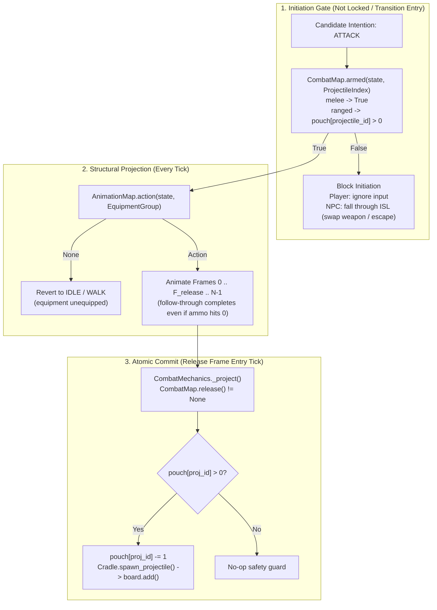

#### Refactor: Phase 03.05 - Ammunition

**Overview**

Add gates to Projectile spawning conditional on the availability of the appropriate Inventory in the Pouch.

##### Architectural Analysis I 

###### The "Last Arrow" Follow-Through Trap

Trace what happens when a Player or Sprite equips `longbow` (`lpc-shoot`: 13 frames `0..12`, release at frame `9`) with **`inventory.pouch["arrow"] == 1`**:

1. **Tick $T_0$**: Entity enters `Intentions.ATTACK` (`Actions.SHOOT`, `frame = 0`). `pouch["arrow"] == 1`.
2. **Ticks $T_1 \dots T_8$**: Bow draws through frames `1..8`.
3. **Tick $T_9$ (Release Frame 9)**: `CombatMechanics._project()` spawns the `arrow` and decrements `pouch["arrow"]`: **`1 -> 0`**.
4. **Tick $T_{10}$ (Follow-Through Frame 10)**:
   * `PlayerMechanics` / `TransitionMechanics` runs its per-tick active-state check (`action = AnimationMap.action(...)`).
   * **If `AnimationMap.action()` checked `pouch["arrow"] > 0`**, it would now return `None` on Tick $T_{10}$!
   * That would immediately revert `ATTACK -> IDLE` and `SHOOT -> WALK`, **truncating the bow's follow-through frames `10..12`** (and if ammo were deducted on Tick $T_0$ instead of release frame 9, Tick $T_1$ would abort the shot before frame 9 was ever reached!).

This same trap applies to every consumable-backed Intention in Ontology:
* `ATTACK` (ranged) $\to$ `inventory.pouch[projectile_id]`
* `BUILD` $\to$ `inventory.pack[material]`
* `USE` $\to$ `inventory.pouch[item]`
* Future magic `CAST` $\to$ `meters.magic.current`

###### Separating *Structural Admissibility* from *Resource Affordability*

The "Last Arrow" trace proves that **"Is this Action permissible?"** actually decomposes into **three distinct, temporally separated checks**:

| Concern | Question Answered | Dependencies | When Checked | On Failure |
| :--- | :--- | :--- | :--- | :--- |
| **1. Resource Affordability (Initiation Gate)** | *"Can this entity **start** a new attack/build/use cycle?"* | `State.inventory`, `Slots`, `ProjectileIndex` (via e.g. `CombatMap.armed(state, relation)`) | **Entry only** (when transitioning *into* `ATTACK`, or at cycle wrap `frame == 0` for looping NPCs) — **never** while `is_locked` mid-animation | Reject initiation (Player ignores trigger; NPC falls through to another Intention rule or swaps weapon) |
| **2. Structural Admissibility (`AnimationMap.action`)** | *"Does the slotted Equipment structurally support an Animation row?"* | `Intention`, `Slots.equipment`, `EquipmentGroup` | **Every tick** in `PlayerMechanics` and `TransitionMechanics` | Revert immediately to `IDLE / WALK` (prevents invalid atlas frame lookups if equipment was unequipped mid-action) |
| **3. Atomic Commit (`CombatMechanics._project`)** | *"Release projectile and deduct consumable?"* | `State.inventory`, `CombatMap`, `ProjectileIndex` | **Once** on release frame entry (`CombatMap.release() != None`) | Guard `pouch.get(proj_id, 0) > 0`; decrement `pouch[proj_id] -= 1` atomically with `Cradle.spawn_projectile()` |



###### Why Keeping `AnimationMap` Free of `Inventory` Matters

1. **Preserves Disjoint Map Domains**:
   * `AnimationMap` remains strictly `(Intentions, Slots, EquipmentGroup) -> Optional[Actions]`, with no coupling to `ProjectileIndex`, `Inventory`, crafting recipes, or mana costs.
   * `CombatMap` already owns `ProjectileIndex` and ranged-combat semantics, making `CombatMap.armed(state, relation) -> bool` the natural home for ranged ammunition checks:
     ```python
     @staticmethod
     def armed(state: SheetState, relation: Optional[ProjectileIndex]) -> bool:
         projectile_id = CombatMap.projectile(state, relation)
         if projectile_id is None:
             return True  # Melee weapon (no ammunition required)
         if not state.inventory:
             return False
         return state.inventory.pouch.get(projectile_id, 0) > 0
     ```
2. **Enables Emergent NPC Behavior (No Rejection Deadlock)**:
   * For `PlayerMechanics` (which already receives `Relations.PROJECTILES` via `self.relation`), gating incoming `Intentions.ATTACK` with `CombatMap.armed(player.state, self.relation)` cleanly blocks starting a draw when out of ammo while letting the last arrow's follow-through finish.
   * For NPC `Sprites`, because `TransitionMechanics` evaluates `src/data/config/intentions/main.yaml` in top-to-bottom rule order, exposing an ISL predicate (e.g., `functions.is_armed(sprite)` checking `pouch`) in the Intention Matrix allows an out-of-ammo archer to **fall through** to a secondary rule—e.g., transitioning out of `attack` / `hunt` into `escape`, or letting `CognitionMechanics` re-equip a melee weapon from `inventory.sheathe`—rather than deadlocking forever on a rejected `hunt -> attack` transition.
   * Crucially, for looping NPC `attack -> attack` rules, checking `not is_armed` only after the cycle completes (`sprite.animation.frame == 0`) or transitioning out after `pouch` hits `0` at cycle wrap guarantees the NPC also finishes its release follow-through cleanly.

###### Summary

* **`SpriteFrame`**: Keep `state.intention` as the primary `tool` vs. `weapon` disambiguator (since `Actions.THRUST` / `Actions.SLASH` are non-injective across Equipment slots), and optionally guard out `Actions.WALK` / `Actions.DIE` so non-implement actions never emit weapon/tool keys.
* **`AnimationMap` vs. `CombatMap` for `Inventory`**: Keep `AnimationMap.action()` strictly for **structural Equipment admissibility** (safe to run every tick and revert immediately). Place **consumable Inventory checks** (`CombatMap.armed()`) at **initiation** (`PlayerMechanics` rising edge; ISL / `CognitionMechanics` for NPCs) and **atomic consumption** at **release** (`CombatMechanics._project()`), preventing the last-projectile follow-through truncation bug and keeping Maps cleanly decoupled.