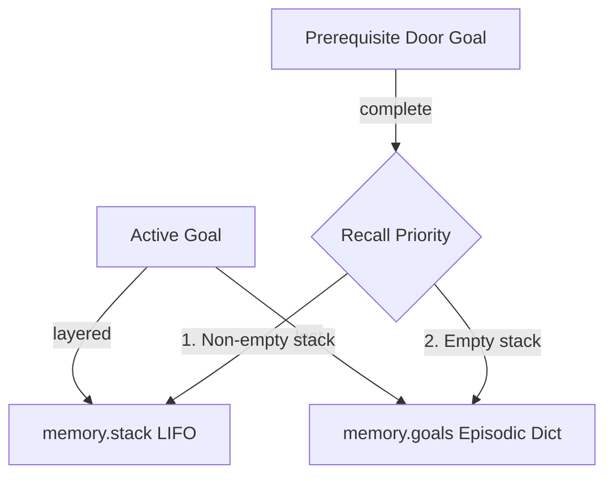
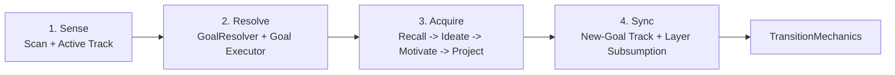
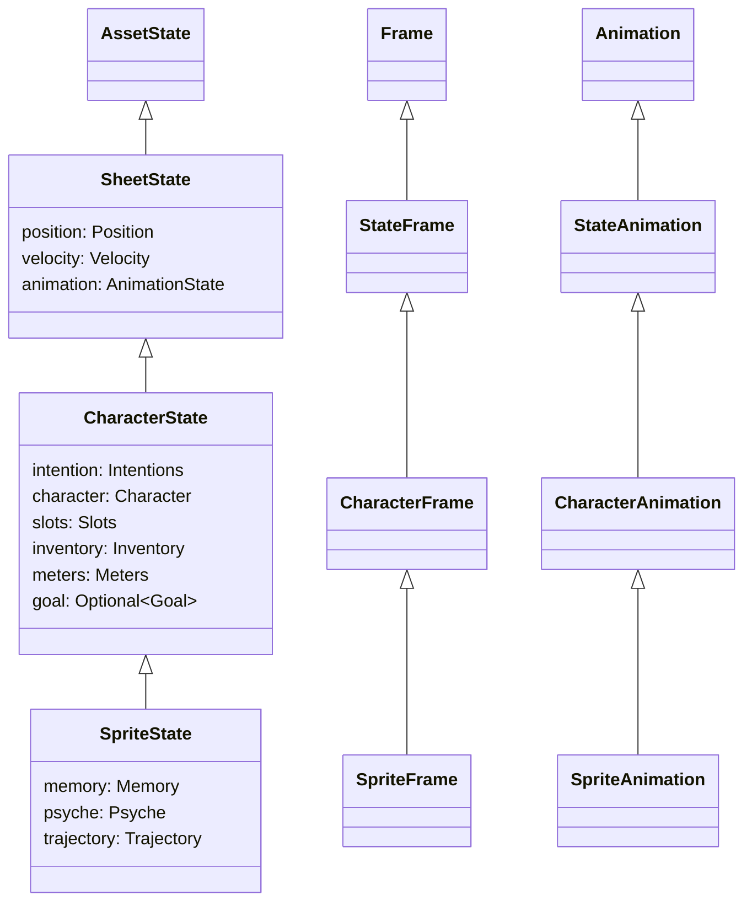
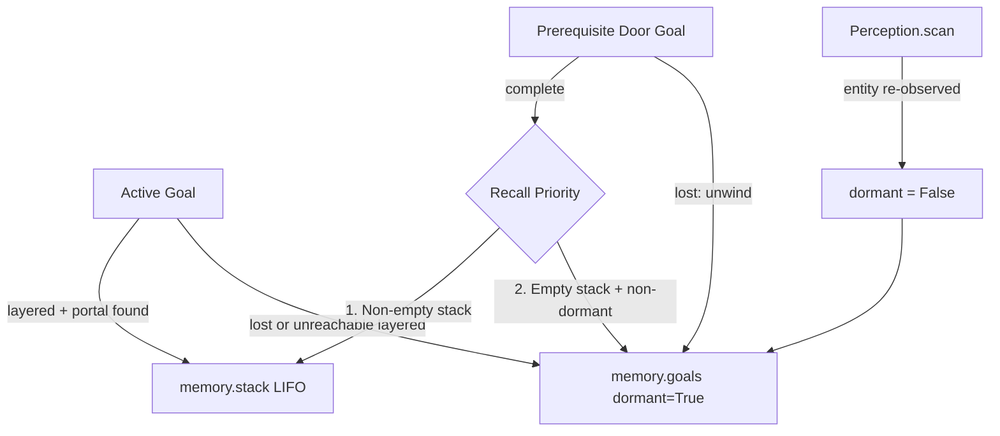
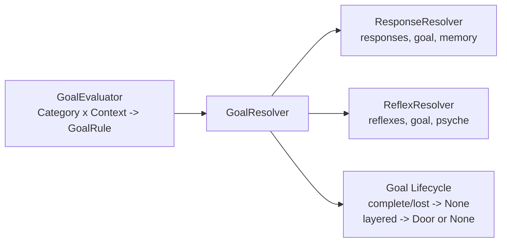
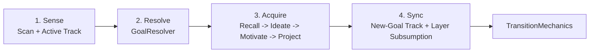

#### Refactor: Phase 06.02 - Goals

**Overview**

Refactor `CognitionMechanics` into a declarative, modular cognitive pipeline anchored by a compiled **Goal Resolution Executor**, cohesive cognitive modules (Perception, Resolution, Recall, Ideation/Motivation, Projection), an explicit **Subgoal Commitment Stack** decoupled from episodic memory, and a three-tier **Sheet State & Component Hierarchy** (`SheetState` $\to$ `CharacterState` $\to$ `SpriteState`). Enforce SMDP option soundness across `GoalResolver`, `TransitionMechanics`, `NavigationMechanics`, and `InteractionMechanics` to eliminate cross-layer deadlocks, epistemic telepathy leaks, and silent ISL compilation failures.

##### Specification

###### 1. Goal Taxonomy

| Goal Category | Semantics | `goal.name` Identity | Spatial Mobility | Factored Completion Invariant |
| --- | --- | --- | --- | --- |
| `target` | Hostile character pursued for combat | Deployed Character `name` | Mobile | Target removed or `target.mutators.triggers.dead` |
| `subject` | Character pursued for social interaction | Deployed Character `name` | Mobile | `not sprite.psyche.dialogue` |
| `door` | Portal traversed to transition Layers | Deployed Door `name` | Static | `sprite.layer != sprite.goal.layer` |
| `object` | Non-portal interactive Object (Chest, Plate, Sign) | Deployed Object `name` | Static | Explicit interaction outcome (disjoint from unary missing-`switch` failure) |
| `resource` | Biological or geological Resource targeted for harvesting | Deployed Resource `name` | Static | Resource removed (`not target`) |
| `property` | Structure targeted for construction | Blueprint/Craft `id` or deployed Strut `name` | Static | Deployed structure registered in `sprite.memory.property` |
| `position` | Coordinate destination (`wander`, `escape`, `return`) | Synthetic tag | Static | Within `action.radius` of `goal.position` (or `not triggers.frightened` for `escape`) |

###### 2. Commitment Stack vs. Episodic Memory

`Memory` separates ordered subgoal commitments from unordered episodic desires:



* **`memory.stack: List[Goal]`**: LIFO commitment stack holding parent Goals suspended by prerequisite subgoals (such as cross-layer `door` subsumption). Completing a prerequisite immediately resumes `memory.stack.pop()` before general episodic recall.
* **`memory.goals: Dict[str, Goal]`**: Unordered episodic desire store populated by `lost` outcomes and queried by `Recall` with live-visibility dormancy checks and Intention-category affinity.

###### 3. Goal Resolution Matrix

Goal resolution is defined in `/src/data/config/goals/main.yaml` and compiled through `Translator` $\to$ `Executor` (`Executors.GOAL`) in canonical precedence:

$$\text{Precedence}: \quad \texttt{complete} \succ \texttt{layered} \succ \texttt{lost}$$

* **Outcomes**:
  1. `complete`: Objective satisfied; clears `sprite.state.goal`.
  2. `layered`: `goal.layer != sprite.layer`; pushes active Goal onto `memory.stack` (via `push` reaction) and assigns a `LayerProjections.IN` `Goals.DOOR`, or demotes the Goal to `memory.goals` and clears `sprite.state.goal` if no reachable portal exists.
  3. `lost`: Goal abandoned (unseen at last-known location), stalled (`sprite.trajectory.stalled`), or invalidated by Intention transition; clears `sprite.state.goal`.
* **Reactions**:
  * `forget`: Evicts `goal.name` from `sprite.state.memory.goals`.
  * `store`: Commits `goal` into `sprite.state.memory.goals[goal.name]`.
  * `push`: Pushes `goal` onto `sprite.state.memory.stack` (preventing duplicate top-of-stack entries).
  * `confusion`: Attaches a `confusion` Expression bubble to `sprite.state.psyche.expression`.

###### 4. Cognitive Pipeline Ordering

Per tick, each autonomous Sprite executes a four-stage cognitive loop:



1. **Sense (`Perception`)**: Refreshes `memory.sprites` (copied coordinate snapshots) and visible `memory.goals` within `vision.radius`, then updates `triggers.vision`, `goal.position`, and `goal.layer` for any active Goal. Because perception executes *before* resolution, `GoalResolver` never observes 1-tick stale visibility or layer flags.
2. **Resolve (`GoalResolver`)**: Evaluates the compiled Goal Executor against `sprite.state.goal` using locals `{'sprite': sprite.state, 'sprites': board.characters(), 'target': target_state}`. Executes matched Reactions followed by the Outcome Callback.
3. **Acquire (`Recall`, `Ideate`, `Motivate`, `Project`)**: Populates a Goal if `sprite.state.goal is None` (respecting the Intention Loop hub invariant so `interact`/`speak` return to `idle` before recalling stacked Goals), or projects spatial coordinates for `wander`/`escape`.
4. **Sync (Post-Acquisition Validation)**: If Acquisition introduced a new Goal on this tick, immediately updates `triggers.vision` and checks `layered` subsumption so `TransitionMechanics` and `NavigationMechanics` receive an actionable same-layer Goal on the same frame.

###### 5. Sheet State & Component Hierarchy

To enforce strict ECS component symmetry across `Pixies`, `Players`, and `Sprites`:



* **`Pixies`**: `SheetState` + `StateFrame` + `StateAnimation`
* **`Players`**: `CharacterState` + `CharacterFrame` + `CharacterAnimation`
* **`Sprites`**: `SpriteState` + `SpriteFrame` + `SpriteAnimation`

##### Architectural Analysis I

An audit of `CognitionMechanics`, `TransitionMechanics`, `NavigationMechanics`, `intentions/main.yaml`, and `services/translators` reveals six systemic weaknesses:

1. **Ad-hoc Resolution Branching & Incomplete Categories**: `CognitionMechanics._resolve` and `CognitionMechanics.complete` duplicate `if/elif` chains across `Goals`, hardcode a special case to drop `WANDER` goals when transitioning to `FIND`/`HUNT`, leave `OBJECT` and `PROPERTY` incomplete (`return True` / `pass`), and have no support for `RESOURCE` or `DOOR`.
2. **Stale Phase Ordering & Cross-Layer Gaps**:
   * `_resolve` runs *before* `_track`, so `triggers.vision` and `goal.layer` evaluated during resolution are 1 tick stale.
   * `_track` returns early for `POSITION`, `OBJECT`, and `PROPERTY` before the cross-layer door subsumption block—meaning only `TARGET` and `SUBJECT` can ever traverse Doors, while cross-layer static Goals stall permanently in `NavigationMechanics`.
   * `CognitionMechanics.door()` queries all `AssetInstances.DOORS` on the layer without filtering out `LayerProjections.OUT` shadow doors (which have empty hitboxes and cannot be interacted with).
3. **Broken Memory Dormancy & Intention Affinity in `_remember`**:
   * Dormancy detection checks `not sprite.state.mutators.triggers.vision`, which belongs to the *active* Goal (now `None`), not the candidate in `memory.goals`. When a lost Target walks back within `action.radius`, `_scan` updates its position in `memory.goals` without touching `triggers.vision` (still `False`), causing `_remember` to skip a Target standing directly beside the Sprite. Conversely, after dropping a `WANDER` goal (`triggers.vision == True`), an absent dormant Target is falsely recalled.
   * `_remember` pops the first dict entry regardless of `sprite.state.intention`. A Sprite transitioning `wander -> hunt` on spotting a remembered `TARGET` can pop an unrelated `SUBJECT`, deadlocking in `hunt`.
   * Dormancy should instead evaluate live visibility of `candidate` directly:
     $$\text{dormant}(c) \iff \neg\text{visible}(c) \;\land\; (c.\text{layer} = s.\text{layer}) \;\land\; \text{nearby}(c.\text{position}, s.\text{position}, r_{\text{action}})$$
4. **Coupling Defect Between `ESCAPE` Projection and `NavigationMechanics`**:
   * `CognitionMechanics._project` extrapolates `goal.position` away from an attacker while retaining `goal.name = attacker.name`. `NavigationMechanics._target()` prioritizes `board.asset(goal.name)` over `goal.position` for same-layer assets—silently discarding the flee coordinate and steering the escaping Sprite straight into the attacker. `_project` also omits `None` guards and layer-boundary clamping for `ESCAPE`.
5. **Alignment Issues in the Draft Goal YAML & `Environ` Contract**:
   * **Inverted `subject.complete` condition**: The notes sketch `- sprite.psyche.dialogue`, whereas dialogue completion requires `- not sprite.psyche.dialogue`.
   * **Null-safety in `target.complete`**: Requiring `sprites.get(sprite.goal.name)` as a mandatory conjunct prevents completion if the target was removed by `RemoveMechanics`. The condition must short-circuit as `not sprites.get(sprite.goal.name) or sprites.get(sprite.goal.name).mutators.triggers.dead` (or `not target or target.mutators.triggers.dead`).
   * **Naming drift**: The notes YAML uses `functions.nearby` (whereas `Environ.functions` exports `is_near`) and reaction `remember` (whereas the reaction spec defines `store`). Standardizing on `functions.is_near` and `store` eliminates ambiguity with `_remember` (memory recall).
   * **Uniform Asset State Access (`target` local)**: Passing only `sprite` and `sprites` limits declarative Goal rules to Characters. Injecting a zero-allocation `target: Optional[AssetState]` local (resolved once per tick via $O(1)$ `board.asset(goal.name)`) enables `OBJECT` (`not target or target.switch`), `RESOURCE` (`not target`), `TARGET`, and `SUBJECT` rules uniformly without allocating state dicts per tick. Note that `settings.LAMBDA_SIGNATURE` must be updated alongside `CompilerTranslator` so both compilation backends remain in lockstep.
6. **Reusing `Translator` / `Executor` Cleanly**:
   * Both `LambdaTranslator` and `CompilerTranslator` compile `Dict[str, List[Config]]` into `Executor` instances returning `Optional[str]`.
   * Authoring `goals/main.yaml` as `Dict[Goals, Dict[Outcomes, GoalConfiguration]]` gives unique reaction lookup per `(category, outcome)` and clean readability. At boot, a thin normalization step flattens each category's outcome map in canonical `(COMPLETE, LAYERED, LOST)` order into the existing `Translator.compile(...)` contract—yielding full AST/Lambda parity with zero duplication of compilation logic.
   * Because `COMPLETE` is always evaluated first, `GoalResolver.complete(sprite, board)` reduces cleanly to `executor.evaluate(goal.category, locals) == Outcomes.COMPLETE` without mutating state.

##### Architectural Analysis II

Synthesizing formal BDI, HTN, SMDP Option theory, and ABL precondition-monitoring invariants against Architectural Analysis I identifies six additional design issues that must be resolved during Phase 06.02:

1. **Cross-Layer Thrashing via Flat `memory.goals`**: Storing `layered` parent goals in `memory.goals` allows `Recall` to pop an older unrelated goal after door transit instead of resuming the parent goal. Adding a LIFO `memory.stack` with a `Responses.PUSH` reaction isolates subgoal commitments from episodic desires and lays the foundation for multi-step `resource`/`property` planning.
2. **`hunt` / `follow` Deadlock on Subgoal Substitution**: Replacing a `TARGET` with a prerequisite `DOOR` while `intention == HUNT` traps the Sprite in `hunt` because `hunt` lacks a category-mismatch exitpoint to `idle`. Adding explicit category-mismatch exitpoints (ABL-style precondition monitors) to `hunt`, `attack`, and `follow` guarantees clean re-routing through the `idle` hub.
3. **`InteractionMechanics` vs. `find -> interact` Contact Gap**: `find -> interact` fires at `action.radius` (`30` px), halting movement before inset Sprite hitboxes overlap the target Door or Chest required by `InteractionMechanics.intersections`. Either `InteractionMechanics` must evaluate within `proximities` for Sprite-initiated `interact` or `NavigationMechanics` / `find -> interact` must guarantee hitbox overlap prior to halting.
4. **Epistemic Telepathy in `_track` & `intentions/main.yaml`**: Updating `goal.layer = target_state.layer` unconditionally when a target is unseen violates BDI epistemic decoupling. `Perception.track` should only update `goal.layer` and `goal.position` when the target is observed on the same layer within `vision.radius` (or observed exiting a visible door, updating `goal.layer` to `door.state.outlayer` and `goal.position` to the door). Similarly, `find -> speak` and `idle -> find` should check perceived `sprite.goal.position` + `triggers.vision` rather than omniscient `sprites.get(sprite.goal.name).position`.
5. **Unfactored Static Goal Rules (`object`, `door`, `resource`, `property`)**:
  * `door`, `object`, `resource`, and `property` need `lost` conditions on `sprite.trajectory.stalled` (and `not target` for `door`) so unreachable portals/objects do not softlock Sprites.
  * `object.complete` cannot rely unconditionally on `target.switch` because unary Objects lack `switch` and already-open reusable Chests immediately satisfy `target.switch`. Restrict `Goals.OBJECT` completion to an explicit post-interaction state/flag or split binary switchable interaction from unary inspection (`Sign`).
  * `any_memories_visible` in `environ.py` must exclude dead targets (`not target.mutators.triggers.dead`) and support non-character board assets (`OBJECT`, `DOOR`, `RESOURCE`) if those categories can be recalled from memory.
6. **Fail-Fast ISL Compilation & `ESCAPE` Decoupling**:
  * `CompilerTranslator` and `LambdaTranslator` must raise (or drop the entire rule) on condition syntax errors rather than silently dropping individual failed conjuncts.
  * `NavigationMechanics._target()` must bypass `board.asset(goal.name)` whenever `goal.category == Goals.POSITION`, and `ESCAPE` should project a synthetic `Goals.POSITION` (`name="escape"`) whose lifecycle in `intentions/main.yaml` is governed by `sprite.mutators.triggers.frightened` rather than `sprites.get(sprite.goal.name).intention == ATTACK`.

##### User Review I

* The Goal Resolver in the specification is ambiguous. As specified, it is unclear what exactly the interface is.
* "Normalize `ConfigurationSchema.goals` into canonical `(COMPLETE, LAYERED, LOST)` transition lists during bootstrap so `LambdaTranslator` and `CompilerTranslator` compile `Executors.GOAL` without duplicating compiler logic.": What does this mean? The whole analysis proceeds as if the Goal automata is transitioning into the `complete`, `layered` or `lost` state, but I am not certain that is what is occuring, or is what should occur.
* Goals do not "transition" between `complete`, `layered` or `lost`. These *are* the transitions, i.e. not nodes, but edges. 
* It seems like the Resolver is exposing named methods, e.g. `complete()`, rather than abstracting the interface into its correct functional predicate and actual dependent variables, e.g. `psyche` and `memory` are variables. 
* **Door Projections** Tasking misunderstands what a Layer Projection for a Door is. Sprites *should* be able to target `LayerProjections.OUT` Doors. They would be stranded in the Door's Layer if there were no inverse return Door. 
* It seems like the Executor and Translator interfaces are being unnecessarily bent and stretched to accomodate what is fundamentally a different sort of operation. Executor and Translators are for transitioning finite automata between the nodes of their trees/loops. However, Goal Resolution does not seem to quite fit the model of finite automata as codified in Translators and Executor, atleast not in the same formulation as other transitions.
  * What we have here: Sprite has Goal. A Goal does not transition from `complete` to `layered` or `layered` to `lost`. The Goal Outcomes are not "states" the Goal enters, to transition into another. Instead, at the beginning of every loop, a Goal is in an "undetermined" or "free" state. The conditions for each outcome are evaluated within the Cognitive pipeline. When the conditions for an outcome are met, the corresponding callback is invoked, all of which nullify the Goal. In fact, `complete`, `layered`, `lost` would probably be more easily modeled as self-reentrant loops back into null, i.e. ther are three ways a Goal can return to the null state. So, if Goals are to be modeled as finite automata (which I don't think is the correct move), there would need to be a "null" state, with three arrows labelled `complete`, `layered`, `lost`, all of which transition back into the `null` state. If Goal Resolution is to be jammed into Transitions Executor, then they have to be specified analogously, e.g. in the same framework of defining the automata. Currently, the "grammar" of Goals automata is fundamentally different than the "grammar" of Transition automata. 

###### Reflexes

`confusion` is at odds with the other Responses. 

Responses appear to be "Memory Operators", i.e. intentional acts within the Sprite's memory that occur when their conditions are met. `confusion`, however, is more like an "involuntarily side-effect", let's call it a "Reflex". Moreover, they operate on a different subset of State than Responses.

So: Goal Resolution is actually composed (so far) of two orthogonal operators: Response and Reflxes, which affect the memory and psyche, respectively.

  Resolver(Reflex, Response) -> Mutations

* `app.game.logic.modules.cognition.goal.resolvers.reflexes`: 
  * `reflex.resolve(outcome, goal, psyche) -> psyche mutation`
* `app.game.logic.modules.cognition.goal.resolvers.response`: 
  * `response.resolve(outcome, goal, memory) -> memory mutation`

**Note: Really, what is happening here is: Sprites are being injected with a Behavior, i.e. Reflexes and Response are "components" of Sprite Sheet Assets**.

###### Separation of Sheets

**SheetState -> CharacterState -> SpriteState**

I believe this mapping will also simplify some of the nested logic in the hydration and migration. Currently, the Migrator has a few hacks in place to hydrate Player properties and state. Players are treated as participants in the Sprite node when it comes to Properties, i.e. they have their properties hydrated from `sheets.sprites` but they have their state hydrated from `sheets.players`.

###### Updated YAML
 
```yaml
<outcome>:
  reflexes: [ <reflex> ]
  responses: [ <response> ] 
  conditions:
      - <condition>
```

##### Goals

###### Goal: Declarative Goal Resolution Executor

Replace ad-hoc resolution logic with a compiled `Executors.GOAL` Executor backed by `src/data/configurations/automata/goals/main.yaml`, supporting canonical `(COMPLETE, LAYERED, LOST)` precedence, commitment-stack `push`, and stall/removal `lost` guards:

```yaml
goals:
  subject:
    complete:
      reactions: [ forget ]
      conditions:
        - not sprite.psyche.dialogue
    layered:
      reactions: [ push ]
      conditions:
        - sprite.goal.layer
        - sprite.layer != sprite.goal.layer
    lost:
      reactions: [ store, confusion ]
      conditions:
        - functions.is_near(
            sprite.goal.position,
            sprite.position,
            sprite.mutators.parameters.action.radius
          )
        - not sprite.mutators.triggers.vision
  target:
    complete:
      reactions: [ forget ]
      conditions:
        - not target or target.mutators.triggers.dead
    layered:
      reactions: [ push ]
      conditions:
        - sprite.goal.layer
        - sprite.layer != sprite.goal.layer
    lost:
      reactions: [ store, confusion ]
      conditions:
        - functions.is_near(
            sprite.goal.position,
            sprite.position,
            sprite.mutators.parameters.action.radius
          )
        - not sprite.mutators.triggers.vision
  position:
    complete:
      reactions: []
      conditions:
        - functions.is_near(
            sprite.goal.position,
            sprite.position,
            sprite.mutators.parameters.action.radius
          )
    layered:
      reactions: [ push ]
      conditions:
        - sprite.goal.layer
        - sprite.layer != sprite.goal.layer
    lost:
      reactions: []
      conditions:
        - sprite.trajectory.stalled or sprite.intention in [constants.Intentions.FIND, constants.Intentions.HUNT]
  door:
    complete:
      reactions: [ forget ]
      conditions:
        - sprite.layer != sprite.goal.layer
    lost:
      reactions: [ forget ]
      conditions:
        - not target or sprite.trajectory.stalled
  object:
    complete:
      reactions: [ forget ]
      conditions:
        - not target or getattr(target, 'switch', False)  # Replace once Object interaction completion contract is finalized
    layered:
      reactions: [ push ]
      conditions:
        - sprite.goal.layer
        - sprite.layer != sprite.goal.layer
    lost:
      reactions: [ store ]
      conditions:
        - sprite.trajectory.stalled
  property:
    complete:
      reactions: [ forget ]
      conditions:
        - sprite.goal.name in sprite.memory.property
    layered:
      reactions: [ push ]
      conditions:
        - sprite.goal.layer
        - sprite.layer != sprite.goal.layer
    lost:
      reactions: [ store ]
      conditions:
        - sprite.trajectory.stalled
  resource:
    complete:
      reactions: [ forget ]
      conditions:
        - not target
    layered:
      reactions: [ push ]
      conditions:
        - sprite.goal.layer
        - sprite.layer != sprite.goal.layer
    lost:
      reactions: [ store ]
      conditions:
        - sprite.trajectory.stalled

```

*(Note: Per the Models guideline avoiding `getattr`, finalize the unary vs. binary Object completion predicate in Task 1—e.g., an explicit `interacted` signal or restricting `Goals.OBJECT` to switchable entities while giving `Signs` their own completion rule—so `goals/main.yaml` uses strictly typed attribute access.)*

###### Goal: Modular Cognitive Architecture

Decompose `CognitionMechanics` under `app.game.logic.modules.cognition`:

* `GoalResolver`: Declarative `Executors.GOAL` evaluation, Reaction map (`forget`, `store`, `push`, `confusion`), Outcome callbacks (`complete`, `layered`, `lost`), and `LayerProjections.IN`-filtered Door lookup.
* `Perception`: Epistemic same-layer scanning (copying `Position` snapshots) and active-goal tracking without unseen cross-layer telepathy.
* `Recall`: Two-tier acquisition popping `memory.stack` (LIFO) before scanning `memory.goals` with live-visibility dormancy checks and Intention-category affinity.
* `Generator` (`Ideation` + `Motivation` strategy registry): Pluggable `Dict[Motivations, MotivationStrategy]`.
* `Projector`: Bounded coordinate projection for `wander` and `escape` (`Goals.POSITION`), decoupled from `NavigationMechanics._target()` asset lookups.

###### Goal: Clean Sheet State, Frame & Animation Hierarchy

Separate `SheetState` (kinematic/animated base for `Pixies`), `CharacterState(SheetState)` (equipment/inventory/goal base for `Player`), and `SpriteState(CharacterState)` (autonomous cognitive fields for `Sprites`), with matching `StateFrame -> CharacterFrame -> SpriteFrame` and `StateAnimation -> CharacterAnimation -> SpriteAnimation` hierarchies that eliminate all runtime `getattr` and `id != RequiredAssets.PLAYER` checks.

##### Tasks

**1. Task: Goal Semantics, Configuration Models & Resolution Matrix**

*Objective*: Formalize Goal categories, outcome callbacks, reactions, and Pydantic-validated configuration schemas with sound factored completion invariants.

* [ ] Subtask: Update `app.static.semantics` to add `Goals.DOOR`, `Goals.RESOURCE`, `Outcomes` (`complete`, `layered`, `lost`), `Responses` (`forget`, `store`, `push`, `confusion`), and `Executors.GOAL`.
* [ ] Subtask: Add `stack: List[Goal] = field(default_factory=list)` to `Memory` in `app.models.state.assets.sheets` to separate suspended subgoal commitments from episodic `memory.goals`.
* [ ] Subtask: Define frozen `GoalConfiguration` (`reactions: List[Enumerated[Responses]]`, `conditions: List[str]`) in `app.models.config` and expose `goals: Dict[Enumerated[Goals], Dict[Enumerated[Outcomes], GoalConfiguration]]` on `ConfigurationSchema`.
* [ ] Subtask: Resolve the unary vs. binary Object completion contract (avoiding untyped `target.switch` on `Signs`/`Crates` and immediate completion on already-open `Chests`) and author `/src/data/config/goals/main.yaml` covering all 7 categories including `stalled`/`not target` `lost` rules.
* [ ] Subtask: Wire `/src/data/config/goals/` ingestion into `Loader` and register `executors: [ goal ]` on `cognition` in `/src/data/config/mechanics/main.yaml`.

**2. Task: Goal Executor Compilation & ISL Environment Hardening**

*Objective*: Compile `Executors.GOAL` through `Translator` with full AST/Lambda parity, fail-fast syntax validation, uniform `target` asset-state access, and clean boundary semantics.

* [ ] Subtask: Normalize `ConfigurationSchema.goals` into canonical `(COMPLETE, LAYERED, LOST)` transition lists during bootstrap so `LambdaTranslator` and `CompilerTranslator` compile `Executors.GOAL` without duplicating compiler logic.
* [ ] Subtask: Harden `CompilerTranslator.compile` and `LambdaTranslator.compile` to fail fast (raise on invalid ISL condition syntax rather than silently dropping a failed conjunct from a transition rule).
* [ ] Subtask: Update `settings.LAMBDA_SIGNATURE` to accept `target=None` alongside `sprite` and `sprites` so both `LambdaExecutor` and `CompilerExecutor` support $O(1)$ resolved target-asset state queries.
* [ ] Subtask: Standardize `Environ.functions.is_near` and `geometry.nearby` boundary semantics (`<=` vs. `<`), filter dead targets (`not target.mutators.triggers.dead`) out of `any_memories_visible`, and expose new Goal enums in `Environ.constants`.
* [ ] Subtask: Add the typed `executor` property on `CognitionMechanics` bound to `Executors.GOAL`.

**3. Task: `GoalResolver` Implementation**

*Objective*: Encapsulate declarative Goal evaluation, reaction dispatch, outcome callbacks and commitment-stack pushing behind `complete(sprite, board)` and `resolve(sprite, board)`.

* [ ] Subtask: Create `src/app/game/logic/modules/cognition/resolver.py` implementing `GoalResolver` with `complete(sprite, board) -> bool` and `resolve(sprite, board) -> Optional[Outcomes]`.
* [ ] Subtask: Implement the `Responses` handler map (`forget`, `store`, `push`, `confusion`) receiving `(sprite, goal, board)`.
* [ ] Subtask: Implement the `Outcomes` callback map (`complete`, `layered`, `lost`), routing `layered` to `door(sprite, board)` to assign a prerequisite `Goals.DOOR` (after pushing the parent onto `memory.stack`), or demoting the parent to `memory.goals` and clearing `sprite.state.goal` when unreachable.
* [!: INCORRECT ASSUMPTION] Subtask: Restrict `door(sprite, board)` to `LayerProjections.IN` doors so non-interactive `OUT` shadow footprints are never targeted.
  * **WARNING: DO NOT DO THIS. THIS IS A FUNDAMENTAL MISUNDERSTANDING OF WHAT A DOOR LAYER PROJECTION IS. SPRITES SHOULD BE ABLE TO TARGET "OUT" LAYER PROJECTIONS**

**4. Task: Decompose `CognitionMechanics` & Fix Cognitive / Navigation / Interaction Coupling**

*Objective*: Break `CognitionMechanics` into focused modules, enforce the 4-stage pipeline, close epistemic telepathy leaks, and fix `ESCAPE` and `interact` contact deadlocks.

* [ ] Subtask: Extract `Perception` (`scan`, `track`) into `app.game.logic.modules.cognition.perception`; copy `Position` snapshots in `memory.sprites`, restrict `goal.layer` updates to observed transitions (closing cross-layer telepathy), separate mobile vs. static tracking, and remove inline door subsumption.
* [ ] Subtask: Extract `Recall` (`remember`) into `app.game.logic.modules.cognition.recall`; pop `memory.stack` (LIFO) before scanning `memory.goals`, replace stale `triggers.vision` checks with live-visibility dormancy checks, and filter episodic recall by Intention affinity (`HUNT` $\to$ `TARGET`, `FIND` $\to$ `SUBJECT`/`OBJECT`/`DOOR`, `IDLE` $\to$ any eligible).
* [ ] Subtask: Extract `Ideation` and a pluggable `Dict[Motivations, MotivationStrategy]` registry into `app.game.logic.modules.cognition.ideation`, aligning dialogue ideation with `intentions/main.yaml` relationship predicates.
* [ ] Subtask: Extract `Projector` (`wander`, `escape`) into `app.game.logic.modules.cognition.projection`; add `None` guards and layer-bounds clamping for `ESCAPE`, emit synthetic `Goals.POSITION` for `ESCAPE`, and update `NavigationMechanics._target()` to skip `board.asset(goal.name)` lookup when `goal.category == Goals.POSITION`.
* [ ] Subtask: Reconcile the `find -> interact` initiation radius (`action.radius`) with `InteractionMechanics` execution (`intersections` vs. `proximities`) so Sprites entering `interact` at Doors and Chests never halt short of contact.
* [ ] Subtask: Refactor `CognitionMechanics.update()` into the 4-stage pipeline (**Sense $\to$ Resolve $\to$ Acquire $\to$ Sync**) with a safe `player = board.player()` guard hoisted outside the sprite loop.

**5. Task: Sheet State, Frame & Animation Hierarchy Refactor (`pstats` Remediation)**

*Objective*: Separate `SheetState`, `CharacterState`, and `SpriteState` and their corresponding Frame/Animation strategies to enforce uniform ECS dispatch, fix stationary expression decay, and eliminate per-tick `logger.info` overhead.

* [ ] Subtask: Refactor `src/app/models/state/assets/sheets.py` into `SheetState(AssetState)`, `CharacterState(SheetState)`, and `SpriteState(CharacterState)`.
* [ ] Subtask: Type `Goal.category` as `Optional[Enumerated[Goals]]` and change `CharacterState.goal` default to `None` (auditing `MotionMechanics`, `PlayerMechanics`, and state YAML files).
* [ ] Subtask: Split `src/app/assets/frames/sheets.py` into `CharacterFrame(StateFrame)` and `SpriteFrame(CharacterFrame)`, removing `if id != RequiredAssets.PLAYER`, deleting the dead `properties.actions` statement, and downgrading per-tick `logger.info` calls in both `SpriteFrame` and `PlayerMechanics` to `logger.debug`.
* [ ] Subtask: Split `src/app/assets/animations/sheets.py` into `CharacterAnimation(StateAnimation)` and `SpriteAnimation(CharacterAnimation)` with unconditional `expression.ttl` decay, removing `getattr(state, 'psyche', None)`.
* [ ] Subtask: Update Recipe configurations, `AssetFactory`, `Loader` hydration schemas (`pixies` $\to$ `SheetState`, `players` $\to$ `CharacterState`, `sprites` $\to$ `SpriteState`), and audit `isinstance(..., SheetState)` / `Board._cache` call sites.

**6. Task: Intention Transition Matrix Reconciliation & Automaton Verification Suite**

*Objective*: Align `intentions/main.yaml` with the new Goal taxonomy, enforce non-deadlocking category-mismatch exitpoints, and verify cognitive and automaton invariants with automated tests.

* [ ] Subtask: Update `src/data/config/intentions/main.yaml` to:
* Support `Goals.DOOR` in `idle` and `find` and close `idle` proximity-stall gaps for `SUBJECT`/`OBJECT`/`DOOR`.
* Add category-mismatch exitpoints (`-> idle`) on `hunt`, `attack`, and `follow` so cross-layer `DOOR` subsumption re-routes cleanly through `idle`.
* Add the missing `attack -> idle` exitpoint, null-guard `sprites.get(sprite.goal.name)` in `attack`, and reconcile `attack -> scavenge` and `speak -> idle` (Player) ordering with `GoalResolver`.
* Wire `escape` entrypoints and persistence to `triggers.frightened` / `Goals.POSITION` and replace invalid `inventory.wallet`, `Goals.LOOT`, and duplicate `mine` rules.

**7. Update Coverage**

* [!: Dependent on User Acceptance Tests] Subtask: Add unit tests verifying `Executors.GOAL` compilation, fail-fast syntax rejection, and evaluation parity across `LambdaTranslator` and `CompilerTranslator`.
* [!: Dependent on User Acceptance Tests] Subtask: Add unit tests for `GoalResolver` (`complete > layered > lost` precedence; `forget`/`store`/`push`/`confusion` reactions; `LayerProjections.IN` door filtering; `stalled` abandonment), `Recall` commitment-stack LIFO resume and live dormancy, `Perception` epistemic isolation and position copying, and `ESCAPE` flee steering through `NavigationMechanics`.
* [!: Dependent on User Acceptance Tests] Subtask: Add static automaton verification tests checking `intentions/main.yaml` for hub reachability, non-deadlocking exit coverage per `(Intention, GoalCategory)`, and `SheetState`/`CharacterState`/`SpriteState` hydration and stationary `SpriteAnimation` TTL decay.


# Analysis

Evaluating Phase 06.02 against **User Review I**, the open **Bug Reports**, and the current codebase exposes seven structural adjustments required before implementation begins.

---

### 1. Goal Resolution Is a Rule Classifier, Not a Finite Automaton

**User Review I** identifies a category error in the prior Phase 06.02 plan: forcing Goal Resolution into the finite-automaton `Translator` $\to$ `Executor` pipeline.

* **Finite Automata (`Intentions`, `Plots`, `Resource Stages`)** are endomorphisms on a state set $Q$:
  $$\delta : Q \times \Sigma \to Q \cup \{\bot\}$$
  `Executor.evaluate(current_state, locals) -> Optional[str]` consumes a node $q \in Q$ and emits a successor node $q' \in Q$ via `Transition(next, conditions)`.
* **Goal Resolution** does **not** transition a Goal between `complete`, `layered`, and `lost` states. At the start of each tick, any active Goal $g$ is undetermined (*free*). Resolution classifies $g$ by its immutable category $c \in \mathcal{C}$ (`Goals`) against precedence-ordered outcome predicates:
  $$\rho : \mathcal{C} \times \Sigma \to \mathcal{R} \cup \{\bot\}$$
  where a matched rule $r = (\texttt{outcome}, \texttt{responses}, \texttt{reflexes}) \in \mathcal{R}$ carries all metadata needed to resolve the Goal back to `None` (or replace it with a prerequisite `Goals.DOOR`).

**Architectural Resolution**: Do **not** distort `Transition.next` or normalize `goals/main.yaml` into fake state-to-state transition lists. Instead, factor `app.services.translators` into two clean layers:

1. **Shared ISL Condition Backend (`Compiler` / `Lambda`)**: Owns `Environ` globals, fail-fast condition compilation (resolving **B069**), and short-circuit conjunction evaluation with `target=None` in `settings.LAMBDA_SIGNATURE`.
2. **Domain-Specific Compilers Built on the Shared Backend**:
   * `Translator` $\to$ `Executor`: Unchanged finite-automaton contract (`Dict[str, List[Transition]]` $\to$ `Optional[str]`).
   * `GoalTranslator` $\to$ `GoalEvaluator`: Compiles `Dict[Goals, Dict[Outcomes, GoalConfiguration]]` directly into precedence-ordered `Dict[Goals, List[GoalRule]]`, returning `Optional[GoalRule]` (carrying `outcome`, `responses`, and `reflexes` together).

This preserves full AST/Lambda parity without duplicating compiler code, eliminates the need for `GoalResolver` to separately look up `ConfigurationSchema.goals` after evaluation, and keeps `Executors.GOAL` cleanly injectable through `MechanicFactory` (just as `Executors.ACTUATOR` already coexists in `Mechanic.executors` without inheriting automaton `Executor`).

---

### 2. Orthogonal Goal Resolution Operators: `Resolver(Reflex, Response)`

**User Review I** correctly separates two conflated concerns:

* **Responses (`Memory` operators)**: Deliberate memory mutations (`forget`, `store`, `push`, `unwind`) operating strictly on `memory: Memory`.
* **Reflexes (`Psyche` operators)**: Involuntary psychological side-effects (`confusion`, and future expressions like `surprise` or `anger`) operating strictly on `psyche: Psyche`.
* **Goal Lifecycle (`GoalResolver`)**: Composes `(evaluator, response, reflex)` and applies the terminal mutation to `sprite.state.goal` (`None` on `complete`/`lost`; Door substitution or dormant demotion on `layered`).

#### Clarifying the Interface & Removing Hardcoded `complete()`

In the current `cognition.py`, `complete(sprite, board)` was only invoked inside `_resolve` and inside `_project` (for `WANDER`). Under the 4-stage pipeline (**Sense $\to$ Resolve $\to$ Acquire $\to$ Sync**), Stage 2 (**Resolve**) already clears a completed `WANDER` Goal before Stage 3 (**Acquire/Project**) runs, so `Projector` only checks `not sprite.state.goal`.

Consequently, `GoalResolver` does **not** need named outcome methods like `complete()`. Its clean interface reduces to two operations:
1. **Pure Predicate**: `evaluate(state, sprites, target) -> Optional[GoalRule]` — evaluates the active Goal without mutating state (callers/tests inspecting completion check `rule.outcome == Outcomes.COMPLETE`).
2. **State Resolution**: `resolve(sprite, board) -> Optional[Outcomes]` — evaluates the active Goal, invokes `ResponseResolver.resolve(rule.responses, goal, sprite.state.memory)` and `ReflexResolver.resolve(rule.reflexes, goal, sprite.state.psyche, ...)`, and applies the Goal lifecycle transition (`None` or prerequisite `Goals.DOOR`).

#### Explicit Coupling Note on `ReflexResolver` & ECS Component Alignment

`Cradle.spawn_expression(palette, icon, sprite)` currently computes `AttachmentState.offset` from `sprite.dimensions` and expression properties. To keep `ReflexResolver.resolve(reflexes, goal, psyche, spawn)` decoupled from `Board` and `Asset`, `GoalResolver` can pass a bound expression spawner callable (or `Cradle` + dimensions). As noted in **User Review I**, making `ResponseResolver` and `ReflexResolver` stateless strategy components over narrow state slices (`Memory` and `Psyche`) mirrors `Frame`, `Animation`, and `HitboxSchema`—allowing them to be promoted later to Recipe-injected Sheet behavior components (alongside Phase 08.04's Mutator component refactor) without altering `GoalResolver`.

---

### 3. Door Layer Projections (`IN` and `OUT` Are Both Navigable Portals)

The prior analysis misread `LayeredHitbox.elevations() -> []` for `LayerProjections.OUT` as meaning `OUT` doors are non-interactive shadow footprints. In reality:

* `Board.weights(layer, elevation)` filters by `hitbox.elevations()`, so returning `[]` excludes `OUT` projections strictly from **solid collision/obstacle physics** (preventing arriving Sprites from colliding with the return portal they spawn on).
* `Asset.hitboxes` calls `hitbox.get(properties, state, elevation)`, and every `OUT` Door is the **reciprocal return portal** back to the originating Layer.
* Restricting `door(sprite, board)` to `LayerProjections.IN` would permanently strand Sprites inside destination Layers.

All `LayerProjections.IN` filtering must be removed from Specification, Goals, Tasks, and Tests. `door(sprite, board)` must consider **both** `IN` and `OUT` Doors on `sprite.state.layer` (preferring mapped doors in `memory.doors` matching `goal.layer`, then nearest unmapped door within `vision.radius`), and `InteractionMechanics` must allow Sprites to traverse both `IN` and `OUT` Doors and record traversed portals in `memory.doors`.

---

### 4. Reconciling Bug B019 vs. Bug B059 (Dormancy Design) & Prerequisite Stall Loops

There is a direct contradiction between **Bug B019** and the spatial dormancy formula proposed in **Architectural Analysis I / B059**:

$$\text{dormant}_{\text{old}}(c) \iff \neg\text{visible}(c) \;\land\; (c.\text{layer} = s.\text{layer}) \;\land\; \text{nearby}(c.\text{position}, s.\text{position}, r_{\text{action}})$$

Trace what happens under $\text{dormant}_{\text{old}}$:
1. A Sprite abandons an unseen `TARGET` at `(100, 100)` into `memory.goals`.
2. In `idle`, it skips the dormant goal and enters `wander`, walking 80 px away to `(180, 100)`.
3. Upon completing `wander` and returning to `idle`, `nearby((100, 100), (180, 100), 30)` becomes **`False`**!
4. `Recall` immediately pops the stale `(100, 100)` goal back out of `memory.goals`, forcing an infinite walk-back loop (**Bug B019**).

**Resolution**: Adopt **B019's explicit `Goal.dormant: bool = False`** field paired with Stage 1 (`Perception.scan`) waking:
* `Responses.STORE` sets `goal.dormant = True` and saves `memory.goals[goal.name] = goal`.
* In Stage 1 (`Perception.scan`), sighting a living character on the same layer within `vision.radius` updates `mem_goal.position` (fresh coordinate copy) and `mem_goal.layer`, and clears `mem_goal.dormant = False` (waking it immediately even if within `action.radius`, fixing **B059**). Sighting a dead target evicts it from `memory.goals`. Cross-layer dormant goals wake when the Sprite enters `mem_goal.layer` or spots a mapped/unmapped Door on `sprite.state.layer`.
* In Stage 3 (`Recall`), skip any candidate with `candidate.dormant == True`.

**Two Additional Stack Thrash Loops Caught**:
1. **Unreachable `layered` Demotion**: If `Outcomes.LAYERED` fires and `door(sprite, board)` returns `None`, the parent Goal must **not** remain on `memory.stack` (otherwise Stage 3 `Recall` pops it and Stage 4 `Sync` re-evaluates `layered` in an infinite loop). Instead, demote it via `Responses.STORE` (`dormant = True`) and set `sprite.state.goal = None`.
2. **Stalled Prerequisite `DOOR` Loop**: If a `Goals.DOOR` goal stalls (`door.lost` via `not target or sprite.trajectory.stalled`), clearing `sprite.state.goal` while leaving the cross-layer parent Goal on `memory.stack` causes `Recall` $\to$ `Sync` to re-assign the exact same blocked Door every tick. Adding a `Responses.UNWIND` memory operator (`door.lost: responses: [ forget, unwind ]`) pops the suspended parent from `memory.stack` into dormant `memory.goals`, cleanly breaking the cycle.

---

### 5. Finalizing `Goals.OBJECT`, `Goals.POSITION` (`ESCAPE`), and Unreachable Mobile Goals

* **`Goals.OBJECT` Completion Without `getattr`**: The draft YAML used `getattr(target, 'switch', False)`, violating **Guideline: Models** and failing on unary Objects (`Signs`) and already-open reusable `Chests`. Adding a strictly typed `interacted: bool = False` trigger to `MutatorTriggers` (mirroring `dead`, `vision`, `frightened`, `submerged`, `falling`) lets `InteractionMechanics` signal completion without mutating `sprite.state.goal` (preserving Separation of Duties). `object.complete` becomes strictly typed: `not target or sprite.mutators.triggers.interacted`. `InteractionMechanics` clears `triggers.interacted = False` once the Sprite exits `Intentions.INTERACT`.
* **`Goals.POSITION` (`ESCAPE`) Completion**: `goals/main.yaml` omitted the `not sprite.mutators.triggers.frightened` completion disjunct for `ESCAPE` documented in the Goal Taxonomy table. Adding `(sprite.intention == constants.Intentions.ESCAPE and not sprite.mutators.triggers.frightened)` to `position.complete` lets escaping Sprites terminate cleanly once safety is reached.
* **Unreachable Unseen `TARGET`/`SUBJECT` Goals**: Adding `or sprite.trajectory.stalled` alongside `is_near(...)` under `not sprite.mutators.triggers.vision` prevents permanent stalls when an unseen target's last-known coordinate is obstructed, without causing 1-tick thrash while the target is still visible (where `NavigationMechanics`'s retry cooldown handles temporary obstructions).

---

### 6. Sheet Hierarchy (`SheetState -> CharacterState -> SpriteState`) & Migrator Cleanup

Examining the current codebase against **User Review I** confirms:

* `src/assets/sheets/sprites/main.yaml` defines `player` under `sheets.sprites`, while Player state lives under `sheets.players` (`AssetInstances.PLAYERS`), forcing special-case lookup hacks in `Migrator`. Moving `player` properties to `src/assets/sheets/players/main.yaml` (adding `players: Dict[str, SheetProperties]` to the sheet properties schema) creates uniform `(category, instance)` symmetry across Properties, State, Recipes, `Loader`, and `Migrator`:
  * `sheets.pixies` $\to$ `SheetState` + `StateFrame` + `StateAnimation`
  * `sheets.players` $\to$ `CharacterState` + `CharacterFrame` + `CharacterAnimation`
  * `sheets.sprites` $\to$ `SpriteState` + `SpriteFrame` + `SpriteAnimation`
* Tightening non-nullable component fields on `CharacterState`, `SpriteState`, and `Memory` (removing redundant `Optional[...]` wrappers around `default_factory` fields) enforces **Guideline: Models** and removes defensive `None` checks across `CognitionMechanics`, `SpriteFrame`, and `NavigationMechanics`.
* Per **Bug B060's User Note**, `intentions/main.yaml` must **not** guard `.mutators` (which is guaranteed on every `AssetState`). The only required guard in `attack` is dict-membership presence `sprites.get(sprite.goal.name)` before dereferencing the returned state, because garbage-collected targets are absent from `board.characters()`.
* Housekeeping from codebase audit:
  * Per-tick `logger.info` calls in `SpriteFrame` (`sheets.py:121`) and `PlayerMechanics` (`player.py:236`) are **already** `logger.debug`; that stale item is removed from Task 5.
  * `intentions/main.yaml` already replaced `inventory.wallet`, `Goals.LOOT`, and duplicate `mine` keys; Task 6 is updated to fix the **actual** remaining defects in `src/data/configurations/automata/intentions/main.yaml` (including `TypeError` crashes in `barter` and `mine` from bare `dict.get()` returning `None`, missing `follow -> speak` category guard, `idle` proximity stalls, missing `Goals.DOOR` support, and `ESCAPE` wiring).
  * All stale `/src/data/config/...` paths in the backlog are corrected to the actual repository layout under `src/data/configurations/...`.

---

# Groomed Backlog

#### Refactor: Phase 06.02 - Goals

**Overview**

Refactor `CognitionMechanics` into a declarative, modular cognitive pipeline anchored by a compiled **Goal Resolution Evaluator** (built on a shared ISL condition backend without distorting finite-automaton `Executor` contracts), orthogonal **Response** (`Memory`) and **Reflex** (`Psyche`) operators composed inside `GoalResolver`, cohesive cognitive modules (`Perception`, `Recall`, `Ideation`/`Motivation`, `Projector`), an explicit **Subgoal Commitment Stack** decoupled from dormant episodic memory, and a three-tier **Sheet State & Component Hierarchy** (`SheetState` $\to$ `CharacterState` $\to$ `SpriteState`). Enforce SMDP option soundness across `GoalResolver`, `TransitionMechanics`, `NavigationMechanics`, and `InteractionMechanics` to eliminate cross-layer deadlocks, epistemic telepathy leaks, infinite recall loops, and silent ISL compilation failures.

##### Specification

###### 1. Goal Taxonomy

| Goal Category | Semantics | `goal.name` Identity | Spatial Mobility | Factored Completion Invariant |
| --- | --- | --- | --- | --- |
| `target` | Hostile character pursued for combat | Deployed Character `name` | Mobile | Target removed (`not target`) or `target.mutators.triggers.dead` |
| `subject` | Character pursued for social interaction | Deployed Character `name` | Mobile | `not sprite.psyche.dialogue` |
| `door` | Portal (`IN` or `OUT`) traversed to transition Layers | Deployed Door `name` | Static | `sprite.layer != sprite.goal.layer` |
| `object` | Non-portal interactive Object (Chest, Plate, Sign) | Deployed Object `name` | Static | `not target or sprite.mutators.triggers.interacted` |
| `resource` | Biological or geological Resource targeted for harvesting | Deployed Resource `name` | Static | Resource removed (`not target`) |
| `property` | Structure targeted for construction | Blueprint/Craft `id` or deployed Strut `name` | Static | Deployed structure registered in `sprite.memory.property` |
| `position` | Coordinate destination (`wander`, `escape`, `return`) | Synthetic tag | Static | Within `action.radius` of `goal.position` (or `not triggers.frightened` for `escape`) |

###### 2. Commitment Stack vs. Dormant Episodic Memory

`Memory` separates ordered subgoal commitments from unordered episodic desires:



* **`memory.stack: List[Goal]`**: LIFO commitment stack holding parent Goals suspended by prerequisite subgoals (such as cross-layer `door` subsumption). Completing a prerequisite immediately resumes `memory.stack.pop()` before general episodic recall; failing a prerequisite (`door.lost`) unwinds the suspended parent into dormant `memory.goals`.
* **`memory.goals: Dict[str, Goal]`**: Unordered episodic desire store populated by `store` / `unwind` (`goal.dormant = True`), woken by `Perception.scan` upon live observation (`goal.dormant = False`), and queried by `Recall` with Intention-category affinity.

###### 3. Goal Resolution Matrix & Orthogonal Operators

Goal resolution is defined in `/src/data/configurations/automata/goals/main.yaml` and compiled through a shared ISL condition backend into `GoalEvaluator` (`Executors.GOAL`) — a category-indexed rule classifier distinct from finite-automaton state `Executor`s. At the start of each tick, an active Goal is undetermined (*free*) and classified in canonical outcome precedence:

$$\text{Precedence}: \quad \texttt{complete} \succ \texttt{layered} \succ \texttt{lost}$$

Each matched `GoalRule` carries `(outcome, responses, reflexes)` and dispatches across three orthogonal slices of `SpriteState`:



* **Outcomes** (Goal lifecycle transitions):
  1. `complete`: Objective satisfied; clears `sprite.state.goal = None`.
  2. `layered`: `goal.layer != sprite.layer`; locates a reachable Door (`LayerProjections.IN` or `LayerProjections.OUT`) on `sprite.state.layer`. If found, executes `push` onto `memory.stack` and substitutes a `Goals.DOOR` Goal; if unreachable, demotes the Goal to dormant `memory.goals` (`store`) and clears `sprite.state.goal = None`.
  3. `lost`: Goal abandoned (unseen at last-known location or unreachable), stalled (`sprite.trajectory.stalled`), or invalidated by Intention transition; clears `sprite.state.goal = None`.
* **Responses (`Memory` Operators — `app.game.logic.modules.cognition.goal.resolvers.response`)**:
  * `forget`: Evicts `goal.name` from `memory.goals`.
  * `store`: Marks `goal.dormant = True` and commits `goal` into `memory.goals[goal.name]`.
  * `push`: Pushes `goal` onto `memory.stack` (preventing consecutive duplicate top entries).
  * `unwind`: Pops top suspended parent Goal from `memory.stack`, marks it `dormant = True`, and stores it in `memory.goals`.
* **Reflexes (`Psyche` Operators — `app.game.logic.modules.cognition.goal.resolvers.reflex`)**:
  * `confusion`: Attaches a `confusion` Expression bubble to `psyche.expression`.

###### 4. Cognitive Pipeline Ordering

Per tick, each autonomous Sprite executes a four-stage cognitive loop:



1. **Sense (`Perception`)**: Refreshes `memory.sprites` (copied `Position` snapshots), wakes visible `memory.goals` (`dormant = False`) and evicts observed dead targets within `vision.radius`, then updates `triggers.vision`, `goal.position`, and observed Door `goal.layer` transitions for any active Goal.
2. **Resolve (`GoalResolver`)**: Evaluates `GoalEvaluator` against `sprite.state.goal` using locals `{'sprite': sprite.state, 'sprites': board.characters(), 'target': target_state}`. Dispatches `ResponseResolver`, `ReflexResolver`, and Goal lifecycle transition.
3. **Acquire (`Recall`, `Ideate`, `Motivate`, `Project`)**: Populates a Goal if `sprite.state.goal is None` (respecting the Intention Loop hub invariant so `interact`/`speak` return to `idle` before recalling stacked Goals), or projects clamped spatial coordinates for `wander`/`escape`.
4. **Sync (Post-Acquisition Validation)**: If Acquisition introduced a new Goal on this tick, immediately updates `triggers.vision` and evaluates cross-layer Door subsumption so `TransitionMechanics` and `NavigationMechanics` receive an actionable same-layer Goal on the same tick.

###### 5. Sheet State & Component Hierarchy

To enforce strict ECS component symmetry across `Pixies`, `Players`, and `Sprites` and eliminate `Migrator` Player hydration special cases:


* **`Pixies` (`sheets.pixies`)**: `SheetState` + `StateFrame` + `StateAnimation`
* **`Players` (`sheets.players`)**: `CharacterState` + `CharacterFrame` + `CharacterAnimation`
* **`Sprites` (`sheets.sprites`)**: `SpriteState` + `SpriteFrame` + `SpriteAnimation`

##### Architectural Analysis I

*(Retained from prior grooming cycle; superseded where noted in Architectural Analysis III.)*

An audit of `CognitionMechanics`, `TransitionMechanics`, `NavigationMechanics`, `intentions/main.yaml`, and `services/translators` identified systemic weaknesses in ad-hoc resolution branching, stale `_resolve`-before-`_track` ordering, cross-layer static Goal gaps, broken memory dormancy and Intention affinity in `_remember`, `ESCAPE` steering into attackers via `NavigationMechanics._target()`, and ISL environment mismatches (`is_near`, `target` local, `LAMBDA_SIGNATURE`).

##### Architectural Analysis II

*(Retained from prior grooming cycle; superseded where noted in Architectural Analysis III.)*

Synthesizing BDI/HTN/SMDP invariants identified flat-memory cross-layer thrashing (motivating `memory.stack`), `hunt`/`follow` deadlocks on subgoal substitution, `InteractionMechanics` vs. `find -> interact` hitbox gaps (**B067**), epistemic telepathy in `_track` and `intentions/main.yaml`, unfactored static Goal rules, and silent ISL compilation conjunct dropping (**B069**).

##### User Review I

* Clarified that Goals are not finite automata transitioning between `complete`, `layered`, and `lost` states; Goal Resolution evaluates free Goals against Outcome predicates that resolve them back to null and should not bend the finite-automaton `Translator`/`Executor` grammar.
* Clarified that `GoalResolver` should expose its functional predicate over dependent state variables (`memory`, `psyche`, `goal`) rather than hardcoded named methods like `complete()`.
* Separated **Responses** (Memory operators) from **Reflexes** (Psyche operators, e.g. `confusion`), updating the YAML schema to `reflexes`, `responses`, and `conditions` and noting their architectural alignment with injectable Sprite Sheet behavior components.
* Corrected the **Door Projection** misconception: Sprites **must** be able to target `LayerProjections.OUT` Doors as reciprocal return portals.
* Noted that separating `SheetState -> CharacterState -> SpriteState` should also simplify Player property/state hydration hacks in `Migrator`.

##### Architectural Analysis III

Reconciling **User Review I**, **B019**, **B058–B070**, and the current codebase resolves five remaining design issues:

1. **Decoupling ISL Condition Compilation from Finite-Automaton Execution**: Extract a shared ISL condition compilation/evaluation backend (`Compiler` AST and `Lambda`) in `app.services.translators` with fail-fast syntax validation (**B069**). Keep `Translator`/`Executor` strictly for state-to-state automata (`Optional[str]`) and add `GoalTranslator`/`GoalEvaluator` returning immutable `GoalRule(outcome, responses, reflexes, conditions)` directly.
2. **Orthogonal `GoalResolver(evaluator, response, reflex)`**: Implement `ResponseResolver` (`memory`) and `ReflexResolver` (`psyche`) under `app.game.logic.modules.cognition.goal.resolvers.{response,reflex}`, removing named `complete()` methods from `GoalResolver` in favor of a pure `evaluate(state, sprites, target) -> Optional[GoalRule]` predicate and `resolve(sprite, board) -> Optional[Outcomes]`. Keep `ReflexResolver` decoupled from `Board` by passing an expression spawner callable (preparing both resolvers for future Recipe-based Sprite behavior injection).
3. **Explicit Dormancy (`Goal.dormant`) & Prerequisite Unwinding (`Responses.UNWIND`)**: Analysis I's spatial dormancy check fails **B019** as soon as a Sprite wanders beyond `action.radius` of an empty last-known coordinate. Explicit `Goal.dormant: bool = False` set on `Responses.STORE` and cleared on live sighting in Stage 1 (`Perception.scan`) resolves **B019** and **B059** simultaneously. Adding `Responses.UNWIND` on `door.lost` (and skipping `push` when `layered` finds no portal) prevents infinite `Recall` $\to$ `Sync` retry loops on blocked or missing portals.
4. **Strict Typed Contracts & Reciprocal `OUT` Doors**:
   * Replace `getattr(target, 'switch', False)` on `object.complete` with a strictly typed `MutatorTriggers.interacted: bool = False` trigger set by `InteractionMechanics` and cleared upon leaving `Intentions.INTERACT`.
   * Target both `LayerProjections.IN` and `LayerProjections.OUT` Doors in `door(sprite, board)` and `InteractionMechanics`.
   * Guard only dict-membership `sprites.get(sprite.goal.name)` in `intentions/main.yaml` (never `.mutators`, per **Guideline: Models** and **B060 User Note**), fix `dict.get(key, 0)` `TypeError` crashes in `barter` and `mine`, add missing `follow -> speak` category guard, and correct stale `/src/data/config/` paths to `/src/data/configurations/`.
5. **Symmetric `sheets.players` Hydration**: Move `player` properties out of `src/assets/sheets/sprites/main.yaml` into `src/assets/sheets/players/main.yaml` (paired with `CharacterState`, `CharacterFrame`, `CharacterAnimation`) to eliminate Player hydration special cases in `Migrator`.

##### Goals

###### Goal: Declarative Goal Resolution Matrix & Orthogonal Operators

Replace ad-hoc resolution logic with a compiled `GoalEvaluator` (`Executors.GOAL`) backed by `src/data/configurations/automata/goals/main.yaml`, separating `reflexes` (`Psyche` operators) from `responses` (`Memory` operators) with canonical `(COMPLETE, LAYERED, LOST)` precedence, strict typing (zero `getattr`), commitment-stack `push`/`unwind`, and `ESCAPE`/stall guards:

```yaml
goals:
  subject:
    complete:
      reflexes: []
      responses: [ forget ]
      conditions:
        - not sprite.psyche.dialogue
    layered:
      reflexes: []
      responses: [ push ]
      conditions:
        - sprite.goal.layer
        - sprite.layer != sprite.goal.layer
    lost:
      reflexes: [ confusion ]
      responses: [ store ]
      conditions:
        - not sprite.mutators.triggers.vision
        - functions.is_near(
            sprite.goal.position,
            sprite.position,
            sprite.mutators.parameters.action.radius
          ) or sprite.trajectory.stalled
  target:
    complete:
      reflexes: []
      responses: [ forget ]
      conditions:
        - not target or target.mutators.triggers.dead
    layered:
      reflexes: []
      responses: [ push ]
      conditions:
        - sprite.goal.layer
        - sprite.layer != sprite.goal.layer
    lost:
      reflexes: [ confusion ]
      responses: [ store ]
      conditions:
        - not sprite.mutators.triggers.vision
        - functions.is_near(
            sprite.goal.position,
            sprite.position,
            sprite.mutators.parameters.action.radius
          ) or sprite.trajectory.stalled
  position:
    complete:
      reflexes: []
      responses: []
      conditions:
        - functions.is_near(
            sprite.goal.position,
            sprite.position,
            sprite.mutators.parameters.action.radius
          ) or (
            sprite.intention == constants.Intentions.ESCAPE
            and not sprite.mutators.triggers.frightened
          )
    layered:
      reflexes: []
      responses: [ push ]
      conditions:
        - sprite.goal.layer
        - sprite.layer != sprite.goal.layer
    lost:
      reflexes: []
      responses: []
      conditions:
        - sprite.trajectory.stalled or sprite.intention in [constants.Intentions.FIND, constants.Intentions.HUNT]
  door:
    complete:
      reflexes: []
      responses: [ forget ]
      conditions:
        - sprite.layer != sprite.goal.layer
    lost:
      reflexes: []
      responses: [ forget, unwind ]
      conditions:
        - not target or sprite.trajectory.stalled
  object:
    complete:
      reflexes: []
      responses: [ forget ]
      conditions:
        - not target or sprite.mutators.triggers.interacted
    layered:
      reflexes: []
      responses: [ push ]
      conditions:
        - sprite.goal.layer
        - sprite.layer != sprite.goal.layer
    lost:
      reflexes: []
      responses: [ store ]
      conditions:
        - sprite.trajectory.stalled
  property:
    complete:
      reflexes: []
      responses: [ forget ]
      conditions:
        - sprite.goal.name in sprite.memory.property
    layered:
      reflexes: []
      responses: [ push ]
      conditions:
        - sprite.goal.layer
        - sprite.layer != sprite.goal.layer
    lost:
      reflexes: []
      responses: [ store ]
      conditions:
        - sprite.trajectory.stalled
  resource:
    complete:
      reflexes: []
      responses: [ forget ]
      conditions:
        - not target
    layered:
      reflexes: []
      responses: [ push ]
      conditions:
        - sprite.goal.layer
        - sprite.layer != sprite.goal.layer
    lost:
      reflexes: []
      responses: [ store ]
      conditions:
        - sprite.trajectory.stalled
```

###### Goal: Modular Cognitive Architecture

Decompose `CognitionMechanics` under `app.game.logic.modules.cognition`:

* `goal/resolver.py` (`GoalResolver`): Composes `GoalEvaluator`, `ResponseResolver`, and `ReflexResolver` behind `evaluate(state, sprites, target) -> Optional[GoalRule]` and `resolve(sprite, board) -> Optional[Outcomes]`, plus bidirectional (`IN` and `OUT`) Door lookup.
* `goal/resolvers/response.py` (`ResponseResolver`): Stateless `Memory` operator (`forget`, `store`, `push`, `unwind`).
* `goal/resolvers/reflex.py` (`ReflexResolver`): Stateless `Psyche` operator (`confusion`).
* `perception.py` (`Perception`): Epistemic same-layer scanning (copying `Position` snapshots, waking dormant remembered Goals, evicting observed dead targets) and active-goal tracking without unseen cross-layer telepathy.
* `recall.py` (`Recall`): Two-tier acquisition popping `memory.stack` (LIFO) before scanning non-dormant `memory.goals` filtered by Intention-category affinity.
* `ideation.py` (`Ideation` & `MotivationStrategy` registry): Relationship-aligned dialogue ideation and pluggable `Dict[Motivations, MotivationStrategy]`.
* `projection.py` (`Projector`): Clamped coordinate projection for `wander` and `escape` (`Goals.POSITION`), decoupled from `NavigationMechanics._target()` asset lookups.

###### Goal: Clean Sheet State, Frame, Animation & Hydration Hierarchy

Separate `SheetState` (`Pixies`), `CharacterState(SheetState)` (`Players`), and `SpriteState(CharacterState)` (`Sprites`), with matching `StateFrame -> CharacterFrame -> SpriteFrame`, `StateAnimation -> CharacterAnimation -> SpriteAnimation`, and symmetric `sheets.pixies` / `sheets.players` / `sheets.sprites` property hydration that eliminate `getattr`, `id != RequiredAssets.PLAYER`, and `Migrator` Player special cases.

##### Tasks

**1. Task: Goal Semantics, Configuration Models & Resolution Matrix**

*Objective*: Formalize Goal categories, outcomes, orthogonal Memory responses and Psyche reflexes, dormancy state, and Pydantic-validated configuration schemas.

* [ ] Subtask: Update `app.static.semantics` to add `Goals.DOOR`, `Goals.RESOURCE`, `Outcomes` (`complete`, `layered`, `lost`), `Responses` (`forget`, `store`, `push`, `unwind`), `Reflexes` (`confusion`), and `Executors.GOAL`.
* [ ] Subtask: Add `dormant: bool = False` to `Goal`, `stack: List[Goal] = field(default_factory=list)` to `Memory` in `src/app/models/state/assets/sheets.py`, and `interacted: bool = False` to `MutatorTriggers` in `src/app/models/state/core.py`.
* [ ] Subtask: Define frozen `GoalConfiguration` (`reflexes: List[Enumerated[Reflexes]]`, `responses: List[Enumerated[Responses]]`, `conditions: List[str]`) in `app.models.configurations.automata` and expose `goals: Dict[Enumerated[Goals], Dict[Enumerated[Outcomes], GoalConfiguration]]` on `ConfigurationSchema`.
* [ ] Subtask: Update `/src/data/configurations/automata/goals/main.yaml` to the `reflexes`/`responses`/`conditions` grammar across all 7 categories, using `sprite.mutators.triggers.interacted` for `object.complete`, `not sprite.mutators.triggers.frightened` for `escape` `position.complete`, `[forget, unwind]` for `door.lost`, and `not vision` + `stalled` guards for `target`/`subject`.
* [ ] Subtask: Wire `/src/data/configurations/automata/goals/` ingestion into `Loader` and register `executors: [ goal ]` on `cognition` in `/src/data/configurations/engine/mechanics/main.yaml`.

**2. Task: Shared ISL Condition Backend, `GoalEvaluator` & Environment Hardening**

*Objective*: Separate shared ISL expression compilation from finite-automaton transition execution with AST/Lambda parity, fail-fast syntax validation, uniform `target` asset-state access, and standardized distance semantics.

* [ ] Subtask: Extract shared ISL condition compilation and conjunction evaluation (`Compiler` AST backend and `Lambda` backend) in `app.services.translators` and harden both backends to fail fast (raise on invalid ISL condition syntax rather than silently dropping conjuncts — fixes **B069**).
* [ ] Subtask: Keep `Translator` / `Executor` dedicated to finite-automaton state transitions (`Optional[str]`) and implement `GoalRule`, `GoalTranslator`, and `GoalEvaluator` compiling `ConfigurationSchema.goals` in canonical `(COMPLETE, LAYERED, LOST)` precedence and returning `Optional[GoalRule]`.
* [ ] Subtask: Update `settings.LAMBDA_SIGNATURE` to accept `target=None` alongside `sprite` and `sprites` so both AST and Lambda backends support $O(1)$ resolved target-asset state queries, and register `Executors.GOAL` compilation in `Orchestrator` / `MechanicFactory`.
* [ ] Subtask: Standardize `Environ.functions.is_near` and `libs.core.math.geometry.nearby` to inclusive closed-ball distance (`<=`), exclude dead characters (`not target.mutators.triggers.dead`) in `any_memories_visible` (fixes **B070**), and expose new Goal/Outcome/Response/Reflex enums in `Environ.constants`.
* [ ] Subtask: Add the typed `executor` property on `CognitionMechanics` bound to `Executors.GOAL`.

**3. Task: `GoalResolver` & Orthogonal `ResponseResolver` / `ReflexResolver`**

*Objective*: Encapsulate declarative Goal classification, Memory responses, Psyche reflexes, and Goal lifecycle transitions behind clean dependent-variable interfaces.

* [ ] Subtask: Create `src/app/game/logic/modules/cognition/goal/resolvers/response.py` implementing stateless `ResponseResolver.resolve(responses, goal, memory)` handling `forget`, `store` (setting `goal.dormant = True`), `push` (preventing consecutive top duplicates on `memory.stack`), and `unwind` (popping top suspended parent from `memory.stack` into dormant `memory.goals`).
* [ ] Subtask: Create `src/app/game/logic/modules/cognition/goal/resolvers/reflex.py` implementing stateless `ReflexResolver.resolve(reflexes, goal, psyche, spawn)` handling `confusion` (and extensible to future psychological expression side-effects) without coupling to `Board`.
* [ ] Subtask: Create `src/app/game/logic/modules/cognition/goal/resolver.py` implementing `GoalResolver(evaluator, response, reflex)` with pure predicate `evaluate(state, sprites, target) -> Optional[GoalRule]` and stateful `resolve(sprite, board) -> Optional[Outcomes]`.
* [ ] Subtask: Implement bidirectional `door(sprite, board)` in `GoalResolver` querying all `AssetInstances.DOORS` on `sprite.state.layer` (**both `LayerProjections.IN` and `LayerProjections.OUT`**), prioritizing mapped doors in `memory.doors` matching `goal.layer` and falling back to the nearest unmapped door within `vision.radius`; on `layered`, push and assign `Goals.DOOR` when a portal exists, or demote directly to dormant `memory.goals` (`store`) and clear `sprite.state.goal = None` when unreachable.

**4. Task: Decompose `CognitionMechanics` & Fix Cognitive / Navigation / Interaction Coupling**

*Objective*: Break `CognitionMechanics` into cohesive modules, enforce the 4-stage pipeline, resolve dormancy and epistemic telepathy leaks, and fix `ESCAPE` and `interact` contact deadlocks.

* [ ] Subtask: Extract `Perception` (`scan`, `track`) into `src/app/game/logic/modules/cognition/perception.py`; copy `Position` snapshots in `memory.sprites`, wake visible `memory.goals` (`dormant = False`, fixes **B019** & **B059**) while evicting observed dead targets, wake cross-layer dormant goals when entering their layer or sighting a relevant/unmapped door, restrict `goal.layer` updates to same-layer sightings or observed door transits (closing cross-layer telepathy), and remove inline door subsumption.
* [ ] Subtask: Extract `Recall` (`remember`) into `src/app/game/logic/modules/cognition/recall.py`; pop `memory.stack` (LIFO) before scanning non-dormant (`not candidate.dormant`) entries in `memory.goals`, and filter episodic recall by Intention affinity (`HUNT` $\to$ `TARGET`, `FIND` $\to$ `SUBJECT`/`OBJECT`/`DOOR`, `IDLE` $\to$ any eligible).
* [ ] Subtask: Extract `Ideation` and a pluggable `Dict[Motivations, MotivationStrategy]` registry into `src/app/game/logic/modules/cognition/ideation.py`, aligning dialogue ideation with `intentions/main.yaml` relationship predicates (`FRIEND`/`FAMILY`) and skipping dead characters.
* [ ] Subtask: Extract `Projector` (`wander`, `escape`) into `src/app/game/logic/modules/cognition/projection.py`; remove the redundant `complete()` check in `wander`, add `None` guards, zero-delta fallback, and layer-bounds clamping for `escape` emitting synthetic `Goals.POSITION` (`name="escape"`), and update `NavigationMechanics._target()` to skip `board.asset(goal.name)` lookup whenever `goal.category == Goals.POSITION`.
* [ ] Subtask: Reconcile the `find -> interact` initiation radius (`action.radius`) with `InteractionMechanics` execution (fixes **B067**) so Sprite-initiated `interact` evaluates within `proximities` (prioritizing `sprite.state.goal.name`), supports both `LayerProjections.IN` and `LayerProjections.OUT` Doors, records traversed doors in `memory.doors`, and sets/resets `sprite.state.mutators.triggers.interacted` for non-Door Objects.
* [ ] Subtask: Refactor `CognitionMechanics.update()` into the 4-stage pipeline (**Sense $\to$ Resolve $\to$ Acquire $\to$ Sync**) with a safe `player = board.player()` guard hoisted outside the sprite loop.

**5. Task: Sheet State, Frame, Animation & Hydration Hierarchy Refactor**

*Objective*: Separate `SheetState`, `CharacterState`, and `SpriteState` alongside matching Frame, Animation, and property-hydration layers to eliminate runtime type hacks, `Migrator` workarounds, and frozen stationary expression decay.

* [ ] Subtask: Refactor `src/app/models/state/assets/sheets.py` into `SheetState(AssetState)`, `CharacterState(SheetState)`, and `SpriteState(CharacterState)`, tightening non-nullable `default_factory` fields per **Guideline: Models**, typing `Goal.category` as `Optional[Enumerated[Goals]]` and `Psyche.motivation` as `Optional[Enumerated[Motivations]]`, and defaulting `CharacterState.goal` to `None` (fixes **B066**; audit `MotionMechanics`, `PlayerMechanics`, and state YAML files).
* [ ] Subtask: Split `src/app/assets/frames/sheets.py` into `StateFrame`, `CharacterFrame(StateFrame)`, and `SpriteFrame(CharacterFrame)`, removing `if id != RequiredAssets.PLAYER`, deleting the dead `properties.actions` statement, and removing redundant `state.slots` null checks.
* [ ] Subtask: Split `src/app/assets/animations/sheets.py` into `CharacterAnimation(StateAnimation)` and `SpriteAnimation(CharacterAnimation)` with unconditional `expression.ttl` decay regardless of `mutators.triggers.animated` (fixes **B058**), removing `getattr(state, 'psyche', None)`.
* [ ] Subtask: Relocate `player` properties from `src/assets/sheets/sprites/main.yaml` to `src/assets/sheets/players/main.yaml`, add `players` to sheet property schemas, update Recipe configurations, `AssetFactory`, `Loader` hydration schemas (`pixies` $\to$ `SheetState`, `players` $\to$ `CharacterState`, `sprites` $\to$ `SpriteState`), simplify `Migrator` by removing Player property/state fallback hacks, and audit `isinstance(..., SheetState)` / `Board._cache` call sites.

**6. Task: Intention Transition Matrix Reconciliation**

*Objective*: Align `src/data/configurations/automata/intentions/main.yaml` with the new Goal taxonomy, eliminate deadlocks and `TypeError` crashes, and close epistemic telepathy leaks.

* [ ] Subtask: Update `idle` and `find` in `src/data/configurations/automata/intentions/main.yaml` to support `Goals.DOOR`, remove `not functions.is_near(...)` from `idle -> find` (closing proximity-stall deadlocks for `SUBJECT`/`OBJECT`/`DOOR`), and replace omniscient `sprites.get(sprite.goal.name).position` checks with perceived `sprite.goal.position` + `sprite.mutators.triggers.vision`.
* [ ] Subtask: Add category-mismatch exitpoints (`-> idle`) on `hunt`, `attack`, `follow`, `find`, `threaten`, and `wander` so cross-layer `Goals.DOOR` subsumption re-routes cleanly through `idle` (fixes **B064** duplicate), and add the missing `sprite.goal.category == constants.Goals.SUBJECT` check to `follow -> speak`.
* [ ] Subtask: Update `attack` to add a terminal `not sprite.goal -> idle` exitpoint, guard `sprites.get(sprite.goal.name)` presence (without guarding `.mutators` per **Guideline: Models**), add a range-loss `attack -> hunt` transition when a live target exits `action.radius`, and remove/decouple the unreachable `attack -> scavenge` transition (fixes **B060**).
* [ ] Subtask: Reconcile `speak -> idle` (Player) ordering with `GoalResolver` clearing `sprite.goal`, wire `escape` entrypoints and persistence to `sprite.mutators.triggers.frightened` / `Goals.POSITION`, and fix missing-key `TypeError` crashes in `barter` and `mine` by supplying numeric defaults to `.get(..., 0)`.

**7. Task: Verification & Test Coverage**

* [!: Dependent on User Acceptance Tests] Subtask: Add unit tests verifying shared ISL condition compilation, fail-fast syntax rejection (**B069**), and `GoalEvaluator` evaluation parity across `Compiler` and `Lambda` backends.
* [!: Dependent on User Acceptance Tests] Subtask: Add unit tests for `ResponseResolver` (`forget`/`store`/`push`/`unwind`), `ReflexResolver` (`confusion`), `GoalResolver` (`complete > layered > lost` precedence; bidirectional `IN`/`OUT` Door lookup; unreachable `layered` demotion; `door.lost` stack unwinding), `Recall` LIFO resume and explicit `Goal.dormant` (**B019**, **B059**), `Perception` epistemic isolation and position copying, `any_memories_visible` dead-target filtering (**B070**), and `ESCAPE` flee steering through `NavigationMechanics`.
* [!: Dependent on User Acceptance Tests] Subtask: Add static automaton verification tests checking `intentions/main.yaml` for hub reachability, non-deadlocking exit coverage per `(Intention, GoalCategory)`, safe missing-key evaluation in `barter`/`mine`, and `SheetState`/`CharacterState`/`SpriteState` hydration and stationary `SpriteAnimation` TTL decay (**B058**, **B066**).

---

# Documentation Updates

##### Draft: Goal Satisfaction, Responses & Reflexes

- **Page**: `docs/04-intentions.md`
- **Heading**: `Goal: Satisfaction` (and `Workflow Component: Cognition`)

###### Drift

`Goal: Satisfaction` currently groups memory operations and psychological side-effects under a single `Reactions` list (`forget`, `store`, `confusion`), contradicting `Workflow Component: Cognition` on the same page (which already refers to `Responses` and `Reflexes`). It also omits `push` and `unwind`, leaves the distinction between Goal Resolution and finite-automaton Transitions unclear, and describes Memory dormancy in `Workflow Component: Cognition` using a spatial proximity rule that causes Sprites to revisit empty coordinates after wandering away (**B019**).

###### Update

```markdown
###### Goal: Satisfaction

* Location: `/src/data/configurations/automata/goals/main.yaml`

A Goal does not transition between lifecycle states as a finite automaton. At the start of each tick, an active Goal is undetermined. The **Goal Resolution Matrix** classifies the active Goal by its Category using the propositional condition language, evaluating three canonical **Outcomes** in descending precedence:

$$
\text{complete} \succ \text{layered} \succ \text{lost}
$$

1. **Outcome: `complete`**: The Goal objective is satisfied. Clears the active Goal.
2. **Outcome: `layered`**: The Goal resides on a different Layer than the Sprite. Assigns a prerequisite `door` Goal for a reachable Door (`in` or `out` projection) on the Sprite's current Layer, or demotes the Goal to dormant Memory and clears the active Goal if no reachable Door exists.
3. **Outcome: `lost`**: The Goal has failed, stalled, or been invalidated by an Intention transition. Clears the active Goal.

Each Outcome declares two orthogonal operator lists executed when its conditions match:

* **Responses (Memory Operators)**: Mutate the Sprite's Memory.
  * `forget`: Removes the Goal from episodic Memory.
  * `store`: Marks the Goal dormant and stores it in episodic Memory.
  * `push`: Pushes the Goal onto the Commitment Stack.
  * `unwind`: Pops a suspended parent Goal from the Commitment Stack into dormant episodic Memory.
* **Reflexes (Psyche Operators)**: Mutate the Sprite's Psyche.
  * `confusion`: Attaches a `confusion` Expression to the Sprite's Psyche.
```

*(Under `Workflow Component: Cognition` -> `3. Acquisition -> Recall`, replace the spatial dormancy sentence with:)*

```markdown
* **Recall**: Pops the top suspended parent Goal from the Commitment Stack when non-empty. Otherwise selects a non-dormant Goal from episodic Memory compatible with the active Intention. A stored Goal remains dormant until Perception observes its target or an accessible Door to its Layer.
```

##### Draft: Sheet State Hierarchy, Commitment Stack, Goal Dormancy & Interaction Trigger

- **Page**: `docs/02-sprites.md`
- **Heading**: `Sheet: Player`, `Model: Goal`, `Model: Memory`, `Model: Mutators`

###### Drift

`docs/02-sprites.md` does not list `CharacterFrame` and `CharacterAnimation` on `Sheet: Player`, omits `dormant` on `Goal` and `stack` on `Memory`, and omits the `interacted` trigger on `Mutators` required for typed `object` Goal completion.

###### Update

```markdown
###### Sheet: Player

The Player Sheet extends the base [SheetState](./01-assets.md#category-sheets) with dimensions of *Intentionality*.

**Animation: CharacterAnimation**

* Advances the Animation frame according to the Action delay when the `animated` trigger is active, and resets to frame `0` when inactive.

**Frame: CharacterFrame**

* Resolves the base Sheet Frame key and stacks active Equipment Frame keys in render order.
```

*(In `CharacterState -> goal: Goal`, add `dormant: bool`.)*

*(In `Model: Memory`, add:)*

```markdown
* `memory.stack: List[Goal]`: LIFO Commitment Stack of parent Goals suspended by prerequisite sub-Goals.
```

*(In `Model: Mutators -> Fields: Triggers`, add:)*

```markdown
* `triggers.interacted`: Triggered when a Sprite completes an `interact` Action with an Object, cleared after leaving `interact`.
```

##### Draft: Clarify Goal Evaluator vs. Automaton Executors

- **Page**: `docs/05-mechanics.md`
- **Heading**: `Dependency: Executors`

###### Drift

`docs/05-mechanics.md` groups `goal` alongside finite-automaton Transition Executors (`plot`, `intention`, `annual`, `perennial`, `centennial`) without distinguishing state-transition automata from category-indexed Goal Resolution rules.

###### Update

```markdown
###### Dependency: Executors

Executors are Services injected into Mechanics registered in the [Configuration](#configuration-mechanics).

* **Automaton Executors** evaluate state-to-state transition matrices:
  * `plot`: Evaluates [Plot Transitions](./08-narratives.md).
  * `intention`: Evaluates [Intention Transitions](./04-intentions.md).
  * `annual`, `perennial`, `centennial`: Evaluate [Resource Stage](./01-assets.md#category-resources) transitions for each Lifespan.
* **Rule & Procedural Executors** evaluate non-automaton domain logic:
  * `goal`: Evaluates the [Goal Resolution Matrix](./04-intentions.md#goal-satisfaction) to classify an active Goal into an Outcome, Responses, and Reflexes.
  * `actuator`: Generates [Fluid](./01-assets.md#effect-fluids) and [Shoreline](./01-assets.md#category-geography) Assets.
```

##### Draft: Closed-Ball Distance Semantics for `nearby`

- **Page**: `docs/12-architecture.md`
- **Heading**: `Math: Geometry`

###### Drift

`docs/12-architecture.md` specifies `nearby` with strict inequality $\|\mathbf{d}\|^2 < r^2$, conflicting with the inclusive inequality $\|\mathbf{d}\|^2 \le r^2$ used by `cone` and propositional proximity checks (`is_near`), creating a 1-pixel boundary mismatch between Intention transitions and Spatial proximity checks (**B067**).

###### Update

```markdown
4. **`nearby`**: Euclidean distance check.

$\mathbf{t}$ lies within radius $r$ of $\mathbf{s}$ if and only if:

$$
\|\mathbf{d}\|^2 = \Delta x^2 + \Delta y^2 \le r^2
$$
```

---

# Bug Reports

##### Bug B071: `TypeError` Crash on Missing Inventory/Price Keys in `intentions/main.yaml` (`barter` and `mine`)

**STATUS**: OPEN
**SEVERITY**: HIGH

**Description**

In `src/data/configurations/automata/intentions/main.yaml`:
1. `barter -> threaten` (line 32) evaluates `sprite.inventory.pouch.get(sprite.goal.name) < sprite.memory.prices.get(sprite.goal.name)`.
2. `mine -> build` (line 161) evaluates `sprite.inventory.pack.get(sprite.goal.name) > 0`.
3. `mine -> mine` (line 169) evaluates `sprite.inventory.pack.get(sprite.goal.name) == 0`.

When `sprite.goal.name` is absent from `pouch`, `pack`, or `prices`, `dict.get()` returns `None`. Comparing `None < float` or `None > 0` raises `TypeError` — which neither `CompilerExecutor` nor `LambdaExecutor` catches (they only catch `AttributeError`), crashing the Engine loop. Meanwhile `None == 0` evaluates to `False`, preventing `mine` persistence.

**Steps to Replicate**

1. Place an autonomous Sprite in `Intentions.MINE` with a `Goals.RESOURCE` whose `name` is not yet present in `sprite.state.inventory.pack`.
2. Run `TransitionMechanics.update()`.
3. Observe `TypeError: '>' not supported between instances of 'NoneType' and 'int'`.

**Proposed Remeditation**

Provide explicit numeric defaults in `intentions/main.yaml` (`sprite.inventory.pack.get(sprite.goal.name, 0) > 0`, `sprite.inventory.pack.get(sprite.goal.name, 0) == 0`, and `sprite.inventory.pouch.get(sprite.goal.name, 0) < sprite.memory.prices.get(sprite.goal.name, 0)`).

##### Bug B072: `CognitionMechanics._project` Steers Escaping Sprites Into Attackers & Crashes on `None` Goal

**STATUS**: OPEN
**SEVERITY**: HIGH

**Description**

In `src/app/game/logic/mechanics/intentional/cognition.py` (lines 503–510):
1. `if intention == Intentions.ESCAPE and sprite.state.mutators.triggers.vision:` dereferences `sprite.state.goal.position` without verifying `sprite.state.goal` is not `None`, raising `AttributeError`.
2. It extrapolates `sprite.state.goal.position` using `dx * 10` without clamping to Layer bounds (causing RRT stalls against perimeters) and without handling `dx == 0, dy == 0`.
3. It leaves `goal.name` set to the attacker's Asset name and does not set `goal.category = Goals.POSITION`. `NavigationMechanics._target()` prioritizes `board.asset(goal.name)` for same-layer Assets, silently discarding the flee coordinates and steering the escaping Sprite directly into its attacker.

**Steps to Replicate**

1. Place a Sprite in `Intentions.ESCAPE` with `triggers.vision = True` and `goal = Goal(name="attacker", category=Goals.TARGET, ...)`.
2. Run `CognitionMechanics.update()` followed by `NavigationMechanics.update()`.
3. Observe `sprite.state.trajectory.target` points to `"attacker"`'s live hitbox center instead of the extrapolated flee coordinate.

**Proposed Remeditation**

Emit a synthetic `Goals.POSITION` Goal (`name="escape"`) with `None` guards, zero-displacement fallback, and Layer-bounds clamping in `Projector.escape`, and bypass `board.asset(goal.name)` in `NavigationMechanics._target()` whenever `goal.category == Goals.POSITION`.

##### Bug B073: `idle -> find` Proximity-Stall Deadlock, `follow -> speak` Missing Category Guard, & `Ideation` Relationship Mismatch

**STATUS**: OPEN
**SEVERITY**: HIGH

**Description**

Three coupled defects exist in `src/data/configurations/automata/intentions/main.yaml` and `CognitionMechanics._ideate`:
1. `idle -> find` (lines 129–144) requires `not functions.is_near(...)` for `SUBJECT` and `OBJECT` Goals while `idle` has no direct `-> speak` or `-> interact` transitions. Any Sprite acquiring a `SUBJECT`, `OBJECT`, or `DOOR` Goal already within `action.radius` (such as an adjacent Player or an `OUT` Door it just exited) stalls permanently in `idle`.
2. `follow -> speak` (lines 99–111) omits `sprite.goal.category == constants.Goals.SUBJECT`. If cross-layer Door subsumption replaces a `SUBJECT` Goal with a `DOOR` while `psyche.dialogue` is set, the Sprite transitions `follow -> speak` toward a Door.
3. `CognitionMechanics._ideate` (lines 397–422) generates `SUBJECT` Goals for any character within `vision.radius`, whereas `find -> speak` requires `sprite.memory.relationships[sprite.goal.name]` to be `FRIEND` or `FAMILY`, causing Sprites to walk up to strangers and stall in `find`.

**Steps to Replicate**

1. Place a Sprite in `Intentions.IDLE` with `psyche.dialogue = "hello"` within `action.radius` (`< 30` px) of a `FRIEND` Sprite.
2. Run `CognitionMechanics.update()` followed by `TransitionMechanics.update()`.
3. Observe `sprite.state.goal` is assigned to the adjacent `SUBJECT`, `not is_near(...)` is `False`, and `sprite.state.intention` remains `Intentions.IDLE` indefinitely.

**Proposed Remeditation**

Remove `not functions.is_near(...)` from `idle -> find` (routing `SUBJECT`, `OBJECT`, and `DOOR` unconditionally through `find` using perceived `goal.position`), add `sprite.goal.category == constants.Goals.SUBJECT` and a category-mismatch `-> idle` exitpoint to `follow`, and filter `Ideation` candidates by the same `FRIEND`/`FAMILY` relationship predicate as `find -> speak`.

##### Bug B074: Aliased `Position` Reference in `CognitionMechanics._scan` & Unchecked `board.player()` Dereference

**STATUS**: OPEN
**SEVERITY**: MEDIUM

**Description**

In `src/app/game/logic/mechanics/intentional/cognition.py`:
1. Line 313 (`_scan`) assigns `sprite.state.memory.sprites[other_name] = other_state.position`, storing a live mutable reference to the other character's `Position` rather than a snapshot copy. Subsequent movement mutates `memory.sprites[other_name]` in place even after the character leaves `vision.radius` or changes Layers.
2. Line 165 (`update`) evaluates `if sprite.name == board.player().name:` inside the per-sprite loop without guarding `board.player() is None`, crashing with `AttributeError` on headless/NPC-only Boards without a deployed Player.

**Steps to Replicate**

1. Run `CognitionMechanics._scan` with Sprite A within `vision.radius` of Sprite B at `(100, 100)`.
2. Move Sprite B to `(500, 500)` outside `vision.radius` without running `_scan`.
3. Inspect `sprite_a.state.memory.sprites[sprite_b.name]` and observe `(500, 500)` instead of the last-observed `(100, 100)`.

**Proposed Remeditation**

Copy `(x, y)` coordinates into `memory.sprites[other_name]` in `Perception.scan` (updating an existing snapshot or allocating a new `Position`), and hoist `player = board.player()` with a `if player and sprite.name == player.name:` guard outside the sprite loop in `CognitionMechanics.update`.

*(Housekeeping note: the Bug Reports View currently contains two distinct open reports sharing ID `B064` — static goal subsumption in `_track` and `hunt` deadlock on Door substitution; renumbering the duplicate on the board is recommended.)*