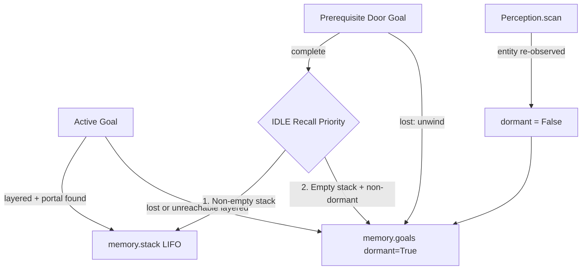
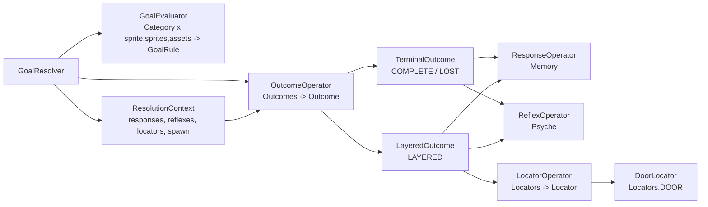
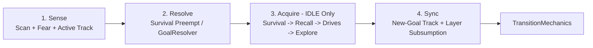
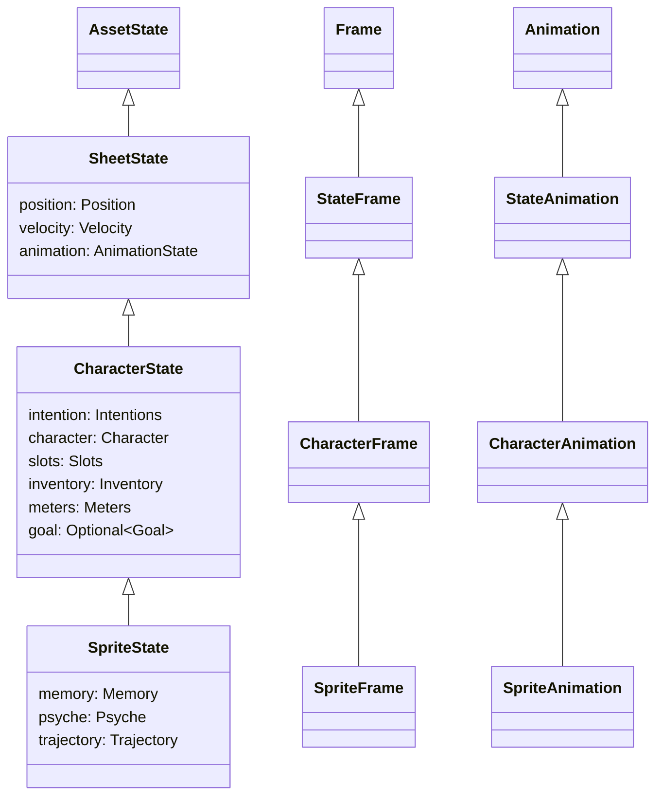
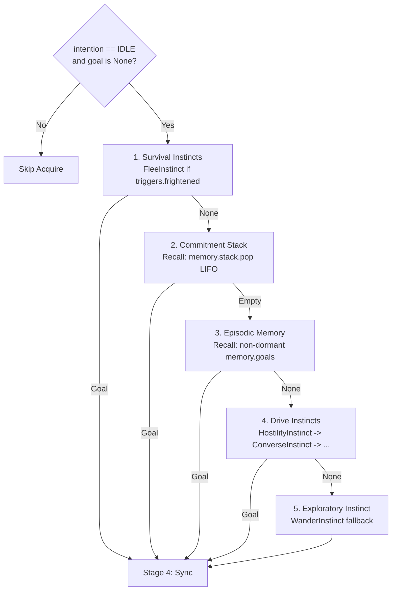

#### Refactor: Phase 06.02 - Goals

**Overview**

Refactor `CognitionMechanics` into a declarative, modular cognitive pipeline anchored by a compiled **Goal Resolution Evaluator** (built on a shared ISL condition backend without distorting finite-automaton `Executor` contracts), orthogonal **Response** (`Memory`) and **Reflex** (`Psyche`) operators composed inside `GoalResolver`, strict `IDLE`-only Goal acquisition pairing an explicit **Subgoal Commitment Stack** and dormant episodic **Recall** with a layered **Instincts** subsystem (replacing ad-hoc `_ideate`, `_motivate`, and `_project`), and a three-tier **Sheet State & Component Hierarchy** (`SheetState` $\to$ `CharacterState` $\to$ `SpriteState`). Enforce SMDP option soundness and the `idle` hub invariant across `GoalResolver`, `TransitionMechanics`, `NavigationMechanics`, and `InteractionMechanics` to eliminate cross-layer deadlocks, epistemic telepathy leaks, infinite recall loops, unreachable `wander -> idle` exits, and silent ISL compilation failures.

##### Specification

###### 1. Goal Taxonomy

| Goal Category | Semantics | `goal.name` Identity | Spatial Mobility | Factored Completion Invariant |
| --- | --- | --- | --- | --- |
| `target` | Hostile character pursued for combat | Deployed Character `name` | Mobile | Target removed (`not target`) or `target.mutators.triggers.dead` |
| `subject` | Character pursued for social interaction | Deployed Character `name` | Mobile | `not sprite.psyche.dialogue` |
| `door` | Portal (`IN` or `OUT`) traversed to transition Layers | Deployed Door `name` | Static | `sprite.layer != sprite.goal.layer` |
| `object` | Non-portal interactive Object (Chest, Plate, Sign) | Deployed Object `name` | Static | `not target or sprite.mutators.triggers.interacted` |
| `resource` | Biological or geological Resource targeted for harvesting | Deployed Resource `name` | Static | Resource removed (`not target`) |
| `property` | Structure targeted for construction | Blueprint/Craft `id` or deployed Strut `name` | Static | Deployed structure registered in `sprite.memory.property` |
| `position` | Coordinate destination (`wander`, `escape`, `return`) | Synthetic tag | Static | Within `action.radius` of `goal.position` (or `not triggers.frightened` for `escape`) |

###### 2. Commitment Stack vs. Dormant Episodic Memory

`Memory` separates ordered subgoal commitments from unordered episodic desires:



* **`memory.stack: List[Goal]`**: LIFO commitment stack holding parent Goals suspended by prerequisite subgoals (such as cross-layer `door` subsumption). Completing a prerequisite returns to `idle` and immediately resumes `memory.stack.pop()` before general episodic recall; failing a prerequisite (`door.lost`) unwinds the suspended parent into dormant `memory.goals`.
* **`memory.goals: Dict[str, Goal]`**: Unordered episodic desire store populated by `store` / `unwind` (`goal.dormant = True`), woken by `Perception.scan` upon live observation (`goal.dormant = False`), and popped by `Recall` strictly in `Intentions.IDLE`.

###### 3. Goal Resolution Matrix & Orthogonal Operators

Goal resolution is defined in `/src/data/configurations/automata/goals/main.yaml` and compiled through a shared ISL condition backend into `GoalEvaluator` (`Executors.GOAL`) — a category-indexed rule classifier distinct from finite-automaton state `Executor`s. At the start of each tick, an active Goal is undetermined (*free*) and classified in canonical outcome precedence:

$$\text{Precedence}: \quad \texttt{complete} \succ \texttt{layered} \succ \texttt{lost}$$

Each matched `GoalRule` carries `(outcome, responses, reflexes)` and dispatches across three orthogonal slices of `SpriteState`.




* **Outcomes** (Goal lifecycle transitions):
  1. `complete`: Objective satisfied; clears `sprite.state.goal = None`.
  2. `layered`: `goal.layer != sprite.layer`; locates a reachable Door (`LayerProjections.IN` or `LayerProjections.OUT`) on `sprite.state.layer`. If found, executes `push` onto `memory.stack` and substitutes a `Goals.DOOR` Goal; if unreachable, demotes the Goal to dormant `memory.goals` (`store`) and clears `sprite.state.goal = None`.
  3. `lost`: Goal abandoned (unseen at last-known location or unreachable), stalled (`sprite.trajectory.stalled`), or interrupted (remembered entity spotted or frightened during `wander`); clears `sprite.state.goal = None`.
* **Responses (`Memory` Operators — `app.game.logic.modules.cognition.goal.resolvers.response`)**:
  * `forget`: Evicts `goal.name` from `memory.goals`.
  * `store`: Marks `goal.dormant = True` and commits `goal` into `memory.goals[goal.name]`.
  * `push`: Pushes `goal` onto `memory.stack` (preventing consecutive duplicate top entries).
  * `unwind`: Pops top suspended parent Goal from `memory.stack`, marks it `dormant = True`, and stores it in `memory.goals`.
* **Reflexes (`Psyche` Operators — `app.game.logic.modules.cognition.goal.resolvers.reflex`)**:
  * `confusion`: Attaches a `confusion` Expression bubble to `psyche.expression`.

###### 4. Cognitive Pipeline & Layered Instinct Acquisition

Per tick, each autonomous Sprite executes a four-stage cognitive loop:



1. **Sense (`Perception`)**: Refreshes `memory.sprites` (copied `Position` snapshots), wakes visible `memory.goals` (`dormant = False`) and evicts observed dead targets within `vision.radius`, updates `triggers.frightened` from `fear` parameters (`health / maximum < fear.limit` or hostile count $\ge$ `fear.enemy` within `fear.radius`), and updates `triggers.vision`, `goal.position`, and observed Door `goal.layer` transitions for any active Goal.
2. **Resolve (`GoalResolver`)**: If `sprite.state.goal` is active:
   * If `triggers.frightened` is `True` and `sprite.state.intention != Intentions.ESCAPE`, Survival preemption shelves any non-`wander` active Goal into `memory.goals` (non-dormant, without emitting a `confusion` reflex) and clears `sprite.state.goal = None` so `TransitionMechanics` exits cleanly to `idle`.
   * Otherwise evaluates `GoalEvaluator` against `sprite.state.goal` using locals `{'sprite': sprite.state, 'sprites': board.characters(), 'target': target_state}` and dispatches `ResponseResolver`, `ReflexResolver`, and Goal lifecycle transition.
3. **Acquire (`Instincts` + `Recall` — Strictly `IDLE` Only)**: Runs **if and only if** `sprite.state.intention == Intentions.IDLE` and `sprite.state.goal is None`, selecting the first Goal produced across five monotonic priority tiers:
   1. **Survival Instincts**: `FleeInstinct` (`triggers.frightened` $\to$ clamped `Goals.POSITION`, `name="escape"`).
   2. **Commitment Stack (`Recall`)**: Pops `memory.stack` (LIFO).
   3. **Episodic Memory (`Recall`)**: Pops first non-dormant (`not candidate.dormant`) Goal from `memory.goals`.
   4. **Drive Instincts**: Low-level Goal constructors (`HostilityInstinct` $\to$ `Goals.TARGET`, `ConverseInstinct` $\to$ `Goals.SUBJECT`; extensible to `Forage`, `Harvest`, `Heal`, `Build`).
   5. **Exploratory Instinct**: `WanderInstinct` fallback (`Goals.POSITION`, `name="wander"`).
   *(In future phases, `psyche.motivation` will act as a declarative selection, ordering, and target-filtering policy over the Instinct tiers.)*
4. **Sync (Post-Acquisition Validation)**: If Acquisition introduced a new Goal on this tick, immediately updates `triggers.vision` and evaluates cross-layer Door subsumption so `TransitionMechanics` and `NavigationMechanics` receive an actionable same-layer Goal on the same tick.

###### 5. Sheet State & Component Hierarchy

To enforce strict ECS component symmetry across `Pixies`, `Players`, and `Sprites` and eliminate `Migrator` Player hydration special cases:



* **`Pixies` (`sheets.pixies`)**: `SheetState` + `StateFrame` + `StateAnimation`
* **`Players` (`sheets.players`)**: `CharacterState` + `CharacterFrame` + `CharacterAnimation`
* **`Sprites` (`sheets.sprites`)**: `SpriteState` + `SpriteFrame` + `SpriteAnimation`

###### 6. Cognitive Hierarchy

| Layer | Term | Definition | Architectural Realization |
| --- | --- | --- | --- |
| **1** | **Actions** | Animate Events that generate physical collisions, projectiles, or interactions. | `AnimationState` (`walk`, `slash`, `thrust`, `shoot`, `cast`, `die`) |
| **2** | **Intentions** | Predisposition to Action; finite-automaton nodes governing how an active Goal is pursued. | `intentions/main.yaml` + `TransitionMechanics` |
| **3** | **Goals** | The Objective of Action (the concrete entity or coordinate pursued, resolved into `Responses` and `Reflexes`). | `goals/main.yaml` + `GoalResolver` |
| **4** | **Instincts** | **The Procedure for generating Goals.** Low-level, stateless Goal constructors reacting to physiological/local state (`Flee`, `Hostility`, `Converse`, `Wander`, and later `Forage`, `Harvest`, `Heal`, `Build`). | **Phase 06.02**: `app.game.logic.modules.cognition.instincts` (`Instinct.generate(sprite, board) -> Optional[Goal]`) |
| **5** | **Motivations** | **The Policy governing Instincts.** High-level teleology (`conquest`, `profit`, `survival`, `love`, `revenge`, `rebellion`, `safety`) that **selects, orders, and filters** which Instincts fire and which targets qualify (e.g., `conquest` prioritizing `Hostility` filtered by rival property cost, whereas `survival` elevates `Flee` and `Forage` while suppressing aggression). | **Future Phase** (once Property, Crafting, Economy, and Plots exist): declarative Motivation policies modulating the Instinct pipeline |

Dissolving `_ideate`, `_motivate`, and `_project` into a single **Instinct** interface (`generate(sprite, board) -> Optional[Goal]`) yields a crisp, monotonic **5-tier Acquisition pipeline** inside `IDLE`:



##### Architectural Analysis I

An audit of `CognitionMechanics`, `TransitionMechanics`, `NavigationMechanics`, `intentions/main.yaml`, and `services/translators` reveals six systemic weaknesses:

1. **Ad-hoc Resolution Branching & Incomplete Categories**: `CognitionMechanics._resolve` and `CognitionMechanics.complete` duplicate `if/elif` chains across `Goals`, hardcode a special case to drop `WANDER` goals when transitioning to `FIND`/`HUNT`, leave `OBJECT` and `PROPERTY` incomplete (`return True` / `pass`), and have no support for `RESOURCE` or `DOOR`.
2. **Stale Phase Ordering & Cross-Layer Gaps**:
   * `_resolve` runs *before* `_track`, so `triggers.vision` and `goal.layer` evaluated during resolution are 1 tick stale.
   * `_track` returns early for `POSITION`, `OBJECT`, and `PROPERTY` before the cross-layer door subsumption block—meaning only `TARGET` and `SUBJECT` can ever traverse Doors, while cross-layer static Goals stall permanently in `NavigationMechanics`.
   * `CognitionMechanics.door()` queries all `AssetInstances.DOORS` on the layer without filtering out `LayerProjections.OUT` shadow doors (which have empty hitboxes and cannot be interacted with).
3. **Broken Memory Dormancy & Intention Affinity in `_remember`**:
   * Dormancy detection checks `not sprite.state.mutators.triggers.vision`, which belongs to the *active* Goal (now `None`), not the candidate in `memory.goals`. When a lost Target walks back within `action.radius`, `_scan` updates its position in `memory.goals` without touching `triggers.vision` (still `False`), causing `_remember` to skip a Target standing directly beside the Sprite. Conversely, after dropping a `WANDER` goal (`triggers.vision == True`), an absent dormant Target is falsely recalled.
   * `_remember` pops the first dict entry regardless of `sprite.state.intention`. A Sprite transitioning `wander -> hunt` on spotting a remembered `TARGET` can pop an unrelated `SUBJECT`, deadlocking in `hunt`.
   * Dormancy should instead evaluate live visibility of `candidate` directly:
     $$\text{dormant}(c) \iff \neg\text{visible}(c) \;\land\; (c.\text{layer} = s.\text{layer}) \;\land\; \text{nearby}(c.\text{position}, s.\text{position}, r_{\text{action}})$$
4. **Coupling Defect Between `ESCAPE` Projection and `NavigationMechanics`**:
   * `CognitionMechanics._project` extrapolates `goal.position` away from an attacker while retaining `goal.name = attacker.name`. `NavigationMechanics._target()` prioritizes `board.asset(goal.name)` over `goal.position` for same-layer assets—silently discarding the flee coordinate and steering the escaping Sprite straight into the attacker. `_project` also omits `None` guards and layer-boundary clamping for `ESCAPE`.
5. **Alignment Issues in the Draft Goal YAML & `Environ` Contract**:
   * **Inverted `subject.complete` condition**: The notes sketch `- sprite.psyche.dialogue`, whereas dialogue completion requires `- not sprite.psyche.dialogue`.
   * **Null-safety in `target.complete`**: Requiring `sprites.get(sprite.goal.name)` as a mandatory conjunct prevents completion if the target was removed by `RemoveMechanics`. The condition must short-circuit as `not sprites.get(sprite.goal.name) or sprites.get(sprite.goal.name).mutators.triggers.dead` (or `not target or target.mutators.triggers.dead`).
   * **Naming drift**: The notes YAML uses `functions.nearby` (whereas `Environ.functions` exports `is_near`) and reaction `remember` (whereas the reaction spec defines `store`). Standardizing on `functions.is_near` and `store` eliminates ambiguity with `_remember` (memory recall).
   * **Uniform Asset State Access (`target` local)**: Passing only `sprite` and `sprites` limits declarative Goal rules to Characters. Injecting a zero-allocation `target: Optional[AssetState]` local (resolved once per tick via $O(1)$ `board.asset(goal.name)`) enables `OBJECT` (`not target or target.switch`), `RESOURCE` (`not target`), `TARGET`, and `SUBJECT` rules uniformly without allocating state dicts per tick. Note that `settings.LAMBDA_SIGNATURE` must be updated alongside `CompilerTranslator` so both compilation backends remain in lockstep.
6. **Reusing `Translator` / `Executor` Cleanly**:
   * Both `LambdaTranslator` and `CompilerTranslator` compile `Dict[str, List[Config]]` into `Executor` instances returning `Optional[str]`.
   * Authoring `goals/main.yaml` as `Dict[Goals, Dict[Outcomes, GoalConfiguration]]` gives unique reaction lookup per `(category, outcome)` and clean readability. At boot, a thin normalization step flattens each category's outcome map in canonical `(COMPLETE, LAYERED, LOST)` order into the existing `Translator.compile(...)` contract—yielding full AST/Lambda parity with zero duplication of compilation logic.
   * Because `COMPLETE` is always evaluated first, `GoalResolver.complete(sprite, board)` reduces cleanly to `executor.evaluate(goal.category, locals) == Outcomes.COMPLETE` without mutating state.

##### Architectural Analysis II

Synthesizing formal BDI, HTN, SMDP Option theory, and ABL precondition-monitoring invariants against Architectural Analysis I identifies six additional design issues that must be resolved during Phase 06.02:

1. **Cross-Layer Thrashing via Flat `memory.goals`**: Storing `layered` parent goals in `memory.goals` allows `Recall` to pop an older unrelated goal after door transit instead of resuming the parent goal. Adding a LIFO `memory.stack` with a `Responses.PUSH` reaction isolates subgoal commitments from episodic desires and lays the foundation for multi-step `resource`/`property` planning.
2. **`hunt` / `follow` Deadlock on Subgoal Substitution**: Replacing a `TARGET` with a prerequisite `DOOR` while `intention == HUNT` traps the Sprite in `hunt` because `hunt` lacks a category-mismatch exitpoint to `idle`. Adding explicit category-mismatch exitpoints (ABL-style precondition monitors) to `hunt`, `attack`, and `follow` guarantees clean re-routing through the `idle` hub.
3. **`InteractionMechanics` vs. `find -> interact` Contact Gap**: `find -> interact` fires at `action.radius` (`30` px), halting movement before inset Sprite hitboxes overlap the target Door or Chest required by `InteractionMechanics.intersections`. Either `InteractionMechanics` must evaluate within `proximities` for Sprite-initiated `interact` or `NavigationMechanics` / `find -> interact` must guarantee hitbox overlap prior to halting.
4. **Epistemic Telepathy in `_track` & `intentions/main.yaml`**: Updating `goal.layer = target_state.layer` unconditionally when a target is unseen violates BDI epistemic decoupling. `Perception.track` should only update `goal.layer` and `goal.position` when the target is observed on the same layer within `vision.radius` (or observed exiting a visible door, updating `goal.layer` to `door.state.outlayer` and `goal.position` to the door). Similarly, `find -> speak` and `idle -> find` should check perceived `sprite.goal.position` + `triggers.vision` rather than omniscient `sprites.get(sprite.goal.name).position`.
5. **Unfactored Static Goal Rules (`object`, `door`, `resource`, `property`)**:
  * `door`, `object`, `resource`, and `property` need `lost` conditions on `sprite.trajectory.stalled` (and `not target` for `door`) so unreachable portals/objects do not softlock Sprites.
  * `object.complete` cannot rely unconditionally on `target.switch` because unary Objects lack `switch` and already-open reusable Chests immediately satisfy `target.switch`. Restrict `Goals.OBJECT` completion to an explicit post-interaction state/flag or split binary switchable interaction from unary inspection (`Sign`).
  * `any_memories_visible` in `environ.py` must exclude dead targets (`not target.mutators.triggers.dead`) and support non-character board assets (`OBJECT`, `DOOR`, `RESOURCE`) if those categories can be recalled from memory.
6. **Fail-Fast ISL Compilation & `ESCAPE` Decoupling**:
  * `CompilerTranslator` and `LambdaTranslator` must raise (or drop the entire rule) on condition syntax errors rather than silently dropping individual failed conjuncts.
  * `NavigationMechanics._target()` must bypass `board.asset(goal.name)` whenever `goal.category == Goals.POSITION`, and `ESCAPE` should project a synthetic `Goals.POSITION` (`name="escape"`) whose lifecycle in `intentions/main.yaml` is governed by `sprite.mutators.triggers.frightened` rather than `sprites.get(sprite.goal.name).intention == ATTACK`.

##### User Review I

* The Goal Resolver in the specification is ambiguous. As specified, it is unclear what exactly the interface is.
* "Normalize `ConfigurationSchema.goals` into canonical `(COMPLETE, LAYERED, LOST)` transition lists during bootstrap so `LambdaTranslator` and `CompilerTranslator` compile `Executors.GOAL` without duplicating compiler logic.": What does this mean? The whole analysis proceeds as if the Goal automata is transitioning into the `complete`, `layered` or `lost` state, but I am not certain that is what is occuring, or is what should occur.
* Goals do not "transition" between `complete`, `layered` or `lost`. These *are* the transitions, i.e. not nodes, but edges. 
* It seems like the Resolver is exposing named methods, e.g. `complete()`, rather than abstracting the interface into its correct functional predicate and actual dependent variables, e.g. `psyche` and `memory` are variables. 
* **Door Projections** Tasking misunderstands what a Layer Projection for a Door is. Sprites *should* be able to target `LayerProjections.OUT` Doors. They would be stranded in the Door's Layer if there were no inverse return Door. 
* It seems like the Executor and Translator interfaces are being unnecessarily bent and stretched to accomodate what is fundamentally a different sort of operation. Executor and Translators are for transitioning finite automata between the nodes of their trees/loops. However, Goal Resolution does not seem to quite fit the model of finite automata as codified in Translators and Executor, atleast not in the same formulation as other transitions.
  * What we have here: Sprite has Goal. A Goal does not transition from `complete` to `layered` or `layered` to `lost`. The Goal Outcomes are not "states" the Goal enters, to transition into another. Instead, at the beginning of every loop, a Goal is in an "undetermined" or "free" state. The conditions for each outcome are evaluated within the Cognitive pipeline. When the conditions for an outcome are met, the corresponding callback is invoked, all of which nullify the Goal. In fact, `complete`, `layered`, `lost` would probably be more easily modeled as self-reentrant loops back into null, i.e. ther are three ways a Goal can return to the null state. So, if Goals are to be modeled as finite automata (which I don't think is the correct move), there would need to be a "null" state, with three arrows labelled `complete`, `layered`, `lost`, all of which transition back into the `null` state. If Goal Resolution is to be jammed into Transitions Executor, then they have to be specified analogously, e.g. in the same framework of defining the automata. Currently, the "grammar" of Goals automata is fundamentally different than the "grammar" of Transition automata. 

###### Reflexes

`confusion` is at odds with the other Responses. 

Responses appear to be "Memory Operators", i.e. intentional acts within the Sprite's memory that occur when their conditions are met. `confusion`, however, is more like an "involuntarily side-effect", let's call it a "Reflex". Moreover, they operate on a different subset of State than Responses.

So: Goal Resolution is actually composed (so far) of two orthogonal operators: Response and Reflxes, which affect the memory and psyche, respectively.

  Resolver(Reflex, Response) -> Mutations

* `app.game.logic.modules.cognition.goal.resolvers.reflexes`: 
  * `reflex.resolve(outcome, goal, psyche) -> psyche mutation`
* `app.game.logic.modules.cognition.goal.resolvers.response`: 
  * `response.resolve(outcome, goal, memory) -> memory mutation`

**Note: Really, what is happening here is: Sprites are being injected with a Behavior, i.e. Reflexes and Response are "components" of Sprite Sheet Assets**.

###### Separation of Sheets

**SheetState -> CharacterState -> SpriteState**

I believe this mapping will also simplify some of the nested logic in the hydration and migration. Currently, the Migrator has a few hacks in place to hydrate Player properties and state. Players are treated as participants in the Sprite node when it comes to Properties, i.e. they have their properties hydrated from `sheets.sprites` but they have their state hydrated from `sheets.players`.

###### Updated YAML
 
```yaml
<outcome>:
  reflexes: [ <reflex> ]
  responses: [ <response> ] 
  conditions:
      - <condition>
```

##### Architectural Analysis III

1. **Decoupling ISL Condition Compilation from Finite-Automaton Execution**: Extract a shared ISL condition compilation/evaluation backend (`Compiler` AST and `Lambda`) in `app.services.translators` with fail-fast syntax validation (**B069**). Keep `Translator`/`Executor` strictly for state-to-state automata (`Optional[str]`) and add `GoalTranslator`/`GoalEvaluator` returning immutable `GoalRule(outcome, responses, reflexes, conditions)` directly.
2. **Orthogonal `GoalResolver(evaluator, response, reflex)`**: Implement `ResponseResolver` (`memory`) and `ReflexResolver` (`psyche`) under `app.game.logic.modules.cognition.goal.resolvers.{response,reflex}`, removing named `complete()` methods from `GoalResolver` in favor of a pure `evaluate(state, sprites, target) -> Optional[GoalRule]` predicate and `resolve(sprite, board) -> Optional[Outcomes]`. Keep `ReflexResolver` decoupled from `Board` by passing an expression spawner callable (preparing both resolvers for future Recipe-based Sprite behavior injection).
3. **Explicit Dormancy (`Goal.dormant`) & Prerequisite Unwinding (`Responses.UNWIND`)**: Analysis I's spatial dormancy check fails **B019** as soon as a Sprite wanders beyond `action.radius` of an empty last-known coordinate. Explicit `Goal.dormant: bool = False` set on `Responses.STORE` and cleared on live sighting in Stage 1 (`Perception.scan`) resolves **B019** and **B059** simultaneously. Adding `Responses.UNWIND` on `door.lost` (and skipping `push` when `layered` finds no portal) prevents infinite `Recall` $\to$ `Sync` retry loops on blocked or missing portals.
4. **Strict Typed Contracts & Reciprocal `OUT` Doors**:
   * Replace `getattr(target, 'switch', False)` on `object.complete` with a strictly typed `MutatorTriggers.interacted: bool = False` trigger set by `InteractionMechanics` and cleared upon leaving `Intentions.INTERACT`.
   * Target both `LayerProjections.IN` and `LayerProjections.OUT` Doors in `door(sprite, board)` and `InteractionMechanics`.
   * Guard only dict-membership `sprites.get(sprite.goal.name)` in `intentions/main.yaml` (never `.mutators`, per **Guideline: Models** and **B060 User Note**), fix `dict.get(key, 0)` `TypeError` crashes in `barter` and `mine`, add missing `follow -> speak` category guard, and correct stale `/src/data/config/` paths to `/src/data/configurations/`.
5. **Symmetric `sheets.players` Hydration**: Move `player` properties out of `src/assets/sheets/sprites/main.yaml` into `src/assets/sheets/players/main.yaml` (paired with `CharacterState`, `CharacterFrame`, `CharacterAnimation`) to eliminate Player hydration special cases in `Migrator`.

##### User Review II

###### Notes

```text
filter episodic recall by Intention affinity (`HUNT` $\to$ `TARGET`, `FIND` $\to$ `SUBJECT`/`OBJECT`/`DOOR`, `IDLE` $\to$ any eligible).
```

This seems incorrect. If a Sprite is in an Intention other than `idle`, it already has a Goal, so filtering its Recall by its current Intention gets the order of operations wrong. Recall only occurs if a Sprite needs a new Goal. 

######  Motivations and Ideation

I would like further clarification on Ideation and MotivationStrategies. Currently all Goal-oriented behavior in the game comes from two bits. 

First, a Goal is explicitly set in the State, e.g.,

```yaml
sheets:
  sprites: 
    - id: jasilynn
      name: evil-empress-jasilynn
      layer: throne-layer-3
      position:
        x: 15
        y: 15
      meters:
        health: 
          current: 50
          maximum: 100
        magic: 
          current: 100
          maximum: 100
      character:
        strength: 5
        defense: 5
        speed: 50
        impulse: 25
      mutators:
        parameters:
          fear:
            radius: 100
            limit: 0.50
            enemy: 5
          vision:
            radius: 150
          action:
            radius: 25
          squeeze: 
            radius: 10
          hand: right
      psyche:
        dialogue: greeting
        expression: null
        motivation: conquest
        persona: empress-jasilynn
      intention: find
      goal:
        name: player
        category: subject
        layer: '0'
        position:
          x: 100
          y: 200
      memory:
        goals:
          player:
            name: player
            category: subject
            layer: '0'
            position:
              x: 100
              y: 200
        prices: null
        property: null
        relationships: 
          player: friend
        rumors: null
        sprites: 
          player:
            x: 100
            y: 200
      slots:
        equipment:
          armor: null
          tool: null
          utility: null
          weapon: sword
          shield: null
        grip:
          left: null
          right: null
      inventory:
        bag: []
        belt: []
        sheathe:
          - sword 
        pouch: {}
        pack: {}
        sack: {}
```

Second, `CognitionMechanics._ideate()` injects a `Goal.SUBJECT` into the Sprite if the Sprite has `state.psyche.dialogue`.

These are the only two sources of Goal creation. All testing has occured by hotwiring Goals into the Sprite. The initial idea with `Cognition._motivate()` was to provide the source of Goal creation.

`_ideate()`, as written, is really more of a Motivation Handler (it would more accurately be described as Subject Handler). It should be a particular behavior that is adopted when the Sprite has the prerequisite Motivation. 

```yaml
## NOTE: DRAFT, NOT GOSPEL
# example of conquest condition for TARGET Goal Creation
conquest:
  target:
    - functions.visible_foe(sprites, sprite.state.position, sprite.state.memory)
    - sprites.get(
        function.visible_foe(sprites, sprite.state.position, sprite.state.memory)
      ).memory.property
    - functions.cost(
        sprites.get(
          function.visible_foe(sprites, sprite.state.position, sprite.state.memory)
        ).memory.property 
      ) > functions.cost(
        sprite.memory.property
      )
```

So I suppose the workflow is:

* Intentions transition based on which Goals have been set.
* Goals are resolved based on whether the Intention succeeds in achieving the Goal conditions. 
* Goals resolutions mutate State.
* Goals are created from Motivations based on whether or not the prerequisite conditions have been met.

However, I think Motivations might be too abstract of a concept for the current implementation. It would seem there needs to be another layer, or perhaps several, before high-level "phenomenological" Goals can be codified. I am thinking of the old reptilian-mamalian brain model, where lower level functions get integrated into higher level ones. The Sprites have Intentions and basic path finding, but they do not have "*instincts*". I believe there needs to be a low-level Goal creation module for handling things like, "generating Goal to increase inventory", "generating Goal to increase health", "generating Goal to escape", "generating Goal to speak", etc.

Then, these instincts needs to be wired into the proposed cognitive pipelines in place of the current `_motivate()` call. 

So:

* Intentions: Predisposition to Action.
* Actions: Animate Events that generate collisions or interactions.
* Goals: The Objective of Action.
* Instincts: The Procedure for Goal Generation.
* Motivations: ...?

##### Architectural Analysis IV

1. **Strict `IDLE`-Only Acquisition & Fixing Unreachable `wander -> idle` (B075)**:
   * Intention-affinity filtering in `_remember` only existed because `attack -> hunt` (`not sprite.goal`) and `wander -> hunt/find` bypassed `idle` — workarounds necessitated by `_project` immediately re-generating a `wander` Goal on the same tick `_resolve` cleared it, making `wander -> idle` completely unreachable (**B075**).
   * Restricting **all** Goal Acquisition (`Instincts` + `Recall`) strictly to `Intentions.IDLE` when `sprite.state.goal is None`, removing the `attack -> hunt` (goal-less), `wander -> hunt/find`, and `idle -> wander` (goal-less) shortcuts from `intentions/main.yaml`, and letting `position.lost` drop a `wander` Goal when frightened or spotting a remembered target eliminates Intention-affinity filtering completely and guarantees every Intention Loop returns through `idle`.
2. **Unified `Instinct` Layer Replacing `_ideate`, `_motivate`, and `_project`**:
   * Dissolve `_ideate`, `_motivate`, and `_project` into a single `Instinct` interface (`generate(sprite, board) -> Optional[Goal]`) partitioned into **Survival** (`FleeInstinct`), **Drives** (`HostilityInstinct`, `ConverseInstinct`), and **Exploratory** (`WanderInstinct`) tiers bracketing `Recall` (`memory.stack` $\to$ `memory.goals`).
   * **Motivations** (`psyche.motivation`) remain cleanly typed on `Psyche` as the future higher-level policy layer that selects, prioritizes, and filters Instincts once Economy, Crafting/Property, and Narrative subsystems are implemented.

##### User Review III

* `target` in the Goal Resolution condition is not very well defined and is the source of undesirable defensive programming and fallbacks. I believe it is a placeholder for the more unambiguous `goal.category == Goals.TARGET`, however, this is doesn't make sense in the context it is used in `src/data/configurations/automata/goals.yaml`. It appears to be a shorthand for the current goal. If that is the case, it is a poor name choice, given there is already a `target` Goal category. 
* Locator needs the same treatment as the other interfaces in the Cognition module. Currently, it's an adhoc DoorHandler. It needs wired into the LocatorOperator.

**NOTE**: Implementation has been paused because the User would like to re-evaluate the architecture. Now that code has been committed, please step back and examine whether or not the phase is on track to complete the [Goals](#goals)

##### Architectural Analysis V

1. **Eliminating `target` via Layer-Scoped `assets` (`board.states(layer)`):**
   * `target` collides semantically with `Goals.TARGET`, forces a defensive multi-fallback switchboard (`GoalResolver._target()`), and leaks a `'target': None` special case into `GoalEvaluator.evaluate()` and `settings.LAMBDA_SIGNATURE`.
   * Maintaining a zero-allocation, layer-scoped state index `board.states(layer) -> Dict[str, AssetState]` on `Board._cache` and exposing it as `assets` alongside `sprite` and `sprites` unifies `goals/main.yaml` and `intentions/main.yaml` under one `.get(sprite.goal.name)` idiom, eliminates Door `IN`/`OUT` name collisions, preserves cross-layer epistemic isolation, and deletes `GoalResolver._target()` completely.
2. **First-Class `LocatorOperator` & `ResolutionContext`:**
   * Promote `LocatorOperator` to parity with `ResponseOperator`, `ReflexOperator`, and `OutcomeOperator` by adding `LocatorOperator.resolve(key, sprite, board)`, removing the broken `GoalResolver.door` classmethod, bundling `(responses, reflexes, locators, spawn)` into a frozen `ResolutionContext` passed to `OutcomeOperator.resolve()`, and keying `LayeredOutcome` on `Locators.DOOR` rather than an uninjected instance field.
3. **Bidirectional `Memory.doors` & Stabilization (B076–B081):**
   * Fix committed boot/import crashes in `builder.py`, `resolutions.py`, `transition.py`, `cognition.py`, and `cognition/base.py` (B076–B079) before extending the pipeline.
   * Upgrade `Memory.doors` from `Dict[str, str]` to `Dict[str, Dict[str, str]]` (`from_layer -> {door_name: to_layer}`) so reciprocal `IN`/`OUT` Door projections do not overwrite each other (B080), and restrict cross-layer dormant Goal waking to layer transitions, newly mapped doors, or newly discovered non-stalled doors (B081).

###### Additional Architectural Gaps Discovered in Audit

1. **Stage 4 (`Sync`) Must Cover Stage 2 Substitutions and Reuse `GoalResolver`:**
   The current Stage 4 spec only runs when *Acquisition (Stage 3)* introduces a new Goal. However, Stage 2 (`LayeredOutcome`) can also substitute an active Goal with a new `Goals.DOOR` Goal on the same tick, leaving `triggers.vision` stale from the replaced Goal. Stage 4 should refresh `Perception.track` whenever `sprite.state.goal` changed during Stage 2 or Stage 3, and run `GoalResolver.resolve` for newly acquired Stage 3 Goals (eliminating any duplicate cross-layer Door logic outside `GoalResolver`).

2. **Frightened `speak` Softlock & `escape -> return` Hub Violation (Task 6):**
   * In `intentions/main.yaml`, `speak` only exits on `PLAYER` or `not sprite.psyche.expression`. If a Sprite becomes `frightened` while displaying a `loquacity` bubble, Survival preemption clears `sprite.goal`, yet `speak` traps the Sprite until `expression.ttl` decays to zero. Add `sprite.mutators.triggers.frightened -> idle` to `speak`.
   * `escape` currently exits to `return` when `not sprite.goal`, which immediately bounces `return -> idle` on the next tick. Route `escape` exit directly to `idle` (`not sprite.goal or sprite.goal.category != constants.Goals.POSITION -> idle`) to preserve the `idle` hub invariant.
   * Also note `FleeInstinct`: since Stage 2 Survival preemption sets `sprite.state.goal = None` before `IDLE`, `FleeInstinct` cannot derive flee direction from `sprite.state.goal` (unlike legacy `_project`). It must compute the threat centroid from visible living `FOE`/attacking characters on the Sprite's Layer, with a safe fallback when frightened solely by low health with no threat in sight (and tangential deflection when clamped into a map corner within `action.radius`).

3. **Constructor / `set_executor` Wiring for `CognitionMechanics` & YAML `null` Audit for Task 5:**
   * `MechanicFactory.mechanics()` instantiates `CognitionMechanics()` with no arguments and injects `Executors.GOAL` afterward via `set_executor()`. `CognitionMechanics` must override `set_executor` (and its `executor` setter) to bind/rebuild `self.resolver = GoalResolver(evaluator=executor)` when `Executors.GOAL` is attached.
   * Existing state YAMLs contain explicit `null` values for empty `Memory` collections (e.g., `prices: null`, `property: null`, `rumors: null`). Task 5 must audit and normalize all `/src/data/state/**/*.yaml` files when tightening `Memory` fields to non-nullable `default_factory` types per **Guideline: Models**, and must add `FrameRecipe.CHARACTER` / `AnimationRecipe.CHARACTER` in `semantics.py` and `AssetFactory`.

##### Bug Reports

###### Bug Report: B081 — Potential Infinite Stall–Unwind–Wake Loop on Blocked Unmapped Doors (Design Defect in Task 4 Spec)

* **Severity:** High (Infinite Loop)
* **Location:** Task 4 Subtask 1 (`Perception.scan` cross-layer dormancy wake rule)
* **Root Cause:** Waking cross-layer dormant Goals whenever an unmapped door lies within `vision.radius` immediately re-wakes a Goal that was just unwound by `door.lost` due to stalling on that very same door.
* **Impact:** Infinite per-tick oscillation (`door.lost` $\to$ `unwind` $\to$ `scan` wakes $\to$ `Recall` pops $\to$ `Sync` re-picks blocked door $\to$ stall).
* **Remediation:** Trigger cross-layer Goal waking only on layer change, new `memory.doors` mapping matching `goal.layer`, or newly observed (non-stalled) unmapped doors.

##### Goals

###### Goal: Declarative Goal Resolution Matrix & Orthogonal Operators

Replace ad-hoc resolution logic with a compiled `GoalEvaluator` (`Executors.GOAL`) backed by `src/data/configurations/automata/goals/main.yaml`, separating `reflexes` (`Psyche` operators) from `responses` (`Memory` operators) with canonical `(COMPLETE, LAYERED, LOST)` precedence, strict typing (zero `getattr`), commitment-stack `push`/`unwind`, and `WANDER`/`ESCAPE`/stall guards.

###### Goal: Modular Cognitive Architecture with Layered Instincts
Decompose `CognitionMechanics` under `app.game.logic.modules.cognition`:

* `base.py`: Abstract interfaces (`Operator`, `Response`, `Reflex`, `Outcome`, `Locator`) and frozen `ResolutionContext`.
* `core.py` (`GoalResolver`): Composes `GoalEvaluator`, `ResponseOperator`, `ReflexOperator`, `OutcomeOperator`, and `LocatorOperator` behind `evaluate(state, sprites, assets) -> Optional[GoalRule]` and `resolve(sprite, board) -> Optional[Outcomes]`.
* `responses.py` (`ResponseOperator`): Stateless `Memory` operator (`forget`, `store`, `push`, `unwind`).
* `reflexes.py` (`ReflexOperator`): Stateless `Psyche` operator (`confusion`).
* `outcomes.py` (`OutcomeOperator`): Goal lifecycle transitions (`TerminalOutcome`, `LayeredOutcome` resolving `Locators.DOOR` via `ResolutionContext.locators`).
* `locators.py` (`LocatorOperator`): Spatial search registry (`DoorLocator` over bidirectional `memory.doors` and same-layer `IN`/`OUT` Doors).
* `perception.py` (`Perception`): Epistemic same-layer scanning (copied `Position` snapshots, waking visible dormant Goals, evicting observed dead targets), `triggers.frightened` evaluation, and active-goal tracking without unseen cross-layer telepathy.
* `recall.py` (`Recall`): `IDLE`-only two-tier memory retrieval popping `memory.stack` (LIFO) before scanning non-dormant `memory.goals`.
* `instincts/` (`Instinct` ABC + concrete modules): Replaces `_ideate`, `_motivate`, and `_project` with a unified `generate(sprite, board) -> Optional[Goal]` interface across Survival (`FleeInstinct`), Drive (`HostilityInstinct`, `ConverseInstinct`), and Exploratory (`WanderInstinct`) tiers.

###### Goal: Clean Sheet State, Frame, Animation & Hydration Hierarchy

Separate `SheetState` (`Pixies`), `CharacterState(SheetState)` (`Players`), and `SpriteState(CharacterState)` (`Sprites`), with matching `StateFrame -> CharacterFrame -> SpriteFrame`, `StateAnimation -> CharacterAnimation -> SpriteAnimation`, and symmetric `sheets.pixies` / `sheets.players` / `sheets.sprites` property hydration that eliminate `getattr`, `id != RequiredAssets.PLAYER`, and `Migrator` Player special cases.

##### Tasks

**1. Task: Goal Semantics, Configuration Models & Resolution Matrix**

*Objective*: Formalize Goal categories, outcomes, orthogonal Memory responses and Psyche reflexes, dormancy state, and Pydantic-validated configuration schemas.

* [x] Subtask: Update `app.static.semantics` to add `Goals.DOOR`, `Goals.RESOURCE`, `Outcomes` (`complete`, `layered`, `lost`), `Responses` (`forget`, `store`, `push`, `unwind`), `Reflexes` (`confusion`), and `Executors.GOAL`.
* [x] Subtask: Add `dormant: bool = False` to `Goal`, `stack: List[Goal] = field(default_factory=list)` to `Memory` in `src/app/models/state/assets/sheets.py`, and `interacted: bool = False` to `MutatorTriggers` in `src/app/models/state/core.py`.
* [x] Subtask: Define frozen `GoalConfiguration` (`reflexes: List[Enumerated[Reflexes]]`, `responses: List[Enumerated[Responses]]`, `conditions: List[str]`) in `app.models.configurations.automata` and expose `goals: Dict[Enumerated[Goals], Dict[Enumerated[Outcomes], GoalConfiguration]]` on `ConfigurationSchema`.
* [x] Subtask: Update `/src/data/configurations/automata/goals/main.yaml` to the `reflexes`/`responses`/`conditions` grammar across all 7 categories, using `sprite.mutators.triggers.interacted` for `object.complete`, `not sprite.mutators.triggers.frightened` for `escape` `position.complete`, `WANDER` memory/frightened interrupts in `position.lost`, `[forget, unwind]` for `door.lost`, and `not vision` + `stalled` guards for `target`/`subject`.
* [x] Subtask: Wire `/src/data/configurations/automata/goals/` ingestion into `Loader` and register `executors: [ goal ]` on `cognition` in `/src/data/configurations/engine/mechanics/main.yaml`.

**2. Task: Shared ISL Condition Backend, `GoalEvaluator` & Environment Hardening**

*Objective*: Separate shared ISL expression compilation from finite-automaton transition execution with AST/Lambda parity, fail-fast syntax validation, uniform `target` asset-state access, and standardized distance semantics.

* [x] Subtask: Extract shared ISL condition compilation and conjunction evaluation (`Compiler` AST backend and `Lambda` backend) in `app.services.translators` and harden both backends to fail fast (raise on invalid ISL condition syntax rather than silently dropping conjuncts — fixes **B069**).
* [x] Subtask: Keep `Translator` / `Executor` dedicated to finite-automaton state transitions (`Optional[str]`) and implement `GoalRule`, `GoalTranslator`, and `GoalEvaluator` compiling `ConfigurationSchema.goals` in canonical `(COMPLETE, LAYERED, LOST)` precedence and returning `Optional[GoalRule]`.
* [x] Subtask: Update `settings.LAMBDA_SIGNATURE` to accept `target=None` alongside `sprite` and `sprites` so both AST and Lambda backends support $O(1)$ resolved target-asset state queries, and register `Executors.GOAL` compilation in `Orchestrator` / `MechanicFactory`.
* [x] Subtask: Standardize `Environ.functions.is_near` and `libs.core.math.geometry.nearby` to inclusive closed-ball distance (`<=`), exclude dead characters (`not target.mutators.triggers.dead`) in `any_memories_visible` (fixes **B070**), and expose new Goal/Outcome/Response/Reflex enums in `Environ.constants`.
* [x] Subtask: Add the typed `executor` property on `CognitionMechanics` bound to `Executors.GOAL`.

**3. Task: `GoalResolver` & Orthogonal `ResponseResolver` / `ReflexResolver`**

*Objective*: Encapsulate declarative Goal classification, Memory responses, Psyche reflexes, and Goal lifecycle transitions behind clean dependent-variable interfaces.

* [x] Subtask: Create `src/app/game/logic/modules/cognition/response.py` implementing stateless `ResponseOperator.resolve(responses, goal, memory)` handling `forget`, `store` (setting `goal.dormant = True`), `push` (preventing consecutive top duplicates on `memory.stack`), and `unwind` (popping top suspended parent from `memory.stack` into dormant `memory.goals`).
* [x] Subtask: Create `src/app/game/logic/modules/cognition/reflex.py` implementing stateless `ReflexOperator.resolve(reflexes, goal, psyche, spawn)` handling `confusion` (extensible to future expression reflexes) without coupling to `Board`.
* [x] Subtask: Create `src/app/game/logic/modules/cognition/cire.py` implementing `GoalResolver(evaluator, response, reflex)` with pure predicate `evaluate(state, sprites, target) -> Optional[GoalRule]` and stateful `resolve(sprite, board) -> Optional[Outcomes]`.
* [x] Subtask: Implement bidirectional `door(sprite, board)` in `GoalResolver` querying all `AssetInstances.DOORS` on `sprite.state.layer` (**both `LayerProjections.IN` and `LayerProjections.OUT`**), prioritizing mapped doors in `memory.doors` matching `goal.layer` and falling back to the nearest unmapped door within `vision.radius`; on `layered`, push and assign `Goals.DOOR` when a portal exists, or demote directly to dormant `memory.goals` (`store`) and clear `sprite.state.goal = None` when unreachable.

**4. Task: Remediation — Boot Stability, `assets` ISL Contract, `LocatorOperator` Wiring & Bidirectional `Memory.doors`**

*Objective*: Resolve committed import/boot breakages (B076–B079), eliminate the ambiguous `target` local and `GoalResolver._target()` fallbacks (User Review III), wire `LocatorOperator` symmetrically into `OutcomeOperator` and `GoalResolver` (User Review III), and fix bidirectional Door memory (B080).

* [x] Subtask: Fix committed boot/import breakages: compile `plots` with `transitions.compile(...)` in `src/app/services/orchestration/builder.py` (**B076**); update `resolutions.py` to import `Backend` from `app.services.translators.base`, `transition.py` (plus audit `PlotMechanics` and `SeasonMechanics`) to import `TransitionExecutor`, and `cognition.py` to import `GoalEvaluator` from `app.services.translators` (**B077**); move `ResponseOperator`/`ReflexOperator` imports in `cognition/base.py` under `if TYPE_CHECKING:` (**B078**); clean up `MechanicFactory.backend()` to use `TRANSLATOR_MAP`.
* [x] Subtask: Add $O(1)$ per-layer state indexing (`board.states(layer) -> Dict[str, AssetState]`) on `Board._cache` (maintained in `index_batch`, `evict_batch`, `relayer`, `clear`), swap `target=None` for `assets=None` in `settings.LAMBDA_SIGNATURE`, remove the `eval_locals` `'target'` fallback from `GoalEvaluator.evaluate()`, delete `GoalResolver._target()`, update `GoalResolver.evaluate(state, sprites, assets)` to pass `{'sprite': state, 'sprites': sprites, 'assets': assets}`, and update `/src/data/configurations/automata/goals/main.yaml` to use `sprites.get(sprite.goal.name)` (`target.complete`) and layer-guarded `assets.get(sprite.goal.name)` (`door.lost`, `object.complete`, `resource.complete`).
* [x] Subtask: Complete `LocatorOperator` wiring (**B079**): add `LocatorOperator.resolve(key, sprite, board) -> Optional[Asset]` and fix docstrings in `cognition/locators.py`; add frozen `ResolutionContext(responses, reflexes, locators, spawn)` in `cognition/base.py`; pass `context` through `OutcomeOperator.resolve(...)` and `Outcome.apply(...)`; update `LayeredOutcome` to hold `locator: Locators = Locators.DOOR` and call `context.locators.resolve(self.locator, sprite, board)`; remove `GoalResolver.door` classmethod and default all four operators in `GoalResolver.__init__`.
* [x] Subtask: Upgrade `Memory.doors` in `src/app/models/state/assets/sheets.py` to `Dict[str, Dict[str, str]]` (`from_layer -> {door_name: to_layer}`) (**B080**), audit any state YAML fixtures referencing `memory.doors`, and update `DoorLocator.locate()` to query `memory.doors.get(sprite.state.layer, {})` (with optional BFS over `memory.doors` for multi-hop layer paths) and unmapped doors within `vision.radius`.

**5. Task: Decompose `CognitionMechanics`, Build `Instincts` Subsystem & Fix Cognitive / Navigation / Interaction Coupling**

*Objective*: Break `CognitionMechanics` into `Perception`, `Recall`, and layered `Instincts`, enforce the 4-stage pipeline with `IDLE`-only Acquisition, resolve dormancy and epistemic telepathy leaks, and fix `ESCAPE`, `wander -> idle`, and `interact` deadlocks.

* [x] Subtask: Extract `Perception` (`scan`, `track`, `fear`) into `src/app/game/logic/modules/cognition/perception.py`: copy `Position` snapshots in `memory.sprites` (**B074**), wake visible same-layer `memory.goals` (`dormant = False`, **B019** & **B059**) while evicting observed dead targets, wake cross-layer dormant goals strictly on layer transition or newly mapped/newly sighted non-stalled doors (**B081**), evaluate `triggers.frightened` from `fear` parameters, restrict `goal.layer` updates to same-layer sightings or observed door transits (closing cross-layer telepathy), and remove inline door subsumption.
* [x] Subtask: Extract `Recall` (`remember`) into `src/app/game/logic/modules/cognition/recall.py`: operate strictly when `sprite.state.intention == Intentions.IDLE` and `sprite.state.goal is None`, popping `memory.stack` (LIFO) before scanning non-dormant (`not candidate.dormant`) entries in `memory.goals` (without Intention-affinity filtering).
* [x] Subtask: Create `src/app/game/logic/modules/cognition/instincts/` defining the `Instinct` interface (`generate(sprite, board) -> Optional[Goal]`) and implementing tiered concrete Instincts replacing `_ideate`, `_motivate`, and `_project`:
  * `survival.py` (`FleeInstinct`): when `triggers.frightened`, derives threat centroid from visible living same-layer `FOE`/attacking characters (with safe fallback when no threat is visible) and projects a Layer-clamped flee coordinate (with zero-delta and corner-deflection fallback, **B072**) as synthetic `Goals.POSITION` (`name="escape"`).
  * `combat.py` (`HostilityInstinct`): selects a visible living same-layer `FOE` from `memory.relationships` (when `AnimationMap.action(..., intention=Intentions.ATTACK)` is admissible) as `Goals.TARGET`.
  * `social.py` (`ConverseInstinct`): when `psyche.dialogue` is set, selects a visible living same-layer `FRIEND`/`FAMILY` character (aligned with `find -> speak`, **B073**) as `Goals.SUBJECT`.
  * `explore.py` (`WanderInstinct`): fallback sampling a Layer-clamped coordinate within `vision.radius` as `Goals.POSITION` (`name="wander"`), executing strictly in `IDLE` so `wander -> idle` becomes reachable (**B075**).
* [x] Subtask: Update `NavigationMechanics._target()` to skip `board.asset(goal.name)` lookup whenever `goal.category == Goals.POSITION` (**B072**).
* [x] Subtask: Reconcile the `find -> interact` initiation radius (`action.radius`) with `InteractionMechanics` execution (**B067**) so Sprite-initiated `interact` evaluates within `proximities` using matching distance semantics (prioritizing `sprite.state.goal.name`), supports both `LayerProjections.IN` and `LayerProjections.OUT` Doors, records bidirectional transitions in `memory.doors[from_layer][door.name] = to_layer` (and reciprocal `OUT` edge if present, **B080**), wakes dormant Goals matching the entered Layer, and sets `sprite.state.mutators.triggers.interacted = True` for non-Door Objects (clearing `interacted = False` whenever `sprite.state.intention != Intentions.INTERACT`).
* [x] Subtask: Refactor `CognitionMechanics`: bind `self.resolver = GoalResolver(evaluator=executor)` via `set_executor` / `executor` setter when `Executors.GOAL` is injected; wire `Perception`, `Recall`, and tiered `Instincts`; implement the 4-stage pipeline (**Sense $\to$ Resolve [with Survival preemption shelving non-`wander` goals non-dormant] $\to$ Acquire [`IDLE`-only: Survival $\succ$ Recall $\succ$ Drives $\succ$ Explore] $\to$ Sync [refresh `Perception.track` if Goal changed in Stage 2 or 3, and run `GoalResolver.resolve` on newly acquired Stage 3 Goals]**) with a safe `player = board.player()` guard hoisted outside the sprite loop (**B074**).

**6. Task: Sheet State, Frame, Animation & Hydration Hierarchy Refactor**

*Objective*: Separate `SheetState`, `CharacterState`, and `SpriteState` alongside matching Frame, Animation, and property-hydration layers to eliminate runtime type hacks, `Migrator` workarounds, and frozen stationary expression decay.

* [ ] Subtask: Refactor `src/app/models/state/assets/sheets.py` into `SheetState(AssetState)`, `CharacterState(SheetState)`, and `SpriteState(CharacterState)`, tightening non-nullable `default_factory` fields per **Guideline: Models**, typing `Goal.category` as `Optional[Enumerated[Goals]]` and `Psyche.motivation` as `Optional[Enumerated[Motivations]]`, defaulting `CharacterState.goal` to `None` (**B066**), and auditing `/src/data/state/**/*.yaml` (`prices: null`, `property: null`, `rumors: null`), `MotionMechanics`, and `PlayerMechanics`.
* [ ] Subtask: Add `FrameRecipe.CHARACTER` and `AnimationRecipe.CHARACTER` to `app.static.semantics`; split `src/app/assets/frames/sheets.py` into `StateFrame`, `CharacterFrame(StateFrame)`, and `SpriteFrame(CharacterFrame)`, removing `if id != RequiredAssets.PLAYER`, deleting the dead `properties.actions` statement, and removing redundant `state.slots` null checks.
* [ ] Subtask: Split `src/app/assets/animations/sheets.py` into `CharacterAnimation(StateAnimation)` and `SpriteAnimation(CharacterAnimation)` with unconditional `expression.ttl` decay regardless of `mutators.triggers.animated` (**B058**), removing `getattr(state, 'psyche', None)`.
* [ ] Subtask: Relocate `player` properties from `src/assets/sheets/sprites/main.yaml` to `src/assets/sheets/players/main.yaml`, add `players` to sheet property schemas, register `CHARACTER` Frame/Animation in `AssetFactory` and `/src/data/configurations/assets/recipes/main.yaml`, update `Loader` hydration schemas (`pixies` $\to$ `SheetState`, `players` $\to$ `CharacterState`, `sprites` $\to$ `SpriteState`), simplify `Migrator` by removing Player property/state fallback hacks, and audit `isinstance(..., SheetState)` / `Board._cache` call sites.

**7. Task: Intention Transition Matrix Reconciliation**

*Objective*: Align `src/data/configurations/automata/intentions/main.yaml` with the `idle` hub invariant and new Goal taxonomy, eliminate deadlocks and `TypeError` crashes, and close epistemic telepathy leaks.

* [x] Subtask: Enforce strict `idle` hub routing in `src/data/configurations/automata/intentions/main.yaml`:
  * Remove hub-bypassing `wander -> hunt`, `wander -> find`, `attack -> hunt` (`not sprite.goal`), and goal-less `idle -> wander` (`not sprite.goal`) rules.
  * Update `idle` to route `Goals.POSITION` to `escape` when `triggers.frightened` and `wander` otherwise, route `SUBJECT`/`OBJECT`/`DOOR` unconditionally to `find` (removing `not functions.is_near(...)` proximity-stall guards, **B073**), and route `TARGET` to `hunt`.
  * Update `find` to support `Goals.DOOR` in `find -> interact` and replace omniscient `sprites.get(sprite.goal.name).position` checks with perceived `sprite.goal.position` + `sprite.mutators.triggers.vision`.
* [x] Subtask: Add category-mismatch exitpoints (`-> idle`) on `hunt`, `attack`, `follow`, `find`, `interact`, `threaten`, `escape`, and `wander` so cross-layer `Goals.DOOR` subsumption re-routes cleanly through `idle` (**B064**), and add `sprite.goal.category == constants.Goals.SUBJECT` to `follow -> speak` (**B073**).
* [x] Subtask: Update `attack` with a terminal `not sprite.goal or sprite.goal.category != constants.Goals.TARGET -> idle` exitpoint, dict-presence check `sprites.get(sprite.goal.name)` (without guarding `.mutators` per **Guideline: Models**), a live-target range-loss `attack -> hunt` transition, and remove/decouple the unreachable `attack -> scavenge` rule (**B060**).
* [x] Subtask: Add `sprite.mutators.triggers.frightened -> idle` to `speak`, reconcile `speak -> idle` (Player) ordering with `GoalResolver` clearing `sprite.goal`, update `escape` persistence/exit directly to `idle` governed by `triggers.frightened` and `Goals.POSITION` (removing the `escape -> return` detour), and fix missing-key `TypeError` crashes in `barter` and `mine` by supplying numeric defaults to `.get(..., 0)` (**B071**).

**8. Task: Verification & Test Coverage**

* [!: Dependent on User Acceptance Tests] Subtask: Add unit tests verifying shared ISL `Backend` compilation, fail-fast syntax rejection (**B069**), `Builder.build_executors` compiling `plots` via `TransitionTranslator` (**B076**), and `GoalEvaluator` evaluation parity across `Compiler` and `Lambda` backends using `sprite`, `sprites`, and layer-scoped `assets`.
* [!: Dependent on User Acceptance Tests] Subtask: Add unit tests for `ResponseOperator` (`forget`/`store`/`push`/`unwind`), `ReflexOperator` (`confusion`), `LocatorOperator` (`DoorLocator` bidirectional `memory.doors` **B080**, `IN`/`OUT` Door lookup, multi-hop routing), `GoalResolver` (`complete > layered > lost` precedence; unreachable `layered` demotion; `door.lost` stack unwinding; **B079**), `IDLE`-only `Recall` (LIFO resume and explicit `Goal.dormant`, **B019**/**B059**), `Instincts` (`Flee`, `Hostility`, `Converse`, `Wander` + `wander -> idle` reachability **B075**), `Perception` epistemic isolation, position copying (**B074**), non-looping cross-layer dormancy wake (**B081**), `any_memories_visible` dead-target filtering (**B070**), and `ESCAPE` flee steering through `NavigationMechanics` (**B072**).
* [!: Dependent on User Acceptance Tests] Subtask: Add static automaton verification tests checking `intentions/main.yaml` for strict `idle` hub reachability, non-deadlocking exit coverage per `(Intention, GoalCategory)`, frightened exit from `speak`, safe missing-key evaluation in `barter`/`mine` (**B071**), and `SheetState`/`CharacterState`/`SpriteState` hydration and stationary `SpriteAnimation` TTL decay (**B058**, **B066**).