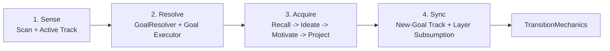
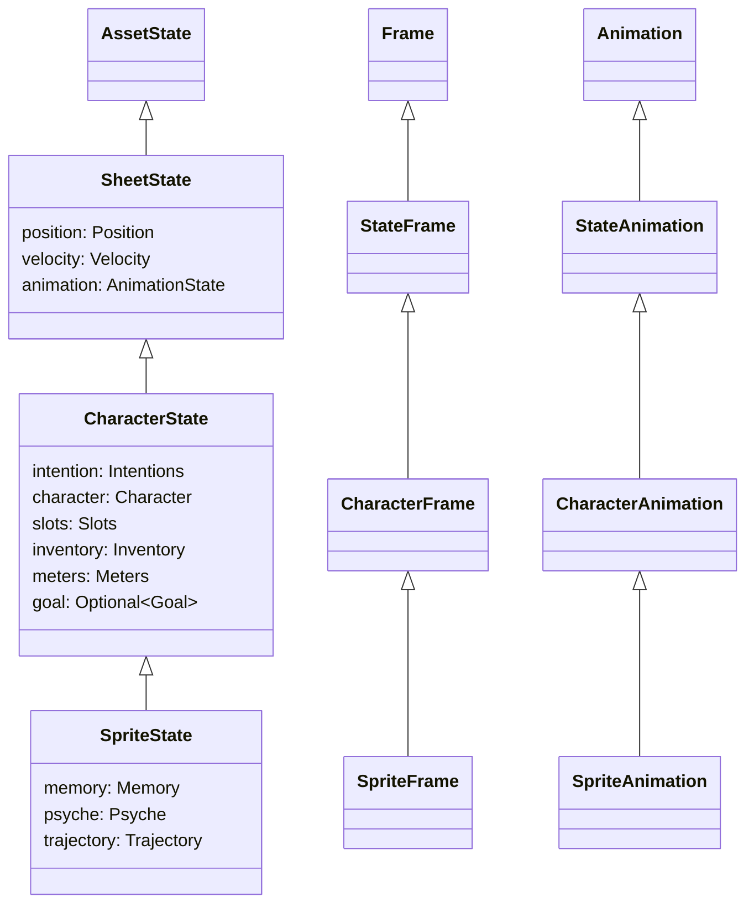

#### Refactor: Phase 06.02 - Goals

**Overview**

Refactor `CognitionMechanics` from a monolithic, goal-category-branched procedure into a declarative, modular cognitive pipeline anchored by a configurable **Goal Resolution Executor**, cohesive cognitive modules (Perception, Resolution, Recall, Ideation/Motivation, Projection), and a clean three-tier **Sheet State & Component Hierarchy** (`SheetState` $\to$ `CharacterState` $\to$ `SpriteState`). Eliminate systemic goal-lifecycle deadlocks, cross-layer ambiguities, and `Player`/`Sprite` type leakage surfaced by runtime profiling.

##### Specification

###### 1. Goal Taxonomy

Goals are categorized by the class of accomplishable feat or spatial entity they target:

| Goal Category | Semantics | `goal.name` Identity | Spatial Mobility |
| :--- | :--- | :--- | :--- |
| `target` | Hostile character pursued for combat | Deployed Character `name` | Mobile |
| `subject` | Character pursued for social interaction | Deployed Character `name` | Mobile |
| `door` | Portal traversed to transition Layers | Deployed Door `name` | Static |
| `object` | Non-portal interactive Object (e.g., Chest, Plate, Sign) | Deployed Object `name` | Static |
| `resource` | Biological or geological Resource targeted for harvesting | Deployed Resource `name` | Static |
| `property` | Structure targeted for construction or ownership | Blueprint/Craft `id` or deployed Strut `name` | Static |
| `position` | Coordinate destination (e.g., `wander`, `escape`, `return`) | Synthetic tag (e.g., `wander`) | Static |

Splitting `door` from `object` resolves the structural contradiction where layer-transit completion (`sprite.layer != goal.layer`) conflicted with cross-layer pursuit of non-door Objects (such as a Chest on another Layer).

###### 2. Goal Resolution Matrix

Goal resolution is defined declaratively in `/src/data/config/goals/main.yaml` and compiled through the existing `Translator` $\to$ `Executor` pipeline (`Executors.GOAL`). Each Goal Category maps to an ordered set of **Outcomes** (`GoalOutcomes`), each declaring **Reactions** (`GoalReactions`) and sequential short-circuiting ISL **Conditions**:

* **Outcomes (Callbacks)** — evaluated in strict canonical precedence to preserve cross-layer and terminal invariants:
  $$\text{Precedence}: \quad \texttt{complete} \;>\; \texttt{layered} \;>\; \texttt{lost}$$
  1. `complete`: Goal conditions are satisfied; clears the active Goal.
  2. `layered`: Goal occupies a different Layer (`goal.layer != sprite.layer`); attempts prerequisite `door` subsumption onto the Sprite's current Layer, or clears the active Goal if no valid portal is reachable.
  3. `lost`: Goal has failed, gone stale, or been superseded by an Intention transition; clears the active Goal.
* **Reactions** — side effects executed with `(sprite, goal, board)` immediately prior to the Outcome callback:
  * `forget`: Removes `goal.name` from `sprite.state.memory.goals`.
  * `store`: Commits `goal` into `sprite.state.memory.goals[goal.name]`.
  * `confusion`: Attaches a `confusion` Expression bubble to `sprite.state.psyche.expression`.

Evaluating `complete` before `layered` guarantees already-satisfied Goals (e.g., a dead Target on another Layer) terminate cleanly rather than routing through Doors. Evaluating `layered` before `lost` guarantees overlapping `(x, y)` coordinates across independent Layer planes cannot falsely trigger same-layer proximity abandonment.

###### 3. Cognitive Pipeline Ordering

Per tick, each autonomous Sprite executes a four-stage cognitive loop:



1. **Sense (`Perception`)**: Refreshes `memory.sprites` (copied coordinate snapshots) and visible `memory.goals` within `vision.radius`, then updates `triggers.vision`, `goal.position`, and `goal.layer` for any active Goal. Because perception executes *before* resolution, `GoalResolver` never observes 1-tick stale visibility or layer flags.
2. **Resolve (`GoalResolver`)**: Evaluates the compiled Goal Executor against `sprite.state.goal` using locals `{'sprite': sprite.state, 'sprites': board.characters(), 'target': target_state}`. Executes matched Reactions followed by the Outcome Callback.
3. **Acquire (`Recall`, `Ideate`, `Motivate`, `Project`)**: Populates a Goal if `sprite.state.goal is None` (respecting the Intention Loop hub invariant so `interact`/`speak` return to `idle` before recalling stacked Goals), or projects spatial coordinates for `wander`/`escape`.
4. **Sync (Post-Acquisition Validation)**: If Acquisition introduced a new Goal on this tick, immediately updates `triggers.vision` and checks `layered` subsumption so `TransitionMechanics` and `NavigationMechanics` receive an actionable same-layer Goal on the same frame.

###### 4. Sheet State & Component Hierarchy

To enforce strict ECS component symmetry across `Pixies`, `Players`, and `Sprites`:



* **`Pixies`**: `SheetState` + `StateFrame` + `StateAnimation`
* **`Players`**: `CharacterState` + `CharacterFrame` + `CharacterAnimation`
* **`Sprites`**: `SpriteState` + `SpriteFrame` + `SpriteAnimation`

##### Architectural Analysis I

###### 1. What Sprite Cognition Currently Lacks & Where It Breaks Down

An audit of `CognitionMechanics`, `TransitionMechanics`, `NavigationMechanics`, `intentions/main.yaml`, and `services/translators` reveals six systemic weaknesses:

1. **Ad-hoc Resolution Branching & Incomplete Categories**: `CognitionMechanics._resolve` and `CognitionMechanics.complete` duplicate `if/elif` chains across `Goals`, hardcode a special case to drop `WANDER` goals when transitioning to `FIND`/`HUNT`, leave `OBJECT` and `PROPERTY` incomplete (`return True` / `pass`), and have no support for `RESOURCE` or `DOOR`.
2. **Stale Phase Ordering & Cross-Layer Gaps**:
   * `_resolve` runs *before* `_track`, so `triggers.vision` and `goal.layer` evaluated during resolution are 1 tick stale.
   * `_track` returns early for `POSITION`, `OBJECT`, and `PROPERTY` before the cross-layer door subsumption block—meaning only `TARGET` and `SUBJECT` can ever traverse Doors, while cross-layer static Goals stall permanently in `NavigationMechanics`.
   * `CognitionMechanics.door()` queries all `AssetInstances.DOORS` on the layer without filtering out `LayerProjections.OUT` shadow doors (which have empty hitboxes and cannot be interacted with).
3. **Broken Memory Dormancy & Intention Affinity in `_remember`**:
   * Dormancy detection checks `not sprite.state.mutators.triggers.vision`, which belongs to the *active* Goal (now `None`), not the candidate in `memory.goals`. When a lost Target walks back within `action.radius`, `_scan` updates its position in `memory.goals` without touching `triggers.vision` (still `False`), causing `_remember` to skip a Target standing directly beside the Sprite. Conversely, after dropping a `WANDER` goal (`triggers.vision == True`), an absent dormant Target is falsely recalled.
   * `_remember` pops the first dict entry regardless of `sprite.state.intention`. A Sprite transitioning `wander -> hunt` on spotting a remembered `TARGET` can pop an unrelated `SUBJECT`, deadlocking in `hunt`.
   * Dormancy should instead evaluate live visibility of `candidate` directly:
     $$\text{dormant}(c) \iff \neg\text{visible}(c) \;\land\; (c.\text{layer} = s.\text{layer}) \;\land\; \text{nearby}(c.\text{position}, s.\text{position}, r_{\text{action}})$$
4. **Coupling Defect Between `ESCAPE` Projection and `NavigationMechanics`**:
   * `CognitionMechanics._project` extrapolates `goal.position` away from an attacker while retaining `goal.name = attacker.name`. `NavigationMechanics._target()` prioritizes `board.asset(goal.name)` over `goal.position` for same-layer assets—silently discarding the flee coordinate and steering the escaping Sprite straight into the attacker. `_project` also omits `None` guards and layer-boundary clamping for `ESCAPE`.
5. **Alignment Issues in the Draft Goal YAML & `Environ` Contract**:
   * **Inverted `subject.complete` condition**: The notes sketch `- sprite.psyche.dialogue`, whereas dialogue completion requires `- not sprite.psyche.dialogue`.
   * **Null-safety in `target.complete`**: Requiring `sprites.get(sprite.goal.name)` as a mandatory conjunct prevents completion if the target was removed by `RemoveMechanics`. The condition must short-circuit as `not sprites.get(sprite.goal.name) or sprites.get(sprite.goal.name).mutators.triggers.dead` (or `not target or target.mutators.triggers.dead`).
   * **Naming drift**: The notes YAML uses `functions.nearby` (whereas `Environ.functions` exports `is_near`) and reaction `remember` (whereas the reaction spec defines `store`). Standardizing on `functions.is_near` and `store` eliminates ambiguity with `_remember` (memory recall).
   * **Uniform Asset State Access (`target` local)**: Passing only `sprite` and `sprites` limits declarative Goal rules to Characters. Injecting a zero-allocation `target: Optional[AssetState]` local (resolved once per tick via $O(1)$ `board.asset(goal.name)`) enables `OBJECT` (`not target or target.switch`), `RESOURCE` (`not target`), `TARGET`, and `SUBJECT` rules uniformly without allocating state dicts per tick. Note that `settings.LAMBDA_SIGNATURE` must be updated alongside `CompilerTranslator` so both compilation backends remain in lockstep.
6. **Reusing `Translator` / `Executor` Cleanly**:
   * Both `LambdaTranslator` and `CompilerTranslator` compile `Dict[str, List[Config]]` into `Executor` instances returning `Optional[str]`.
   * Authoring `goals/main.yaml` as `Dict[Goals, Dict[GoalOutcomes, GoalRuleConfiguration]]` gives unique reaction lookup per `(category, outcome)` and clean readability. At boot, a thin normalization step flattens each category's outcome map in canonical `(COMPLETE, LAYERED, LOST)` order into the existing `Translator.compile(...)` contract—yielding full AST/Lambda parity with zero duplication of compilation logic.
   * Because `COMPLETE` is always evaluated first, `GoalResolver.complete(sprite, board)` reduces cleanly to `executor.evaluate(goal.category, locals) == GoalOutcomes.COMPLETE` without mutating state.

###### 2. Reconciling the `pstats` Analysis Findings

Auditing the `pstats` notes against the current codebase separates what belongs in Phase 06.02 from what is already resolved or belongs in a separate UI phase:

* **Already Resolved**: `Screen._assemble` (`src/app/game/screen.py:168`) has already been migrated to Cython (`render.assemble`), eliminating the Python-side `isinstance(asset.state, SheetState)` guard noted in the profile.
* **In Scope for Phase 06.02 (Sheets & Goals)**:
  * Splitting `SheetState` $\to$ `CharacterState` $\to$ `SpriteState` directly impacts `Goal` modeling (`Goal.category` typed as `Enumerated[Goals]`, `goal: Optional[Goal] = None` eliminating truthy empty `Goal()` defaults), keeps `Pixies` lightweight, and removes `getattr(state, 'psyche', None)` from `SpriteAnimation` and `id != RequiredAssets.PLAYER` from `SpriteFrame`.
  * Refactoring `SpriteAnimation` also resolves a live softlock where `expression.ttl` fails to decay whenever `mutators.triggers.animated` is `False` (all stationary `StaticIntentions`, including `speak`).
* **Recommended Deferral (Spin Off to Phase 04.07 — Widget/Screen Polymorphism)**:
  * `Screen._widgets`, `Screen.stamp`, `Screen.bake`, `Screen.release` checking `isinstance(widget.state, PaneState)` and `Widget(Asset)` overriding `dimensions` are strictly UI/Rendering concerns (`app.game.screen`, `app.game.menus.core`) orthogonal to Sprite Cognition. Deferring these to a dedicated Phase 04 follow-up keeps Phase 06.02 cohesive and minimizes regression surface.

###### 3. Design Ambiguities to Resolve Before Implementation

* **`Goals.RESOURCE` Identity Convention**: `docs/04-intentions.md` currently states that for `resource`, `goal.name` is a `MaterialIndex` key rather than a deployed Resource `name`. Making `goal.name` the deployed Resource Asset `name` aligns `resource` with `object`, `door`, `target`, and `subject` (giving $O(1)$ `board.asset(goal.name)` resolution and automatic hitbox-anchor targeting in `NavigationMechanics`), while Material-level demand remains a Motivation/Ideation search filter.
* **`attack -> scavenge` Lifecycle Ordering**: Currently `CognitionMechanics` clears a `TARGET` goal on death *before* `TransitionMechanics` runs, making `attack -> scavenge` unreachable and softlocking `attack` (which has no `not sprite.goal -> idle` exitpoint). Decide whether killed Targets spawn `Collectable` drops (with `attack -> idle` exitpoint, and a separate Motivation/Ideation generating `scavenge` goals) or whether `TARGET` completion defers one tick while `intention == ATTACK`. The former preserves strict separation of duties (`idle` hub invariant).

##### Goals

###### Goal: Declarative Goal Resolution Executor

Replace ad-hoc resolution logic with a compiled `Executors.GOAL` Executor backed by `src/data/config/goals/main.yaml` and consumed by a `GoalResolver` exposing `complete(sprite, board)` and `resolve(sprite, board)`.

```yaml
goals:
  subject:
    complete:
      reactions:
        - forget
      conditions:
        - not sprite.psyche.dialogue
    layered:
      reactions:
        - store
      conditions:
        - sprite.goal.layer
        - sprite.layer != sprite.goal.layer
    lost:
      reactions:
        - store
        - confusion
      conditions:
        - functions.is_near(
            sprite.goal.position,
            sprite.position,
            sprite.mutators.parameters.action.radius
          )
        - not sprite.mutators.triggers.vision
  target:
    complete:
      reactions:
        - forget
      conditions:
        - not target or target.mutators.triggers.dead
    layered:
      reactions:
        - store
      conditions:
        - sprite.goal.layer
        - sprite.layer != sprite.goal.layer
    lost:
      reactions:
        - store
      conditions:
        - functions.is_near(
            sprite.goal.position,
            sprite.position,
            sprite.mutators.parameters.action.radius
          )
        - not sprite.mutators.triggers.vision
  position:
    complete:
      reactions: []
      conditions:
        - functions.is_near(
            sprite.goal.position,
            sprite.position,
            sprite.mutators.parameters.action.radius
          )
    layered:
      reactions:
        - store
      conditions:
        - sprite.goal.layer
        - sprite.layer != sprite.goal.layer
    lost:
      reactions: []
      conditions:
        - sprite.intention in [constants.Intentions.FIND, constants.Intentions.HUNT]
  door:
    complete:
      reactions:
        - forget
      conditions:
        - sprite.layer != sprite.goal.layer
  object:
    complete:
      reactions:
        - forget
      conditions:
        - not target or target.switch
    layered:
      reactions:
        - store
      conditions:
        - sprite.goal.layer
        - sprite.layer != sprite.goal.layer
  property:
    complete:
      reactions:
        - forget
      conditions:
        - sprite.goal.name in sprite.memory.property
    layered:
      reactions:
        - store
      conditions:
        - sprite.goal.layer
        - sprite.layer != sprite.goal.layer
  resource:
    complete:
      reactions:
        - forget
      conditions:
        - not target
    layered:
      reactions:
        - store
      conditions:
        - sprite.goal.layer
        - sprite.layer != sprite.goal.layer
```

###### Goal: Modular Cognitive Architecture

Decompose `CognitionMechanics` into single-responsibility modules under `app.game.logic.modules.cognition`:

* `GoalResolver`: Declarative evaluation via `Executors.GOAL`, Reaction handler map (`forget`, `store`, `confusion`), Callback handler map (`complete`, `layered`, `lost`), and `LayerProjections.IN`-filtered Door lookup.
* `Perception`: Same-layer sensory scanning (copying `Position` snapshots) and active-goal tracking (`triggers.vision`, live coordinates, and layer sync).
* `Recall`: Intention-aware memory popping with live-visibility dormancy checks.
* `Generator` (`Ideation` + `Motivation` strategy map): Extensible registry mapping `Motivations` enums to modular strategy objects, eliminating the 7-branch stub inside `CognitionMechanics`.
* `Projector`: Strategy map over projection Intentions (`wander`, `escape`) with bounds clamping and safe `NavigationMechanics` interoperability.

###### Goal: Clean Sheet State, Frame & Animation Hierarchy

Separate `SheetState` (kinematic/animated base for `Pixies`), `CharacterState(SheetState)` (equipment/inventory/goal base for `Player`), and `SpriteState(CharacterState)` (autonomous cognitive fields for `Sprites`), with matching `StateFrame -> CharacterFrame -> SpriteFrame` and `StateAnimation -> CharacterAnimation -> SpriteAnimation` hierarchies that eliminate all runtime `getattr` and `id != RequiredAssets.PLAYER` checks.

##### Tasks

**1. Task: Goal Semantics, Configuration Models & Resolution Matrix**

*Objective*: Formalize Goal categories, outcome callbacks, reactions, and Pydantic-validated configuration schemas so Goal resolution is declaratively configurable.

* [ ] Subtask: Update `app.static.semantics` to add `Goals.DOOR`, `Goals.RESOURCE`, `GoalOutcomes` (`complete`, `layered`, `lost`), `GoalReactions` (`forget`, `store`, `confusion`), and `Executors.GOAL`.
* [ ] Subtask: Define frozen `GoalRuleConfiguration` (`reactions: List[Enumerated[GoalReactions]]`, `conditions: List[str]`) in `app.models.config` and expose `goals: Dict[Enumerated[Goals], Dict[Enumerated[GoalOutcomes], GoalRuleConfiguration]]` on `ConfigurationSchema`.
* [ ] Subtask: Wire `/src/data/config/goals/` ingestion into `Loader` and author `/src/data/config/goals/main.yaml` covering `subject`, `target`, `position`, `door`, `object`, `property`, and `resource`.
* [ ] Subtask: Register `executors: [ goal ]` on the `cognition` entry in `/src/data/config/mechanics/main.yaml`.

**2. Task: Goal Executor Compilation & ISL Environment Alignment**

*Objective*: Compile `Executors.GOAL` through the existing `Translator` infrastructure with full AST/Lambda parity and uniform asset-state access.

* [ ] Subtask: Normalize `ConfigurationSchema.goals` into canonical `(COMPLETE, LAYERED, LOST)` transition lists during bootstrap so `LambdaTranslator` and `CompilerTranslator` compile `Executors.GOAL` with zero duplicated logic.
* [ ] Subtask: Update `settings.LAMBDA_SIGNATURE` to accept `target=None` alongside `sprite` and `sprites` so both `LambdaExecutor` and `CompilerExecutor` support $O(1)$ resolved target-asset state queries.
* [ ] Subtask: Audit `Environ.functions.is_near` vs `geometry.nearby` boundary semantics (`<=` vs `<`) and ensure `Environ.constants` exposes any new Goal semantics (`Goals`, `GoalOutcomes`, etc.).
* [ ] Subtask: Add the typed `executor` property on `CognitionMechanics` bound to `Executors.GOAL` (matching `TransitionMechanics`).

**3. Task: `GoalResolver` Implementation**

*Objective*: Encapsulate declarative Goal evaluation, reaction dispatch, outcome callbacks, and cross-layer Door lookup behind a clean `complete(sprite, board)` / `resolve(sprite, board)` interface.

* [ ] Subtask: Create `src/app/game/logic/modules/cognition/resolver.py` implementing `GoalResolver` with `complete(sprite, board) -> bool` and `resolve(sprite, board) -> Optional[GoalOutcomes]`.
* [ ] Subtask: Implement the `GoalReactions` handler map (`forget`, `store`, `confusion`) receiving `(sprite, goal, board)` explicitly.
* [ ] Subtask: Implement the `GoalOutcomes` callback map (`complete`, `layered`, `lost`), routing `layered` to `door(sprite, board)` to assign a prerequisite `Goals.DOOR` goal or clear the goal when unreachable.
* [ ] Subtask: Restrict `door(sprite, board)` to `LayerProjections.IN` doors so non-interactive `OUT` shadow footprints are never targeted.

**4. Task: Decompose `CognitionMechanics` & Fix Cognitive Pipeline Bugs**

*Objective*: Break `CognitionMechanics` into focused cognitive modules, reorder execution to eliminate 1-tick vision lag, and resolve memory, aliasing, and projection defects.

* [ ] Subtask: Extract `Perception` (`scan`, `track`) into `app.game.logic.modules.cognition.perception`; deep-copy `Position` snapshots in `memory.sprites`, separate mobile (`target`, `subject`) vs. static goal tracking, and remove inline cross-layer subsumption (now owned by `GoalResolver`).
* [ ] Subtask: Extract `Recall` (`remember`) into `app.game.logic.modules.cognition.recall`; replace stale `triggers.vision` checks with live entity visibility dormancy checks and add intention-category filtering (`HUNT` $\to$ `TARGET`, `FIND` $\to$ `SUBJECT`/`OBJECT`/`DOOR`, `IDLE` $\to$ any eligible goal).
* [ ] Subtask: Extract `Ideation` and a pluggable `Dict[Motivations, MotivationStrategy]` registry into `app.game.logic.modules.cognition.ideation`, guarding dialogue ideation against inadmissible targets (e.g., relationship checks aligned with `intentions/main.yaml`).
* [ ] Subtask: Extract `Projector` (`wander`, `escape`) into `app.game.logic.modules.cognition.projection`; add `None` guards and layer-bounds clamping for `ESCAPE`, and reconcile `ESCAPE` coordinates with `NavigationMechanics._target()` so fleeing Sprites steer away from attackers rather than toward them.
* [ ] Subtask: Refactor `CognitionMechanics.update()` into the 4-stage pipeline (**Sense $\to$ Resolve $\to$ Acquire $\to$ Sync**) with a safe `player = board.player()` guard hoisted outside the sprite loop.

**5. Task: Sheet State, Frame & Animation Hierarchy Refactor (`pstats` Remediation)**

*Objective*: Separate `SheetState`, `CharacterState`, and `SpriteState` and their corresponding Frame/Animation strategies to enforce uniform ECS dispatch and fix stationary expression decay.

* [ ] Subtask: Refactor `src/app/models/state/assets/sheets.py` into `SheetState(AssetState)` (`position`, `velocity`, `animation`), `CharacterState(SheetState)` (`intention`, `character`, `slots`, `inventory`, `meters`, `goal`), and `SpriteState(CharacterState)` (`memory`, `psyche`, `trajectory`).
* [ ] Subtask: Type `Goal.category` as `Optional[Enumerated[Goals]]` and change `CharacterState.goal` default from `field(default_factory=Goal)` to `None` (auditing `MotionMechanics`, `PlayerMechanics`, and existing state YAML files).
* [ ] Subtask: Split `src/app/assets/frames/sheets.py` into `CharacterFrame(StateFrame)` (base + Z-ordered equipment) and `SpriteFrame(CharacterFrame)` (expression overlay), removing `if id != RequiredAssets.PLAYER` and downgrading per-tick `logger.info` calls to `logger.debug`.
* [ ] Subtask: Split `src/app/assets/animations/sheets.py` into `CharacterAnimation(StateAnimation)` (body animation gate) and `SpriteAnimation(CharacterAnimation)` (unconditional `expression.ttl` decay), removing `getattr(state, 'psyche', None)` and fixing expression freeze during stationary `StaticIntentions`.
* [ ] Subtask: Update Recipe configurations, `AssetFactory`, `Loader` state hydration schemas (`pixies` $\to$ `SheetState`, `players` $\to$ `CharacterState`, `sprites` $\to$ `SpriteState`), and audit `isinstance(..., SheetState)` / `Board._cache` call sites.

**6. Task: Intention Transition Matrix Reconciliation & Verification Suite**

*Objective*: Align `intentions/main.yaml` with the new Goal taxonomy and validate the refactored Cognition and Sheet hierarchies with automated tests.

* [ ] Subtask: Update `src/data/config/intentions/main.yaml` to recognize `constants.Goals.DOOR` in `idle`/`find`, add the missing `attack -> idle` exitpoint, reconcile `attack -> scavenge` and `attack` range/null checks, replace invalid `sprite.inventory.wallet` and `Goals.LOOT` references, and close the `idle` proximity-stall gaps for `SUBJECT`/`OBJECT`/`DOOR`.
* [ ] Subtask: Add unit tests verifying `Executors.GOAL` compilation and evaluation across both `LambdaTranslator` and `CompilerTranslator`.
* [ ] Subtask: Add unit tests for `GoalResolver` (`complete`, `layered`, `lost` precedence; `forget`, `store`, `confusion` reactions; `LayerProjections.IN` door filtering), `Recall` dormancy and intention affinity, `Perception` position-copy isolation, and `ESCAPE` flee direction through `NavigationMechanics`.
* [ ] Subtask: Add unit tests verifying `SheetState` / `CharacterState` / `SpriteState` hydration, `CharacterFrame` vs. `SpriteFrame` key output, and `SpriteAnimation` expression TTL expiration while `triggers.animated == False`.

---

## Documentation Proposals

##### Draft: Goal Taxonomy, Goal Resolution Matrix & Cognitive Pipeline

- **Page**: `docs/04-intentions.md`
- **Heading**: `##### Specification: Goal` & `###### Workflow Component: Cognition`

###### Drift

1. `Goal: Satisfaction` is currently an empty `TODO`, and `Workflow Compoentn: Cognition` (heading typo) describes hardcoded per-category procedural branches rather than a declarative **Goal Resolution Matrix**.
2. `Goal: Category` conflates cross-layer Doors with interactive Objects (`object`), leaves `resource` as an unimplemented `@TODO`, and assigns `resource.name` a Material key instead of a deployed Resource `name`, conflicting with the identity rule used by `object`, `target`, and `subject`.
3. The documented 7-phase Cognition order resolves Goals before updating active Goal tracking, introducing a 1-tick visibility/layer lag and omitting cross-layer transit for static Goal categories.

###### Update

```markdown
###### Goal: Category

Each Goal Category identifies the class of entity or spatial feat a Sprite pursues:

* `position`: A spatial coordinate on a Layer. `name` is a synthetic label (e.g., `wander`).
* `door`: A portal used to transition between Layers. `name` is the deployed Door `name`.
* `object`: A non-portal interactive Object (such as a Chest, Plate, or Sign). `name` is the deployed Object `name`.
* `resource`: A biological or geological Resource targeted for harvesting. `name` is the deployed Resource `name`.
* `property`: A structure targeted for construction or ownership. `name` is the Craft identifier or deployed Strut `name`.
* `target`: A Character pursued with hostile intent. `name` is the deployed Character `name`.
* `subject`: A Character pursued with passive or social intent. `name` is the deployed Character `name`.

###### Goal: Satisfaction

* Location: `/src/data/config/goals/main.yaml`

Goal lifecycle resolution is governed declaratively by the **Goal Resolution Matrix**, compiled and evaluated using the same propositional condition language as the [Intention Transition Matrix](#intention-transition-matrix).

For each Goal Category, rules are partitioned into three canonical **Outcomes**, evaluated in descending precedence:

$$
\text{complete} \succ \text{layered} \succ \text{lost}
$$

1. **Outcome: `complete`**: The Goal's objective has been achieved. Clears the active Goal.
2. **Outcome: `layered`**: The Goal resides on a different Layer than the Sprite. Attempts to assign a prerequisite `door` Goal on the Sprite's current Layer, or clears the active Goal if no reachable portal exists.
3. **Outcome: `lost`**: The Goal has failed, been invalidated, or been superseded by an Intention transition. Clears the active Goal.

Each Outcome declares a sequence of **Reactions** executed prior to the Outcome transition:

* `forget`: Evicts the Goal from episodic Memory.
* `store`: Preserves the Goal in episodic Memory for future recall.
* `confusion`: Attaches a `confusion` Expression to the Sprite's Psyche.

Evaluating `complete` prior to `layered` prevents pursuit of already-satisfied Goals across Layers; evaluating `layered` prior to `lost` prevents overlapping coordinates on independent Layer planes from falsely triggering same-Layer abandonment.

###### Workflow Component: Cognition

CognitionMechanics manages Sprite Goals across four deterministic stages per tick:

1. **Perception**: Scans same-Layer entities within Vision radius, snapshots observed coordinates into Memory, refreshes remembered Goal coordinates, and updates active Goal visibility (`triggers.vision`), coordinates, and Layer.
2. **Resolution**: Evaluates the active Goal against the compiled Goal Resolution Matrix, executing configured Reactions and the matched Outcome (`complete`, `layered`, or `lost`).
3. **Acquisition**: When no active Goal is present (and Intention permits acquisition without violating the `idle` hub invariant), recruits a Goal via:
   * **Recall**: Selects a non-dormant remembered Goal compatible with the active Intention. A remembered mobile Goal is dormant if and only if its entity is currently unseen and the Sprite is already within Action radius of its last-known same-Layer coordinates.
   * **Ideation**: Generates Goals from internal Psyche drivers (such as active Dialogue).
   * **Motivation**: Generates strategic Goals from the Sprite's Motivation when no immediate Goal exists.
   * **Projection**: Computes bounded spatial destinations for projective Intentions (`wander`, `escape`).
4. **Synchronization**: Synchronizes visibility and evaluates cross-Layer `door` subsumption for any Goal acquired during the current tick before handing control to TransitionMechanics.
```

##### Draft: Goal Executor Registration & CognitionMechanics Specification

- **Page**: `docs/05-mechanics.md`
- **Heading**: `###### Dependency: Executors` & `###### Intentional Mechanic: CognitionMechanics`

###### Drift

`Dependency: Executors` omits the `goal` Executor consumed by `CognitionMechanics`, and `Intentional Mechanic: CognitionMechanics` does not document its delegation of Goal resolution to the Goal Resolution Matrix or its strategy decomposition for Motivations and Projections.

###### Update

```markdown
###### Dependency: Executors

Executors are Services made available to Mechanics that register to receive them in the [Configuration](#configuration-mechanics):

* `plot`: Evaluates conditions for [Plot Transitions](./08-narratives.md).
* `intention`: Evaluates conditions for [Intention Transitions](./04-intentions.md#intention-transition-matrix).
* `goal`: Evaluates conditions for the [Goal Resolution Matrix](./04-intentions.md#goal-satisfaction).
* `actuator`: Generates [Fluid](./01-assets.md#effect-fluids) and [Shoreline](./01-assets.md#category-geography) Assets.
* `annual`: Evaluates [Resource Stage](./01-assets.md#category-resources) transitions for annual Lifespans.
* `perennial`: Evaluates [Resource Stage](./01-assets.md#category-resources) transitions for perennial Lifespans.
* `centennial`: Evaluates [Resource Stage](./01-assets.md#category-resources) transitions for centennial Lifespans.
```

##### Draft: Three-Tier Sheet State & Component Hierarchy

- **Page**: `docs/01-assets.md` & `docs/02-sprites.md`
- **Heading**: `###### Sheet: Pixies` (`01-assets.md`), `###### Sheet: Sprite` & `###### Sheet: Player` (`02-sprites.md`)

###### Drift

`docs/01-assets.md` leaves Pixie State as `TBD`, while `docs/02-sprites.md` describes `PlayerState` as an informal truncation of `SpriteState` without specifying the strict three-tier inheritance across States, Frames, and Animations. This ambiguity caused `Player`, `Sprite`, and `Pixie` deployments to share incompatible state and component strategies.

###### Update

```markdown
##### Sheet Hierarchy: States, Frames & Animations

Stateful Sheet Instances partition along a three-tier specialization hierarchy so each Instance carries strictly the data and rendering strategies required by its domain:

1. **Base Tier (`Pixies`)**:
   * **State (`SheetState`)**: Spatial and animation primitives (`position`, `velocity`, `animation`).
   * **Frame (`StateFrame`)**: Projects `(action, direction, frame)` onto the Sheet atlas.
   * **Animation (`StateAnimation`)**: Advances `(action, direction, frame)` according to Action count and delay.

2. **Character Tier (`Players`)**:
   * **State (`CharacterState` extends `SheetState`)**: Adds intentionality and physical agency (`intention`, `goal`, `character`, `slots`, `inventory`, `meters`).
   * **Frame (`CharacterFrame` extends `StateFrame`)**: Superimposes active Equipment frames in Z-order (`armor`, `utility`, `tool`, `weapon`, `shield`) over the base Sheet.
   * **Animation (`CharacterAnimation` extends `StateAnimation`)**: Gates body-frame advancement on `mutators.triggers.animated`, resetting idle animations to frame `0`.

3. **Autonomous Tier (`Sprites`)**:
   * **State (`SpriteState` extends `CharacterState`)**: Adds autonomous cognition and navigation (`psyche`, `memory`, `trajectory`).
   * **Frame (`SpriteFrame` extends `CharacterFrame`)**: Appends active Psyche Expression overlays at their configured spatial offset.
   * **Animation (`SpriteAnimation` extends `CharacterAnimation`)**: Advances body animations while decaying `psyche.expression.ttl` unconditionally on every tick, independent of body movement or `triggers.animated`.
```

##### Draft: Intention Transition Matrix Examples & Function Signature Drift

- **Page**: `docs/04-intentions.md`
- **Heading**: `###### Intention: Transition Matrix`

###### Drift

The prose example references `sprite.memory.goal.category == constants.Goals.TARGET.value` (whereas `memory.goals` is a mapping of Goal entries) and documents `any_goals(m: List[Goal], category: str)` when `memory.goals` is `Dict[str, Goal]`.

###### Update

```markdown
* `any_goals(goals: Dict[str, Goal], category: Optional[str])`: Determines whether any remembered Goal matches the requested Category (or whether Memory contains any Goals when `category` is omitted).
```

---

## Bug Reports

##### Bug 06-02-01: `NavigationMechanics._target` Overrides `ESCAPE` Goal Projection, Steering Fleeing Sprites Toward Their Attacker

**STATUS**: OPEN
**SEVERITY**: HIGH

**Description**

When a Sprite enters `Intentions.ESCAPE`, `CognitionMechanics._project` (`src/app/game/logic/mechanics/intentional/cognition.py`, lines 512–518) extrapolates `sprite.state.goal.position` away from the threat while leaving `sprite.state.goal.name` set to the attacker's name. Immediately afterward, `NavigationMechanics._target` (`src/app/game/logic/mechanics/intentional/navigation.py`, lines 152–157) resolves `board.asset(goal.name, sprite.state.layer)` whenever `goal.name` matches a same-layer asset—completely ignoring `goal.position` and returning `self.anchor(attacker)`. As a result, fleeing Sprites path directly into their attacker. Additionally, `_project` dereferences `sprite.state.goal.position` without a `None` check and fails to clamp the extrapolated point to layer bounds.

**Steps to Replicate**

1. Deploy a Sprite at `(100, 100)` with `intention = Intentions.ESCAPE`, `triggers.vision = True`, and `goal = Goal(name=attacker.name, category=Goals.TARGET, layer=layer, position=Position(120, 100))`.
2. Run `CognitionMechanics.update()` followed by `NavigationMechanics.update()`.
3. Observe `sprite.state.goal.position.x == -100` (unclamped off-map), while `sprite.state.trajectory.target` is set to the attacker's position at `(120, 100)` instead of fleeing left.

**Proposed Remediation**

Respect `goal.position` in `NavigationMechanics._target()` when `sprite.state.intention == Intentions.ESCAPE` (or when `goal.category == Goals.POSITION`), guard `sprite.state.goal` for `None` in `Projector`, and clamp extrapolated escape coordinates to `[0, max_w - sprite_w] x [0, max_l - sprite_l]` matching `WANDER`.

---

##### Bug 06-02-02: `SpriteAnimation.animate` Freezes Expression TTL Decay When `triggers.animated` Is `False`

**STATUS**: OPEN
**SEVERITY**: HIGH

**Description**

`TransitionMechanics` (`src/app/game/logic/mechanics/intentional/transition.py`, lines 128–135) sets `sprite.state.mutators.triggers.animated = False` whenever a Sprite is stationary (`vx == 0, vy == 0`) in any `StaticIntention` (including `speak` and `idle`). `SpriteAnimation.animate` (`src/app/assets/animations/sheets.py`, lines 22–34) returns early when `not state.mutators.triggers.animated` before decrementing `state.psyche.expression.ttl`. Because `intentions/main.yaml` exits `speak -> idle` only when `not sprite.psyche.expression`, a stationary Sprite speaking to another Sprite (or displaying a `confusion` bubble while stationary in `idle`) never clears its Expression and permanently softlocks in `speak`.

**Steps to Replicate**

1. Place two non-player Sprites adjacent to each other with `velocity = (0, 0)`, `intention = Intentions.SPEAK`, and a `psyche.expression` with `ttl = 30`.
2. Tick `TransitionMechanics` followed by `AnimationMechanics` for 60 ticks.
3. Observe `triggers.animated == False`, `expression.ttl` remains `30`, and the Sprite never transitions back to `idle`.

**Proposed Remediation**

In the refactored `SpriteAnimation(CharacterAnimation)`, execute `super().animate(state, properties)` for body frames and decrement `state.psyche.expression.ttl` unconditionally afterward regardless of `mutators.triggers.animated`.

---

##### Bug 06-02-03: `CognitionMechanics._remember` Uses Stale `triggers.vision` for Dormancy & Ignores Intention Affinity

**STATUS**: OPEN
**SEVERITY**: HIGH

**Description**

In `src/app/game/logic/mechanics/intentional/cognition.py` (lines 352–363), `_remember` evaluates dormancy for memorized goals using `not sprite.state.mutators.triggers.vision` — a flag belonging to the Sprite's *previously active* Goal rather than the memorized candidate.
1. If a Sprite abandons a `TARGET` at `(100, 100)` (`triggers.vision = False`), and the `TARGET` later returns to `(105, 100)` (within `action.radius`), `_scan` updates `memory.goals[target].position` without setting `triggers.vision = True`. `_remember` then skips the `TARGET` as dormant even though it is standing directly next to the Sprite.
2. Conversely, after dropping a `WANDER` goal (`_track` sets `triggers.vision = True` for `POSITION`), a genuinely absent dormant `TARGET` is immediately popped back into `sprite.state.goal`.
3. `_remember` selects the first matching dict entry without considering `sprite.state.intention`, allowing a Sprite in `Intentions.HUNT` to pop a `SUBJECT` goal and deadlock in `hunt`.

**Steps to Replicate**

1. Place a Sprite at `(100, 100)` with `goal = None`, `triggers.vision = False`, and `memory.goals["target"] = Goal(name="target", category=Goals.TARGET, layer=L, position=Position(100, 100))`.
2. Move `"target"` to `(105, 100)` (within `action.radius`) on layer `L`.
3. Execute `CognitionMechanics._scan` and `CognitionMechanics._remember`.
4. Observe `sprite.state.goal` remains `None` despite `"target"` being visible and adjacent.

**Proposed Remediation**

Evaluate dormancy in `Recall` by checking live visibility against `board.character(candidate.name)` (same layer and within `vision.radius`), skipping only when the entity is currently *unseen* and the Sprite is already within `action.radius` of `candidate.position` on `candidate.layer`. Filter/prioritize candidates by intention affinity (`HUNT` $\to$ `TARGET`; `FIND` $\to$ `SUBJECT`, `OBJECT`, `DOOR`; `IDLE` $\to$ any eligible category).

---

##### Bug 06-02-04: `attack` Intention Softlock, Unreachable `attack -> scavenge`, and Unsafe Attribute Dereference

**STATUS**: OPEN
**SEVERITY**: HIGH

**Description**

In `src/data/config/intentions/main.yaml` (lines 3–22):
1. `CognitionMechanics` runs before `TransitionMechanics` and clears `sprite.state.goal = None` as soon as `target.mutators.triggers.dead` becomes `True`. Consequently, `attack -> scavenge` (which requires `sprite.goal` and `target.dead`) is unreachable.
2. `attack` has no exitpoint to `idle` when `not sprite.goal` and no other `TARGET` exists in `memory.goals`, violating the Intention Loop hub invariant and leaving the Sprite permanently stuck in `attack`.
3. `attack -> attack` accesses `sprites.get(sprite.goal.name).mutators.triggers.dead` without an existential `sprites.get(sprite.goal.name)` check, and does not check `is_near(..., action.radius)` to transition back to `hunt` when a Target retreats out of attack range.

**Steps to Replicate**

1. Put an autonomous Sprite in `Intentions.ATTACK` targeting an enemy with `memory.goals = {}`.
2. Set the target's `mutators.triggers.dead = True`.
3. Run `CognitionMechanics.update()` then `TransitionMechanics.update()`.
4. Observe `sprite.state.goal` becomes `None`, `attack -> scavenge` does not trigger, and `sprite.state.intention` stays `Intentions.ATTACK` indefinitely.

**Proposed Remediation**

Add a terminal `- next: idle` rule (`conditions: [not sprite.goal]`) to `attack`, guard `sprites.get(sprite.goal.name)` before dereferencing `.mutators`, add a range-loss transition back to `hunt` when the live Target leaves `action.radius`, and decouple `scavenge` acquisition cleanly via `idle` rather than relying on a cleared `TARGET` goal.

---

##### Bug 06-02-05: `CognitionMechanics._scan` Aliases Mutable `Position` Reference in `memory.sprites`

**STATUS**: OPEN
**SEVERITY**: MEDIUM

**Description**

In `src/app/game/logic/mechanics/intentional/cognition.py` (line 325), `sprite.state.memory.sprites[other_name] = other_state.position` stores a direct reference to the live Cython `Position` object of `other_state`. Once another character enters vision radius a single time, `memory.sprites[other_name]` mutates in lockstep with that character's true coordinates even after they leave vision radius or move to another Layer.

**Steps to Replicate**

1. Allow Sprite A to scan Sprite B at `(100, 100)`.
2. Move Sprite B to `(900, 900)` outside Sprite A's vision radius.
3. Inspect `sprite_a.state.memory.sprites[sprite_b.name]` and observe it reads `(900, 900)` instead of the last-observed `(100, 100)`.

**Proposed Remediation**

Store an independent snapshot `Position(x=other_state.position.x, y=other_state.position.y)` (or update an existing owned `Position` instance in place) in `Perception.scan`.

---

##### Bug 06-02-06: `CognitionMechanics.update` Dereferences `board.player().name` Without `None` Guard

**STATUS**: OPEN
**SEVERITY**: MEDIUM

**Description**

`CognitionMechanics.update` (`src/app/game/logic/mechanics/intentional/cognition.py`, line 168) executes `if sprite.name == board.player().name:` on every Sprite iteration without verifying `board.player()` is not `None`. On any Board lacking a Player entity (such as headless NPC tests or simulations), this raises `AttributeError: 'NoneType' object has no attribute 'name'`.

**Steps to Replicate**

1. Instantiate a `Board` containing at least one `AssetInstances.SPRITES` entity and zero `AssetInstances.PLAYERS` entities.
2. Call `CognitionMechanics().update(board, delta, bus, payload)`.
3. Observe `AttributeError`.

**Proposed Remediation**

Hoist `player = board.player()` outside the Sprite loop and guard with `if player and sprite.name == player.name: continue` (matching `NavigationMechanics` and `TransitionMechanics`).

---

##### Bug 06-02-07: `CognitionMechanics.door` Can Target Non-Interactive `LayerProjections.OUT` Shadow Doors

**STATUS**: OPEN
**SEVERITY**: MEDIUM

**Description**

`CognitionMechanics.door` (`src/app/game/logic/mechanics/intentional/cognition.py`, lines 139–151) scans `board.instances(AssetInstances.DOORS, sprite.state.layer)` without filtering by `DoorState.projection`. Because Board hydration deploys reciprocal `LayerProjections.OUT` shadow doors onto destination layers (with empty `LayeredHitbox.elevations()`), a Sprite exploring unmapped doors can select an `OUT` projection that it can never physically intersect or traverse.

**Steps to Replicate**

1. Deploy a Door on `layer-1` projecting an `OUT` shadow footprint onto `layer-2`.
2. Give a Sprite on `layer-2` (within vision radius of the `OUT` shadow, with empty `memory.doors`) a Goal located on `layer-1`.
3. Call `CognitionMechanics.door(sprite, board)`.
4. Observe the `OUT` shadow door may be returned as `target_door`.

**Proposed Remediation**

Filter candidate doors in `GoalResolver.door()` to strictly require `d.state.projection == LayerProjections.IN`.

---

##### Bug 06-02-08: `CognitionMechanics._track` Blocks Cross-Layer Door Subsumption for Static Goals

**STATUS**: OPEN
**SEVERITY**: MEDIUM

**Description**

In `src/app/game/logic/mechanics/intentional/cognition.py` (lines 454–465), `_track` returns early for `Goals.POSITION`, `Goals.OBJECT`, and `Goals.PROPERTY` prior to reaching the cross-layer door subsumption block (lines 470–492). If a Sprite holds a static Goal located on another Layer, it never subsumes the Goal into a Door while `NavigationMechanics` (`navigation.py`, line 210) clears its trajectory whenever `goal.layer != sprite.layer`, freezing the Sprite indefinitely.

**Steps to Replicate**

1. Assign a Sprite on `layer-1` a Goal with `category=Goals.OBJECT` (or `POSITION`) and `layer="layer-2"`.
2. Run `CognitionMechanics.update()` and `NavigationMechanics.update()`.
3. Observe no Door goal is assigned and `sprite.state.trajectory.target` remains `None`.

**Proposed Remediation**

Move cross-layer subsumption out of `_track` into `GoalResolver`'s declarative `layered` outcome, enabling uniform Door routing across all non-`DOOR` Goal categories (`TARGET`, `SUBJECT`, `OBJECT`, `POSITION`, `PROPERTY`, `RESOURCE`).

---

##### Bug 06-02-09: Invalid Attribute/Enum References & Proximity Stalls in `intentions/main.yaml`

**STATUS**: OPEN
**SEVERITY**: MEDIUM

**Description**

Multiple rules in `src/data/config/intentions/main.yaml` diverge from current State models or create deadlocks:
1. `barter -> threaten` (line 27) evaluates `sprite.inventory.wallet`, an attribute that does not exist on `Inventory` (`src/app/models/state/assets/sheets.py`).
2. `barter` and `mine` (lines 26, 147, 151) reference `constants.Goals.LOOT`, whereas Goal semantics specify `RESOURCE`.
3. `idle -> find` for `SUBJECT` and `OBJECT` (lines 95–116) requires `not functions.is_near(..., action.radius)`, yet `idle` defines no transition to `speak` or `interact` when already within `action.radius`—stalling idle Sprites positioned next to their target.
4. `CognitionMechanics._ideate` (lines 380–404) creates `Goals.SUBJECT` for any nearby character regardless of `memory.relationships`, while `find -> speak` (lines 58–62) requires `FRIEND` or `FAMILY`, causing a Sprite with dialogue near a stranger to pursue them and stall indefinitely in `find`.

**Steps to Replicate**

1. Place an `idle` Sprite with `psyche.dialogue = "hello"` directly adjacent (within `action.radius`) to a `FRIEND` character.
2. Run `CognitionMechanics` and `TransitionMechanics`.
3. Observe `_ideate` sets a `SUBJECT` Goal, `idle -> find` evaluates to `False` (already near), and the Sprite never transitions to `speak`.

**Proposed Remediation**

Align `barter`/`mine` with actual `Inventory` fields and `Goals.RESOURCE`; add proximity-ready transitions from `idle` (or remove the negated `is_near` guard on `idle -> find` so `find` immediately transitions to `speak`/`interact` on the following tick); and validate relationship admissibility inside `Ideation` before committing a `SUBJECT` Goal.

---

##### Bug 06-02-10: `SheetState.goal` Default Factory Instantiates a Truthy Empty `Goal()`

**STATUS**: OPEN
**SEVERITY**: LOW

**Description**

`SheetState` (`src/app/models/state/assets/sheets.py`, line 143) declares `goal: Optional[Goal] = field(default_factory=Goal)`. Any Sprite hydrated without an explicit `goal: null` receives a non-`None`, truthy `Goal(name=None, category=None, layer=None, position=Position(0, 0))`, causing `not sprite.goal` guards across `CognitionMechanics` and `TransitionMechanics` (`idle -> wander`, `_remember`, `_motivate`) to evaluate to `False`.

**Steps to Replicate**

1. Instantiate `SpriteState(id="archaxes", name="npc-1", layer="layer-1")` without specifying `goal`.
2. Evaluate `bool(state.goal)` and observe `True` with `state.goal.category is None`.

**Proposed Remediation**

Default `CharacterState.goal` to `Optional[Goal] = None` (and validate `Goal.category` as `Optional[Enumerated[Goals]]`), auditing `MotionMechanics` and `PlayerMechanics` to confirm `None` safety.