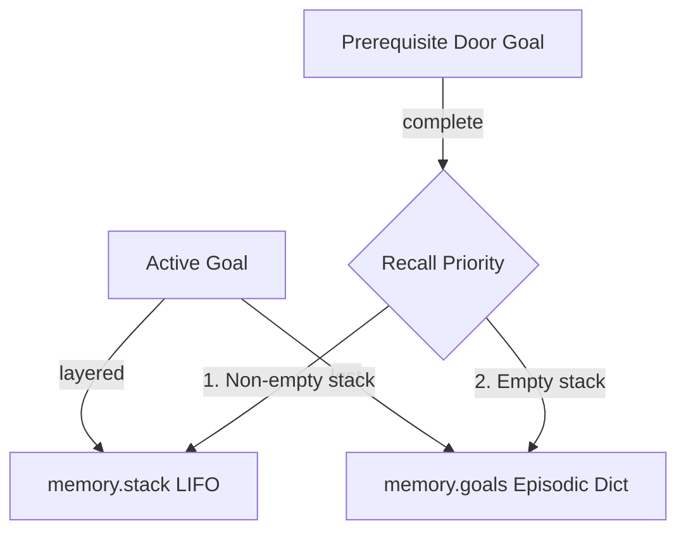
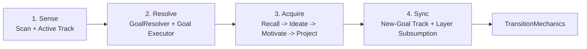
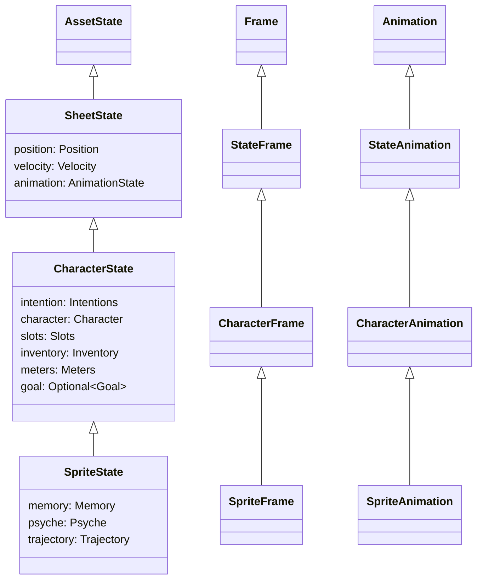

#### Refactor: Phase 06.02 - Goals

**Overview**

Refactor `CognitionMechanics` into a declarative, modular cognitive pipeline anchored by a compiled **Goal Resolution Executor**, cohesive cognitive modules (Perception, Resolution, Recall, Ideation/Motivation, Projection), an explicit **Subgoal Commitment Stack** decoupled from episodic memory, and a three-tier **Sheet State & Component Hierarchy** (`SheetState` $\to$ `CharacterState` $\to$ `SpriteState`). Enforce SMDP option soundness across `GoalResolver`, `TransitionMechanics`, `NavigationMechanics`, and `InteractionMechanics` to eliminate cross-layer deadlocks, epistemic telepathy leaks, and silent ISL compilation failures.

##### Specification

###### 1. Goal Taxonomy

| Goal Category | Semantics | `goal.name` Identity | Spatial Mobility | Factored Completion Invariant |
| --- | --- | --- | --- | --- |
| `target` | Hostile character pursued for combat | Deployed Character `name` | Mobile | Target removed or `target.mutators.triggers.dead` |
| `subject` | Character pursued for social interaction | Deployed Character `name` | Mobile | `not sprite.psyche.dialogue` |
| `door` | Portal traversed to transition Layers | Deployed Door `name` | Static | `sprite.layer != sprite.goal.layer` |
| `object` | Non-portal interactive Object (Chest, Plate, Sign) | Deployed Object `name` | Static | Explicit interaction outcome (disjoint from unary missing-`switch` failure) |
| `resource` | Biological or geological Resource targeted for harvesting | Deployed Resource `name` | Static | Resource removed (`not target`) |
| `property` | Structure targeted for construction | Blueprint/Craft `id` or deployed Strut `name` | Static | Deployed structure registered in `sprite.memory.property` |
| `position` | Coordinate destination (`wander`, `escape`, `return`) | Synthetic tag | Static | Within `action.radius` of `goal.position` (or `not triggers.frightened` for `escape`) |

###### 2. Commitment Stack vs. Episodic Memory

`Memory` separates ordered subgoal commitments from unordered episodic desires:



* **`memory.stack: List[Goal]`**: LIFO commitment stack holding parent Goals suspended by prerequisite subgoals (such as cross-layer `door` subsumption). Completing a prerequisite immediately resumes `memory.stack.pop()` before general episodic recall.
* **`memory.goals: Dict[str, Goal]`**: Unordered episodic desire store populated by `lost` outcomes and queried by `Recall` with live-visibility dormancy checks and Intention-category affinity.

###### 3. Goal Resolution Matrix

Goal resolution is defined in `/src/data/config/goals/main.yaml` and compiled through `Translator` $\to$ `Executor` (`Executors.GOAL`) in canonical precedence:

$$\text{Precedence}: \quad \texttt{complete} \succ \texttt{layered} \succ \texttt{lost}$$

* **Outcomes**:
  1. `complete`: Objective satisfied; clears `sprite.state.goal`.
  2. `layered`: `goal.layer != sprite.layer`; pushes active Goal onto `memory.stack` (via `push` reaction) and assigns a `LayerProjections.IN` `Goals.DOOR`, or demotes the Goal to `memory.goals` and clears `sprite.state.goal` if no reachable portal exists.
  3. `lost`: Goal abandoned (unseen at last-known location), stalled (`sprite.trajectory.stalled`), or invalidated by Intention transition; clears `sprite.state.goal`.
* **Reactions**:
  * `forget`: Evicts `goal.name` from `sprite.state.memory.goals`.
  * `store`: Commits `goal` into `sprite.state.memory.goals[goal.name]`.
  * `push`: Pushes `goal` onto `sprite.state.memory.stack` (preventing duplicate top-of-stack entries).
  * `confusion`: Attaches a `confusion` Expression bubble to `sprite.state.psyche.expression`.

###### 4. Cognitive Pipeline Ordering

Per tick, each autonomous Sprite executes a four-stage cognitive loop:



1. **Sense (`Perception`)**: Refreshes `memory.sprites` (copied coordinate snapshots) and visible `memory.goals` within `vision.radius`, then updates `triggers.vision`, `goal.position`, and `goal.layer` for any active Goal. Because perception executes *before* resolution, `GoalResolver` never observes 1-tick stale visibility or layer flags.
2. **Resolve (`GoalResolver`)**: Evaluates the compiled Goal Executor against `sprite.state.goal` using locals `{'sprite': sprite.state, 'sprites': board.characters(), 'target': target_state}`. Executes matched Reactions followed by the Outcome Callback.
3. **Acquire (`Recall`, `Ideate`, `Motivate`, `Project`)**: Populates a Goal if `sprite.state.goal is None` (respecting the Intention Loop hub invariant so `interact`/`speak` return to `idle` before recalling stacked Goals), or projects spatial coordinates for `wander`/`escape`.
4. **Sync (Post-Acquisition Validation)**: If Acquisition introduced a new Goal on this tick, immediately updates `triggers.vision` and checks `layered` subsumption so `TransitionMechanics` and `NavigationMechanics` receive an actionable same-layer Goal on the same frame.

###### 5. Sheet State & Component Hierarchy

To enforce strict ECS component symmetry across `Pixies`, `Players`, and `Sprites`:



* **`Pixies`**: `SheetState` + `StateFrame` + `StateAnimation`
* **`Players`**: `CharacterState` + `CharacterFrame` + `CharacterAnimation`
* **`Sprites`**: `SpriteState` + `SpriteFrame` + `SpriteAnimation`

##### Architectural Analysis I

###### 1. What Sprite Cognition Currently Lacks & Where It Breaks Down

An audit of `CognitionMechanics`, `TransitionMechanics`, `NavigationMechanics`, `intentions/main.yaml`, and `services/translators` reveals six systemic weaknesses:

1. **Ad-hoc Resolution Branching & Incomplete Categories**: `CognitionMechanics._resolve` and `CognitionMechanics.complete` duplicate `if/elif` chains across `Goals`, hardcode a special case to drop `WANDER` goals when transitioning to `FIND`/`HUNT`, leave `OBJECT` and `PROPERTY` incomplete (`return True` / `pass`), and have no support for `RESOURCE` or `DOOR`.
2. **Stale Phase Ordering & Cross-Layer Gaps**:
   * `_resolve` runs *before* `_track`, so `triggers.vision` and `goal.layer` evaluated during resolution are 1 tick stale.
   * `_track` returns early for `POSITION`, `OBJECT`, and `PROPERTY` before the cross-layer door subsumption block—meaning only `TARGET` and `SUBJECT` can ever traverse Doors, while cross-layer static Goals stall permanently in `NavigationMechanics`.
   * `CognitionMechanics.door()` queries all `AssetInstances.DOORS` on the layer without filtering out `LayerProjections.OUT` shadow doors (which have empty hitboxes and cannot be interacted with).
3. **Broken Memory Dormancy & Intention Affinity in `_remember`**:
   * Dormancy detection checks `not sprite.state.mutators.triggers.vision`, which belongs to the *active* Goal (now `None`), not the candidate in `memory.goals`. When a lost Target walks back within `action.radius`, `_scan` updates its position in `memory.goals` without touching `triggers.vision` (still `False`), causing `_remember` to skip a Target standing directly beside the Sprite. Conversely, after dropping a `WANDER` goal (`triggers.vision == True`), an absent dormant Target is falsely recalled.
   * `_remember` pops the first dict entry regardless of `sprite.state.intention`. A Sprite transitioning `wander -> hunt` on spotting a remembered `TARGET` can pop an unrelated `SUBJECT`, deadlocking in `hunt`.
   * Dormancy should instead evaluate live visibility of `candidate` directly:
     $$\text{dormant}(c) \iff \neg\text{visible}(c) \;\land\; (c.\text{layer} = s.\text{layer}) \;\land\; \text{nearby}(c.\text{position}, s.\text{position}, r_{\text{action}})$$
4. **Coupling Defect Between `ESCAPE` Projection and `NavigationMechanics`**:
   * `CognitionMechanics._project` extrapolates `goal.position` away from an attacker while retaining `goal.name = attacker.name`. `NavigationMechanics._target()` prioritizes `board.asset(goal.name)` over `goal.position` for same-layer assets—silently discarding the flee coordinate and steering the escaping Sprite straight into the attacker. `_project` also omits `None` guards and layer-boundary clamping for `ESCAPE`.
5. **Alignment Issues in the Draft Goal YAML & `Environ` Contract**:
   * **Inverted `subject.complete` condition**: The notes sketch `- sprite.psyche.dialogue`, whereas dialogue completion requires `- not sprite.psyche.dialogue`.
   * **Null-safety in `target.complete`**: Requiring `sprites.get(sprite.goal.name)` as a mandatory conjunct prevents completion if the target was removed by `RemoveMechanics`. The condition must short-circuit as `not sprites.get(sprite.goal.name) or sprites.get(sprite.goal.name).mutators.triggers.dead` (or `not target or target.mutators.triggers.dead`).
   * **Naming drift**: The notes YAML uses `functions.nearby` (whereas `Environ.functions` exports `is_near`) and reaction `remember` (whereas the reaction spec defines `store`). Standardizing on `functions.is_near` and `store` eliminates ambiguity with `_remember` (memory recall).
   * **Uniform Asset State Access (`target` local)**: Passing only `sprite` and `sprites` limits declarative Goal rules to Characters. Injecting a zero-allocation `target: Optional[AssetState]` local (resolved once per tick via $O(1)$ `board.asset(goal.name)`) enables `OBJECT` (`not target or target.switch`), `RESOURCE` (`not target`), `TARGET`, and `SUBJECT` rules uniformly without allocating state dicts per tick. Note that `settings.LAMBDA_SIGNATURE` must be updated alongside `CompilerTranslator` so both compilation backends remain in lockstep.
6. **Reusing `Translator` / `Executor` Cleanly**:
   * Both `LambdaTranslator` and `CompilerTranslator` compile `Dict[str, List[Config]]` into `Executor` instances returning `Optional[str]`.
   * Authoring `goals/main.yaml` as `Dict[Goals, Dict[Outcomes, GoalRuleConfiguration]]` gives unique reaction lookup per `(category, outcome)` and clean readability. At boot, a thin normalization step flattens each category's outcome map in canonical `(COMPLETE, LAYERED, LOST)` order into the existing `Translator.compile(...)` contract—yielding full AST/Lambda parity with zero duplication of compilation logic.
   * Because `COMPLETE` is always evaluated first, `GoalResolver.complete(sprite, board)` reduces cleanly to `executor.evaluate(goal.category, locals) == Outcomes.COMPLETE` without mutating state.

###### 2. Design Ambiguities to Resolve Before Implementation

* **`Goals.RESOURCE` Identity Convention**: `docs/04-intentions.md` currently states that for `resource`, `goal.name` is a `MaterialIndex` key rather than a deployed Resource `name`. Making `goal.name` the deployed Resource Asset `name` aligns `resource` with `object`, `door`, `target`, and `subject` (giving $O(1)$ `board.asset(goal.name)` resolution and automatic hitbox-anchor targeting in `NavigationMechanics`), while Material-level demand remains a Motivation/Ideation search filter.
* **`attack -> scavenge` Lifecycle Ordering**: Currently `CognitionMechanics` clears a `TARGET` goal on death *before* `TransitionMechanics` runs, making `attack -> scavenge` unreachable and softlocking `attack` (which has no `not sprite.goal -> idle` exitpoint). Decide whether killed Targets spawn `Collectable` drops (with `attack -> idle` exitpoint, and a separate Motivation/Ideation generating `scavenge` goals) or whether `TARGET` completion defers one tick while `intention == ATTACK`. The former preserves strict separation of duties (`idle` hub invariant).

##### Architectural Analysis II

Synthesizing formal BDI, HTN, SMDP Option theory, and ABL precondition-monitoring invariants against Architectural Analysis I identifies six additional design issues that must be resolved during Phase 06.02:

1. **Cross-Layer Thrashing via Flat `memory.goals`**: Storing `layered` parent goals in `memory.goals` allows `Recall` to pop an older unrelated goal after door transit instead of resuming the parent goal. Adding a LIFO `memory.stack` with a `Responses.PUSH` reaction isolates subgoal commitments from episodic desires and lays the foundation for multi-step `resource`/`property` planning.
2. **`hunt` / `follow` Deadlock on Subgoal Substitution**: Replacing a `TARGET` with a prerequisite `DOOR` while `intention == HUNT` traps the Sprite in `hunt` because `hunt` lacks a category-mismatch exitpoint to `idle`. Adding explicit category-mismatch exitpoints (ABL-style precondition monitors) to `hunt`, `attack`, and `follow` guarantees clean re-routing through the `idle` hub.
3. **`InteractionMechanics` vs. `find -> interact` Contact Gap**: `find -> interact` fires at `action.radius` (`30` px), halting movement before inset Sprite hitboxes overlap the target Door or Chest required by `InteractionMechanics.intersections`. Either `InteractionMechanics` must evaluate within `proximities` for Sprite-initiated `interact` or `NavigationMechanics` / `find -> interact` must guarantee hitbox overlap prior to halting.
4. **Epistemic Telepathy in `_track` & `intentions/main.yaml`**: Updating `goal.layer = target_state.layer` unconditionally when a target is unseen violates BDI epistemic decoupling. `Perception.track` should only update `goal.layer` and `goal.position` when the target is observed on the same layer within `vision.radius` (or observed exiting a visible door, updating `goal.layer` to `door.state.outlayer` and `goal.position` to the door). Similarly, `find -> speak` and `idle -> find` should check perceived `sprite.goal.position` + `triggers.vision` rather than omniscient `sprites.get(sprite.goal.name).position`.
5. **Unfactored Static Goal Rules (`object`, `door`, `resource`, `property`)**:
  * `door`, `object`, `resource`, and `property` need `lost` conditions on `sprite.trajectory.stalled` (and `not target` for `door`) so unreachable portals/objects do not softlock Sprites.
  * `object.complete` cannot rely unconditionally on `target.switch` because unary Objects lack `switch` and already-open reusable Chests immediately satisfy `target.switch`. Restrict `Goals.OBJECT` completion to an explicit post-interaction state/flag or split binary switchable interaction from unary inspection (`Sign`).
  * `any_memories_visible` in `environ.py` must exclude dead targets (`not target.mutators.triggers.dead`) and support non-character board assets (`OBJECT`, `DOOR`, `RESOURCE`) if those categories can be recalled from memory.
6. **Fail-Fast ISL Compilation & `ESCAPE` Decoupling**:
  * `CompilerTranslator` and `LambdaTranslator` must raise (or drop the entire rule) on condition syntax errors rather than silently dropping individual failed conjuncts.
  * `NavigationMechanics._target()` must bypass `board.asset(goal.name)` whenever `goal.category == Goals.POSITION`, and `ESCAPE` should project a synthetic `Goals.POSITION` (`name="escape"`) whose lifecycle in `intentions/main.yaml` is governed by `sprite.mutators.triggers.frightened` rather than `sprites.get(sprite.goal.name).intention == ATTACK`.

##### User Review I

###### Door Projections

Tasking misunderstands what a Layer Projection for a Door is. Sprites *should* be able to target `LayerProjections.OUT` Doors. They would be stranded in the Door's Layer if there were no inverse, return Door. 

###### Reflexes

`confusion` seems at odds with the other Responses. Responses seem to be "Memory Operators", i.e. intentional acts within the Sprite's memory that occur when their conditions are met. `confusion`, however, is more like an "involuntarily side-effect", let's call it a "Reflex". Moreover, they operate on a different subset of State than Responses.

So: Goal Resolution is actually composed (so far) of two orthogonal operators: Response and Reflxes, which affect the memory and psyche, respectively.

```yaml
lost:
  reflexes: [ confusion ]
  responses: [ store ]
  conditions:
    - functions.is_near(
        sprite.goal.position,
        sprite.position,
        sprite.mutators.parameters.action.radius
      )
    - not sprite.mutators.triggers.vision
```

* `app.game.logic.modules.cognition.goal.resolvers.reflexes`: 
  * `reflex.react(goal, psyche) -> psyche mutation`
* `app.game.logic.modules.cognition.goal.resolvers.response`: 
  * `response.cogitate(goal, memory) -> memory mutation`

##### Goals

###### Goal: Declarative Goal Resolution Executor

Replace ad-hoc resolution logic with a compiled `Executors.GOAL` Executor backed by `src/data/configurations/automata/goals/main.yaml`, supporting canonical `(COMPLETE, LAYERED, LOST)` precedence, commitment-stack `push`, and stall/removal `lost` guards:

```yaml
goals:
  subject:
    complete:
      reactions: [ forget ]
      conditions:
        - not sprite.psyche.dialogue
    layered:
      reactions: [ push ]
      conditions:
        - sprite.goal.layer
        - sprite.layer != sprite.goal.layer
    lost:
      reactions: [ store, confusion ]
      conditions:
        - functions.is_near(
            sprite.goal.position,
            sprite.position,
            sprite.mutators.parameters.action.radius
          )
        - not sprite.mutators.triggers.vision
  target:
    complete:
      reactions: [ forget ]
      conditions:
        - not target or target.mutators.triggers.dead
    layered:
      reactions: [ push ]
      conditions:
        - sprite.goal.layer
        - sprite.layer != sprite.goal.layer
    lost:
      reactions: [ store, confusion ]
      conditions:
        - functions.is_near(
            sprite.goal.position,
            sprite.position,
            sprite.mutators.parameters.action.radius
          )
        - not sprite.mutators.triggers.vision
  position:
    complete:
      reactions: []
      conditions:
        - functions.is_near(
            sprite.goal.position,
            sprite.position,
            sprite.mutators.parameters.action.radius
          )
    layered:
      reactions: [ push ]
      conditions:
        - sprite.goal.layer
        - sprite.layer != sprite.goal.layer
    lost:
      reactions: []
      conditions:
        - sprite.trajectory.stalled or sprite.intention in [constants.Intentions.FIND, constants.Intentions.HUNT]
  door:
    complete:
      reactions: [ forget ]
      conditions:
        - sprite.layer != sprite.goal.layer
    lost:
      reactions: [ forget ]
      conditions:
        - not target or sprite.trajectory.stalled
  object:
    complete:
      reactions: [ forget ]
      conditions:
        - not target or getattr(target, 'switch', False)  # Replace once Object interaction completion contract is finalized
    layered:
      reactions: [ push ]
      conditions:
        - sprite.goal.layer
        - sprite.layer != sprite.goal.layer
    lost:
      reactions: [ store ]
      conditions:
        - sprite.trajectory.stalled
  property:
    complete:
      reactions: [ forget ]
      conditions:
        - sprite.goal.name in sprite.memory.property
    layered:
      reactions: [ push ]
      conditions:
        - sprite.goal.layer
        - sprite.layer != sprite.goal.layer
    lost:
      reactions: [ store ]
      conditions:
        - sprite.trajectory.stalled
  resource:
    complete:
      reactions: [ forget ]
      conditions:
        - not target
    layered:
      reactions: [ push ]
      conditions:
        - sprite.goal.layer
        - sprite.layer != sprite.goal.layer
    lost:
      reactions: [ store ]
      conditions:
        - sprite.trajectory.stalled

```

*(Note: Per the Models guideline avoiding `getattr`, finalize the unary vs. binary Object completion predicate in Task 1—e.g., an explicit `interacted` signal or restricting `Goals.OBJECT` to switchable entities while giving `Signs` their own completion rule—so `goals/main.yaml` uses strictly typed attribute access.)*

###### Goal: Modular Cognitive Architecture

Decompose `CognitionMechanics` under `app.game.logic.modules.cognition`:

* `GoalResolver`: Declarative `Executors.GOAL` evaluation, Reaction map (`forget`, `store`, `push`, `confusion`), Outcome callbacks (`complete`, `layered`, `lost`), and `LayerProjections.IN`-filtered Door lookup.
* `Perception`: Epistemic same-layer scanning (copying `Position` snapshots) and active-goal tracking without unseen cross-layer telepathy.
* `Recall`: Two-tier acquisition popping `memory.stack` (LIFO) before scanning `memory.goals` with live-visibility dormancy checks and Intention-category affinity.
* `Generator` (`Ideation` + `Motivation` strategy registry): Pluggable `Dict[Motivations, MotivationStrategy]`.
* `Projector`: Bounded coordinate projection for `wander` and `escape` (`Goals.POSITION`), decoupled from `NavigationMechanics._target()` asset lookups.

###### Goal: Clean Sheet State, Frame & Animation Hierarchy

Separate `SheetState` (kinematic/animated base for `Pixies`), `CharacterState(SheetState)` (equipment/inventory/goal base for `Player`), and `SpriteState(CharacterState)` (autonomous cognitive fields for `Sprites`), with matching `StateFrame -> CharacterFrame -> SpriteFrame` and `StateAnimation -> CharacterAnimation -> SpriteAnimation` hierarchies that eliminate all runtime `getattr` and `id != RequiredAssets.PLAYER` checks.

##### Tasks

**1. Task: Goal Semantics, Configuration Models & Resolution Matrix**

*Objective*: Formalize Goal categories, outcome callbacks, reactions, and Pydantic-validated configuration schemas with sound factored completion invariants.

* [ ] Subtask: Update `app.static.semantics` to add `Goals.DOOR`, `Goals.RESOURCE`, `Outcomes` (`complete`, `layered`, `lost`), `Responses` (`forget`, `store`, `push`, `confusion`), and `Executors.GOAL`.
* [ ] Subtask: Add `stack: List[Goal] = field(default_factory=list)` to `Memory` in `app.models.state.assets.sheets` to separate suspended subgoal commitments from episodic `memory.goals`.
* [ ] Subtask: Define frozen `GoalRuleConfiguration` (`reactions: List[Enumerated[Responses]]`, `conditions: List[str]`) in `app.models.config` and expose `goals: Dict[Enumerated[Goals], Dict[Enumerated[Outcomes], GoalRuleConfiguration]]` on `ConfigurationSchema`.
* [ ] Subtask: Resolve the unary vs. binary Object completion contract (avoiding untyped `target.switch` on `Signs`/`Crates` and immediate completion on already-open `Chests`) and author `/src/data/config/goals/main.yaml` covering all 7 categories including `stalled`/`not target` `lost` rules.
* [ ] Subtask: Wire `/src/data/config/goals/` ingestion into `Loader` and register `executors: [ goal ]` on `cognition` in `/src/data/config/mechanics/main.yaml`.

**2. Task: Goal Executor Compilation & ISL Environment Hardening**

*Objective*: Compile `Executors.GOAL` through `Translator` with full AST/Lambda parity, fail-fast syntax validation, uniform `target` asset-state access, and clean boundary semantics.

* [ ] Subtask: Normalize `ConfigurationSchema.goals` into canonical `(COMPLETE, LAYERED, LOST)` transition lists during bootstrap so `LambdaTranslator` and `CompilerTranslator` compile `Executors.GOAL` without duplicating compiler logic.
* [ ] Subtask: Harden `CompilerTranslator.compile` and `LambdaTranslator.compile` to fail fast (raise on invalid ISL condition syntax rather than silently dropping a failed conjunct from a transition rule).
* [ ] Subtask: Update `settings.LAMBDA_SIGNATURE` to accept `target=None` alongside `sprite` and `sprites` so both `LambdaExecutor` and `CompilerExecutor` support $O(1)$ resolved target-asset state queries.
* [ ] Subtask: Standardize `Environ.functions.is_near` and `geometry.nearby` boundary semantics (`<=` vs. `<`), filter dead targets (`not target.mutators.triggers.dead`) out of `any_memories_visible`, and expose new Goal enums in `Environ.constants`.
* [ ] Subtask: Add the typed `executor` property on `CognitionMechanics` bound to `Executors.GOAL`.

**3. Task: `GoalResolver` Implementation**

*Objective*: Encapsulate declarative Goal evaluation, reaction dispatch, outcome callbacks and commitment-stack pushing behind `complete(sprite, board)` and `resolve(sprite, board)`.

* [ ] Subtask: Create `src/app/game/logic/modules/cognition/resolver.py` implementing `GoalResolver` with `complete(sprite, board) -> bool` and `resolve(sprite, board) -> Optional[Outcomes]`.
* [ ] Subtask: Implement the `Responses` handler map (`forget`, `store`, `push`, `confusion`) receiving `(sprite, goal, board)`.
* [ ] Subtask: Implement the `Outcomes` callback map (`complete`, `layered`, `lost`), routing `layered` to `door(sprite, board)` to assign a prerequisite `Goals.DOOR` (after pushing the parent onto `memory.stack`), or demoting the parent to `memory.goals` and clearing `sprite.state.goal` when unreachable.
* [!: INCORRECT ASSUMPTION] Subtask: Restrict `door(sprite, board)` to `LayerProjections.IN` doors so non-interactive `OUT` shadow footprints are never targeted.
  * **WARNING: DO NOT DO THIS. THIS IS A FUNDAMENTAL MISUNDERSTANDING OF WHAT A DOOR LAYER PROJECTION IS. SPRITES SHOULD BE ABLE TO TARGET "OUT" LAYER PROJECTIONS**

**4. Task: Decompose `CognitionMechanics` & Fix Cognitive / Navigation / Interaction Coupling**

*Objective*: Break `CognitionMechanics` into focused modules, enforce the 4-stage pipeline, close epistemic telepathy leaks, and fix `ESCAPE` and `interact` contact deadlocks.

* [ ] Subtask: Extract `Perception` (`scan`, `track`) into `app.game.logic.modules.cognition.perception`; copy `Position` snapshots in `memory.sprites`, restrict `goal.layer` updates to observed transitions (closing cross-layer telepathy), separate mobile vs. static tracking, and remove inline door subsumption.
* [ ] Subtask: Extract `Recall` (`remember`) into `app.game.logic.modules.cognition.recall`; pop `memory.stack` (LIFO) before scanning `memory.goals`, replace stale `triggers.vision` checks with live-visibility dormancy checks, and filter episodic recall by Intention affinity (`HUNT` $\to$ `TARGET`, `FIND` $\to$ `SUBJECT`/`OBJECT`/`DOOR`, `IDLE` $\to$ any eligible).
* [ ] Subtask: Extract `Ideation` and a pluggable `Dict[Motivations, MotivationStrategy]` registry into `app.game.logic.modules.cognition.ideation`, aligning dialogue ideation with `intentions/main.yaml` relationship predicates.
* [ ] Subtask: Extract `Projector` (`wander`, `escape`) into `app.game.logic.modules.cognition.projection`; add `None` guards and layer-bounds clamping for `ESCAPE`, emit synthetic `Goals.POSITION` for `ESCAPE`, and update `NavigationMechanics._target()` to skip `board.asset(goal.name)` lookup when `goal.category == Goals.POSITION`.
* [ ] Subtask: Reconcile the `find -> interact` initiation radius (`action.radius`) with `InteractionMechanics` execution (`intersections` vs. `proximities`) so Sprites entering `interact` at Doors and Chests never halt short of contact.
* [ ] Subtask: Refactor `CognitionMechanics.update()` into the 4-stage pipeline (**Sense $\to$ Resolve $\to$ Acquire $\to$ Sync**) with a safe `player = board.player()` guard hoisted outside the sprite loop.

**5. Task: Sheet State, Frame & Animation Hierarchy Refactor (`pstats` Remediation)**

*Objective*: Separate `SheetState`, `CharacterState`, and `SpriteState` and their corresponding Frame/Animation strategies to enforce uniform ECS dispatch, fix stationary expression decay, and eliminate per-tick `logger.info` overhead.

* [ ] Subtask: Refactor `src/app/models/state/assets/sheets.py` into `SheetState(AssetState)`, `CharacterState(SheetState)`, and `SpriteState(CharacterState)`.
* [ ] Subtask: Type `Goal.category` as `Optional[Enumerated[Goals]]` and change `CharacterState.goal` default to `None` (auditing `MotionMechanics`, `PlayerMechanics`, and state YAML files).
* [ ] Subtask: Split `src/app/assets/frames/sheets.py` into `CharacterFrame(StateFrame)` and `SpriteFrame(CharacterFrame)`, removing `if id != RequiredAssets.PLAYER`, deleting the dead `properties.actions` statement, and downgrading per-tick `logger.info` calls in both `SpriteFrame` and `PlayerMechanics` to `logger.debug`.
* [ ] Subtask: Split `src/app/assets/animations/sheets.py` into `CharacterAnimation(StateAnimation)` and `SpriteAnimation(CharacterAnimation)` with unconditional `expression.ttl` decay, removing `getattr(state, 'psyche', None)`.
* [ ] Subtask: Update Recipe configurations, `AssetFactory`, `Loader` hydration schemas (`pixies` $\to$ `SheetState`, `players` $\to$ `CharacterState`, `sprites` $\to$ `SpriteState`), and audit `isinstance(..., SheetState)` / `Board._cache` call sites.

**6. Task: Intention Transition Matrix Reconciliation & Automaton Verification Suite**

*Objective*: Align `intentions/main.yaml` with the new Goal taxonomy, enforce non-deadlocking category-mismatch exitpoints, and verify cognitive and automaton invariants with automated tests.

* [ ] Subtask: Update `src/data/config/intentions/main.yaml` to:
* Support `Goals.DOOR` in `idle` and `find` and close `idle` proximity-stall gaps for `SUBJECT`/`OBJECT`/`DOOR`.
* Add category-mismatch exitpoints (`-> idle`) on `hunt`, `attack`, and `follow` so cross-layer `DOOR` subsumption re-routes cleanly through `idle`.
* Add the missing `attack -> idle` exitpoint, null-guard `sprites.get(sprite.goal.name)` in `attack`, and reconcile `attack -> scavenge` and `speak -> idle` (Player) ordering with `GoalResolver`.
* Wire `escape` entrypoints and persistence to `triggers.frightened` / `Goals.POSITION` and replace invalid `inventory.wallet`, `Goals.LOOT`, and duplicate `mine` rules.

**7. Update Coverage**

* [!: Dependent on User Acceptance Tests] Subtask: Add unit tests verifying `Executors.GOAL` compilation, fail-fast syntax rejection, and evaluation parity across `LambdaTranslator` and `CompilerTranslator`.
* [!: Dependent on User Acceptance Tests] Subtask: Add unit tests for `GoalResolver` (`complete > layered > lost` precedence; `forget`/`store`/`push`/`confusion` reactions; `LayerProjections.IN` door filtering; `stalled` abandonment), `Recall` commitment-stack LIFO resume and live dormancy, `Perception` epistemic isolation and position copying, and `ESCAPE` flee steering through `NavigationMechanics`.
* [!: Dependent on User Acceptance Tests] Subtask: Add static automaton verification tests checking `intentions/main.yaml` for hub reachability, non-deadlocking exit coverage per `(Intention, GoalCategory)`, and `SheetState`/`CharacterState`/`SpriteState` hydration and stationary `SpriteAnimation` TTL decay.


