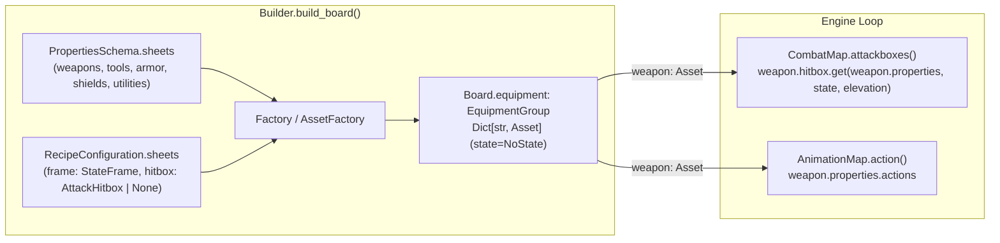

#### Refactor: Phase 06.03 - Combat

**Overview**

Induct `Equipment` into the `Board` as stateless `Asset` instances injected via `Recipe` configurations (`StateFrame` and `AttackHitbox`), unify `SheetProperties.attackboxes` into `SheetProperties.hitboxes`, resolve the structural separation between a Sprite's physical hurtbox (`StaticHitbox`) and its equipped weapon reach (`AttackHitbox`), enforce discrete elevation partitioning in `CombatMechanics`, remove the broken ranged `"TODO"` stub from `CombatMechanics.update()`, and migrate `test_combat.py` to the live `world-testbed` fixture framework.



##### Specification

In the Asset Hierarchy, `Sprites` (and `Players`) are stateful `Sheet` Assets deployed onto the `Board`, whereas `Equipment` (`weapons`, `tools`, `armor`, `shields`, `utilities`) are stateless `Sheet` Assets (`state = NoState()`) hydrated into `Board.equipment` (`EquipmentGroup`) during `Builder.build_board()` and projected onto a wielding Sprite's state.

1. **Stateless Equipment `Asset` Hydration (`EquipmentGroup` & `Recipes`)**:
    * `EquipmentGroup` stores `Dict[str, Asset]` for `armor`, `weapons`, `tools`, `utilities`, and `shields`.
    * During `Builder.build_board()`, each equipment entry in `PropertiesSchema.sheets` is instantiated as an `Asset` using its `Recipe` in `src/data/config/recipes/main.yaml`:
    * `sheets.weapons` and `sheets.tools` inject `frame: StateFrame` and `hitbox: AttackHitbox`.
    * `sheets.armor`, `sheets.shields`, and `sheets.utilities` inject `frame: StateFrame` and `hitbox: null`.
2. **Dual Footprint Separation (`StaticHitbox` vs. `AttackHitbox`)**:
    * **Body Footprint (`Hitbox`)**: Owned by the deployed `Sprite` or `Player` (`Asset`). Resolved via `StaticHitbox` from `sprite.properties.hitboxes` (`List[Hitbox]`). Governs physical obstacle collision (`CollisionMechanics`), RRT pathfinding anchors (`NavigationMechanics`), environmental interactions (`InteractionMechanics`), fluid immersion (`MotionMechanics`), and incoming damage reception (`CombatMechanics`).
    * **Action Footprint (`Attackbox`)**: Owned by stateless `Equipment` `Asset`s (`weapons` and `tools`). Resolved via `weapon.hitbox.get(weapon.properties, sprite.state, elevation)` (`AttackHitbox`) from `weapon.properties.hitboxes` (`Dict[str, List[Hitbox]]`) projected against the wielding entity's `SheetState` (`state.animation` and `state.elevation`).
3. **Property Schema Unification (`SheetProperties`)**:
    * Consolidate `attackboxes` into a single polymorphic `hitboxes` field on `SheetProperties`: $\text{SheetProperties.hitboxes} : \text{Optional}\Big[\text{Union}\big[\text{Dict}[\text{str}, \text{List}[\text{Hitbox}]],\; \text{List}[\text{Hitbox}]\big]\Big]$
    * Deployed character sheets (`sprites`, `players`, `pixies`) configure `hitboxes` as `List[Hitbox]` (interpreted by `StaticHitbox`).
    * Stateless equipment sheets (`weapons`, `tools`) configure `hitboxes` as `Dict[str, List[Hitbox]]` keyed by `<action>-<direction>-<frame>` (interpreted by `AttackHitbox`).
4. **Stateless Projection Contract (`CombatMap`)**:
    * `CombatMap.attackboxes(state, equipment, elevation)` resolves the active weapon key from `state.slots.equipment.weapon`, retrieves the stateless weapon `Asset` from `equipment.weapons`, and delegates geometric resolution to `weapon.hitbox.get(weapon.properties, state, resolved_elevation)`.

##### Architectural Analysis I

1. **Why `AttackHitbox` Cannot Replace `StaticHitbox` on `Sprite` Instances**:
Every deployed `Asset` possesses a single `hitbox: HitboxSchema` slot. Replacing `StaticHitbox` with `AttackHitbox` on `sheets.sprites` or `sheets.players` would cause `sprite.hitboxes` to evaluate to `[]` on all non-attack frames—breaking solid-body collision resolution, door/chest interaction padding, fluid immersion checks, and target hurtbox detection—while causing weapon swing footprints on active attack frames to transfer physical impulse against walls and shift RRT sensory anchors. Keeping `StaticHitbox` on the `Sprite` and binding `AttackHitbox` to `Equipment` preserves strict separation between the body hurtbox and the weapon attackbox.
2. **Defect in Existing `AttackHitbox.get()` Implementation (`src/app/assets/hitboxes/sheets.py`)**:
The current implementation of `AttackHitbox.get()` delegates key generation to `frame.keys(state.id, state)`:

```python
keys = frame.keys(state.id, state)
frame_key = keys[0][0]
return properties.attackboxes.get(frame_key, [])
```

This contains two incompatibilities:

* **Prefix Mismatch**: `StateFrame.keys(id, state)` prepends the Asset `id` to produce a Registry texture key (`f"{id}-{action}-{direction}-{frame}"`, e.g., `"player-slash-right-3"`), whereas weapon hitbox maps in `/src/assets/sheets/equipment/weapons/*.yaml` are keyed by canonical animation state (`f"{action}-{direction}-{frame}"`, e.g., `"slash-right-3"`).
* **Coupling to `Frame**`: No other `HitboxSchema` (`LayeredHitbox`, `MaterialHitbox`, `StageHitbox`) calls `Frame.keys()`; each indexes `properties.hitboxes` directly from `state` attributes (`state.layer`, `state.blueprint`, `state.stage`). Constructing `frame_key` directly from `state.animation` (`f"{state.animation.action}-{state.animation.direction}-{state.animation.frame}"`) inside `AttackHitbox.get()` decouples `HitboxSchema` from `Frame` and matches the YAML schema.

3. **Elevation Leakage and Unarmed/Ranged Crash in `CombatMechanics` (`src/app/game/logic/mechanics/spatial/combat.py`)**:

* **Elevation Leakage**: `CombatMechanics.update()` currently hashes all melee attackers and targets on a `layer` into `self.grid` without checking `elevation`. An attacker at `elevation = 0` will damage a target at `elevation = 1` if their 2D `(x, y)` coordinates overlap. Evaluating collisions per elevation tier (`elevation = attacker.elevation`) and resolving target hurtboxes via `target.hitbox.get(target.properties, target.state, elevation)` enforces 3D topological isolation.
* **Ranged / Unarmed Crash**: When an unarmed entity enters `Intentions.ATTACK.value`, `AnimationMap.action()` resolves its action to `Actions.CAST.value`. In `CombatMechanics.update()`, `Actions.CAST.value` and `Actions.SHOOT.value` enter the ranged combat branch, which accesses `attacker.state.mutators.triggers.executed` (an attribute that does not exist on `MutatorTriggers`) and passes `"TODO"` strings to `board.cradle.spawn_projectile()`.

4. **Blackbox Mocking in `test_combat.py` (`tests/unit/app/game/logic/mechanics/spatial/test_combat.py`)**:

`test_combat.py` currently relies on ad-hoc helper functions (`_create_player_attacker`, `_create_sprite_target`, `_create_reactable_target`, `_create_equipment`), `MagicMock` bus/payload objects, and monkeypatched `mock_board.instances` lambdas. All required assets (`player` with `shortsword`, `jasilynn`, `archaxes`, and `spinning-dummy`) are already hydrated in `world-testbed`.

##### User Review I

**Inconsistencies In The Current Spec**

There appears to be an inconsistency in the plan or a misunderstanding of the injection system, as the CombatMap is instantiating a AttackHitbox, but the Task list has it also being registered as a component injected via Recipes. Equipment is not instantiated in the game, so registering it in a Recipe in the current implementation achieves nothing.

However, rather than storing Equipment Properties on the Board, it might be better to store Equipment *Assets* on the Board that can be referenced. That way, CombatMap has access to the hitbox and properties through the Asset interface.

Adoption of this strategy, however, may have implications with respect to SpriteFrame, insofar that currently SpriteFrame manages the injection of EquipmentFrames. 

**Projectile Implementation**

Application is at the point where Projectiles need to be codified. There are two routes, as I see:

* Atlasing Route: Different directions of the Projectile are atlased in an Asset file.
* Rotation Route: A Projectile Asset contains a single Frame in a single Direction (say: `left`). When it is indexed by the Registry, it's coordinates are rotated by a fixed amount. 

Atlasing fixes the number of Directions a Projectile can be fired. However, rotation allows for an arbitary division of degrees, e.g. arrows can fire in four directions (degree delta = 90) and cannonballs can fire in eight directions (degree delta = 45). However, rotation may require substantial changes in the rendering interface, so there are trade offs.

##### Architectural Analysis II

1. **Resolving the Recipe Injection Inconsistency via Stateless Equipment `Asset`s**:
Previously, `Builder.build_board()` passed raw `SheetProperties` dictionaries into `EquipmentGroup`, rendering `recipes.sheets.weapons` unused outside of `Registry._index()` and forcing `CombatMap` to instantiate `AttackHitbox()` directly. By constructing stateless `Asset` instances (`state=NoState()`) for `EquipmentGroup` in `Builder.build_board()`, `AttackHitbox` is injected once via `AssetFactory.hitbox(recipe.hitbox)` and accessed polymorphically via `weapon.hitbox.get(weapon.properties, state, elevation)`.
2. **Impact on `AnimationMap` and `SpriteFrame**`:
    * In `AnimationMap.action(state, equipment)`, looking up a weapon or tool in `equipment.weapons` or `equipment.tools` now returns an `Asset`; action resolution accesses `weapon.properties.actions` instead of `weapon_props.actions`.
    * In `SpriteFrame.keys(id, state)`, because `Frame.keys()` receives only `(id: str, state: SpriteState)` and `state.slots.equipment` stores equipment string keys, `SpriteFrame.keys()` delegates equipment key formatting to `super().keys(eq_key, state)` (`StateFrame.keys`).
3. **Fixing `state.slots.equipment` Lookup in `CombatMap`**:
`CombatMap.attackboxes()` currently queries `state.inventory.equipment.weapon` (which raises `AttributeError` because `equipment` was moved to `state.slots.equipment` in Phase 06.04) and uses `Optional[int]` without importing `Optional`. Updating `CombatMap` to read `state.slots.equipment.weapon` and call `weapon.hitbox.get(...)` fixes both defects.
4. **Elevation Partitioning & Removal of Broken Ranged Stub in `CombatMechanics**`:
    * `CombatMechanics.update()` currently hashes all attackers and targets on a `layer` into `self.grid` regardless of `elevation`, allowing an attacker at $E = 0$ to strike a target at $E = 1$. Enforcing `attacker.elevation == target.elevation` isolates melee combat to coplanar entities.
    * Ranged projectile spawning (`Actions.SHOOT`, `Actions.CAST`) is currently an unimplemented `"TODO"` stub that crashes on `attacker.state.mutators.triggers.executed`. Rather than polluting `MutatorTriggers` with an `executed` flag for a stub, ranged projectile spawning is deferred to **Phase 03.04: Projectiles**, and `CombatMechanics.update()` cleanly skips `Actions.SHOOT` and `Actions.CAST` during melee attacker collection.

##### Goals

###### Goal: Unify `SheetProperties.hitboxes` and YAML Definitions

Replace `attackboxes` with `hitboxes` on `SheetProperties` in `src/app/models/properties/assets.py` so both character sheets (`List[Hitbox]`) and equipment sheets (`Dict[str, List[Hitbox]]`) share a single property field:

```python
# src/app/models/properties/assets.py
@dataclass(slots=True)
class SheetProperties(AssetProperties):
    stack: List[str] = field(default_factory=list)
    mass: int = 1
    actions: Union[
        str,
        Dict[Enumerated[Actions], Action]
    ] = field(default_factory=dict)
    hitboxes: Optional[Union[
        Dict[str, List[Hitbox]],
        List[Hitbox]
    ]] = field(default_factory=list)

```

Update `src/assets/sheets/equipment/weapons/main.yaml` and `src/assets/sheets/equipment/tools/main.yaml` to replace `attackboxes` with `hitboxes`.

###### Goal: Hydrate Stateless Equipment `Asset`s into `EquipmentGroup`

Update `EquipmentGroup` (`src/app/models/groups.py`) to hold `Dict[str, Asset]` and update `Builder.build_board()` (`src/app/services/orchestration/builder.py`) to construct stateless `Asset` objects (`state=NoState()`) for `armor`, `weapons`, `tools`, `utilities`, and `shields` using `recipes.sheets`:

```python
# src/app/models/groups.py
@dataclass(slots=True)
class EquipmentGroup:
    armor: Dict[str, Asset] = field(default_factory=dict)
    weapons: Dict[str, Asset] = field(default_factory=dict)
    tools: Dict[str, Asset] = field(default_factory=dict)
    utilities: Dict[str, Asset] = field(default_factory=dict)
    shields: Dict[str, Asset] = field(default_factory=dict)

```

###### Goal: Delegate `CombatMap.attackboxes` to the Weapon `Asset` Interface

Update `CombatMap.attackboxes` to resolve the equipped weapon from `state.slots.equipment.weapon` and invoke `weapon.hitbox.get(weapon.properties, state, resolved_elevation)` through the `Asset` interface:

```python
# src/app/game/logic/modules/maps/combat.py
from typing import List, Optional
from app.models.groups import EquipmentGroup
from app.models.state import SheetState
from libs.core.models import Hitbox

class CombatMap:
    @staticmethod
    def attackboxes(
        state: SheetState,
        equipment: EquipmentGroup,
        elevation: Optional[int] = None
    ) -> List[Hitbox]:
        weapon_key = state.slots.equipment.weapon
        weapon = equipment.weapons.get(weapon_key) if weapon_key else None
        if not weapon or not weapon.hitbox:
            return []
        resolved_elevation = (
            elevation if elevation is not None
            else (state.elevation if state.elevation is not None else 0)
        )
        return weapon.hitbox.get(weapon.properties, state, resolved_elevation)

```

###### Goal: Enforce Elevation Isolation and Clean Up `CombatMechanics.update()`

Remove the unfinished ranged `"TODO"` block from `CombatMechanics.update()` (deferring ranged projectile spawning to Phase 03.04) and enforce discrete elevation isolation (`attacker.elevation == target.elevation`) during melee collision resolution:

```python
# src/app/game/logic/mechanics/spatial/combat.py
for attacker in attackers:
    if attacker.state.animation.action in (
        Actions.SHOOT.value,
        Actions.CAST.value,
    ):
        continue

    attackboxes = CombatMap.attackboxes(attacker.state, board.equipment, attacker.elevation)
    if attackboxes:
        melee_attackers.append((attacker, attackboxes))

```

###### Goal: Induct `test_combat.py` into the Live Fixture Framework

Remove all `_create_*` helper functions, `MagicMock` instances, and monkeypatched `mock_board` lambdas from `tests/unit/app/game/logic/mechanics/spatial/test_combat.py`. Execute all combat tests against `mock_mechanic(Mechanics.COMBAT.value)`, `mock_board`, `mock_bus`, and `mock_payload`.

##### Tasks

**1. Task: Unify `SheetProperties.hitboxes` and Equipment YAML Assets**

*Objective*: Consolidate `attackboxes` into `hitboxes` on `SheetProperties` and update all Equipment YAML definitions.

* [] Subtask: Update `SheetProperties` in `src/app/models/properties/assets.py` so `hitboxes` accepts `Optional[Union[Dict[str, List[Hitbox]], List[Hitbox]]]` and remove the legacy `attackboxes` field.
* [] Subtask: Replace `attackboxes` with `hitboxes` (and remove duplicate `hitboxes: null` keys) in `src/assets/sheets/equipment/weapons/main.yaml` and `src/assets/sheets/equipment/tools/main.yaml`.

**2. Task: Hydrate Stateless Equipment `Asset`s in `EquipmentGroup` and `Builder**`

*Objective*: Store stateless `Asset` instances in `Board.equipment` (`EquipmentGroup`) injected via `recipes/main.yaml` and update all `board.equipment` consumers.

* [] Subtask: Register `hitbox: AttackHitbox` for `sheets.weapons` and `sheets.tools` in `src/data/config/recipes/main.yaml`.
* [] Subtask: Update `EquipmentGroup` in `src/app/models/groups.py` to type `armor`, `weapons`, `tools`, `utilities`, and `shields` as `Dict[str, Asset]`.
* [] Subtask: Update `Builder.build_board()` in `src/app/services/orchestration/builder.py` to instantiate stateless `Asset` objects (`state=NoState()`) for each equipment dictionary using `AssetFactory` and `self.context.configurations.recipes.sheets`.
* [] Subtask: Update `AnimationMap` (and any Menu `Binder` / controller call sites) that access `board.equipment` to read `.properties` from the retrieved Equipment `Asset`, and simplify `SpriteFrame.keys()` in `src/app/assets/frames/sheets.py` to delegate equipment key formatting to `super().keys(eq_key, state)`.

**3. Task: Wire `CombatMap` and Harden `CombatMechanics**`

*Objective*: Route `CombatMap.attackboxes()` through `weapon.hitbox.get()`, enforce elevation isolation in `CombatMechanics.update()`, and remove the broken ranged stub.

* [] Subtask: Fix `CombatMap.attackboxes()` in `src/app/game/logic/modules/maps/combat.py` to import `Optional`, read `state.slots.equipment.weapon`, and delegate hitbox lookup to `weapon.hitbox.get(weapon.properties, state, resolved_elevation)`.
* [] Subtask: Remove the unimplemented ranged `"TODO"` block in `CombatMechanics.update()` (`src/app/game/logic/mechanics/spatial/combat.py`), skip `Actions.SHOOT` and `Actions.CAST` in melee resolution, remove the defensive `getattr(target.state, 'mutators', None)` check, and enforce `attacker.elevation == target.elevation` on colliding pairs.
* [] Subtask: Add unit tests for `AttackHitbox.elevations()` and `AttackHitbox.get()` and update `tests/unit/app/game/logic/modules/maps/test_combat_maps.py` to test against stateless Equipment `Asset`s.

**4. Task: Refactor `test_combat.py` to Use `world-testbed` Fixtures**

*Objective*: Replace all ad-hoc asset builders and `MagicMock` overrides in `tests/unit/app/game/logic/mechanics/spatial/test_combat.py` with live `mock_board` and `mock_mechanic` fixtures.

* [] Subtask: Remove `_create_player_attacker`, `_create_sprite_target`, `_create_reactable_target`, and `_create_equipment` from `tests/unit/app/game/logic/mechanics/spatial/test_combat.py`.
* [] Subtask: Refactor `test_combat_mechanics_melee_resolution`, `test_combat_mechanics_lethal_blow`, `test_combat_mechanics_reactable_trigger`, `test_combat_mechanics_inactive_attackbox_filtered`, and `test_combat_mechanics_unarmed_bypasses_melee` to query `mock_board.player()`, `mock_board.instances(AssetInstances.SPRITES.value, "0")`, and `mock_board.instances(AssetInstances.REACTABLES.value, "0")`.
* [] Subtask: Add `test_combat_mechanics_elevation_isolation` to verify that an attacker at `elevation = 0` cannot damage an overlapping target at `elevation = 1`.


----

### Bug Reports

##### Bug 001: `CombatMap.attackboxes` Raises `NameError` on Import and `AttributeError` on Equipment Slot Lookup

**STATUS**: OPEN
**SEVERITY**: HIGH

**Description**

In `src/app/game/logic/modules/maps/combat.py`, two defects prevent `CombatMap.attackboxes()` from executing:

1. Line 12 imports `from typing import List` without `Optional` (and without `from __future__ import annotations`), causing `elevation: Optional[int] = None` on line 25 to raise `NameError: name 'Optional' is not defined` at import time.
2. Line 27 accesses `state.inventory.equipment.weapon`. Following Phase 06.04 (`Inventory`), active equipment is stored on `state.slots.equipment` (`Slots`), whereas `state.inventory` (`Inventory`) only holds unequipped storage containers (`bag`, `belt`, `sheathe`, `pouch`, `pack`, `sack`). Calling `CombatMap.attackboxes()` raises `AttributeError: 'Inventory' object has no attribute 'equipment'`.

**Steps to Replicate**

1. Import `CombatMap` from `app.game.logic.modules.maps.combat` (raises `NameError` unless `Optional` is imported).
2. Pass a hydrated `SpriteState` or `SheetState` and `board.equipment` to `CombatMap.attackboxes(state, board.equipment)`.
3. Observe `AttributeError: 'Inventory' object has no attribute 'equipment'` on line 27.

**Proposed Remeditation**

Import `Optional` from `typing`, resolve `weapon_key` via `state.slots.equipment.weapon`, and delegate hitbox retrieval to the weapon `Asset` (`weapon.hitbox.get(weapon.properties, state, resolved_elevation)`).

##### Bug 002: `SheetProperties` Declares `attackboxes` Instead of `hitboxes`, Silently Dropping Sprite Hitboxes

**STATUS**: OPEN
**SEVERITY**: HIGH

**Description**

In `src/app/models/properties/assets.py` (lines 117–128), `SheetProperties` still defines `attackboxes` and omits `hitboxes`. However, `src/assets/sheets/sprites/main.yaml` configures physical hurtboxes under the `hitboxes:` key for `player`, `jasilynn`, and `archaxes`. When `Loader.load_properties()` validates `SheetProperties` via Pydantic `TypeAdapter`, the `hitboxes` key in `sprites/main.yaml` is silently ignored, leaving `sprite.properties` without a `hitboxes` attribute when `StaticHitbox.get()` queries it.

**Steps to Replicate**

1. Load properties via `Loader.load_properties()`.
2. Inspect `properties.sheets.sprites["player"]`.
3. Observe that `hasattr(properties.sheets.sprites["player"], "hitboxes")` is `False` and the configured hitbox in `src/assets/sheets/sprites/main.yaml` was discarded.

**Proposed Remeditation**

Rename `attackboxes` to `hitboxes: Optional[Union[Dict[str, List[Hitbox]], List[Hitbox]]] = field(default_factory=list)` on `SheetProperties` in `src/app/models/properties/assets.py`, and replace `attackboxes` with `hitboxes` in `src/assets/sheets/equipment/weapons/main.yaml` and `src/assets/sheets/equipment/tools/main.yaml`.

##### Bug 003: Unfinished Ranged Combat Stub in `CombatMechanics.update` Crashes on `Actions.SHOOT` and `Actions.CAST`

**STATUS**: OPEN
**SEVERITY**: HIGH

**Description**

In `src/app/game/logic/mechanics/spatial/combat.py` (lines 76–88), when an entity in `Intentions.ATTACK` has `state.animation.action` equal to `Actions.SHOOT.value` or `Actions.CAST.value`, execution enters an unfinished ranged combat block that accesses `attacker.state.mutators.triggers.executed`. Because `MutatorTriggers` (`src/app/models/state/core.py`) does not define `executed`, an `AttributeError` is raised at `frame == 0` (and at `frame != 0`).

**Steps to Replicate**

1. Set a deployed Sprite or Player state to `intention = Intentions.ATTACK.value` with `animation.action = Actions.CAST.value` (unarmed) or `Actions.SHOOT.value` (`longbow`).
2. Execute `CombatMechanics().update(board, delta, bus, payload)`.
3. Observe `AttributeError: 'MutatorTriggers' object has no attribute 'executed'`.

**Proposed Remeditation**

Remove the unfinished ranged combat `"TODO"` block from `CombatMechanics.update()` and skip `Actions.SHOOT.value` and `Actions.CAST.value` during melee attacker resolution until **Phase 03.04: Projectiles** is implemented.

---

### Documentation Updates

*(Note: The `@TODO(06-03)` markers in `docs/04-intentions.md` under `Goal: Category` (`resource`) and `Workflow Component: Cognition` (`doors`) concern Goal semantics for **Phase 06.02: Goals**, which has not yet been started on the Task Board.)*

##### Draft: Sheet Hitboxes, Stateless Equipment Assets, and Substrate Sort Keys

* **Page**: `docs/01-assets.md`
* **Heading**: `##### Assets: Overview -> ###### Concept: Appearance` & `##### Assets: Categories -> ###### Category: Sheets`

###### Drift

1. Under `###### Concept: Appearance -> **Substrates**`, `@TODO(07-03)` notes that the paragraph claiming negative substrates are collapsed into `elevation = 0` during `CollisionMechanics` is obsolete: `substrate` ($\le 0$) and `elevation` ($\ge 0$) are now independent attributes on `Asset` forming the first two components of `sort_key(A) = (elevation, substrate, ground, priority)`.
2. Under `###### Category: Sheets -> **Hitbox: Attackboxes**` (`@TODO(06-03)`), `**Properties: SheetProperties**`, and `###### Sheet: Equipment`, the documentation still lists `attackboxes` as a separate field on `SheetProperties`, uses the legacy `get(properties, state, frame)` signature on `StaticHitbox`, and states that Equipment only has Properties (whereas Equipment is now hydrated into `Board.equipment` as stateless `Asset`s with injected `SheetProperties`, `StateFrame`, and `AttackHitbox`).

###### Update

```markdown
**Substrates**

Certain Assets have a dedicated Substrate (`asset.substrate` $\in \mathbb{Z}_{\le 0}$) to preserve intra-elevation rendering order within a macro-elevation tier $E \in \mathbb{Z}_{\ge 0}$. These values are hydrated onto the Asset directly via [MaterialIndex](./appendices/01-schemas.md#configuration-materials) during [hydration](./12-architecture.md#phase-2-hydration) and occupy the secondary slot of the render sort key `(elevation, substrate, ground, priority)`. Physical collision and boundary resolution operate strictly on `asset.elevation` via `HitboxSchema.elevations()`, independent of `asset.substrate`.

--8<-- "static/md/asset-substrates.md"

```

```markdown
**Hitbox: StaticHitbox & AttackHitbox**

Sheet Assets utilize a unified polymorphic `hitboxes` property on `SheetProperties` interpreted by the `HitboxSchema` injected via their [Recipe](./appendices/01-schemas.md#configuration-recipes):

- **Deployed Character Sheets (`sprites`, `players`, `pixies`)**: Configure `hitboxes` as `List[Hitbox]` representing the entity's physical body footprint. Injected with `StaticHitbox`:
  * `elevations(properties, state): returns [max(0, state.elevation or 0)]`
  * `get(properties, state, elevation): returns properties.hitboxes if elevation == max(0, state.elevation or 0) else []`
- **Stateless Equipment Sheets (`weapons`, `tools`)**: Configure `hitboxes` as `Dict[str, List[Hitbox]]` mapped to canonical `<action>-<direction>-<frame>` keys (where `settings.SEPARATOR = "-"`). Injected with `AttackHitbox`:
  * `elevations(properties, state): returns [max(0, state.elevation or 0)]`
  * `get(properties, state, elevation): returns properties.hitboxes.get(f"{state.animation.action}-{state.animation.direction}-{state.animation.frame}", []) if elevation == max(0, state.elevation or 0) else []`

**Properties: SheetProperties(AssetProperties)**

- `dimensions: Dimensions`
- `stack: List[str]`
- `hitboxes: Optional[Union[Dict[str, List[Hitbox]], List[Hitbox]]]`
- `actions: Union[str, Dict[Enumerated[Actions], Action]]`
- `mass: int = 1`

###### Sheet: Equipment

- Equipment: Weapons, Utilities, Tools, Armor, Shields

Equipment is a group of stateless Asset Instances within the Category of Sheets (`EquipmentGroup`) hydrated onto `Board.equipment` during `Builder.build_board()`. Because Equipment rendering and action hitboxes depend on the wielding Sprite's `SheetState`, Equipment Assets are instantiated with `state = NoState()`, `animation = None`, `frame = StateFrame()`, and (for `weapons` and `tools`) `hitbox = AttackHitbox()`.

```

##### Draft: Equipment Slot Paths and Stateless Equipment Assets on `Board`

* **Page**: `docs/02-sprites.md`
* **Heading**: `##### Specification: Sprites -> ###### Equipment: Frame` & `###### Equipment: Animation`

###### Drift

In `docs/02-sprites.md`, `###### Equipment: Frame` refers to `sprite.state.inventory.equipment` in prose (while the YAML snippet below it uses `slots.equipment`), and `###### Equipment: Animation` states that `Board.equipment` stores raw `Equipment Properties` rather than stateless Equipment `Asset`s.

###### Update

```markdown
###### Equipment: Frame

Equipment is hydrated onto `Board.equipment` (`EquipmentGroup`) as stateless Sheet `Asset`s (`state = NoState()`). Because Equipment does not possess its own deployment state in `/src/data/state/<board-key>/**`, it is not deployed onto Board layers by the Migrator. Instead, Equipment Frame keys are projected dynamically by `SpriteFrame.keys()` when a Sprite or Player has Equipment slotted in `state.slots.equipment`:

``` yaml
# /src/data/state/<board-key>/sheets.sprites.state.slots: 
equipment:
    armor: leather
    tool: shovel
    utility: lantern
    shield: buckler
    weapon: dagger

```

###### Equipment: Animation

When Equipment is configured in the Sheet Property index file, the Equipment `Asset`'s `properties.actions` dictionary determines which Actions in a Sprite's state are enterable from animated Intentions (`attack`, `mine`) via `AnimationMap.action(sprite.state, board.equipment)` and which `<action>-<direction>-<frame>` hitboxes are projected during combat via `CombatMap.attackboxes(sprite.state, board.equipment, sprite.elevation)`.

!!! note "Equipment Assets" Stateless Equipment `Asset` instances (bundling `SheetProperties`, `StateFrame`, and `AttackHitbox`) are stored in `Board.equipment`, *not* on the Sprite Asset.

```

##### Draft: Elevation-Partitioned Collision Pipeline in `CollisionMechanics`

- **Page**: `docs/05-mechanics.md`
- **Heading**: `###### Spatial Mechanic: CollisionMechanics`

###### Drift

Marked with `!!! @TODO Out of date.` (`phase = None`). The section does not document the 3-phase elevation-partitioned pipeline introduced in Phases 07.02–07.03 (Phase 0 stair incline transitions, Phase 1 ground-tier $E = 0$ perimeter constraint solving allowing un-walled ledge drops at $E > 0$, and Phase 2 per-elevation solid-body collision and momentum resolution with airborne `falling` exclusion). Additionally, the `SpatialMechanics` base summary above it omits the `elevation` parameter on `collisions(assets, elevation=None)`.

###### Update

```markdown
###### Spatial Mechanic: CollisionMechanics

`CollisionMechanics` resolves topological elevation transitions, environmental perimeter constraints, and solid-body elastic collisions across three deterministic phases per active layer. Airborne entities (`state.mutators.triggers.falling == True`) are excluded from all three phases so freefall kinematics execute unobstructed across elevation planes.

1. **Phase 0 — Incline Traversal (`_traverse_stairs`)**:
   * Strictly prior to elevation tier partitioning, dynamic entities intersecting `crafts.stairs` evaluate directional velocity against the stair's `state.blueprint` (`left`, `right`, `down`) and mutate `asset.state.elevation += ±stairs.state.delta`.
   * Executing Phase 0 first guarantees that elevation transitions take effect within the current frame's broad-phase spatial hash.

2. **Phase 1 — Environmental Perimeter Constraints ($E = 0$)**:
   * Queries `self.constrain(weights_at_e0, boundaries, elevation=0)` via `physics.boundaries` and resolves overlaps via `physics.constrain`.
   * Perimeter hulls are enforced strictly at base terrain (`elevation == 0`), allowing dynamic entities at elevated tiers ($E > 0$) to walk off un-walled platform ledges into gravitational freefall.

3. **Phase 2 — Elevation-Partitioned Solid Collisions & Momentum Transfer**:
   * Non-falling weights (`board.weights(layer, elevation=tier)`) are partitioned by discrete elevation tier $E \in \mathbb{Z}_{\ge 0}$, ensuring entities only collide with obstacles and bodies whose `HitboxSchema.elevations()` includes tier $E$.
   * Overlapping pairs returned by `self.collisions(tier_weights, elevation=tier)` are resolved via `physics.collide`:
     * **Spatial Separation**: Overlapping bodies shift apart along the minimum penetration axis proportional to their inverse mass ratios ($p_i = \frac{1/m_i}{1/m_1 + 1/m_2}$). Static bodies ($m = 0$) absorb $0\%$ of the shift ($1/m \to 0$), forcing dynamic bodies ($m > 0$) to absorb $100\%$ of the displacement.
     * **1D Elastic Momentum Transfer**: Post-separation velocities update via conservation of momentum:

$$
v_{1f} = \frac{v_1(m_1 - m_2) + 2m_2v_2}{m_1 + m_2}, \qquad v_{2f} = \frac{v_2(m_2 - m_1) + 2m_1v_1}{m_1 + m_2}
$$

     * **Player Kinematic Exemption**: The Player retains positive dynamic mass ($m > 0$) during spatial separation—halting against static walls ($m = 0$) and pushing movable Crates ($m > 0$)—but passes `is_kinematic = True` to `physics.collide` to bypass elastic velocity bounce.

```