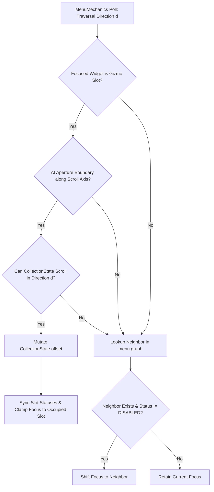

#### Refactor: Phase 06.04 - Inventory

**Overview**

* Division of `Inventory` and `Slots` in `SheetState` (`SpriteState` and `PlayerState`). Introduction of new fields to handle inventory workflows.
* Expansion and clarification of `Inventory` fields (`belt`, `bag`, `pouch`, `pack`, `sheathe`) and removal of `wallet` in favor of `coin` as a standard `pouch` item.
* Separation of the monolithic Inventory Menu into three distinct, Tab-less Menus (`Equipment`, `Pouch`, `Pack`) mapped to independent hardware inputs and `MenuEvent` emissions.
* Redesign of `CollectionState` Gizmo navigation to replace explicit scroll arrow buttons with direct directional traversal and edge-triggered window pagination.
* Addition of `block`, `mine`, and `use` (parameterized by `hand`) to Device input mappings and Intention workflows.

##### Specification

!!! note "Scope"
    Eventually, Tabs will be introduced into the Menu system and the Menus described will be aggregated into different Tabs of the unified Inventory Menu. For the time being, each Menu will be mapped to a different input and displayed separately through different `MenuEvent` dispatches, using a Tab-less Menu for each one.

**Menu: Equipment**

* `dock(header)`: `pane(content="Equipment")`
* `dock(gear)`: `button(slot[k]) for k, v in slots.equipment.items() if k in Gear` (`armor`, `shield`)
* `dock(equipment)`: `button(slot[k]) + gizmo(inventory[m(k)]) for k in slots.equipment.keys() if k not in Gear`
    * `slots.equipment.weapon` $\to$ `inventory.sheathe`
    * `slots.equipment.tool` $\to$ `inventory.belt`
    * `slots.equipment.utility` $\to$ `inventory.bag`

Each non-Gear row of `Equipment` is traversible. Selecting a slottable equipment piece from a row updates the corresponding slot at the beginning of the row, mutating `SheetState.slots.equipment` in place and updating the bound icon closure.

**Menu: Crafts**

* `dock(header)`: `pane(content="Crafts")`
* `stack`:
    * `dock(subheader)`: `pane(content="Resources")`
    * `dock(materials)`: `gizmo(inventory.pack)`
    * `dock(crops)`: `gizmo(inventory.sack)`
* `stack`:
    * `docker(subheader)`: `pane(content="Placeholder for Known Craft Formulae")`

**Menu: Pouch**

* `Row(header)`: `pane(content="Pouch")`
* `Row(grip)`: `button(slots.grip.right) + button(slots.grip.left)`
* `Row(items)`: `gizmo(inventory.pouch)`

**Model: Slots**

* `slots.equipment`:
    * `slots.equipment.weapon`: Injects Equipment Frame into Sprite Frame; used for attack damage; `intention = attack`.
    * `slots.equipment.armor`: Injects Equipment Frame into Sprite Frame; used for defense; classified as `Gear`.
    * `slots.equipment.shield`: Injects Equipment Frame into Sprite Frame; `intention = block`; classified as `Gear`.
    * `slots.equipment.tool`: Injects Equipment Frame into Sprite Frame; `intention = mine`.
    * `slots.equipment.utility`: Injects Equipment Frame into Sprite Frame; persistent environmental and character effects.
* `slots.grip`:
    * `slots.grip.left`: Usable Item; `intention = use`, `mutators.parameters.hand = left`.
    * `slots.grip.right`: Usable Item; `intention = use`, `mutators.parameters.hand = right`.

**Model: Inventory**

* `inventory.belt`: `Dict[Enumerated[Tools], int]`
* `inventory.bag`: `Dict[Enumerated[Utilities], int]`
* `inventory.pouch`: `Dict[Enumerated[Items], int]`
* `inventory.pack`: `Dict[Enumerated[Materials], int]`
* `inventory.sack`: `Dict[Enumerated[Crops], int]`
* `inventory.sheathe`: `Dict[Enumerated[Weapons], int]`

##### Architectural Analysis I

###### 1. Gizmo Traversal & Implicit Edge-Triggered Pagination

Eliminating explicit scroll arrow buttons (`arrow-left`, `arrow-right`) requires `CollectionState` Gizmos to be directly traversible and to paginate when `focus` crosses the boundary of the visible aperture window.

Let a Gizmo have capacity $C$, column count $K$, row count $R = \lceil C / K \rceil$, window offset $\omega \in \mathbb{Z}_{\ge 0}$, and total collection length $N = |\text{collection}|$. An aperture slot at local index $i \in \{0, \dots, C-1\}$ maps to collection index $k = \omega + i$ at grid coordinates:

$$r(i) = \left\lfloor \frac{i}{K} \right\rfloor, \qquad c(i) = i \bmod K$$

Two structural issues in the current codebase prevent button-less Gizmo pagination:

1. **Static Exclusion of `DISABLED` Buttons in `Layout._build_graph`**:

Currently, `Provider._unpack_pane` calls `_sync_collection_slots` before `Layout.compute()`, setting unoccupied slots ($k \ge N$) to `Statuses.DISABLED`. `Layout._build_graph` then skips any button with `status == Statuses.DISABLED`. Consequently, if a Gizmo is initially empty or partially filled, or if a user scrolls to a partial final page where trailing slots become unoccupied, the static `menu.graph` either lacks edges for newly occupied slots or retains stale edges pointing to newly unoccupied slots.

**Architectural Fix**:

* Separate **structural non-traversibility** (e.g., passive display slots like `Gear` in `Menu: Equipment`) from **dynamic slot vacancy**.
* `Layout._build_graph` should include all Gizmo aperture slot buttons in the spatial adjacency graph regardless of whether they are currently occupied, while only excluding buttons explicitly configured as non-interactive display slots (or `MenuMechanics` should dynamically validate neighbor availability).
* When traversing in `MenuMechanics` (or `InventoryController`), an edge to a target button is only followed if `target_button.state.status != Statuses.DISABLED`.

2. **Boundary Traversal Interception (Window Scrolling without Arrow Buttons)**:

When the focused widget is a Gizmo slot button (`SelectBinding` with `selection == Selections.SLOT`, `selector == gizmo_name`, `index == i`), directional input $\tau \in \{\text{NORTH}, \text{SOUTH}, \text{EAST}, \text{WEST}\}$ can be intercepted at the aperture boundary before falling back to `menu.graph`:

* **1D Horizontal Strip Gizmos ($R = 1, C = K$, used in `Menu: Equipment` rows)**:
* Each equipment row (`sheathe`, `belt`, `bag`) is a single horizontal row of $K$ slots stacked vertically beneath one another.
* Vertical inputs (`NORTH`, `SOUTH`) must immediately traverse between equipment rows (`sheathe` $\leftrightarrow$ `belt` $\leftrightarrow$ `bag`) via `menu.graph`.
* Horizontal inputs (`EAST`, `WEST`) navigate within the row and scroll the aperture window when $N > C$:
* If $\tau = \text{EAST}$ and $c(i) = K - 1$ and $\omega + C < N$: increment $\omega \leftarrow \omega + 1$ (or $\omega + K$), re-synchronize slot statuses, and retain/clamp focus inside the Gizmo.
* If $\tau = \text{WEST}$ and $c(i) = 0$ and $\omega > 0$: decrement $\omega \leftarrow \max(0, \omega - 1)$, re-synchronize slot statuses, and retain focus on slot $0$. Only when $\omega = 0$ does $\tau = \text{WEST}$ consult `menu.graph`.

* **2D Grid Gizmos ($R > 1, C = R \cdot K$, used in `Menu: Pouch` and `Menu: Pack`)**:

* Vertical inputs (`NORTH`, `SOUTH`) scroll the window by one row ($K$ elements) at the top and bottom boundaries of the grid:
* If $\tau = \text{SOUTH}$ and $r(i) = R - 1$ and $\omega + C < N$: advance $\omega \leftarrow \omega + K$, call `_sync_collection_slots`, and if $\omega + i \ge N$, clamp focus to the highest occupied slot index $i' < i$.
* If $\tau = \text{NORTH}$ and $r(i) = 0$ and $\omega > 0$: decrement $\omega \leftarrow \max(0, \omega - K)$ and call `_sync_collection_slots`. Only when $r(i) = 0$ and $\omega = 0$ does $\tau = \text{NORTH}$ traverse out of the Gizmo into the `Row(grip)` buttons above.



###### 2. Pouch Dual-Grip Selection State Machine

In `Menu: Equipment`, each Collection Gizmo row corresponds uniquely to a single target slot (`sheathe` $\to$ `weapon`, `belt` $\to$ `tool`, `bag` $\to$ `utility`), so pressing `SELECT` on a Gizmo slot immediately equips the item into that row's slot.

In `Menu: Pouch`, both `slots.grip.right` and `slots.grip.left` draw from the single `inventory.pouch` Collection Gizmo. To allow the player to equip two items to different Grips without redundant Gizmos:

* The two Grip buttons (`pouch-grip-right-slot` and `pouch-grip-left-slot`) are interactive `buttons` bound to `SelectTarget(selection=Selections.GRIP, selector="right" | "left")`.
* `InventoryContext` (or `InventoryController` / `PouchController`) tracks the target hand `grip_target: str` (defaulting to `"right"` on menu open, with `pouch-grip-right-slot` rendered in `Statuses.SELECTED` when idle, or toggled when the user selects either Grip button).

**Workflow**

1. When the user traverses to `pouch-grip-left-slot` or `pouch-grip-right-slot` and presses `SELECT`, `grip_target` switches to `"left"` or `"right"` respectively (updating the unselected grip button to `IDLE` and the active target grip button to `SELECTED`).
2. When the user traverses to `inventory-pouch-grid` and presses `SELECT` on an occupied slot $i$, the controller resolves `item_key = gizmo.state.get_item(i)` and assigns `setattr(state.slots.grip, grip_target, item_key)`.
3. Because `pouch-grip-right-icon` and `pouch-grip-left-icon` use `IconBinding` closures pointing to `context.slots.grip.right` and `context.slots.grip.left`, the newly equipped item icon renders immediately on the next frame.

###### 3. Parameterized `use` Intention & Device Mappings

The specification defines:

* `slots.grip.left`: `intention = use, mutators.parameters.hand = left`
* `slots.grip.right`: `intention = use, mutators.parameters.hand = right`

In `src/app/models/config/mappings.py`, `WorldMapping.intentions` is currently `Dict[Enumerated[Intentions], int]`. Because YAML dictionary keys must be unique, `world.intentions` cannot contain two separate entries keyed by `use`.

**Architectural Resolution**

* Introduce `Hands` (`LEFT = "left"`, `RIGHT = "right"`) in `app.static.semantics`.
* In `WorldMapping.intentions` (and `PlayerIntentions` / `Intentions` semantics), map distinct hardware input actions `use-left` and `use-right` (or add a ` grips: Dict[Enumerated[Hands], int]` mapping on `WorldMapping`), while keeping the canonical Sprite/Sheet `Intentions.USE = "use"` for the Intention Transition Matrix and `AnimationMap`.
* When `PlayerMechanics` processes `payload.world`, a trigger on `use-left` (or `payload.world.grip == Hands.LEFT`) transitions `player.state.intention = Intentions.USE.value` and sets `player.state.mutators.parameters.hand = Hands.LEFT.value` (and analogously `Hands.RIGHT.value` for right grip).

##### User Review I

* `inventory.sack` added for `crops`. Specficiation updated.
* need to differentiate between singular Inventory, things that only have a single instance (e.g. weapons, tools), and Inventory that accumulates (e.g. crops, material).

##### Goals

###### Goal: Segregate `Slots` and `Inventory` on `SheetState`

Refactor `src/app/models/state/assets/sheets.py` and `src/app/static/semantics.py` to decouple active ready-at-hand `Slots` (`equipment` and `grip`) from carried `Inventory` (`belt`, `bag`, `pouch`, `pack`, `sheathe`), and remove `wallet`.

```python
@dataclass(slots=True)
class Equipment:
    armor: Optional[Enumerated[Armor]] = None
    weapon: Optional[Enumerated[Weapons]] = None
    tool: Optional[Enumerated[Tools]] = None
    utility: Optional[Enumerated[Utilities]] = None
    shield: Optional[Enumerated[Shields]] = None

@dataclass(slots=True)
class Grip:
    left: Optional[Enumerated[Items]] = None
    right: Optional[Enumerated[Items]] = None

@dataclass(slots=True)
class Slots:
    equipment: Equipment = field(default_factory=Equipment)
    grip: Grip = field(default_factory=Grip)

@dataclass(slots=True)
class Inventory:
    belt: Dict[Enumerated[Tools], int] = field(default_factory=dict)
    bag: Dict[Enumerated[Utilities], int] = field(default_factory=dict)
    pouch: Dict[Enumerated[Items], int] = field(default_factory=dict)
    pack: Dict[Enumerated[Materials], int] = field(default_factory=dict)
    sheathe: Dict[Enumerated[Weapons], int] = field(default_factory=dict)

@dataclass(slots=True)
class SheetState(AssetState):
    position: Optional[Position] = field(default_factory=lambda: CorePosition(0, 0))
    velocity: Optional[Velocity] = field(default_factory=lambda: CoreVelocity(0.0, 0.0))
    animation: AnimationState = field(default_factory=AnimationState)
    intention: Optional[Enumerated[Intentions]] = Intentions.IDLE.value
    character: Optional[Character] = field(default_factory=Character)
    slots: Optional[Slots] = field(default_factory=Slots)
    inventory: Optional[Inventory] = field(default_factory=Inventory)
    meters: Optional[Meters] = field(default_factory=Meters)
    goal: Optional[Goal] = field(default_factory=Goal)

```

Update `InventoryContext` in `src/app/models/menus/contexts.py` so Menu bindings can resolve both `context.slots.*` and `context.inventory.*`:

```python
@dataclass(slots=True)
class InventoryContext(MenuContext):
    slots: Slots
    inventory: Inventory

```

###### Goal: Implement Direct Gizmo Traversal and Edge Pagination

Remove scroll arrow buttons from `Inventory` menu configurations and enable `CollectionState` Gizmos to scroll automatically when directional traversal crosses the aperture boundary.

1. Update `CollectionState` (`src/app/models/state/assets/widgets.py`) with directional boundary predicates (`can_scroll_north`, `can_scroll_south`, `can_scroll_west`, `can_scroll_east`) based on `capacity`, `columns`, `offset`, and `len(self.collection)`.
2. Update `Layout._build_graph` (`src/app/services/generators/menus/layout.py`) so that all Gizmo slot buttons participate in the geometric AABB adjacency graph regardless of initial vacancy, while `MenuMechanics` checks `target.state.status != Statuses.DISABLED.value` at traversal time.
3. In `MenuMechanics` / `InventoryController`, when focus resides on a `Selections.SLOT` button at the edge of its Gizmo's scroll axis and more items exist in that direction, mutate `CollectionState.offset`, invoke `Provider._sync_collection_slots`, and clamp focus to an occupied slot.

###### Goal: Decompose Inventory Menu into `Equipment`, `Pouch`, and `Pack` Menus

Replace the monolithic `menus.inventory` configuration in `src/data/config/menus/inventory/main.yaml` with three standalone menu definitions (`equipment`, `pouch`, `pack`):

* **`equipment`**:
    * Header pane (`"EQUIPMENT"`).
    * Gear row (`dock` pane): two disabled/non-traversible display slots bound to `context.slots.equipment.armor` (`id: armor`) and `context.slots.equipment.shield` (`id: shields`).
    * Weapon row (`dock` pane): display slot bound to `context.slots.equipment.weapon` (`id: weapons`) + 1x4 Collection Gizmo (`id: weapons`, `source: context.inventory.sheathe`, `capacity: 4`, `columns: 4`).
    * Tool row (`dock` pane): display slot bound to `context.slots.equipment.tool` (`id: tools`) + 1x4 Collection Gizmo (`id: tools`, `source: context.inventory.belt`, `capacity: 4`, `columns: 4`).
    * Utility row (`dock` pane): display slot bound to `context.slots.equipment.utility` (`id: utilities`) + 1x4 Collection Gizmo (`id: utilities`, `source: context.inventory.bag`, `capacity: 4`, `columns: 4`).

* **`pouch`**:
    * Header pane (`"POUCH"`).
    * Grip row (`dock` pane): two interactive slot buttons bound to `SelectTarget(selection=Selections.GRIP, selector="right")` (`context.slots.grip.right`, `id: items`) and `SelectTarget(selection=Selections.GRIP, selector="left")` (`context.slots.grip.left`, `id: items`).
    * Items grid: 2x4 Collection Gizmo (`id: items`, `source: context.inventory.pouch`, `capacity: 8`, `columns: 4`).
* **`pack`**:
    * Header pane (`"PACK"`).
    * Two-column `dock` body pane:
    * Left `stack` column: `"RESOURCES"` subheader pane + 2x4 Collection Gizmo (`id: materials`, `source: context.inventory.pack`, `capacity: 8`, `columns: 4`).
    * Right `stack` column: `"CRAFT FORMULAE"` placeholder subheader pane.

###### Goal: Expand Device Mappings and Intention Routing

Update `src/app/static/semantics.py`, `src/app/models/config/mappings.py`, `src/data/config/mappings/main.yaml`, and `src/app/game/logic/mechanics/intentional/player.py` to support:

* World Menu triggers: `Menus.EQUIPMENT`, `Menus.POUCH`, `Menus.PACK`.
* World Intention triggers: `Intentions.BLOCK`, `Intentions.MINE`, `Intentions.USE` (with `hand` parameter resolution for `left` and `right` grips on `mutators.parameters.hand`).

##### Tasks

**1. Task: Refactor `SheetState`, `Slots`, and `Inventory` Data Models**

*Objective*: Separate `Slots` and `Inventory` on `SheetState`, expand inventory dictionary partitions, add `hand` parameter support to `Mutators`, and migrate existing state and semantic definitions.

* [x] Subtask: Update `src/app/static/semantics.py` to add `Menus` keys (`EQUIPMENT`, `POUCH`, `PACK`), `Intentions` keys (`BLOCK`, `USE`), `Hands` (`LEFT`, `RIGHT`), `Selections.GRIP`, and item/equipment enumeration classes (`ArmorPalette`, `CropPalette`, `ItemPalette`, `MaterialPalette`, `ShieldPalette`, `UtilityPalette`, `ToolPalette`, `WeaponPalette`) matching `src/assets/widgets/main.yaml#widgets.icons`.
* [x] Subtask: Refactor `src/app/models/state/assets/sheets.py` to define `Grip`, `Slots(equipment, grip)`, and updated `Inventory(belt, bag, pouch, pack, sheathe)`, removing `wallet` and attaching `slots: Optional[Slots]` to `SheetState`.
* [x] Subtask: Add `hand: Optional[Enumerated[Hands]] = None` to `Mutators.parameters` in `src/app/models/state/core.py`.
* [x] Subtask: Update `SpriteFrame.keys` in `src/app/assets/frames/sheets.py` and `AnimationMap.action` in `src/app/game/logic/modules/maps/animation.py` to read active equipment from `state.slots.equipment` instead of `state.inventory.equipment`.
* [x: application]: [ : test fixtures] Subtask: Migrate all board state YAML files in `src/data/state/**` and test fixtures in `tests/` from `inventory.equipment` / `inventory.wallet` to `slots.equipment`, `slots.grip`, and the 5 `inventory` dictionaries.

**2. Task: Upgrade `CollectionState`, `Layout`, and `MenuMechanics` for Button-less Gizmo Traversal**

*Objective*: Enable direct cardinal traversal across Gizmo slots with automatic window scrolling when the binding count exceeds Gizmo capacity.

* [ ] Subtask: Update `Layout._build_graph` in `src/app/services/generators/menus/layout.py` so Gizmo aperture buttons (`Selections.SLOT`) are always indexed into `menu.graph` regardless of initial vacancy, while `MenuMechanics` filters out transitions to neighbors currently in `Statuses.DISABLED`.
* [ ] Subtask: Add boundary scroll resolution methods to `CollectionState` in `src/app/models/state/assets/widgets.py` supporting 1D horizontal strip scrolling (`capacity == columns`, scrolling by 1 or `columns` on `WEST`/`EAST`) and 2D grid scrolling (`capacity > columns`, scrolling by `columns` on `NORTH`/`SOUTH`).
* [ ] Subtask: Update `MenuMechanics` and `InventoryController` so edge traversal on a focused Gizmo slot triggers `CollectionState` scrolling, calls `Provider._sync_collection_slots` to refresh button `IDLE`/`DISABLED` statuses, and clamps focus to the nearest occupied slot.

**3. Task: Implement `Equipment`, `Pouch`, and `Pack` Menus and Controller Logic**

*Objective*: Split the monolithic Inventory Menu configuration into `equipment`, `pouch`, and `pack` Menus and update `InventoryController` to support row-scoped equipment slotting and dual-grip selection.

* [x] Subtask: Update `InventoryContext` in `src/app/models/menus/contexts.py` to accept both `slots: Slots` and `inventory: Inventory` (and `active_grip: str = "right"`).
* [ ] Subtask: Refactor `src/data/config/menus/inventory/main.yaml` to define `menus.equipment`, `menus.pouch`, and `menus.pack` according to the Phase 06.04 specification without scroll arrow buttons.
* [ ] Subtask: Refactor `InventoryController` in `src/app/game/menus/controllers/inventory.py` to handle `Selections.GRIP` (latching `active_grip` between `"left"` and `"right"` and toggling `Statuses.SELECTED` on the grip buttons) and `Selections.SLOT` (equipping weapons, tools, and utilities into `state.slots.equipment` in `Menu: Equipment`, or equipping usable items into ` getattr(state.slots.grip, active_grip)` in `Menu: Pouch`), removing the erroneous `UpdateEvent` text stamp on `CollectionState` panes.

**4. Task: Wire Device Mappings and `PlayerMechanics` for New Menus and Intentions**

*Objective*: Connect hardware inputs for `equipment`, `pouch`, `pack`, `block`, `mine`, and parameterized `use` (`left`/`right` hand) to `Device` polling and `PlayerMechanics`.

* [ ] Subtask: Update `WorldMapping` (`src/app/models/config/mappings.py`), `WorldPayload` (`src/app/models/state/devices.py`), `Keyboard.poll` (`src/app/game/devices.py`), and `src/data/config/mappings/main.yaml` to map distinct scancodes for `equipment`, `pouch`, and `pack` menus, as well as `block`, `mine`, and left/right hand `use` intentions.
* [ ] Subtask: Update `PlayerMechanics.update` in `src/app/game/logic/mechanics/intentional/player.py` to dispatch `MenuEvent` with `InventoryContext(slots=player.state.slots, inventory=player.state.inventory)` for `Menus.EQUIPMENT`, `Menus.POUCH`, and `Menus.PACK`, and to populate `player.state.mutators.parameters.hand` when entering `Intentions.USE`.
* [!: Dependent on User Acceptance Testing] Subtask: Add unit and integration tests covering `Slots` and `Inventory` hydration, `Equipment`/`Pouch`/`Pack` menu unpacking, edge-triggered Gizmo scrolling, and dual-grip item assignment.

##### Bugs

###### Bug B019: Gizmo Pagination Desynchronizes Slot Statuses and Rasterizes Offset Text Over Grid

**STATUS**: OPEN
**SEVERITY**: HIGH

**Description**

In `src/app/game/menus/controllers/inventory.py`, when `InventoryController.select` handles `Selections.SCROLLDOWN` or `Selections.SCROLLUP`, it mutates `target_widget.state.offset` on the `CollectionState` pane and appends `UpdateEvent(widget=target_widget, content=str(target_widget.state.offset))` to the Engine bus:

1. `Provider._sync_collection_slots` is never called after `scrollup()` or `scrolldown()`, leaving all child slot buttons (`{pane_name}-slot-{i}`) in their previous `Statuses.IDLE` or `Statuses.DISABLED` states regardless of whether the newly windowed slot index `offset + i` is occupied.
2. Passing `target_widget` (whose state is `CollectionState(PaneState)`) and `content=str(target_widget.state.offset)` into `UpdateEvent` causes `UpdateEventHandler` to invoke `Screen.stamp(target_widget, str(offset))`. `Screen.stamp` allocates a `TexturePtr` canvas on the transparent Gizmo container pane and rasterizes the raw numeric offset string (e.g. `"4"`) across the Gizmo grid using the menu font.

**Steps to Replicate**

1. Populate a player's `inventory.pouch` with more items than the Gizmo capacity ($N > 4$, e.g., 6 items).
2. Open the Inventory Menu and select `inventory-pouch-scroll-down` (`arrow-right`).
3. Observe that the string `"4"` is stamped onto `inventory-pouch-grid.state.canvas` and rendered over the grid, while vacant slots `slot-2` and `slot-3` remain in `Statuses.IDLE` and remain selectable.

**Proposed Remeditation**

1. Remove the `bus.append(UpdateEvent(widget=target_widget, content=str(target_widget.state.offset)))` calls from `InventoryController.select` (and remove `UpdateEvent(widget=widget, content=item_key)` on slot selection, as `IconBinding` closures and `ApertureBinding` closures evaluate dynamically every frame in `Screen._widgets`).
2. Invoke `Provider._sync_collection_slots(target_widget.name, target_widget.state, menu.widgets)` whenever `CollectionState.offset` or the underlying collection mutates.

###### Bug B020: Static Exclusion of Initially Disabled Gizmo Slots in `Layout._build_graph`

**STATUS**: OPEN
**SEVERITY**: MEDIUM

**Description**

In `src/app/services/generators/menus/provider.py`, `_unpack_pane` executes `_sync_collection_slots` during Phase 2 hydration, setting any unoccupied Gizmo slot ($i \ge |\text{collection}|$) to `Statuses.DISABLED` prior to Phase 3 (`layout.compute`). In `src/app/services/generators/menus/layout.py`, `Layout._build_graph` skips any button where `b.state.status == Statuses.DISABLED.value`. If any Gizmo slot is unoccupied when the Menu is unpacked (or if a collection changes size / paginates dynamically), those slot buttons are omitted from `menu.graph` and can never be reached via directional traversal without destroying and re-unpacking the Menu.

**Steps to Replicate**

1. Unpack a Menu containing a `CollectionState` Gizmo where initial item count is less than `capacity` (e.g., 2 items in a 4-slot Gizmo).
2. Mutate the bound collection or window state so slot index `2` becomes occupied and its status is updated to `Statuses.IDLE`.
3. Attempt to traverse `EAST` from `slot-1` to `slot-2`; traversal fails because `graph["...-slot-1"]` has no `east` entry.

**Proposed Remeditation**

In `Layout._build_graph`, include Gizmo slot buttons (`widget.binding.selection == Selections.SLOT.value`) when computing geometric AABB adjacency edges regardless of their initial `IDLE`/`DISABLED` status, and enforce `menu.widgets[neighbor].state.status != Statuses.DISABLED.value` during runtime focus traversal in `MenuMechanics`.