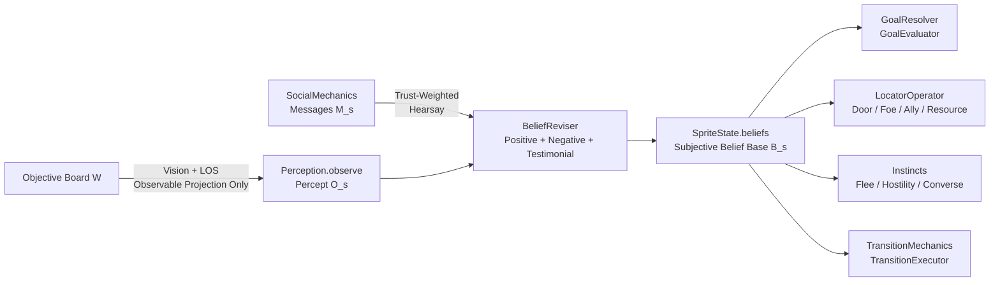
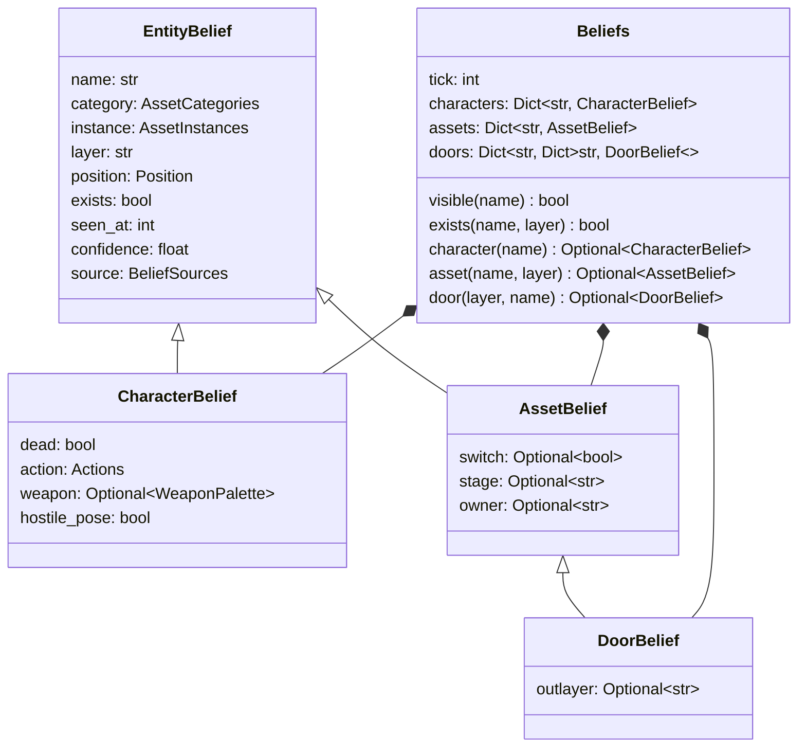
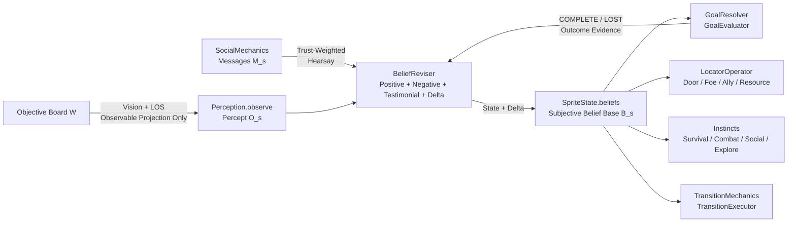
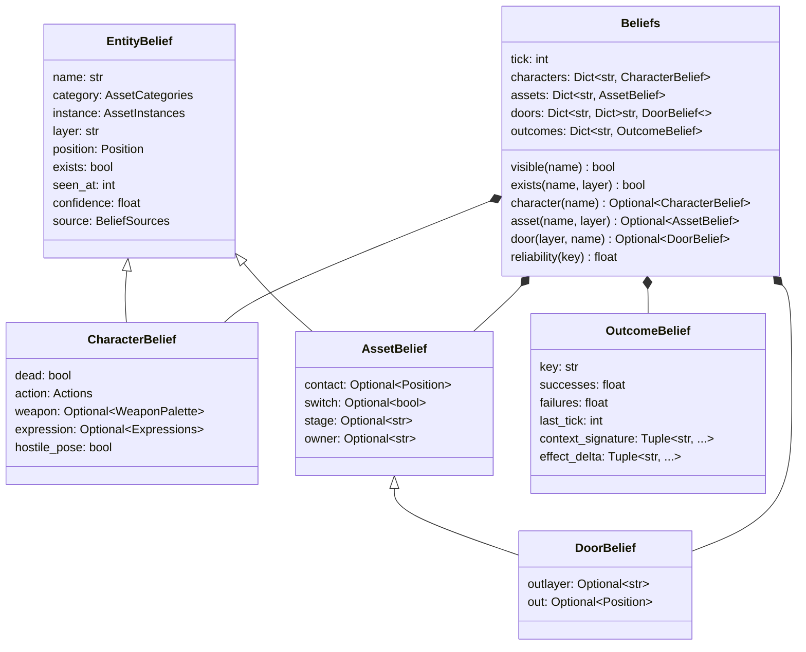

#### Refactor: Phase 06.05 - Beliefs

**Overview**

Relativize all Sprite cognitive evaluation (`TransitionMechanics`, `GoalResolver`, `LocatorOperator`, and `Instincts`) from objective `Board` state to a subjective, per-Sprite **Belief Base** (`Beliefs`) on `SpriteState`. Replace the omniscient `sprites` and `assets` ISL locals with `beliefs`, upgrade `Perception` into an observational **Belief Revision** stage supporting positive sightings, line-of-sight occlusion, and negative absence detection, restrict inter-Sprite perception strictly to externally observable state projections (eliminating private mind-reading), and wire `SocialMechanics` to exchange testimonial beliefs (`rumors`, entity sightings, and Door routes) modulated by trust and freshness.

##### Specification

###### 1. Formal Epistemic Update Cycle

At each simulation tick $t$, an autonomous Sprite $s$ updates its subjective Belief Base $B_s(t)$ from objective `Board` state $W(t)$ and incoming social messages $M_s(t)$ prior to any deliberative evaluation:

$$O_s(t) = \text{Observe}\big(W(t), \; s(t)\big)$$

$$B_s(t) = \text{Revise}\big(B_s(t-1), \; O_s(t), \; M_s(t)\big)$$

$$\text{GoalOutcome}(t) = \text{GoalEvaluator}\big(s.\text{goal.category}, \; \{\texttt{sprite}: s, \; \texttt{beliefs}: B_s(t)\}\big)$$

$$\text{NextIntention}(t) = \text{TransitionExecutor}\big(s.\text{intention}, \; \{\texttt{sprite}: s, \; \texttt{beliefs}: B_s(t)\}\big)$$



* **Body / Mind Separation:** `Perception`, `NavigationMechanics`, `MotionMechanics`, and `SpatialMechanics` interact with objective `Board` state $W$. `GoalResolver`, `Recall`, `Instincts`, `LocatorOperator`, and `TransitionMechanics` operate exclusively over `(sprite.state, sprite.state.beliefs)` with zero direct reads of `board.characters()` or `board.states()`.

###### 2. Belief Data Hierarchy

`Beliefs` sits on `SpriteState` (never on `SheetState` or `CharacterState`) and stores sparse, slot-allocated records representing what the Sprite takes to be true about deployed entities:



* **Observable Projection Invariant:** `CharacterBelief` captures strictly externally observable traits (`position`, `layer`, `dead`, visible `action`, equipped `weapon`, whether visibly attacking/threatening) — never private internal attributes (`inventory`, `meters.health`, `psyche.motivation`, `memory`).
* **Zero-Reset Freshness:** Direct observation stamps `belief.seen_at = beliefs.tick`. Live visibility reduces to an $O(1)$ timestamp test with zero per-tick clearing loop:
  $$\text{visible}(b) \iff \big(b.\text{exists}\big) \land \big(b.\text{seen\_at} = B_s.\text{tick}\big)$$
* **Separation from Conative `Memory`:** `sprite.state.memory` retains conative and relational stores (`goals`, `stack`, `relationships`, `prices`, `rumors`), while spatial/world-model tables (`memory.sprites`, `memory.doors`, `memory.property`) migrate cleanly into `sprite.state.beliefs`.

###### 3. Epistemic Revision Rules

`BeliefReviser` resolves conflicts using provenance priority (`DIRECT > TESTIMONIAL > INITIAL`), recency (`seen_at`), and trust:

1. **Positive Revision (Direct Observation):** Any entity within `vision.radius` on `sprite.layer` whose anchor passes `geometry.los` (unobstructed by solid elevation obstacles) updates its existing `EntityBelief` in place with `seen_at = tick`, `exists = True`, `confidence = 1.0`, `source = BeliefSources.DIRECT`.
2. **Negative Revision (Observed Absence):** For any belief $b \in B_s$ on `sprite.layer` with $b.\text{exists} = \top$, $b.\text{seen\_at} < B_s.\text{tick}$, and whose believed `b.position` lies within `vision.radius` with clear `geometry.los`:
   * If $b$ is a **static Asset** (`AssetBelief` / `DoorBelief`): set `b.exists = False` (and `b.seen_at = tick`), allowing `object.complete`, `resource.complete`, or `door.lost` to resolve upon discovering the empty site rather than telepathically from afar.
   * If $b$ is a **mobile Character** (`CharacterBelief`): leave `b.exists = True` (the Character moved, not necessarily vanished); `visible(b)` is `False`, triggering `lost` + `confusion` + `store` upon arriving at the empty last-known location.
3. **Testimonial Revision (Social Communication):** During `speak` in `SocialMechanics`, a speaker may share selected beliefs (e.g., high-salience `CharacterBelief` sightings or `DoorBelief` routes) with a listener. Incoming testimony is accepted only if the listener trusts the speaker (`FRIEND`/`FAMILY`, not `FOE`), holds no fresher direct observation (`incoming.seen_at > current.seen_at` or `current.source != DIRECT`), and discounts `confidence` by a decay factor $\gamma \in (0, 1)$.
4. **Bounded Retention (Forgetting):** Beliefs exceeding `BELIEF_TTL` ticks since `seen_at` that are not referenced by `sprite.goal`, `memory.goals`, `memory.stack`, `memory.relationships`, or self-owned `property` are pruned periodically to bound memory per Sprite.

###### 4. Relativized ISL Contract

Both `TransitionExecutor` (`intentions/main.yaml`) and `GoalEvaluator` (`goals/main.yaml`) compile against a single unified local signature:

* `sprite`: Evaluating Sprite's `SpriteState`
* `beliefs`: Evaluating Sprite's `Beliefs` (`sprite.beliefs`)
* `constants`: Application semantic enumerations (including `BeliefSources`)
* `functions`: Pure predicates operating over `(sprite, beliefs)` — replacing `any_memories_visible(sprite, sprites, categories)` with `any_memories_visible(sprite, beliefs, categories)`

Representative relativized rules:

```yaml
# goals/main.yaml (relativized)
goals:
  target:
    complete:
      reflexes: []
      responses: [ forget ]
      conditions:
        - not beliefs.character(sprite.goal.name) or beliefs.character(sprite.goal.name).dead
  door:
    lost:
      reflexes: []
      responses: [ forget, unwind ]
      conditions:
        - not beliefs.exists(sprite.goal.name, sprite.layer) or sprite.trajectory.stalled
  object:
    complete:
      reflexes: []
      responses: [ forget ]
      conditions:
        - sprite.layer == sprite.goal.layer
        - not beliefs.exists(sprite.goal.name, sprite.layer) or sprite.mutators.triggers.interacted
  resource:
    complete:
      reflexes: []
      responses: [ forget ]
      conditions:
        - sprite.layer == sprite.goal.layer
        - not beliefs.exists(sprite.goal.name, sprite.layer)
```

##### Architectural Analysis I

1. **Building on Phase 06.02's End State Without Rework:**
   * Phase 06.02's decomposition of `CognitionMechanics` into `Perception`, `GoalResolver`, `Recall`, `Instincts`, and `LocatorOperator` already isolates the exact seams needed for relativization.
   * Replacing `target` with `assets` in Phase 06.02 Task 4 removes ad-hoc lookup fallbacks immediately; Phase 06.05 then cleanly swaps `(sprites, assets)` for `beliefs` in one atomic cut across `GoalResolver`, `TransitionMechanics`, `Environ`, `settings.LAMBDA_SIGNATURE`, and the two automata YAML matrices.
2. **Eliminating `triggers.vision` Drift:**
   * In Phase 06.02, `mutators.triggers.vision` tracks visibility for the single active Goal only, requiring careful synchronization whenever `sprite.state.goal` changes in Stage 2 or Stage 3.
   * With tick-stamped `Beliefs`, `beliefs.visible(name)` is intrinsically exact for *every* known entity simultaneously; `triggers.vision` becomes a simple derived mirror of `beliefs.visible(goal.name)` (or can be retired from ISL conditions altogether in favor of `beliefs.visible(sprite.goal.name)`).
3. **Bootstrap & Initial Beliefs from State YAML:**
   * Scenarios where a Sprite begins the simulation knowing about an entity on another Layer (e.g., Empress Jasilynn starting on `throne-layer-3` with a `subject` Goal for `player` on Layer `'0'`) remain fully supported: initial State files seed `sprite.beliefs` (with `source = INITIAL`, `seen_at = 0`), preserving intentional agency from tick 1 without granting omniscience about subsequent world changes!
4. **Performance Guardrails:**
   * Running `geometry.los` against every obstacle for every entity in `vision.radius` for every Sprite can become expensive in dense scenes. `Perception.observe` must filter by **same Layer** and **squared Euclidean radius** first, exclude static Tiles and passive Effects, and only execute `geometry.los` on the small candidate set inside `vision.radius` (caching per-Layer static obstacle tuples once per tick outside the Sprite loop).
   * Updating `EntityBelief` fields in place preserves Ontology's zero-allocation inner-loop principle.

##### Goals

###### Goal: Subjective `Beliefs` Model & AGM-Inspired Belief Revision

Introduce `Beliefs`, `EntityBelief`, `CharacterBelief`, `AssetBelief`, and `DoorBelief` on `SpriteState` (migrating spatial/world-model maps out of `Memory`), backed by a `BeliefReviser` module under `app.game.logic.modules.cognition` handling direct positive observation, observed-absence negative revision, trust-weighted testimonial revision, and TTL pruning.

###### Goal: Epistemically Relativized ISL Execution & Cognitive Modules

Remove objective `sprites` and `assets` collections from `TransitionExecutor`, `GoalEvaluator`, `settings.LAMBDA_SIGNATURE`, and `Environ.functions`, passing only `(sprite, beliefs)` into all Intention and Goal rules. Migrate `LocatorOperator` (`DoorLocator` and future entity locators) and `Instincts` (`Flee`, `Hostility`, `Converse`) to query `sprite.state.beliefs` exclusively so `Perception` is the sole boundary reading `Board` state into cognition.

###### Goal: Observable State Projection & Social Information Propagation

Enforce strict projection of externally observable traits in `Perception.observe` (with `geometry.los` occlusion) and extend `SocialMechanics` so conversing Sprites exchange high-salience beliefs (character sightings, deaths, door routes) with provenance and trust discounting — unlocking emergent rumors, false beliefs, stealth, and scouting.

##### Tasks

**1. Task: Belief Semantics, State Models & Hydration Schema**

*Objective*: Define strict Pydantic-validated Belief models on `SpriteState`, enumerate epistemic provenance semantics, and migrate spatial/world-model tables cleanly from `Memory` into `Beliefs`.

* [ ] Subtask: Add `BeliefSources` (`initial`, `direct`, `rumor`) to `app.static.semantics` and expose it in `Environ.constants`.
* [ ] Subtask: Define `@dataclass(slots=True)` models `EntityBelief`, `CharacterBelief(EntityBelief)`, `AssetBelief(EntityBelief)`, `DoorBelief(AssetBelief)`, and `Beliefs` (with typed query helpers `visible`, `exists`, `character`, `asset`, `door`) in `src/app/models/state/assets/beliefs.py` (or `sheets.py`), and attach `beliefs: Beliefs = field(default_factory=Beliefs)` strictly on `SpriteState`.
* [ ] Subtask: Migrate `memory.sprites`, `memory.doors`, and `memory.property` references into `sprite.beliefs` (`characters`, `doors`, `assets` with `owner`), retaining conative/relational fields (`goals`, `stack`, `relationships`, `prices`, `rumors`) on `Memory`, and update `/src/data/state/**/*.yaml` schemas and `Board.serialize` accordingly.
* [ ] Subtask: Add `BELIEF_TTL` and `RUMOR_CONFIDENCE_DECAY` configuration constants to `app.static.settings`.

**2. Task: Perception Observation Projection & `BeliefReviser`**

*Objective*: Upgrade `Perception` into the sole sensorimotor bridge from `Board` to `Beliefs`, implementing observable-only projection, LOS occlusion, negative absence revision, and bounded retention.

* [ ] Subtask: Create `src/app/game/logic/modules/cognition/beliefs.py` implementing `BeliefReviser` with `observe_positive(beliefs, percept)`, `observe_absence(beliefs, sprite, visible_names, obstacles)`, `assimilate_testimony(beliefs, incoming, relationship)`, and `prune(beliefs, memory, ttl)` — mutating existing slot records in place with zero inner-loop heap churn.
* [ ] Subtask: Update `Perception` in `src/app/game/logic/modules/cognition/perception.py` to advance `beliefs.tick`, cache per-Layer static obstacle primitives once per tick, filter same-Layer `Characters`, `Doors`, `Objects`, `Resources`, and `Crafts` by `vision.radius` + `geometry.los` (optional `geometry.cone`), project strictly observable attributes into `EntityBelief` updates, and execute negative absence revision for expected static assets missing within visible LOS.
* [ ] Subtask: Re-anchor `Perception.fear` and `Perception.track` onto `sprite.state.beliefs`: evaluate `triggers.frightened` solely from currently visible hostile `CharacterBelief` entries within `fear.radius` (plus self health ratio), wake dormant `memory.goals` when `beliefs` receives a fresh direct or trusted testimonial update, and derive `triggers.vision` from `beliefs.visible(goal.name)`.
* [ ] Subtask: Update `InteractionMechanics` Door traversal to record bidirectional `DoorBelief` entries directly into `sprite.state.beliefs.doors` (recording `outlayer` on both origin and reciprocal `OUT` projections).

**3. Task: Relativize ISL Signature, `GoalResolver`, `TransitionMechanics`, `LocatorOperator` & `Instincts`**

*Objective*: Remove all objective `Board` collections (`sprites`, `assets`) from ISL execution and deliberative cognitive modules so Sprite decisions depend exclusively on `(sprite, beliefs)`.

* [ ] Subtask: Update `settings.LAMBDA_SIGNATURE` to replace `sprites=None, assets=None` with `beliefs=None` (verifying `PlotMechanics` and `SeasonMechanics` locals remain unaffected), and refactor `Environ.functions.any_memories_visible(sprite, beliefs, categories)` to query `beliefs.visible(goal.name)` and `not beliefs.character(goal.name).dead` without inspecting `Board` character dicts.
* [ ] Subtask: Update `GoalResolver.evaluate(state, beliefs)` and `GoalResolver.resolve(sprite, board)` to pass `locals={'sprite': sprite.state, 'beliefs': sprite.state.beliefs}`, and update `TransitionMechanics.update()` to pass `locals={'sprite': sprite.state, 'beliefs': sprite.state.beliefs}` (removing the `board.characters()` query from `TransitionMechanics`).
* [ ] Subtask: Update `/src/data/configurations/automata/goals/main.yaml` and `/src/data/configurations/automata/intentions/main.yaml` to query `beliefs` (`beliefs.character(...)`, `beliefs.asset(...)`, `beliefs.exists(...)`, `beliefs.visible(...)`) instead of `sprites` and `assets`, eliminating all remaining cross-layer and off-vision telepathy.
* [ ] Subtask: Refactor `DoorLocator` (`cognition/locators.py`) and all concrete `Instincts` (`FleeInstinct`, `HostilityInstinct`, `ConverseInstinct`) to read `sprite.state.beliefs` exclusively rather than scanning `board.characters()` or `board.instances(AssetInstances.DOORS)` directly.

**4. Task: Testimonial Belief Exchange in `SocialMechanics`**

*Objective*: Enable Sprites in `speak` to propagate subjective beliefs (entity sightings, deaths, and Door routes) with trust filtering and provenance precedence.

* [ ] Subtask: Extend `SocialMechanics` Sprite-to-Sprite dialogue exchange to select salient recent beliefs from the speaker's `Beliefs` (e.g., observed `FOE` locations/deaths, mapped `DoorBelief` routes, or requested `memory.goals` subjects) and feed them through `BeliefReviser.assimilate_testimony(...)` on the listener.
* [ ] Subtask: Ensure direct sightings (`BeliefSources.DIRECT`) always supersede hearsay (`BeliefSources.RUMOR`), distrusted speakers (`Relationships.FOE`) are rejected, and receiving a trusted sighting of a dormant remembered Goal wakes it (`dormant = False`) with the rumored coordinates and Layer.

**5. Task: Verification & Epistemic Isolation Tests**

*Objective*: Verify zero epistemic leakage, false-belief persistence and revision upon arrival, testimonial belief propagation, and AST/Lambda backend parity.

* [!: Dependent on User Acceptance Tests] Subtask: Add unit tests verifying `BeliefReviser` positive revision, negative absence revision for missing static Assets (`object`/`resource`/`door`) vs. non-lethal absence for mobile Characters (`target`/`subject`), `seen_at == tick` zero-reset visibility, and `BELIEF_TTL` pruning without evicting active/stored Goals.
* [!: Dependent on User Acceptance Tests] Subtask: Add epistemic isolation tests confirming a Sprite with a distant `target`, `resource`, or `object` Goal retains its false belief when the target dies or is removed outside `vision.radius` / behind an LOS wall, and resolves `complete`/`lost` only once the Sprite enters visible LOS of the location (or receives a trusted rumor).
* [!: Dependent on User Acceptance Tests] Subtask: Add `Compiler` vs. `Lambda` parity tests for the relativized `locals={'sprite': ..., 'beliefs': ...}` contract across `goals/main.yaml` and `intentions/main.yaml`, plus `SocialMechanics` rumor-propagation tests (trust acceptance vs. `FOE` rejection, direct-observation dominance over stale rumors).


---


## Formal Assessment: Applying the Theory to Ontology

Your direction is structurally sound—**Tasks as Goal sequences** executed over a **subjective Belief Base** with **outcome-driven conditioning** is the right bridge between Ontology's finite automata (`TransitionMechanics` / `GoalResolver`) and BDI plan learning. Three formal adjustments are required so the theory fits the Engine without combinatorial collapse or architectural drift.

### 1. The Boundary Condition: Belief Satisfaction, Not Total State Equality

Writing $E(P_t) = w_{t+1}$ introduces two mismatches with the Engine:

* **Multi-tick span:** A Task $P$ is a temporally extended operator spanning $k \ge 1$ ticks (multiple Goal loops and Intention transitions), not a single-tick transition $t \to t+1$.
* **Partial observability & frame separation:** Objective `Board` state $W(t+k)$ changes due to unrelated Mechanics (Seasons, Fluids, other Sprites). The Sprite never sees $W(t+k)$; it only observes its revised subjective belief base $B_s(t+k)$.

Formally, a Task $P$ is a lifted schema $\langle \Phi_{\text{pre}}, \; [g_1, \dots, g_m], \; \Phi_{\text{post}} \rangle$ whose boundary condition is **belief satisfiability over an observed delta**, not equality with full world state:

$$B_s(t_0) \models \Phi_{\text{pre}}(P) \;\xrightarrow{\;P = [g_1, \dots, g_m]\;}\; B_s(t_0 + k) \models \Phi_{\text{post}}(P)$$

The measurable signal at termination is the **Belief Delta** $\Delta B_s(t_0 \to t_0+k)$ (e.g., an `AssetBelief.switch` flipping, a `CharacterBelief.dead` becoming `True`, a `DoorBelief` route unlocking, or an Inventory increment) checked against $\Phi_{\text{post}}(P)$.

### 2. Task Formalization: Exact Fit with `memory.stack`

Formalizing a Task as an ordered sequence of Goals $[g_1, \dots, g_m]$ maps directly onto Ontology's existing Commitment Stack (`sprite.state.memory.stack`), `PushResponse`, `UnwindResponse`, and `Recall` Tier 2. Today, `LayeredOutcome` already performs single-step decomposition by pushing a parent Goal and activating a prerequisite `Goals.DOOR` Goal. Generalizing this to push $[g_m, \dots, g_2]$ onto `memory.stack` and activate $g_1$ preserves strict Separation of Duties: `TransitionMechanics` never needs to know a Task exists.

### 3. Task Space Conditionalization vs. "Nulling Out"

Enumerating all possible Tasks and permanently nulling out failed ones fails in Ontology for three formal reasons:

1. **Combinatorial Explosion:** Grounded Goal sequences over deployed Board Assets scale as $O(\vert{}\mathcal{A}\vert{}^m)$. The Task Space must be **lifted** (parameterized by `Goals`, `AssetCategories`, `AssetInstances`, `Equipment`, and `Relationships`, not grounded `name`s) and **expanded lazily** from declarative decomposition schemas or MDL-gated macro-compilation of recurring successful traces.
2. **Subgoal Credit Assignment (BUL):** If $P = [g_1, g_2]$ fails because $g_1$ hit a transient `trajectory.stalled`, nulling $P$ misattributes a tactical navigation failure to the strategic schema. Failure should only propagate to $P$'s applicability estimate once subgoal reliability stabilizes.
3. **Non-Stationary World Dynamics:** Plates toggle Gates, Seasons regrow Resources, and Characters move. Permanently deleting a Task locks the Sprite out of strategies that later become valid. Instead of nulling out Tasks, store **exponentially decayed success/failure evidence** $(\alpha, \beta)$ indexed by `(task_schema, context_signature)`. Failed strategies drop below an admissibility threshold (effective suppression) and automatically recover eligibility as evidence decays or when a new `BeliefDelta` invalidates the obstructing belief.

### 4. Phase Boundary: Phase 06.05 (Beliefs) vs. Phase 06.06 (Goal Decomposition)

Keep the two phases cleanly separated so Phase 06.05 stays cohesive while laying the exact epistemic foundation Phase 06.06 needs:

* **Phase 06.05 (`Beliefs`):** Owns the **epistemic world model** $B_s(t)$, observable-only projection, `BeliefReviser` (positive, negative, testimonial, TTL), **Belief Delta detection** ($\Delta B_s$), and **defeasible Outcome/Episodic Reliability Beliefs** (decayed $(\alpha, \beta)$ records for Goal attempts and observed causal transitions—replacing the ad-hoc `_stalled_doors` / `_stalled_static` side-channel dicts currently living on `Perception`).
* **Phase 06.06 (`Goal Decomposition`):** Owns the **teleological Task Space**: formalizing Tasks as lifted Goal sequences over `memory.stack`, selecting/conditionalizing Tasks against 06.05's `Beliefs` and `OutcomeBelief` priors, applying Bottom-Up Learning credit assignment, and gating macro-Task invention with MDL and counterfactual pruning.

---

## Updated Task Board Entry: Phase 06.05

#### Refactor: Phase 06.05 - Beliefs

**Overview**

Relativize all Sprite cognitive evaluation (`TransitionMechanics`, `GoalResolver`, `LocatorOperator`, and `Instincts`) from objective `Board` state to a subjective, per-Sprite **Belief Base** (`Beliefs`) on `SpriteState`. Replace the omniscient `sprites` and `assets` ISL locals with `beliefs`, upgrade `Perception` into an observational **Belief Revision** stage supporting positive sightings, line-of-sight occlusion, negative absence detection, and **Belief Delta** ($\Delta B_s$) extraction, restrict inter-Sprite perception strictly to externally observable state projections (eliminating private mind-reading), record decayed **Outcome & Causal Beliefs** to ground Phase 06.06's Task Space conditionalization, and wire `SocialMechanics` to exchange testimonial beliefs modulated by trust and freshness.

##### Specification

###### 1. Formal Epistemic Update & Outcome Cycle

At each simulation tick $t$, an autonomous Sprite $s$ updates its subjective Belief Base $B_s(t)$ from objective `Board` state $W(t)$ and incoming social messages $M_s(t)$ prior to any deliberative evaluation, extracting observable state transitions $\Delta B_s(t)$ and updating decayed Goal outcome beliefs upon resolution:

$$O_s(t) = \text{Observe}\big(W(t), \; s(t)\big)$$

$$\big(B_s(t), \; \Delta B_s(t)\big) = \text{Revise}\big(B_s(t-1), \; O_s(t), \; M_s(t)\big)$$

$$\text{GoalOutcome}(t) = \text{GoalEvaluator}\big(s.\text{goal.category}, \; \{\texttt{sprite}: s, \; \texttt{beliefs}: B_s(t)\}\big)$$

$$B_s^{\text{outcomes}}(t) = \text{RecordOutcome}\big(B_s^{\text{outcomes}}(t-1), \; s.\text{goal}, \; \text{GoalOutcome}(t), \; \Delta B_s(t)\big)$$

$$\text{NextIntention}(t) = \text{TransitionExecutor}\big(s.\text{intention}, \; \{\texttt{sprite}: s, \; \texttt{beliefs}: B_s(t)\}\big)$$



* **Body / Mind Separation:** `Perception`, `NavigationMechanics`, `MotionMechanics`, and `SpatialMechanics` interact with objective `Board` state $W$. `GoalResolver`, `Recall`, `Instincts`, `LocatorOperator`, and `TransitionMechanics` operate exclusively over `(sprite.state, sprite.state.beliefs)` with zero direct reads of `board.characters()`, `board.states()`, or `board.instances(...)`.

###### 2. Belief Data Hierarchy

`Beliefs` sits on `SpriteState` (never on `SheetState` or `CharacterState`) and stores sparse, slot-allocated records representing what the Sprite takes to be true about deployed entities, observed spatial topology, and empirical Goal reliability:



* **Observable Projection Invariant:** `CharacterBelief` captures strictly externally observable traits (`position`, `layer`, `dead`, visible `action`, equipped `weapon`, visible `expression`, and `hostile_pose` derived from combat actions/weapons) — never private internal attributes (`intention`, `inventory`, `meters.health`, `psyche.motivation`, `memory`).
* **Hitbox-Contact Alignment (B084) & Door Exit Preservation (B083):** `AssetBelief.contact` caches the observable hitbox-contact origin computed during `Perception.observe`, and `DoorBelief` retains both `outlayer` and destination exit `out: Optional[Position]` learned via traversal or observed Character transit.
* **Zero-Reset Freshness:** Direct observation stamps `belief.seen_at = beliefs.tick`. Live visibility reduces to an $O(1)$ timestamp test with zero per-tick clearing loop:

$$\text{visible}(b) \iff \big(b.\text{exists}\big) \land \big(b.\text{seen\_at} = B_s.\text{tick}\big)$$


* **Epistemic Outcome Grounding (Phase 06.06 Interface):** `OutcomeBelief` stores non-stationary, exponentially decayed Beta evidence $(\alpha = 1 + \text{successes}, \; \beta = 1 + \text{failures})$ with posterior reliability $\hat{p} = \frac{\alpha}{\alpha + \beta}$ keyed by lifted Goal/context keys (and per-instance reachability keys for stalled `DOOR` / static assets, superseding `Perception._stalled_doors` and `Perception._stalled_static`). Failed strategies are suppressed below an admissibility threshold rather than permanently nulled, allowing recovery as `last_tick` decays or when a new `BeliefDelta` alters the believed world state.
* **Separation from Conative `Memory`:** `sprite.state.memory` retains conative and relational stores (`goals`, `stack`, `relationships`, `prices`, `rumors`), while spatial/world-model tables (`memory.sprites`, `memory.doors`, `memory.property`) migrate cleanly into `sprite.state.beliefs`.

###### 3. Epistemic Revision & Belief-Delta Rules

`BeliefReviser` resolves conflicts using provenance priority (`DIRECT` over `RUMOR` over `INITIAL`), recency (`seen_at`), and trust, while emitting lightweight `BeliefDelta` records whenever an observable field transitions:

1. **Positive Revision (Direct Observation):** Any entity within `vision.radius` on `sprite.layer` whose anchor passes `geometry.los` updates its existing `EntityBelief` in place with `seen_at = tick`, `exists = True`, `confidence = 1.0`, `source = BeliefSources.DIRECT`. Field changes (`dead`, `switch`, `stage`, `layer`, `exists`) emit a `BeliefDelta` for the current tick.
2. **Negative Revision (Observed Absence):** For any belief $b \in B_s$ on `sprite.layer` with $b.\text{exists} = \top$, $b.\text{seen\_at} < B_s.\text{tick}$, and whose believed `b.position` lies within `vision.radius` with clear `geometry.los`:
* If $b$ is a **static Asset** (`AssetBelief` / `DoorBelief`): set `b.exists = False` (and `b.seen_at = tick`) and emit an absence `BeliefDelta`, allowing `object.complete`, `resource.complete`, or `door.lost` to resolve upon discovering the empty site rather than telepathically from afar.
* If $b$ is a **mobile Character** (`CharacterBelief`): leave `b.exists = True` (the Character moved, not necessarily vanished); `visible(b)` is `False`, triggering `lost` + `confusion` + `store` upon arriving at the empty last-known location.


3. **Outcome Revision (Decayed Empirical Conditioning):** When `GoalResolver` resolves an active Goal (`COMPLETE` or `LOST`), `BeliefReviser.record_outcome(...)` applies exponential decay $\gamma^{\Delta t}$ to the corresponding `OutcomeBelief`, increments `successes` or `failures`, and records the observed `BeliefDelta` tags as `effect_delta`. A fresh positive `BeliefDelta` on a previously stalled asset resets its suppression penalty immediately.
4. **Testimonial Revision (Social Communication):** During `speak` in `SocialMechanics`, a speaker may share selected beliefs (e.g., high-salience `CharacterBelief` sightings or `DoorBelief` routes) with a listener. Incoming testimony is accepted only if the listener trusts the speaker (`FRIEND`/`FAMILY`, not `FOE`), holds no fresher direct observation (`incoming.seen_at > current.seen_at` or `current.source != DIRECT`), and discounts `confidence` by a decay factor $\gamma \in (0, 1)$.
5. **Bounded Retention (Forgetting):** Entity and outcome beliefs exceeding `BELIEF_TTL` ticks since `seen_at` / `last_tick` that are not referenced by `sprite.goal`, `memory.goals`, `memory.stack`, `memory.relationships`, or self-owned `AssetBelief.owner == sprite.name` are pruned periodically to bound memory per Sprite.

###### 4. Relativized ISL Contract

Both `TransitionExecutor` (`intentions/main.yaml`) and `GoalEvaluator` (`goals/main.yaml`) compile against a single unified local signature:

* `sprite`: Evaluating Sprite's `SpriteState`
* `beliefs`: Evaluating Sprite's `Beliefs` (`sprite.beliefs`)
* `constants`: Application semantic enumerations (including `BeliefSources`, `Actions`, `Expressions`)
* `functions`: Pure predicates operating over `(sprite, beliefs)` — replacing `any_memories_visible(sprite, sprites, categories)` with `any_memories_visible(sprite, beliefs, categories)`

Representative relativized rules:

```yaml
# goals/main.yaml (relativized)
goals:
  target:
    complete:
      reflexes: []
      responses: [ forget ]
      conditions:
        - not beliefs.character(sprite.goal.name) or beliefs.character(sprite.goal.name).dead
  door:
    lost:
      reflexes: []
      responses: [ forget, unwind ]
      conditions:
        - sprite.layer == sprite.goal.layer
        - not beliefs.exists(sprite.goal.name, sprite.layer) or sprite.trajectory.stalled
  object:
    complete:
      reflexes: []
      responses: [ forget ]
      conditions:
        - sprite.layer == sprite.goal.layer
        - not beliefs.exists(sprite.goal.name, sprite.layer) or sprite.mutators.triggers.interacted
  resource:
    complete:
      reflexes: []
      responses: [ forget ]
      conditions:
        - sprite.layer == sprite.goal.layer
        - not beliefs.exists(sprite.goal.name, sprite.layer)

```

##### Architectural Analysis I

1. **Building on Phase 06.02's End State Without Rework:**
* Phase 06.02's decomposition of `CognitionMechanics` into `Perception`, `GoalResolver`, `Recall`, `Instincts`, and `LocatorOperator` already isolates the exact seams needed for relativization.
* Swapping `(sprites, assets)` for `beliefs` occurs in one atomic cut across `GoalResolver`, `TransitionMechanics`, `Environ`, `settings.LAMBDA_SIGNATURE`, and the two automata YAML matrices.


2. **Eliminating `triggers.vision` Drift:**
* With tick-stamped `Beliefs`, `beliefs.visible(name)` is intrinsically exact for *every* known entity simultaneously; `triggers.vision` becomes a derived mirror of `beliefs.visible(goal.name)` (retained only where `NavigationMechanics._tracks` reads it, or unified directly onto `beliefs.visible(goal.name)`).


3. **Bootstrap & Initial Beliefs from State YAML:**
* Scenarios where a Sprite begins knowing about an entity on another Layer (e.g., Empress Jasilynn starting on `throne-layer-3` with a `subject` Goal for `player` on Layer `'0'`) remain supported by seeding `sprite.beliefs` (`source = INITIAL`, `seen_at = 0`), preserving intentional agency from tick 1 without granting omniscience about subsequent world changes.


4. **Performance Guardrails:**
* `Perception.observe` filters by **same Layer** and **squared Euclidean radius** first, excludes static Tiles and passive Effects, and executes `geometry.los` only on the small candidate set inside `vision.radius` (reusing `NavigationMechanics` / `Board.statics` per-Layer static obstacle tuples once per tick outside the Sprite loop). Updating `EntityBelief` fields in place preserves Ontology's zero-allocation inner-loop principle.


##### Architectural Analysis II

1. **Formal Bridge to Phase 06.06 (Task Space & Goal Decomposition):**
* A formal BDI plan / Task $P = \langle \Phi_{\text{pre}}, [g_1, \dots, g_m], \Phi_{\text{post}} \rangle$ cannot be conditioned on total world state equality $E(P_t) = w_{t+1}$; it requires subjective **precondition satisfaction** ($B_s(t_0) \models \Phi_{\text{pre}}$), **observed post-execution belief deltas** ($\Delta B_s(t_0 \to t_0+k) \models \Phi_{\text{post}}$), and **decayed outcome statistics** rather than permanent task nulling.
* Embedding `OutcomeBelief` (decayed Beta evidence) and `BeliefDelta` emission directly inside Phase 06.05 ensures `Beliefs` supplies both the **epistemic state** and the **empirical transition evidence** Phase 06.06 needs for lifted Task conditionalization and Bottom-Up Learning—without pulling multi-step plan search into Phase 06.05.
* Storing stalled-entity failure evidence in `Beliefs.outcomes` also eliminates the unserialized, side-channel dictionaries (`_stalled_doors`, `_stalled_static`) currently held on `Perception`, making stall suppression persistent across `Board.serialize` and naturally subject to temporal decay.


2. **Codebase Audit — Resolving Private-State Leaks & Exact Module Targets:**
* **Private `intention` leaks:** Both `SurvivalInstinct._threats` (`other_state.intention == Intentions.ATTACK`) and `intentions/main.yaml` (`mock` -> `threaten` checking `sprites.get(sprite.goal.name).intention == constants.Intentions.MOCK`) currently read hidden `Intention` state on other Sprites. Under the Observable Projection Invariant:
* `SurvivalInstinct` must evaluate `belief.hostile_pose` (true when observable `action` is an attack action such as `SLASH`/`THRUST`/`SHOOT`/`CAST` with a combat weapon) instead of private `intention`.
* `mock` -> `threaten` in `intentions/main.yaml` must condition on observable `CharacterBelief.expression` (or observable pose) rather than private `other.intention`.


* **Exact module names & paths:** Concrete Instinct classes in `src/app/game/logic/modules/cognition/instincts/` are `SurvivalInstinct`, `CombatInstinct`, `SocialInstinct`, and `ExploreInstinct` (not `Flee`/`Hostility`/`Converse`), and `DoorLocator` resides at `src/app/game/logic/modules/cognition/goals/locators.py`.
* **`DoorBelief` & `NavigationMechanics` consistency:** Preserving `DoorBelief.out: Optional[Position]` and `AssetBelief.contact: Optional[Position]` keeps observed Door-transit destination coordinates (B083) and hitbox-contact alignment (B084) intact when `DoorLocator` and `Perception.track` stop reading `Board` assets directly.


##### Goals

###### Goal: Subjective `Beliefs` Model, Belief Deltas & AGM/KM-Inspired Revision

Introduce `Beliefs`, `EntityBelief`, `CharacterBelief`, `AssetBelief`, `DoorBelief`, `OutcomeBelief`, and lightweight `BeliefDelta` records on `SpriteState` (migrating spatial/world-model maps out of `Memory`), backed by `BeliefReviser` under `app.game.logic.modules.cognition` handling direct positive observation, observed-absence negative revision, decayed outcome conditioning, trust-weighted testimonial revision, and TTL pruning.

###### Goal: Epistemically Relativized ISL Execution & Cognitive Modules

Remove objective `sprites` and `assets` collections from `TransitionExecutor`, `GoalEvaluator`, `settings.LAMBDA_SIGNATURE`, and `Environ.functions`, passing only `(sprite, beliefs)` into all Intention and Goal rules. Migrate `DoorLocator` (`cognition/goals/locators.py`), `Perception.fear`, and all `Instincts` (`SurvivalInstinct`, `CombatInstinct`, `SocialInstinct`, `ExploreInstinct`) to query `sprite.state.beliefs` exclusively so `Perception` is the sole sensorimotor boundary reading `Board` state into cognition.

###### Goal: Observable State Projection & Social Information Propagation

Enforce strict projection of externally observable traits in `Perception.observe` (with `geometry.los` occlusion, eliminating private `intention` reads in `SurvivalInstinct` and `mock` transitions) and extend `SocialMechanics` so conversing Sprites exchange high-salience beliefs (character sightings, deaths, door routes) with provenance and trust discounting — unlocking emergent rumors, false beliefs, stealth, and scouting.

##### Tasks

**1. Task: Belief Semantics, State Models & Hydration Schema**

*Objective*: Define strict `@dataclass(slots=True)` Pydantic-validated Belief models (including `OutcomeBelief` for Phase 06.06 conditioning) on `SpriteState`, enumerate epistemic provenance semantics, and migrate spatial/world-model tables cleanly from `Memory` into `Beliefs`.

* [ ] Subtask: Add `BeliefSources` (`initial`, `direct`, `rumor`) to `app.static.semantics` and expose `BeliefSources`, `Actions`, and `Expressions` in `Environ.constants`.
* [ ] Subtask: Define `@dataclass(slots=True)` models `EntityBelief`, `CharacterBelief(EntityBelief)` (with observable `dead`, `action`, `weapon`, `expression`, `hostile_pose`), `AssetBelief(EntityBelief)` (with `contact`, `switch`, `stage`, `owner`), `DoorBelief(AssetBelief)` (with `outlayer`, `out`), `OutcomeBelief` (with decayed `successes`, `failures`, `last_tick`, `context_signature`, `effect_delta`), and `Beliefs` (with typed query helpers `visible`, `exists`, `character`, `asset`, `door`, `reliability`) in `src/app/models/state/assets/beliefs.py`, and attach `beliefs: Beliefs = field(default_factory=Beliefs)` strictly on `SpriteState`.
* [ ] Subtask: Migrate `memory.sprites`, `memory.doors`, and `memory.property` references into `sprite.beliefs` (`characters`, `doors`, `assets` with `owner`), retaining conative/relational fields (`goals`, `stack`, `relationships`, `prices`, `rumors`) on `Memory`, and update `/src/data/state/**/*.yaml` schemas and `Board.serialize` accordingly.
* [ ] Subtask: Add `BELIEF_TTL`, `RUMOR_CONFIDENCE_DECAY`, `OUTCOME_DECAY_RATE`, and `OUTCOME_SUPPRESSION_THRESHOLD` configuration constants to `app.static.settings`.

**2. Task: Perception Observation Projection, `BeliefReviser` & Outcome Recording**

*Objective*: Upgrade `Perception` into the sole sensorimotor bridge from `Board` to `Beliefs`, implementing observable-only projection, LOS occlusion, negative absence revision, `BeliefDelta` extraction, decayed outcome beliefs, and bounded retention.

* [ ] Subtask: Create `src/app/game/logic/modules/cognition/beliefs.py` implementing `BeliefDelta` and `BeliefReviser` with `observe_positive(...)`, `observe_absence(...)`, `record_outcome(...)`, `assimilate_testimony(...)`, and `prune(beliefs, memory, ttl)` — mutating existing slot records in place with zero inner-loop heap churn.
* [ ] Subtask: Update `Perception` in `src/app/game/logic/modules/cognition/perception.py` to advance `beliefs.tick`, cache per-Layer static obstacle primitives once per tick, filter same-Layer `Characters`, `Doors`, `Objects`, `Resources`, and `Crafts` by `vision.radius` + `geometry.los`, project strictly observable attributes (including `AssetBelief.contact` for B084) into `BeliefReviser.observe_positive`, and run `BeliefReviser.observe_absence` for expected static assets missing within visible LOS.
* [ ] Subtask: Re-anchor `Perception.fear`, `Perception.track`, and dormancy waking onto `sprite.state.beliefs`: evaluate `triggers.frightened` solely from visible hostile `CharacterBelief` entries within `fear.radius` (plus self health ratio), replace `Perception._stalled_doors` / `_stalled_static` side-channel dicts with decayed `OutcomeBelief` records in `sprite.state.beliefs.outcomes`, and derive `triggers.vision` from `beliefs.visible(goal.name)`.
* [ ] Subtask: Update `InteractionMechanics` Door traversal and `Perception._observed_door_transit` to record `DoorBelief` entries (both `outlayer` and destination `out` coordinates) directly into `sprite.state.beliefs.doors`, and wire `CognitionMechanics._resolve` to invoke `BeliefReviser.record_outcome` on terminal `COMPLETE` / `LOST` resolutions.

**3. Task: Relativize ISL Signature, `GoalResolver`, `TransitionMechanics`, `DoorLocator` & `Instincts**`

*Objective*: Remove all objective `Board` collections (`sprites`, `assets`) from ISL execution and deliberative cognitive modules so Sprite decisions depend exclusively on `(sprite, beliefs)`.

* [ ] Subtask: Update `settings.LAMBDA_SIGNATURE` to replace `sprites=None, assets=None` with `beliefs=None` (verifying `PlotMechanics` and `SeasonMechanics` locals remain unaffected), and refactor `Environ.functions.any_memories_visible(sprite, beliefs, categories)` to query `beliefs.visible(goal.name)` and `not beliefs.character(goal.name).dead` without inspecting `Board` character dicts.
* [ ] Subtask: Update `GoalResolver.evaluate(state, beliefs)` and `GoalResolver.resolve(sprite, board)` (`cognition/goals/core.py`) to pass `locals={'sprite': sprite.state, 'beliefs': sprite.state.beliefs}`, and update `TransitionMechanics.update()` (`mechanics/intentional/transition.py`) to pass `locals={'sprite': sprite.state, 'beliefs': sprite.state.beliefs}` (removing the `board.characters()` and `board.states(...)` queries).
* [ ] Subtask: Update `/src/data/configurations/automata/goals/main.yaml` and `/src/data/configurations/automata/intentions/main.yaml` to query `beliefs` (`beliefs.character(...)`, `beliefs.asset(...)`, `beliefs.exists(...)`, `beliefs.visible(...)`) instead of `sprites` and `assets`, replacing `mock` -> `threaten`'s private `intention` read with observable `CharacterBelief` state.
* [ ] Subtask: Refactor `DoorLocator` (`cognition/goals/locators.py`) to route over `sprite.state.beliefs.doors` (filtering by `beliefs.reliability(...)` above `OUTCOME_SUPPRESSION_THRESHOLD` rather than querying `board.instances(AssetInstances.DOORS)`), and refactor `SurvivalInstinct`, `CombatInstinct`, and `SocialInstinct` (`cognition/instincts/`) to read `sprite.state.beliefs.characters` exclusively (using `belief.hostile_pose` in `SurvivalInstinct` instead of private `other_state.intention`).

**4. Task: Testimonial Belief Exchange in `SocialMechanics**`

*Objective*: Enable Sprites in `speak` to propagate subjective beliefs (entity sightings, deaths, and Door routes) with trust filtering and provenance precedence.

* [ ] Subtask: Extend `SocialMechanics` Sprite-to-Sprite dialogue exchange to select salient recent beliefs from the speaker's `Beliefs` (e.g., observed `FOE` locations/deaths, mapped `DoorBelief` routes, or requested `memory.goals` subjects) and feed them through `BeliefReviser.assimilate_testimony(...)` on the listener.
* [ ] Subtask: Ensure direct sightings (`BeliefSources.DIRECT`) always supersede hearsay (`BeliefSources.RUMOR`), distrusted speakers (`Relationships.FOE`) are rejected, and receiving a trusted sighting of a dormant remembered Goal wakes it (`dormant = False`) with the rumored coordinates and Layer.

**5. Task: Verification & Epistemic Isolation Tests**

*Objective*: Verify zero epistemic leakage, false-belief persistence and revision upon arrival, decayed outcome suppression/recovery, testimonial belief propagation, and AST/Lambda backend parity.

* [!: Dependent on User Acceptance Tests] Subtask: Add unit tests verifying `BeliefReviser` positive revision, `BeliefDelta` emission, negative absence revision for missing static Assets (`object`/`resource`/`door`) vs. non-lethal absence for mobile Characters (`target`/`subject`), `seen_at == tick` zero-reset visibility, decayed `OutcomeBelief` suppression and recovery upon decay or fresh `BeliefDelta`, and `BELIEF_TTL` pruning without evicting active/stored Goals or self-owned property.
* [!: Dependent on User Acceptance Tests] Subtask: Add epistemic isolation tests confirming a Sprite with a distant `target`, `resource`, or `object` Goal retains its false belief when the target dies or is removed outside `vision.radius` / behind an LOS wall, and resolves `complete`/`lost` only once the Sprite enters visible LOS of the location (or receives a trusted rumor).
* [!: Dependent on User Acceptance Tests] Subtask: Add `Compiler` vs. `Lambda` parity tests for the relativized `locals={'sprite': ..., 'beliefs': ...}` contract across `goals/main.yaml` and `intentions/main.yaml`, plus `SocialMechanics` rumor-propagation tests (trust acceptance vs. `FOE` rejection, direct-observation dominance over stale rumors).