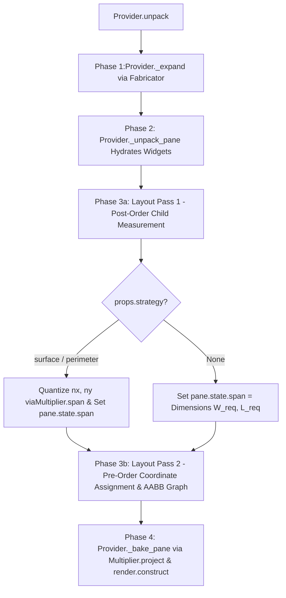
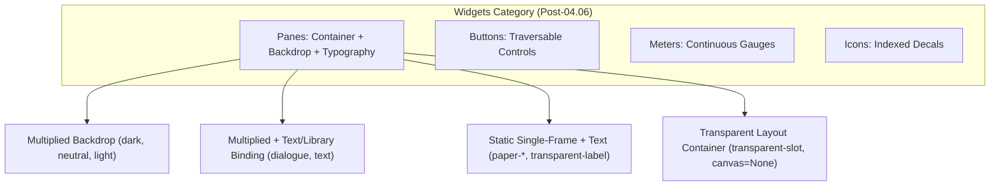

#### Refactor: Phase 04.06 - Pane Generation

**Overview**

Unify the container and display branches of the `Widgets` hierarchy by deprecating `Pages` (`AssetInstances.PAGES` and `DisplayState`) and subsuming their text-rendering, `canvas` allocation, and pagination capabilities directly into `Panes` (`AssetInstances.PANES` and `PaneState`). Simultaneously, decouple `Pane` assets from fixed-dimension textures (`dark`, `dark-small`, `dark-thin`, `dark-dialogue`, `dark-notification`, `dark-portrait`, etc.) by inducting `Panes` into the multiplication architecture (`SurfaceMultiplier`), enabling both container and text-bearing `Panes` to expand to arbitrary quantized dimensions using bottom-up layout measurement and pre-baked `TexturePtr` canvases.

##### Specification

A multiplied `Pane` of unit cell dimensions $(w, l)$ and interior multiplicity $(n_x, n_y) \in \mathbb{Z}_{\ge 0}^2$ spans a total bounding box of:

$$W(n_x) = (n_x + 2) \cdot w, \quad L(n_y) = (n_y + 2) \cdot l$$

1. **Minimum Dimensions Constraint**:

Setting $n_x = 0, n_y = 0$ yields the minimum valid footprint $W_{\min} = 2w,\; L_{\min} = 2l$, where the `north`/`south` and `west`/`east` caps superimpose at the four corners over the `center` backdrop without interior shaft segments.

2. **Bottom-Up Content Measurement**:

For a `Pane` with child footprints $C = \{(w_i, l_i)\}_{i=1}^{k}$, uniform margin $m \in \mathbb{Z}_{\ge 0}$, and inter-child spacing $g \in \mathbb{Z}_{\ge 0}$, the required bounding footprint $(W_{\text{req}}, L_{\text{req}})$ is determined by its `Layouts` strategy when $\vert{}C\vert{} > 0$:

* **`Layouts.STACK` (Vertical Column)**:

$$W_{\text{req}} = \max_{c \in C}(c.w) + 2m, \quad L_{\text{req}} = \sum_{c \in C} c.l + g \cdot \max(0, \vert{}C\vert{} - 1) + 2m$$

* **`Layouts.DOCK` (Horizontal Row)**:

$$W_{\text{req}} = \sum_{c \in C} c.w + g \cdot \max(0, \vert{}C\vert{} - 1) + 2m, \quad L_{\text{req}} = \max_{c \in C}(c.l) + 2m$$

* **`Layouts.OVERLAY` (Sagittal Superimposition)**:

$$W_{\text{req}} = \max_{c \in C}(c.w) + 2m, \quad L_{\text{req}} = \max_{c \in C}(c.l) + 2m$$

If `PaneParameters.dimensions` is explicitly configured, $(W_{\text{req}}, L_{\text{req}}) = (\text{params.dimensions.w}, \text{params.dimensions.l})$. For leaf `Panes` ($\vert{}C\vert{} = 0$, such as text-bound display panes) without explicit `PaneParameters.dimensions`, $(W_{\text{req}}, L_{\text{req}}) = (w, l)$ from `WidgetProperties.dimensions`.

3. **Quantization of Target Dimensions**:

Given $(W_{\text{req}}, L_{\text{req}})$:

* **Multiplied Panes (`properties.strategy is not None`)**: If `PaneParameters.multiple` is explicitly set, $(n_x, n_y) = (\text{multiple.nx}, \text{multiple.ny})$. Otherwise, $(n_x, n_y)$ is resolved via clamped ceiling division:

$$n_x = \max\!\left(0,\; \left\lceil \frac{W_{\text{req}} - 2w}{w} \right\rceil\right), \quad n_y = \max\!\left(0,\; \left\lceil \frac{L_{\text{req}} - 2l}{l} \right\rceil\right)$$

setting `pane.state.multiple = Multiple(nx, ny)` and `pane.state.span = Dimensions((nx + 2) * w, (ny + 2) * l)`.

* **Unmultiplied Panes (`properties.strategy is None`)**: `pane.state.span` resolves to `Dimensions(W_req, L_req)`.

4. **Unified Canvas Compilation (Backdrop + Typography)**:

A `Pane` allocates a hardware target texture `pane.state.canvas = render.canvas(span.w, span.l)` whenever it possesses a visual backdrop texture in `Registry` (`properties.strategy is not None` or `registry.image(pane.id) is not None`) OR a text binding (`LibraryBinding`, `TextBinding`). Canvas compilation executes in two stages inside `Screen.stamp()` / `Provider._bake_pane()`:

* **Stage 1 (Backdrop Construction)**: Evaluates `pane.frame.keys(pane.id, pane.state)`—yielding $3\text{-tuples}$ `(frame_key, ox, oy)` from `SurfaceMultiplier.project()` for multiplied panes or `[(pane.id, 0, 0)]` for single-frame panes—and stamps all resolved textures onto `pane.state.canvas` via `render.construct(canvas, primitives)` (clearing the target to `RGBA(0, 0, 0, 0)` first, which provides a clean transparent surface for unbacked text labels).
* **Stage 2 (Typography Rasterization)**: If `pane.state.content_function is not None` and `content = pane.state.current()` is non-empty, stamps wrapped glyphs over the constructed backdrop via `render.write((canvas, 0, 0, span.w, span.l, 0, 0, span.w, span.l), content, font)`.

##### Architectural Analysis I

###### 1. Can the Existing Multiplication Strategies Be Utilized?

The existing `Multipliers` (`SimpleMultiplier`, `OrientedMultiplier`, `ExpansionMultiplier`, `PerimeterMultiplier` in `app.game.logic.modules.multipliers`) implement the exact coordinate stepping required for `Panes`, but **cannot be invoked directly as-is** due to three architectural divergences between world `Crafts` and UI `Panes`:

1. **Multi-Entity Instantiation vs. Single-Widget Identity**:
    * `PerimeterMultiplier.multiply()` calls `self._unit(...)` to instantiate $2(n_x + n_y + 4)$ separate `Asset` instances on the `Board`. `Struts` require separate `Asset` instances because each world segment has an independent `Hitbox` for `CollisionMechanics` and an independent `ground_y` (`anchor`) for 2.5D Painter's Algorithm sorting (`Screen._sort`) against dynamic `Sprites`.
    * Conversely, a `Pane` in `Menu.widgets` **must remain a single `Widget` instance** keyed by `pane.name`:
    * `Layout.compute()` queries `widgets[pane.name]` to resolve child alignments and mutates `pane.state.position` *after* `Provider._unpack_pane()` completes.
    * `CollectionState` Gizmos store state on the root `Pane` (`menu.widgets[selector]`), which `ApertureBinding` and `InventoryController` query in $O(1)$ by `pane.name`.
    * `Panes` do not participate in world collisions or `Screen._sort`; they render flat on a single plane behind their children via `Screen.interface()`.
2. **Hollow Enclosure vs. Filled Backdrop**:
    * `PerimeterMultiplier` generates a **hollow** boundary: for $n_x \ge 1, n_y \ge 1$, no segments are placed in the interior domain $[1, n_x] \times [1, n_y]$. While a fence or wall enclosure on the `Board` encloses open terrain, a `Pane` is an opaque backdrop. Using `PerimeterMultiplier` alone leaves a rectangular hole in the center of every menu whenever $n_x \ge 1$ and $n_y \ge 1$.
    * A `Pane` therefore requires a **composite (`simple` + `perimeter`)** or **filled-perimeter (`surface`)** strategy: a base fill across the interior $[1, n_x] \times [1, n_y]$ (or full $[0, n_x + 1] \times [0, n_y + 1]$ footprint) combined with the `PerimeterMultiplier` border pass.
3. **Coupling to `CraftState` and `MaterialIndex` Substrates**:
    * `Multiplier._unit` assumes `state` is a `CraftState` with `material`, `blueprint`, `layer`, `elevation`, and queries `self.materials.substrate(instance, blueprint)`.
        * **Resolution**: Refactor `Multiplier` subclasses to separate **pure topological coordinate generation** (`project(w, l, nx, ny, ...) -> List[Tuple[str, int, int, int]]` yielding `(partition_key, ox, oy, anchor_delta)` and `span(w, l, nx, ny) -> Dimensions`) from **world `Asset` instantiation** (`multiply(...) 
    -> List[Asset]`).
    * `Decomposer.multiply()` calls `multiply()` to emit world `Asset` lists for `Crafts`.
    * `CompositionCompiler._compute_span()` calls `Multiplier.span()` instead of duplicating strategy span formulas.
    * `Provider` / `PaneFrame` calls `project()` to obtain relative tile offsets `(part_key, ox, oy)` for a single `Pane` `Widget`.

###### 2. Dependency Injection & Hydration Pipeline Analysis

Tracing the DI pipeline (`Builder` $\to$ `Orchestrator` $\to$ `Provider` $\to$ `Layout` $\to$ `Screen`) reveals three pipeline bottlenecks that must be resolved:

1. **Missing `MaterialIndex` / Strategy Injection in `Provider**`:
    * In `app.services.orchestration.builder`, `Decomposer` is injected with `MaterialIndex`, whereas `Provider` only receives `(recipes.widgets, properties.widgets, binder, fabricator)`. If `Panes` declare blueprint schemas (or multiplication strategies) and optional `Material` palettes (e.g., unifying `dark`, `neutral`, `light` into a single `pane` atlas indexed over `Chromatics`), `Provider` must receive `MaterialIndex` (or the compiled strategy index).
2. **Phase Ordering Inversion Between `Provider._unpack_pane` and `Layout.compute**`:
    * Currently in `Provider.unpack()`:
    * **Phase 1**: `_expand()` expands `Gizmos` into `MenuNode` trees, computing static pixel `Dimensions` on `PaneParameters`.
    * **Phase 2**: `_unpack_pane()` instantiates `Widget` objects and overrides `props.dimensions` if `params.dimensions` was explicitly set.
    * **Phase 3**: `Layout.compute()` walks the tree, reads `widget.dimensions`, and assigns `widget.state.position`.
    * Under this ordering, if a `Pane` in YAML omits explicit `dimensions` / `multiple`, Phase 2 instantiates it with its raw unit tile size $(w, l)$ before `Layout` has measured its children!
    * **Pipeline Fix**: Split `Layout.compute()` into a **Bottom-Up Measurement & Quantization Pass** (computing required `(nx, ny)` and quantized `span` `Dimensions((nx + 2) * w, (ny + 2) * l)` for every `Pane` based on its children's sizes, `gap`, and `margins`) followed by the **Top-Down Positioning Pass**.
3. **60 Hz Rendering Overhead (`Frame.keys` vs. `render.construct` Canvas Baking)**:
    * A $320 \times 256\text{ px}$ menu built from $16 \times 16\text{ px}$ unit tiles ($n_x = 18, n_y = 14$) comprises $(20 \times 16) + 2(18 + 14 + 4) = 392$ tile primitives.
    * Pushing 392 tuples per pane across the Python-to-Cython boundary in `Screen._widgets()` on every frame at 60 Hz creates avoidable inner-loop overhead.
    * Instead, just as `Screen._prerender()` bakes multiplied `Tiles` onto `bg_canvas` via `render.construct()` and `Provider._page()` allocates a `TexturePtr` `canvas` for `DisplayState`, `Provider` (or `Layout`) can bake a multiplied `Pane`'s tiles once onto a `PaneState.canvas: TexturePtr` via `render.construct()` at menu instantiation time. At runtime, `Screen._widgets()` draws the entire multiplied `Pane` in a **single** `SDL_RenderCopy` call.

##### User Review I

Let's lose anything that requires injecting the Provider with the MaterialIndex, as it seems hacky making a Menu Factory depend on the relationships between the material aspect of Assets. Menus have no "materiality" modality, so let's not give Menus a dependency it does not requires. The Provider can instantiate whatever multiplication strategy handlers it requires within its own methods.

##### Architectural Analysis II

###### 1. Decoupling `Provider` and `Multiplier` from `MaterialIndex` (Addressing User Review I)

Per **User Review I**, `Provider` must not receive `MaterialIndex`, as UI `Menus` have no `Material` modality. Inspecting `src/app/game/logic/modules/multipliers/` reveals two subtle coupling hazards that must be addressed when `Provider` instantiates or invokes multiplication strategies directly:

1. **`Singleton` Lifecycle Hazard on `Multiplier**`:
    * `Multiplier` (`src/app/game/logic/modules/multipliers/base.py`) inherits from `Singleton` and currently requires `materials: MaterialIndex` in `__init__(self, materials: MaterialIndex)`.
    * In Python, when a `Singleton` subclass is called a second time (e.g., `Decomposer` instantiates `PerimeterMultiplier(materials)` during `Builder` bootstrap, and `Provider` later calls `PerimeterMultiplier()` without arguments), Python still invokes `__init__` on the cached singleton instance. If `__init__` blindly assigns `self.materials = materials`, calling `PerimeterMultiplier()` with `materials=None` inside `Provider` will overwrite `self.materials = None` on the singleton shared with `Decomposer`!
    * **Resolution**:
        * Make `span()` and `project()` pure `@classmethod` methods on `Multiplier` subclasses, AND guard `Multiplier.__init__(self, materials: Optional[MaterialIndex] = None)` with `if materials is not None: self.materials = materials`.
        * Neither `span()` nor `project()` accesses `self.materials`. `Provider`, `Layout`, and `CompositionCompiler` can therefore invoke `strategy.span(...)` and `strategy.project(...)` directly on the strategy class (or via a class-level `_STRATEGIES` mapping) with zero dependency on `MaterialIndex`.
2. **Preserving `Enclosures` Cardinality for `Crafts**`:
    * In `src/app/models/properties/assets.py` and `MaterialFrame`, `Blueprints.ENCLOSURES` maps to the 4-element `Enclosures` enum (`north`, `south`, `east`, `west`). `MaterialFrame.index()` iterates over `partition(properties.blueprints)` to index rows of Craft sprite sheets.
    * Adding `CENTER = "center"` directly to `Enclosures` would change the partition cardinality of `Enclosures` from 4 to 5, corrupting row indexing for all `Crafts` declaring `blueprints: enclosures`.
    * **Resolution**: Define a dedicated `Surfaces` enum in `src/app/static/semantics.py` with the 5 partitions `(NORTH, SOUTH, EAST, WEST, CENTER)` (or keep `Enclosures` strictly 4-part and reference `Surfaces.CENTER` in `SurfaceMultiplier` and `PaneFrame`).

###### 2. Corner Superposition Geometry & Full-Footprint `center` Fill

In `PerimeterMultiplier.project()`, `north` and `south` are emitted first across $i_x \in [0, n_x + 1]$, followed by `west` and `east` across $i_y \in [0, n_y + 1]$. At the four corners $(0, 0)$, $((n_x + 1)w, 0)$, $(0, (n_y + 1)l)$, and $((n_x + 1)w, (n_y + 1)l)$, `west` and `east` are drawn *on top of* `north` and `south`:

* If the `west` and `east` unit tiles in the `.png` atlas contained opaque interior background fill across their full $w \times l$ cell, stamping `west` at $(0, 0)$ over `north` would overwrite `north`'s horizontal top border across columns $[b, w)$ (where $b$ is the border thickness in pixels).
* Conversely, if `north`, `south`, `east`, and `west` contain only their respective border bevels with transparent interiors, and `center` were only tiled across the strict interior $[1, n_x] \times [1, n_y]$, then:

1. The inner $(w - b)$ margin of the border ring would be transparent.
2. Any pane with $n_x = 0$ or $n_y = 0$ would have an empty $[1, 0]$ interior range and thus zero `center` tiles.

* **Resolution**: `SurfaceMultiplier.project()` must first emit `Surfaces.CENTER.value` across the **entire** $[0, n_x + 1] \times [0, n_y + 1]$ footprint via `SimpleMultiplier.project(w, l, nx + 2, ny + 2, blueprint=Surfaces.CENTER.value)`, and then append `PerimeterMultiplier.project(w, l, nx, ny, ...)`. In the re-atlased pane `.png` strips, `center` provides the solid $w \times l$ backdrop, while `north`, `south`, `east`, and `west` contain only their directional border bevels over a transparent background so they superimpose cleanly at all four corners.

###### 3. `Layouts.OVERLAY` and Transparent Container Auto-Sizing

Inspecting `src/app/services/generators/menus/fabricator.py` and `src/data/config/menus/dialogue/main.yaml` exposes two layout edge cases:

1. **`Layouts.OVERLAY` Measurement**: `new-game-slot`, `character-portrait-container`, and `Fabricator` slot containers use `layout: overlay` to superimpose a foreground `Icon` or `Page` over a `Button` or background `Page`. `Layout`Pass 1 must evaluate `Layouts.OVERLAY` via $W_{\text{req}} = \max_c(c.w) + 2m$ and $L_{\text{req}} = \max_c(c.l) + 2m$ rather than summing along an axis.
2. **Unmultiplied Container Span Resolution**: When `Fabricator._collection()` removes hardcoded `dimensions` on synthesized `row_pane` and root gizmo panes (which use `id: transparent-slot`, whose static property size is $40 \times 40$), `Layout` Pass 1 must assign `pane.state.span = Dimensions(W_req, L_req)` to unmultiplied container panes so parent panes measure the full synthesized grid ($175 \times 85$) rather than a single $40 \times 40$ slot.
3. **Skipping Canvas Allocation for Transparent Panes**: In `Provider._bake_pane(widget)`, if `widget.properties.strategy is None` or `self.binder.registry.image(...)` returns `None`, `pane.state.canvas` must remain `None` so transparent layout containers do not allocate blank SDL target textures or issue redundant `SDL_RenderCopy` calls in `Screen._widgets()`.



##### User Review II

Thinking about the Widget branch of the Asset Hierachy in general, there appears to be an opportunity for reducing some complexity and verbosity: Pages serve the same purpose as Panes, e.g. providing a background, differing insofar they possess a `canvas` to render text. You are now proposing adding a `canvas` to PaneState to accomodate prerendering the pane multiplication. I am now wondering if Pages are completely extraneous and should be culled from the Asset Hierarchy altogether and have their functionality subsumed by Panes. I see no reason Panes couldn't receive a TextBinding or LibraryBinding.

Analyze what would be necessary to accomplish the deprecation of Pages.

##### Architectural Analysis III

###### 1. Subsuming `Pages` (`DisplayState`) into `Panes` (`PaneState`)

Inspecting `src/app/models/state/assets/widgets.py`, `src/app/game/screen.py`, and `src/app/services/generators/menus/provider.py` confirms that `Pages` and `Panes` are structurally isomorphic: both represent static rectangular regions that optionally back foreground content. Deprecating `Pages` requires resolving six architectural touchpoints:

1. **State Model Consolidation (`DisplayState` $\to$ `PaneState`)**:

* `DisplayState` holds `content_function: Callable[[], Union[str, List[str]]]`, `pageindex: int = 0`, `pagesize: int = 1`, `font: Enumerated[Fonts] = Fonts.DIALOGUE.value`, `canvas: Any = None`, and the pagination interface (`content`, `_pagecount`, `current()`, `more()`, `less()`, `scrollup()`, `scrolldown()`).
* Merging these fields and methods directly into `PaneState` eliminates `DisplayState` without conflicting with `CollectionState(PaneState)`: `CollectionState` already subclasses `PaneState` and overrides `scrollup()` and `scrolldown()` for collection aperture windowing. Consequently, `ScrollController` can invoke `target_widget.state.scrollup()` / `scrolldown()` polymorphically on any `PaneState`.


2. **Deferred Text-Binding Hydration After Quantization (`Layout` Pass 1 $\to$ `Binding.bind`)**:

* Previously, `Provider._page()` called `binding.bind(w=w, l=l)` during Phase 2 widget instantiation using raw `properties.dimensions`.
* When a `Pane` with a `LibraryBinding` or `TextBinding` uses `strategy: surface` (for example, `character-speech` in `dialogue.yaml` using `id: dark` instead of fixed `dark-notification`), its raw `properties.dimensions` is the unit tile size $(w, l)$ (e.g., $16 \times 16$), whereas its actual text-wrapping bounding box is the quantized `pane.state.span` $(W, L)$ computed in `Layout.compute()` Pass 1.
* **Resolution**: During `Provider._unpack_pane()`, attach the `Binding` instance (`LibraryBinding` or `TextBinding`) to `pane_widget.binding` and store the lexically scoped `font` on `pane.state.font`, but defer invoking `pane.state.content_function = pane_widget.binding.bind(w=pane.dimensions.w, l=pane.dimensions.l, font=pane.state.font)` until **after** `Layout.compute()` Pass 1 has resolved `pane.state.span`.


3. **Unifying `PaneFrame.keys()` for `Provider._bake_pane()` and `Screen.stamp()`**:

* When `ScrollController` advances `pageindex` on a dialogue `Pane` and emits `UpdateEvent(widget, content)`, `UpdateEventHandler` invokes `Screen.stamp(widget, content)`.
* In `src/app/game/screen.py`, `Screen.stamp()` previously assumed the background was a single unmultiplied texture (`base_key, ox, oy = widget.frame.keys(widget.id, widget.state)[0]`). If the dialogue box is now a multiplied `Pane`, `Screen.stamp()` must reconstruct the *multiplied* backdrop before calling `render.write()` so the previous page's glyphs are wiped cleanly.

* **Resolution**: Have `PaneFrame.keys(id, state)` inspect `state.multiple`:
    * If `state.multiple is not None`, `PaneFrame.keys()` delegates to `SurfaceMultiplier.project(w, l, state.multiple.nx, state.multiple.ny)` and returns `[(f"{id}-{part}", ox, oy) for part, ox, oy, _ in projected]`.
    * If `state.multiple is None`, `PaneFrame.keys()` returns `[(id, 0, 0)]`.

* With this `PaneFrame.keys()` contract, `Screen.stamp()` and `Provider._bake_pane()` share the exact same backdrop construction loop: iterate over `widget.frame.keys(widget.id, widget.state)`, collect `(tex_ptr, sx, sy, sw, sl, ox, oy, sw, sl, 1, 1)` for all keys present in `Registry`, call `render.construct(canvas, primitives)`, and—if `content` is non-empty—call `render.write((canvas, 0, 0, canvas.w, canvas.l, 0, 0, canvas.w, canvas.l), content, font)`.


4. **Optional `PaneParameters` on Leaf Panes in `menus/*.yaml`**:

* Leaf `Pages` in `menus/*.yaml` (such as `new-game-text` or `character-speech`) did not require a `parameters:` block unless overriding layout or dimensions.
* In `Provider._expand()` and `Provider._unpack_pane()`, `pane.parameters` was strictly checked with `if not isinstance(params, PaneParameters): return`.
* **Resolution**: Default `params = pane.parameters or PaneParameters()` when `node.instance == AssetInstances.PANES.value` so leaf text-display `Panes` do not require boilerplate `parameters:` blocks in YAML.


5. **Fixing Lexical Font Shadowing on `PaneParameters`**:

* In `src/app/models/config/menus.py`, `PaneParameters.font` defaulted to `Fonts.DIALOGUE.value` instead of `None`. When a root pane declared `font: menu` (e.g. `main.yaml`) and a child container pane (`new-game-slot`) omitted `font:`, `params.font or font` evaluated to `"dialogue"`, shadowing the parent's `"menu"` font on all nested text widgets.
* **Resolution**: Set `PaneParameters.font: Optional[Enumerated[Fonts]] = None`, and resolve `active_font = params.font or font or Fonts.DIALOGUE.value` during tree traversal in `Provider._unpack_pane()`.


6. **Asset & Configuration Cleanup (`src/assets/widgets/main.yaml` & `menus/*.yaml`)**:

* **Eliminated Fixed-Size Dark/Neutral/Light Assets**: `dark-dialogue`, `dark-notification`, `dark-portrait` (formerly under `pages:`), and `dark-small`, `dark-thin`, `neutral-small`, `light-small` (under `panes:`) are all replaced by the 3 multiplied base panes: `dark`, `neutral`, and `light`.
* **Eliminated Duplicate Transparent Label**: `pages.text-label` ($142 \times 28$) is redundant with `panes.transparent-label` ($142 \times 28$) and is removed.
* **Collapsed Portrait Container in `dialogue.yaml**`: `character-portrait-container` (`transparent-block` wrapping `pages.dark-portrait` + `icons.portraits`) simplifies to a single `instance: panes, id: dark` with `layout: overlay` wrapping `icons.portraits` directly.
* **Migrated Faux-Paper Assets**: `paper-scroll`, `paper-header-torn`, `paper-header`, `paper-area`, and `paper-weathered` move from `widgets.pages` to `widgets.panes` as static single-frame panes (`strategy: None`).




##### Goals

###### Goal: Decouple Topology Generation from Entity Instantiation in `Multipliers`

Extract pure `@classmethod` geometric projection and span calculation methods onto the `Multiplier` hierarchy so world `Crafts` (`Decomposer`), compile-time macro evaluation (`CompositionCompiler`), and UI `Panes` (`Provider` / `Layout` / `PaneFrame`) share a single implementation without requiring `MaterialIndex`:

```python
class Multiplier(Singleton):
    materials: Optional[MaterialIndex] = None

    def __init__(self, materials: Optional[MaterialIndex] = None):
        if materials is not None:
            self.materials = materials

    @classmethod
    @abstractmethod
    def span(
        cls,
        w: int,
        l: int,
        nx: int,
        ny: int,
        blueprint: Optional[str] = None
    ) -> Dimensions:
        """Returns the total bounding Dimensions of the multiplied footprint."""
        pass

    @classmethod
    @abstractmethod
    def project(
        cls,
        w: int,
        l: int,
        nx: int,
        ny: int,
        blueprint: Optional[str] = None,
        base_anchor: int = 0,
        hitboxes: Optional[Dict[str, List[Hitbox]]] = None
    ) -> List[Tuple[str, int, int, int]]:
        """
        Emits relative placement primitives: (blueprint_part, offset_x, offset_y, seg_anchor).
        """
        pass

```

Introduce `SurfaceMultiplier(PerimeterMultiplier)` (`MultiplicationStrategies.SURFACE = "surface"`), which first tiles `Surfaces.CENTER.value` across $[0, n_x + 1] \times [0, n_y + 1]$ via `SimpleMultiplier.project(w, l, nx + 2, ny + 2, blueprint=Surfaces.CENTER.value)` and then appends `PerimeterMultiplier.project(w, l, nx, ny, ...)`.

###### Goal: Deprecate `Pages` and Unify `DisplayState` into `PaneState`

Remove `AssetInstances.PAGES`, `Widgets.PAGES`, and `DisplayState`. Consolidate all typography, pagination, multiplication, and `canvas` fields onto `PaneState`:

```python
@dataclass(slots=True)
class WidgetProperties(AssetProperties):
    frames: Optional[List[str]] = field(default_factory=list)
    strategy: Optional[Enumerated[MultiplicationStrategies]] = None


@dataclass(slots=True, frozen=True)
class PaneParameters:
    layout: Enumerated[Layouts] = Layouts.STACK.value
    alignment: Enumerated[Alignments] = Alignments.START.value
    gap: int = 0
    margins: int = 0
    position: Optional[ScreenPosition] = None
    dimensions: Optional[Dimensions] = None
    multiple: Optional[Multiple] = None
    font: Optional[Enumerated[Fonts]] = None
    children: List[MenuNode] = field(default_factory=list)


@dataclass(slots=True)
class PaneState(WidgetState):
    layout: Enumerated[Layouts] = Layouts.STACK.value
    alignment: Enumerated[Alignments] = Alignments.CENTER.value
    gap: Optional[int] = 0
    margins: Optional[int] = 0
    multiple: Optional[Multiple] = None
    span: Optional[Dimensions] = None
    content_function: Optional[Callable[[], Union[str, List[str]]]] = None
    pageindex: int = 0
    pagesize: int = 1
    font: Enumerated[Fonts] = Fonts.DIALOGUE.value
    canvas: Any = None

    @property
    def content(self) -> Union[str, List[str]]:
        if not self.content_function:
            return ""
        return self.content_function()

    @property
    def _pagecount(self) -> int:
        content = self.content
        if not content:
            return 0
        if isinstance(content, list):
            return len(content)
        return 1

    def current(self) -> str:
        content = self.content
        if not content:
            return ""
        if isinstance(content, list):
            if 0 <= self.pageindex < len(content):
                return content[self.pageindex]
            return ""
        return content

    def more(self) -> bool:
        return self.pageindex < (self._pagecount - 1)

    def less(self) -> bool:
        return self.pageindex > 0

    def scrollup(self) -> None:
        if self.less():
            self.pageindex -= 1

    def scrolldown(self) -> None:
        if self.more():
            self.pageindex += 1

```

###### Goal: Bottom-Up Auto-Sizing, Deferred Text Binding & Unified Canvas Baking

1. **Pass 1 (Post-Order Measurement & Quantization in `Layout.compute`)**:
* Measure child `MenuNode` footprints recursively across `STACK`, `DOCK`, and `OVERLAY` layouts.
* Resolve $(W_{\text{req}}, L_{\text{req}})$ from explicit `PaneParameters.dimensions`, measured child bounds plus `2 * margins`, or leaf `WidgetProperties.dimensions`.
* For multiplied panes (`properties.strategy is not None`), quantize $(n_x, n_y)$ via ceiling division and set `pane.state.multiple = Multiple(nx, ny)` and `pane.state.span = strategy.span(w, l, nx, ny)`. For unmultiplied panes, set `pane.state.span = Dimensions(W_req, L_req)`.


2. **Pass 2 (Pre-Order Coordinate Assignment & Traversal Graph in `Layout.compute`)**:
* Position all panes and children using `widget.dimensions` (`pane.state.span`) and construct the AABB traversal graph.


3. **Pass 3 (Text Binding Evaluation & Canvas Baking in `Provider._bake_pane` / `Screen.stamp`)**:
* For panes with a `LibraryBinding` or `TextBinding`, bind `pane.state.content_function = pane.binding.bind(w=pane.dimensions.w, l=pane.dimensions.l, font=pane.state.font)` using the quantized dimensions.
* For any pane with a valid texture or text binding, allocate `pane.state.canvas = render.canvas(pane.dimensions.w, pane.dimensions.l)`, construct the backdrop from `pane.frame.keys(pane.id, pane.state)`, and write `pane.state.current()` via `render.write()`.


##### Tasks

**1. Task: Refactor `Multipliers` to Separate Geometry Projection from Entity Instantiation**

*Objective*: Decouple coordinate/partition math from `Craft` asset hydration and `MaterialIndex` so `Multipliers` can be invoked directly by `CompositionCompiler`, `Decomposer`, `Layout`, `Provider`, and `PaneFrame`.

* [] Subtask: Make `materials: Optional[MaterialIndex] = None` optional in `Multiplier.__init__` (guarding `if materials is not None: self.materials = materials` to preserve singleton state) and add abstract `@classmethod` methods `span(cls, w, l, nx, ny, blueprint=None)` and `project(cls, w, l, nx, ny, blueprint=None, base_anchor=0, hitboxes=None)` in `src/app/game/logic/modules/multipliers/base.py`.
* [] Subtask: Implement `@classmethod` `span()` and `project()` on `SimpleMultiplier`, `OrientedMultiplier`, `ExpansionMultiplier`, and `PerimeterMultiplier`, refactoring `multiply()` to iterate over `self.project(...)` and invoke `self._unit(...)`.
* [] Subtask: Add `SURFACE = "surface"` to `MultiplicationStrategies` and define `Surfaces` (`NORTH`, `SOUTH`, `EAST`, `WEST`, `CENTER`) in `src/app/static/semantics.py`, then implement `SurfaceMultiplier(PerimeterMultiplier)` in `src/app/game/logic/modules/multipliers/surface.py` (tiling `center` across $[0, n_x + 1] \times [0, n_y + 1]$ followed by `PerimeterMultiplier.project`).
* [] Subtask: Replace duplicate span logic in `CompositionCompiler._compute_span` (`src/app/static/macros/compositions.py`) with a call to the corresponding `Multiplier.span()`.

**2. Task: Deprecate `Pages` and Unify `DisplayState` into `PaneState` and `PaneFrame**`

*Objective*: Remove `Pages` (`AssetInstances.PAGES`, `Widgets.PAGES`, `DisplayState`) from the Asset Hierarchy and consolidate typography, pagination, and partition frame indexing into `Panes`.

* [] Subtask: Remove `PAGES = "pages"` from `AssetInstances` and `Widgets` in `src/app/static/semantics.py`, and remove `pages` fields from `WidgetGroup` / `RecipeGroup` in `src/app/models/groups.py` and `src/data/config/recipes/main.yaml`.
* [] Subtask: Merge `DisplayState` fields (`content_function`, `pageindex`, `pagesize`, `font`, `canvas`) and pagination methods (`content`, `_pagecount`, `current`, `more`, `less`, `scrollup`, `scrolldown`) into `PaneState` alongside `multiple: Optional[Multiple] = None` and `span: Optional[Dimensions] = None`, then delete `DisplayState` from `src/app/models/state/assets/widgets.py` and `src/app/models/state/__init__.py`.
* [] Subtask: Add `multiple: Optional[Multiple] = None` and set `font: Optional[Enumerated[Fonts]] = None` on `PaneParameters` (`src/app/models/config/menus.py`), and add `strategy: Optional[Enumerated[MultiplicationStrategies]] = None` to `WidgetProperties` (`src/app/models/properties/assets.py`).
* [] Subtask: Implement `PaneFrame(Frame)` in `src/app/assets/frames/widgets.py` (and register it on `widgets.panes` in `src/data/config/recipes/main.yaml`) so `index()` maps `{f"{id}-{part}": (i * w, 0, w, l)}` across `Surfaces` when `properties.strategy` is set (or `{id: (0, 0, w, l)}` when `None`), and `keys(id, state)` emits `SurfaceMultiplier.project(w, l, state.multiple.nx, state.multiple.ny)` tuples `(f"{id}-{part}", ox, oy)` when `state.multiple is not None` (or `[(id, 0, 0)]` when `None`).
* [] Subtask: Override `dimensions` on `Widget` (`src/app/game/menus/core.py`) to return `self.state.span` when present on `PaneState`, falling back to `self.properties.dimensions`.

**3. Task: Upgrade `Layout`, `Fabricator`, `Provider`, and `Screen` for Unified Pane Baking & Typography**

*Objective*: Measure and quantize `Panes` bottom-up, evaluate text bindings against quantized dimensions, and unify backdrop + typography stamping on `PaneState.canvas`.

* [] Subtask: Refactor `Layout.compute()` (`src/app/game/menus/modules/layout.py`) into a bottom-up post-order pass that measures child footprints across `STACK`, `DOCK`, and `OVERLAY` layouts, quantizes `PaneState.multiple` and `PaneState.span` for multiplied panes (and sets `PaneState.span` for unmultiplied panes), followed by the top-down coordinate placement pass.
* [] Subtask: Remove `Provider._page()` and update `Provider._expand()` and `Provider._unpack_pane()` (`src/app/services/generators/menus/provider.py`) to default `params = pane.parameters or PaneParameters()`, cascade `active_font = params.font or font or Fonts.DIALOGUE.value` onto `PaneState.font`, and support `LibraryBinding` and `TextBinding` alongside `CollectionBinding` on `Panes`.
* [] Subtask: Implement `Provider._bake_pane(widget)` to bind `content_function = widget.binding.bind(w=widget.dimensions.w, l=widget.dimensions.l, font=widget.state.font)` after `Layout.compute()`, allocate `PaneState.canvas`, stamp `widget.frame.keys()` primitives via `render.construct()`, and rasterize initial `widget.state.current()` text via `render.write()`.
* [] Subtask: Update `Screen._widgets()` and `Screen.stamp()` (`src/app/game/screen.py`), `ScrollController`, `MenuEventHandler`, and `UpdateEventHandler` to operate on `PaneState` (re-constructing all `widget.frame.keys()` tiles onto `PaneState.canvas` before calling `render.write()` during `Screen.stamp()`).
* [] Subtask: Remove hardcoded `dimensions` overrides in `Fabricator._collection` (`src/app/services/generators/menus/fabricator.py`) and add explicit `render.destroy()` cleanup for `PaneState.canvas` in `TerminalEventHandler.handle` (`src/app/game/menus/handlers/terminal.py`) and `Board.clear()` (`src/app/game/board/core.py`).

**4. Task: Re-Atlas Pane Assets, Migrate Faux-Paper Assets, and Consolidate `menus/*.yaml**`

*Objective*: Consolidate `widgets/main.yaml` and all menu configurations onto the unified `panes` instance and verify with unit tests.

* [] Subtask: Re-atlas `dark`, `neutral`, and `light` `.png` files in `src/assets/widgets/panes/` into 5 horizontal unit tiles (`north`, `south`, `east`, `west`, `center`), move `paper-*` assets into `src/assets/widgets/panes/`, remove `src/assets/widgets/pages/` (`dark-dialogue`, `dark-notification`, `dark-portrait`, `text-label`) and fixed-size pane variants (`dark-small`, `dark-thin`, `neutral-small`, `light-small`), and update `src/assets/widgets/main.yaml`.
* [] Subtask: Update `main.yaml`, `load.yaml`, `pause.yaml`, `options.yaml`, `dialogue.yaml`, `text.yaml`, `inventory.yaml`, and `view.yaml` in `src/data/config/menus/` to replace all `instance: pages` nodes with `instance: panes` (`id: dark`, `id: neutral`, `id: light`, `id: transparent-label`, or `id: paper-*`) and collapse `character-portrait-container` in `dialogue.yaml` into a single `dark` overlay `Pane`.
* [] Subtask: Add unit tests under `tests/unit/app/` verifying `SurfaceMultiplier.project()`, `SurfaceMultiplier.span()`, `PaneFrame.keys()`, `PaneState` pagination (`current()`, `scrollup()`, `scrolldown()`), and `Layout.compute()` bottom-up quantization for both container and text-bound `Panes`.