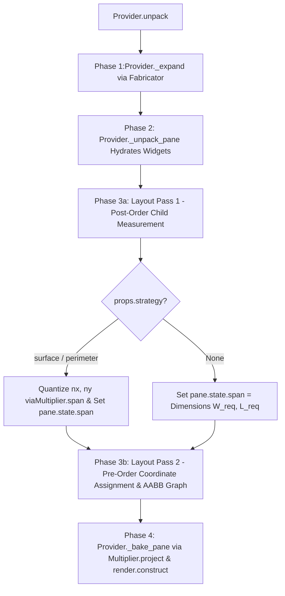
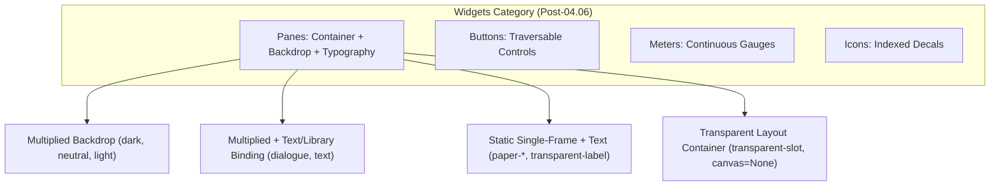
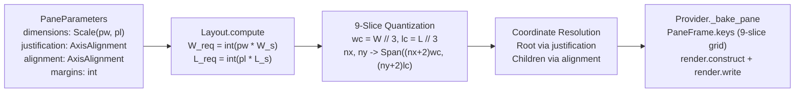

#### Refactor: Phase 04.06 - Pane Generation

**Overview**

Unify and simplify the `Widgets` branch of the Asset Hierarchy by:

1. Deprecating `Pages` (`AssetInstances.PAGES` and `DisplayState`) and subsuming their typography, `canvas` allocation, and pagination capabilities directly into `Panes` (`AssetInstances.PANES` and `PaneState`).
2. Eliminating `Widget` animations (`TraversalAnimation`, `MeterAnimation`) and `AnimationState` fields on `Widgets`, projecting instantaneous state changes directly inside `TraversalFrame.keys()` and `MeterFrame.keys()`.
3. Decoupling `Panes` from fixed-dimension pixel configurations and `ScreenPosition` coordinates via implicit in-place $3 \times 3$ (9-slice) cell indexing (`PaneFrame`), screen-relative fractional `Scale` dimensions $(w_p, l_p) \in (0.0, 1.0]^2$, and 2-axis `AxisAlignment` (`horizontal: left | center | right`, `vertical: left | center | right`).

##### Specification

1. **Implicit $3 \times 3$ Cell Partitioning (`PaneFrame.index`)**:

Given a `Pane` asset with total pixel dimensions $(W, L) = (\text{properties.dimensions.w}, \text{properties.dimensions.l})$, the unit cell dimensions $(w_c, l_c)$ are obtained by trisecting each axis:

$$w_c = \left\lfloor \frac{W}{3} \right\rfloor, \quad l_c = \left\lfloor \frac{L}{3} \right\rfloor$$

Let $V = (\text{start}, \text{center}, \text{end})$. `PaneFrame.index(id, properties)` partitions the source texture in-place into nine cells:

$$\text{index}(id, \text{properties}) = \Big\{\; \text{{id}-{V[r]}-{V[c]}}: (c \cdot w_c,\; r \cdot l_c,\; w_c,\; l_c) \;\Big\vert{}\; r \in \{0, 1, 2\},\; c \in \{0, 1, 2\} \;\Big\}$$

2. **Screen-Relative Quantization**:

Given fractional `PaneParameters.dimensions` $(w_p, l_p) \in (0.0, 1.0]^2$ and viewport `screensize` $(W_s, L_s)$, the target pixel footprint is:

$$W_{\text{req}} = \text{int}(w_p \cdot W_s), \quad L_{\text{req}} = \text{int}(l_p \cdot L_s)$$

The interior multiplicity $(n_x, n_y) \in \mathbb{Z}_{\ge 0}^2$ and quantized pixel span $(W_{\text{span}}, L_{\text{span}})$ are resolved deterministically for every `Pane`:

$$n_x = \max\!\left(0,\; \left\lceil \frac{W_{\text{req}} - 2w_c}{w_c} \right\rceil\right), \quad n_y = \max\!\left(0,\; \left\lceil \frac{L_{\text{req}} - 2l_c}{l_c} \right\rceil\right)$$

$$W_{\text{span}}(n_x) = (n_x + 2) \cdot w_c, \quad L_{\text{span}}(n_y) = (n_y + 2) \cdot l_c$$

3. **9-Slice Topological Projection (`PaneFrame.keys`)**:

For a `Pane` with `state.multiple = Multiple(nx, ny)`, `PaneFrame.keys(id, state)` iterates over row index $i_y \in [0, n_y + 1]$ and column index $i_x \in [0, n_x + 1]$, selecting:

$$v(i) = \begin{cases} \text{start} & i = 0 \\ \text{end} & i = n + 1 \\ \text{center} & 1 \le i \le n \end{cases}$$

and emitting $(n_x + 2)(n_y + 2)$ non-overlapping tile primitives:

$$\Big(\text{id-}v[i_y]\text{-}v[i_x],\; i_x \cdot w_c,\; i_y \cdot l_c\Big)$$

4. **Two-Axis Alignment, Justification, and Margins**:

Both horizontal ($X$) and vertical ($Y$, downward positive) axes are parameterized over `Alignments` $\in \{\text{start}, \text{center}, \text{end}\}$. For a parent bounding box $(p_0, P)$, an inner content span $C$, and margin $m \in \mathbb{Z}_{\ge 0}$, the 1D axis resolver $\alpha(p_0, P, C, m, \text{mode})$ is:

$$\alpha(p_0, P, C, m, \text{mode}) = \begin{cases} p_0 + m & \text{if mode} = \text{start} \\ p_0 + \lfloor (P - C) / 2 \rfloor & \text{if mode} = \text{center} \\ p_0 + P - C - m & \text{if mode} = \text{end} \end{cases}$$

* **Root Pane Placement (`justification`)**: Placed within the viewport $(0, 0, W_s, L_s)$ at:

$$x_{\text{root}} = \alpha(0, W_s, W_{\text{span}}, m, \text{justification.horizontal}), \quad y_{\text{root}} = \alpha(0, L_s, L_{\text{span}}, m, \text{justification.vertical})$$

* **Child Placement (`alignment`)**: Inside a `Pane` at $(x_0, y_0)$ with quantized span $(W_{\text{span}}, L_{\text{span}})$, children $C = \{c_1, \dots, c_k\}$ with inter-child gap $g$ are positioned along their layout axis (`STACK`, `DOCK`, or `OVERLAY`) using $\alpha$ along both horizontal and vertical axes.

5. **Direct Stateless Frame Projection for `Widgets` (No `Animation` Mediation)**:

In accordance with the `Frame` vs. `Animation` separation of concerns:

$$\text{Frame.index}: \text{Properties} \to \text{Atlas}, \qquad \text{Frame.keys}: \text{State} \to \text{Keys}, \qquad \text{Animation.animate}: \text{State} \times \text{Properties} \to \text{State}$$

An `Animation` component is valid if and only if a non-instantaneous temporal transition (accumulating `tick` over time) must be mediated by `Properties` (such as `EffectProperties.frequency` or `SheetProperties.actions`). Because all `Widget` state transitions (`TraversalState.status`, `MeterState.reading / unit`, `IconState.icon`, `PaneState.pageindex`) are instantaneous and unmediated by `WidgetProperties`, `Widgets` have no `Animation` component:

* **`TraversalFrame.keys(id, state)`**: Projects `state.status` directly to `[(f"{id}-{state.status}", 0, 0)]`.
* **`MeterFrame.keys(id, state)`**: Evaluates $r = \text{clamp}(\text{round}(100 \cdot \text{state.reading} / \text{state.unit}), 0, 100)$ directly in `keys()`, returning `[(f"{id}-empty", 0, 0), (f"{id}-{r}", 0, 0)]` when $r > 0$ and `[(f"{id}-empty", 0, 0)]` when $r = 0$.

##### Architectural Analysis I

###### 1. Can the Existing Multiplication Strategies Be Utilized?

The existing `Multipliers` (`SimpleMultiplier`, `OrientedMultiplier`, `ExpansionMultiplier`, `PerimeterMultiplier` in `app.game.logic.modules.multipliers`) implement the exact coordinate stepping required for `Panes`, but **cannot be invoked directly as-is** due to three architectural divergences between world `Crafts` and UI `Panes`:

1. **Multi-Entity Instantiation vs. Single-Widget Identity**:
    * `PerimeterMultiplier.multiply()` calls `self._unit(...)` to instantiate $2(n_x + n_y + 4)$ separate `Asset` instances on the `Board`. `Struts` require separate `Asset` instances because each world segment has an independent `Hitbox` for `CollisionMechanics` and an independent `ground_y` (`anchor`) for 2.5D Painter's Algorithm sorting (`Screen._sort`) against dynamic `Sprites`.
    * Conversely, a `Pane` in `Menu.widgets` **must remain a single `Widget` instance** keyed by `pane.name`:
    * `Layout.compute()` queries `widgets[pane.name]` to resolve child alignments and mutates `pane.state.position` *after* `Provider._unpack_pane()` completes.
    * `CollectionState` Gizmos store state on the root `Pane` (`menu.widgets[selector]`), which `ApertureBinding` and `InventoryController` query in $O(1)$ by `pane.name`.
    * `Panes` do not participate in world collisions or `Screen._sort`; they render flat on a single plane behind their children via `Screen.interface()`.
2. **Hollow Enclosure vs. Filled Backdrop**:
    * `PerimeterMultiplier` generates a **hollow** boundary: for $n_x \ge 1, n_y \ge 1$, no segments are placed in the interior domain $[1, n_x] \times [1, n_y]$. While a fence or wall enclosure on the `Board` encloses open terrain, a `Pane` is an opaque backdrop. Using `PerimeterMultiplier` alone leaves a rectangular hole in the center of every menu whenever $n_x \ge 1$ and $n_y \ge 1$.
    * A `Pane` therefore requires a **composite (`simple` + `perimeter`)** or **filled-perimeter (`surface`)** strategy: a base fill across the interior $[1, n_x] \times [1, n_y]$ (or full $[0, n_x + 1] \times [0, n_y + 1]$ footprint) combined with the `PerimeterMultiplier` border pass.
3. **Coupling to `CraftState` and `MaterialIndex` Substrates**:
    * `Multiplier._unit` assumes `state` is a `CraftState` with `material`, `blueprint`, `layer`, `elevation`, and queries `self.materials.substrate(instance, blueprint)`.
        * **Resolution**: Refactor `Multiplier` subclasses to separate **pure topological coordinate generation** (`project(w, l, nx, ny, ...) -> List[Tuple[str, int, int, int]]` yielding `(partition_key, ox, oy, anchor_delta)` and `span(w, l, nx, ny) -> Dimensions`) from **world `Asset` instantiation** (`multiply(...) 
    -> List[Asset]`).
    * `Decomposer.multiply()` calls `multiply()` to emit world `Asset` lists for `Crafts`.
    * `CompositionCompiler._compute_span()` calls `Multiplier.span()` instead of duplicating strategy span formulas.
    * `Provider` / `PaneFrame` calls `project()` to obtain relative tile offsets `(part_key, ox, oy)` for a single `Pane` `Widget`.

###### 2. Dependency Injection & Hydration Pipeline Analysis

Tracing the DI pipeline (`Builder` $\to$ `Orchestrator` $\to$ `Provider` $\to$ `Layout` $\to$ `Screen`) reveals three pipeline bottlenecks that must be resolved:

1. **Missing `MaterialIndex` / Strategy Injection in `Provider**`:
    * In `app.services.orchestration.builder`, `Decomposer` is injected with `MaterialIndex`, whereas `Provider` only receives `(recipes.widgets, properties.widgets, binder, fabricator)`. If `Panes` declare blueprint schemas (or multiplication strategies) and optional `Material` palettes (e.g., unifying `dark`, `neutral`, `light` into a single `pane` atlas indexed over `Chromatics`), `Provider` must receive `MaterialIndex` (or the compiled strategy index).
2. **Phase Ordering Inversion Between `Provider._unpack_pane` and `Layout.compute**`:
    * Currently in `Provider.unpack()`:
    * **Phase 1**: `_expand()` expands `Gizmos` into `MenuNode` trees, computing static pixel `Dimensions` on `PaneParameters`.
    * **Phase 2**: `_unpack_pane()` instantiates `Widget` objects and overrides `props.dimensions` if `params.dimensions` was explicitly set.
    * **Phase 3**: `Layout.compute()` walks the tree, reads `widget.dimensions`, and assigns `widget.state.position`.
    * Under this ordering, if a `Pane` in YAML omits explicit `dimensions` / `multiple`, Phase 2 instantiates it with its raw unit tile size $(w, l)$ before `Layout` has measured its children!
    * **Pipeline Fix**: Split `Layout.compute()` into a **Bottom-Up Measurement & Quantization Pass** (computing required `(nx, ny)` and quantized `span` `Dimensions((nx + 2) * w, (ny + 2) * l)` for every `Pane` based on its children's sizes, `gap`, and `margins`) followed by the **Top-Down Positioning Pass**.
3. **60 Hz Rendering Overhead (`Frame.keys` vs. `render.construct` Canvas Baking)**:
    * A $320 \times 256\text{ px}$ menu built from $16 \times 16\text{ px}$ unit tiles ($n_x = 18, n_y = 14$) comprises $(20 \times 16) + 2(18 + 14 + 4) = 392$ tile primitives.
    * Pushing 392 tuples per pane across the Python-to-Cython boundary in `Screen._widgets()` on every frame at 60 Hz creates avoidable inner-loop overhead.
    * Instead, just as `Screen._prerender()` bakes multiplied `Tiles` onto `bg_canvas` via `render.construct()` and `Provider._page()` allocates a `TexturePtr` `canvas` for `DisplayState`, `Provider` (or `Layout`) can bake a multiplied `Pane`'s tiles once onto a `PaneState.canvas: TexturePtr` via `render.construct()` at menu instantiation time. At runtime, `Screen._widgets()` draws the entire multiplied `Pane` in a **single** `SDL_RenderCopy` call.

##### User Review I

Let's lose anything that requires injecting the Provider with the MaterialIndex, as it seems hacky making a Menu Factory depend on the relationships between the material aspect of Assets. Menus have no "materiality" modality, so let's not give Menus a dependency it does not requires. The Provider can instantiate whatever multiplication strategy handlers it requires within its own methods.

##### Architectural Analysis II

###### 1. Decoupling `Provider` and `Multiplier` from `MaterialIndex` (Addressing User Review I)

Per **User Review I**, `Provider` must not receive `MaterialIndex`, as UI `Menus` have no `Material` modality. Inspecting `src/app/game/logic/modules/multipliers/` reveals two subtle coupling hazards that must be addressed when `Provider` instantiates or invokes multiplication strategies directly:

1. **`Singleton` Lifecycle Hazard on `Multiplier**`:
    * `Multiplier` (`src/app/game/logic/modules/multipliers/base.py`) inherits from `Singleton` and currently requires `materials: MaterialIndex` in `__init__(self, materials: MaterialIndex)`.
    * In Python, when a `Singleton` subclass is called a second time (e.g., `Decomposer` instantiates `PerimeterMultiplier(materials)` during `Builder` bootstrap, and `Provider` later calls `PerimeterMultiplier()` without arguments), Python still invokes `__init__` on the cached singleton instance. If `__init__` blindly assigns `self.materials = materials`, calling `PerimeterMultiplier()` with `materials=None` inside `Provider` will overwrite `self.materials = None` on the singleton shared with `Decomposer`!
    * **Resolution**:
        * Make `span()` and `project()` pure `@classmethod` methods on `Multiplier` subclasses, AND guard `Multiplier.__init__(self, materials: Optional[MaterialIndex] = None)` with `if materials is not None: self.materials = materials`.
        * Neither `span()` nor `project()` accesses `self.materials`. `Provider`, `Layout`, and `CompositionCompiler` can therefore invoke `strategy.span(...)` and `strategy.project(...)` directly on the strategy class (or via a class-level `_STRATEGIES` mapping) with zero dependency on `MaterialIndex`.
2. **Preserving `Enclosures` Cardinality for `Crafts**`:
    * In `src/app/models/properties/assets.py` and `MaterialFrame`, `Blueprints.ENCLOSURES` maps to the 4-element `Enclosures` enum (`north`, `south`, `east`, `west`). `MaterialFrame.index()` iterates over `partition(properties.blueprints)` to index rows of Craft sprite sheets.
    * Adding `CENTER = "center"` directly to `Enclosures` would change the partition cardinality of `Enclosures` from 4 to 5, corrupting row indexing for all `Crafts` declaring `blueprints: enclosures`.
    * **Resolution**: Define a dedicated `Surfaces` enum in `src/app/static/semantics.py` with the 5 partitions `(NORTH, SOUTH, EAST, WEST, CENTER)` (or keep `Enclosures` strictly 4-part and reference `Surfaces.CENTER` in `SurfaceMultiplier` and `PaneFrame`).

###### 2. Corner Superposition Geometry & Full-Footprint `center` Fill

In `PerimeterMultiplier.project()`, `north` and `south` are emitted first across $i_x \in [0, n_x + 1]$, followed by `west` and `east` across $i_y \in [0, n_y + 1]$. At the four corners $(0, 0)$, $((n_x + 1)w, 0)$, $(0, (n_y + 1)l)$, and $((n_x + 1)w, (n_y + 1)l)$, `west` and `east` are drawn *on top of* `north` and `south`:

* If the `west` and `east` unit tiles in the `.png` atlas contained opaque interior background fill across their full $w \times l$ cell, stamping `west` at $(0, 0)$ over `north` would overwrite `north`'s horizontal top border across columns $[b, w)$ (where $b$ is the border thickness in pixels).
* Conversely, if `north`, `south`, `east`, and `west` contain only their respective border bevels with transparent interiors, and `center` were only tiled across the strict interior $[1, n_x] \times [1, n_y]$, then:

1. The inner $(w - b)$ margin of the border ring would be transparent.
2. Any pane with $n_x = 0$ or $n_y = 0$ would have an empty $[1, 0]$ interior range and thus zero `center` tiles.

* **Resolution**: `SurfaceMultiplier.project()` must first emit `Surfaces.CENTER.value` across the **entire** $[0, n_x + 1] \times [0, n_y + 1]$ footprint via `SimpleMultiplier.project(w, l, nx + 2, ny + 2, blueprint=Surfaces.CENTER.value)`, and then append `PerimeterMultiplier.project(w, l, nx, ny, ...)`. In the re-atlased pane `.png` strips, `center` provides the solid $w \times l$ backdrop, while `north`, `south`, `east`, and `west` contain only their directional border bevels over a transparent background so they superimpose cleanly at all four corners.

###### 3. `Layouts.OVERLAY` and Transparent Container Auto-Sizing

Inspecting `src/app/services/generators/menus/fabricator.py` and `src/data/config/menus/dialogue/main.yaml` exposes two layout edge cases:

1. **`Layouts.OVERLAY` Measurement**: `new-game-slot`, `character-portrait-container`, and `Fabricator` slot containers use `layout: overlay` to superimpose a foreground `Icon` or `Page` over a `Button` or background `Page`. `Layout`Pass 1 must evaluate `Layouts.OVERLAY` via $W_{\text{req}} = \max_c(c.w) + 2m$ and $L_{\text{req}} = \max_c(c.l) + 2m$ rather than summing along an axis.
2. **Unmultiplied Container Span Resolution**: When `Fabricator._collection()` removes hardcoded `dimensions` on synthesized `row_pane` and root gizmo panes (which use `id: transparent-slot`, whose static property size is $40 \times 40$), `Layout` Pass 1 must assign `pane.state.span = Dimensions(W_req, L_req)` to unmultiplied container panes so parent panes measure the full synthesized grid ($175 \times 85$) rather than a single $40 \times 40$ slot.
3. **Skipping Canvas Allocation for Transparent Panes**: In `Provider._bake_pane(widget)`, if `widget.properties.strategy is None` or `self.binder.registry.image(...)` returns `None`, `pane.state.canvas` must remain `None` so transparent layout containers do not allocate blank SDL target textures or issue redundant `SDL_RenderCopy` calls in `Screen._widgets()`.



##### User Review II

Thinking about the Widget branch of the Asset Hierachy in general, there appears to be an opportunity for reducing some complexity and verbosity: Pages serve the same purpose as Panes, e.g. providing a background, differing insofar they possess a `canvas` to render text. You are now proposing adding a `canvas` to PaneState to accomodate prerendering the pane multiplication. I am now wondering if Pages are completely extraneous and should be culled from the Asset Hierarchy altogether and have their functionality subsumed by Panes. I see no reason Panes couldn't receive a TextBinding or LibraryBinding.

Analyze what would be necessary to accomplish the deprecation of Pages.

##### Architectural Analysis III

###### 1. Subsuming `Pages` (`DisplayState`) into `Panes` (`PaneState`)

Inspecting `src/app/models/state/assets/widgets.py`, `src/app/game/screen.py`, and `src/app/services/generators/menus/provider.py` confirms that `Pages` and `Panes` are structurally isomorphic: both represent static rectangular regions that optionally back foreground content. Deprecating `Pages` requires resolving six architectural touchpoints:

1. **State Model Consolidation (`DisplayState` $\to$ `PaneState`)**:

* `DisplayState` holds `content_function: Callable[[], Union[str, List[str]]]`, `pageindex: int = 0`, `pagesize: int = 1`, `font: Enumerated[Fonts] = Fonts.DIALOGUE.value`, `canvas: Any = None`, and the pagination interface (`content`, `_pagecount`, `current()`, `more()`, `less()`, `scrollup()`, `scrolldown()`).
* Merging these fields and methods directly into `PaneState` eliminates `DisplayState` without conflicting with `CollectionState(PaneState)`: `CollectionState` already subclasses `PaneState` and overrides `scrollup()` and `scrolldown()` for collection aperture windowing. Consequently, `ScrollController` can invoke `target_widget.state.scrollup()` / `scrolldown()` polymorphically on any `PaneState`.

2. **Deferred Text-Binding Hydration After Quantization (`Layout` Pass 1 $\to$ `Binding.bind`)**:

* Previously, `Provider._page()` called `binding.bind(w=w, l=l)` during Phase 2 widget instantiation using raw `properties.dimensions`.
* When a `Pane` with a `LibraryBinding` or `TextBinding` uses `strategy: surface` (for example, `character-speech` in `dialogue.yaml` using `id: dark` instead of fixed `dark-notification`), its raw `properties.dimensions` is the unit tile size $(w, l)$ (e.g., $16 \times 16$), whereas its actual text-wrapping bounding box is the quantized `pane.state.span` $(W, L)$ computed in `Layout.compute()` Pass 1.
* **Resolution**: During `Provider._unpack_pane()`, attach the `Binding` instance (`LibraryBinding` or `TextBinding`) to `pane_widget.binding` and store the lexically scoped `font` on `pane.state.font`, but defer invoking `pane.state.content_function = pane_widget.binding.bind(w=pane.dimensions.w, l=pane.dimensions.l, font=pane.state.font)` until **after** `Layout.compute()` Pass 1 has resolved `pane.state.span`.

3. **Unifying `PaneFrame.keys()` for `Provider._bake_pane()` and `Screen.stamp()`**:

* When `ScrollController` advances `pageindex` on a dialogue `Pane` and emits `UpdateEvent(widget, content)`, `UpdateEventHandler` invokes `Screen.stamp(widget, content)`.
* In `src/app/game/screen.py`, `Screen.stamp()` previously assumed the background was a single unmultiplied texture (`base_key, ox, oy = widget.frame.keys(widget.id, widget.state)[0]`). If the dialogue box is now a multiplied `Pane`, `Screen.stamp()` must reconstruct the *multiplied* backdrop before calling `render.write()` so the previous page's glyphs are wiped cleanly.
* **Resolution**: Have `PaneFrame.keys(id, state)` inspect `state.multiple`:
    * If `state.multiple is not None`, `PaneFrame.keys()` delegates to `SurfaceMultiplier.project(w, l, state.multiple.nx, state.multiple.ny)` and returns `[(f"{id}-{part}", ox, oy) for part, ox, oy, _ in projected]`.
    * If `state.multiple is None`, `PaneFrame.keys()` returns `[(id, 0, 0)]`.
* With this `PaneFrame.keys()` contract, `Screen.stamp()` and `Provider._bake_pane()` share the exact same backdrop construction loop: iterate over `widget.frame.keys(widget.id, widget.state)`, collect `(tex_ptr, sx, sy, sw, sl, ox, oy, sw, sl, 1, 1)` for all keys present in `Registry`, call `render.construct(canvas, primitives)`, and—if `content` is non-empty—call `render.write((canvas, 0, 0, canvas.w, canvas.l, 0, 0, canvas.w, canvas.l), content, font)`.

4. **Optional `PaneParameters` on Leaf Panes in `menus/*.yaml`**:

* Leaf `Pages` in `menus/*.yaml` (such as `new-game-text` or `character-speech`) did not require a `parameters:` block unless overriding layout or dimensions.
* In `Provider._expand()` and `Provider._unpack_pane()`, `pane.parameters` was strictly checked with `if not isinstance(params, PaneParameters): return`.
* **Resolution**: Default `params = pane.parameters or PaneParameters()` when `node.instance == AssetInstances.PANES.value` so leaf text-display `Panes` do not require boilerplate `parameters:` blocks in YAML.

5. **Fixing Lexical Font Shadowing on `PaneParameters`**:

* In `src/app/models/config/menus.py`, `PaneParameters.font` defaulted to `Fonts.DIALOGUE.value` instead of `None`. When a root pane declared `font: menu` (e.g. `main.yaml`) and a child container pane (`new-game-slot`) omitted `font:`, `params.font or font` evaluated to `"dialogue"`, shadowing the parent's `"menu"` font on all nested text widgets.
* **Resolution**: Set `PaneParameters.font: Optional[Enumerated[Fonts]] = None`, and resolve `active_font = params.font or font or Fonts.DIALOGUE.value` during tree traversal in `Provider._unpack_pane()`.

6. **Asset & Configuration Cleanup (`src/assets/widgets/main.yaml` & `menus/*.yaml`)**:

* **Eliminated Fixed-Size Dark/Neutral/Light Assets**: `dark-dialogue`, `dark-notification`, `dark-portrait` (formerly under `pages:`), and `dark-small`, `dark-thin`, `neutral-small`, `light-small` (under `panes:`) are all replaced by the 3 multiplied base panes: `dark`, `neutral`, and `light`.
* **Eliminated Duplicate Transparent Label**: `pages.text-label` ($142 \times 28$) is redundant with `panes.transparent-label` ($142 \times 28$) and is removed.
* **Collapsed Portrait Container in `dialogue.yaml`**: `character-portrait-container` (`transparent-block` wrapping `pages.dark-portrait` + `icons.portraits`) simplifies to a single `instance: panes, id: dark` with `layout: overlay` wrapping `icons.portraits` directly.
* **Migrated Faux-Paper Assets**: `paper-scroll`, `paper-header-torn`, `paper-header`, `paper-area`, and `paper-weathered` move from `widgets.pages` to `widgets.panes` as static single-frame panes (`strategy: None`).





##### User Review IV

Several poor design choices stick out.

**Incorrect Multiplication Strategy**

Multiplication strategy for Panes seems incorrect. Most likely an artifact of trying to jam Pane expansion in the Composition multiplcation framework. Seems like the base Pane Frame should be broken into nine cells:

* (start, start), (start, center), (top, end)
* (center, start), (center, center), (center, end)
* (end, start), (end, center), (end, end)

So when it is multipled by (nx, ny) = (2, 2), say,

* (start, start), (start, center), (start, center), (start, end)
* (center, start), (center, center), (center, center), (center, end)
* (center, start), (center, center), (center, center), (center, end)
* (end, start), (end, center), (end, center), (end, end)

Atlas is implicit in the Pane Asset. Asset does not need to be edited into a special atlas; No special atlas is required at all. To avoid verbose configuration, Pane dimensions should be declared to encompass the entire Asset. Indexing strategy can account for the corner margins by just dividing the image in three along each dimension; except in extreme cases where the Asset wouldn't even be usable in the engine, there is no way for this solution not to work.

**Pointless Property**

`strategy` is pointless, as the only widget that gets multiplied are Panes. Remove it. It is a duck-typing placeholder to circumvent the actual issue, which is touched on next.

**Specification Drift**

The various fallbacks and duck-typing of PaneParameters is undesirable. Eliminate it. The underlying problem is having the width and length of the Pane specified as pixels, while position is percentage of screen width.

Instead of hacking the dimensions to make them work, system needs rethought. Simplest way to make would seem to be: remove screen position altogether, introduce axis alignments/justifications and margins to Panes (e.g. vertical: left | center | right, horizontal: left | center | right), and then specify dimension as percentages of screen width,

* *Note*: Do not worry about Screen resizing events.

##### Architectural Analysis IV

###### 1. Eliminating `Multipliers` Coupling and `WidgetProperties.strategy`

By trisecting any `Pane` texture in-place within `PaneFrame.index()` into the 9 cells `{top, center, bottom} x {left, center, right}`:

* **Zero `Multipliers` Touchpoints**: `src/app/game/logic/modules/multipliers/` remains strictly dedicated to world `Crafts` and `Compositions`. `Panes` do not share or subclass `PerimeterMultiplier` or `SimpleMultiplier`.
* **Zero Special Atlases**: Existing rectangular `Pane` `.png` assets do not need to be sliced into horizontal strips; `WidgetProperties.dimensions` simply declares the full pixel width and length of the `.png` file.
* **Zero Property Duck-Typing**: `WidgetProperties` does not need a `strategy` field because *every* `Pane` is indexed and projected via `PaneFrame`'s 9-slice grid. Even transparent layout containers (`transparent`) use the exact same 9-slice math.

###### 2. Eliminating `ScreenPosition` and `PaneParameters` Fallbacks

Previously, `PaneParameters` mixed fractional screen coordinates (`ScreenPosition(px, py)`) with pixel `Dimensions(w, l)`, forcing authors to manually pre-calculate `px = (screensize.w - w) / (2 * screensize.w)` in YAML and requiring fallback chains when `dimensions` or `position` were omitted.

Under the revised architecture:

1. **`ScreenPosition` Removal**: `ScreenPosition` and `PydanticScreenPosition` are removed from `PaneParameters`, `src/app/models/adapters.py`, and `src/libs/core/models.pyx`.
2. **Fractional `Scale` (`pw: float, pl: float`) for `PaneParameters.dimensions**`: `PaneParameters.dimensions` is always a fractional pair $(w_p, l_p) \in (0.0, 1.0]^2$ (defaulting to `Scale(pw=1.0, pl=1.0)`). `Layout.compute()` converts $(w_p, l_p)$ into target pixels $(W_{\text{req}}, L_{\text{req}}) = (\text{int}(w_p \cdot W_s), \text{int}(l_p \cdot L_s))$ and immediately quantizes `pane.state.multiple = Multiple(nx, ny)` and `pane.state.span = Dimensions((nx + 2) * wc, (ny + 2) * lc)` in a single top-down pass.
3. **Orthogonal `justification` and `alignment` via `AxisAlignment`**:
    * Why separate `justification` (self-placement of a root `Pane` within `Screen`) from `alignment` (placement of `children` within the `Pane`)? Because leaf controls (`Buttons`, `Meters`, `Icons`) do not carry `PaneParameters`—their placement is governed by their parent `Pane`'s `alignment`. Meanwhile, a root `Pane` (such as `dialogue-menu`) must be justified at the bottom-center of the `Screen` (`justification: { horizontal: center, vertical: right }`) while centering its own children vertically (`alignment: { horizontal: center, vertical: center }`).
    * Both fields use the identical `AxisAlignment(horizontal: Alignments, vertical: Alignments)` schema with default `AxisAlignment(horizontal="center", vertical="center")`.
4. **Pure Percentage Subdivision in `Fabricator._collection()`**:
* Because `PaneParameters.dimensions` is a screen percentage `Scale(pw, pl)`, `Fabricator._collection()` no longer needs `WidgetProperties` to look up pixel sizes. Given a gizmo's `dimensions: Scale(pw, pl)`, `columns`, and `total_rows = ceil(capacity / columns)`, `Fabricator` assigns `Scale(pw=w, pl=pl / total_rows)` to each row `Pane` and `Scale(pw=pw / columns, pl=pl / total_rows)` to each slot `Pane`.



##### User Review V

Everything looks good for implementation, except one last point that I noticed on my last review of the codebase. I am looking over Widget Frames, Animations and MenuMechanics:

I wonder if Widget Animations are extraneous. Widget animations really only serve to intercede the Frame logic which already instantaneously alters the Frame based on the Widget state. Atleast for TraversalAnimation. It also seems like MeterFrame could directly calculate the ratio of its reading and unit field.

During a recent refactor, it was established that instantaneous state changes do not require an animation. For example, Objects previously had an animation implementation for Plates and Gates that transformed their `state.switch` into `state.animation`, but this was deemed redundant because all that served to accomplish was adding an extra step to the process.

It seems like an additional tenet for Animation Should be:

Animations only exist if the non-instantaneous change of state must be meditated by properties. in the case of effects, this is the frequency and periodicity that controls the flow of the animation over time. in the case of sheets, this is the action and its frame delay. 

In fact, examining the Frame interface, `keys(state)`, `index(properties)` and the Animation interface, `animation(state, properties)`, this is already manifest. Going further, the separation of Animation and Frame into distinct interfaces seems slightly arbitrary.

I suppose the idea is separate all of the distinct Asset behaviors into interfaces. `keys()` and `index()` are implicitly related (almost inverses of one another, in a certain sense), so they logically get grouped into the Frame interface. While it is tempting to collapse Animation interface into the Frame interface (i.e. add `animate()` to Frame), most Assets would have to pass on its implementation. Which I suppose they do now by specifying `none` in the Recipes. So, really, either approach is valid, it's a matter of what the abstraction is grouping together.

Anyway, whether or not animations get collapsed into the Frame interface for other Assets is irrelevant to the question at hand: I believe Widget Animations are completely extraneous, as Widgets alter their state instantaneously.


##### Architectural Analysis V

###### 1. Formalizing the `Animation` vs. `Frame` Boundary

The signatures of `Frame` and `Animation` in `src/app/assets/base.py` encode their mathematical roles:

* `Frame.index(id, properties)` depends purely on `AssetProperties` (partitioning the static image file into named crop regions).
* `Frame.keys(id, state)` depends purely on `AssetState` (projecting the entity's current state into a list of crop keys).
* `Animation.animate(state, properties)` is the *only* interface that takes the product $(\text{AssetState}, \text{AssetProperties})$, because advancing a frame index over discrete engine ticks requires comparing a mutable temporal accumulator (`state.animation.tick`, `state.animation.frame`) against immutable timing and topology constraints (`properties.frequency.delay`, `properties.actions[action].count`).

When an asset's visual representation is a pure function of its domain state (`ObjectState.material`, `SwitchState.switch`, `ResourceState.stage`, `TraversalState.status`, `MeterState.reading / unit`), introducing an `Animation` class merely copies data from one field of `state` to `state.animation` so `Frame.keys()` can read `state.animation`. Removing `TraversalAnimation` and `MeterAnimation` yields four immediate architectural improvements:

1. **Eliminates `src/app/assets/animations/widgets.py**`: Both `TraversalAnimation` and `MeterAnimation` are deleted, leaving `Animation` implementations strictly to time-stepped world entities (`FrequencyAnimation` for `Effects`, `StateAnimation` for `Sheets`).
2. **Simplifies `TraversalState` and `MeterState**`: Neither state model carries an extraneous `animation: AnimationState` dataclass instance. `Provider._button()`, `Provider._meter()`, `Provider._focus()`, and `Provider._sync_collection_slots()` no longer have to synchronize `state.status` with `state.animation.action`.
3. **Eliminates `MenuMechanics` Per-Tick Widget Loops & Fixes Bug B017**: `MenuMechanics.update()` (`src/app/game/logic/mechanics/core/menu.py`) no longer iterates over `overlay.widgets.values()` or `active_menu.widgets.values()` to call `widget.animation.animate()`. Focus shifts (`active_menu.widgets[new_focus].state.status = Statuses.ACTIVE.value`) are reflected on the very same tick by `TraversalFrame.keys()` without a 1-frame animation lag.
4. **Fixes Zero-Reading Registry Miss in `MeterFrame.keys()**`: In `src/app/assets/frames/widgets.py`, `MeterFrame.index()` only indexes `res in range(1, 101)`. Previously, when `reading == 0`, `state.animation.frame` was `0` and `MeterFrame.keys()` emitted `f"{id}-0"`, triggering a `Registry MISS` warning in `Screen._widgets()`. Computing `res` directly inside `MeterFrame.keys()` and omitting the second tuple when `res == 0` resolves this cleanly.

##### Goals

###### Goal: Remove Extraneous `Widget` Animations & Project State Directly in `Widget` Frames

Delete `src/app/assets/animations/widgets.py` (`TraversalAnimation`, `MeterAnimation`), remove `animation: AnimationState` from `TraversalState` and `MeterState`, remove widget animation loops from `MenuMechanics.update()`, and evaluate state directly inside `TraversalFrame.keys()` and `MeterFrame.keys()`:

```python
class TraversalFrame(Frame):

    def keys(self, id: str, state: TraversalState) -> List[Tuple[str, int, int]]:
        return [
            (settings.SEPARATOR.join([id, state.status]), 0, 0)
        ]


class MeterFrame(Frame):

    def keys(self, id: str, state: MeterState) -> List[Tuple[str, int, int]]:
        unit = state.unit
        pct = (state.reading / unit) if unit > 0 else 0.0
        res = max(0, min(100, int(round(pct * 100))))

        frames = [
            (settings.SEPARATOR.join([id, Gauges.EMPTY.value]), 0, 0)
        ]
        if res > 0:
            frames.append(
                (settings.SEPARATOR.join([id, str(res)]), 0, 0)
            )
        return frames

```

###### Goal: Implicit 9-Slice `PaneFrame` Indexing & Projection

Implement `PaneFrame(Frame)` in `src/app/assets/frames/widgets.py` to trisect any `Pane` asset of dimensions $(W, L)$ into 9 cells of size $(w_c, l_c) = (W // 3, L // 3)$ and project $(n_x + 2) \times (n_y + 2)$ tile offsets from `PaneState.multiple`:

```python
class PaneFrame(Frame):
    _VERTICAL = (
        PanePartitions.TOP.value,
        PanePartitions.CENTER.value,
        PanePartitions.BOTTOM.value,
    )
    _HORIZONTAL = (
        Alignments.LEFT.value,
        Alignments.CENTER.value,
        Alignments.RIGHT.value,
    )

    def index(
        self,
        id: str,
        properties: WidgetProperties
    ) -> dict[str, tuple[int, int, int, int]]:
        wc = properties.dimensions.w // 3
        lc = properties.dimensions.l // 3
        crops = {}
        for r, v in enumerate(self._VERTICAL):
            for c, h in enumerate(self._HORIZONTAL):
                key = settings.SEPARATOR.join([id, v, h])
                crops[key] = (c * wc, r * lc, wc, lc)
        return crops

    def keys(
        self,
        id: str,
        state: PaneState
    ) -> List[Tuple[str, int, int]]:
        nx = state.multiple.nx
        ny = state.multiple.ny
        wc = state.span.w // (nx + 2)
        lc = state.span.l // (ny + 2)

        primitives: List[Tuple[str, int, int]] = []
        for iy in range(ny + 2):
            v = (
                PanePartitions.TOP.value if iy == 0
                else PanePartitions.BOTTOM.value if iy == ny + 1
                else PanePartitions.CENTER.value
            )
            for ix in range(nx + 2):
                h = (
                    Alignments.LEFT.value if ix == 0
                    else Alignments.RIGHT.value if ix == nx + 1
                    else Alignments.CENTER.value
                )
                key = settings.SEPARATOR.join([id, v, h])
                primitives.append((key, ix * wc, iy * lc))
        return primitives

```

###### Goal: Replace `ScreenPosition` with Fractional `Scale` & 2-Axis `AxisAlignment`

Remove `ScreenPosition` from `libs.core.models` and `app.models.adapters`, replacing it with `Scale(w: double, l: double)` (`PydanticScale`), and standardize `Alignments` to `LEFT = "left"`, `CENTER = "center"`, `RIGHT = "right"`:

```python
@dataclass(slots=True, frozen=True)
class AxisAlignment:
    horizontal: Enumerated[Alignments] = Alignments.CENTER.value
    vertical: Enumerated[Alignments] = Alignments.CENTER.value


@dataclass(slots=True, frozen=True)
class PaneParameters:
    layout: Enumerated[Layouts] = Layouts.STACK.value
    alignment: AxisAlignment = field(default_factory=AxisAlignment)
    justification: AxisAlignment = field(default_factory=AxisAlignment)
    gap: int = 0
    margins: int = 0
    dimensions: Scale = field(default_factory=lambda: Scale(1.0, 1.0))
    font: Optional[Enumerated[Fonts]] = None
    children: List[MenuNode] = field(default_factory=list)

```

###### Goal: Consolidate `DisplayState` (`Pages`) into `PaneState` (`Panes`)

Deprecate `Pages` (`AssetInstances.PAGES`, `Widgets.PAGES`, `DisplayState`) and merge all text-binding, pagination, multiplication, and canvas attributes onto `PaneState`:

```python
@dataclass(slots=True)
class PaneState(WidgetState):
    layout: Enumerated[Layouts] = Layouts.STACK.value
    alignment: AxisAlignment = field(default_factory=AxisAlignment)
    justification: AxisAlignment = field(default_factory=AxisAlignment)
    gap: int = 0
    margins: int = 0
    multiple: Multiple = field(default_factory=lambda: Multiple(1, 1))
    span: Dimensions = field(default_factory=lambda: Dimensions(0, 0))
    content_function: Optional[Callable[[], Union[str, List[str]]]] = None
    pageindex: int = 0
    pagesize: int = 1
    font: Enumerated[Fonts] = Fonts.DIALOGUE.value
    canvas: Any = None
```

##### Tasks

**1. Task: Replace `ScreenPosition` with Fractional `Scale` and Introduce 2-Axis `AxisAlignment`**

*Objective*: Remove `ScreenPosition` across Cython and Pydantic models, update `Alignments` to `left | center | right`, and define `Scale` and `AxisAlignment` on `PaneParameters`.

* [x] Subtask: Replace `ScreenPosition(px, py)` with `Scale(w: double, l: double)` in `src/libs/core/models.pxd`, `src/libs/core/models.pyx`, and `src/app/models/adapters.py` (`PydanticScale`).
* [x] Subtask: Update `Alignments` in `src/app/static/semantics.py` to `LEFT = "START"`, `CENTER = "center"`, `RIGHT = "END"`.
* [x] Subtask: Define `AxisAlignment(horizontal, vertical)` in `src/app/models/config/menus.py` and update `PaneParameters` to remove `position: Optional[ScreenPosition]`, replace pixel `dimensions` with fractional `dimensions: Scale`, and use `alignment: AxisAlignment` and `justification: AxisAlignment`.
* [x] Subtask: Add `dimensions: Scale` to `GizmoParameters` (`src/app/models/config/menus.py`) and update `Fabricator._collection()` (`src/app/services/generators/menus/fabricator.py`) to subdivide fractional `Scale` across generated row and slot panes without querying `WidgetProperties`.

**2. Task: Deprecate `Pages`, Remove `Widget` Animations, and Implement 9-Slice `PaneFrame`**

*Objective*: Remove `Pages` (`DisplayState`) and `Widget` animations (`TraversalAnimation`, `MeterAnimation`) from the Asset Hierarchy, merge pagination and canvas fields into `PaneState`, and implement direct state projection across `PaneFrame`, `TraversalFrame`, and `MeterFrame`.

* [x] Subtask: Delete `src/app/assets/animations/widgets.py`, remove `TraversalAnimation` and `MeterAnimation` from `src/app/assets/animations/__init__.py` and `AssetFactory`, and set all `widgets` recipes in `src/data/config/recipes/main.yaml` to `animation: none`.
* [x] Subtask: Remove `animation: AnimationState` from `TraversalState` and `MeterState` in `src/app/models/state/assets/widgets.py`, update `TraversalFrame.keys()` and `MeterFrame.keys()` in `src/app/assets/frames/widgets.py` to read `state.status` and `state.reading / state.unit` directly, and remove the widget `animate()` loops from `MenuMechanics.update()` (`src/app/game/logic/mechanics/core/menu.py`).
* [x] Subtask: Remove `PAGES = "pages"` from `AssetInstances` and `Widgets` in `src/app/static/semantics.py`, remove `pages` from `WidgetGroup` / `RecipeGroup` in `src/app/models/groups.py` and `src/data/config/recipes/main.yaml`, and merge `DisplayState` fields and pagination methods into `PaneState` alongside `multiple: Multiple`, `span: Dimensions`, `alignment: AxisAlignment`, and `justification: AxisAlignment`.
* [] Subtask: Implement `PaneFrame(Frame)` in `src/app/assets/frames/widgets.py` (and register `PaneFrame` on `widgets.panes` in `src/data/config/recipes/main.yaml`) to index 9 cells `(c * wc, r * lc, wc, lc)` where `wc = w // 3, lc = l // 3` and emit $(n_x + 2)(n_y + 2)$ 9-slice tile tuples in `keys(id, state)`.
* [] Subtask: Override `dimensions` on `Widget` (`src/app/game/menus/core.py`) to return `self.state.span` when `isinstance(self.state, PaneState)`, falling back to `self.properties.dimensions`.

**3. Task: Upgrade `Layout`, `Provider`, and `Screen` for 9-Slice Quantization, 2-Axis Alignment, and Canvas Baking**

*Objective*: Quantize `Panes` directly from fractional screen dimensions, resolve coordinates via 2-axis `justification` and `alignment`, and unify 9-slice backdrop + text rendering on `PaneState.canvas`.

* [] Subtask: Refactor `Layout.compute()` (`src/app/game/menus/modules/layout.py`) to compute $W_{\text{req}} = \text{int}(w_p \cdot W_s)$ and $L_{\text{req}} = \text{int}(l_p \cdot L_s)$, quantize `state.multiple` and `state.span` via $(w_c, l_c) = (W // 3, L // 3)$, position root panes on `Screen` using `state.justification` and `state.margins`, and position children inside panes across `STACK`, `DOCK`, and `OVERLAY` using `state.alignment`, `state.gap`, and `state.margins`.
* [] Subtask: Remove `Provider._page()` and `AnimationState` references from `Provider` (`src/app/services/generators/menus/provider.py`), and update `Provider._unpack_pane()` to hydrate `PaneState`, bind `LibraryBinding` / `TextBinding` against quantized `state.span`, and bake `PaneState.canvas` via `render.construct()` and `render.write()`.
* [] Subtask: Update `Screen._widgets()` and `Screen.stamp()` (`src/app/game/screen.py`), `ScrollController`, `MenuEventHandler`, and `UpdateEventHandler` to operate on `PaneState` (re-stamping all 9-slice tuples from `widget.frame.keys()` onto `PaneState.canvas` before calling `render.write()`).
* [] Subtask: Add explicit `render.destroy()` cleanup for `PaneState.canvas` in `TerminalEventHandler.handle` (`src/app/game/menus/handlers/terminal.py`) and `Board.clear()` (`src/app/game/board/core.py`).

**4. Task: Consolidate `widgets/main.yaml` and Migrate `menus/*.yaml` to Fractional Dimensions and 2-Axis Alignments**

*Objective*: Remove redundant fixed-size `pages` and `panes` definitions, unify menu YAML files onto fractional `dimensions` and 2-axis `alignment`/`justification`, and verify with unit tests.

* [x] Subtask: Consolidate `src/assets/widgets/main.yaml` by removing the `pages:` section, moving `paper-*` assets under `panes:`, and replacing fixed-size variants (`dark-small`, `dark-thin`, `dark-dialogue`, `dark-notification`, `dark-portrait`, `neutral-small`, `light-small`, `transparent-slot`, `transparent-block`, `transparent-area`, `transparent-label`) with base pane entries (`dark`, `neutral`, `light`, `transparent`).
* [] Subtask: Update `main.yaml`, `load.yaml`, `pause.yaml`, `options.yaml`, `dialogue.yaml`, `text.yaml`, `inventory.yaml`, and `view.yaml` in `src/data/config/menus/` to replace `instance: pages` with `instance: panes`, remove `position: { px, py }`, and declare fractional `dimensions: { w, l }`, `justification: { horizontal, vertical }`, and `alignment: { horizontal, vertical }`.
* [!: Dependent on User Acceptance Testing] Subtask: Add unit tests under `tests/unit/app/` verifying `PaneFrame.index()`, `PaneFrame.keys()`, stateless `TraversalFrame.keys()` and `MeterFrame.keys()`, fractional screen quantization, and 2-axis `Layout.compute()` positioning.
